# OMA: From Running an Agent to Delivering a Reliable Service

This article introduces OMA, our cloud-based managed-agent platform, and the architecture and engineering choices behind it. We have [open-sourced the project on GitHub](https://github.com/superduck-ai/open-managed-agents) to share what we have learned with other teams bringing agents into production. We welcome you to deploy it, share feedback, and contribute.

As we integrated agents into real applications, we found that connecting a model to tools was only the beginning. How do long-running tasks recover from interruptions? How do we keep credentials secure, persist files, reach private-network tools, and trace execution and costs? These problems recur across applications, making them good candidates for a shared runtime platform.

OMA takes on that work. Drawing on Anthropic's managed-agent design, we built session management, separate reasoning and execution runtimes, credential management, and a filesystem on our own infrastructure. Application teams define and use agents through APIs. We'll start with that division of responsibilities, then explain the components and the tradeoffs we encountered.

## From model APIs to managed agents

When you build an agent directly on a model API, the model provider runs inference. Your application runs the agent loop: send context, interpret tool calls, execute tools, return results, and decide whether to continue or finish.

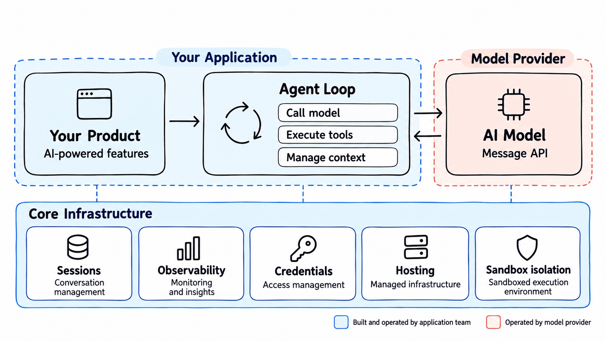

Everything in blue is something the application team must build and operate: context management, tool execution, session persistence, credentials, sandbox isolation, and observability. An agent framework can reduce the work of implementing the loop, but someone still has to connect the infrastructure needed for production.

A managed-agent platform brings these shared responsibilities together. Applications submit tasks, receive events, and retrieve results through an API.

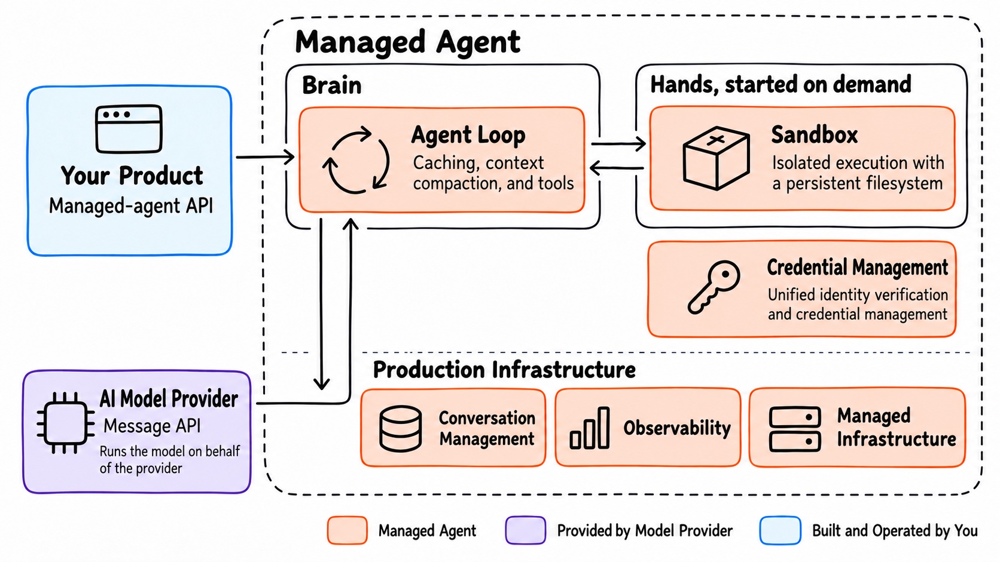

Application developers define the agent's role, instructions, Skills, and tools. They decide which operations require approval and integrate the results into business workflows. The platform handles execution, state persistence, and security controls.

With a self-hosted platform such as OMA, the enterprise still deploys and operates the infrastructure. A platform team can own that work centrally so multiple applications can reuse it. Models run with the configured model provider; where data travels depends on the deployment and model configuration.

## Starting with Anthropic's design

OMA draws primarily on [Claude Managed Agents](https://claude.com/resources/articles/claude-managed-agents). It offers the agent loop and production infrastructure together as a service, with a clear boundary between application configuration and runtime mechanics. We adopted ideas from its resource model, API design, session persistence, separation of reasoning and execution, and credential management.

Other vendors are moving in a similar direction. [OpenAI's Agents API](https://developers.openai.com/api/docs/guides/agents-api/overview) provides the Codex harness as a managed service, including sessions, context compaction, and recovery. Alibaba Cloud's [Qoder Cloud Agents](https://docs.qoder.cn/cloud-agents/api-overview) also exposes APIs for agent definitions, environments, sessions, and event streams.

The implementations differ, but they address the same problem: organizing model calls, tool execution, and state into work that can keep running. As tasks get longer, developers need to manage entire sessions rather than individual model requests.

OMA brings those capabilities to enterprise-owned infrastructure. We provide Anthropic SDK-compatible APIs and connect existing model services, storage, private tools, and security systems, while keeping the underlying components replaceable.

## Getting the abstractions right

Anthropic organizes managed agents around four concepts: Agent, Environment, Session, and Events. They describe capabilities, execution conditions, a running instance, and its interactions. OMA adopts these abstractions.

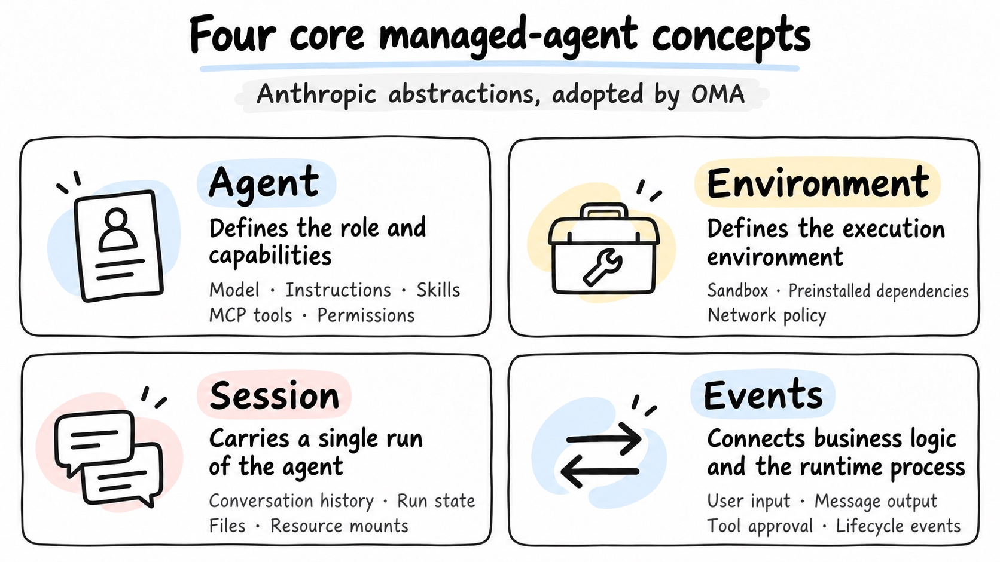

Consider an agent that produces analytical reports. The Agent definition specifies the model, report requirements, analysis Skill, and data-query tools. The Environment supplies Python dependencies and network restrictions. When a user submits data, the application creates a Session, sends the task, and subscribes to Events to show progress, handle approvals, and retrieve the report.

Follow-up questions can continue in the same Session. A separate task creates a new Session while reusing the Agent definition. This separates reusable configuration from runtime state, so application code does not need to manage processes, sandboxes, or storage directly.

### A Kubernetes analogy

If you know Kubernetes, think of Agent as a reusable workload definition, Environment as execution conditions, Session as a stateful task instance, and Events as the connection between observation and application interaction.

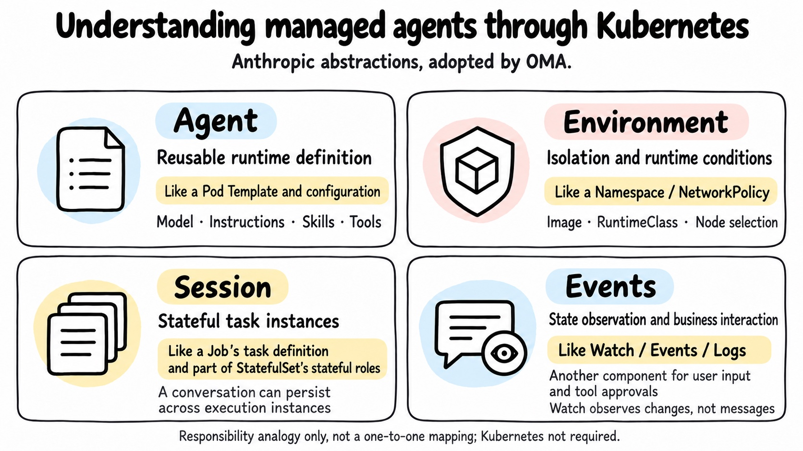

This is an analogy between responsibilities. Sessions can outlive execution instances, and Events also carry input and approvals. These concepts do not map one-to-one to Kubernetes resources, nor do they require Kubernetes underneath. The official [workload](https://kubernetes.io/docs/concepts/workloads/) and [API concepts](https://kubernetes.io/docs/reference/using-api/api-concepts/) documentation provides useful context.

## Overall architecture

OMA has three core parts: the platform handles control and governance, the Brain handles reasoning and tool orchestration, and the Sandbox executes commands and file operations.

The OMA platform is the entry point for applications and runtime management. It manages sessions, permissions, and resources, provides model proxying and sandbox orchestration, and delivers messages, approval requests, and state changes to applications.

The Brain runs the agent loop outside the sandbox and exchanges inputs, outputs, and runtime events with the platform over CCRv2. We use DeepSeek Harness for this component. When the Brain requests a tool, the platform handles permissions and resources, and a Rust MCP Server inside the sandbox executes the operation and returns the result.

Underneath, PostgreSQL, NATS, and S3 provide state storage, message delivery, and object storage. Vault, KMS, and egress policies protect credentials and network access. FUSE, Filestore, and Memory provide persistent files, Skills, and memory.

The flow is straightforward: the application submits input, the Brain calls the model and orchestrates tools, the Sandbox performs operations, and the platform persists state and returns events and artifacts. The key is giving the reasoning process, execution environment, and session state independent lifecycles.

## Separating the brain from the hands

A common deployment puts the agent harness and command-execution environment in the same sandbox. It is an easy way to start, but the first model call must wait for both the sandbox and the agent process to start. A sandbox failure can also affect the reasoning process and session state.

Following Anthropic's design, we moved the Brain outside the sandbox. The sandbox executes tools, while the platform stores session state independently.

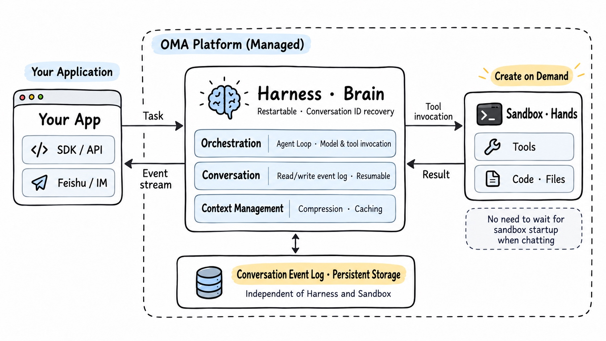

### The first response does not have to wait for the sandbox

The Brain can start reasoning as soon as it receives input. The sandbox can be prepared in parallel or created when a tool actually needs it. Tasks that never execute commands can avoid that setup altogether.

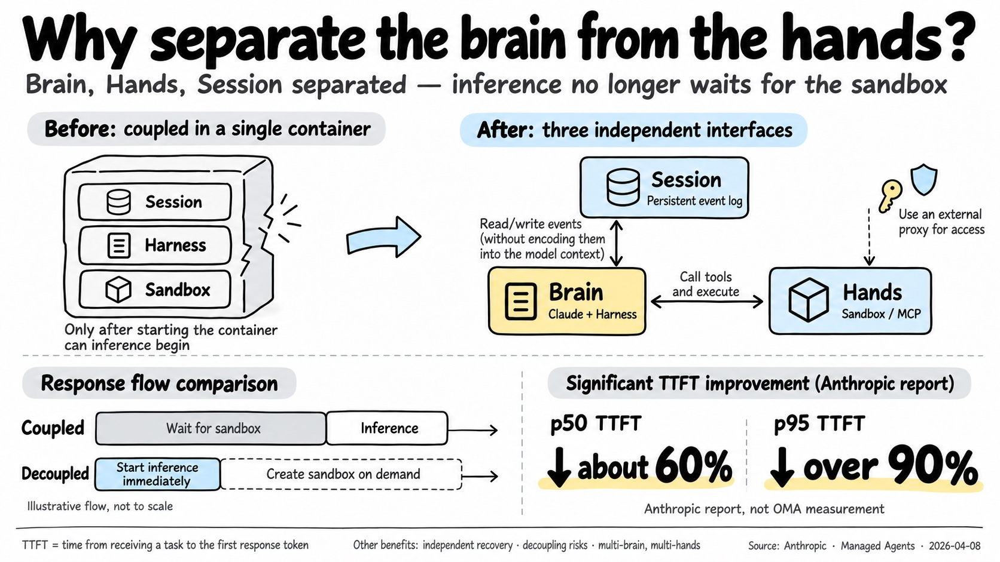

In its [architecture report](https://www.anthropic.com/research/managed-agents), Anthropic reports a roughly 60% reduction in p50 time to first token and a reduction of more than 90% at p95. TTFT measures the wait for the first response token. These are Anthropic's results, not OMA measurements.

### Processes are replaceable; state must survive

A failed sandbox can be recreated. A restarted Brain can load history using the session ID. Recovery depends on storing conversations, events, and files independently on the platform. Whether an already-dispatched tool call can be retried also depends on execution state and application-level idempotency, which we'll return to with CCRv2.

## A replaceable Brain needs a stable protocol

Once reasoning and execution are separate, the platform and Brain need a runtime protocol. We took Claude Code's CCRv2 remote-execution protocol as a reference. It is a non-public Claude protocol that defines how a worker and server exchange input, output, approvals, and session state.

In our adaptation work, we found that it is not deeply tied to the Claude model or a particular harness. It primarily addresses communication and lifecycle concerns in remote execution: redelivery after disconnects, process recovery, worker takeover, and approvals during a task. Other Brain implementations can connect to the same backend by implementing that contract.

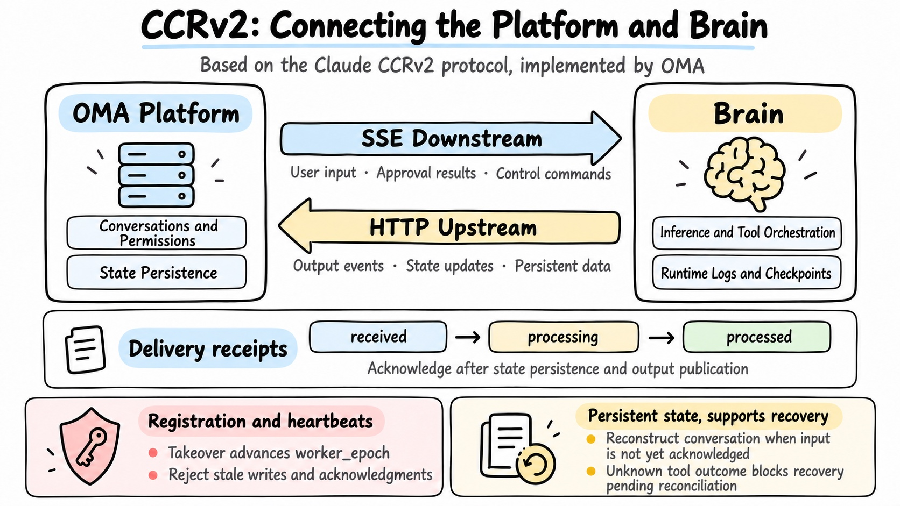

In OMA, a registered Brain maintains its lease through heartbeats. On takeover, the platform advances `worker_epoch` and rejects writes or acknowledgments from stale workers. User input, approval decisions, and control messages travel downstream over SSE; output, state, and persistence data travel upstream over HTTP. The `received`, `processing`, and `processed` receipts distinguish delivery from completion. Control responses have a separate processing queue, so a task waiting for approval does not block the approval itself.

The platform stores runtime logs and checkpoints to reconstruct sessions. If a tool ran but its result was never saved, recovery marks the outcome as unknown and blocks for reconciliation, rather than replaying it and risking duplicate effects. MCP connects tools, model APIs provide inference, and CCRv2 coordinates execution with the platform.

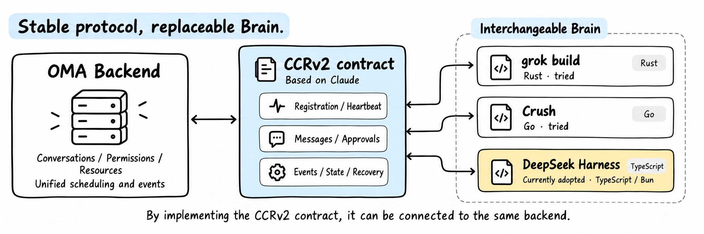

We tried integrating the Rust-based grok build and the Go-based Crush before choosing DeepSeek Harness. Its plugin system was the main reason: event reporting, platform reads, and protocol adaptation can be implemented as plugins, with fewer changes to core code and less work when following upstream releases.

Language consistency, performance, and resource use all mattered. So did the amount of code we would need to maintain. A protocol boundary lets us replace the Brain while reusing application integrations and session data.

## Choosing a sandbox

OMA's cloud deployment uses Tencent's open-source [CubeSandbox](https://cubesandbox.com/zh/). I started following it when it was first released and studied its implementation. Some of its design choices suited our needs better than the E2B setup we had tried: PVM support on compatible cloud servers reduces reliance on bare-metal deployment, and eBPF-based networking makes for a lighter implementation.

The early releases had stability issues, and we encountered some ourselves. OMA therefore keeps a separate sandbox adapter and continues to evaluate alternatives based on maturity and deployment requirements.

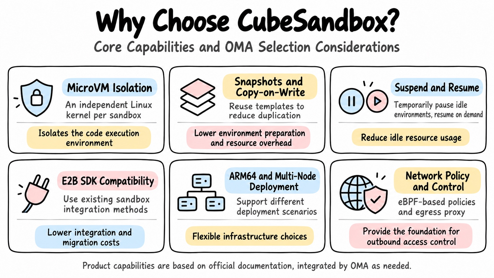

For local development, we built e2b-local, an E2B-compatible gateway written in Go. It accepts E2B SDK requests and runs sandboxes on Docker, Linux VMs managed through the OrbStack CLI, or Apple Container. Cloud and local environments use the same interface to reuse calling code and reduce environment-specific integration work.

## Credential security

Credentials become another critical boundary once the runtimes are separate. We have previously described the design that keeps credentials out of agents and sandboxes; here is how it fits into the request path.

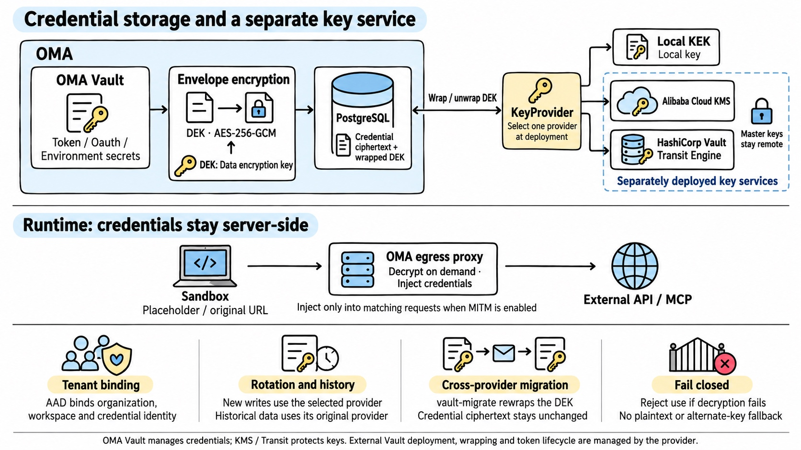

Agents encounter user input, web pages, repository files, and tool results, any of which may contain malicious instructions. If generated code can read a long-lived credential, it can copy or exfiltrate it. OMA keeps those credentials in the control plane. The sandbox receives only a session identity for platform access; proxies inject the real credentials when contacting upstream services.

The platform controls model and MCP endpoints, routing requests through the model proxy and MCP gateway. Other network requests from scripts, CLI tools, or generated code go through the egress gateway, which checks the destination and authorization configuration.

For example, a CLI tool calling an authenticated business API does not need the API key stored in its sandbox. The gateway matches the target service and credential binding, adds authentication, and forwards the request.

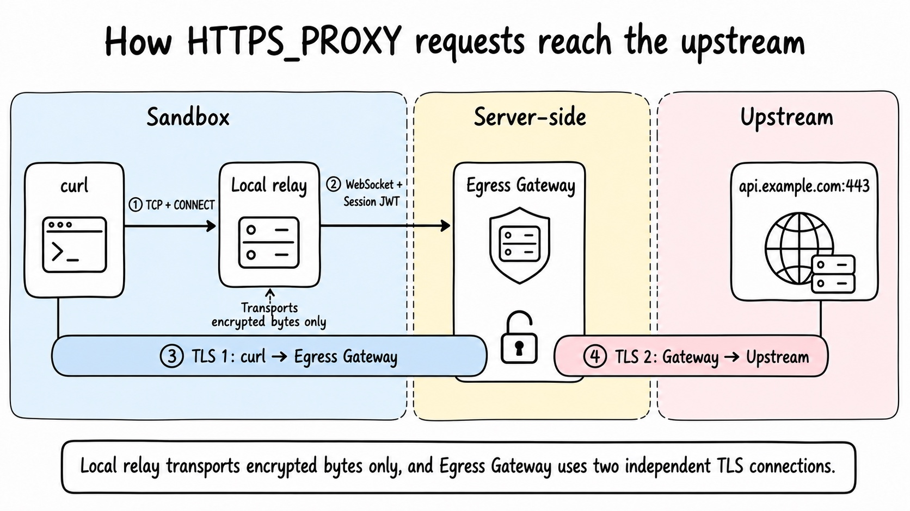

For HTTPS, the client sends CONNECT through the proxy. A local relay forwards encrypted bytes to the server. The egress gateway handles two independent TLS connections, one from the client and one to the upstream service, and performs policy checks and credential injection. The client must trust the configured certificate authority.

This path has explicit protocol boundaries, including HTTPS CONNECT on port 443 and Git access over HTTPS. Its behavior depends on egress restrictions, proxy configuration, and client compatibility.

### Separate ciphertext from the ability to decrypt it

Vault and KMS mechanisms protect stored credentials. The database holds ciphertext; an authorized runtime service uses the key service to decrypt it and injects it only for a matching upstream. Possessing a database copy does not by itself provide usable credentials. The platform also manages decryption permissions, usage scope, and auditing.

## A userspace filesystem built on FUSE

Inside the Sandbox, agents still rely heavily on native CLI tools such as `git`, `find`, and `grep`. Those tools need a stable POSIX file interface: inputs, Skills, and outputs should appear at predictable logical paths, regardless of the underlying storage. The filesystem also provides an intuitive permission boundary, such as read-only `/skills` and writable `/outputs` directories.

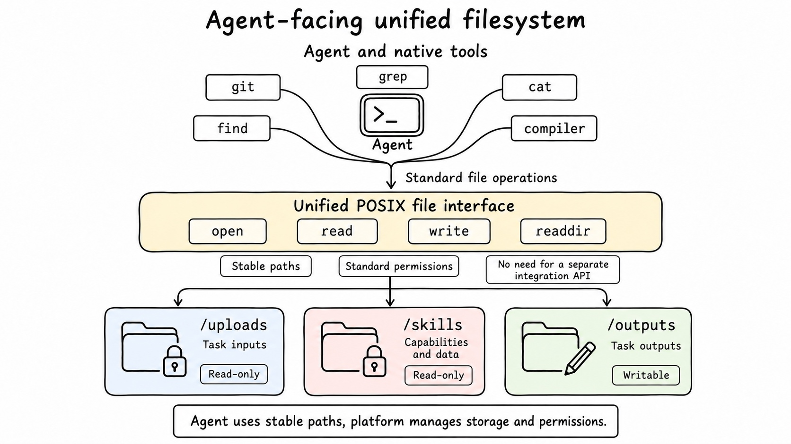

Traditional distributed filesystems such as NFS and NAS are often designed for long-lived, shared workloads. They may be a poor fit for short-lived, highly concurrent sandboxes created per Session. For example, Alibaba Cloud NAS lists the following [service limits](https://help.aliyun.com/zh/nas/product-overview/limits):

- Up to 1,000 compute nodes can mount a single filesystem concurrently.
- An account can create up to 20 General-purpose NAS filesystems or 200 Extreme NAS filesystems per region.

If each sandbox mounts as an independent compute node, or each Session gets its own filesystem, those quotas can become constraints on concurrency and provisioning.

Another option is to mount a bucket prefix using a tool such as ossfs. This avoids NAS filesystem and mount-node quotas while retaining file-path access. But object storage is fundamentally a flat key-value space: ossfs [derives virtual directories](https://help.aliyun.com/zh/oss/developer-reference/recognition-mechanism-of-ossfs2-0-for-objects-and-folders) from `/` separators in object keys. That answers how to read remote objects through file paths, but not which files a particular task should see.

For our design, the mount needs a programmable abstraction rather than directly exposing a physical bucket or host directory. The platform constructs a task-specific view and controls permissions and lifecycle on the server. FUSE, or Filesystem in Userspace, provides that mechanism: a POSIX-facing interface above, with the platform managing the namespace, authorization, and lifecycle below.

Agents access mounted directories through operations such as `open`, `read`, `write`, and `readdir`, without needing to know whether content comes from a database, object storage, or a remote API.

FUSE itself only forwards Linux filesystem operations to a userspace process. A cloud-agent filesystem also needs session orchestration, a virtual namespace, a remote file protocol, and credential boundaries.

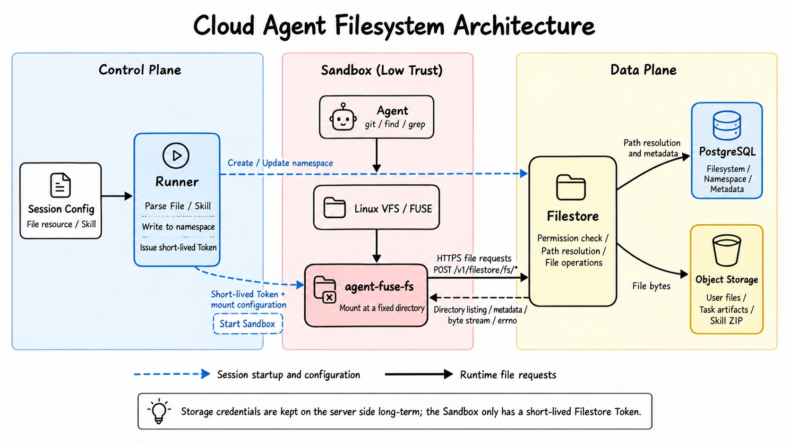

To me, the biggest benefit is the task-specific virtual view it gives each Session. Paths visible to the agent do not have to match physical object-storage locations. The platform can assemble files stored in different places into one directory tree and decide what is visible, read-only, or writable.

For example, after uploading a CSV, a user can specify `mount_path` when attaching it to a Session. A value of `/reports/input.csv` is normalized to `/uploads/reports/input.csv`, and the agent reads it at `/mnt/session/uploads/reports/input.csv` inside the sandbox. The task determines this logical path, independently of the actual object key. The user does not need to copy the file into the sandbox manually.

Multiple Skills can likewise appear in a common directory. Different Sessions can reference the same content while selecting their own versions and mount paths. The platform assembles the view; the agent uses the agreed paths.

This is particularly useful for Skill management. Versions can be resolved as the session is prepared, then combined into one directory. Even when Skills are stored as ZIP archives, the backend can inspect archive directories and read individual files on demand, reducing advance downloads, full extraction, and repackaging.

The design separates where files live from what a task sees. FUSE receives file operations, and Filestore resolves them against the session's path mappings and permissions. Uploads and Skills can be read-only while output directories are writable. Changes to physical storage can be accommodated through mappings that preserve agent-facing paths.

Routing file access through the platform also provides a common point for permission checks and change tracking. A replacement sandbox can remount the session's view while persistent content stays on the backend. Long-lived object-storage keys never need to enter the execution environment.

## MCP Tunnel: connecting cloud agents to private tools

A cloud agent can reason about a task, but reaching private assets such as an internal knowledge base or office system often means crossing an enterprise firewall.

There are three common approaches:

- Expose the MCP server publicly. This requires relatively little integration work, but increases the private service's public attack surface.
- Connect networks through a VPN or dedicated link. This works for broader network integration, but can be expensive to operate when only a few tools need access.
- Initiate the connection from inside the private network. A local client connects outward and receives tool requests through that channel.

We chose the third approach. The enterprise permits the client's outbound connection, while the MCP server stays private. An outbound-initiated connection is not authorization: it changes who opens the connection, but calls still reach private services and results still return to the cloud. Access scope and data flows need their own design.

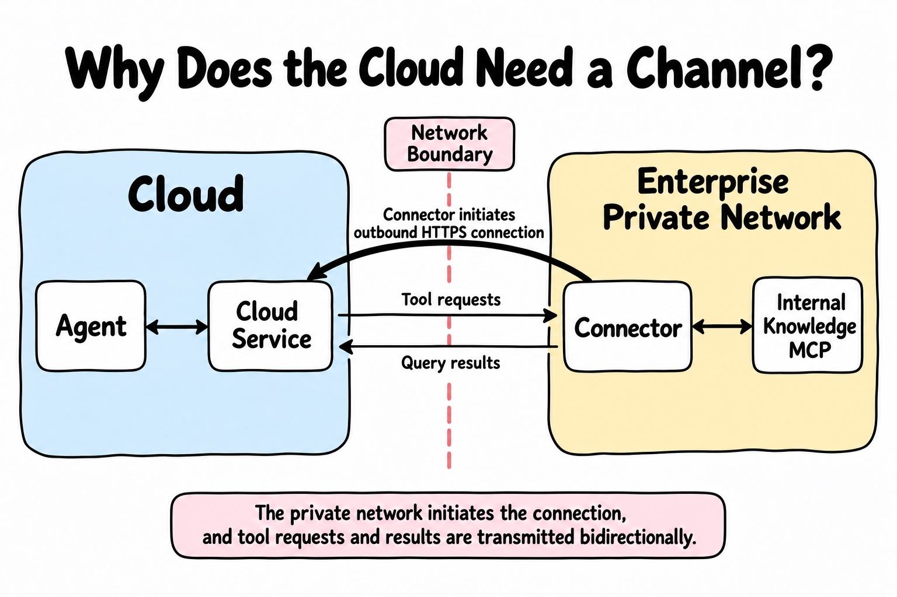

To reuse existing clients and management tools, we combined two existing contracts:

- The management API follows the Tunnels API contract in Claude Managed Agents.
- Rather than build a private-network client, we use OpenAI's open-source [tunnel-client](https://github.com/openai/tunnel-client/blob/master/docs/architecture.md), referred to here as the Connector.

The protocols were available; the scheduling layer between them was ours to design.

The tunnel-client data plane uses HTTPS long polling. The Connector opens a long-running request asking for work, calls the local MCP service when it receives a task, and submits the result through a separate response request. All traffic uses ordinary outbound HTTPS, making it easier to accommodate enterprise firewall policies.

To the agent, this remains a regular MCP call. The channel carries tool requests and results without requiring a general-purpose public endpoint or connectivity to the entire private network.

## Observability

Once a task runs, we need to understand how it ran.

A missing report could mean a misunderstanding by the model, a failed tool, a missing dependency, or a permission denial. The final response alone rarely explains the cause. A total token count also does not explain a sudden cost increase.

OMA shows model and tool calls on a timeline so developers can inspect steps, latency, and failure locations. Repeated calls to the same tool can be investigated through its description, argument design, and Skill instructions.

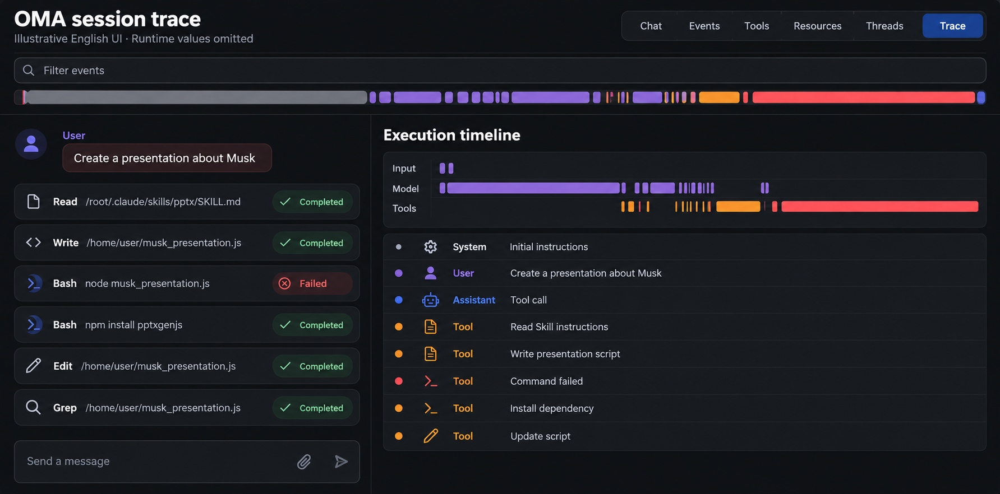

*English UI schematic based on the original screenshot; runtime values omitted.*

A global view aggregates requests, tokens, cost, and failures to support usage analysis by team and scenario.

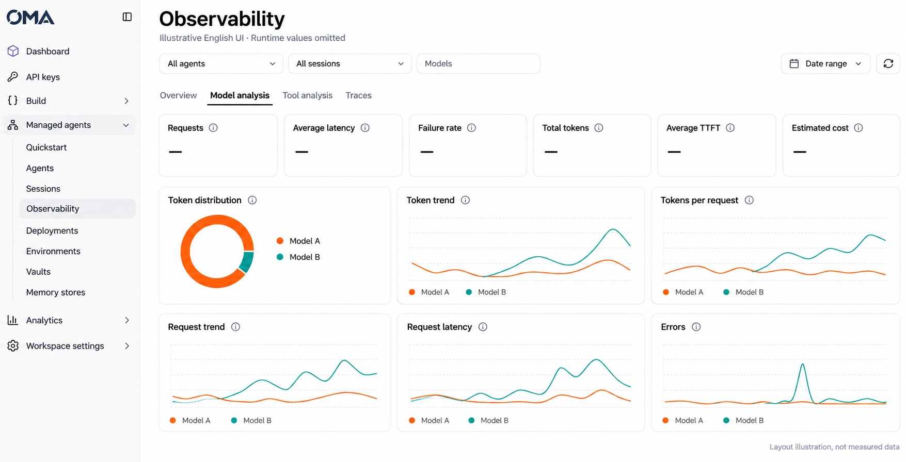

*English UI schematic based on the original screenshot; runtime values omitted.*

Today, these records primarily support manual investigation. We plan to use traces to suggest improvements to prompts, tool configuration, and execution.

## Other capabilities and plans

OMA also supports long-term memory, Dream, scheduled execution, session budgets, and GitLab and GitHub repository mounts. Scheduled tasks can produce a daily summary or consolidate the day's accumulated memory overnight. Repository mounts prepare code and files for development tasks.

Our next focus is agent evaluation. After changing a Skill, adding a tool, or switching models, a few conversations are not enough to tell whether real task performance improved. We want to compare versions by their actual outputs: whether a report was produced, whether it met requirements, where the workflow failed, and how costs changed.

## Closing thoughts

OMA is fundamentally a backend-heavy infrastructure project. We have open-sourced it so you can explore the implementation alongside the designs in this article. We will keep refining the platform through real-world use and community feedback, and share more implementation details as we go. Try it out, open an issue, or contribute.

Source code: [superduck-ai/open-managed-agents](https://github.com/superduck-ai/open-managed-agents)
