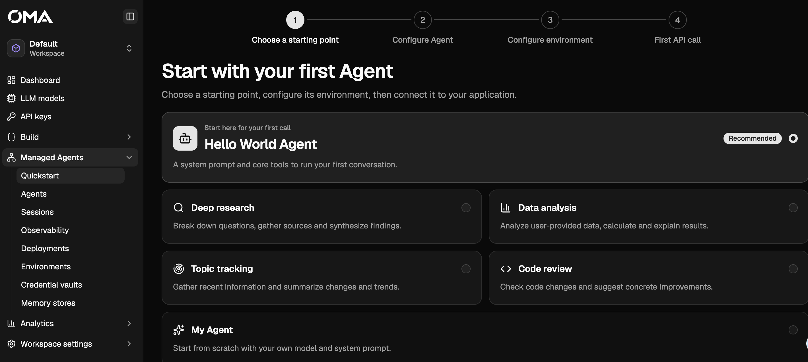
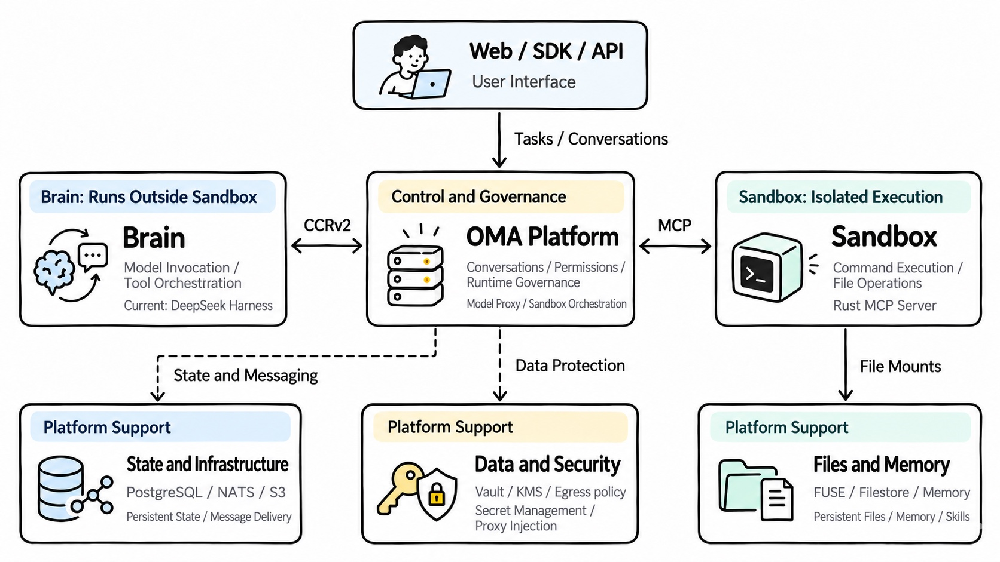

# Open Managed Agents

English | [简体中文](./README.cn.md)

**Run managed agents on your own infrastructure, with Anthropic SDK-compatible APIs, isolated sandboxes, and a console for inspecting every session.**

[](./go.mod)
[](./web/package.json)
[](./docs/en/quickstart.mdx)
[](https://github.com/superduck-ai/open-managed-agents/actions/workflows/unit-tests.yml)

OMA lets you define an agent, submit a task, and stream its progress through an API. The platform manages execution, approvals, persistent files, and session recovery. Use it to build agent applications, run the stack locally, and debug the path from a model call to a sandbox operation.



_Create your first agent from a template in the console._

[Quickstart](#quickstart) · [Connect an SDK](#connecting-clients) · [Architecture](./OMA-Managed-Agents-Architecture.en.md) · [Contribute](./CONTRIBUTING.md)

## Key features

- Use Anthropic SDKs to manage agents, environments, sessions, and event streams against a self-hosted `/v1` endpoint.
- Execute commands and file operations in isolated sandboxes through an E2B-compatible interface, including e2b-local for local development.
- Run the Brain separately from the sandbox. Persist conversation and execution state so replacement workers can resume sessions.
- Mount uploads, Skills, memory, and outputs through Filestore and FUSE, with session-specific paths and permissions.
- Keep upstream credentials behind platform proxies, handle tool approvals, and connect private MCP services through outbound tunnels.
- Inspect sessions, tool calls, latency, and usage in the React console.

## Architecture overview

An Agent defines behavior and tools. An Environment defines execution conditions. A Session runs a task, and Events carry input, progress, approvals, and results.



The platform owns resources, permissions, and durable state. The Brain runs the agent loop and orchestrates model and tool calls. The Sandbox executes commands and exposes the session filesystem. External MCP and web tools use their own integrations. Recovery restores saved state; a tool call with an unknown outcome needs reconciliation before replay.

Read [OMA: From Running an Agent to Delivering a Reliable Service](./OMA-Managed-Agents-Architecture.en.md) for the design of CCRv2, credential isolation, FUSE, and MCP tunnels.

## Quickstart

Use Docker Compose to try the console, API, and local sandbox infrastructure without building Go or frontend code.

You need Git, [just](https://github.com/casey/just), OpenSSL, and Docker Compose on Linux Docker Engine 20.10+ or OrbStack on macOS. The sandbox gateway requires host networking. Keep the default ports `28080` and `38080` available.

### 1. Get the source

```bash
git clone https://github.com/superduck-ai/open-managed-agents.git
cd open-managed-agents
```

### 2. Initialize local configuration

```bash
just init-compose-config
```

This creates the ignored `deploy/docker-compose/oma-server.local.yaml` and proxy CA key without overwriting existing files. The defaults target local development. Model provider credentials are added in the console after startup.

### 3. Start the stack

```bash
docker pull ghcr.io/superduck-ai/managed-agent-sandbox:latest
docker compose up -d
```

The first start downloads the images. Check readiness and API access:

```bash
curl --fail http://localhost:38080/readyz
curl --fail http://localhost:38080/v1/models \
  -H 'X-Api-Key: sk-ant-local-default'
```

Open the [console](http://localhost:28080). Before the first model call, configure a provider and its model IDs on the workspace's **LLM Models** page. Use an API key from that same workspace; `sk-ant-local-default` belongs to the default seeded development workspace. The model list can be empty until a provider is configured.

To create an agent, replace `provider-slug/model-id` with an ID returned by `/v1/models`:

```bash
curl --fail-with-body http://localhost:38080/v1/agents \
  -H 'X-Api-Key: sk-ant-local-default' \
  -H 'anthropic-version: 2023-06-01' \
  -H 'anthropic-beta: managed-agents-2026-04-01' \
  -H 'Content-Type: application/json' \
  -d '{"name":"Hello OMA","model":"provider-slug/model-id","system":"You are a helpful assistant.","tools":[{"type":"agent_toolset_20260401"}]}'
```

A successful response contains an agent `id` and `version`. Continue with the [first-session walkthrough](./docs/en/quickstart.mdx) to create an environment, send a task, and stream the response.

For startup diagnostics, use `docker compose ps` and `docker compose logs --tail=100 oma-server`. Stop the stack with `docker compose down`; named data volumes remain. See the [Compose deployment guide](./docs/design/docker-compose-deployment.md) for configuration and production requirements.

## Connecting clients

Point an Anthropic SDK at OMA and use your workspace API key. These examples create an agent; execution uses Sessions and their Events API. Install an SDK version that includes the Managed Agents beta resources.

Set a model ID from your workspace:

```bash
export OMA_MODEL_ID="provider-slug/model-id"
```

### Python

Install with `pip install anthropic`, then run:

```python
import os
from anthropic import Anthropic

client = Anthropic(
    base_url="http://localhost:38080",
    api_key="sk-ant-local-default",
)

agent = client.beta.agents.create(
    name="Hello OMA",
    model=os.environ["OMA_MODEL_ID"],
    system="You are a helpful assistant.",
    tools=[{"type": "agent_toolset_20260401"}],
)
print(agent.id)
```

### TypeScript

Install with `bun add @anthropic-ai/sdk`, then run with Bun:

```typescript
import Anthropic from "@anthropic-ai/sdk";
import type { BetaManagedAgentsModel } from "@anthropic-ai/sdk/resources/beta";

const client = new Anthropic({
  baseURL: "http://localhost:38080",
  apiKey: "sk-ant-local-default",
});

const agent = await client.beta.agents.create({
  name: "Hello OMA",
  model: process.env.OMA_MODEL_ID as BetaManagedAgentsModel,
  system: "You are a helpful assistant.",
  tools: [{ type: "agent_toolset_20260401" }],
});
console.log(agent.id);
```

For a complete create-session, send-input, and stream-events example, see the [TypeScript smoke client](./tests/js-test/src/run-agent.ts) and [SDK walkthrough](./docs/en/quickstart.mdx).

### Brain runtime

The Brain in `oma-brain-dsh/` runs DeepSeek Harness and communicates with the platform through CCRv2. The platform manages runtime registration and session credentials. See [Brain setup](./oma-brain-dsh/README.md) for configuration.

## Local development

For source changes and debugging, use Go `1.27.0`, Bun, and the tools in the [development guide](./docs/development-guide.md). From the repository root:

```bash
just dev-init
```

On first use, fill in the generated `~/.oma-dev/model-providers.yaml` with your provider credentials, then rerun `just dev-init`. It prepares dependencies, hooks, keys, development data, and an isolated infrastructure stack for the current worktree.

Open Herdr from the repository root and run the following in its control pane to start the backend, Brain, and Web together:

```bash
just restart
```

For individual service restarts, use `just restart-server`, `just restart-brain`, or `just restart-web` from the repository root. The [development guide](./docs/development-guide.md) covers addresses, portless setup, and environment management. The [configuration and operations guide](./docs/local-development.en.md) covers manual startup, private keys, migrations, and targeted tests.

## Supported API endpoints

| Resource      | Endpoint                                    | Purpose                            |
| ------------- | ------------------------------------------- | ---------------------------------- |
| Models        | `GET /v1/models`                            | List configured workspace models   |
| Agents        | `/v1/agents`, `POST /v1/agents:search`      | Define and find agents             |
| Sessions      | `/v1/sessions`                              | Run tasks and exchange events      |
| Environments  | `/v1/environments`                          | Configure execution environments   |
| Deployments   | `/v1/deployments`, `/v1/deployment_runs`    | Manage deployments and runs        |
| Files         | `/v1/files`                                 | Upload, download, and manage files |
| Memory        | `/v1/memory_stores`                         | Persist agent memory               |
| Skills        | `/v1/skills`                                | Manage reusable Skills             |
| Messages      | `POST /v1/messages`, `/v1/messages/batches` | Call models and submit batches     |
| Vaults        | `/v1/vaults`                                | Manage credential resources        |
| Tunnels       | `/v1/tunnels`                               | Connect private MCP services       |
| Webhooks      | `/v1/webhooks`                              | Deliver event notifications        |
| Organizations | `/v1/organizations`                         | Manage organization resources      |

SDK requests authenticate with `X-Api-Key` or `Authorization: Bearer ...`. Beta headers vary by resource; see the [API reference](./docs/en/api/overview.mdx) and [versioning guide](./docs/en/api/versioning-beta.mdx). Console routes use cookie sessions.

## Roadmap and contributing

Planned work includes agent evaluations and trace-assisted improvements to prompts, tools, and execution. See the [architecture article](./OMA-Managed-Agents-Architecture.en.md#other-capabilities-and-plans) for context.

Bug reports, SDK compatibility fixes, documentation improvements, and runtime integrations are welcome. Start with [CONTRIBUTING.md](./CONTRIBUTING.md) for setup, quality checks, and design conventions, or [open an issue](https://github.com/superduck-ai/open-managed-agents/issues).
