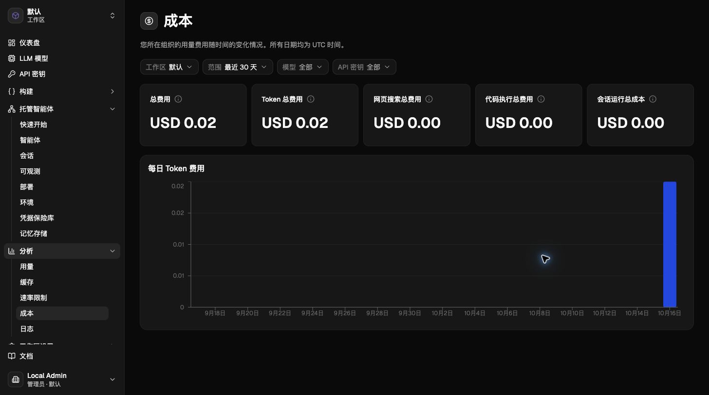
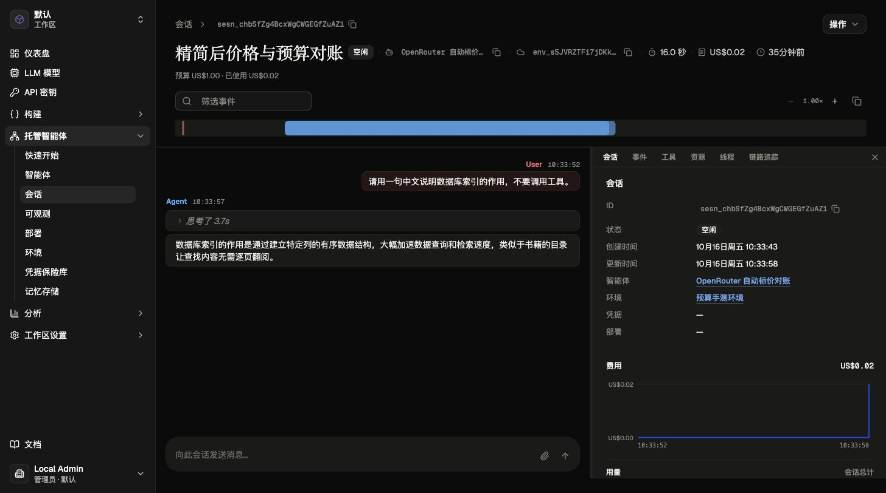

# PR #384 用量、成本与预算验收

验收日期：2026-10-16。复用 PR #384 本地环境：前端 `127.0.0.1:5174`，后端 `127.0.0.1:38080`，原 PostgreSQL、Redis、NATS 和 Worker。基线提交 `5b78fac47fa1ec70a1c1aae8a33ef096e1e500df`，本报告随本次实现提交。

## 结论与范围

用量/成本页面已接入实际汇总与每日趋势，保留工作区、时间范围、模型、API 密钥四项筛选。中英文标题、筛选、状态、默认工作区名称、图表日期与提示已验证。未增加页面、分组明细、来源或会话输入框，也没有“模型与搜索费用小计”卡片。

仅使用 OpenRouter 入库价格计算新请求；不读取旧手工价表或 YAML 标价。请求保存当时价格快照和金额，更新目录不重算历史。缓存写入分别保存 5 分钟、1 小时计量，保留逐请求美分舍入规则。

代码执行总费用、会话运行总成本按约定保留 `USD 0.00` 占位，尚未接入真实计费。页面总费用目前是模型与搜索费用之和。该范围内功能验收通过；**全前端回归未全部通过，真实上游非零缓存写入仍未覆盖**。

## 同一真实会话对账

会话 `sesn_chbSfZg4BcxWgCWGEGfZuAZ1` 使用 `deepseek-v4-pro`，真实上游返回中文回答，最终状态 `idle`。预算 100 美分。

| 数据 | 请求事件 | 会话累计 | 用量接口 | 成本接口 |
| --- | ---: | ---: | ---: | ---: |
| 非缓存输入 Token | 21,803 | 21,803 | 21,803 | 21,803 |
| 输出 Token | 54 | 54 | 54 | 54 |
| 缓存读取/写入 | 0/0 | 0/0 | 0/0 | 0/0 |
| 模型与搜索费用（美分） | 2 | 2 | 2 | 2 |

快照来源为 `openrouter`，来源模型 `deepseek/deepseek-v4-pro`；输入、输出每百万 Token 分别 USD 0.95526、1.91052。计算 `(21803 × 0.95526 + 54 × 1.91052) / 1000000`，逐请求舍入得到 2 美分。每日桶与汇总一致；未定价和不完整请求均为 0。可审阅的脱敏数值证据见 [reconciliation.json](reconciliation.json)。

另一个真实 flash 会话出现非零缓存读取而金额为 0 美分，原因是整条请求低于半美分；不能用“有用量就必须有正美分”作为断言。历史部分请求缺价格快照，费用保持未知，成本页展示已知金额及缺价警告，不能当成免费。

## 本次截图索引

所有以下截图均于本轮对重启后的实际页面采集，没有模拟或修改页面数据，单张小于 1 MiB。用户生成的会话标题和回复保留原语言。

| 证据 | 验收内容 |
| --- | --- |
| [中文用量](screenshots/usage-zh.jpg) | 21,803 输入、54 输出；中文筛选与日期轴 |
| [英文用量](screenshots/usage-en.jpg) | 同一数据；英文筛选、日期和紧凑刻度 |
| [中文成本](screenshots/cost-zh.jpg) | 总额与 Token 费用 USD 0.02，五张卡片及两个零占位 |
| [英文成本](screenshots/cost-en.jpg) | 同一金额、英文日期与五张卡片 |
| [中文会话预算](screenshots/session-budget-zh.jpg) | 已使用 US$0.02 / 预算 US$1.00，真实回复和累计 Token |
| [英文会话预算](screenshots/session-budget-en.jpg) | 英文预算与会话累计 USD 0.02 |
| [模型筛选空态](screenshots/model-filter-empty.jpg) | 同会话切换不匹配模型，汇总归零且图表显示 No data，URL 更新 |
| [日期选项与大数轴](screenshots/range-options-large-axis.jpg) | 月份由真实数据生成；30,585,210 输入，刻度 7.5M–30M 完整可见 |
| [七天与 API 密钥](screenshots/api-key-seven-days.jpg) | 选择七天后日期为 10–16 日；选择真实密钥后输入变为 30,387,799、输出 469,639 |
| [历史缺价提示](screenshots/cost-unpriced-zh.jpg) | 已知费用 USD 0.54，明确提示部分请求缺价格或完整用量 |

### 历史截图处置

原截图位于本机 `tmp/analytics-manual`，不作为最终版本通过证据；新版截图已替代同类验收，避免在 PR 中混用过期 UI。

| 原文件 | 处置 |
| --- | --- |
| `pr384-session-ready.png` | 由中英文 session-budget 截图替代 |
| `cost-total-ready.png`、`cost-five-cards.png` | 由中英文 cost 截图替代 |
| `filter-audit.png` | 由 model-filter-empty、api-key-seven-days、range-options-large-axis 替代 |
| `usage-simplified.png`、`usage-axis-fixed.png` | 由中英文 usage 和大数轴截图替代 |
| `model-prices-verified.png` | 作废：对应已删除的用户手工标价界面，不代表当前产品能力 |

## 自动化与服务验证

| 检查 | 结果 |
| --- | --- |
| 分析页、日期范围、预算国际化专项 | 26 项通过，0 失败 |
| 前端生产构建 | 通过；仍有既有包体积提示 |
| 后端全仓 `just test` | 精简后版本通过；本轮工作区选项改动另定向复跑 |
| `go test ./tests -run TestAnalytics -count=1` | 在新建隔离数据库中通过；覆盖五条请求入口、来源筛选、授权/撤权及工作区选项采用控制台 ID |
| 真实 PostgreSQL 定向计费测试 | 快照不随目录改价漂移、完整模型 ID、短名歧义、按需查询、双 TTL 对账通过 |
| 双 TTL 非零样例 | 输入/输出/读取各 100 万、5m/1h 写入各 100 万，单价 3/15/0.3/3.75/6，账本与会话均 2805 美分；为隔离测试数据，不是供应商真实缓存写入 |
| 真实服务筛选 | 之前同条件用量/成本 8 组查询一致；本轮模型、七天、API 密钥 UI 重新验收，工作区名称修正并复跑权限测试 |
| 质量门禁 | lint、死代码、复杂度、重复代码、前端格式/命名、文件大小及 diff 空白检查通过 |

原始本地日志位于 `tmp/analytics-manual/`：`slim-full-tests.log`、`slim-postgres.log`、`final-analytics-backend.log`、`final-web-tests.log`、`final-web-build.log`、`final-{lint,dead,complexity,duplicates}.log`。未提交认证 Cookie、部署配置、原始请求正文或供应商密钥。

本轮首次定向测试误用默认测试库，在迁移 72 检测到历史组织缺默认工作区时失败；随后使用独立临时数据库重跑通过，没有修改 384 数据库来绕过迁移约束。

## 未通过或未覆盖

1. 全前端单进程测试退出码 133。逐文件执行 114 个文件，101 个通过，13 个失败、异常退出或挂起；涉及 I18nProvider、TimeRangePicker、useSessionResourceRefresh、ManagedAgentsPage、ResourceIdButton、ConsoleLayout（两个文件）、memory-attach、DashboardPage、WorkspaceApiKeysPage、WorkbenchPage、AgentToolsSection、WorkspacesSettingsPage。当前批次未证明这些失败全部属于基线问题，不宣称全量通过，详情在 `slim-web-isolated.log`。
2. 现有可用模型真实返回的缓存写入仍为 0；缓存服务探测被上游拒绝或没有字段，不能证明真实 5m/1h 写入闭环。非零双 TTL 的金额计算已由隔离 PostgreSQL 测试覆盖，不冒充真实上游结果。
3. 代码执行及会话运行费用由其他负责人接入；本次不验证供应商实际账单、优惠或汇率，Narrows 未接入。
4. 历史缺价请求没有按当前价重算。用量图有柱、成本图无正金额可能来自未知历史价格或逐请求舍入，应结合缺价提示与接口元数据判断。

## 手测入口

服务保留运行；若会话继续追加消息，累计数值会增长，截图对应本报告采集时刻。

- [真实会话](http://127.0.0.1:5174/workspaces/workspace_default/sessions/sesn_chbSfZg4BcxWgCWGEGfZuAZ1?interactive=true)
- [同会话用量](http://127.0.0.1:5174/usage?workspace_id=workspace_default&session_id=sesn_chbSfZg4BcxWgCWGEGfZuAZ1)
- [同会话成本](http://127.0.0.1:5174/cost?workspace_id=workspace_default&session_id=sesn_chbSfZg4BcxWgCWGEGfZuAZ1)

打开后确认 21,803/54 与 USD 0.02；可在左下语言菜单切换中英文，再操作四项筛选检查 URL 与结果。切换工作区会清除模型、密钥与会话筛选，恢复单会话对账时重新打开上述链接。
