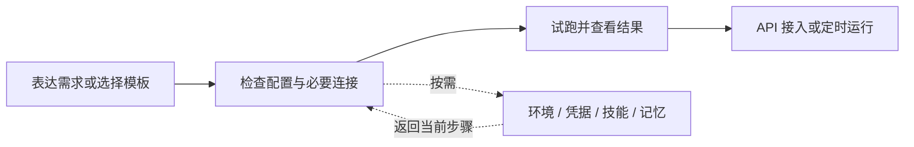

# Managed Agents 界面与信息架构对比

研究日期：2026-11-05（Asia/Shanghai）。范围：Claude、Qoder、GLM 的实际登录态页面，以及用户提供的 OMA 截图、本地控制台和当前源码。本文是设计分析与改版建议，没有修改产品行为。

## 核心判断

OMA 的主要问题是把平台的功能分类当作用户的工作路径。用户首先看见模型、密钥、构建、托管智能体、分析、工作区设置，却没有清楚地得到三个答案：我在这里做什么、现在该做哪一步、刚才的运行怎么样。

竞品也有 Environment、Vault、Memory、Skills 等复杂对象。它们的优势不在于消除了资源，而在于为这些资源分配了不同的出现时机：开始时围绕需求或模板，配置时围绕当前 Agent，运行时围绕当前 Session，批量维护时才进入全局资源管理。

对 OMA 最有价值的方向是：围绕“创建 Agent → 试跑 → 查看结果 → 接入或定时运行”组织主路径，把共享资源维护和平台配置移出日常工作的注意力中心。此建议保留资源的独立生命周期、权限和 API 语义。

## 观察范围与限制

| 产品 | 实际查看 | 本次没有验证 |
| --- | --- | --- |
| Claude | 平台 Dashboard；进入智能体分区后的概览、创建入口、空白对话构建页、Agent 列表和已有 Agent 详情 | 发送生成请求、保存新 Agent、启动 Session、真实 API 调用 |
| Qoder | Managed 模式的 Agent 列表、快速开始首页、Hello World 的配置 Agent 步骤、已有 Agent 详情 | 向导后续步骤的实际执行、资源创建、Forward 模式的实际界面 |
| GLM | Managed Agents 快速开始、Agent 定义空状态、创建 Agent 表单；打开表单后已取消 | 提交需求、模板生成后的流程、创建与运行，以及已有 Agent 详情 |
| OMA | 用户截图对应的本地概览；快速开始；Agent 空列表；创建 Agent 页面；本地源码 | 有模型时的 Builder 实际交互、真实运行、其他部署的配置和状态 |

OMA 本地页面来自用户已打开的 `oma-5514-web.localhost:1355` 环境；源码来自当前 worktree，HEAD 为 `a1bbacd7`。没有核对该页面的构建 SHA，因此分别标注页面观察与源码事实。当前本地工作区显示无可用模型，不据此推断生产也缺模型。

竞品页面也会随账号、权限和版本改变。下文区分“实际观察”“官方资料”和“设计判断”。不以营销页或旧画布式 Agent 产品补造当前控制台结论。

## Claude：分区隔离复杂度，在对象内部形成工作闭环

### 实际观察

[平台首页](https://platform.claude.com/dashboard) 的导航先分为“构建与配置”和“组织”。构建侧是消息、智能体、资源；组织侧是支出、密钥与访问权限、安全与数据、设置。进入“智能体”后，侧边栏会切换成该领域的概览、创建、智能体、会话、部署、环境、记忆、凭据保管库，并提供返回所有部分和工作区切换。

这是导航上下文的切换：全局业务分区和智能体内部资源不同时铺开。用户进入一个领域之后，主要面对这个领域的选择。

智能体概览展示过去 30 天会话、错误率、活跃智能体和会话趋势，并给出 Agent 表格。它在回答运行情况，而不只是给菜单增加一层入口。

[创建入口](https://platform.claude.com/workspaces/default/agent-quickstart) 先问“您想构建什么”，提供业务模板和空白起点。进入空白构建页后，中心是描述需求的对话区，右侧是“创建智能体、配置环境、开始会话、集成”的进度，以及 Agent 草稿和资源状态。

已有 Agent 的详情把配置、会话、部署、可观测性放在同一对象内；顶部提供开始会话。配置默认突出名称、模型、描述和系统提示词，工具、技能、多智能体收起，并显示当前摘要及可选性质。

### 展示逻辑与优势

1. **先选择领域，再显示局部导航。** 用户不必同时阅读所有平台能力。
2. **创建入口使用目标语言。** 模板说明完成什么工作，需求框允许用户先表达意图。
3. **过程可见。** 对话构建并非只有聊天记录；右侧进度让用户知道还差哪些步骤和已经产生什么。
4. **运行围绕对象组织。** 看某个 Agent 的会话、部署和错误时，保留 Agent 上下文。
5. **高级配置按需展开。** 默认值和摘要让用户可以略过当前不需要的配置。

官方控制台导览还描述了配置、内联 Session 试跑和 API 接入的连续过程；Session Inspector 的 Resources 汇集文件、仓库、记忆和技能。这些是官方资料支持的流程，不是本轮真实运行的结果。[控制台构建](https://platform.claude.com/docs/en/managed-agents/onboarding)、[会话检查](https://platform.claude.com/docs/en/managed-agents/session-observability)

### 取舍

分区导航需要一次切换，跨领域操作的路径会变长。平台首页以额度、支出、模型和 Token 为中心，服务的是整个 API 平台，OMA 没有必要原样复制。对话构建也需要可见的配置和进度，不能以自然语言替代状态反馈。

**值得借鉴：分区导航、对象内操作、可见进度和可选项折叠。**

## Qoder：用明确步骤帮助开发者走到首次 API 成功

### 实际观察

[Managed Agents 列表](https://qoder.com.cn/cloud/agents) 的导航并不短：智能体平台下是快速开始、智能体、会话、部署；资源下是环境、文件、技能、密钥、记忆；分析下是可观测、评测；配置下是 Webhook，底部还有个人访问令牌。

它与 OMA 的差别主要是分类清楚，且当前产品范围明确。核心工作、资源维护、分析和配置有独立组名，不需要从“构建”和“托管智能体”的区别猜文件、技能、环境各在哪里。

快速开始有明确的四步：选择起始点、配置 Agent、配置环境、第一个 API 调用。首页说明产品是可集成的云端 Agent 服务，默认突出 Hello World，其他场景次之。Hello World 明确没有 MCP 依赖，强调先完成第一个调用。

进入配置 Agent 步骤，左侧是已预填的名称、描述、模型、系统提示词，右侧是对应 API 请求，并说明字段与请求同步。当前账号已有同名 Agent 时，页面提示下一步会复用已有对象；本轮没有继续触发复用或写入。

已有 Agent 详情提供基础信息、模型、提示词、技能、工具、多智能体、版本和渲染/Raw 切换，并可进入会话。它的详细配置仍然有密度，不能把快速开始的简单外观理解为全产品都没有学习成本。

### 展示逻辑与优势

1. **终点明确。** 入门的目标是完成首次 API 调用，而非浏览所有资源页。
2. **每一步只解决一个主要问题。** 不要求用户自己决定先建 Agent 还是环境。
3. **模板提供可运行的起点。** Hello World 的低外部依赖减少首次接入变量。
4. **表单与代码相连。** 页面帮助 API 开发者理解控制台操作如何转成代码。
5. **组名解释功能角色。** 相近数量的资源入口，仍可以有更好的可扫描性。

官方资料还区分 Forward 和 Managed 两种使用方式，更新日志记载按模式展示独立导航。本轮没有切换 Forward，因此它只作为“不同任务面可隔离”的补充证据，不能当作实测界面结论。[模式说明](https://docs.qoder.com/zh/cloud-agents/api/overview)、[更新日志](https://docs.qoder.com/zh/release-notes/cloud-agents)

### 取舍

侧边栏仍长，完整 API 请求也会增加阅读量；它适合开发者入门，不一定适合希望直接交付业务任务的用户。OMA 应学习步骤和默认值，不应因为竞品有模式切换就增加新的模式层。

**值得借鉴：低依赖模板、明确终点、预填配置和连续的接入向导。**

## GLM：用需求和角色模板解释产品用途

### 实际观察

[快速开始](https://bigmodel.cn/managed-agents/quick-start) 的中心是“你想构建什么”，下面是需求输入框和模型选择。角色模板包括软件工程师、前端开发、深度研究、数据分析、客户支持、运维、项目管理、销售，以及自定义 Agent。模板通过任务描述帮助用户理解用途。

侧边栏清楚分为两组：“Agent 运行”包含快速开始、Agent 定义、会话、评测与自迭代、定时任务；“资源配置”包含环境、凭据库、技能、记忆库、文件、Webhooks。它也有 11 个叶子入口，因此简单感并非来自极少的菜单数量。

Agent 定义的空状态说明创建第一个 Agent、开始真实运行。手动创建表单提供表单/代码两种视图，包含常规、Multiagent、工具和技能；工具权限默认折叠。表单本身并不极简。

### 展示逻辑与优势

1. **把用户的需求放在页面中心。** 主内容区有明确焦点，用户无需先研究资源目录。
2. **角色模板帮助表达需求。** 不熟悉 Agent 术语的用户可以从熟悉的工作开始。
3. **“运行”和“配置”区分当前工作与支撑条件。** 用户更容易判断资源是否是当前必须处理的内容。
4. **“定时任务”直接表达使用目的。** 对定时触发场景，这比抽象的部署术语更容易理解。

### 取舍

角色模板之间仍可能重叠，数量增加后也会产生选择成本。“Agent 定义”是偏技术的叫法。首页的顺畅起步不证明后续环境、授权和试跑同样简单；本轮没有提交生成或运行，不能推断自动创建了哪些资源。

**值得借鉴：目标驱动首页、场景解释和运行/配置分组。**

## OMA：具体问题与证据

### 1. 菜单分类混合了不同层次

当前导航同时出现：平台入口（仪表盘、模型、API 密钥）、功能类别（构建、托管智能体、分析）、管理范围（工作区设置）。它们的分类依据不同，用户无法从一个稳定规则推断目标位置。

更具体地说：文件、技能、MCP 服务器在“构建”；环境、凭据、记忆在“托管智能体”；可观测在“托管智能体”，日志、用量和费用在“分析”。这些区别在实现中可以有意义，但用户需要先学习平台分类才能找东西。源码另有 API 密钥的重复导航定义；本轮没有逐个展开设置菜单，因此这里只作为源码发现。

来源：`web/src/app/layout/navigation.ts`。

### 2. 概览主要重复导航，缺少工作状态

用户截图和实际本地页面一致：主内容是智能体、会话、LLM 模型三张卡片，再列出环境、部署、记忆、凭据、文件、技能。卡片解释能管理什么，没有展示最近的工作、待处理项、运行结果或下一步。

左侧已经有功能导航，主内容又提供资源导航。视觉上留白很多，认知上仍要求用户面对大量概念。这里缺少的是信息优先级，而非单纯减少文字或边框。

来源：用户截图；本地 Dashboard；`web/src/features/dashboard/home.tsx`。源码也印证概览由静态入口数组构成。

### 3. 平台能力与日常任务同等突出

LLM 模型和 API 密钥位于一级导航，模型又占据首页三张大卡之一，容易让普通用户把模型供应商管理理解为每次工作的必经步骤。

OMA 支持多供应商和自托管，这种管理需求是真实的；建议把“为当前 Agent 选模型”和“维护供应商/凭证/可用模型”分开呈现。前者是任务配置，后者是管理员或平台配置。只有确实缺模型时，才把平台配置提升为当前阻塞。

### 4. 起步路径和创建入口尚未统一

概览的主要创建按钮通向 `/agents/new`，侧边栏另有快速开始。源码中快速开始实际上已经支持对话构建与手动配置，包含需求输入、资源选择、试跑和接入相关模块。因此问题不能描述为“OMA 没有 Builder”。

问题是：最好理解的路径被当作另一项功能，主页主要动作进入另一条路径。用户必须先判断两种“开始”有什么区别。

来源：本地页面；`web/src/features/dashboard/home.tsx`、`web/src/features/managed-agents/quickstart/AgentQuickstartPage.tsx`、`web/src/features/managed-agents/quickstart/builder/BuilderGate.tsx`。有模型时的完整流程未在本轮实测。

### 5. 首次使用时，前置条件替代了主任务

当前本地工作区进入快速开始和创建 Agent，都出现“尚未配置模型，配置模型后即可开始使用”。快速开始不能继续；源码也在无模型或模型配置不可用时返回这类页面。

需要改进的是阻塞说明的上下文：当前工作区缺什么、当前用户是否有权限处理、到哪里处理、完成后回到哪里、能否保留需求草稿。不应对普通成员只给出一个泛化的“配置模型”任务。

这里没有对无模型原因、用户实际权限、配置后的返回行为做完整验证，也不据此要求平台自动添加供应商或凭据。

### 6. 可复用的对象内结构没有成为全局主线

当前 Agent 详情源码已经包含配置、会话、部署、可观测、渠道页签，以及在 Agent 上创建部署等动作。OMA 具备围绕 Agent 聚合工作的基础。

需要增强的是路径一致性：从首页进入某个 Agent，在该对象下配置、试跑、看历史和处理问题；跨 Agent 检索时才进入全局会话或可观测。全局与局部入口可以并存，但必须解释局部页已经限定当前 Agent。

来源：`web/src/features/managed-agents/agents/detail.tsx`。当前工作区没有 Agent，因此本轮未实测其详情 UI。

### 7. 文案没有充分表达“目的”与“可选性”

凭据保险库、记忆存储、可观测、环境都是合理的领域术语，但连续出现会让新用户担心每项都需要配置。缺少“可选”“按需使用”“当前已使用默认配置”之类的责任边界。

建议在任务内使用操作语言，例如连接服务、保留跨会话记忆、查看本次错误、选择运行环境；进入全局资源管理后继续使用准确资源名称。API Key 与第三方服务凭据应明确区分，不能为了短文案把两者都写成“密钥”。

同样，不能未经语义核对就把 OMA 的全部“部署”改叫定时任务；只在具体定时触发场景使用更直接的表达。

## 推荐的信息结构

这是一版供讨论的结构方向，不是本轮实施的导航变更。先假设主要使用者是创建和集成 Agent 的开发者；如果日常使用者主要是最终业务用户，默认首页还应进一步偏向任务和交付结果。

```text
工作区

开始 / 概览       随工作区状态展示创建入口或最近工作
智能体            主工作对象
会话              跨 Agent 的运行查找和结果
定时运行          仅在现有部署语义适合时采用该名称
资源              环境、文件、技能、服务连接与凭据、记忆
用量与运行分析    跨 Agent 的运行情况、用量与费用

设置              模型供应商、API 密钥、成员、Webhook 等配置
文档 / 账号
```

这是任务层的 4 个主要入口，加上资源、分析和设置。资源可做分区页或进入后切换局部导航，不建议仅把所有现有项目塞进一个长下拉菜单。底层组织/工作区权限继续保留，视觉归组不等于改变资源归属。

“开始”和“概览”优先作为同一首页随状态变化的内容，而不是再增加两个永久入口：

- **没有可用模型：** 显示可理解的阻塞原因和有权限的处理路径，同时解释创建 Agent 的目标及后续步骤。
- **有模型但没有 Agent：** 主要动作是创建第一个 Agent；可描述需求、选择低依赖模板，手动配置作为另一种创建方式。
- **已有 Agent：** 优先显示最近智能体、最近会话、失败/待处理运行，并保留创建入口。

不建议把主页改成一张占满页面的聊天框。已建立 Agent 的用户更需要恢复工作、看结果、处理异常；自然语言构建主要服务创建任务。

## 创建与运行路径



用户应知道必须做什么，以及哪些可选项可以以后再处理。界面可引用平台配置的默认模型和默认环境；默认值必须来自真实可用配置，网络权限、外部授权和费用等条件仍需清楚展示。

Agent 详情承接持续工作：配置、试跑、会话、定时运行、运行分析。全局资源页承接复用、版本、权限、批量维护；Session 内承接本次输入文件、产物、工具执行、错误和授权处理。文件输入、运行产物和可复用文件库不应只因同属 File 就混成一个无法辨认的入口。

## 改版优先级

| 优先级 | 改动 | 直接解决的问题 |
| --- | --- | --- |
| P0 | 统一首页和列表的主要创建路径，复用已有快速开始 | 用户不再先比较两种开始方式 |
| P0 | 首页按未配置、未创建、已有运行分状态 | 主内容回答下一步和当前状态 |
| P0 | 重组核心工作、资源、分析、平台配置 | 降低导航分类的学习成本 |
| P0 | 补齐无模型等阻塞的责任与返回路径 | 让首次成功路径连续 |
| P1 | 加强 Agent/Session 内的资源选择与问题处理 | 减少为完成一个任务而跨页跳转 |
| P1 | 高级项折叠，显示默认值、摘要和可选状态 | 减少首次配置时的决策负担 |
| P1 | 统一错误、日志、用量和费用的查找路径 | 减少故障诊断时的选择成本 |
| P2 | 根据真实使用情况再调整密度、间距和装饰 | 避免只做视觉瘦身而保留原有任务负担 |

不建议本轮就新增第二套资源管理系统、更多模式开关或新的 Builder；当前源码已经提供的能力应优先整合。也不建议删除独立资源页：高级用户和管理员仍需要共享资源的集中维护能力。

## 怎样验证改版是否更简单

这些是后续可执行的验证任务，并非本轮已完成的用户测试：

1. 请首次使用者从登录开始创建一个低依赖 Agent，得到首条有效回复，并找到 API 接入方式；记录是否需要口头解释，以及在哪一步停住。
2. 请已有用户找到最近失败的运行，定位到具体工具或错误；观察是否会在可观测、日志、分析之间反复试探。
3. 请普通成员在模型不可用时说明缺什么、谁能处理、之后如何继续；不要求其了解供应商管理实现。
4. 请管理员更新一个可复用技能或环境，并确认哪些 Agent/运行使用它；验证简化没有损害维护能力。
5. 对比完成任务前必须理解的概念、跨上下文跳转、必选配置和错误入口，而不是仅比较菜单总数。先取得现状基线，再设定量化目标。

最终判断依据是用户能否沿着一条明确路径完成工作。导航数量、空白面积和视觉密度只能作为辅助信号。
