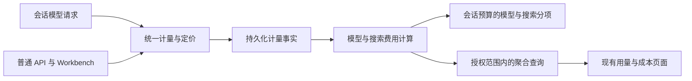

# 分析页用量与成本设计方案

状态：已实现。最新验收、截图及未通过项见 [PR #384 验收报告](https://github.com/superduck-ai/open-managed-agents/pull/384#issuecomment-6207322284)。调研日期：2026-10-14；最后验收：2026-10-16。

## 本次范围与协作边界

按用户最新分工，本次跳过“代码执行总费用”和“会话运行总成本”，由其他人负责其计量、定价、聚合、页面接入与验收。本次只完成模型 Token（含缓存）、搜索用量及对应费用、筛选、趋势和权限隔离。下文保留的运行计费官方资料仅作为协作背景，不构成本次实施任务。

接口中的合计口径仍为“模型与搜索费用小计”，不代表完整会话预算。未接入的两项在事实数据中不补零、不混入小计；对应卡片按用户要求保留零值占位，数值与接口分项交由负责人接入。完整会话预算总额对账待其他分项就绪后联合验收，不阻塞本次分项闭环。

## 目标与代码基线

在现有“分析 → 用量、成本”页面完成真实计量、费用聚合、筛选和会话对账，不新增看板页面。成本表示按数据库中的 OpenRouter 标价计算的消费额，不代表支付账单、合同折扣或供应商发票。

实现分支 `codex/analytics-usage-cost` 基于 PR #384 的 `5b78fac47fa1ec70a1c1aae8a33ef096e1e500df`；该 PR 尚未合并。以下列出改动前的缺口与预算基线。

- `web/src/features/analytics/AnalyticsPages.tsx`：指标、趋势和部分选项是占位数据。
- `internal/platformapi/platform_backend_routes.go`：用量与成本接口返回空内容。
- `internal/messages/model_request.go`：仅有 CodeSession 的请求建立模型计量记录。
- `internal/workbench/console_platform_workbench.go`：存在独立上游调用，不能假定接入 Messages 代理就覆盖 Workbench。
- PR #384 的 `billing.go`：模型费用逐请求四舍五入到美分；搜索按次数计费；活跃时间累计后舍入。
- PR #384 的 `session_usage_mapper.xml`：活跃时间是模型请求起止时间差之和，存在并发重复计时，也不覆盖模型调用之外的运行时间。

## 官方参考与取舍

以下为公开文档支持的产品行为，不代表获知 CMA 或 QCA 内部数据库、结算架构或私有控制台接口。

| 主题 | CMA | QCA | OMA 设计选择 |
| --- | --- | --- | --- |
| 预算单位 | USD 标价预算，公开金额为美分字符串 | 会话预算使用 Credits | 保留现有 USD 协议，不引入 Credits 换算 |
| 模型与运行费用 | 模型、搜索、会话运行时间 | 模型与沙箱运行消耗分项 | 本次单列模型、搜索；运行费用由他人负责 |
| 计时 | 会话运行状态；并发重叠只计一次 | running 计费，暂停、空闲等不计费 | 保留为他人负责的计时参考 |
| 展示组织 | 会话累计用量与组织聚合报表 | 月度用量、剩余额度、每日消耗 | 现有页面增加真实汇总、趋势及下钻 |

CMA 用未舍入标价执行预算，公开金额才舍入；预算跨线程共享，已开始的请求可以完成，因此不保证最终消费严格等于上限。参考：[会话预算](https://platform.claude.com/docs/en/managed-agents/budgets)。

CMA 运行时间按 running 状态计量，替代 Managed Agents 的代码执行容器时计费；不能再加一份代码执行费用。参考：[价格与运行时间](https://platform.claude.com/docs/en/about-claude/pricing#claude-managed-agents-pricing)。

CMA 区分非缓存输入、缓存读取、按 TTL 区分的缓存写入及输出；会话用量是累计快照，不能把多条 `session.usage` 相加。参考：[用量追踪](https://platform.claude.com/docs/en/managed-agents/session-observability)。

组织级报表提供时间桶、过滤、分组和分页；其权限独立于普通请求权限。该公开 API 可参考查询语义，不能据此推断私有 `usage_cost` 的完整合同。参考：[Usage and Cost API](https://platform.claude.com/docs/en/manage-claude/usage-cost-api)。

QCA 将模型与沙箱消耗计入 Credits，运行时间按秒计量、小时结算，文档规定失败模型调用不扣 Credits。此失败扣费规则不能直接移植到 OMA 的多供应商请求。参考：[QCA 计费](https://docs.qoder.com/cloud-agents/billing)。

QCA 中国站创建会话文档使用 `max_credit_cost` 表达会话总预算；国际站相同文档路径本次未成功读取，不推断跨站合同完全相同。参考：[QCA 创建会话](https://docs.qoder.cn/en/cloud-agents/sessions-create)。

QCA 发布说明确认月度用量、剩余预算与每日消耗等控制台能力，但没有在本次已读资料中核实完整的分析 API 合同或金额舍入算法。参考：[QCA 发布说明](https://docs.qoder.com/release-notes/cloud-agents)。

## 核心决策

1. 采用“统一计量事实 → 统一定价 → 会话预算与分析聚合”链路，页面不重新计算价格。
2. 已接入 Managed Agents、普通 API、控制台代理及 Workbench；会话分项沿用预算口径。历史 API/Workbench 请求不能追溯恢复，页面明确披露覆盖限制。
3. 模型与搜索金额沿用会话侧同版本口径；保留精确计量和价格版本。CMA 精确预算作为后续统一口径目标，整体预算算法切换另行协同，不作为本次分析页接入的前置条件。禁止静默改写历史消费。
4. 本次小计仅为模型费用加搜索费用。代码执行费用与会话运行成本的字段、卡片和计算由其他人负责；合并时不得重复计费或把小计替换为完整预算总额。
5. 不建设支付、充值、发票、合同优惠或预付 Credits 系统；不把不同会话剩余预算相加当作组织可用余额。

## 计量与金额

### 模型请求

记录每次实际上游尝试的稳定 ID、组织、工作区、来源、可选会话与线程、调用主体、计费模型、请求起止时间、用量完整性及价格版本。重试是独立尝试；同一次完成通知重投不重复入账。

Token 字段区分非缓存输入、输出、缓存读取、缓存写入；能获得 TTL 时保留 5 分钟与 1 小时明细。输入总量为非缓存输入加缓存读取加缓存写入；TTL 明细与写入总数不能再次相加。本版沿用 PR #384 的请求模型定价，以保证预算分项一致；服务模型别名归一化需与预算侧统一升级，不能只改分析侧。

缺少价格、上游未返回用量和真实零消费必须区分。错误或取消请求仍可能有上游消费：保存已确认用量并标记完整性，不能一律置零，也不能凭内容估算为已结算费用。未确认部分显示“数据不完整”。

价格在消费发生时固定，保存版本与必要快照；后续改价不重算已确认历史。定价使用 Rates 的有理数计算与逐请求美分舍入；Token 与整数美分分别持久化，前端按美分字符串格式化。新请求保留数据库价格快照，旧事件无法恢复价格快照时留空，不按现价补造。精确预算金额迁移不在本版实施，不能单独替换预算已采用的舍入金额。

### 外部分项接入边界

本次不建立运行区间表、不修改运行状态计时、不计算代码执行或会话运行费用。与其他负责人共享组织/工作区、会话 UUID、时间范围、时区、币种、计费版本和查询截止时刻等合同；运行费用的模型归属、跨日分摊与舍入由其方案明确。

分析响应显式声明本次包含 `model`、`web_search`，未接入的分项使用覆盖元数据表达，不能以数值零表示。完整预算仍由现有会话服务负责，不使用本次小计覆盖会话 `usage.list_cost`。

### 舍入与对账

模型与搜索小计使用与会话侧一致的金额版本，前端只格式化为 USD 两位小数。若提供精确计量金额，必须和已计入预算的金额明确区分，不能混合相加。

分项与日期桶以同一批请求、同一计费版本聚合，日桶按请求完成时间归属。旧口径直接累计已保存的逐请求美分和搜索费用，不用新价格或新舍入规则重算。

同一会话、完整生命周期、相同截止时刻下，本次分析的模型费用与搜索费用必须分别等于会话侧相应分项。若会话接口仅暴露含运行费的 `usage.list_cost`，用服务端计量明细核对模型和搜索分项，不能直接要求小计等于它，也不能把差额猜作运行费。

未来精确金额口径启用时，精确分项和日期桶之和须等于精确小计；展示舍入差额需显式解释。完整会话总额对账由全部分项负责人联合完成。

## 数据与后端边界

建议增加最小持久化计量事实，而非直接长期扫描会话事件 JSON。原因是需要覆盖非会话请求、保留删除会话后的计费历史、固定价格，并支持时间与主体索引。

本次增加 `usage_records` 模型请求计量表，不预先引入数据仓库或日汇总任务：

| 表 | 内容与约束 |
| --- | --- |
| 模型请求计量 | UUID 身份；组织/工作区、来源、主体、可选会话/线程 UUID、Token 与搜索量、整数美分分项金额、价格快照与计费版本、完整性；租户内来源尝试 ID 唯一 |

模型与搜索可以作为同一计量行的不同分项，不为每个 Token 类型建立独立流水。数据库遵守无外键、UUID 引用、goose 迁移与 Yourbatis Mapper 规范；主要索引为租户与时间、会话与时间，其他索引按查询计划增加。

`internal/billing` 负责纯定价与计费版本；新增聚焦的分析资源模块负责授权、查询参数与响应映射；`internal/db` 负责模型/搜索事实写入与聚合 SQL；`platformapi` 保留现有路由兼容映射，`internal/api` 仅组装。

会话模型结束事件、计量事实与预算状态转换保持事务一致；非会话请求使用同一计量入口，成功提交后才进入聚合。业务计量独立于对话内容，不复制提示词或工具参数。非会话请求在发送上游前预写待完成记录，结束时最多重试 5 秒；完成写入持续失败或进程崩溃时保留不完整记录。待完成行不是保存最终响应的 outbox，不能自动恢复已丢失的响应用量；页面明确报告不完整性，不能声称完全覆盖。

## 查询合同与权限

沿用 `usage_activities`、`usage_cost` 及工作区成本路由，增加统一查询模型。具体兼容字段须以调用方与路由测试为准，不从外部私有接口猜测。

- 时间：`starting_at`、`ending_at`，左闭右开；显式 IANA 时区，默认 UTC。首版按月选择范围、按日展示趋势，最大查询跨度 366 天。
- 筛选：工作区、模型、来源、可选会话 ID；具备真实主体归属后提供服务账号。不能把 API Key 与服务账号直接当作同一个维度。
- 报表仅返回汇总和每日趋势，不生成分组明细或分页结果。工作区、模型、来源、API Key 和会话筛选保持不变；API Key 不假称服务账号。
- 元数据：币种、成本口径、包含与未接入分项、来源选项、最早已记录事实时刻、计费版本、截止时刻和未定价/不完整记录数。最早事实时刻不是历史数据完整性的保证；不完整记录同时涵盖尚未结束的请求。
- 汇总：各类 Token、搜索次数、模型费用、搜索费用及二者小计；趋势返回连续日期桶。代码执行与会话运行字段由其他负责人接入，本次不写入伪零值。
- 选项：权限范围内的现行配置与历史计量维度并集，已删除模型/账号保留历史标识；月份从当前日期和覆盖起点生成。

组织身份取自认证上下文；“全部工作区”仅表示当前用户有权访问的集合。每个指定工作区先验证归属与权限；路径与查询工作区冲突返回参数错误。只有具有组织级分析权限的身份可读完整组织汇总，普通工作区凭据不能扩大到组织范围。

金额、趋势、选项和下钻共享同一权限函数；禁止选项或缓存泄漏其他租户。缓存键包含租户、可见范围及所有过滤条件，权限变化失效。

所有分项使用一致快照和 `as_of`。两个接口需要联合对账时使用同一服务端数据版本/快照标识，不能仅以墙钟时间保证迟到写入一致。首版页面各自单次响应包含自己的完整卡片与趋势。

## 页面接入

仅拆出与本次相关的用量/成本页面、查询 hook、类型及格式化函数，不重构其他分析页面。

用量页按 CMA 参考保持输入、输出、搜索三张汇总卡；非缓存/缓存读取/缓存写入明细放在趋势图提示中。成本页本次接入模型、搜索费用和每日 Token 费用趋势；保留五张 CMA 卡片，代码执行费用与会话运行成本显示零值占位，总费用展示当前已接入的模型和搜索费用之和，不展示模型与搜索小计卡片。保留现有控件风格，移除示例月份、模型和账号选项。

筛选变化更新 URL 与请求键，取消旧请求或丢弃过期结果；切换工作区时同步清除无效筛选。明确区分加载、查询失败、权限不足、数据覆盖不足和真实无消费；错误时不得显示零值卡片。响应保留截止时刻与不完整请求数，页面通过异常提示说明已知费用范围。

分析页接受 URL 中的 `session_id` 用于对账；不增加会话 ID 输入框、来源筛选、分组明细表和分页，也不展示计费版本、回填说明、数据截止时刻。页面保留工作区、时间范围、模型、API Key 筛选、汇总卡和每日趋势；时间范围支持最近 7/30 天、本月至今和历史月份。对账仍使用接口中的计费版本及整数美分分项，不依赖前端已加载的会话事件分页。

## 迁移与实施顺序

1. **口径与计量**：在 PR #384 合并基线上固定模型与搜索分项的价格、计费版本和时间归属，补充可对账的计量事实。本次保持现有预算算法，不实施运行区间或完整预算口径迁移。
2. **会话最小闭环**：写入计量事实、实现聚合与权限、接入两页并完成模型与搜索分项对账。已有事件通过租户内稳定来源 ID 幂等回填；缺失价格、用量或主体的数据标记未知。会话来源先完成分项闭环，再通过普通 API 与 Workbench 的覆盖测试。
3. **全平台覆盖**：逐一接入普通 API 与 Workbench 的所有上游调用路径，计量模块与会话消息发布解耦。以来源覆盖测试通过为条件开放全平台选项。

旧版本历史可以重建事实但不能改变已显示费用或重新触发预算事件。历史删除、归档、外置摘要缺失导致无法回填时公布覆盖起点。删除对话与计量保留策略分离；禁止把后台内容清理误当作撤销费用。

上线前影子对账，核对事实聚合与既有会话模型/搜索分项金额一致；完整会话金额含本次排除项，不能直接用于小计相等断言。首版直接查询事实表，达到实际性能瓶颈再增加汇总投影。

## 验收

| 场景 | 必须满足 |
| --- | --- |
| 缺价格、取消、截断、写入失败 | 未知不变零；重试不重复计费；事务失败不推进预算 |
| 跨租户、越权工作区、权限撤销 | 总计、趋势、筛选选项和缓存全部隔离 |
| 非零请求及缓存 | 四类 Token 与搜索费用正确，缓存 TTL 明细不重复计数 |
| 跨日、跨月与时区 | 请求按完成时间正确归桶，连续日桶完整，模型与搜索分项之和等于小计 |
| 小额与舍入 | 聚合遵循会话侧同版本规则，已有逐请求美分值不被重算；精确计量与预算金额不混用 |
| 同一会话对账 | 全生命周期、同版本与同快照，模型和搜索费用分别与会话侧相应分项一致 |
| 排除分项 | 小计明确排除代码执行与运行费用；界面按用户要求显示零值占位，接口保留排除项元数据，不覆盖完整会话预算金额 |
| 筛选与竞态 | 非零数据随筛选改变，旧请求不能覆盖新筛选结果 |
| 迁移及归档 | 回填可重跑、历史价格不漂移、会话归档不重复或遗漏计量 |
| 普通 API 与 Workbench | 无 CodeSession 仍有计量；每条上游入口有覆盖证据 |

实施时运行计费与聚合单测、Mapper SQL/参数测试、真实 PostgreSQL 的事务/权限/金额测试、前端非零与筛选测试，并按改动执行项目门禁。真实端到端验证使用 `verify-be`，通过 `--api-port 18081` 避开既有服务。实际结果和未覆盖项在下方验收记录中列明。

## 历史实现与验收记录（2026-10-14）

以下保留早期批次记录，临时目录链接仅在验收机器可用；最终代码以最新验收报告为准。

实现使用 `usage_records` 保存 Token、模型/搜索美分、价格快照与请求完整性。会话事实与事件、预算状态同事务；普通请求预写后结算。历史回填仅处理可读取、未删除的结束事件，不补造归档缺失或接入前普通请求的用量。`as_of` 是查询时刻，不承诺跨请求可重复读快照。

| 验证 | 结果与证据 |
| --- | --- |
| 非零与五条请求入口 | 普通 Messages、控制台代理、Workbench completions / generate_prompt / generate_title 均产生正确 Token、缓存、模型与搜索费用；来源筛选通过 |
| 权限 | 私有工作区汇总、模型选项隔离；授权后可见，撤权后消失；路径与查询工作区冲突拒绝 |
| 数据与对账 | 真实 PostgreSQL 幂等、回滚、时间边界、会话模型/搜索分项对账通过；Mapper 参数绑定与 UUID 边界检查通过 |
| 前端专项 | 分析页 13 项测试通过；生产构建、命名、格式通过 |
| 质量门禁 | `just lint`、`just dead-code`、`just duplicates`、`just complexity`、`just large-files` 通过；新增未跟踪文件也检查了 1 MiB 预算 |
| Go 全量 | [隔离全量报告](../../tmp/verify-be/verify-be-0761966be4ad/report.md) 已执行；当时唯一失败为新增聚合 SQL 的 UUID 输出转换。已修正并通过真实 PostgreSQL、Mapper 和 UUID 检查定向复验，复用其他未受影响的通过结果。报告保留失败事实；云端与独立 live 场景的跳过不计通过 |
| 实际服务收发 | [chat.roundtrip](../../tmp/verify-be/verify-be-6503dd2beaf6/report.md) 通过：实际后端、Worker、PostgreSQL、Redis、NATS，中文预览与最终回复一致，历史恢复、idle 与队列排空通过 |
| 性能 | [基线](../../tmp/verify-be/verify-be-d5f7ec4c817a/report.md) 为 `5b78fac47fa1ec70a1c1aae8a33ef096e1e500df`；[当前版本对比](../../tmp/verify-be/verify-be-90a22d80b2a1/report.md) 通过全部 P50/P95 门槛。20 轮串行负载，最终回复 P95：320.85 → 316.58 ms |

原登录集成测试尝试删除唯一组织管理员，违反当前生产权限规则；测试补充继任管理员后通过，未修改生产权限规则。

前端全量单进程以 133 退出；随后逐文件运行 113 个测试文件，其中 100 个通过，13 个断言失败、超时或异常退出。对这 13 个文件在未修改的 PR 基线再次运行，均复现不通过，不能宣称全量前端通过。[基线复核结果](../../tmp/analytics-verification/oma-analytics-web-baseline-summary.json)、[分文件结果](../../tmp/analytics-verification/oma-analytics-web-isolated-summary.txt) 和 [专项验证日志](../../tmp/analytics-verification/oma-analytics-final-targeted.log) 保留在工作区。

本地验收统一使用 `--api-port 18081`，所有验证服务已清理，原 18080 服务未停止。真实 Worker 场景使用确定性上游模型，不覆盖真实供应商账单、公共 Runner 创建、云端供应商费用或并发吞吐。代码执行总费用和会话运行总成本仍由其他负责人实施，不纳入本次通过结论。

### CMA 费用卡片对齐

成本页保留 CMA 的五张卡片：总费用、Token 总费用、网页搜索总费用、代码执行总费用、会话运行总成本。模型与搜索分项显示真实金额；按用户最新要求，未接入的代码执行和会话运行成本保留卡片并显示 USD 0.00；总费用显示当前已接入的 Token 与网页搜索费用之和。这里的零值是 UI 占位，并非真实计量结果；后端仍保留排除项元数据，待其他负责人接入后再计入总费用。页面移除“模型与搜索费用小计”卡片；后端小计口径保持不变，用于接口对账。成本趋势对应每日 Token 费用，只使用模型费用。

成本页工作区路径仅提供初始筛选，允许在页面切换其他授权工作区或全部工作区；显式 URL 工作区参数优先于路径，空值表示全部，刷新后保持选择。切换工作区清除模型、API Key 与会话下钻条件。用量图纵轴使用本地化紧凑数字并预留刻度宽度，悬浮提示保留完整精度，避免长数字被裁切。

## 数据库来源标价与缓存 TTL

价格由服务端从 OpenRouter `https://openrouter.ai/api/v1/models` 获取，启动时同步到全局公开价格目录 `model_price_catalog`。Narrows 网关（`narrows-gateway.test.seewo.com`）使用独立的 `https://narrows.seewo.com/pricing/api/rules` 目录，固定以 1 USD = 7.2 CNY 换算；缺失 Narrows 价格时不回退至 OpenRouter。用户无需填写、选择或保存价格；原手工标价弹窗、参考价接口、YAML 导入接口均已移除。旧 `llm_model_prices` 表保留历史数据，但不参与新请求计费。

同步保留原始 pricing JSON、转换后的 USD/百万 Token 价格及价格内容摘要版本。HTTP 超时 15 秒、响应最多 8 MiB；成功解析后事务替换目录。同步失败保留上次成功数据并记录告警，不把未知价当成零，不回退到 YAML 或手工标价。当前在服务启动时更新，不增加定时任务或管理页面。

运行时计费只读数据库；各工作区只为已配置的供应商模型匹配价格。完整模型 ID 优先；无厂商前缀的短 ID 仅在目录中唯一匹配时使用，忽略 `~` 路由别名作为短名称候选。不同日期、版本、batch/free 变体不做模糊映射。缺价模型不能创建预算会话；无预算请求仍记录用量并标为未定价。

输入、输出、缓存读取、通用缓存写入、5 分钟写入、1 小时写入使用独立价格。Anthropic 的 `input_cache_write` 映射到 5 分钟，`input_cache_write_1h` 映射到 1 小时；其他模型通用缓存写入不推断时长。来源 `-1` 表示未知价而非免费。0 为明确免费，缺字段保持未知。

会话事件聚合中的 5 分钟与 1 小时缓存写入 Token，与相邻 Token 列一致，只对十进制非负整数字段执行 bigint 转换；缺失、空值、非数字、负数及小数不计入累计，避免异常缓存字段阻断整条用量与预算查询。真实 PostgreSQL 回归同时覆盖 `model_usage` 与 `usage` 回退路径，并验证合法记录及其他用量、费用仍正常累计。

保留 OpenRouter 的 `overrides` 条件价格：总输入量包括普通输入与缓存读写，严格超过 `min_prompt_tokens` 时匹配；时间条件使用请求开始时的 UTC 时刻，HHMM 时间窗左闭右开并支持跨午夜及星期筛选。多个匹配项按来源顺序逐字段覆盖，缺少的价格字段继承之前的值。

请求开始固定来源模型、价格版本、请求时间和完整规则快照，结束时按实际用量计算。会话、普通 API、Workbench 共用计算规则；逐请求合计后四舍五入到美分，历史账目不重算。缓存总量不与 TTL 明细重复计费。代码执行和会话运行成本卡片仍为 0 占位。

验收覆盖：来源转换、未知与免费、双 TTL、长上下文阈值、跨日时间与星期、歧义模型匹配、同步事务回滚、工作区模型隔离、改价前后请求快照、真实会话与分析账本对账。规则来源参考 OpenRouter 官方 Terraform provider 的 `data.pricing.overrides` 文档。

### 最小实现收敛

模型请求只查询当前工作区中请求模型对应的目录候选，保留完整 ID 优先及短名唯一匹配规则，不加载整个 OpenRouter 目录，也不新增内存缓存。预算校验仅查询工作区配置的模型候选。所有新请求统一通过 Rates 精确计费，移除旧浮点价格字段和 YAML 标价配置；历史请求直接汇总已保存金额，不重新定价。报表移除未使用的分组和分页响应，页面筛选、价格快照、逐请求舍入及双 TTL 计费不变。

### 多模型计费验收

离线回归使用少量合成规则与固定预期金额，覆盖精确匹配、未定价、缓存用量和分档阈值两侧，
贯通价格解析、目录入库、工作区模型选择、流式/非流式响应计量、账本和每日汇总。
历史价格快照、测试数据及运行产物不纳入 Git。Narrows 全模型实测从本地价格快照获取模型，按固定 7.2 汇率计费；OpenRouter 实测需显式指定模型列表。
真实请求另以显式启用的 `TestLiveNarrowsBilling` 验证，结果区分费用匹配、未定价、调用受阻和对账不一致；
不能用合成用量的回归结果代替真实供应商验证。输入来源、运行参数及限制见 `tests/testdata/billing/README.md`。

### Narrows 价格与换汇

启动时分别同步两个来源，任一来源失败均保留该来源的旧目录。Narrows 仅精确匹配模型 ID；当前已接入的网关域名使用 Narrows 价格，其他现有 Provider 保持 OpenRouter 参考价策略。OpenRouter 也可作为模型调用供应商，但获取价格目录不等于配置了调用凭据。

价格快照保存原币每百万 Token 单价、`source_currency=CNY`、`exchange_rate=7.2`、来源模型及包含汇率的版本摘要。所有用量项先按原币有理数求和，再除以汇率，最后一次四舍五入为美元美分；不先舍入换算后的单价。历史金额与在途快照不重新计价。

Narrows 分档支持严格下界、包含下界及包含上界，按原 API 顺序应用。当前用量协议无法区分思考模式输出、图像输出及隐式缓存：存在这些独立单价时，对应类别保持未定价，不能按普通输出或显式缓存价格猜测收费。嵌入模型虽可登记在 Provider 中，但不能以 Messages 成功测试代替 Embeddings 接口验收。

Narrows 解析回归使用合成规则验证固定汇率、分档上下界及无法区分的输出和缓存价格。真实测试设置 `LIVE_BILLING_SOURCE=narrows`、`LIVE_BILLING_PRICES` 为本地原规则 JSON，并核对实际用量、价格来源、固定汇率与最终账本美分。
