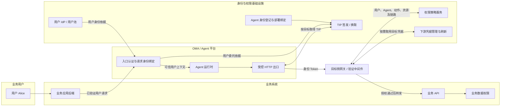
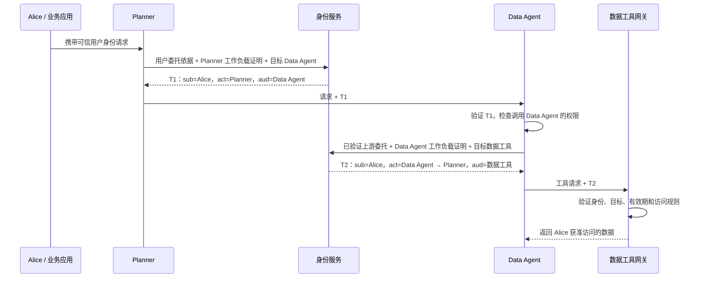
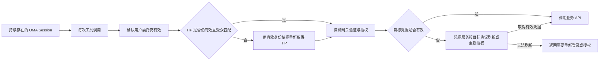
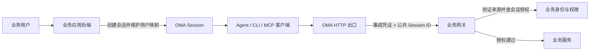

# AgentKit 身份与网关机制核对

核对日期：2026-11-08。本文记录官方资料与 OMA 接入方案的比较，不表示相关能力已在 OMA 实现。本次仅研究文档，没有执行真实网关或 OAuth 联调。

## 官方文档明确的机制

| 层次 | 文档中的职责 | 来源 |
|---|---|---|
| 入站认证 | 验证调用者能否访问 Agent 或网关，可使用 API Key 或身份提供商 | [身份与权限概述](https://docs.volcengine.com/docs/agentkit/identity-and-permission-01?lang=zh) |
| 身份与权限 | 网关识别工作负载、用户或客户端，再依据主体、目标与动作判定权限 | [智能体网关概述](https://docs.volcengine.com/docs/agentkit/mcp-overview?lang=zh) |
| 出站凭据 | 网关按服务及主体取得或刷新下游凭据，注入 Header 或签名，凭据不返回 Agent | [智能体网关概述](https://docs.volcengine.com/docs/agentkit/mcp-overview?lang=zh) |
| 凭据取用 | 独立出站代理可在代理进程内注入秘密；SDK 取用则会把明文带入 Agent 业务进程 | [凭据概述](https://docs.volcengine.com/docs/agentkit/credential-overview?lang=zh) |
| 用户委托 | OAuth 用户授权与机器身份取票是不同流程；第三方用户授权首次缺失时引导用户授权，后续可使用托管的 Refresh Token | [OAuth 连接凭据](https://docs.volcengine.com/docs/agentkit/connect-credential-via-oauth?lang=zh)、[代表用户访问第三方资源](https://docs.volcengine.com/docs/agent-identity/out-bound-authorization-theagentaccessesthird-party-resources-on-behalf-of-the?lang=zh) |

网关插件支持凭据位置转换、自定义处理和 Identity 鉴权。Identity 插件默认读取 `X-Ve-TIP-Token`，Header 名可配置，并结合权限空间验证；认证失败拒绝请求。这个 Header 携带的是待验证的 Token，不是一个无需校验就获得权限的普通标识。[专属网关插件配置](https://docs.volcengine.com/docs/agentkit/dedicated-gateway-plugin-configuration-description?lang=zh)

运行时安全文档要求业务后端维护用户与会话的映射，用户身份应来自已验证的来源，不能信任任意客户端用户 Header。网关认证成功后，业务仍需检查用户、租户、角色与资源权限。[运行时安全最佳实践](https://docs.volcengine.com/docs/agentkit/runtime-security-best-practices?lang=zh)

## 用户身份、Agent 身份、TIP 与下游凭据

这几类对象需要分开理解：

| 对象 | 回答的问题 | 生命周期与作用 |
|---|---|---|
| 业务用户身份 | 这次请求最终代表谁 | 用户登录或企业 IdP 提供可信身份；业务登录 Token 不应直接当作 Agent 身份 |
| Agent / Workload Identity | 当前是哪一个 Agent 在执行 | 稳定的工作负载身份；不是某一次 Session，也不是整个 Workload Pool |
| TIP Token | 谁代表谁，当前交给谁调用 | 身份服务签发的访问令牌，携带用户、Agent、受众、有效期及可选委托链 |
| 下游访问凭据 | 目标系统接受什么认证材料 | 目标 API Key、用户 OAuth Access Token 或 STS 凭据；由目标服务和主体共同决定 |
| Session ID | 这次工作属于哪个会话 | 可关联业务映射和审计；自身不是身份凭证，也不是授权策略 |

AgentKit 的 AEI 是绑定 Agent 资产的稳定授权身份：创建 Agent 时注册 WorkloadIdentity，发布新版本不改变该身份，删除 Agent 时清理；工具授权可以在发布时映射为对应权限策略。这与每个会话生成一个秘密的方案不同。[创建 Agent 身份](https://docs.volcengine.com/docs/agentkit/create-agent-identity?lang=zh)

TIP 全称是 Trust Identity Propagation。官方把它解释为用于可信身份传递的 Workload Access Token，并非另一套独立令牌格式。工作负载可以只代表自身，也可以携带用户身份；下游验证上游传来的身份后，取得代表自己工作负载的新 Token，继续调用下一跳。[Workload Pool 用户指南](https://docs.volcengine.com/docs/agent-identity/agent-identity-management-workload-pool-user-guide?lang=zh)

“虚拟 K”尚未核实为这个身份产品统一、精确的官方术语。若指上述 TIP，它是有主体、受众和有效期的访问令牌；若指模型网关的 Proxy API Key，则是网关对外提供的代理密钥，用于隐藏真实模型供应商密钥。两者不能混成同一种用户委托协议。[创建模型服务](https://docs.volcengine.com/docs/agentkit/creating-model-service?lang=zh)

## 模块职责：网关承载验证与执行，身份服务提供可信依据

下图是依据官方职责整理的逻辑模块图，不表示火山所有产品均部署为相同进程，也不表示 OMA 已实现这些模块。



HTTP Header 是身份材料的传输位置。可信性来自签发方、验签、受众及有效期验证、部署与工作负载绑定、权限判定。Agent 业务代码任意填写 `user_id` 或 `agent_id` 不具备同样的证明能力。网关可以承担校验与换票适配；身份提供方、策略服务和目标业务权限仍有各自职责。

## 多跳示例：Alice → Planner → Data Agent → 数据工具

以下名称均为说明用别名；这是产品身份模型的示意，不是已经验证过的完整 SDK 调用示例。



第二跳的关键 Claims 可以写成：

```json
{
  "sub": "alice",
  "aud": ["data-tool"],
  "act": {
    "sub": "data-agent",
    "act": {
      "sub": "planner"
    }
  }
}
```

这只是省略了签名、签发方、有效期等字段的语义示例。顶层 `sub` 是原始主体；最外层 `act.sub` 是当前执行者，越深的 `act` 越早参与调用。没有 `act` 时，Agent Token 的顶层 `sub` 可表示 Agent 自身。各跳应由可信签发服务建立委托链，不能让 Agent 自报一段 JSON 就获得权限。[Token 格式定义](https://docs.volcengine.com/docs/agent-identity/agent-identity-token-format-definition?lang=zh)

Token 格式借鉴 RFC 8693 的 `act` 表达方式，不等于已经证明产品支持通用 RFC 8693 Token Exchange 协议端点。官方还提供 `GetWorkloadAccessToken`、`GetWorkloadAccessTokenForJWT`、`GetWorkloadAccessTokenForUserId` 等接口；ForJWT 接受用户 Token，ForUserId 接受 UserId，但调用本身需要可信调用方认证，不能解释为匿名提交任意用户 ID 即可换票。[ForJWT API](https://docs.volcengine.com/docs/agent-identity/get-workload-access-token-for-jwt-get-workload-user-identity-access-token?lang=zh)、[ForUserId API](https://docs.volcengine.com/docs/agent-identity/get-workload-access-token-for-user-id-get-workload-user-identity-access-token?lang=zh)

## 权限策略确实可以约束中间 Agent，但语义有边界

AgentKit 的访问规则文档明确支持配置中间层 Agent。在 MCP 工具的可视化配置中，可以设置 1–5 级 Agent，一级最靠近用户。规则同时要求用户、部门或用户组被授权，并完整经过指定链路；少一级、多一级、顺序不一致均不命中。中间 Agent 与目标资源要在同一项目，默认拒绝，显式拒绝优先。[创建访问规则](https://docs.volcengine.com/docs/agentkit/create-access-rules?lang=zh)

例如，一条规则允许 Alice 经 `Planner → Data Agent` 调用 `read_sales`：

| 实际调用 | 该条规则是否匹配 |
|---|---|
| Alice → Planner → Data Agent → read_sales | 匹配，仍需不存在优先拒绝规则 |
| Alice → Data Agent → read_sales | 不匹配，少了 Planner |
| Alice → Other Agent → Planner → Data Agent → read_sales | 不匹配，多了一级 |
| Bob → Planner → Data Agent → read_sales | 若 Bob 不在授权用户范围，不匹配 |
| Alice → Planner → Data Agent → delete_sales | 不匹配，动作或目标不同 |

这里“不匹配”不代表无条件全局拒绝：还需考虑空间内其他允许及拒绝策略。因此应通过模拟判定检查整体效果，不能只检查某一条配置。

这证明策略系统能够利用调用链约束授权，但不能简化为“Token 中出现所有 Agent，就自动计算所有人的权限交集”。中间 Agent 条件约束的是访问路径，用户最小权限、各资源入口规则、业务数据权限仍需配置。文档概述涉及 Agent 和工具资源，但可视化操作明确描述 MCP 工具的链路配置；不应据此保证所有任意 HTTP API 已有相同的内置支持。[查看访问规则](https://docs.volcengine.com/docs/agentkit/view-access-rules?lang=en)、[创建权限策略](https://docs.volcengine.com/docs/agent-identity/create-permission-policies?lang=zh)

## 长会话：TIP 到期与下游 Token 到期是两件事



Session 可以持续很久，短期凭据则按需重新取得。TIP 更新依赖仍有效的用户委托和工作负载证明；目标 OAuth Access Token 更新依赖目标服务的 Refresh Token 或其他获准刷新机制。两者不要求相同寿命，也不要求每次更新都修改 Session 绑定的 Vault。[Workload Pool 用户指南](https://docs.volcengine.com/docs/agent-identity/agent-identity-management-workload-pool-user-guide?lang=zh)、[代表用户访问第三方资源](https://docs.volcengine.com/docs/agent-identity/out-bound-authorization-theagentaccessesthird-party-resources-on-behalf-of-the?lang=zh)

对于仅有“用户当前登录 Token”、没有 OAuth 或其他刷新接口的业务，网关不能凭空延长用户授权。可由业务后端在自己的会话和权限体系内执行请求，或者提供受控的凭据获取/刷新接口；如果真实用户授权已经失效，则应重新登录或授权。是否允许脱离当前用户登录的后台长任务，必须另行定义持久委托依据，不能从“OMA Session 还存在”推出授权仍有效。

## 官方 Python SDK 的已核对实现与限制

核对基线为官方仓库提交 `988608f613d6da4715be35013fff4da3b2dd7cd2`；该基线不能代替对云端实际部署版本的验证。[SDK 身份说明](https://github.com/volcengine/agentkit-sdk-python/blob/988608f613d6da4715be35013fff4da3b2dd7cd2/docs/agent_identity.md)

- `agentkit_identity` 是随同一 wheel 发布的模块，0.8.x 标为 experimental。部署配置绑定 Runtime、可信用户 issuer/JWKS、Workload issuer/JWKS、目标 alias、audience 和 HTTPS 地址；请求不能自选可信绑定。
- 中间件验证用户 ID Token，从已验证的 `sub` 绑定请求身份，移除向下传递的原始 Authorization。Runtime IAM 凭据用于授权 ForJWT 换票。
- SDK 验证返回 TIP 的签名、issuer、用户、直接 `act.sub`、受众和寿命；缓存按用户 Token 指纹、用户、Runtime、目标区分。TIP 不得比当前用户 Token 存活更久，因此不能宣称它可无限续期一个已经失效的用户请求。
- 受控 transport 向固定目标注入 Bearer Authorization，禁止覆盖目标和认证 Header、禁用跳转。下游服务或 APIG 仍独立验票并执行授权。
- V1 身份模式禁用无身份绑定的 `/run` 和 A2A mount 等路径。官方身份体系有多跳设计，不能据此声称这个 SDK 的所有多 Agent 调用路径已经开箱可用。
- 当前 TIP 仍是 Bearer Token。该 SDK 不提供 DPoP、发送者绑定证明或已消费 `jti` 的防重放账本。进程内隐藏字段不隔离恶意同进程代码；强隔离要靠网关、sidecar 或独立 broker。

SDK 明确要求服务端权威地绑定 Runtime IAM 与 Workload；若没有这项绑定，应通过受信 APIG/部署适配器换票，不能由 Agent 代码填写 Runtime 名字来替代。`IdentityClient` 的实际请求包括 `Audience` 和 `DurationSeconds`，而公开 ForJWT API 页面字段表没有完整展示这些字段；SDK 自身也提示 endpoint/action/version 需做真实兼容性检查。[SDK API Client](https://github.com/volcengine/agentkit-sdk-python/blob/988608f613d6da4715be35013fff4da3b2dd7cd2/agentkit/identity/client.py)

## 对 OMA Session Header 方案的判断

以下是基于上述职责划分的设计判断，不是火山引擎对 OMA 协议的承诺。

OMA 在受控 HTTP 出口写入公共 Session ID，并由业务网关用应用级集成凭证验证请求来源，是合理的服务间委托调用方式。Session ID 用于查询业务方已有的会话授权；它本身不证明用户身份，也不代替业务权限判断。没有证据表明火山将“固定 Key + 普通 Session ID”定义为其 OAuth 用户委托协议。



建议的最小合同：

- OMA 从已经验证的运行时身份取得公共 Session ID，在匹配的业务目标上设置 `X-OMA-Session-ID`；调用方提供的同名字段不能成为权威值。
- 应用级集成凭证只在可信出口使用。业务网关先验证来源，再按接入应用及 Session ID 查询用户映射和当前权限。
- 映射由业务后端在验证用户登录后建立；未知、过期或撤销的映射拒绝执行。映射应先于需要用户授权的工具操作就绪。
- CLI 和 MCP 的实际出口需要遵循相同合同；独立代理或 Tunnel 路径不能假定天然经过同一处理点。
- 使用现有公共 Session ID，不新增 `execution_ref`，也不要求 OMA 引入终端用户账号体系。

完整模型演进需要可信用户上下文、稳定 Agent 身份、按目标签发的委托令牌，以及网关授权和凭据获取/刷新。身份服务可以外置，OMA 无需成为用户账号系统，但需消费并保护可信身份上下文。修改范围会超出一个 Header；下面是设计建议，不是当前仓库已有能力的清单：

| 模块 | 所需能力 | 可以由谁提供 |
|---|---|---|
| 用户身份接入 | 验证企业 IdP 或业务后端签发/背书的用户身份，绑定请求与会话；不接受工具自报用户 | OMA 入口与业务身份系统协作 |
| Agent 身份登记 | 稳定 Agent 身份及部署到工作负载的可信绑定 | OMA 控制面或外部身份平台 |
| 身份签发与换取 | 按用户、当前 Agent、下游目标签发短期令牌，后续调用受控延续委托链 | 独立 Identity 服务，或已有身份平台 |
| HTTP 出口 | 从可信执行上下文取身份，按目标获取令牌并注入；CLI/MCP 均须经过可执行该协议的出口 | OMA 网关、sidecar 或代理 |
| 目标入口与策略 | 验票并判断用户、Agent、动作、资源及链路；业务服务继续执行数据权限 | 业务网关、策略平台与业务服务 |
| 下游凭据 | 将获准身份转换为目标系统接受的真实凭据，并按目标协议刷新 | 业务后端或 OMA 凭据服务，按接入合同选择 |

Session Header 方案把“Session 到用户”的解析和权限留在业务系统；完整身份方案使多跳参与方能验证统一的身份与委托证明。两者面向不同的接入范围。只有当需要跨多个服务或 Agent 统一验证身份、委托链和策略时，才需要为这些职责建立完整合同；单个自有业务网关接入可以保留已有映射方案。无论哪种方式，目标服务的真实用户凭据问题都需要有明确负责方，不能把 Header 注入本身等同于刷新能力。

## 适用范围与尚未证实的事项

该方式适用于业务服务端或网关愿意接受上述委托合同的自有工具。不能据此推断无法修改的第三方服务会接受 Session Header；这些服务仍需要其支持的 API Key、OAuth 或其他认证方式。

此次阅读没有证实火山的所有 HTTP 出口都会自动覆盖客户端 Session Header，也没有证实它提供与上述 OMA 协议完全一致的默认实现。部分旧链接跳转后的标题或正文不完整，本文以实际读到正文的页面为依据，不将链接标题当作实现证据。访问规则的链路语义已经读取到完整正文；文档更新时间为 2026-11-03，链路完整匹配规则位于注意事项，1–5 级限制位于 MCP 工具的中间 Agent 配置步骤。

后续实现需要验证 Header 来源与覆盖、目标地址限制、跨会话和跨租户隔离、首次请求映射时序、会话恢复、集成凭证轮换，以及实际使用的 CLI/MCP 出口路径。本次没有修改运行时代码或生产配置。
