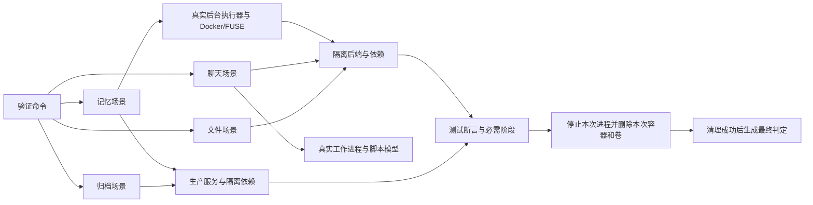

# 后端验证设计

`verify-be` 使用按领域划分的命令替代 `verify-chat`。
所有领域复用隔离环境、镜像检查、源码指纹、报告和清理。
Go 测试 JSON 与必需阶段共同决定结果。
旧命令不保留别名。

| 领域         | 验证内容                                       |
| ------------ | ---------------------------------------------- |
| `chat`       | 消息交付、工具、恢复、公开启动、子智能体和性能 |
| `files`      | 文件接口、对象存储和性能                       |
| `transcript` | 真实 PostgreSQL 和 MinIO 上的归档集成          |
| `memory`     | 生产处理器、文件存储和实际挂载                 |
| `deployment` | 执行创建、River 调度与重试、重复任务和进程恢复 |

```sh
just verify-be -h
just verify-be chat doctor public
just verify-be chat roundtrip
just verify-be files doctor
just verify-be files invalid
just verify-be files isolation
just verify-be files lifecycle
just verify-be files storage
just verify-be files attachments
just verify-be files platform
just verify-be files recovery
just verify-be files doctor generated
just verify-be files generated
```

报告使用 `chat.roundtrip`、`files.lifecycle` 等场景标识。
执行命令使用 `DOMAIN SCENARIO`，不使用旧式 `run DOMAIN.SCENARIO`。
所有场景支持 `--timeout`。
工作进程参数用于 `chat`、`files generated` 和 `memory mounts`。
基线与诊断参数用于两个性能命令。

帮助命令不加载运行配置。
根依赖检查只检查公共依赖。
云端依赖检查只读取显式私有配置。

实现位于 `cmd/verify-be`。
脚本入口只构建并执行 Go 命令。
技能和功能地图位于 `.agents/skills/verify-be/`。
本地配置位于 `.verify-be.local.json`，证据位于 `tmp/verify-be/`。
容器归属标签为 `oma.verify-be.run`。
旧证据目录保留。



## 部署与 River

阅读[部署功能地图](../../../.agents/skills/verify-be/features/deployment.md)。
四个场景为 `deployment.lifecycle`、`deployment.retry`、`deployment.idempotency` 和 `deployment.restart`。
场景复用 Go 测试，并使用独立数据库命名空间和真实 PostgreSQL、River。
命令仅为所选场景设置 `VERIFY_BE_DEPLOYMENT=1`。
普通套件会显式跳过这些场景。

场景启动异步 River 消费者。
检查任务终态、执行错误、部署状态、计划、公开响应和关联数据行。
关联数据包括会话、线程、工作、初始事件和文件存储。
任务完成可能表示永久失败或旧任务被忽略。
因此，River 任务完成不能单独证明业务成功。

重试场景在会话写入后拒绝执行记录插入。
测试必须确认整个事务回滚。
随后等待真实 River 默认退避和自动重试。
持续故障使用两次尝试预算，最终必须丢弃且没有业务副作用。

重复任务共享同一次计划触发，并在十个工作进程的队列中执行。
所有任务完成后，只能保留一条业务执行及关联记录。
持久计划通过 River 更新接口设为到期。
实际调度仍使用 River 领导节点和生产触发标记钩子。

重启场景在业务提交前和提交后分别设置测试屏障。
提交前使用数据库锁，提交后使用测试中间件。
SIGKILL 后，新进程必须恢复并完成同一任务。
提交前不得留下副作用，提交后不得重复产生副作用。
提交后的执行 ID 和会话 ID 必须保持不变。
测试还检查所有进程停止期间保存的计划及其游标推进。

测试任务期限为 10 秒，恢复阈值为 15 秒。
生产的一小时恢复延迟、完整 API 重启、模型执行、云端副作用和吞吐量仍未验证。
其他三个场景使用生产 River 客户端配置。
默认场景期限为 3 分钟，重启场景为 5 分钟。
CI 的 `Deployment verification` 运行四个场景。
分支保护需要单独配置。

## 记忆与文件存储

阅读[记忆功能地图](../../../.agents/skills/verify-be/features/memory.md)。
前五个场景为 `memory.integrity`、`memory.isolation`、`memory.cleanup`、`memory.lifecycle` 和 `memory.filestore`。
它们在测试进程内调用生产 HTTP 处理器。
数据库命名空间和 MinIO 均独立。
`DependenciesOnly` 模式不启动独立后端或工作进程。

命令只为选中场景设置 `VERIFY_BE_MEMORY=1`。
普通套件会显式列出这些跳过项。

场景检查非法写入、路径冲突、对象缺失与修复、只读挂载和租户范围。
场景还检查归档存储拒绝、旧令牌撤销、不可变版本和共享记忆保留。
文件操作检查覆盖、复制、移动和删除后的字节一致性。
清理跨越超过 100 个对象，最终配额必须为零，记忆数据仍保留。

测试端注入上传、删除和入队失败。
入队拒绝必须回滚存储删除或版本脱敏。
补偿任务必须持久化，并支持重试和完成幂等性。
临时 MinIO 桶必须未启用版本控制。
记忆历史使用独立不可变对象键。

`memory.mounts` 使用实际后端、后台执行器、Docker 服务商实现及 rclone/FUSE。
挂载启动后，测试在写入 `MEMORY.md` 时注入故障。
失败必须删除已分配沙箱，且不得暴露工作进程记录。
成功流程检查五个固定挂载、两个记忆挂载、只读拒绝和种子字节。
还检查 Markdown 内容与令牌配置清理。

FUSE 写入必须保存相同 S3 字节，并创建 `session_actor` 版本。
销毁首个容器后，新会话必须读取持久字节并重建本地 Markdown。
首个会话的临时文件不得出现在新会话中。
此场景直接执行文件操作，不使用模型回合。

前五个场景调用生产清理的 `RunOnce`。
它们显式推进重试资格和待处理孤立对象的保护期限。
后台自动退避、崩溃恢复、并发编辑、性能、云端 IAM、令牌续期和浏览器仍未验证。
前五个场景默认期限为 3 分钟，挂载场景为 8 分钟。
CI 的记忆任务运行前五个场景，工作进程任务运行实际挂载。
证明阶段只接受所选测试及其子测试的输出。

## 回复记录归档

阅读[归档功能地图](../../../.agents/skills/verify-be/features/transcript.md)。
依赖检查不要求工作进程镜像或 FUSE。
场景只启动临时依赖，并提供私有配置。
测试复用现有数据库命名空间和会话记录。
普通套件显式跳过这些需要单独启用的场景。

| 场景          | 检查内容                                                                              |
| ------------- | ------------------------------------------------------------------------------------- |
| `lifecycle`   | 归档、物理删除、旧内容清理、维护命令导出与重复恢复、私有 HTTP 字节和租户隔离          |
| `boundary`    | 前台与子线程各自的压缩边界，以及软删除、物理删除和恢复后的边界保留                    |
| `recovery`    | 上传前后故障、数据库批次拒绝、待处理段过期与重建、清单身份、部分进度和 500 条恢复边界 |
| `concurrency` | 上传暂停后由另一个调用方恢复同一段，只保留一次上传和一份清单                          |
| `integrity`   | 删除或损坏真实对象时，导出、恢复和删除失败且不修改覆盖记录。修复后成功                |

源记录和旧内容删除后，归档对象仍是可恢复副本。
测试显式调整记录时间，并调用生产清理工作进程的 `RunOnce`。
故障包装器只存在于测试端，且包围真实存储调用。

这些场景不验证五分钟 River 扫描、自动重试、进程恢复、云端 IAM 或吞吐量。
生命周期和恢复默认期限为 5 分钟，其他场景为 3 分钟。
`--timeout` 可以覆盖默认值。
CI 的 `Transcript verification` 运行五个场景，只上传 JSON 和 Markdown 报告。

## 文件

阅读[文件功能地图](../../../.agents/skills/verify-be/features/files.md)。
`tests/livefiles` 通过公开 HTTP 访问实际构建的后端。
测试通过现有数据库接口准备和观察记录。
真实 MinIO 用于检查字节和对象存在性。
Redis 和 NATS 仍是后端启动依赖。

`files generated` 位于 `tests/liveworker`，使用真实工作进程、FUSE 和脚本模型。
该场景先执行专用依赖检查。

失败场景先于成功场景执行。
非法上传检查鉴权、测试版启用、格式错误、缺少文件、文件名和请求体上限。
文件上限为 64 KiB，工作区配额为 96 KiB。
先接受一个 64 KiB 对象，再拒绝超配额请求。
对象列表、元数据和配额必须证明回滚。
拒绝后，下一次合法上传仍须成功。

租户隔离检查同组织另一工作区和另一组织的工作区。
外部工作区不能读取元数据、下载内容、删除文件或通过游标列出文件。
所有者仍可访问原对象。

生命周期检查二进制字节、UTF-8 名称、元数据、SHA-256、分页和删除。
普通上传保持 `downloadable=false`。
内容接口使用单独的可下载记录和对象。
`generated` 通过 SDK 消息触发已允许的 `Write`。
它检查真实输出生成、文件投影、公开列表、会话资源和下载字节。

存储场景检查对象缺失的错误映射、后台清理、分段上传中止和无效凭据。
它还检查 TCP 断开恢复、指定版本删除及全部版本和删除标记清理。
分段上传测试调用实际适配器，流量超过 16 MiB 分段阈值。
该测试不提高 HTTP 文件上限。

恢复场景分别注入 API 删除失败和超配额补偿失败。
本地 Go 反向代理保留 S3 签名，并只拒绝隔离桶下指定方法。
每个对象应观察到 HTTP 补偿和后台尝试各一次拒绝删除。
恢复后，清理不得早于生产的一分钟重试延迟。
测试不插入、租用或提前推进这些任务。
代理随环境关闭，不进入生产后端。

附件场景检查引用冲突、解除引用后删除、TTL 可见性和归档保留。
会话删除应清理派生文件，并保留共享上传源文件。
输出记录使用 `PutFilestoreFile` 创建。
过期本身不证明物理字节已删除。
平台场景使用隔离开发登录，检查 base64、预览、缩略图和派生对象清理。

重试耗尽场景运行生产清理工作进程及真实数据库、MinIO。
每次失败前，测试显式提前执行已准备的任务。
按工作区查询 `status`、`attempts` 和 `run_after`。
断言检查十次尝试、二次退避上限、失败终态、显式恢复和完成幂等性。
测试加速累计 199 分钟的计划。
真实等待与自动入队由恢复场景另行验证。

文件性能使用独立版本化负载。
先预热两轮，再执行二十轮串行操作。
每轮使用 32 KiB 确定内容，间隔为 250 毫秒。
测量上传、元数据、列表、下载和删除的完成延迟。
下载使用单独可下载记录。

每轮检查字节和删除结果，最终配额、列表和对象均为空。
基线必须匹配提交、场景、负载哈希、镜像、工具和主机。
比较复用 P50/P95 的 25% 加 25 毫秒阈值。
流程见[文件性能说明](../../../.agents/skills/verify-be/features/files-performance.md)。

云端场景为 `files cloud-storage` 和 `chat cloud-renewal`。
命令显式读取私有 YAML 配置并调用生产适配器。
配置缺失或无效时，命令在远程请求前报告阻塞。
存储检查所有者和只读访问、写入拒绝、字节及本次对象清理。
E2B 检查沙箱创建、`SetTimeout`、期限延长和删除。

清单保留本次对象键或资源 ID，以支持崩溃恢复。
创建结果未知或清理失败时，不得报告清理成功。
这些检查不代表全部 IAM、防火墙或公开工具审批验证。
详见[云端契约](../../../.agents/skills/verify-be/features/cloud.md)。

普通功能场景拒绝跳过项、阶段缺失、测试失败、源码变化和清理失败。
文件依赖检查只在 `generated` 场景读取工作进程镜像并检查 FUSE。
聊天负载和性能语义见[聊天验证设计](chat-verification.md)。

## 子智能体与全量验证

`chat.subagents` 使用公开配置和会话接口、真实后台执行器及 Claude Code 2.1.251。
七个必需阶段检查固定版本委派、技能、子线程 SSE、工具审批、HTTP MCP、历史和续聊。
附加回归检查乱序、同配置并行实例、回复去重和两套工具事件 ID。
场景说明见[子智能体功能地图](../../../.agents/skills/verify-be/features/subagents.md)。
实现说明见[子智能体设计](subagent-delegation.md)。

模型响应由脚本提供。
定向中断和子线程重启恢复仍未验收。

`just verify-be test` 在临时依赖上运行全部默认构建的 Go 包。
它不启动独立后端，也不重置共享开发数据库。
命令启用以下集成环境：

- `TEST_MIGRATION_DATABASE_URL`
- `TEST_EVENT_PAYLOAD_S3`
- `REDIS_URL`
- `TEST_TUNNEL_REDIS_ADDR`
- S3 适配器测试配置。

子进程会移除继承的外部测试地址和启用标记。
报告保留包与测试结果，并逐项列出跳过项。
迁移、S3 和 Redis 必需测试缺失或跳过时，运行失败。
`passed_with_skips` 只表示命令完成，覆盖仍不完整。
真实场景、云端、额外构建标签和外部 SDK 需要单独运行。
清理和源码身份检查同样适用于全量套件。

历史迁移测试使用独立命名空间。
资源统一测试按顺序检查迁移 42、47 和 48。
测试验证非法引用拒绝、回滚和升级后写入。
归档回滚测试退回迁移 62 之前，并要求返回归档保留错误。
恢复和可见性测试先调整软删除时间，再检查物理删除。

这些测试不依赖主机与数据库时钟在零期限边界完全一致。
子线程待处理工具不应阻塞本来空闲的主线程输入。

清理任务测试将重试设为过去，再检查立即重新领取。
沙箱生命周期测试先等待 River 数据库监听器，再创建到期计划。
一小时备用轮询间隔和 15 秒调度期限保持不变。

修改共享编排后，运行命令单测、仓库质量检查、文件功能及性能比较和聊天回归。
报告包含源码与二进制哈希、工具与镜像、验证边界和清理状态。
CI 独立运行八个文件场景，生成文件场景由工作进程任务执行。
文件性能比较使用 PR 基础提交。
云端检查需要手动工作流输入和受保护配置。
CI 只上传不含凭据的 JSON、Markdown 报告和恢复 ID。
