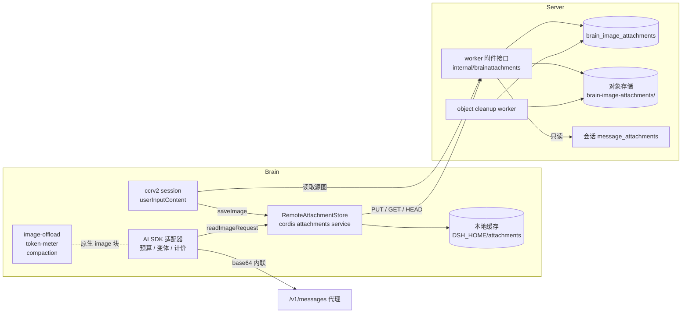
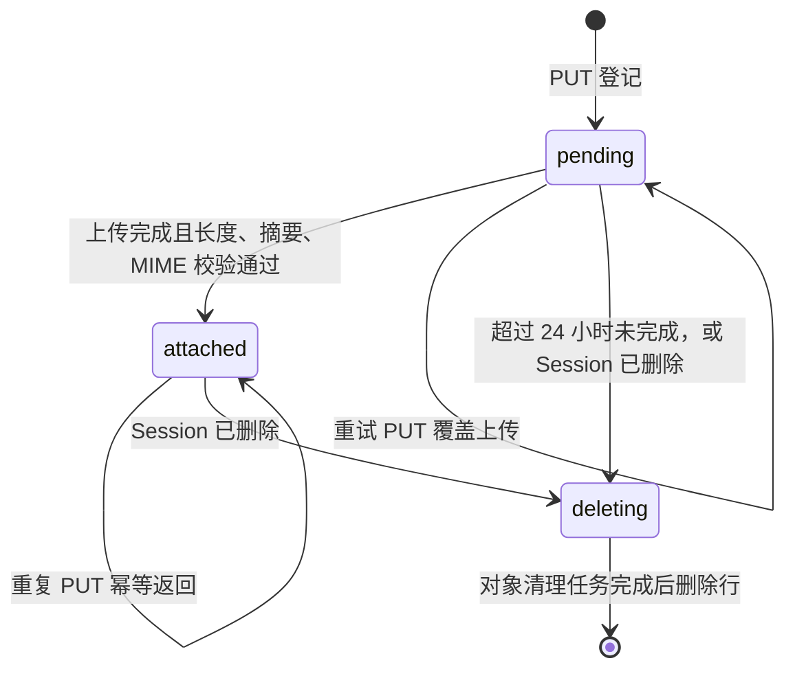
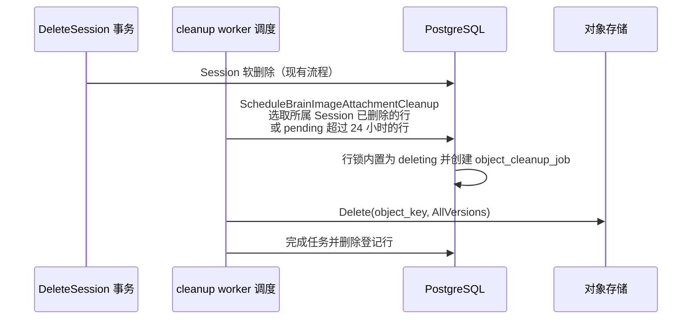
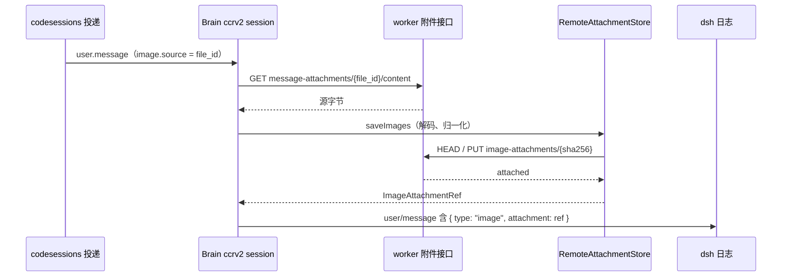
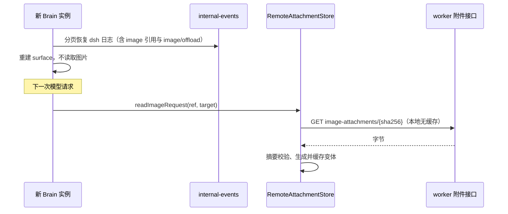
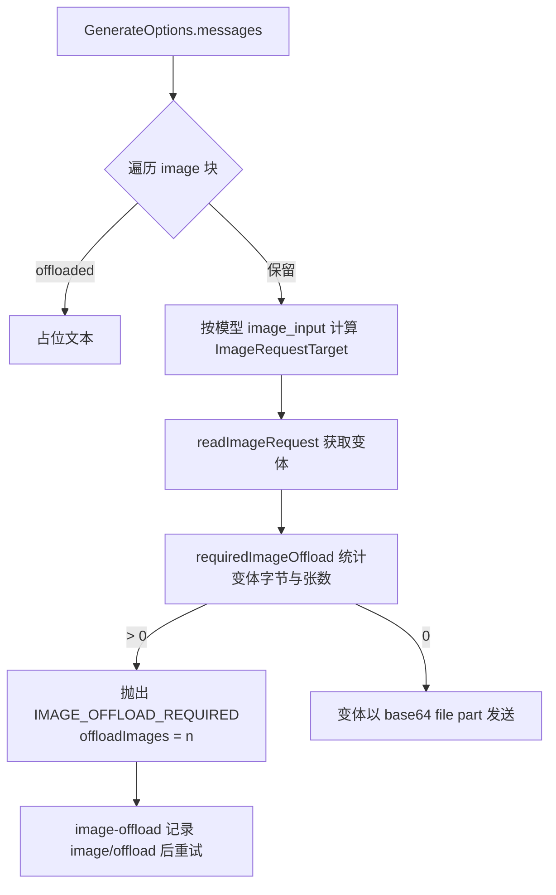

# Brain 远端图片附件与原生图片预算

> 状态：设计提案，尚未实现。当前行为仍以 [message-media-attachments](message-media-attachments.md) 和 [brain-runtime](brain-runtime.md) 为准。

## 背景

Brain 当前挂载 `@deepseek-ai/dsh-compaction-image-offload`，但它在 OMA 中不生效：

- 服务端投递前把所有 `image` 物化为会话私有文件并改写为 `file_id`，Brain 将其映射为 `oma-image`。image-offload、token 计量和模型能力过滤只识别 DSH 原生 `{ type: "image", attachment: ImageAttachmentRef }`，`oma-image` 全部被跳过。
- AI SDK 适配器不计算请求图片预算，不实现 `imageRequestPricing`，也不会发出 `IMAGE_OFFLOAD_REQUIRED`，插件的恢复监听永远不会触发。
- `oma-image` 每轮由 Messages 代理重新展开为 base64。历史图片累积后，代理返回 400 `Referenced file exceeds the model request size limit`，上游图片张数或尺寸限制同样返回 400。Brain 将其归类为 `HTTP_ERROR`，不进入 offload 或上下文溢出恢复，下一轮历史不变再次失败，会话实际卡死。
- token meter 按 JSON 长度估算未知块，一个 `oma-image` 只计十几个 token，压力压缩不会因图片触发；summary 请求本身也会携带同样的图片引用并失败。
- 原生 `image` 依赖的 `LocalAttachmentStore` 写入 Brain 本机 `DSH_HOME`，会话被其他 Brain 实例认领后无法解析。

图片 offload 只需要图片元数据（字节数、宽高、媒体类型）作决策，请求时才需要字节。本设计用一个服务端支撑的远端 `AttachmentStore` 承载原生图片，使 DSH 现有的计量、能力过滤、offload 和 summary 恢复对 OMA 图片完整生效。

## 目标与非目标

目标：

- 用户消息中的图片在 Brain 内统一为原生 `image`，引用跨 Brain 实例、进程重启和历史恢复保持可解析。
- 存储按 workspace 与 Session 隔离，读写校验内容完整性。
- 适配器按模型的图片限额生成请求图片变体，超出预算时发出 DSH 可处理的 `IMAGE_OFFLOAD_REQUIRED`，正常轮次与 summary 压缩都能恢复。
- token meter 对图片按视觉 token 计价，压力压缩能看到图片成本。

非目标：

- 不使用 Filestore，也不让归一化图片出现在沙箱中。
- 不改变公开事件、Messages 代理对 `file_id` 的展开语义和 `message_attachments` 物化规则。
- 不迁移或改写已有 dsh 日志；历史 `oma-image` 只保持可读。
- 本阶段不处理 URL 图片、PDF、普通文件和沙箱 `Read` 读图（见“分阶段”）。

## 总体结构

职责划分：

- 服务端只保存归一化后的不可变对象，负责鉴权、租户隔离、哈希校验、大小上限和生命周期回收，不解码图片。
- Brain 负责解码、归一化、请求变体生成与缓存、预算计算和 offload 决策，直接复用 `dsh-attachment-local` 导出的 `prepareImageFile`、`readRequestImageFile`、`requestImageVariantId`，保证引用字段与 DSH 编码器一致。

## 引用格式

dsh 日志中只保存 DSH 合同定义的 `ImageAttachmentRef`，不增加字段：

| 字段 | 取值 |
| --- | --- |
| `attachmentId` | `sha256:<归一化字节的 64 位小写 hex>` |
| `mediaType` | 归一化后的 `image/png`、`image/jpeg`、`image/webp`、`image/gif` |
| `bytes`、`width`、`height` | 归一化结果的精确值 |
| `originalDimensions` | 归一化缩小时由 DSH 填写 |
| `name` | 可选显示名，不承载路径 |

内容寻址带来三点性质：读取后重算哈希即完整性校验；重复投递、并发写入天然幂等；与 `dsh-attachment-local` 的 `ID_PATTERN` 兼容，其工具函数可直接复用。

哈希只是会话内的定位键，不是授权凭据。服务端始终在调用方 Session 范围内解析，其他 Session 的同一哈希视为不存在；不提供跨 Session 或跨租户的全局去重查询，避免按哈希探测内容是否存在。

## 服务端

### 数据模型

新增 goose migration 与表 `brain_image_attachments`，不建外键：

| 列 | 说明 |
| --- | --- |
| `id bigint generated always as identity` | 内部主键 |
| `uuid uuid default gen_random_uuid()` | 业务标识 |
| `external_id text` | `bimg_...`，仅用于诊断，不对外暴露 |
| `organization_uuid`、`workspace_uuid`、`session_uuid` | 租户与 Session 范围 |
| `sha256 text` | 归一化字节摘要 |
| `media_type text`、`size_bytes bigint` | 服务端嗅探与实测值 |
| `object_key text` | `brain-image-attachments/v1/<workspace_uuid>/<session_uuid>/<sha256>` |
| `state text` | `pending`、`attached`、`deleting` |
| `created_at`、`updated_at`、`attached_at` | 时间戳 |

唯一约束 `(workspace_uuid, session_uuid, sha256)`。对象 key 是范围与摘要的纯函数，同一内容的并发覆盖写入相同字节，无副作用；bucket 开启版本时，清理删除全部版本。

状态机写在 DB 写入路径附近：

- 只有 `attached` 行可被读取。
- 已 `attached` 的重复 PUT 不读取 body 之外的存储，直接返回已有元数据。
- `deleting` 是墓碑：不再接受同一键的 PUT，返回 Session 不可用错误。
- 状态推进、清理任务创建在同一事务内完成，沿用 `object_cleanup_jobs` 的有限重试。

所有 SQL 使用 Yourbatis Mapper，按 `brain_image_attachments.go`、`brain_image_attachment_mapper.go`、`brain_image_attachment_mapper.xml` 拆分；nullable 时间戳与状态推进需真实 PostgreSQL 测试。

### Worker 接口

挂在现有 `/v1/code/sessions/{code_session_id}/worker` 子路由下，由新资源包 `internal/brainattachments` 实现 handler，错误合同集中在其 `errors.go`。

| 方法与路径 | 语义 |
| --- | --- |
| `PUT /worker/image-attachments/{sha256}` | 上传归一化字节。`Content-Type` 为声明 MIME。服务端流式计算摘要与长度，与路径、上限和嗅探 MIME 比对后置为 `attached`。已存在返回 200，新建返回 201，响应体为元数据。 |
| `HEAD /worker/image-attachments/{sha256}` | 确认当前 Session 可访问，返回 `Content-Type`、`Content-Length`。供缓存命中授权与 PUT 前去重。 |
| `GET /worker/image-attachments/{sha256}` | 流式返回字节，带 `Content-Length` 与 `ETag: "sha256:<hex>"`。 |
| `GET /worker/message-attachments/{file_id}/content` | 只读返回消息附件源字节，解析规则与 Messages 代理一致：同 workspace 可见 Files，或本 Session 拥有的 `/uploads/message_attachments/` 私有文件。 |

鉴权与范围：

- 使用现有 session ingress 凭证与 `authorizeSessionIngressClaims`，并校验当前认领的 worker epoch（二进制接口通过请求头 `X-Worker-Epoch` 传递）。epoch 失配返回现有冲突错误，防止已被替换的实例写入。
- 由 code session 解析出公开 Session 的 `workspace_uuid` 与 `session_uuid`，所有查询与写入都带这两个范围；子 Agent 线程共享同一 code session，因此共享附件。
- `{sha256}` 必须是 64 位小写 hex；`{file_id}` 在 handler 边界校验格式。

上限与错误：

- 单对象上限默认 4 MiB，与 DSH 归一化输出上限 `DEFAULT_NORMALIZED_IMAGE_MAX_BYTES` 一致，配置项 `brain_image_attachments.max_object_bytes`。超限返回 413，且不登记 `attached`。
- 摘要或长度不符返回 400；MIME 嗅探不在四种栅格格式内返回 400；未找到返回 404；对象存储瞬时失败返回 503，Brain 视为可重试。
- 运行日志只记录 `session_id`、`sha256` 前缀、大小与结果，不记录字节、token 或签名。

### 生命周期

调度并入 `internal/cleanup.Worker.RunOnce`，与事件 payload、transcript 归档清理并列。不在 `DeleteSession` 事务内逐行处理，避免大会话拖长删除事务。`brain-image-attachments/` 前缀不得配置固定 TTL，否则会删除仍被活跃会话日志引用的对象。

## Brain

### RemoteAttachmentStore

实现 `@deepseek-ai/dsh-attachment` 的 `AttachmentStore` 抽象类，在 `src/kernel.ts` 中替换 `LocalAttachmentStore` 注册为 `attachments` 服务。

| 方法 | 实现 |
| --- | --- |
| `imageLimits` | 与服务端入站校验对齐的部署值（见“入站限额”）。 |
| `validateImage` | 调用 `prepareImageFile` 完成解码与归一化，不写存储。 |
| `saveImage` | `prepareImageFile` 得到归一化字节与引用 → 写本地内容缓存 → `HEAD`，不存在则 `PUT` → 记录本 Session 已授权该哈希 → 返回引用。 |
| `readImage` | 授权检查（见下）→ 本地缓存命中且摘要一致则返回，否则 `GET` 后重算摘要，不符抛 `AttachmentError` → 写缓存。 |
| `readImageRequest` | 先 `readImage`，再调用 `readRequestImageFile(cacheRoot, stored, target)`，变体按 `requestImageVariantId` 缓存在本地。 |
| `imageHostPath` | 返回 `undefined`，不向模型暴露 Brain 机器路径。 |
| 文件类方法 | 保留基类默认的不支持行为，PDF 与普通文件不在本阶段接入。 |

Session 范围：`AttachmentStore` 是进程内单例，方法参数不含 Session。所有远端调用必须使用当前 Session 的凭证与 worker epoch：

- `ccrv2` 入站处理与 AI SDK 适配器调用前，通过 `AsyncLocalStorage` 绑定当前 Session 上下文（code session ID、ingress token、epoch）。适配器已有 `request.sessionId` 与 `currentSession`，用于建立该上下文。
- 未绑定上下文的调用直接抛错，不回退到其他 Session 的凭证。

本地缓存：

- 内容缓存按摘要存放，可在同一 Brain 进程的多个 Session 间共享，丢失只影响性能。
- 授权不共享：每个 Session 首次使用某个哈希时必须完成一次 `PUT` 或 `HEAD` 成功，结果记在内存中的 `(session, sha256)` 集合，进程重启后重新确认。缓存命中不能绕过这一步。
- 请求变体缓存由已授权字节确定性导出，按 `variantId` 共享。

### 消息图片入口

- 转换在 `userInputContent` 中完成，写入 dsh 日志之前。日志与 internal-events 只含引用，不含字节，保持 [message-media-attachments](message-media-attachments.md) 的约定。
- 仍携带 base64 的图片走同一 `saveImages` 路径，不再落到 Brain 本地持久存储。
- URL 图片继续映射为 `oma-image`，不在 Brain 侧下载（避免 SSRF），作为已知限制不参与预算。

入站限额：`AttachmentStore.saveImages` 按批校验 `maxImagesPerMessage` 与 `maxMessageImageBytes`，任一失败会拒绝整条消息，而服务端此时已接受并持久化该消息。因此：

- `imageLimits` 不得比服务端入站校验更严格（服务端 4 MiB 事件体、`storage.max_file_bytes` 与四种 MIME），由配置统一下发。
- Brain 逐张调用 `saveImage`，不使用整批 `saveImages`。单张解码或归一化失败（像素超限、格式损坏）替换为与服务端降级一致的“附件不可用”文本块；源文件 404 同样降级。
- 网络错误、503 与 epoch 冲突向上抛出，由现有投递重试路径处理，不降级。

### 跨实例恢复

恢复只依赖服务端登记与对象存储，本地缓存为空不影响正确性。`image/offload` 事件按原有投影重放，已 offload 的图片不再读取字节。

## 模型适配器

### 模型目录

`session_context.models` 的每个模型新增可选 `image_input`，由 Console 校验后存入现有 provider catalog JSON：

| 字段 | 含义 |
| --- | --- |
| `max_images` | 单请求保留图片最大张数 |
| `max_request_image_bytes` | 单请求图片编码后总字节上限（base64 前） |
| `max_image_bytes` | 单张请求图片编码字节目标 |
| `max_long_edge`、`max_pixels` | 请求图片尺寸目标 |
| `tokens_per_megapixel` 或固定公式标识 | 视觉 token 估算参数 |

缺省值按 `api_backend` 给出保守默认；无论模型如何配置，图片预算加上其余请求体必须低于代理的 `MaxMessagesRequestBodyBytes`（32 MiB）。

`input_modalities` 缺省时 `src/model-configs.ts` 回落为 `["text"]`，DSH 运行时会把原生 `image` 投影为纯文本占位。当前 `oma-image` 绕过了这层过滤，切换后未声明 `image` 的视觉模型会丢图。上线前必须补齐目录中视觉模型的 `input_modalities`，并在发布说明中注明。

### 请求构建

- 先为全部保留图片取变体，再用 `requiredImageOffload` 统一计算，超预算时抛 `LlmError(..., IMAGE_OFFLOAD_REQUIRED_CODE, { offloadImages })`，不发出请求。agent 轮次走 `agent/request-error`，summary 走 `compaction/summary-error`，二者都由已挂载的 image-offload 插件处理，不消耗 provider 重试预算。
- 实现 `imageRequestPricing`，`priceImages` 按引用宽高与目录参数同步计算视觉 token，offloaded 图片按占位文本计价，不做 I/O。
- offload 占位由 OMA 生成：标识、尺寸，以及“为满足请求图片限额已省略，图片仍保存在会话中”。不使用 DSH 默认文案中“请用户重新上传”的表述，也不提供路径。
- 变体以 base64 内联发送给代理；代理只对 `source.type=file` 的块展开，原生图片请求体按原字节转发。变体回写对象存储并按引用发送属于后续优化。
- 历史 `oma-image` 与 URL `oma-image` 保持现有引用发送方式，并按目录参数给固定视觉 token 估值，使压力压缩至少能看到其成本；它们不参与 offload。

## 兼容与迁移

| 场景 | 行为 |
| --- | --- |
| 已有日志中的 `oma-image` | 继续以 `file_id` 引用发送，可读不可 offload；图片过多的旧会话仍可能失败，需在文档与发布说明中注明。 |
| 已有日志中的本地原生 `image` | 引用格式相同；远端查不到时报附件不可用错误，结束本轮，不停止会话。仅影响切换前走 base64 路径的极少数会话。 |
| 回滚 | 回滚 Brain 后新日志中的原生 `image` 由 `LocalAttachmentStore` 解析失败；因此服务端接口与表需先于 Brain 发布，并保留到确认不再回滚。 |
| Messages 代理与公开事件 | 不变。 |

## 分阶段

1. 前置：模型目录 `image_input` 与 `input_modalities` 补齐；服务端表、worker 接口、清理调度与租户隔离测试。
2. 消息图片闭环：`RemoteAttachmentStore`、入站转换与降级、适配器预算、offload 与计价、跨实例恢复。
3. 沙箱 `Read` 读图：工具结果携带原生 `image`，`prompt.ts` 的 tool-result 支持图片输出；Chat Completions 后端不支持 tool 消息图片，改为随后的 user 消息或占位文本。
4. 历史 `oma-image` 计价兜底，URL 图片策略决策。
5. PDF 与普通文件接入同一存储后端，保留各自 `document` 与文件句柄语义。

## 测试计划

服务端普通单测：

- 路径参数、摘要、长度、MIME 与上限校验；重复 PUT 幂等；epoch 失配拒绝；错误合同与 HTTP 状态。
- Mapper 生成 SQL 与参数绑定。

服务端集成测试（`integration` 标签，真实 PostgreSQL 与可控 ObjectStore）：

- 其他 Session 或 workspace 的同一哈希返回 404。
- 上传中断后 pending 行重试完成；对象缺失或损坏时 GET 失败。
- Session 删除与 pending 超时触发清理，删除全部版本，任务失败重试。
- `message-attachments` 源读取只能读到本 Session 附件。

Brain 单测（进程内 fake API 与模型）：

- 归一化引用与 DSH 编码器一致；摘要不符拒绝；缓存命中仍需本 Session 授权。
- 单张降级与瞬时错误重试的区分。
- 超预算抛 `IMAGE_OFFLOAD_REQUIRED`，插件记录 `image/offload` 后重试成功；summary 路径同样恢复。
- `imageRequestPricing` 计价与 offload 占位文案；`input_modalities` 未声明 `image` 时的投影。
- 清空本地缓存、换实例重放日志后请求恢复成功。

本设计不运行 `verify-be`；真实模型的图片计费、上游限额与性能需按用户要求单独验收。

## 开放问题

- 每 Session 的图片对象数量与总字节是否需要配额，超限时的公开错误语义。
- `image_input` 的各模型默认值来源，以及是否从上游 provider 元数据自动填充。
- 变体是否回写对象存储并以引用发送，以降低 Brain 到代理的流量。
