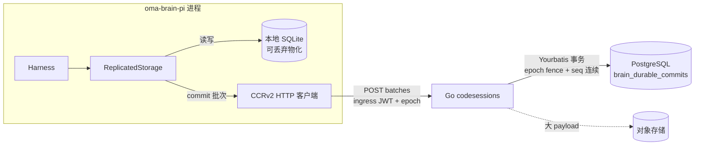
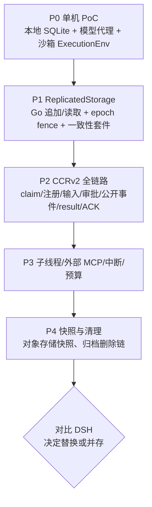

# 评估：以 Pi Durable 实现云端 Agent Brain（PostgreSQL 存储）

状态：规划 / 未实施。本文评估用 `@earendil-works/pi-durable` 替换或并行于当前 DSH 执行端的可行性，并决定 Pi Durable 的 PostgreSQL 持久化走 HTTP（经 Go 后端）还是由 Brain 直连数据库。

评估基于 npm 发布的 `@earendil-works/pi-durable@1.5.0` 与 `@earendil-works/chord@1.5.0` 包内 README、类型声明和 SQLite 存储实现。上游标注 **Experimental，API 会在版本间无通知变化**（1.0.0 到 1.5.0 不到一个月）。

## 结论

1. **可行，但应以独立执行端 `oma-brain-pi` 的 PoC 起步**，复用现有 HTTP claim、CCRv2 注册/心跳/输入/事件、模型代理与沙箱 MCP 网关，不改动 Go 侧对外合同；是否替换 DSH 在 PoC 验收后再决定。
2. **不让 Brain 直连 PostgreSQL，也不把 Pi 的 `Storage` 接口逐方法做成 HTTP RPC。** 推荐方案是：
   - Brain 本地使用 Pi 自带的 SQLite 存储作为热数据与读路径；
   - 用包装层 `ReplicatedStorage` 实现 Pi 的 `Storage` 接口：每次 `commit()` 先写本地 SQLite，再把已提交批次（`seq` + `StorageWrite[]`）通过 **一次 HTTP 请求** 追加到 Go 后端，Go 用 Yourbatis 在 PostgreSQL 中按 `(code_session_uuid, seq)` 写入并执行 epoch fence；**远端确认后才调用 Pi 的 `receive(index, seq)` 持久化回执**；
   - 跨节点恢复时从 Go 读取批次日志，按 `seq` 依次重放到新的本地 SQLite，再 `Harness.open()` + `resume()`。
3. PostgreSQL 因此是唯一事实来源，本地 SQLite 只是可丢弃的物化缓存；这比当前 DSH 的「本地主存储 + 异步复制 + 前缀对账」更简单。

## Pi Durable 关键事实

| 方面 | 事实 | 对 OMA 的含义 |
| --- | --- | --- |
| 执行模型 | 输入、模型回合、工具调用和自定义状态都在展示前提交到存储；每个 task 是带 checkpoint 的持久状态机，崩溃后 `resume()` 从最后 checkpoint 继续 | 与 Brain 崩溃恢复、跨节点接管目标一致 |
| 内置存储 | Memory、IndexedDB、SQLite（Node / Cloudflare DO）、JSONL；**无 PostgreSQL 后端**，Chord 文档仅写明「真实目标需要时再加 Postgres 后端」 | PG 后端需自研 |
| 并发 | 「One process owns a storage at a time; there is no cross-process locking」 | 单写者必须由 OMA 的 claim + epoch 保证，存储层要 fence 旧 owner |
| `Storage` 接口 | `commit(batches, receive)` + `mintId` + 约 14 个点查/分页扫描（conversation、entry、task、submission、document、headMarker）| 粒度细、读多；逐方法远程调用延迟和移植成本都高 |
| 提交语义 | 批次按序原子提交，每批一个 `seq`；存储需执行 Durable 自身校验（全局 ID、document action、copy 解析），遇首个拒绝批次停止；`receive` 是持久化回执，Session 之后才发布 | 「远端确认后再 `receive`」即可让 PG 成为可见性闸门 |
| 读缓存 | `CachedStorage` 在单写者前提下缓存 conversation/task/submission；entries、scans、documents 透传，Session 自己缓存文档与每会话最新 entry | 本地 SQLite 承担透传读，避免远程读 |
| 进度写入 | 流式部分回答和工具输出默认 100 ms 合并、最迟 `persistWithinMs`（1 s）作为 deferred commit 落盘；远程存储可调大 `settings.progress` | 远端写入频率可控 |
| 工具 | 每个工具调用是独立 task，执行前提交 intent；崩溃后仅 `replay: "safe"` 的工具重跑，其余得到 `interrupted` 错误结果 | 与现有「不重放副作用工具」策略一致；Read/Grep/Glob 可标 safe |
| 子 Agent | 会话可由 task 拥有，子会话经 `api.conversation(id)` 驱动，`requestId` 去重 | 可映射 OMA 子线程 |
| 输入 | `submit({ requestId })` 幂等，忙时 follow-up / steer 入 `pi.inbox` | `requestId` 用 OMA 稳定事件 ID |
| 运行时 | `engines.node >= 22.19`；Node SQLite 适配器基于 `node:sqlite`；可移植核心接受异步 `SqliteDatabase` facade | 继续用 Bun 需自写 `bun:sqlite` facade，或执行端改用 Node |
| 测试 | 提供 `registerStorageConformance`、`registerEnvConformance` | 自研存储与沙箱环境可直接跑上游一致性套件 |

## 组件映射

| OMA 概念 | Pi Durable 概念 |
| --- | --- |
| Code Session（一次 claim 期内单 owner） | 一个 `Harness` + 一个 `Storage` |
| 主线程 | root conversation |
| 子线程 / subagent | task 拥有的子 conversation |
| `user.message` 输入 | `submit({ type: "input", requestId: <event id> })` |
| `user.interrupt` | `conversation.abort()` |
| 工具权限 `can_use_tool` | `ToolTask` 的 `beforeTool` hook 或工具包装层调用 Go 权限桥 |
| 沙箱工具 | 自定义 `ExecutionEnv`，经 `/v2/ccr-sessions/{id}/sandbox/mcp` 执行 |
| 外部 MCP | Pi 1.0 原生 MCP 或包装为 extension tools，仍走 OMA MCP 代理 |
| 模型请求 | pi-ai provider 指向 OMA 模型代理与 model token |
| 公开事件 | `observeConversation` / `watch` 的已存储提交 → CCRv2 公开事件投影 |
| 回合结束 | submission settle → CCRv2 `result` → 输入 ACK |

## 存储接入方案比较

### 方案 A：Brain 直连 PostgreSQL

用 TS PG 驱动实现 `Storage`，参照 Pi 的 SQLite schema（conversations、entries、tasks、submissions、documents、document_revisions、record_ids、metadata）建表，每张表加 `code_session_uuid` 作用域。

优点：

- 读写延迟最低，`commit()` 的校验可在一个 PG 事务内完成。
- 实现完全在 TS，可直接移植 `storage/sqlite/storage.js`（约 750 行）并跑上游一致性套件。

问题：

- **安全边界扩大**：Brain fleet 当前只持有 fleet token 与每会话、带 epoch 的 ingress JWT；直连后每个 Brain 进程持有可读写全部租户的数据库凭据，多租户隔离只剩应用代码。Brain 还运行模型驱动的 code mode 等扩展，一旦被利用，影响面从单会话扩大到整个库。
- **epoch fence 跨语言耦合**：每个 commit 事务必须 `SELECT ... FROM code_sessions WHERE uuid = $1 AND current_worker_epoch = $2 FOR SHARE`，TS 代码直接依赖 Go 拥有的 `code_sessions` 表结构和状态机。
- **违反仓库约束**：应用运行时 SQL 必须走 Go Yourbatis Mapper，schema 变更必须走 goose；Pi 自带 migration 机制与之冲突，形成双 schema 所有者。
- **生命周期链断开**：Transcript 归档/导出/还原/物理删除、payload 外置到对象存储、租户删除和观测都在 Go 侧；新表需要在每条链路上补实现，否则数据泄漏或无法清理。
- **连接规模**：N 个 Brain 进程 × 连接池，需要额外的 PgBouncer 规划。

### 方案 B：`Storage` 逐方法 HTTP RPC 到 Go

Go 实现完整的 `Storage` 语义（commit 校验、document copy/retire、各类分页扫描），TS 适配器只做 HTTP 转发。

问题：

- 必须用 Go 重写 Pi/Chord 的存储校验与文档引擎语义，并跟随一个每周变动的实验性 TS 库，长期维护成本最高。
- 每次透传读都是一次网络往返，`CachedStorage` 只覆盖部分表；冷启动 `scanEntries` / `findDocument` 延迟叠加在串行 mutation line 上。

### 方案 C（推荐）：本地 SQLite + HTTP 同步追加批次日志

`ReplicatedStorage.commit(batches, receive)`：

1. 调用本地 SQLite `commit()`，由 Pi 原生实现完成全部校验并分配 `seq`，记录哪些批次已存储、是否有拒绝批次；本地 `receive` 暂不转交 Harness。
2. 把已存储批次 `[{ seq, writes }]` 合并为一次 `POST /v2/ccr-sessions/{id}/worker/durable-commits`（名称待定），携带 epoch。
3. Go 在一个 Yourbatis 事务内校验 epoch 与租户、要求 `seq = last_seq + 1`，写入批次；同 `seq` 同 hash 视为幂等重试，不同 hash 返回冲突。
4. 远端确认后依序调用 Harness 的 `receive(index, seq)`，返回 `{ stored, refused }`；远端结果未知时 reject，Harness 进入 `storage_failed`，执行端释放 claim。

读方法全部委托本地 SQLite，不产生网络请求。

正确性要点：

- Harness 只在 `receive` 后发布提交；工具 intent 未获远端确认时工具不会执行，公开事件也不会投影。因此本地领先远端的尾部从未被观察，可在恢复时直接丢弃，不需要当前 DSH 的「本地领先保留并异步上传」分支。
- 恢复：claim 成功 → 拉取远端批次 → 新建本地 SQLite → 按 `seq` 调用原生 `commit()` 重放（相同顺序下校验结果确定）→ 校验重放得到的 `seq` 与远端一致 → `Harness.open()` → `resume()`。若同一节点本地文件的最大 `seq` 与远端一致且 hash 相同，可跳过重放。
- 旧 owner 的写入被 epoch fence 拒绝，失败即停，不存在双写者。
- 被中断的模型请求按 Pi `settings.retry` 计一次失败尝试；工具按 `replay` 声明处理，与当前「不重放副作用工具」一致。

代价与缓解：

| 代价 | 缓解 |
| --- | --- |
| 每次 commit 增加一次同区域 HTTP 往返（预计 5–30 ms），mutation line 串行 | Pi 已把一次 `commit()` 的多个批次合并；进度写入用 `settings.progress`（如 500 ms / 2 s）降频；模型延迟占主导 |
| 批次日志无限增长 | 第二阶段增加快照：`VACUUM INTO` 上传对象存储并记录水位 `seq`，恢复 = 快照 + 尾部 |
| 依赖 Pi 的 `StorageWrite` 内部结构做重放 | Go 侧只把 `writes` 当不透明 JSON 存储，仅解析 `seq` 与身份；结构变化只影响 TS 侧，由版本门禁与一致性测试覆盖 |
| 大 entry（图片、长工具输出） | 复用 event payload 外置机制，超过阈值的批次 payload 写对象存储 |

## Go 侧改动草案

- goose migration 新增 `brain_durable_commits`：`id bigint generated always as identity`、`uuid uuid default gen_random_uuid()`、`external_id text`、`organization_uuid`、`workspace_uuid`、`code_session_uuid`、`seq bigint`、`worker_epoch bigint`、`payload_hash text`、`payload jsonb` 或外置引用、`format_version text`、`created_at`；唯一索引 `(code_session_uuid, seq)`，无外键。
- `internal/db/brain_durable_commit_mapper.go/.xml` 提供 `AppendBatches`（事务内 epoch fence + seq 连续性）、`ListAfterSeq`（分页）、快照水位读写。
- `internal/codesessions` 增加追加与读取 handler，挂在现有 CCRv2 worker 路由组，复用 ingress JWT、epoch 执行授权和租约检查；错误在 `errors.go` 集中定义。
- Transcript 归档、导出、物理删除与租户清理把新表纳入，按 `code_session_uuid` 处理。
- 公开事件仍由现有 CCRv2 入口发布；`brain_durable_commits` 不进入公开 API。

## Brain 侧实施阶段

- **P0**：`oma-brain-pi` 独立目录，固定精确版本；验证 Bun 下 SQLite facade 或改用 Node 22.19+；实现基于沙箱 MCP 的 `ExecutionEnv` 并跑 `registerEnvConformance`。
- **P1**：`ReplicatedStorage` 跑 `registerStorageConformance`；增加故障注入测试：远端超时、远端拒绝、本地领先、旧 epoch、重放 `seq` 不一致。
- **P2**：沿用 DSH 的 claim、注册、心跳、排空与 release 语义；`requestId` 映射输入事件 ID；`beforeTool` 接 Go 权限桥；公开事件只从已存储提交投影。
- **P3**：子线程身份与 `X-OMA-Session-Thread-ID`、外部 MCP 代理、`user.interrupt`、预算暂停。
- **P4**：快照、批次清理、Transcript 生命周期接入。

## 风险

- **上游不稳定**：实验性 API，存储格式和 `StorageWrite` 可能变化；必须精确锁版本，升级视为数据格式迁移，并保留已有会话的读取路径或明确不兼容。
- **单写者假设**：所有正确性依赖 claim + epoch；任何绕过 fence 的写入路径都会破坏 Pi 的不变量。
- **语义差异**：Pi 的 steer、follow-up、`afterFailedRun` 与 OMA 输入队列契约（逐条独立 turn、`processed_at` 时机）需要逐项对齐，默认用 follow-up，不启用 steer。
- **运行时**：上游以 Node 为目标，Bun 兼容性未验证。
- **观测**：Pi telemetry 需接入现有 OTLP 导出，属性不含内容，与日志规范一致。

## 未覆盖范围

本文为规划，没有代码改动，没有运行测试或 `verify-be`。延迟数字为估算，需在 P1 用真实 PG 与同区域 HTTP 测量。
