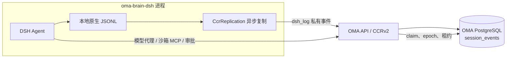
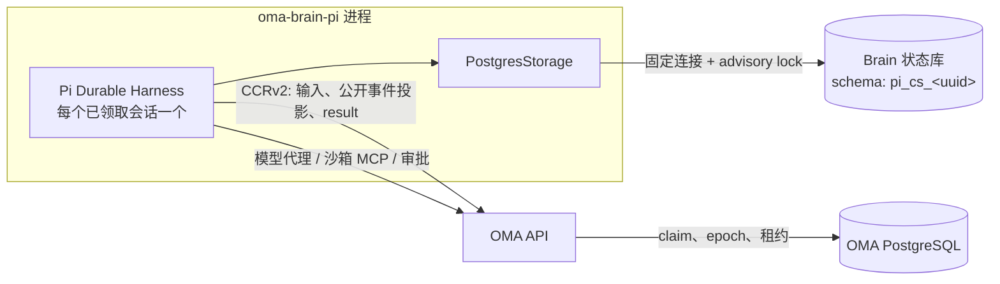
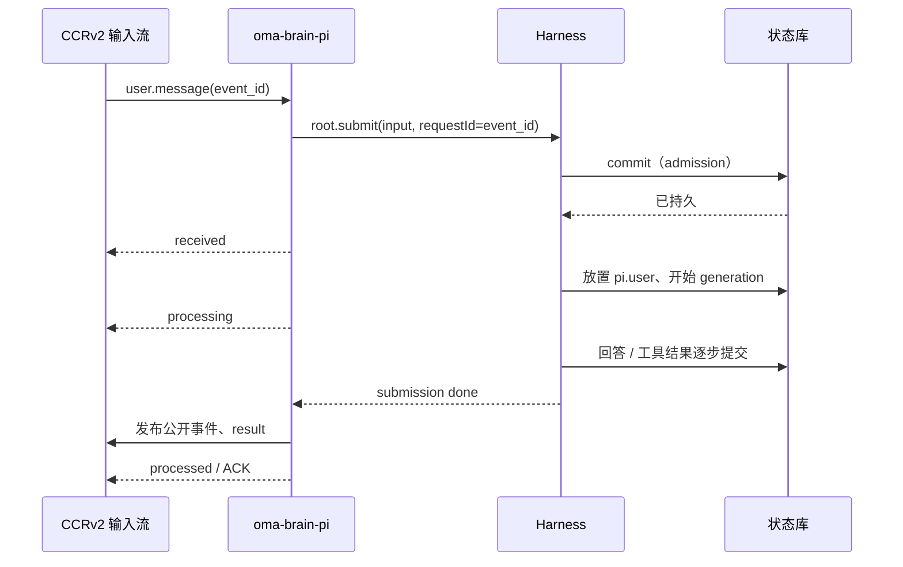
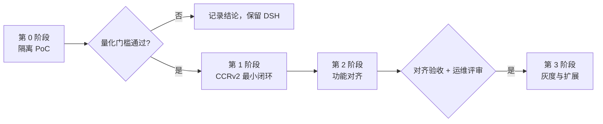

# 基于 Pi Durable 的云端 Agent Brain 可行性规划

状态：规划 / 可行性评估，未实现。本文评估用 [`@earendil-works/pi-durable`](https://github.com/earendil-works/pi/tree/main/packages/durable)（以下简称 Pi Durable）作为云端 Brain 的 Agent 运行时、用 [`@netzlabor/pi-durable-postgres`](https://github.com/j-koester/pi-durable-postgres) 作为持久化存储的可能性，给出映射方案、关键风险、需要的决策和分阶段落地路径。现有 DSH 执行端的设计见 [沙箱外 Agent 与 CCRv2](brain-runtime.md) 和 [Brain Worker 领取](brain-worker-claim.md)。

## 调研基准

| 组件 | 评估版本 | 说明 |
| --- | --- | --- |
| `@earendil-works/pi-durable` | 1.5.0（2026-11） | README 首行声明 Experimental，版本间 API 可无预告变化；`engines.node >= 22.19.0` |
| `@earendil-works/pi-ai` / `chord` / `pi-schema` / `pi-codemode` / `pi-telemetry` | 1.5.0 | Pi Durable 的直接依赖，需同版本锁定 |
| `@netzlabor/pi-durable-postgres` | 0.2.0（2026-10-08） | Alpha；peer 为 `pi-durable >=1.1.0 <2`，但仓库 devDependencies 只验证到 1.1.0；`engines.node >= 22.19.0`；PostgreSQL 17 测试 |
| OMA 本地 PostgreSQL | 17（`deploy/docker-compose/dev-env.yaml`） | 与适配器测试版本一致 |

结论基于两个包在 npm 上发布的 README、类型声明与源码。earendil.com 上的发布文章（`/posts/pi-durable/`）在本次调研环境中不可访问，未直接引用。

## 结论摘要

- **可行，但只适合作为与 DSH 并行的第二执行端，经 PoC 后再决定是否替换。** Pi Durable 的“先提交再展示”、任务检查点、`requestId` 幂等提交、按 conversation 的 inbox（steer/follow-up）、任务拥有的子 conversation、持久 sleep 与 `onWake`，与 OMA 当前需要自己在 DSH 外围补的能力（本地 JSONL + 异步复制、对账、子线程恢复、输入去重）高度重合，有望删除 Brain 侧大量持久化代码。
- **存储粒度必须是“一个 Code Session 一个 PostgreSQL schema”。** 适配器用 schema 级 session advisory lock 保证单写者，并固定占用一条连接、串行化所有操作；同一 schema 不能被多个 Brain 进程或多个 Harness 共享。按分片共享 schema 会把多个会话的提交串到一条连接上，且无法在线删除单个会话。
- **最大的三项风险**：上游 API 不稳定（Experimental + Alpha + 版本 pin）；每个活跃会话一条固定连接、每个会话一组表带来的连接与 catalog 成本；Brain 首次需要直连数据库，安全边界从“只持有单会话 HTTPS 凭据”扩大为“持有 Brain 状态库凭据”。
- **建议**：先做 2 周以内的隔离 PoC（第 0 阶段），用量化结果回答下文“待决策问题”，再进入与 CCRv2 的集成。

## 现状与目标对照

当前 Brain（`oma-brain-dsh`，Bun + DeepSeek Harness）的持久化链路：

崩溃恢复需要：读取远程私有事件 → 与本地 JSONL 对账 → 临时实例回读校验 → `agents.resume()`；工具执行、公开事件发布和输入 ACK 前必须等待本地落盘与远程确认两道屏障。

Pi Durable 目标形态：

Pi Durable 的每次 commit 在存储确认前不会对外可见，`watch`/`observeCommits` 只看到已持久的状态（`pi.live` 中的流式片段除外，见下文）。因此“本地日志 + 异步复制 + 对账”整条链路可以由 PostgreSQL 事务取代。

## 概念映射

| OMA / CCRv2 概念 | Pi Durable 对应 | 说明 |
| --- | --- | --- |
| Code Session（主线程） | 一个 Storage（独立 schema）中的 root conversation | `harness.root()` 首次创建，之后恢复 |
| 子线程（`subagent`、`send_message`、`interrupt_agent`、`list_agents`） | task 拥有的 conversation（`ownership: { kind: "task" }`），后台锚点任务 | 对应上游 `22-subagent-background` 示例；子线程恢复由 Harness 负责，不再需要 `plugin:oma/subagent-runtime` 归属记录 |
| `user.message` 投递 | `root.submit({ type: "input", requestId, whenBusy: "followUp" })` | `requestId` 使用 CCRv2 稳定事件 ID，JetStream 重投天然幂等 |
| 每条输入独立回合、不提前 steering | 默认 follow-up，`followUpMode` 每回合放置一条 | 与[活跃会话输入](brain-runtime.md#活跃会话输入)现有语义一致 |
| `received` / `processing` / `processed` 回执 | 提交被接纳 / inbox 项被放置为 `pi.user` / submission `done`/`unanswered` | 回执在对应 commit 之后发送 |
| `user.interrupt` | `conversation.abort()` | 运行中工具收到 abort signal；原 call 以 aborted 结果结束 |
| 工具审批（`requires_action`） | 包装工具：`replay: "safe"` 的审批外层 + 嵌套真实工具 | 见“工具审批” |
| 沙箱工具（bash/read/write/edit/grep/glob） | 自定义 Tool，经 Go 沙箱 MCP 网关执行 | 第一阶段不用 Pi 的 `CodingTools`/`ExecutionEnv` |
| 模型代理 | `pi-ai` provider，baseURL 指向 OMA 模型代理，凭据为 claim 签发的 model token | 需验证 `pi-ai` provider 的 baseURL/header 注入能力 |
| 上下文压缩 | Pi 内置 compaction（threshold / overflow / manual） | 替代 DSH native compaction；`beforeCompact` hook 可接管 |
| 用量与预算 | `pi.usage` 文档 + `beforeRequest` hook | 预算判定仍以 Go 为准，Brain 只做提前拦截 |
| 回合结束 CCRv2 `result` | submission settle + `pi.live.runFailure` | 成功映射 `end_turn`，`model_error`/`restart_limit` 等映射失败 result |
| 崩溃后不重放副作用工具 | 非 `replay: "safe"` 工具中断后得到 `interrupted` 错误结果 | 与当前“不自动重放”策略一致 |
| 私有 `dsh_log` 事件 | 不再需要 | 控制台轨迹视图需要新的 Pi 数据源，见“控制台与可观测” |

## 存储方案

### 方案比较

| 方案 | 写者与锁 | 优点 | 缺点 | 结论 |
| --- | --- | --- | --- | --- |
| A. 每个 Code Session 一个 schema | 领取会话即打开对应 schema 的 Storage 并持有 advisory lock | 与 claim 语义一一对应；删除会话即 `DROP SCHEMA`；租户隔离清晰；锁成为 epoch 之外的第二道 fencing | 每个活跃会话一条固定连接；每会话 8 张表及索引导致 catalog 膨胀 | **推荐** |
| B. 按分片共享 schema | 一个 Brain 进程拥有整个分片 | 连接数少，表数量固定 | 一个分片的全部会话串行于一条连接；故障迁移粒度为整个分片；适配器不支持在线删除单个 conversation | 不采用 |
| C. 自研多租户适配器（表加 scope 列，锁按 scope） | 每会话独立锁、共享表 | 连接与表数量都可控 | Storage core SQL 写死无前缀表名，需要 fork 适配器或推动上游支持，维护成本高 | 作为第 3 阶段的上游合作选项 |

### 方案 A 细节

- **独立数据库**：Pi 状态放在单独的数据库（例如 `oma_brain_state`）和单独角色中，不放进 OMA 主库。原因：
  - Pi 表结构（`conversations`、`entries`、`tasks`、`submissions`、`documents`、`document_revisions`、`record_ids`、`durable_metadata`）由库自身迁移管理，不符合 OMA 的 `id/uuid/external_id` 表约定，也不由 goose 管理；放在独立库中可以把它们明确划出 [PostgreSQL Schema 规则](../../../CLAUDE.md) 的适用范围，`Migrate()` 的外键清理也不会扫到。
  - Brain 角色只有该库权限，看不到 OMA 业务表。
- **schema 命名**：`pi_cs_<code_session_uuid 去掉连字符>`，由 Code Session UUID 派生，不使用 external_id。schema 由 Brain 在首次领取时 `CREATE SCHEMA IF NOT EXISTS` 后以 `search_path` 打开；适配器在打开时原子执行自身迁移。
- **生命周期**：
  1. claim 成功（拿到 epoch 和凭据）→ `openNodePostgresStorage({ config: { options: "-c search_path=pi_cs_...", application_name: "oma-brain:<worker-id>:<epoch>" } })` → `Harness.open()` → `harness.resume()`。
  2. 运行中，所有提交走这一条固定连接。
  3. 会话 idle 或 release → `harness.close()`，释放连接和 advisory lock。连接数因此只与“已领取的活跃会话数”成正比，受 Brain 现有容量控制约束。
  4. 会话被删除或归档完成 → 由维护任务 `DROP SCHEMA ... CASCADE`。此时没有 Harness 打开，不触碰适配器“在线删除未实现”的限制。
- **双重 fencing**：epoch 继续由 OMA 后端校验；advisory lock 保证同一 schema 只有一个 Harness 写入。旧进程在租约过期后若连接仍存活，会阻塞新领取者打开存储，需要：
  - 打开失败（锁被占用）时 release 并退避，而不是绕过；
  - Brain 设置 TCP keepalive 与 `idle_session_timeout`；
  - 第 2 阶段增加接管步骤：租约和宽限期均过后，由新领取者或运维任务按 `application_name` 中的 epoch 判断旧持有者已失效，再 `pg_terminate_backend`。
- **连接与代理**：适配器依赖 session advisory lock，**不支持 PgBouncer transaction pooling 或会重连的代理**；只能直连或使用 session pooling。连接中断即 fail closed，Harness 以 `storage_failed` 结束，Brain 必须重新打开而不是复用内存状态。
- **进度写入频率**：远程数据库建议设置 `settings.progress = { partialIntervalMs: 500, outputIntervalMs: 500 }`，并通过 PoC 基准确认；`persistWithinMs` 决定崩溃时最多丢失的流式文本/工具输出窗口（默认约 1 秒）。

### 容量估算（待 PoC 验证）

- 连接：`max_connections` 需要覆盖 `Brain 进程数 × 每进程会话容量 + 余量`。若单进程 50 个会话、20 个进程，即约 1000 条长连接，需要专门的 PostgreSQL 实例或 session 模式连接池。
- Catalog：每个 schema 约 8 张表加索引（约 20+ 个 relation）。10 万个未清理会话即 200 万以上 relation，会显著拖慢 `pg_dump`、autovacuum 和 catalog 查询。必须配合[归档](transcript-archive.md)策略：会话结束并完成导出后删除 schema，在线 schema 数量只与保留期内的会话数相关。
- 写放大：每个流式进度 commit 都是一次事务；500 ms 间隔下单会话约每秒 2 次小事务。

## 与 CCRv2 的集成

### 领取与运行时选择

- 新增执行端运行时标识（例如 Code Session `metadata.config.worker_runtime = "pi"`，默认 `dsh`），按 Agent 或部署配置选择。claim 接口按运行时过滤，DSH 与 Pi 两个执行端可在同一部署中并存，互不领取对方的会话。
- 领取、注册、心跳、release、排空和 epoch 语义保持 [Brain Worker 领取](brain-worker-claim.md) 不变。Pi 执行端只是另一种 `claim` transport 的 worker。

### 输入

- 同一 `requestId` 的重投返回同一 submission，不再需要 DSH 侧 pending 映射与原生用户消息身份去重。
- 控制通道（中断、审批结果）不进入 inbox，直接调用 `abort()` 或唤醒审批等待。

### 公开事件投影

Go 仍是公开事件的唯一发布者。Brain 用 `harness.observeCommits()` 或 conversation `watch()` 把**已提交**的 entry 与 `pi.live` 变化投影为 CCRv2 事件：

- 稳定事件 ID 由 Pi entry ID 派生：`pi:<code-session-id>:<conversation-id>:<entry-id>`，崩溃后重新投影可由后端去重。
- 流式预览来自 `pi.live` 的 deferred commit，可能先于存储可见，只能用于预览，不得据此发送 `processed` 或 `result`。
- 投影游标（最后已确认发布的 entry ID）保存在一个自定义 conversation 文档（`defineDoc`，`history: "latest"`）中，与公开发布确认绑定。
- 模型代理当前负责发布消息、工具调用和 `model_request_end`；Pi 执行端沿用同一分工，Brain 只补发代理看不到的部分，规则与 DSH 一致。

### 工具审批

`beforeTool` hook 只能同步阻止或改写参数，不适合等待可能长达数小时的人工审批，且进程崩溃后非 replay-safe 工具会直接得到 `interrupted`。建议：

1. 对外注册的每个沙箱工具是一个 `replay: "safe"` 的外层工具：
   - 以稳定 tool call ID 调用现有 Go 权限桥。Go 已按 call ID 记录审批状态，重复询问返回同一决定，因此重跑安全。
   - 获得批准后通过 `api.executeTool()` 调用 `callers: ["tools"]` 的真实副作用工具（不是 replay-safe），nested key 固定。
2. 崩溃发生在审批等待阶段：外层重跑，重新等待同一审批。崩溃发生在真实执行阶段：嵌套调用按自身策略得到 `interrupted`，不重放副作用，与现有策略一致。
3. `modelTools` 只向模型暴露外层工具。

### 沙箱、Skill 与 MCP

- 第一阶段沿用 Go 沙箱 MCP 网关（`/v2/ccr-sessions/{id}/sandbox/mcp`）与惰性沙箱，Pi 侧只实现调用该网关的 Tool，复用超时与取消规则。
- 第 2 阶段再评估实现 `ExecutionEnv`（`id` 取沙箱 ID），以便复用 Pi 的 `read`/`edit`/`write` 串行化和图像处理；`@earendil-works/pi-env` 的 SSH daemon 模式不适用于 E2B 沙箱。
- Skill：用 extension 的 `sections` 渲染目录或继续以 user-role 消息注入，保持 [Skill 运行时](managed-agent-skills-runtime.md) 的“目录不进 system prompt”约束；`skill` 工具改写为 Pi Tool。
- 外部 MCP 与大型工具集：可用 `deferred: true` + `tool_search`。Code Mode（QuickJS）不在首批范围内。

### 系统提示词与会话配置

`session_context` 的读取与校验不变。系统提示词各层映射为 Pi extension `sections`（稳定层在前、动态层在后），Agent 指令放入 `instructions`；时间上下文这类每次变化的内容不应放进 section，以免破坏 prompt cache，沿用当前“作为 user-role 快照消息”的做法。工具权限表在每次请求前刷新，由外层工具读取。

## 控制台与可观测

- 控制台轨迹视图（`web/src/features/observability/trajectory`）当前直接渲染 DSH 原生格式，依赖 `dsh_log` 私有事件。Pi 执行端需要新的数据源：建议 Go 提供只读接口，从 Brain 状态库以 `readOnly: true` 打开对应会话，或由 Brain 将 entry 投影为通用轨迹格式。这是前后端都要改的工作，应单独设计。
- 遥测：Pi Durable 接受 `TelemetryContext`，span 只含 ID 与控制元数据，不含消息内容，符合日志安全要求；需要桥接到现有 OTLP 导出（参见 [DSH 可观测](ccrv2/dsh-observability.md)）。
- `onReport` 的 `task_faulted`、`task_interrupted`、`storage_failed` 报告映射为结构化日志与指标，作为熔断与告警输入。

## 安全边界

| 项 | 现状（DSH） | Pi + PostgreSQL |
| --- | --- | --- |
| Brain 持有的凭据 | fleet claim token + 每会话 ingress/model token | 以上 + Brain 状态库角色凭据 |
| 越权读取其他会话 | 仅能访问已领取会话的 HTTPS 资源 | 同一角色可读写状态库中所有会话 schema |
| 本地磁盘明文 | 本地 JSONL 含完整对话 | 无本地主存储；状态库中为明文 JSON |

Brain 部署在沙箱之外、属于受信基础设施，但凭据扩大仍需显式接受。可选的加固：独立数据库和最小权限角色；TLS 校验证书；后续评估由 Go 暴露受 claim 凭据保护的 Storage 代理 API（每次提交多一跳网络，作为备选而非首选）。删除会话必须同时删除 schema，备份/WAL 中的残留按现有数据保留策略处理，`deleteConversation` 不构成 GDPR 保证。

## 风险与缓解

| 风险 | 影响 | 缓解 |
| --- | --- | --- |
| Pi Durable 标注 Experimental，API 无预告变化 | 升级成本高，可能阻断安全修复 | 精确版本锁定；集成层集中在少数适配模块；CI 运行上游 `registerStorageConformance` 与 `registerEnvConformance` |
| 适配器 Alpha，0.2.0 只验证到 Pi Durable 1.1.0 | 与 1.5.0 组合未经作者验证 | PoC 先在 1.1.0 组合上跑通，再用 conformance 套件验证 1.5.0；必要时向上游提交 pin 更新或 vendored fork |
| 每活跃会话一条固定连接 | 连接耗尽、无法用 transaction pooling | 只在领取期间打开；容量控制；session 模式连接池；监控连接数 |
| 每会话一个 schema | catalog 膨胀 | 归档后 `DROP SCHEMA`；监控 relation 数；长期考虑方案 C |
| 旧持有者连接未断开阻塞接管 | 会话无法被新进程领取 | keepalive、`idle_session_timeout`、按 epoch 终止旧 backend |
| Node 运行时（`engines.node >= 22.19.0`）与现有 Bun 工具链不同 | 构建、单二进制和脚本需要两套 | 新执行端使用 Node；或在 PoC 中验证 Bun 下 conformance 全部通过后再决定 |
| 轨迹视图依赖 DSH 原生格式 | 控制台无法查看 Pi 会话 | 单独的轨迹数据源设计，作为上线门槛 |
| 崩溃后 `restartLimit` 结束任务 | 某些反复崩溃的任务以失败结束 | 将 `restart_limit` 映射为失败 result 与告警，保留输入以便重试 |
| 已有 DSH 会话无法迁移 | 历史会话只能留在 DSH | 运行时在会话创建时固定，不做跨运行时迁移 |

## 分阶段计划

### 第 0 阶段：隔离 PoC（不改动现有代码路径）

- 在新目录 `oma-brain-pi/`（Node 22/24）中建立最小 Harness，存储指向本地 dev-env PostgreSQL 17 的独立数据库，faux provider 与一个真实模型。
- 在本地 PostgreSQL 上运行适配器的 conformance 与回归测试（1.1.0 与 1.5.0 两个组合）。
- 测量：单会话流式回答的事务数/秒与 p50/p99 提交延迟；进度间隔 100/500 ms 的差异；200 个并发会话下的连接与 CPU；创建与删除 1 万个 schema 的耗时与 catalog 大小。
- 故障注入：回答中途 `kill -9`、工具执行中途 `kill -9`、断开数据库连接、两个进程竞争同一 schema。
- 产出：基准数据和对“待决策问题”的建议，回写本文。

### 第 1 阶段：CCRv2 最小闭环

- `worker_runtime` 配置与 claim 过滤（Go，含 migration 与单测）。
- Pi 执行端实现领取、注册、心跳、release、排空；输入 submit 与回执；模型代理 provider；公开事件投影与 `result`；`user.interrupt`。
- 只开放无审批的只读沙箱工具。
- 验收：`just test`、Brain 侧单测与类型检查；`verify-be` 的聊天场景由用户明确要求时再运行。

### 第 2 阶段：功能对齐

- 工具审批外层工具、全部沙箱工具、Skill、子线程委派、compaction、预算、图片与文档附件、外部 MCP、问卷工具。
- 轨迹视图数据源、遥测桥接、schema 回收维护任务、旧持有者接管。
- 与 DSH 执行端在同一组 verify-be 场景上对比结果与性能。

### 第 3 阶段：灰度与扩展

- 按 workspace 或 Agent 灰度；连接、schema 数、提交延迟和 `onReport` 告警看板。
- 根据规模评估方案 C（共享表 + scope 锁）并与上游合作；评估 `onWake` 驱动的持久 sleep（需要 Go 侧在 `code_sessions` 记录下次唤醒时间并纳入 claim 条件）。

## 待决策问题

1. 是否接受 Brain 获得状态库直连凭据，还是要求 Go 侧 Storage 代理？
2. 新执行端使用 Node，还是要求在 Bun 上通过 conformance 后继续用 Bun？
3. 状态库与 OMA 主库的部署关系：同实例不同数据库，还是独立实例？
4. Pi 状态表不遵守 OMA 表约定、不由 goose 管理，需要作为明确的例外写入规则，还是另立“Brain 状态库”规范？
5. 会话结束后 schema 的保留期限，以及与 Transcript 归档的先后关系。
6. 是否在 PoC 通过后逐步替换 DSH，还是长期双执行端并存？

## 验证范围说明

本文为规划文档，没有代码改动，未运行任何测试或 `verify-be`。文中关于两个包的行为来自其发布的 README、类型声明与源码，尚未在 OMA 环境中实测。
