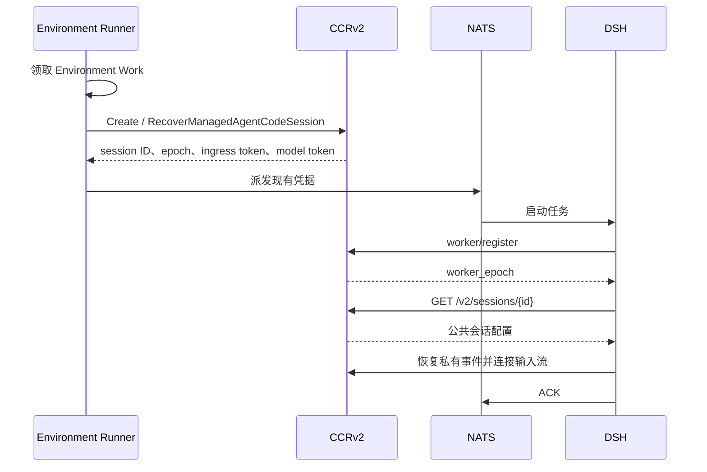
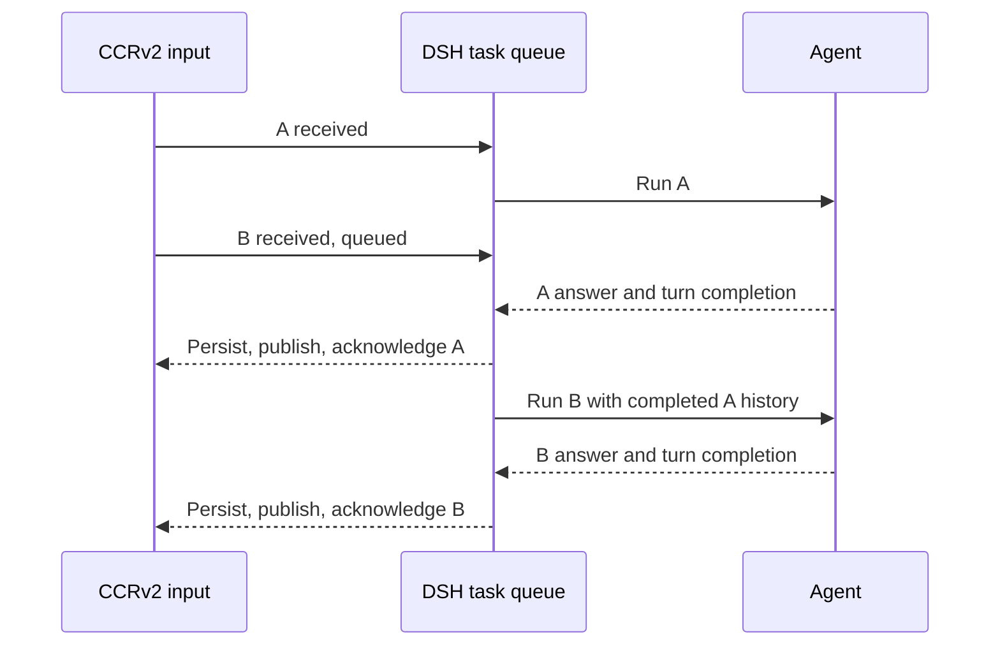
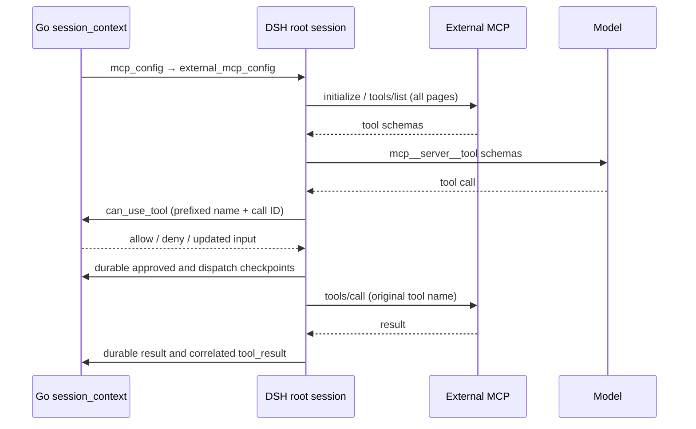
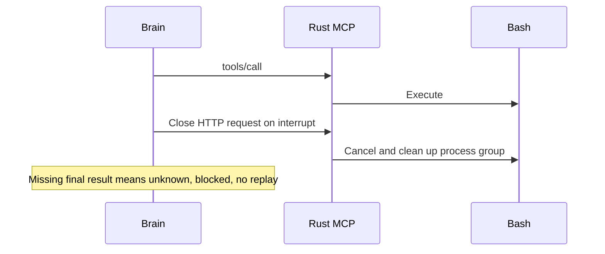

# 沙箱外 Agent 与 CCRv2

当前执行端为 `oma-brain-dsh`。Go 后端负责 NATS 启动任务派发，执行端通过原有 CCRv2 完成注册、输入接收、模型代理、工具审批、事件持久化、状态更新和心跳。后端没有独立的 Brain assignment、注册凭据、租约表或完成状态补丁。

## 启动与多节点恢复

NATS 保留 stream `OMA_BRAIN_TASKS`、subject `oma.brain.tasks.v1` 和共享 durable consumer `oma_brain`。任务字段为 `session_id`、`worker_epoch`、`ingress_token`、`model_token`。两份凭据直接来自已有的创建/恢复流程，不再由另一个注册流程重新签发。NATS 是可信内部传输，不记录任务 payload 到应用日志；数据库只保存模型凭据的 hash。

标准 `POST /v1/code/sessions/{id}/worker/register` 使用 session-ingress token，响应仍只有 `worker_epoch`。DSH 沿用原有 CCRv2 的凭据与 epoch 校验，不绑定额外的节点身份；同一 epoch 可以重复注册。恢复时轮换凭据和 epoch，使旧凭据失效。心跳沿用公共租约与宽限期机制。

恢复复用 `EnvironmentWorkMapper.ClaimNext` 的行锁、`SKIP LOCKED` 和短期领取期限。除 queued Work 外，还可领取超过 60 秒未更新、公共会话仍 running、配置为 `worker_transport=nats` 且 Code Session 租约已失效的 active/starting Work。普通沙箱 worker 和 idle 会话不进入此恢复分支。Runner 调用已有 `RecoverManagedAgentCodeSession` 轮换凭据及 epoch，再发送 NATS 任务。worker 心跳通过公共 Work 续租路径更新活动时间。派发失败走现有 Work 重排流程。

NATS 准入 ACK 后的进程崩溃由上述 Work 恢复处理；共享 durable consumer 负责分配 NATS 任务，同一 DSH 进程按 Session 和 epoch 忽略已运行任务的重复投递。该机制不保证持有同一 epoch 凭据的多个进程只能执行一次。无需第二份任务领取记录或 Code Session 预留扫描。

## 活跃会话输入

遵循 CMA 的输入队列契约：正常 running/rescheduling 时接收 `user.message`，不再返回忙时 409；同一请求也可以提交多条消息。输入在已有 `session_events` 中持久化，排队期间 `processed_at` 为 null。迁移 80 恢复该列可空，不增加表。

投递复用 CCRv2 和 JetStream。两个 consumer 均不显式设置 `MaxAckPending`，使用 NATS 服务端默认值；当前 NATS 2.14.6 默认为 1000。保持按序逐条拉取，控制回复通道仍单独投递。不能再以 `MaxAckPending: 1` 把追加输入阻塞到当前 turn 完成。每次接纳输入后，只将本次收到的事件通过既有 CCRv2 投递路径发布到 NATS，复用稳定事件 ID 去重；不扫描或补投数据库中其他尚未处理的消息。同一批输入保留请求顺序，跨请求按 NATS 实际接收顺序交付。数据库提交与 NATS 发布之间仍无 outbox，不新增发布失败的恢复机制。DSH 将普通输入接到现有 `consumeInbound` 的串行任务链，每条输入分别调用 `receive` 并启动独立 turn；当前 turn 的工具调用、文本回复、持久化、结果发布与投递确认完成后，才开始下一条输入。不再提前调用 steering，也不让下一条输入进入当前 turn 的工具后续请求。控制输入保留独立任务链，因此排队不会阻塞 `user.interrupt` 或工具审批。Worker 收到消息即报告 `received`，轮到该消息执行时才报告 `processing`；每个 turn 只保存并确认自己的输入完成状态。已有 pending 映射合并队列内的重复投递，完成记录防止重投再次执行。未完成投递继续由 JetStream 保留，异常恢复沿用当前 turn 的不重放策略。旧 Worker journal 中的 `turnInputs` 仅在恢复旧回合时读取并收束，新回合不再写入该字段。

DSH 开始模型执行前等待首个 `processing` 回执确认；后端通过已有 ACK 引用定位公开消息，写入一次处理时间并首次向 SSE 发布该消息。`processed` 回执兼容没有单独发送 processing 的执行端。排队期间的消息只出现在提交响应和历史中，SSE 实时投递及游标重放跳过尚未处理的消息，避免要求客户端合并同 ID 的不同载荷。CMA 文档明确规定排队期间 `processed_at` 为 null，并示范按 ID 去重；只在处理时发布是本实现据此采用的兼容策略，并非文档明示的推送时机。重复回执不重复修改时间，消息正文和大对象引用保持不变。

队列非空时，前一轮的普通 `idle/end_turn` 不结束公开会话；最后一条处理完成后才公开 idle。处于 `requires_action` 或 `budget_reached` 暂停时，新消息返回 400，仍需先提交相应工具结果或解除预算暂停。显式中断继续保留 `user.interrupt`，公开 stop reason 为 `end_turn`，不添加取消提示消息。

本地测试覆盖并发提交、批量及大消息、处理时间、暂停拒绝和队列排空，以及工具执行中追加多条输入时的回合隔离、完成顺序、重复投递去重和控制通道独立处理；真实模型的 `session-active-input` 用例需单独运行验证。

## 会话配置

启动数据统一放在 `code_sessions.metadata.config`。公共 `GET /v2/sessions/{id}` 返回 `{ "session_context": { ... } }`。执行端必须从 `session_context` 对象读取以下字段；缺失或非对象的响应应拒绝启动：

- `cwd`、`model`、`system_prompt`、`custom_system_prompt`、`append_system_prompt`。
- `runtime_skills`：Skill 名称、描述、固定版本及沙箱内 `SKILL.md` 路径。
- `runtime_tools`：从 Session 固化的工具配置解析出的内置工具白名单，使用 DSH 工具名。禁用工具不列入，需审批工具仍列入；没有内置 toolset 时返回空数组。
- `subagents`：由会话 Agent 快照中的固定版本引用解析出的子 Agent 定义及工具权限。
- 原有 `outcomes` 和 `mcp_config`。

创建 Code Session 时，Go 对 prompt、Skill 和子 Agent 字段按 schema 解析，拒绝类型错误；子 Agent 定义从固定版本快照解析后写入配置。MCP 声明、outcomes 与未识别扩展字段在 JSON 边界原样透传，避免改写第三方字段或高精度数字。

系统规则由 DSH 原生提示词、OMA 环境约束和用户 Agent 指令共同组成。Memory 目录来自已解析的挂载资源，通过公共 `memory_catalog_prompt` 字段提供给执行端；DSH 将其追加到环境提示词。原有沙箱客户端的 `append_system_prompt` 保持不变。Skill 和子 Agent 配置在创建 Code Session 时固定，凭据恢复不重新解析，因此不会因 Agent 或 Skill 更新而漂移。

DSH 在本地把公共配置转换为运行时对象，并根据 `OMA_API_URL` 构造沙箱 MCP URL；Go 不再提供 `brain.launch` 或完整 assignment 响应。`environment_runner.brain_api_base_url` 已删除。

## 惰性沙箱

DSH 内嵌 Bash、Read、Write、Edit、Grep、Glob 的模型工具定义，启动时不请求 MCP。主会话仅注册 `runtime_tools` 中的内置工具，缺失或 null 按空列表处理，非法列表拒绝启动。内联子 Agent 继承父会话白名单，固定子 Agent 使用其版本快照中的白名单。模型可见性过滤不替代后端执行前的工具权限检查和审批。纯文本或被拒绝的工具调用不创建沙箱。审批通过后，通过 `/v2/ccr-sessions/{id}/sandbox/mcp` 初始化和调用实际 MCP server。

外部 MCP 与沙箱 MCP 分开传递。`registerWorkerTask` 将 `/v2/sessions/{id}` 返回的 `session_context.mcp_config` 原样保存在 assignment 的 `external_mcp_config`，包括连接地址、headers、工具配置和未知扩展；assignment 的 `mcp_config` 仍由 DSH 构造，只包含平台拥有的 `sandbox` endpoint。外部服务器即使名为 `sandbox`，也不会覆盖内置工具的沙箱连接。两份配置只存在于运行时边界，不新增数据库字段或公开 API 字段。

根会话在第一次模型请求前逐个连接外部服务器并执行 `tools/list`。Streamable HTTP 使用 MCP SDK 的自动版本协商，旧式 SSE 使用 legacy initialize；SDK 聚合分页目录。当前外部传输支持 `http`、`streamable-http` 和 `sse`，不支持 stdio、WebSocket 或主机命令。配置缺失时保留原有无外部 MCP 行为。非法配置、发现失败、非法工具名或名称冲突会停止初始化并关闭已创建的连接，不能静默丢弃服务器后继续向模型请求。发现和调用都携带该服务器的 headers，禁止自动跟随 HTTP 重定向，不将沙箱或模型凭据拼接到外部请求。

DSH 将发现的工具注册为 `mcp__<server>__<tool>`，服务器名中的 `.` 转为 `_`，远端调用仍使用原始工具名。拒绝服务器名归一化冲突及完整工具名碰撞，避免将权限或调用路由到错误服务器。显式配置为 `enabled: false` 的工具不注册；其他工具仍必须通过 Go 的实际权限判定，目录过滤不能替代权限检查。服务器名保留在带前缀的审批工具名中，Go 按现有快照解析原始服务器与工具身份，发布裸工具名的 `agent.mcp_tool_use`，关联结果按既有 CCRv2 转换成为 `agent.mcp_tool_result`。DSH 不自行重复发布一套公共 MCP 事件。DSH 从本线程的 `tool/call` 记录工具名，在对应 `tool/result` 的内部 `tool_result` block 中携带 `tool_name`；Go 在结果映射边界根据该身份选择 `agent.mcp_tool_result` 和 `mcp_tool_use_id`，引用与原调用相同的稳定公开事件 ID。内部 `tool_name` 不进入公开结果。内置工具继续使用 `agent.tool_result` / `tool_use_id`，无身份的旧 Worker 结果不从正文猜测 MCP 类型。调用身份按线程和 provider call ID 隔离，结果消费后或轮次结束时释放；已持久化的 outbox 自带身份，不依赖跨进程内存重建或重放工具。失败与成功 MCP 结果使用相同关联规则，保留 `is_error` 和原始 content，不使用子 Agent 文本启发式过滤 MCP 文档中的 `agentId:` 或 `<usage>`。

外部工具复用 `ToolExecution` 的参数 schema 校验、审批后参数再校验、持久化批准、dispatch 与结果检查点。它们不触发沙箱 provision；工具声明为串行执行。当前结果沿用 Brain 的文本结果边界，非文本 MCP content 不在本次支持范围内。MCP 返回 `isError` 时记录失败结果；调用断流或中断后缺少最终结果时记录 unknown、阻断会话且禁止重放，不把本地取消当作远端停止确认。发现和列表请求超时为 30 秒，工具调用超时为 185 秒。

根会话拥有外部连接与发现目录，子会话复用目录和连接，在自身 scope 注册工具，并使用自身的审批与结果记录器。释放子会话不关闭根连接；根 scope 释放及初始化回滚会关闭连接，关闭失败向上传递。恢复会话时重新发现目录，并沿用现有执行日志恢复规则，不重放已完成或结果未知的调用。当前目录是单次运行时快照，不订阅 `tools/list_changed` 热更新。

`internal/codesessions/mapper_mcp_result_test.go` 覆盖成功/失败 MCP 结果、根/子线程稳定关联、普通工具回归及内容保留；`oma-brain-dsh/tests/tool-results.test.ts` 覆盖缺少调用身份、同 call ID 的跨线程隔离、身份消费与轮次结束清理。`oma-brain-dsh/tests/external-mcp.test.ts` 使用本地受控 MCP、模型和 CCRv2 服务覆盖注册配置保留、分页发现、禁用工具、真实 SDK HTTP/SSE 传输、模型工具目录、原始参数与结果 ID、拒绝与非法参数不调用、MCP 错误结果、断流与中断后 unknown、子会话归属、恢复及根连接释放。运行入口为 `cd oma-brain-dsh && bun test tests/external-mcp.test.ts`。这些普通测试不代表 Qoder/OMA 双端真实用例通过，也不覆盖 Microsoft Learn 可达性、真实模型选择工具、公开 SSE/历史的最终兼容断言或并行场景；双端回归与并行场景仍需单独授权。

网关使用普通 CCRv2 身份、租户、epoch 和租约检查，调用共用 Environment 沙箱准备与续期能力，并转发 MCP 协议。Go 不再内嵌另一份工具目录或模拟 initialize/tools/list。沙箱创建复用 `environment_work`、`environment_sandboxes`：创建记录时短暂锁定 Work，多个请求等待同一份创建结果；远端创建和工具执行不持有数据库锁。

DSH 对沙箱 MCP 先尝试 `server/discover` 协商 2026-07-28，旧版服务回退到 initialize。Go 在沙箱创建时用 `server/discover` 检查嵌入式 MCP，成功后才把沙箱标为 `running`；后续工具调用不重复探测。网关透传新版 MCP 请求头及请求范围内的 SSE 响应流。所有工具使用普通 `tools/call`，Rust 不声明 Tasks 能力，Brain 不创建或查询 Tasks。用户中断通过官方客户端的 AbortSignal 关闭当前 HTTP 请求；Rust 按新版协议取消执行并清理 Bash 进程组。连接关闭后没有该请求的最终响应，因此本地 abort 不能证明远端已停止。拿不到最终结果时仍记录 unknown、阻断会话并禁止重放工具调用。

每次调用前使用 provider `SetTimeout` 唤醒并续期沙箱，随后解析 MCP endpoint。Brain 沙箱启动 `environment-manager task-run`，设置 `ENVRUNNER_SKIP_CLAUDE_CODE=true`；Manager 初始化工作目录并在同一进程中启动 `/mcp`，不运行独立的 `mcp-server` CLI。启动命令清空 `MCP_ALLOWED_HOSTS`，使 E2B 动态服务域名可以通过 Go 网关访问，Rust 仍拒绝未经允许的浏览器 Origin。沙箱网关仅转发新版协议需要的 MCP 请求头和可选参数头，不发送旧版 MCP 会话头及 OMA 自定义 client ID、scope。未知执行结果留在 DSH 私有日志中处理，不写后端 Brain blocked 状态。

本地协议联调可启动 Rust Manager，将其嵌入式 `/mcp` 地址设为 `OMA_RUST_MCP_URL`，运行 `TestProbeSandboxMCPReadyAgainstRustServer` 和 `TestBrainMCPRustServerInterop`；两项分别覆盖 Go 创建阶段的探测和 Go 网关到真实 Rust 工具的转发。

`environment_runner.brain_sandbox_prewarm` 默认关闭。开启后，Runner 先完成沙箱准备，再发布任务；预热失败不会派发 Worker，避免已执行任务依赖失败的 Work。纯文本也可能预热沙箱。空闲回收和归档清理继续由共用 SandboxLifecycle 负责。

## 事件与执行状态

模型代理统一发布消息、工具调用、model request end，保留 thinking 内容及稳定消息 ID。DSH 使用标准 CCRv2 私有事件恢复日志、公开事件及 worker 状态更新。所有执行端统一用 CCRv2 `result` 结束回合：DSH 先保存完成状态及待发送事件，等待消息、工具结果和 model span 发布完成，再发送稳定 UUID 的 result，最后确认输入 ACK。worker idle 只更新执行端状态和空闲时间，不推导公开回合结束；running 和 requires_action 的同步保留。注册不再协商终止事件能力，也不再在 worker binding 中保存该能力。

成功 result（含旧客户端未填写 subtype 的成功结果）映射为 `idle/end_turn`；失败 result 复用后端的安全错误分类，映射为 session.error 和 `idle/retries_exhausted`。DSH 不再自行发送公开终止事件或重复的 session.error，详细安全提示仍通过已有 system.message 发布。已确认的用户取消发送非失败 result，保留内部取消状态。后端直接按 result 的成功或失败字段映射，不查询历史推断取消，也不将失败 result 改判为正常结束。

result 复用既有事件 ID 去重、epoch 校验和队列过滤；普通成功结束在有待处理输入时不使公开 Session idle。主线程失败后的子线程结束不能覆盖会话的失败 stop reason。回归覆盖 result 与 worker idle 的各种到达顺序、重复 result、重新注册、迟到状态、中断后同会话继续，以及子线程失败原因保留。

公开 `user.interrupt` 经后端转换为 CCRv2 `control_request/interrupt`；执行端的两种中断入口都记录取消意图。工具结果已确认时保留内部取消处理，公开 `session.status_idle.stop_reason.type` 按 CMA 契约使用 `end_turn`，允许同会话继续；保留 `user.interrupt`，不生成 `Turn cancelled` 消息。结果未知时仍保持 blocked，不把未知执行当作成功取消。

普通工具调用复用官方客户端与 HTTP transport，单次请求等待上限为 185 秒，不增加私有取消 RPC 或结果查询通道。中断与自然完成竞态以客户端实际收到的结果为准；收到完整工具结果才能记录已知 outcome。断线、超时或取消导致结果缺失时，现有执行日志记录 unknown 并停止回合，恢复时继续阻断未确认的 dispatch，不自动重放。此类中断不保证正常 end_turn，也不允许直接继续输入。

Rust 不维护 TaskManager、任务结果缓存或 TTL 回收器。Bash 正常收到取消时终止进程组并等待退出；执行 future 被丢弃时由进程组 guard 强制终止命令。grep/glob 取消时终止并等待子进程；明确请求的后台 Bash 保留原有语义。停止进程不会回滚已经发生的文件写入等副作用。

隔离协议测试先构建真实 Rust mcp-server，再在 oma-brain-dsh 运行 `OMA_TEST_MCP_BINARY=/absolute/path/to/mcp-server bun test tests/mcp-cancellation.test.ts --timeout 20000`。测试使用真实本机 MCP 与 Bash，覆盖断流后进程停止、结果未知时禁止重放、服务端失联和正常结果。进程停止通过本机观测断言，不是客户端获得了远端取消确认。真实模型、公开事件和历史未由这些测试覆盖；原 session-interrupt-continue 对正常 end_turn 的断言不适用于本方案的 unknown 分支。

工具审批仍使用现有 CCRv2 控制请求。DSH 将等待后端权限判定与等待用户确认分开：发送 `can_use_tool` 及等待自动批准/拒绝期间保持 `running`，不发布 `requires_action`。控制请求持久化确认后，执行端通过既有 Worker 状态读取接口核对匹配 request ID 的待确认工具记录；只有后端确实保存待确认请求时才发布 `requires_action`。审批结果可先于状态读取返回，此时立即结束等待并取消读取，不允许迟到结果重新暂停 Worker。待确认记录仍是后端输入拒绝的依据，真实用户审批与 `budget_reached` 暂停继续拒绝普通输入。模型中的标准工具名在 MCP 边界转换为对应 server 名称。原始参数和审批后的参数分别保留；执行前再次校验有效参数。只读工具的并行策略与按 callId 记录的执行状态由 DSH 管理，Go 不为每次工具执行维护独立状态机。

## 迁移与部署

Brain 实现尚未部署，不保留开发阶段创建独立 Brain 表、延迟沙箱字段和迁回 CCRv2 的中间迁移。最终模型直接复用现有 Code Session、公共配置与 CCRv2 私有事件，无需新增表或专用索引。应用过这些中间迁移的本地开发数据库需要重建；旧 Rust/Grok 客户端和旧 registration-token 任务不再兼容。

后端与 DSH 需要一起更新。旧 NATS 任务最长保留一分钟；新部署通过 Work 恢复发送新协议任务。多实例后端继续共用 CCRv2 签名密钥、数据库、NATS 和事件对象存储。

## 验证边界

普通测试覆盖同一 epoch 重复注册与旧凭据拒绝、Work 并发领取与存活/idle 排除、恢复保留配置、子 Agent 固定版本、惰性沙箱并发创建、MCP 转发和消息顺序。DSH 的测试使用真实原生 loop、受控模型/MCP/CCRv2 服务及隔离 NATS 子进程。

真实模型、实际云沙箱和端到端 SSE 对比通过 verify-be 的相关场景单独验收；仅在用户明确要求时执行，不以普通测试代替。

DSH Brain 源码作为主仓库的 `oma-brain-dsh/` 普通目录维护，使用自己的 Bun
依赖锁和 build/typecheck/test 命令。历史验收模板位于
`oma-brain-dsh/verification/testdata/`，属于复制到相应历史后端 harness 的输入数据，
不是独立的 Go package；当前后端验收继续使用 `tests/liveworker/` 中的场景。

任务准入对无效 JSON、无效任务身份以及明确拒绝的 HTTP 400/401/403/404/409/410/422 执行 JetStream TERM 并记录脱敏诊断。其他准入失败延迟 5 秒重投，最多尝试 10 次后 TERM；退出取消不终止任务。TERM 不引入 dead-letter 存储，后续恢复仍由已有 Work 恢复机制负责。
