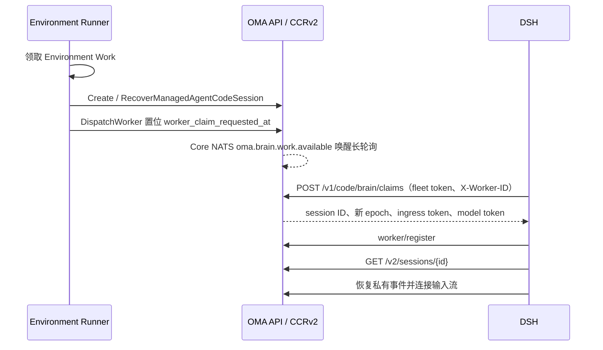
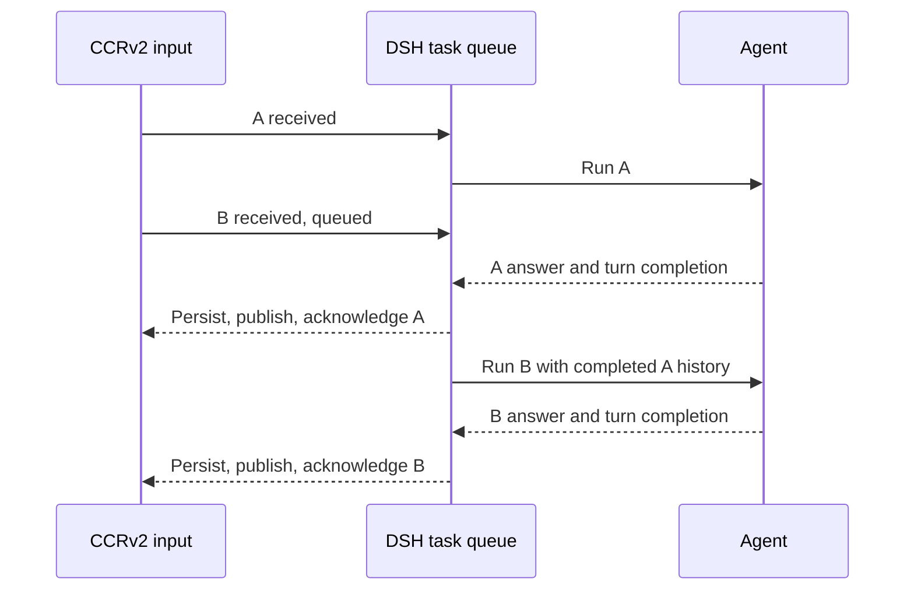
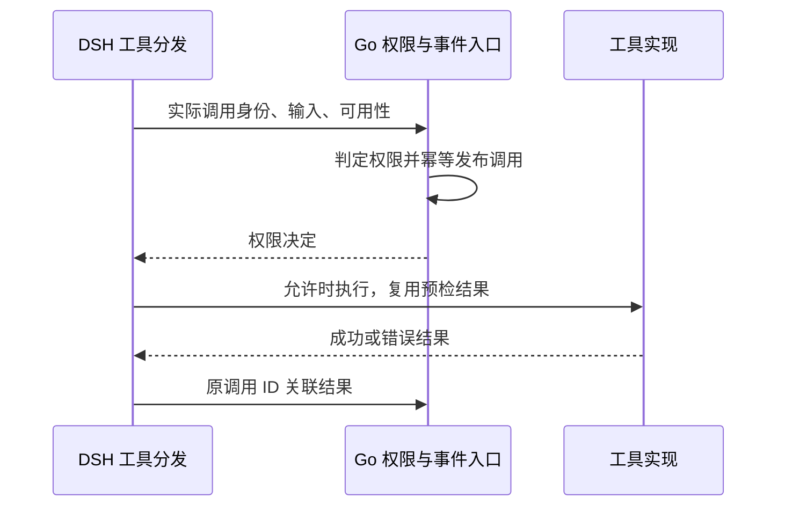
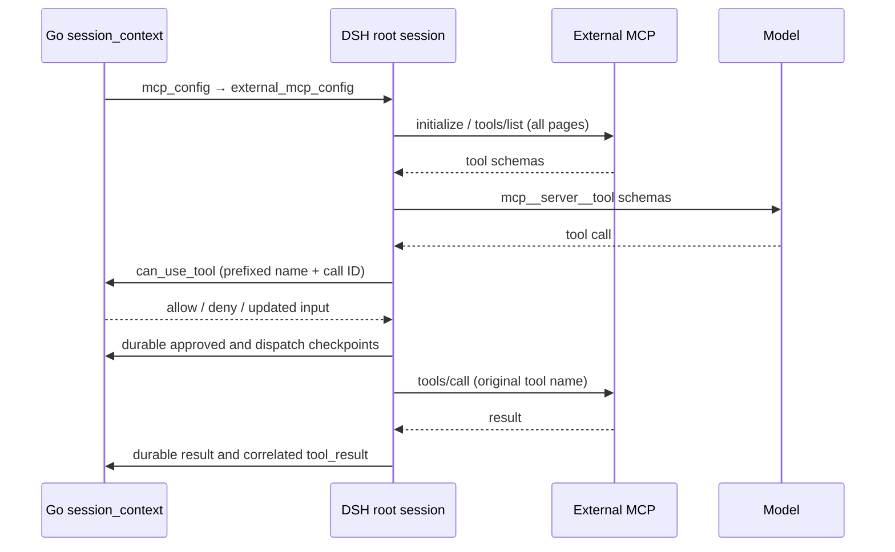
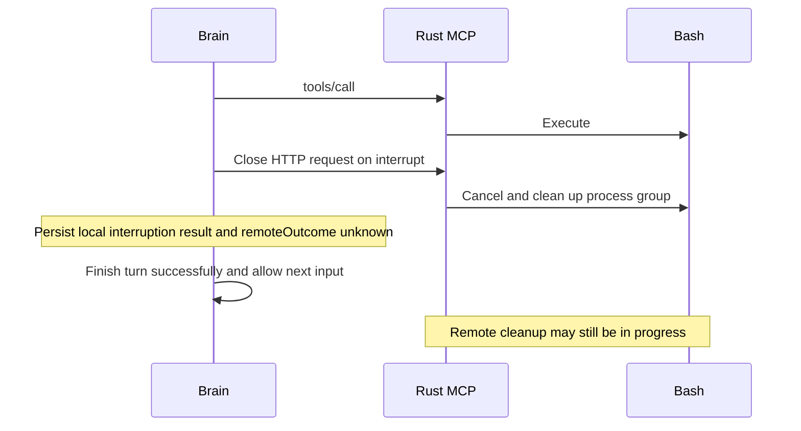
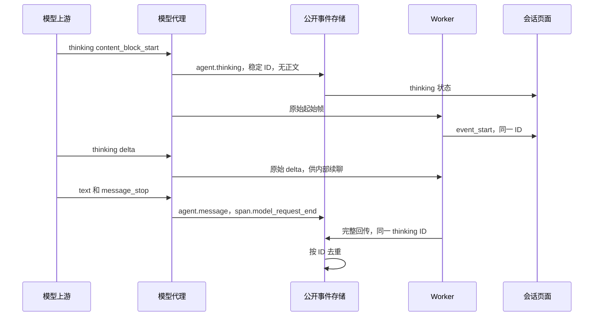
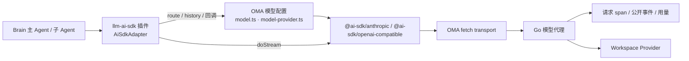

# 沙箱外 Agent 与 CCRv2

当前执行端为 `oma-brain-dsh`。Go 后端负责准备 Code Session 并接受执行端领取，执行端通过原有 CCRv2 完成注册、输入接收、模型代理、工具审批、事件持久化、状态更新和心跳。后端没有独立的 Brain assignment 表或完成状态补丁；领取状态保存在 `code_sessions` 行上。领取接口、状态机、并发与测试的完整设计见 [Brain Worker 领取](brain-worker-claim.md)。

本地在仓库根目录运行 `just restart-brain`，复用 `oma-brain-dsh/scripts/restart.sh`，先构建，再停止当前 Brain 目录启动的 Bun 入口进程，并在前台启动新进程。构建失败时保留旧进程，旧进程未能在 30 秒内退出时取消重启。

## 启动与多节点恢复

Runner 在 brain 模式下把 `metadata.config.worker_transport` 写为 `claim`，创建或恢复 Code Session 后调用 `DispatchWorker`，只置位领取请求，不下发凭据。DSH 以部署级 fleet token（`code_session.brain_claim_token_file`，brain 模式必填）长轮询领取；一次领取在同一事务内锁定一行、推进 epoch、替换模型凭据 hash 并写入领取者与 30 秒领取期限，提交后签发带 epoch 的 ingress JWT。凭据只出现在这一个 HTTPS 响应里，因此同一 epoch 只有一个持有方，不再依赖消息中间件的投递语义。

可领取条件：`worker_transport = claim`、Code Session active、领取期限已过，租约为空或已超过宽限期，并且存在领取请求或公共会话处于 `running`/`rescheduling`。因此首次启动、执行端崩溃和空闲后收到新输入都走同一条件；idle 会话租约失效后不会被领取。`EnvironmentWorkMapper.ClaimNext` 领取云环境的 queued Work，以及已确认但尚无活动 Code Session 的自托管 Work；Brain 执行端崩溃恢复由 HTTP claim 处理，不再由 Work 轮换凭据。

`claim` transport 的租约为 20 秒加 10 秒宽限，其他 transport 保持 60 加 10 秒；register 和 heartbeat 按 Code Session 的 transport 选择参数，领取 SQL 用同一宽限期判断租约是否失效。注册在同一事务内清除领取请求与期限；worker 事件流连接时把连续领取失败次数归零。准入失败时 DSH 调用 release：临时性失败按次数指数退避，连续 5 次领取都没有完成准入时（约 155 秒），后端发布 `session.error` 和 `session.status_idle(retries_exhausted)` 并停止重试；任务信封、会话配置或 assignment 校验失败属于永久性失败，DSH 以 `permanent` 原因 release，后端立即发布同样的事件。DSH 正常退出时 release 准入中的领取和仍有活跃 turn 的会话，使其他进程立即接管；关闭空闲会话时以 `idle` 原因只清除租约，之后的新输入可以立即被领取；崩溃时等待租约与宽限期过去。耗尽与永久失败都推进 epoch，失败公开后旧凭据无法再注册。

Brain 会话收到新输入时不再通过 sandbox 续期路径延长 worker 租约或安排 Work 恢复；沙箱由惰性沙箱网关按需准备。

## 活跃会话输入

遵循 CMA 的输入队列契约：正常 running/rescheduling 时接收 `user.message`，不再返回忙时 409；同一请求也可以提交多条消息。输入在已有 `session_events` 中持久化，排队期间 `processed_at` 为 null。迁移 80 恢复该列可空，不增加表。

投递复用 CCRv2 和 JetStream。两个 consumer 均不显式设置 `MaxAckPending`，使用 NATS 服务端默认值；当前 NATS 2.14.6 默认为 1000。保持按序逐条拉取，控制回复通道仍单独投递。不能再以 `MaxAckPending: 1` 把追加输入阻塞到当前 turn 完成。每次接纳输入后，只将本次收到的事件通过既有 CCRv2 投递路径发布到 NATS，复用稳定事件 ID 去重；不扫描或补投数据库中其他尚未处理的消息。同一批输入保留请求顺序，跨请求按 NATS 实际接收顺序交付。数据库提交与 NATS 发布之间仍无 outbox，不新增发布失败的恢复机制。DSH 将普通输入接到现有 `consumeInbound` 的串行任务链，每条输入分别调用 `receive` 并启动独立 turn；当前 turn 的工具调用、文本回复、持久化、结果发布与投递确认完成后，才开始下一条输入。不再提前调用 steering，也不让下一条输入进入当前 turn 的工具后续请求。控制输入保留独立任务链，因此排队不会阻塞 `user.interrupt` 或工具审批。Worker 收到消息即报告 `received`，轮到该消息执行时才报告 `processing`；每个 turn 只保存并确认自己的输入完成状态。已有 pending 映射合并队列内的重复投递，完成记录防止重投再次执行。未完成投递继续由 JetStream 保留，异常恢复沿用当前 turn 的不重放策略。旧 Worker journal 中的 `turnInputs` 仅在恢复旧回合时读取并收束，新回合不再写入该字段。

DSH 开始模型执行前等待首个 `processing` 回执确认；后端通过已有 ACK 引用定位公开消息，写入一次处理时间并首次向 SSE 发布该消息。`processed` 回执兼容没有单独发送 processing 的执行端。排队期间的消息只出现在提交响应和历史中，SSE 实时投递及游标重放跳过尚未处理的消息，避免要求客户端合并同 ID 的不同载荷。CMA 文档明确规定排队期间 `processed_at` 为 null，并示范按 ID 去重；只在处理时发布是本实现据此采用的兼容策略，并非文档明示的推送时机。重复回执不重复修改时间，消息正文和大对象引用保持不变。

队列非空时，前一轮的普通 `idle/end_turn` 不结束公开会话；最后一条处理完成后才公开 idle。处于 `requires_action` 或 `budget_reached` 暂停时，新消息返回 400，仍需先提交相应工具结果或解除预算暂停。显式中断继续保留 `user.interrupt`，公开 stop reason 为 `end_turn`，不添加取消提示消息。

用户消息可以包含 `image` 和 `document` 块。服务端投递前把内联字节和 Files 引用物化为会话私有文件，Brain 收到的 `image`/`document` 只带 `file_id` 或 `url` 引用：图片映射为 `oma-image`，文档映射为 `oma-document`，经 AI SDK 适配器以文件引用发给 Messages 代理，由代理展开字节；因此 Brain 的 internal-events 不含附件原始内容。仍携带 base64 的图片沿用本地 dsh attachment 路径。详见 [message-media-attachments](message-media-attachments.md)。

本地测试覆盖并发提交、批量及大消息、处理时间、暂停拒绝和队列排空，以及工具执行中追加多条输入时的回合隔离、完成顺序、重复投递去重和控制通道独立处理；真实模型的 `session-active-input` 用例需单独运行验证。

## 会话配置

启动数据统一放在 `code_sessions.metadata.config`。公共 `GET /v2/sessions/{id}` 返回 `{ "session_context": { ... } }`。执行端必须从 `session_context` 对象读取以下字段；缺失或非对象的响应应拒绝启动：

- `cwd`、`model`、`system_prompt`、`custom_system_prompt`、`append_system_prompt`。
- `runtime_skills`：Skill 名称、描述、固定版本及沙箱内 `SKILL.md` 路径。
- `runtime_tools`：从 Session 固化的工具配置解析出的内置工具白名单，使用 DSH 工具名。禁用工具不列入，需审批工具仍列入；没有内置 toolset 时返回空数组。
- `subagents`：由会话 Agent 快照中的固定版本引用解析出的子 Agent 定义及工具权限。
- `runtime_tools`：主 Agent 启用的沙箱工具名，按与权限执行相同的规则从会话 Agent 快照计算；缺失时注册全部沙箱工具。
- `runtime_tool_permissions`：以沙箱 MCP 工具名（`bash`、`read`、`write`、`edit`、`grep`、`glob`）为键的策略表，值为 `allow`、`ask` 或 `deny`，由 Go 用与 `can_use_tool` 审批相同的 `resolveAgentToolPermission` 从当前线程的 Agent 快照计算。创建时写入 Code Session 的表仅用于启动；`session_context` 每次读取最新 Session 或子线程快照重新计算权限，包括创建时未带权限表的旧会话。DSH 在每次模型请求前读取该上下文并更新权限表。自托管会话不下发本地放行表，所有调用都通过后端审批和外部结果路由。读取或校验失败时不发送模型请求，不沿用旧的放行结果；响应缺失该字段时清空本地表，所有工具走审批请求。会话只允许在 idle 时更新工具策略，因此下一轮模型执行前即可应用 `allow` 改为 `ask` 或 `deny` 的变化。
- 原有 `outcomes` 和 `mcp_config`。DSH 目前不使用这两个字段：执行端只连接 Go 构造的沙箱 MCP（`/v2/ccr-sessions/{id}/sandbox/mcp`），不连接 `mcp_config` 中的用户 MCP 服务器，因此 Agent 上配置的 `mcp_toolset` 在 brain 模式下不可用，也不执行 outcomes。这是当前的范围限制，扩展时可复用沙箱工具的 `RemoteTool` 与网关转发模型。

创建 Code Session 时，Go 对 prompt、Skill 和子 Agent 字段按 schema 解析，拒绝类型错误；子 Agent 定义从固定版本快照解析后写入配置。MCP 声明、outcomes 与未识别扩展字段在 JSON 边界原样透传，避免改写第三方字段或高精度数字。

系统规则按稳定性分层组装，详见 [agent-system-prompt](agent-system-prompt.md)。`append_system_prompt` 由 Go 按 Environment 的 `networking` 与 `packages` 渲染。Memory 目录来自已解析的挂载资源，通过公共 `memory_catalog_prompt` 字段单独提供给执行端，DSH 将其放在 Agent 指令之后的会话层。Skill 和子 Agent 配置在创建 Code Session 时固定，凭据恢复不重新解析，因此不会因 Agent 或 Skill 更新而漂移。

DSH 在本地把公共配置转换为运行时对象，并根据 `OMA_API_URL` 构造沙箱 MCP URL；Go 不再提供 `brain.launch` 或完整 assignment 响应。`environment_runner.brain_api_base_url` 已删除。

## 惰性沙箱

已注册工具的权限预检挂在每个运行时可并发的 `tools/execute` 包装层，在工具定义校验与执行前调用现有 Go 权限桥，覆盖普通工具、外部 MCP 与内部委派工具。未知工具在 `tools/pre-execute` 入口报告不可用，后端直接拒绝，不进入用户审批等待。不能在已注册工具的串行预调度阶段等待审批，否则会阻止同一批并行工具发起各自的审批。后端仍是公开调用事件的唯一发布者。`ToolExecution` 复用同一 bridge、同一 call ID 的预检结果，不重复审批或发布。结果进入日志后释放预检缓存，轮次结束清空残留；缓存不是执行恢复依据，重启仍依赖持久日志和后端稳定事件 ID。内部 `list_agents`、`send_to_agent`、`archive_agent` 仅在会话配置启用 subagents 时允许，子线程不获得再次委派权限。未知工具及运行时报告不可用的工具直接拒绝，不生成审批等待或伪造策略评估。预检不会创建沙箱，也不执行工具。调用事件和结果使用原有同线程稳定 ID 关联，线程消息事件继续保留。

DSH 内嵌 Bash、Read、Write、Edit、Grep、Glob 的模型工具定义，启动时不请求 MCP。主会话仅注册 `runtime_tools` 中的内置工具，缺失或 null 按空列表处理，非法列表拒绝启动。内联子 Agent 继承父会话白名单，固定子 Agent 使用其版本快照中的白名单。模型可见性过滤不替代后端执行前的工具权限检查和审批。纯文本或被拒绝的工具调用不创建沙箱。审批通过后，通过 `/v2/ccr-sessions/{id}/sandbox/mcp` 初始化和调用实际 MCP server。

外部 MCP 与沙箱 MCP 分开传递。`registerWorkerTask` 将 `/v2/sessions/{id}` 返回的 `session_context.mcp_config` 原样保存在 assignment 的 `external_mcp_config`，包括连接地址、headers、工具配置和未知扩展；assignment 的 `mcp_config` 仍由 DSH 构造，只包含平台拥有的 `sandbox` endpoint。外部服务器即使名为 `sandbox`，也不会覆盖内置工具的沙箱连接。两份配置只存在于运行时边界，不新增数据库字段或公开 API 字段。

Brain 宿主机上的外部 MCP 请求经现有 `/v2/ccr-sessions/{id}/mcp?mcp_url=...` 代理发送。后端校验当前 Session 身份与网络策略，并由 Vault 注入远端凭证。Brain 只向 OMA 发送当前 assignment 的 ingress token，不把该 token 发到远端 MCP。HTTP 和旧式 SSE 的每次实际请求都使用该通道，包括 SSE 返回的消息地址。已有同 Session named Tunnel 网关请求保持原路由。普通沙箱的远端连接仍使用沙箱 HTTP(S) Proxy/MITM。此适配不改写 `external_mcp_config`，不保存 Vault 秘密。

根会话在第一次模型请求前逐个连接外部服务器并执行 `tools/list`。Streamable HTTP 使用 MCP SDK 的自动版本协商，旧式 SSE 使用 legacy initialize；SDK 聚合分页目录。当前外部传输支持 `http`、`streamable-http` 和 `sse`，不支持 stdio、WebSocket 或主机命令。配置缺失时保留原有无外部 MCP 行为。非法配置、发现失败、非法工具名或名称冲突会停止初始化并关闭已创建的连接，不能静默丢弃服务器后继续向模型请求。发现和调用保留服务器协议 headers，代理入口的 Authorization 使用当前 Session 凭据。后端删除入口凭据并注入 Vault 凭据。禁止自动跟随 HTTP 重定向，不将沙箱或模型凭据拼接到外部请求。

DSH 将发现的工具注册为 `mcp__<server>__<tool>`，服务器名中的 `.` 转为 `_`，远端调用仍使用原始工具名。拒绝服务器名归一化冲突及完整工具名碰撞，避免将权限或调用路由到错误服务器。显式配置为 `enabled: false` 的工具不注册；其他工具仍必须通过 Go 的实际权限判定，目录过滤不能替代权限检查。服务器名保留在带前缀的审批工具名中，Go 按现有快照解析原始服务器与工具身份，发布裸工具名的 `agent.mcp_tool_use`，关联结果按既有 CCRv2 转换成为 `agent.mcp_tool_result`。DSH 不自行重复发布一套公共 MCP 事件。DSH 从本线程的 `tool/call` 记录工具名，在对应 `tool/result` 的内部 `tool_result` block 中携带 `tool_name`；Go 在结果映射边界根据该身份选择 `agent.mcp_tool_result` 和 `mcp_tool_use_id`，引用与原调用相同的稳定公开事件 ID。内部 `tool_name` 不进入公开结果。内置工具继续使用 `agent.tool_result` / `tool_use_id`，无身份的旧 Worker 结果不从正文猜测 MCP 类型。调用身份按线程和 provider call ID 隔离，结果消费后或轮次结束时释放；已持久化的 outbox 自带身份，不依赖跨进程内存重建或重放工具。失败与成功 MCP 结果使用相同关联规则，保留 `is_error` 和原始 content，不使用子 Agent 文本启发式过滤 MCP 文档中的 `agentId:` 或 `<usage>`。

外部工具复用 `ToolExecution` 的参数 schema 校验、审批后参数再校验、持久化批准、dispatch 与结果检查点。它们不触发沙箱 provision；工具声明为串行执行。当前结果沿用 Brain 的文本结果边界，非文本 MCP content 不在本次支持范围内。MCP 返回 `isError` 时记录失败结果；外部 MCP tools/call 收到官方 SDK `ProtocolError` 的 `InvalidParams`（例如已删除的工具名）时，保留服务端错误文案并记录已知失败结果，允许模型及后续轮次继续，不记 unknown、不重放旧调用。其他协议错误如 InternalError 不据此推定执行结果已知；非主动中断的断流、超时或 Worker 停止导致结果缺失时记录 unknown、阻断会话且禁止重放。主动用户中断按下述本地中断结果收尾，不把本地取消当作远端停止确认。发现和列表请求超时为 30 秒，工具调用超时为 185 秒。

每个线程拥有自己的外部连接、发现目录、审批与结果记录器。固定子 Agent 从其版本快照解析 MCP 配置，自定义子 Agent 使用派生快照；子线程请求携带线程身份。释放线程或初始化回滚会关闭该线程的连接，关闭失败向上传递。恢复会话时重新发现目录，并沿用现有执行日志恢复规则，不重放已完成或结果未知的调用。当前目录是单次运行时快照，不订阅 `tools/list_changed` 热更新。

`internal/codesessions/mapper_mcp_result_test.go` 覆盖成功/失败 MCP 结果、根/子线程稳定关联、普通工具回归及内容保留；`oma-brain-dsh/tests/tool-results.test.ts` 覆盖缺少调用身份、同 call ID 的跨线程隔离、身份消费与轮次结束清理。`oma-brain-dsh/tests/external-mcp.test.ts` 使用本地受控 MCP、模型和 CCRv2 服务覆盖注册配置保留、分页发现、禁用工具、真实 SDK HTTP/SSE 传输、模型工具目录、原始参数与结果 ID、拒绝与非法参数不调用、MCP 错误结果、断流后 unknown、主动中断本地收尾、子会话归属、恢复及根连接释放。运行入口为 `cd oma-brain-dsh && bun test tests/external-mcp.test.ts`。这些普通测试不代表 Qoder/OMA 双端真实用例通过，也不覆盖 Microsoft Learn 可达性、真实模型选择工具、公开 SSE/历史的最终兼容断言或并行场景；双端回归与并行场景仍需单独授权。

网关使用普通 CCRv2 身份、租户、epoch 和租约检查，调用共用 Environment 沙箱准备与续期能力，并转发 MCP 协议。Go 不再内嵌另一份工具目录或模拟 initialize/tools/list。沙箱创建复用 `environment_work`、`environment_sandboxes`：创建记录时短暂锁定 Work，多个请求等待同一份创建结果；远端创建和工具执行不持有数据库锁。

DSH 对沙箱 MCP 先尝试 `server/discover` 协商 2026-07-28，旧版服务回退到 initialize。Go 在沙箱创建时用 `server/discover` 检查嵌入式 MCP，成功后才把沙箱标为 `running`；后续工具调用不重复探测。网关透传新版 MCP 请求头及请求范围内的 SSE 响应流，固定设置 `X-Accel-Buffering: no`。所有工具使用普通 `tools/call`，Rust 不声明 Tasks 能力，Brain 不创建或查询 Tasks。用户中断通过官方客户端的 AbortSignal 关闭当前 HTTP 请求；Rust 按新版协议取消执行并清理 Bash 进程组。连接关闭后没有该请求的最终响应，因此本地 abort 不能证明远端已停止。非主动中断导致结果缺失时仍记录 unknown、阻断会话并禁止重放；主动中断可以本地收尾并继续下一轮，但不能重放原调用。

网关在请求进入处理函数时设置 `X-Oma-Sandbox-Not-Forwarded: true`，仅在向沙箱发出请求前移除。DSH 只信任 `tools/call` 响应上的该标记，收到时记为失败工具结果，文案包含最多 500 字符的网关错误，不记为未知结果、不 block 会话；工具已执行但返回非 text 内容时同样记为失败结果。

非 `notifications/*` 请求在转发前使用 provider `SetTimeout` 唤醒并续期沙箱，随后解析 MCP endpoint。续期按 provider 沙箱 ID 在进程内节流：同一沙箱在 `e2b.sandbox_timeout` 的 1/3 内已成功续期（包括 worker 心跳路径）时跳过，失败的续期不计入；因此转发时沙箱剩余寿命至少为 2/3 TTL，长时间工具调用仍由心跳续期。多实例各自节流，最坏情况每实例一次续期。E2B 非本地端口模式下，服务 host 由沙箱 ID 和端口确定，provider 按沙箱 ID 与端口缓存 5 分钟，避免每次请求都调用 `Connect`；本地端口查询模式不缓存。Brain 沙箱启动 `environment-manager task-run`，设置 `ENVRUNNER_SKIP_CLAUDE_CODE=true`；Manager 初始化工作目录并在同一进程中启动 `/mcp`，不运行独立的 `mcp-server` CLI。启动命令清空 `MCP_ALLOWED_HOSTS`，使 E2B 动态服务域名可以通过 Go 网关访问，Rust 仍拒绝未经允许的浏览器 Origin。沙箱网关仅转发新版协议需要的 MCP 请求头和可选参数头，不发送旧版 MCP 会话头及 OMA 自定义 client ID、scope。未知执行结果留在 DSH 私有日志中处理，不写后端 Brain blocked 状态。

本地协议联调可启动 Rust Manager，将其嵌入式 `/mcp` 地址设为 `OMA_RUST_MCP_URL`，运行 `TestProbeSandboxMCPReadyAgainstRustServer` 和 `TestBrainMCPRustServerInterop`；两项分别覆盖 Go 创建阶段的探测和 Go 网关到真实 Rust 工具的转发。同一地址也用于 DSH 的 `tests/sandbox-contract.test.ts`：它通过 `tools/list` 读取真实 server 的工具 schema，按类型、枚举、必填项和 `additionalProperties` 与 DSH 内置定义逐项比对，防止两份工具契约漂移；未设置 `OMA_RUST_MCP_URL` 时跳过。

`environment_runner.brain_sandbox_prewarm` 默认关闭。开启后，Runner 先完成沙箱准备，再发布任务；预热失败不会派发 Worker，避免已执行任务依赖失败的 Work。纯文本也可能预热沙箱。空闲回收和归档清理继续由共用 SandboxLifecycle 负责。

## 事件与执行状态

模型代理统一发布消息、工具调用和 model request end。Thinking 只作为无正文的状态事件公开，沿用稳定消息 ID。DSH 使用标准 CCRv2 私有事件恢复日志、公开事件及 worker 状态更新。所有执行端统一用 CCRv2 `result` 结束回合：DSH 先保存完成状态及待发送事件，等待消息、工具结果和 model span 发布完成，再发送稳定 UUID 的 result，最后确认输入 ACK。worker idle 只更新执行端状态和空闲时间，不推导公开回合结束；running 和 requires_action 的同步保留。注册不再协商终止事件能力，也不再在 worker binding 中保存该能力。

成功 result（含旧客户端未填写 subtype 的成功结果）映射为 `idle/end_turn`；失败 result 复用后端的安全错误分类，映射为 session.error 和 `idle/retries_exhausted`。DSH 不再自行发送公开终止事件或重复的 session.error，详细安全提示仍通过已有 system.message 发布。已确认的用户取消发送非失败 result，保留内部取消状态。后端直接按 result 的成功或失败字段映射，不查询历史推断取消，也不将失败 result 改判为正常结束。

result 复用既有事件 ID 去重、epoch 校验和队列过滤；普通成功结束在有待处理输入时不使公开 Session idle。主线程失败后的子线程结束不能覆盖会话的失败 stop reason。回归覆盖 result 与 worker idle 的各种到达顺序、重复 result、重新注册、迟到状态、中断后同会话继续，以及子线程失败原因保留。

公开 `user.interrupt` 经后端转换为 CCRv2 `control_request/interrupt`；执行端的两种中断入口都记录取消意图。主动中断保留内部取消处理，公开 `session.status_idle.stop_reason.type` 按 CMA 契约使用 `end_turn`，允许同会话继续；保留 `user.interrupt`，不生成 `Turn cancelled` 消息。这表示当前 Agent 回合已中断，不承诺远端进程已清理完成。

普通工具调用复用官方客户端与 HTTP transport，单次请求等待上限为 185 秒，不增加私有取消 RPC 或结果查询通道。中断与自然完成竞态以客户端实际收到的结果为准。收到完整工具结果时保留实际结果。只有执行 signal 已取消且 DSH 取消原因明确为 `kind: user` 时，缺失远端结果才转换为本地工具错误 `Tool call interrupted.`；私有 tool outcome 同时保存 `remoteOutcome: unknown`，不伪造 Bash 退出码、信号或远端 cancelled 状态。该结果持久化后完成原 dispatch，DSH 保存工具错误结果，当前轮发送非失败 CCRv2 result，由后端映射为 `idle/end_turn`，允许下一轮输入。

用户中断完成后，Brain 在私有 DSH 消息历史中持久写入带原输入 ID 的 `oma-interruption` 上下文，说明该轮未完成操作已经取消，只有后续用户明确要求时才能重新执行。先刷新此日志，再保存旧输入完成状态、发布结束和确认投递。该上下文会进入下一次模型请求并在会话恢复后保留；已完成输入重投不重复写入。它不删除旧消息，不生成公开的用户消息或 `Turn cancelled` 提示，也不限制后续用户明确发起的新任务。

主动中断的原 call ID 在当前执行日志中不能再次批准或 dispatch；已完成输入重复投递只补发事件和 ACK，不重新执行。恢复后保留本地中断结果及未确认的远端状态，不重放旧调用。下一轮新调用可以开始，接受与远端 Bash 清理短暂重叠的窗口。没有主动用户中断的网络失败、超时、Worker 停止，以及崩溃恢复时未记录结果的 dispatch，继续进入 unknown/blocked，不自动重放。

Rust 不维护 TaskManager、任务结果缓存或 TTL 回收器。Bash 正常收到取消时终止进程组并等待退出；执行 future 被丢弃时由进程组 guard 强制终止命令。grep/glob 取消时终止并等待子进程；明确请求的后台 Bash 保留原有语义。停止进程不会回滚已经发生的文件写入等副作用。

隔离协议测试先构建真实 Rust mcp-server，再在 oma-brain-dsh 运行 `OMA_TEST_MCP_BINARY=/absolute/path/to/mcp-server bun test tests/mcp-cancellation.test.ts --timeout 20000`。测试使用真实本机 MCP 与 Bash，覆盖断流后进程停止、结果未知时禁止重放、服务端失联和正常结果。进程停止通过本机观测断言，不是客户端获得了远端取消确认。`tests/runtime.test.ts` 覆盖主动与非主动取消分类、自然完成竞态和持久化失败；`tests/ccrv2.test.ts` 覆盖两个中断入口的成功 result、工具错误结果、恢复、重复输入与下一轮。真实模型、后端映射后的公开 SSE/历史与完整 session-interrupt-continue 场景仍需单独验收。

工具审批：云沙箱内策略为 `allow` 的内置工具由 DSH 本地放行，不发送 `can_use_tool`，也不上报 `requires_action`；公开 `agent.tool_use`（`evaluated_permission: allow`）仍由模型代理在 `span.model_request_end` 时按稳定事件 ID 发布。`ask`、`deny` 和策略缺失的工具继续使用现有 CCRv2 控制请求，由 Go 判定并发布对应公开事件。`/sandbox/mcp` 网关是最终执行点：关联公开 Session 时，每次 `tools/call` 都从该 Session 或指定子线程的最新 Agent 快照重新计算权限，工具名不在表中或为 `deny` 即返回 403，且不创建、续期或转发沙箱；`ask` 工具的人工审批仍由 DSH 执行。模型中的标准工具名在 MCP 边界转换为对应 server 名称。原始参数和审批后的参数分别保留；执行前再次校验有效参数。只读工具的并行策略与按 callId 记录的执行状态由 DSH 管理，Go 不为每次工具执行维护独立状态机。

DSH 将等待后端权限判定与等待用户确认分开：发送 `can_use_tool` 及等待自动批准/拒绝期间保持 `running`，不发布 `requires_action`。控制请求持久化确认后，执行端通过既有 Worker 状态读取接口核对匹配 request ID 的待确认工具记录；只有后端确实保存待确认请求时才发布 `requires_action`。审批结果可先于状态读取返回，此时立即结束等待并取消读取，不允许迟到结果重新暂停 Worker。待确认记录仍是后端输入拒绝的依据，真实用户审批与 `budget_reached` 暂停继续拒绝普通输入。

权限更新回归由 `tests/brain_tool_permission_updates_test.go` 覆盖同一会话的更新 API、最新上下文和网关拒绝，DSH 的 `tests/parallel-tools.test.ts` 覆盖 `allow` 改为 `ask` 后等待审批、改为 `deny` 后不再执行、刷新失败时停止模型请求，以及缺失权限表时回退审批；`tests/parallel-subagents.test.ts` 对保留的子 Agent 线程验证相同的策略更新。每次模型请求增加一次上下文读取，工具调用仍跳过 `allow` 的审批与状态写入。

DSH 的工具执行持久化屏障如下：审批前先刷新 dsh 日志、保存含 outbox 的 Brain 状态并发布 outbox；发布后清空 outbox 的状态不单独保存，由下一次状态保存（dispatch 或 turn 结束）带上，崩溃后重发的 outbox 事件按稳定 UUID 幂等去重。turn 结束与恢复路径仍在 ACK 前保存清空后的 outbox。有副作用的工具（Bash、Write、Edit）审批通过只更新内存中的 `approved` 阶段，与 `dispatch` 合并为一次保存，并在沙箱准备之后、工具转发之前写入；崩溃恢复语义不变：未写入 `dispatch` 的调用按 interrupted 处理，已写入的按 blocked 处理。只读工具（Read、Glob、Grep）不进入 `callPhases`，不做 dispatch 预写和执行前日志 flush，结果只更新内存状态（审批改写参数时仍立即保存），由下一次模型请求前的 flush 一并持久化。只读调用失败时在未中断的前提下重试一次，仍失败则记为失败结果并以 `is_error` 返回模型，不调用 `recordUnknown`、不停止会话；中断时直接记为失败结果。进程在只读调用期间崩溃时，恢复按普通未完成 turn 处理为 interrupted，不进入 blocked，也不重放。dsh 日志 flush 在缓冲为空且 header 已持久化时跳过，新建会话仍通过一次空 batch 持久化 header。

## 迁移与部署

Brain 实现尚未部署，不保留开发阶段创建独立 Brain 表、延迟沙箱字段和迁回 CCRv2 的中间迁移。最终模型直接复用现有 Code Session、公共配置与 CCRv2 私有事件，无需新增表或专用索引。应用过这些中间迁移的本地开发数据库需要重建；旧 Rust/Grok 客户端和旧 registration-token 任务不再兼容。

后端与 DSH 需要一起更新；JetStream `OMA_BRAIN_TASKS` stream 已删除，迁移 83 为 `code_sessions` 增加领取列。多实例后端继续共用 CCRv2 签名密钥、数据库、NATS 和事件对象存储；任一实例的派发都通过 Core NATS 唤醒所有实例上的长轮询，通知丢失只会让领取退回到每秒一次的兜底查询。

## 验证边界

普通测试覆盖并发领取互斥、领取期限与宽限期边界、idle 排除、失败退避与耗尽后的公开错误、旧 epoch 注册与心跳拒绝、20 秒租约、恢复保留配置、子 Agent 固定版本、惰性沙箱并发创建、MCP 转发和消息顺序。DSH 的测试使用真实原生 loop、受控模型/MCP/CCRv2 与领取服务，覆盖容量背压、准入失败与停机 release。

真实模型、实际云沙箱和端到端 SSE 对比通过 verify-be 的相关场景单独验收；仅在用户明确要求时执行，不以普通测试代替。

DSH Brain 源码作为主仓库的 `oma-brain-dsh/` 普通目录维护，使用自己的 Bun
依赖锁和 build/typecheck/test 命令。历史验收模板位于
`oma-brain-dsh/verification/testdata/`，属于复制到相应历史后端 harness 的输入数据，
不是独立的 Go package；当前后端验收继续使用 `tests/liveworker/` 中的场景。

任务准入对无效 JSON、无效任务身份以及明确拒绝的 HTTP 400/401/403/404/409/410/422 执行 JetStream TERM 并记录脱敏诊断。其他准入失败延迟 5 秒重投，最多尝试 10 次后 TERM；退出取消不终止任务。TERM 不引入 dead-letter 存储，后续恢复仍由已有 Work 恢复机制负责。

Session 创建在解析实际 Agent 版本快照和 Environment 后、生成 Session/Thread/Work 或资源前，校验声明的全部 MCP URL。limited 网络且 allow_mcp_servers 未开启时，每个主机和端口必须匹配 allowed_hosts，复用 networkpolicy 的规范化及通配符规则，否则公开 API 返回400且不持久化 Session。allow_package_managers 不豁免 MCP 主机检查。unrestricted 或 allow_mcp_servers=true 跳过此创建阶段主机限制。此校验不访问 DNS、不握手也不校验凭据；运行时连接、代理策略和审计仍各自生效。公开合同见 https://platform.claude.com/docs/en/managed-agents/mcp-connector#provide-authentication-at-session-creation 。

### Thinking 状态事件

每个 thinking 或 redacted thinking 内容块开始时，模型代理立即持久化并发布一次 `agent.thinking`，在向 Worker 转发该起始帧前完成发布。事件只包含稳定 ID、线程、请求关联和处理时间，不包含 thinking 正文、签名或脱敏数据。代理不再累积 thinking 正文，只保留输入大小计数和原有上限。公开事件边界同时清除旧 Worker 完整回传中的 thinking 内容，并丢弃 thinking 内容 delta。

DSH Worker 在 `block-start` 且块类型为 reasoning 时创建 `event_start`，空 thinking 也会创建。后续 reasoning delta 不生成公开预览，`block-end` 仅发送同一 ID 的 `event_stop`。每次模型请求内保留已创建的块索引，重复起始帧和结束后的重复帧不会重新创建预览。完整 assistant 回传也只包含无正文 thinking 状态。

代理、DSH 预览、完整回传和旧 Claude Worker 映射统一以 code session ID、上游 message ID、原生 block index、事件类型生成 `StableAssistantEventID`。后端已在起始帧成功发布的 thinking 不再放入请求结束批次，span 的 `event_ids` 仍保留该 ID。Worker 回传和发布重试通过相同 ID 幂等去重，不改变首次事件位置和处理时间。起始发布失败时记录错误，请求结束时以同一 ID 回补无正文状态。非流式响应在解析完整内容时生成无正文状态。

模型内部的推理正文、签名和恢复日志仍按模型协议保留，公开状态简化不改写发给 Worker 的上游响应，也不改变后续模型请求的推理上下文。此次不重写历史事件。

回归入口：`TestThinkingStatus*`、`TestModelThinkingStartHasStableIdentityAndNoContent`、`TestThinkingIdentitySharedWithWorker`、`TestWorkerPreviewConverterEmitsThinkingStatusOnly` 及 Worker 的 `assistant-thinking.test.ts`。共享身份向量位于 `internal/managedagentsevents/testdata/thinking-identity.json`。HTTP 回归在收到答案前检查 thinking 已落库，并重复注入 Worker 回传，核对顺序、单条记录和首次时间；Worker 回归核对空块、重复起始帧、无正文预览以及内部带签名推理的续聊恢复。

## Vault environment placeholders in Brain sandboxes

Brain sandbox startup carries resolved Vault environment placeholders in startup_context.environment_variables. Both eager/prewarm launch and lazy/replacement sandbox creation use the current managed-agent launch preparation. The sandbox receives opaque placeholders, never Vault secret values. Existing reserved-name filtering, attachment precedence and MITM requirements remain at PrepareEnvCredentialMount. Reusing a running sandbox does not restart it.

Regression TestBrainSandboxUsesEnvironmentLifecycle covers lazy and prewarm sessions bound to a real stored Vault credential and checks the provider launch payload for the exact stored placeholder and absence of the secret. These two scenarios failed before the mapping was wired into the Brain manager payload. This launch regression does not prove runtime HTTP/HTTPS egress substitution.

## 外部 MCP 大结果落盘

外部 MCP 执行成功返回后，Brain 按 Unicode 码点计算文本输出字符数。超过 100,000 字符时，通过本 Session 已绑定的 SandboxExecutor 将完整文本写入 `/tmp/tool-outputs/mcp_<随机ID>.txt`，再向模型和 CCRv2 工具结果发布含真实路径的头尾预览。恰好 100,000 字符保持内联；文件使用同一会话沙箱，随沙箱替换而失效。内部落盘不向模型注册或执行额外的用户 Write 工具，也不制造公开工具调用事件；后续 Read 仍经过正常工具权限和执行路径。

落盘是外部调用完成后的本地结果处理，不重试外部 MCP。保存失败返回明确的工具错误，不宣称文件已保存，不把完整输出重新塞回模型上下文。保留原 MCP 业务错误状态；取消继续遵循原执行取消流程。回归覆盖阈值与 Unicode、原文精确保留、独立文件名、写失败和取消，以及生产 Session 作用域中 MCP 结果经过沙箱保存后才进入下一次模型请求。真实 MCP RUN004 验证隐藏在预览之外的标记由实际 Read 读取。

## Self-hosted 外部工具执行

Self-hosted 的 queued Work 只由外部 SDK worker 领取、确认和续租。内置 Runner 仅在外部确认后创建 Brain 模型协调器，不创建 E2B 沙箱，不替外部 worker 确认或改写 Work CAS 心跳。协调器的 Code Session 租约独立恢复；外部 worker 的正常心跳不能掩盖已失效的模型租约。

内置工具仍通过既有权限入口发布准确的公开调用。允许的 self-hosted 调用保存原调用身份并等待外部 worker 的真实 `user.tool_result`，通过既有控制响应通道把原文本和错误标记送回 Brain。Brain 保留日志、结果和模型续跑流程，跳过沙箱 provision/call。结果必须匹配本会话保存的调用和线程；确认允许只确认授权，不代替工具结果。Cloud 和独立 Code Session 继续使用原执行路径。

普通回归覆盖结果关联拒绝、成功与失败字节保留、禁止本机沙箱执行和 cloud 执行顺序。Files EXT002 的外部 SDK worker 另行进行真实 API、SSE/history、容器字节及清理复测；本地回归不代表真实用例通过。

外部 MCP 的当前执行适配仅向模型和公开工具结果投影文本。远端已成功返回合法 image、audio、resource 或 resource_link 内容时，在该适配边界转为明确的“不支持非文本内容”工具失败，并持久化已知失败结果；模型仍可处理该工具错误和后续文本输入。不会将已收到的结果标为远端执行未知，不阻塞会话进行结果协调，也不会重放远端调用。此行为不代表已实现图片理解、二进制公开投影或资源自动下载。传输中断、协议解析失败或无法确定远端执行结果的原有未知结果保护保持不变。

Self-hosted 的允许调用不得在模型输出预览阶段成为可执行事件。实际 worker 回调先登记请求身份，再在同一公开事件批次发布调用和携带准确 `event_ids` 的 `requires_action` 状态。快速外部结果凭已登记的精确调用及线程关联接受，不依赖稍后到达的 Brain worker 状态上报；cloud 的模型预览行为保持原样。

### Self-hosted Work credentials

New self-hosted session Work items with attached Memory Stores carry a URL-safe base64 JSON secret containing a random per-Work `sessions_token`. The token is not a workspace API key. Authentication compares the stored Work secret and rechecks the live Work lease and unarchived session. It permits only that session read/event stream/event submission and that Work heartbeat/stop. Attached Memory Store reads are allowed; memory mutations additionally require a live `read_write` attachment. Store management, unrelated sessions/work/stores, Files, Vaults and Messages are denied. Stop, archive, deletion, lease expiry or attachment removal revoke the corresponding access. Raw secret payloads and tokens must never enter runtime logs.

工具结果持久化诊断仅记录 code-session/thread/call 标识的 SHA-256 关联摘要、阶段 start/confirmed、UTF-16 长度及是否含 NUL。confirmed 仅在状态保存得到确认后发出；HTTP 批量写入失败记录同一 code-session 标识的 SHA-256 关联摘要，避免把不同会话的错误混淆。诊断不记录工具正文、输入、认证信息或任意异常文本，也不改变写入确认、重试、工具结果或恢复语义。

### Context-window recovery for large Read histories

A `CONTEXT_WINDOW_EXCEEDED` provider failure now has a bounded runtime recovery path for both primary and child sessions. Only older successful text-only `Read` results of at least 16 KiB are summarized. The latest two results are retained. A summary identifies the omitted character count, retains first and last excerpts and explicitly tells the model to reread the source file for omitted details. User inputs, instructions, assistant messages and tool-call identities are unchanged.

Each summary replaces its original model-surface node through DSH's append-only `tool/result` replacement operation and cites the original sequence. The original event and full output remain available for history and replay. CCRv2 suppresses public publication of replacement results, so each actual tool execution still has one public result. This suppression does not remove the internal replacement log.

Recovery flushes the reduced history before emitting `agent.thread_context_compacted` on the owning thread, then retries the failed model step once. `pre_compaction_tokens` is included only when the provider supplies the message-token count in its diagnostic. Cancellation, other provider failures, unchanged histories and repeat overflow at the same step do not retry. This policy does not summarize arbitrary conversations or unsupported tool payloads; it targets large Read-result pressure and keeps those limits explicit.

### Repository sources in Brain sandbox startup

Brain sandbox startup forwards the server-resolved Git source URL, checkout ref and mount path through `startup_context.sources`, both when creating the runtime and when provisioning a sandbox lazily or during prewarm. Lazy provisioning resolves the current public Session resources before constructing the manager request. Source payloads exclude repository credentials; the outbound proxy continues to inject those after requests leave the sandbox. An empty source list is encoded as an array. Setting only the working directory cannot initialize a repository.

领取接口对缺少或错误的 fleet token 返回 401，对缺少 `X-Worker-ID` 或越界的 `block_ms` 返回 400；release 接受 `admission_failed`、`shutdown`、`idle` 与 `permanent` 四种原因，领取已不属于调用方时返回 409。响应设置 `Cache-Control: no-store`，运行日志只记录 `worker_id`、`code_session_id`、`worker_epoch` 等元数据，不记录凭据。

## 模型 API backend

Provider 的 `api_backend` 决定 Brain 模型适配器，当前支持 `messages` 和 `chat_completions`。
`GET /v2/sessions/{id}` 为 claim transport 在 `session_context.model_backends` 返回当前 workspace 的
模型 ID 到 backend 映射，不包含上游 URL 或 Key。映射构建失败返回 500 `api_error`，
公开文案为 `Could not resolve model API backends`；MCP 配置构建失败保留独立的 MCP 错误文案。
子 Agent 继承与覆盖模型、运行时切换模型均按实际
请求 model 查表。旧服务端没有该字段时沿用 Messages；显式映射中缺少模型或 backend 不支持时失败。

DSH 仍使用 provider `oma`，它表示平台模型适配器，不是用户配置的 Provider。路由映射在会话注册与
恢复时读取，Go 每次代理请求重新解析 Provider 并检查 backend。运行期间修改 Provider backend
可能使旧映射失效，此时明确报错并要求重新加载会话配置，不静默切换协议或自动重发。

Brain 只依赖 Vercel AI SDK 的 provider 层：`@ai-sdk/anthropic` 处理 Messages，
`@ai-sdk/openai-compatible` 处理 Chat Completions，二者都输出同一种 `LanguageModelV4`
stream part，并精确锁定版本。Brain 不引入 `ai` 核心包，也不使用其 `streamText`、重试或
工具执行循环；只调用 `doStream`，SSE 解析、协议字段编码和分片工具参数累积由 SDK 负责。
两种 provider 都以字符串追加累积工具参数，大参数流保持线性耗时，
`chat-completions.test.ts` 用 400 KB 参数守住该性质。

### 通用 adapter 与 OMA 配置的边界

协议转换位于 `oma-brain-dsh/src/llm-ai-sdk/`，按 DSH 插件形态组织（`name`、`inject: ["llm"]`、
`apply`、`Config`），只依赖 `@ai-sdk/*` 与 `@deepseek-ai/*`，不导入任何 OMA 模块；
`tests/llm-ai-sdk.test.ts` 守护该依赖方向。它目前只有 OMA 一个使用者，因此留在仓库内；
出现第二个使用者时可原样发布为独立 DSH 插件包，并补充模型目录、上下文窗口和配置化路由。

- `route.ts`：`AiSdkRoute` 描述一次调用使用的 `LanguageModelV4`、replay 格式名、是否需要签名
  reasoning、默认输出上限和 provider options；`AiSdkAdapterOptions` 定义 `route`、`history`
  与 `onCallStart`、`onRequestBody`、`onMessageID` 回调。
- `prompt.ts`：把 DSH 历史转换为 AI SDK prompt。系统提示合并为首条 system 消息；
  工具调用参数解析失败时保留 `__unparsedToolInput` 占位对象；工具结果只接受文本，
  错误结果映射为 `error-text`。需要签名的路由只在同格式 replay 带有 `signature` 或
  `redactedData` 时回传 thinking，否则降级为文本；其他路由以 reasoning 回传
  （Chat 为 `reasoning_content`）。temperature 与 stop 原样传递，每次调用附带 DSH
  `attributionHeaders()`。
- `stream.ts`：把 stream part 映射为 DSH `StreamChunk`。内容块按 SDK part ID 首次出现顺序
  编号：Messages 的文本与 thinking 对应原生 content block index，Chat 依次为 reasoning、
  文本和各工具，与 Go observer 的编号一致（规则见 `messages-proxy.md`）。block-end 在终态统一发出；`tool-calls` 必须含工具，
  `stop` 不能含工具，`length` 映射为 max-tokens，其余结束原因或缺少终态均视为
  `TRANSPORT` 失败，无内容为 `EMPTY_RESPONSE`。
- `adapter.ts`：`AiSdkAdapter` 串联上述步骤，处理取消并把错误转换为 `LlmError`。
- `index.ts`：插件入口，按 `providers` 注册 adapter。

OMA 侧只提供配置，由 `plugin.ts` 以 `providers: ["oma"]` 加载插件：

- `model-provider.ts`：按会话取得 assignment 与实际模型的 backend，每次请求用当前 model token
  创建 provider，Messages 使用 `authToken`（Bearer），Chat 使用 `apiKey`（Bearer）。自定义 fetch
  只允许向对应 Go 代理路径发送 POST，删除 `x-api-key`，为子 Agent 设置
  `X-Claude-Code-Agent-Id`，禁止重定向，总超时 300 秒。Messages 路由默认输出上限 8192，
  关闭 SDK 默认的 `eager_input_streaming`；Chat 未显式指定时不发送上限，并把 `max_tokens`
  改名为 `max_completion_tokens`。
- `chat-reasoning.ts`：Chat 响应进入 AI SDK 前按与 Go 相同的规则规范化 reasoning 字段，
  只保留 `reasoning_content`，弥补 SDK 只识别 `reasoning_content ?? reasoning` 的差异。
  按完整 SSE 事件处理：多行 `data:` 先按规范拼接再解析，只有负载包含 `"reasoning` 的事件
  才会改写为单行 `data:`，其余事件与 `id:`、`event:` 等字段原样通过；跨网络分片的行先缓冲，
  保留 CRLF，并移除失效的 `content-length`。
- `model.ts`：`omaModelOptions` 组合路由，并用回调维护 `modelResponses`、记录系统提示诊断；
  `history` 把旧 `kind=pi-ai` replay 中的 `thinkingSignature` 转为 `oma-messages-v1` 签名。

错误以 `LlmError` 抛出，由 DSH 运行时转换为终态 finish chunk。HTTP 错误优先读取响应体
`error.message`，按上下文超限、额度耗尽、429、401/403、5xx 分类；流内错误同样分类。
取消时 adapter 主动取消 SDK stream，从而关闭到 Go 代理的 HTTP 响应体。

replay 继续使用 `oma-messages-v1` 与 `oma-chat-completions-v1`。response 保存模型消息 ID、
Go Request-Id 与原始结束原因；blocks 保存每个内容块的公开事件索引，Messages 另存
thinking 签名或 redacted 数据。CCRv2 实时预览、完成消息与历史恢复使用这些元数据生成
同一组稳定事件 ID。旧 `kind=pi-ai` replay 中的 `thinkingSignature` 仍可回传。

Worker 单测位于 `oma-brain-dsh/tests/chat-completions.test.ts` 与 `adapters.test.ts`，覆盖异常流、
HTTP 与流内错误、取消、工具分片、大参数线性耗时、用量尾帧、历史编码、公开身份、
主子模型 backend 选择和凭据轮换。

`oma-brain-dsh/tests/chat-runtime.test.ts` 通过原生 Brain 与本地协议 fixture 执行工具审批、工具结果下一轮回传、关闭后历史恢复，确认恢复不会重复执行已完成的工具。该测试不连接真实模型或 Worker 沙箱。
