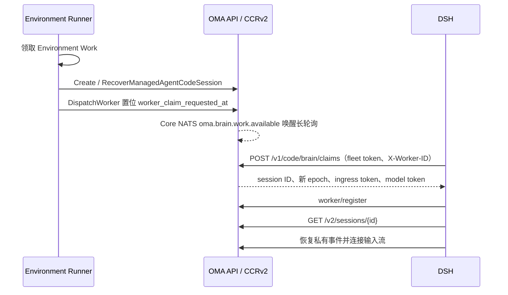

# 沙箱外 Agent 与 CCRv2

当前执行端为 `oma-brain-dsh`。Go 后端负责准备 Code Session 并接受执行端领取，执行端通过原有 CCRv2 完成注册、输入接收、模型代理、工具审批、事件持久化、状态更新和心跳。后端没有独立的 Brain assignment 表或完成状态补丁；领取状态保存在 `code_sessions` 行上。领取接口、状态机、并发与测试的完整设计见 [Brain Worker 领取](brain-worker-claim.md)。

## 启动与多节点恢复

Runner 在 brain 模式下把 `metadata.config.worker_transport` 写为 `claim`，创建或恢复 Code Session 后调用 `DispatchWorker`，只置位领取请求，不下发凭据。DSH 以部署级 fleet token（`code_session.brain_claim_token_file`，brain 模式必填）长轮询领取；一次领取在同一事务内锁定一行、推进 epoch、替换模型凭据 hash 并写入领取者与 30 秒领取期限，提交后签发带 epoch 的 ingress JWT。凭据只出现在这一个 HTTPS 响应里，因此同一 epoch 只有一个持有方，不再依赖消息中间件的投递语义。

可领取条件：`worker_transport = claim`、Code Session active、领取期限已过，租约为空或已超过宽限期，并且存在领取请求或公共会话处于 `running`/`rescheduling`。因此首次启动、执行端崩溃和空闲后收到新输入都走同一条件；idle 会话租约失效后不会被领取。`EnvironmentWorkMapper.ClaimNext` 只领取 queued Work，不再承担 Brain 崩溃恢复，也不再轮换凭据。

`claim` transport 的租约为 20 秒加 10 秒宽限，其他 transport 保持 60 加 10 秒；register 和 heartbeat 按 Code Session 的 transport 选择参数，领取 SQL 用同一宽限期判断租约是否失效。注册在同一事务内清除领取请求与期限；worker 事件流连接时把连续领取失败次数归零。准入失败时 DSH 调用 release：临时性失败按次数指数退避，连续 5 次领取都没有完成准入时（约 155 秒），后端发布 `session.error` 和 `session.status_idle(retries_exhausted)` 并停止重试；任务信封、会话配置或 assignment 校验失败属于永久性失败，DSH 以 `permanent` 原因 release，后端立即发布同样的事件。DSH 正常退出时 release 准入中的领取和仍有活跃 turn 的会话，使其他进程立即接管；崩溃时等待租约与宽限期过去。

Brain 会话收到新输入时不再通过 sandbox 续期路径延长 worker 租约或安排 Work 恢复；沙箱由惰性沙箱网关按需准备。

## 活跃会话输入

遵循 CMA 的输入队列契约：正常 running/rescheduling 时接收 `user.message`，不再返回忙时 409；同一请求也可以提交多条消息。输入在已有 `session_events` 中持久化，排队期间 `processed_at` 为 null。迁移 80 恢复该列可空，不增加表。

投递复用 CCRv2 和 JetStream。两个 consumer 均不显式设置 `MaxAckPending`，使用 NATS 服务端默认值；当前 NATS 2.14.6 默认为 1000。保持按序逐条拉取，控制回复通道仍单独投递。不能再以 `MaxAckPending: 1` 把追加输入阻塞到当前 turn 完成。每次接纳输入后，只将本次收到的事件通过既有 CCRv2 投递路径发布到 NATS，复用稳定事件 ID 去重；不扫描或补投数据库中其他尚未处理的消息。同一批输入保留请求顺序，跨请求按 NATS 实际接收顺序交付。数据库提交与 NATS 发布之间仍无 outbox，不新增发布失败的恢复机制。DSH 在 turn 活跃时将有序追加输入交给原生 steering inbox，由下一步模型请求消费；不再把整轮执行作为所有普通输入的串行屏障。尚未启动、已结束或中断中的 turn 保留顺序排队，已有等待输入时后来的输入不能越过它。控制输入独立处理，因此排队不会阻塞 `user.interrupt` 或工具审批。追加输入 ID 与当前 turn 一同保存到已有 Worker journal；下一次模型请求等待处理回执，turn 结束后先持久化所有输入的完成状态，再按已有投递队列确认，重复投递不再执行。异常恢复沿用当前 turn 的不重放策略。

DSH 开始模型执行前等待首个 `processing` 回执确认；后端通过已有 ACK 引用定位公开消息，写入一次处理时间并首次向 SSE 发布该消息。`processed` 回执兼容没有单独发送 processing 的执行端。排队期间的消息只出现在提交响应和历史中，SSE 实时投递及游标重放跳过尚未处理的消息，避免要求客户端合并同 ID 的不同载荷。CMA 文档明确规定排队期间 `processed_at` 为 null，并示范按 ID 去重；只在处理时发布是本实现据此采用的兼容策略，并非文档明示的推送时机。重复回执不重复修改时间，消息正文和大对象引用保持不变。

队列非空时，前一轮的普通 `idle/end_turn` 不结束公开会话；最后一条处理完成后才公开 idle。处于 `requires_action` 或 `budget_reached` 暂停时，新消息返回 400，仍需先提交相应工具结果或解除预算暂停。显式中断继续保留 `user.interrupt`，公开 stop reason 为 `end_turn`，不添加取消提示消息。

本地测试覆盖并发提交、批量及大消息、处理时间、暂停拒绝和队列排空；真实模型的 `session-active-input` 用例需单独运行验证。

## 会话配置

启动数据统一放在 `code_sessions.metadata.config`。公共 `GET /v2/sessions/{id}` 返回 `{ "session_context": { ... } }`。执行端必须从 `session_context` 对象读取以下字段；缺失或非对象的响应应拒绝启动：

- `cwd`、`model`、`system_prompt`、`custom_system_prompt`、`append_system_prompt`。
- `runtime_skills`：Skill 名称、描述、固定版本及沙箱内 `SKILL.md` 路径。
- `subagents`：由会话 Agent 快照中的固定版本引用解析出的子 Agent 定义及工具权限。
- 原有 `outcomes` 和 `mcp_config`。

创建 Code Session 时，Go 对 prompt、Skill 和子 Agent 字段按 schema 解析，拒绝类型错误；子 Agent 定义从固定版本快照解析后写入配置。MCP 声明、outcomes 与未识别扩展字段在 JSON 边界原样透传，避免改写第三方字段或高精度数字。

系统规则由 DSH 原生提示词、OMA 环境约束和用户 Agent 指令共同组成。Memory 目录来自已解析的挂载资源，通过公共 `memory_catalog_prompt` 字段提供给执行端；DSH 将其追加到环境提示词。原有沙箱客户端的 `append_system_prompt` 保持不变。Skill 和子 Agent 配置在创建 Code Session 时固定，凭据恢复不重新解析，因此不会因 Agent 或 Skill 更新而漂移。

DSH 在本地把公共配置转换为运行时对象，并根据 `OMA_API_URL` 构造沙箱 MCP URL；Go 不再提供 `brain.launch` 或完整 assignment 响应。`environment_runner.brain_api_base_url` 已删除。

## 惰性沙箱

DSH 内嵌 Bash、Read、Write、Edit、Grep、Glob 的模型工具定义，启动时不请求 MCP。纯文本或被拒绝的工具调用不创建沙箱。审批通过后，通过 `/v2/ccr-sessions/{id}/sandbox/mcp` 初始化和调用实际 MCP server。

网关使用普通 CCRv2 身份、租户、epoch 和租约检查，调用共用 Environment 沙箱准备与续期能力，并转发 MCP 协议。Go 不再内嵌另一份工具目录或模拟 initialize/tools/list。沙箱创建复用 `environment_work`、`environment_sandboxes`：创建记录时短暂锁定 Work，多个请求等待同一份创建结果；远端创建和工具执行不持有数据库锁。

DSH 对沙箱 MCP 先尝试 `server/discover` 协商 2026-07-28，旧版服务回退到 initialize。Go 在沙箱创建时用 `server/discover` 检查嵌入式 MCP，成功后才把沙箱标为 `running`；后续工具调用不重复探测。网关透传新版 MCP 请求头及请求范围内的 SSE 响应流，流式响应固定设置 `X-Accel-Buffering: no`，不依赖沙箱 server 或前置代理声明；新版中断关闭原工具请求，由沙箱 server 按协议停止处理，旧版中断仍发送 `notifications/cancelled` 并等待工具结果。沙箱 MCP 的未知执行结果继续由 DSH 私有日志处理。

每次调用前使用 provider `SetTimeout` 唤醒并续期沙箱，随后解析 MCP endpoint。Brain 沙箱启动 `environment-manager task-run`，设置 `ENVRUNNER_SKIP_CLAUDE_CODE=true`；Manager 初始化工作目录并在同一进程中启动 `/mcp`，不运行独立的 `mcp-server` CLI。启动命令清空 `MCP_ALLOWED_HOSTS`，使 E2B 动态服务域名可以通过 Go 网关访问，Rust 仍拒绝未经允许的浏览器 Origin。沙箱网关仅转发新版协议需要的 MCP 请求头和可选参数头，不发送旧版 MCP 会话头及 OMA 自定义 client ID、scope。未知执行结果留在 DSH 私有日志中处理，不写后端 Brain blocked 状态。

本地协议联调可启动 Rust Manager，将其嵌入式 `/mcp` 地址设为 `OMA_RUST_MCP_URL`，运行 `TestProbeSandboxMCPReadyAgainstRustServer` 和 `TestBrainMCPRustServerInterop`；两项分别覆盖 Go 创建阶段的探测和 Go 网关到真实 Rust 工具的转发。

`environment_runner.brain_sandbox_prewarm` 默认关闭。开启后，Runner 先完成沙箱准备，再发布任务；预热失败不会派发 Worker，避免已执行任务依赖失败的 Work。纯文本也可能预热沙箱。空闲回收和归档清理继续由共用 SandboxLifecycle 负责。

## 事件与执行状态

模型代理统一发布消息、工具调用、model request end，保留 thinking 内容及稳定消息 ID。DSH 使用标准 CCRv2 私有事件恢复日志、公开事件及 worker 状态更新。所有执行端统一用 CCRv2 `result` 结束回合：DSH 先保存完成状态及待发送事件，等待消息、工具结果和 model span 发布完成，再发送稳定 UUID 的 result，最后确认输入 ACK。worker idle 只更新执行端状态和空闲时间，不推导公开回合结束；running 和 requires_action 的同步保留。注册不再协商终止事件能力，也不再在 worker binding 中保存该能力。

成功 result（含旧客户端未填写 subtype 的成功结果）映射为 `idle/end_turn`；失败 result 复用后端的安全错误分类，映射为 session.error 和 `idle/retries_exhausted`。DSH 不再自行发送公开终止事件或重复的 session.error，详细安全提示仍通过已有 system.message 发布。已确认的用户取消发送非失败 result，保留内部取消状态。后端直接按 result 的成功或失败字段映射，不查询历史推断取消，也不将失败 result 改判为正常结束。

result 复用既有事件 ID 去重、epoch 校验和队列过滤；普通成功结束在有待处理输入时不使公开 Session idle。主线程失败后的子线程结束不能覆盖会话的失败 stop reason。回归覆盖 result 与 worker idle 的各种到达顺序、重复 result、重新注册、迟到状态、中断后同会话继续，以及子线程失败原因保留。

公开 `user.interrupt` 经后端转换为 CCRv2 `control_request/interrupt`；执行端的两种中断入口都记录取消意图。工具结果已确认时保留内部取消处理，公开 `session.status_idle.stop_reason.type` 按 CMA 契约使用 `end_turn`，允许同会话继续；保留 `user.interrupt`，不生成 `Turn cancelled` 消息。结果未知时仍保持 blocked，不把未知执行当作成功取消。

工具审批仍使用现有 CCRv2 控制请求。模型中的标准工具名在 MCP 边界转换为对应 server 名称。原始参数和审批后的参数分别保留；执行前再次校验有效参数。只读工具的并行策略与按 callId 记录的执行状态由 DSH 管理，Go 不为每次工具执行维护独立状态机。

## 迁移与部署

Brain 实现尚未部署，不保留开发阶段创建独立 Brain 表、延迟沙箱字段和迁回 CCRv2 的中间迁移。最终模型直接复用现有 Code Session、公共配置与 CCRv2 私有事件，无需新增表或专用索引。应用过这些中间迁移的本地开发数据库需要重建；旧 Rust/Grok 客户端和旧 registration-token 任务不再兼容。

后端与 DSH 需要一起更新；JetStream `OMA_BRAIN_TASKS` stream 已删除，迁移 83 为 `code_sessions` 增加领取列。多实例后端继续共用 CCRv2 签名密钥、数据库、NATS 和事件对象存储；任一实例的派发都通过 Core NATS 唤醒所有实例上的长轮询，通知丢失只会让领取退回到每秒一次的兜底查询。

## 验证边界

普通测试覆盖并发领取互斥、领取期限与宽限期边界、idle 排除、失败退避与耗尽后的公开错误、旧 epoch 注册与心跳拒绝、20 秒租约、恢复保留配置、子 Agent 固定版本、惰性沙箱并发创建、MCP 转发和消息顺序。DSH 的测试使用真实原生 loop、受控模型/MCP/CCRv2 与领取服务，覆盖容量背压、准入失败与停机 release。

真实模型、实际云沙箱和端到端 SSE 对比通过 verify-be 的相关场景单独验收；仅在用户明确要求时执行，不以普通测试代替。

DSH Brain 源码作为主仓库的 `oma-brain-dsh/` 普通目录维护，使用自己的 Bun
依赖锁和 build/typecheck/test 命令。历史验收模板位于
`oma-brain-dsh/verification/testdata/`，属于复制到相应历史后端 harness 的输入数据，
不是独立的 Go package；当前后端验收继续使用 `tests/liveworker/` 中的场景。

领取接口对缺少或错误的 fleet token 返回 401，对缺少 `X-Worker-ID` 或越界的 `block_ms` 返回 400；release 只接受 `admission_failed` 与 `shutdown`，领取已不属于调用方时返回 409。响应设置 `Cache-Control: no-store`，运行日志只记录 `worker_id`、`code_session_id`、`worker_epoch` 等元数据，不记录凭据。
