# 沙箱外 Agent 与 CCRv2

当前执行端为 `oma-brain-dsh`。Go 后端负责准备 Code Session 并接受执行端领取，执行端通过原有 CCRv2 完成注册、输入接收、模型代理、工具审批、事件持久化、状态更新和心跳。后端没有独立的 Brain assignment 表或完成状态补丁；领取状态保存在 `code_sessions` 行上。领取接口、状态机、并发与测试的完整设计见 [Brain Worker 领取](brain-worker-claim.md)。

本地在仓库根目录运行 `just restart-brain`，复用 `oma-brain-dsh/scripts/restart.sh`，先构建，再停止当前 Brain 目录启动的 Bun 入口进程，并在前台启动新进程。构建失败时保留旧进程，旧进程未能在 30 秒内退出时取消重启。

## 时间上下文插件扩展

`src/plugins/time-context.ts` 组合原生 `@deepseek-ai/dsh-time-context`，复用采样、时区、刷新调度和会话投影。先加载原插件，再注册 `prepend: true` 的 `agent/pre-step` 中间件；等待 `next()` 返回后，只为新生成的 `source.kind=time-context`、`form=snapshot` 消息增加简短提醒标签和边界说明，同步转换content与source.sections，然后交给DSH入日志。拒绝或取消的step原样返回。普通用户内容不按正文标签或时间模板识别。

包装属于持久消息本身，编码器直接转换content；恢复和重试不再次包装历史，动态时间保持user角色，system提示词没有插件专属规则。原生插件默认十分钟刷新机制保持不变。已有裸时间历史不会被此扩展追溯改写；新快照才包含边界。实现与验收范围见[时间上下文插件扩展](time-context-user-projection.md)。

DSH 内核尊重显式设置的 `DSH_HOME`，并将配置路径归一为绝对路径；未设置或为空时，源码与模块构建默认使用当前应用目录的 `.dsh`，即 `oma-brain-dsh/.dsh/`，不依赖启动 cwd。独立二进制默认使用实际可执行文件所在目录的 `.dsh`，不使用构建机器路径或 Bun 虚拟文件系统路径。显式相对路径按启动 cwd 解析，支持 `~` 家目录前缀。附件与缓存使用该 home，已有数据不自动迁移。

会话主存储由直接注册的 `JsonlPersistence` 管理。路径优先级为 `OMA_BRAIN_TRANSCRIPT_DIR`、已解析 `DSH_HOME` 下的 `transcripts/`、应用默认 `.dsh/transcripts/`。通过重启脚本启动且未覆盖配置时，仍位于当前 checkout 的 `oma-brain-dsh/.dsh/transcripts/`。嵌入 bridge 可传 `localRoot`，未指定时使用隔离临时目录。

启动领取器前创建并探测 DSH_HOME、附件目录和 transcript 根目录。探测实际创建独占临时文件，写入并 fsync、重命名后清理，不只依赖 access 权限位。探测不创建可能被 JSONL 枚举误认为项目目录的临时目录。非法路径、只读或其他 I/O 失败以带设置名、解析路径和错误码的 ConfigurationError 拒绝启动，不发出领取或注册请求；已有目录权限不被修改。测试覆盖不同 cwd、显式 home、只读/非目录路径、探测清理，以及从不同 cwd 启动的独立二进制。

## 私有持久化写入类型

DSH 日志统一使用 `type: "dsh_log"`，`data` 原样保存原生 `SessionHeader` 或单条 `SessionEvent`，不再增加 `dsh_header`、header/event 包装、sessionId、inherited 或额外的记录分类字段。私有 payload 不使用 subtype；后端私有事件入口增加该 type，原有 transcript 类型继续保留，公开事件入口不增加该类型。后端只解析顶层路由与身份字段，data 保持原始 JSON。`CcrPersistArgs` 将 type 与 data 类型关联，由客户端和后端接口共用；类型回归由 `oma-brain-dsh/tests/ccrv2-persistence-types.test.ts` 配合 `bun run typecheck` 验证。

本地创建和追加只通过原生 JSONL；独立 `CcrReplication` 在后台读取并上传本地尾部。远程创建时先确认原生 Header，再上传逐条 Event，每条 payload 只包含一个原生对象。HTTP 上传器继续通过请求的 events 数组合并上传，保留队列容量、顺序、重试和确认约束。复制器等待本次所有事件确认后推进已复制前缀；部分确认后失败时重试沿用各事件身份。本地 append/flush 不等待远程，远程失败在后台重试。工具执行、公开事件发布、后续模型请求与输入 ACK 前显式等待本地日志及远程确认。

日志格式版本直接使用原生 Header 的 version，恢复时由 DSH assertVersion 校验，不写额外的 schema_version。恢复使用原生 seq 字段识别 Event，其他日志记录按 Header 校验；先读取 Header，再逐条校验 Event 的类型与序号连续性。相同 seq、相同内容的重复记录只应用一次，不同内容则报错。当前仍不支持 fork，内存 inherited 固定为 0，不写入原生对象。会话恢复直接使用 DSH `agents.resume()`，不再保存 BrainState、逐调用阶段或工具结果副本。本次不兼容旧批次和额外包装格式，不提供迁移或回滚读取兼容。

私有事件 UUID 不哈希完整 data。Event UUID 为 `dsh_log:<code-session-id>:<dsh-session-id>:<seq>`，Header UUID 为 `dsh_log:<code-session-id>:<dsh-session-id>:header`。ID 各部分使用 encodeURIComponent 编码。主线程的 DSH Session ID 使用 code-session-id，子线程使用传输层 agent_id；Header 的 Session ID 使用原生 id。传输层保留 uuid 和 agent_id，不将其注入 data。读取子线程历史时以 agentId 选择 subagents 私有流，并按返回记录的传输层 agent_id 过滤每一页结果，再将原始 payload 交给恢复逻辑，避免不同子线程相同 seq 相互混淆。不写输入交付阶段插件事件或额外远程交付快照；逐块输出的恢复记录使用下文定义的原生可忽略插件记录。同一 Event 的身份不受 flush 分组或 JSON 属性顺序影响，入队前 JSON 快照和 HTTP 确认行为保持不变。

ccrv2-client.test.ts 覆盖原生对象直存、单事件身份、跨页子线程隔离和重试稳定性。local-transcript.test.ts 覆盖原生可忽略扩展保留、必需未知事件拒绝和 Header 规范化与直接使用原生 JSONL 一致；ccrv2.test.ts 覆盖 Header 与 Event 直接保存和恢复，拒绝不支持的 Header 版本、缺失 Header、序号缺口及冲突事件。session、subagents 和 crash 测试覆盖持久化顺序、子线程恢复和工具结果不重复执行。

## 本地主存储与异步复制

`JsonlPersistence` 直接拥有 sessionPersistence 服务、固定 session 路径和原生 session.lock。每次领取后的首次打开都先读取并校验远程历史，再获取本地原生写锁对账，同一领取代内不重复对账。本地缺失则补齐 Header/Event；本地是远程前缀时追加远程尾部，再交给 agents.resume；本地领先时保留本地尾部并异步上传。历史或 Header 不一致且互不为前缀时直接报错并停止恢复，保留原 session 路径和日志内容，不自动移动、覆盖、拼接或重建。远程缺失时保留并上传已有本地日志；远程读取失败、记录损坏或本地锁冲突时不恢复执行，保留本地文件。没有本地盘的新实例只能恢复远程已确认前缀，未复制的普通尾部依赖保留原磁盘。

冷恢复会把候选远程记录写入独立临时原生 JSONL 实例，关闭 writer 后用新 reader 回读，完整校验跨事件生命周期关系，通过后才修改本地文件。临时文件始终释放并清理；序号连续但回合关系非法的远程历史同样不能触发本地修改或追加。

复制器首次校验前缀后维护已确认 seq，通过 session/created、session/event 更新活动 Session 的增量视图。检查点先固定本次事件边界，再逐个等待本会话及其子线程的原生 `sessions.flush(session)`，只上传该边界内的新尾部，不能把 flush 期间追加但未确认落盘的事件提前上传。不重复打开或扫描 JSONL，也不再比较或深拷贝已确认前缀。无变化的预览帧只等待已有确认。直接操作原生 handle 而没有 Session 事件时，按 revision 检测变化再读取未缓存后缀。缓存随 forget/关闭清理。后台复制同样只等待目标 Session 的持久化屏障，不调用服务级全局 flush；本会话的落盘失败仍阻止其上传和远程确认，其他会话的失败不阻塞本会话。复制器自身触发的 flush 不重复安排后台任务。直接操作原生 handle 的 append 已经完成耐久写入，复制器按落盘 revision 读取，不替调用方刷新其他 writer。

lease/epoch/认证终止会 fence 主线程及所有子线程，旧任务不能采用新一代凭据。关闭等待原生结果复制确认及队列 drain，再释放领取。没有自动保留期限或清理任务，磁盘回收由部署管理；旧格式与旧 Brain receipt 需要显式迁移，不能拼接。

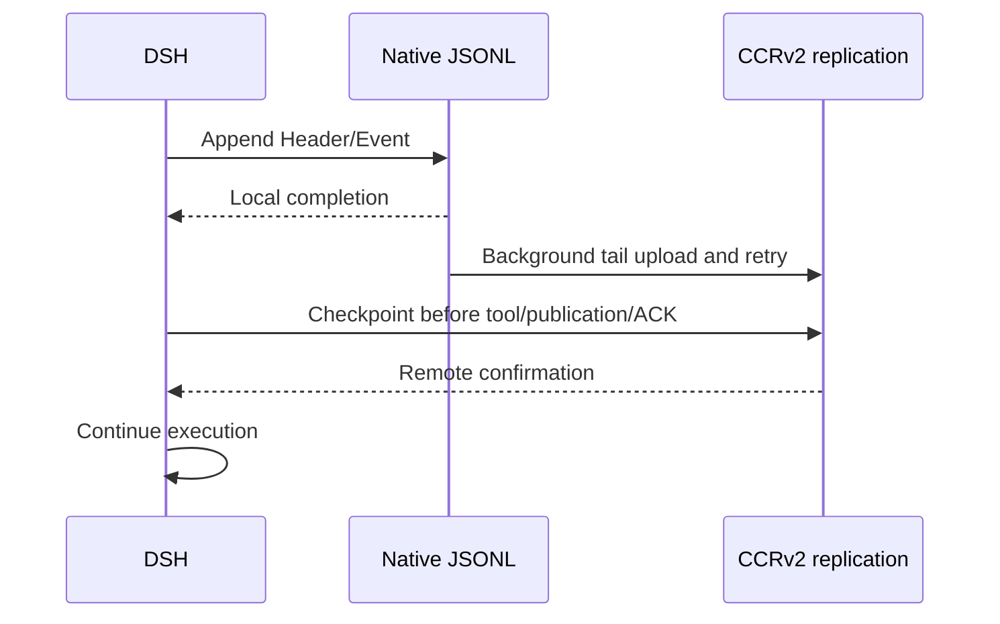

## 启动与多节点恢复

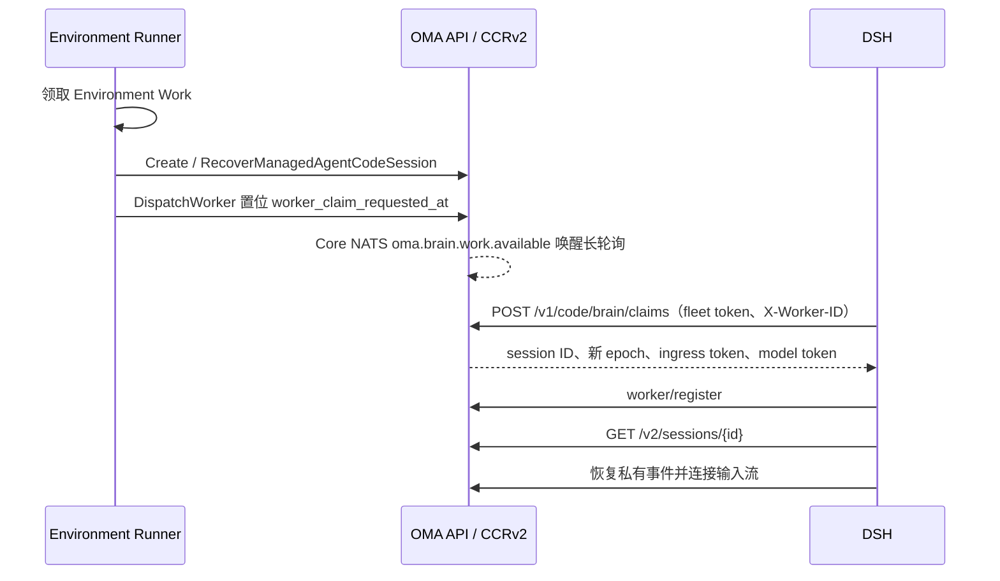

Runner 在 brain 模式下把 `metadata.config.worker_transport` 写为 `claim`，创建或恢复 Code Session 后调用 `DispatchWorker`，只置位领取请求，不下发凭据。DSH 以部署级 fleet token（`code_session.brain_claim_token_file`，brain 模式必填）长轮询领取；一次领取在同一事务内锁定一行、推进 epoch、替换模型凭据 hash 并写入领取者与 30 秒领取期限，提交后签发带 epoch 的 ingress JWT。JWT 验证只检查签名、claims 和请求路径绑定，不因 owner 切换导致 epoch 变化而判定 token 无效。资源读取校验会话与租户归属；注册、心跳、状态与事件写入、工具调用、代理和流订阅在执行授权阶段检查当前 epoch，旧 owner 返回 `409 conflict_error`。写入携带的 epoch 必须匹配签名 claims，数据库事务继续执行 epoch fence。凭据只出现在这一个 HTTPS 响应里，因此同一 epoch 只有一个持有方，不再依赖消息中间件的投递语义。

可领取条件：`worker_transport = claim`、Code Session active、领取期限已过，租约为空或已超过宽限期，并且存在领取请求或公共会话处于 `running`/`rescheduling`。因此首次启动、执行端崩溃和空闲后收到新输入都走同一条件；idle 会话租约失效后不会被领取。`EnvironmentWorkMapper.ClaimNext` 领取云环境的 queued Work，以及已确认但尚无活动 Code Session 的自托管 Work；Brain 执行端崩溃恢复由 HTTP claim 处理，不再由 Work 轮换凭据。

`claim` transport 的租约为 20 秒加 10 秒宽限，其他 transport 保持 60 加 10 秒；register 和 heartbeat 按 Code Session 的 transport 选择参数，领取 SQL 用同一宽限期判断租约是否失效。注册在同一事务内清除领取请求与期限；worker 事件流连接时把连续领取失败次数归零。准入失败时 DSH 调用 release：临时性失败按次数指数退避，连续 5 次领取都没有完成准入时（约 155 秒），后端发布 `session.error` 和 `session.status_idle(retries_exhausted)` 并停止重试；任务信封、会话配置或 assignment 校验失败属于永久性失败，DSH 以 `permanent` 原因 release，后端立即发布同样的事件。DSH 正常退出时先排空：停止领取，拒绝新的 Bash/Write/Edit/外部 MCP dispatch（返回 "Brain worker is shutting down; the tool was not executed." 的工具错误，不记录派发阶段），Read/Glob/Grep 在排空窗口内仍允许执行，保持原有最多重试一次的行为，且不计入副作用调用的排空等待；它们仍参与活动 keepalive，并会在随后统一取消会话时停止。排空在 `OMA_BRAIN_SHUTDOWN_DRAIN_MS`（默认 20 秒）内等待已 dispatch 的副作用调用记录结果；超时仍未完成的会话以 `{kind: "hook", reason: "oma-worker-shutdown"}` 取消本轮，由 DSH 记录中断工具结果并以失败结果结束本轮，等待至多 5 秒收尾，不把会话阻断；进程强制退出时限为排空时长加 8 秒。随后 release 准入中的领取和仍有活跃 turn 的会话，使其他进程立即接管；关闭空闲会话时以 `idle` 原因只清除租约，之后的新输入可以立即被领取；崩溃时等待租约与宽限期过去。耗尽与永久失败都推进 epoch，失败公开后旧凭据无法再注册。

Brain 会话收到新输入时不再通过 sandbox 续期路径延长 worker 租约或安排 Work 恢复；沙箱由惰性沙箱网关按需准备。

## 活跃会话输入

遵循 CMA 的输入队列契约：正常 running/rescheduling 时接收 `user.message`，不再返回忙时 409；同一请求也可以提交多条消息。输入在已有 `session_events` 中持久化，排队期间 `processed_at` 为 null。迁移 80 恢复该列可空，不增加表。

投递复用 CCRv2 和 JetStream。两个 consumer 均不显式设置 `MaxAckPending`，使用 NATS 服务端默认值；当前 NATS 2.14.6 默认为 1000。保持按序逐条拉取，控制回复通道仍单独投递。不能再以 `MaxAckPending: 1` 把追加输入阻塞到当前 turn 完成。每次接纳输入后，只将本次收到的事件通过既有 CCRv2 投递路径发布到 NATS，复用稳定事件 ID 去重；不扫描或补投数据库中其他尚未处理的消息。同一批输入保留请求顺序，跨请求按 NATS 实际接收顺序交付。数据库提交与 NATS 发布之间仍无 outbox，不新增发布失败的恢复机制。DSH 将普通输入接到现有 `consumeInbound` 的串行任务链，每条输入分别调用 `receive` 并启动独立 turn；当前 turn 的工具调用、文本回复、持久化、结果发布与投递确认完成后，才开始下一条输入。不再提前调用 steering，也不让下一条输入进入当前 turn 的工具后续请求。控制输入保留独立任务链，因此排队不会阻塞 `user.interrupt` 或工具审批。Worker 收到消息即报告 `received`，轮到该消息执行时才报告 `processing`；每个 turn 在原生终态和公开结果确认后确认自己的输入。已有 pending 映射合并队列内的重复投递，原生用户消息身份防止重投再次执行。未完成投递继续由 JetStream 保留，异常恢复沿用当前 turn 的不重放策略。不保留旧 Worker 执行快照兼容。

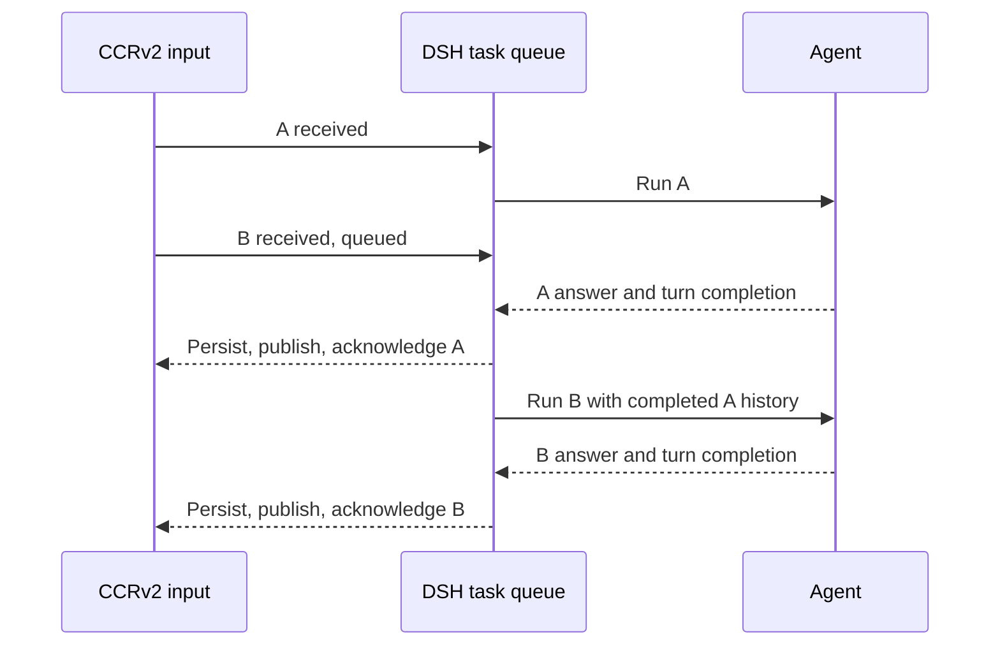

DSH 开始模型执行前等待首个 `processing` 回执确认；后端通过已有 ACK 引用定位公开消息，写入一次处理时间并首次向 SSE 发布该消息。`processed` 回执兼容没有单独发送 processing 的执行端。排队期间的消息只出现在提交响应和历史中，SSE 实时投递及游标重放跳过尚未处理的消息，避免要求客户端合并同 ID 的不同载荷。CMA 文档明确规定排队期间 `processed_at` 为 null，并示范按 ID 去重；只在处理时发布是本实现据此采用的兼容策略，并非文档明示的推送时机。重复回执不重复修改时间，消息正文和大对象引用保持不变。

队列非空时，前一轮的普通 `idle/end_turn` 不结束公开会话；最后一条处理完成后才公开 idle。处于 `requires_action` 或 `budget_reached` 暂停时，新消息返回 400，仍需先提交相应工具结果或解除预算暂停。显式中断继续保留 `user.interrupt`，公开 stop reason 为 `end_turn`，不添加取消提示消息。

用户消息可以包含 `image` 和 `document` 块。服务端投递前把内联内容和 Files 引用物化为会话私有文件。Brain 将 file_id 图片读取并归一化为远端存储支持的原生 DSH image，AI SDK 适配器按模型图片预算生成内联变体，参与能力投影、计量及 offload；base64 图片走同一路径。URL 与历史 oma-image、oma-document 保持代理展开语义。私有日志只保存引用，本地图片缓存不是恢复依赖。详见 [消息附件](message-media-attachments.md) 与 [远端图片附件](brain-image-attachments.md)。

本地测试覆盖并发提交、批量及大消息、处理时间、暂停拒绝和队列排空，以及工具执行中追加多条输入时的回合隔离、完成顺序、重复投递去重和控制通道独立处理；真实模型的 `session-active-input` 用例需单独运行验证。

## 会话配置

启动数据统一放在 `code_sessions.metadata.config`。公共 `GET /v2/sessions/{id}` 返回 `{ "session_context": { ... } }`。执行端必须从 `session_context` 对象读取以下字段；缺失或非对象的响应应拒绝启动：

- `cwd`、`model`、`system_prompt`、`custom_system_prompt`、`append_system_prompt`。
- `runtime_skills`：Skill 名称、描述、固定版本及沙箱内 `SKILL.md` 路径。
- `runtime_tools`：从 Session 固化的工具配置解析出的内置工具白名单，使用 DSH 工具名。禁用工具不列入，需审批工具仍列入；没有内置 toolset 时返回空数组。
- `subagents`：由会话 Agent 快照中的固定版本引用解析出的子 Agent 定义及工具权限。
- `runtime_tools`：主 Agent 启用的沙箱工具名，按与权限执行相同的规则从会话 Agent 快照计算；缺失时注册全部沙箱工具。
- `runtime_tool_permissions`：以沙箱 MCP 工具名（`bash`、`read`、`write`、`edit`、`grep`、`glob`）为键的策略表，值为 `allow`、`ask` 或 `deny`，由 Go 用与 `can_use_tool` 审批相同的 `resolveAgentToolPermission` 从当前线程的 Agent 快照计算。创建时写入 Code Session 的表仅用于启动；`session_context` 每次读取最新 Session 或子线程快照重新计算权限，包括创建时未带权限表的旧会话。DSH 在每次模型请求前读取该上下文并更新权限表。自托管会话不下发本地放行表，所有调用都通过后端审批和外部结果路由。读取或校验失败时不发送模型请求，不沿用旧的放行结果；响应缺失该字段时清空本地表，所有工具走审批请求。会话只允许在 idle 时更新工具策略，因此下一轮模型执行前即可应用 `allow` 改为 `ask` 或 `deny` 的变化。
- 原有 `outcomes` 和 `mcp_config`。DSH 目前不使用这两个字段：执行端只连接 Go 构造的沙箱 MCP（`/v2/ccr-sessions/{id}/sandbox/mcp`），不连接 `mcp_config` 中的用户 MCP 服务器，因此 Agent 上配置的 `mcp_toolset` 在 brain 模式下不可用，也不执行 outcomes。这是当前的范围限制，扩展时可复用沙箱工具的 `RemoteTool` 与网关转发模型。

创建 Code Session 时，Go 对 prompt、Skill 和子 Agent 字段按 schema 解析，拒绝类型错误；子 Agent 定义从固定版本快照解析后写入配置。MCP 声明、outcomes 与未识别扩展字段在 JSON 边界原样透传，避免改写第三方字段或高精度数字。

系统规则按稳定性分层组装，详见 [agent-system-prompt](agent-system-prompt.md)。`append_system_prompt` 由 Go 按 Environment 的 `networking` 与 `packages` 渲染。Memory 目录来自已解析的挂载资源，通过公共 `memory_catalog_prompt` 字段单独提供给执行端，DSH 将其放在 Agent 指令之后的会话层。Skill 和子 Agent 配置在创建 Code Session 时固定，凭据恢复不重新解析，因此不会因 Agent 或 Skill 更新而漂移。

DSH 在本地把公共配置转换为运行时对象，并根据 `OMA_API_URL` 构造沙箱 MCP URL；Go 不再提供 `brain.launch` 或完整 assignment 响应。`environment_runner.brain_api_base_url` 已删除。

## 惰性沙箱

已注册工具的权限预检挂在每个运行时可并发的 `tools/execute` 包装层，在工具定义校验与执行前调用现有 Go 权限桥，覆盖普通工具、外部 MCP 与内部委派工具。未知工具在 `tools/pre-execute` 入口报告不可用，后端直接拒绝，不进入用户审批等待。不能在已注册工具的串行预调度阶段等待审批，否则会阻止同一批并行工具发起各自的审批。后端仍是公开调用事件的唯一发布者。`ToolExecution` 复用同一 bridge、同一 call ID 的预检结果，不重复审批或发布。结果进入日志后释放预检缓存，轮次结束清空残留；缓存不是执行恢复依据，重启仍依赖持久日志和后端稳定事件 ID。内部 `list_agents`、`send_to_agent`、`archive_agent` 仅在会话配置启用 subagents 时允许，子线程不获得再次委派权限。未知工具及运行时报告不可用的工具直接拒绝，不生成审批等待或伪造策略评估。预检不会创建沙箱，也不执行工具。调用事件和结果使用原有同线程稳定 ID 关联，线程消息事件继续保留。

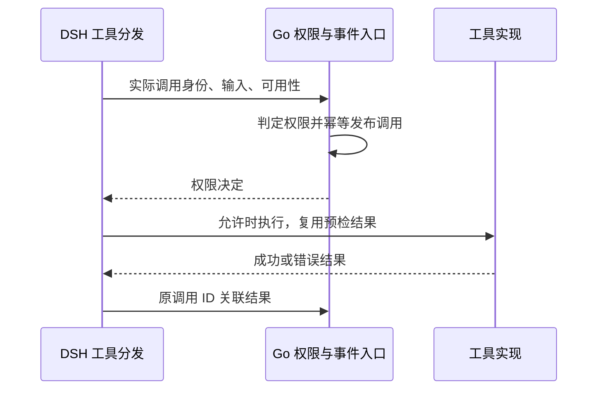

DSH 内嵌 Bash、Read、Write、Edit、Grep、Glob 的模型工具定义，启动时不请求 MCP。主会话仅注册 `runtime_tools` 中的内置工具，缺失或 null 按空列表处理，非法列表拒绝启动。内联子 Agent 继承父会话白名单，固定子 Agent 使用其版本快照中的白名单。固定专家的内置工具名单不与父名单取交集，空名单保持为空；inline/self 使用自身继承的有效快照。模型可见性过滤不替代后端执行前的工具权限检查和审批。实际权限仍使用已认证的子线程上下文，不扩展父线程权限。内置工具注册必须把真实子线程 ID 传入执行器；读重试和写调用均携带该身份，由沙箱客户端设置 `X-OMA-Session-Thread-ID`。父线程不携带该头，共用沙箱客户端不得串用上次调用的线程身份。纯文本或被拒绝的工具调用不创建沙箱。审批通过后，通过 `/v2/ccr-sessions/{id}/sandbox/mcp` 初始化和调用实际 MCP server。

沙箱 Manager 的代理与 Git 签名使用绑定具体 `sandbox_uuid` 的 `role=sandbox` 凭据，生命周期独立于 Brain owner 的 worker epoch。该凭据只能调用这两个运行时入口；worker 接口仍使用当前 owner JWT 和 epoch fence。详见 [沙箱代理凭据](ccrv2/upstream-proxy-and-model-runtime.md#brain-与普通-http-出站)。

外部 MCP 与沙箱 MCP 分开传递。`registerWorkerTask` 将 `/v2/sessions/{id}` 返回的 `session_context.mcp_config` 原样保存在 assignment 的 `external_mcp_config`，包括连接地址、headers、工具配置和未知扩展；assignment 的 `mcp_config` 仍由 DSH 构造，只包含平台拥有的 `sandbox` endpoint。外部服务器即使名为 `sandbox`，也不会覆盖内置工具的沙箱连接。两份配置只存在于运行时边界，不新增数据库字段或公开 API 字段。

Brain 宿主机上的外部 MCP 请求经现有 `/v2/ccr-sessions/{id}/mcp?mcp_url=...` 代理发送。后端校验当前 Session 身份与网络策略，并由 Vault 注入远端凭证。Brain 只向 OMA 发送当前 assignment 的 ingress token，不把该 token 发到远端 MCP。HTTP 和旧式 SSE 的每次实际请求都使用该通道，包括 SSE 返回的消息地址。已有同 Session named Tunnel 网关请求保持原路由。普通沙箱的远端连接仍使用沙箱 HTTP(S) Proxy/MITM。此适配不改写 `external_mcp_config`，不保存 Vault 秘密。

根会话在第一次模型请求前并行连接全部外部服务器并执行 `tools/list`，初始化耗时取决于最慢的服务器而不是各服务器之和；每个服务器仍各自使用下述发现超时。全部服务器结束后再按配置顺序上报失败、校验工具名并注册工具，因此模型工具目录顺序与 `session.error` 顺序不受响应先后影响。Streamable HTTP 使用 MCP SDK 的自动版本协商，旧式 SSE 使用 legacy initialize；SDK 聚合分页目录。当前外部传输支持 `http`、`streamable-http` 和 `sse`，不支持 stdio、WebSocket 或主机命令。配置缺失时保留原有无外部 MCP 行为。单个服务器连接或发现失败时关闭该服务器连接，发布 `mcp_connection_failed_error` 或 `mcp_authentication_failed_error`，其余服务器继续注册，下一次工具刷新时重新发现。非法配置、非法工具名或名称冲突会停止初始化并关闭全部连接；发现期间会话停止同样中止全部服务器并关闭连接。发现和调用保留服务器协议 headers，代理入口的 Authorization 使用当前 Session 凭据。后端删除入口凭据并注入 Vault 凭据。禁止自动跟随 HTTP 重定向，不将沙箱或模型凭据拼接到外部请求。

DSH 将发现的工具注册为 `mcp__<server>__<tool>`，服务器名中的 `.` 转为 `_`，远端调用仍使用原始工具名。拒绝服务器名归一化冲突及完整工具名碰撞，避免将权限或调用路由到错误服务器。显式配置为 `enabled: false` 的工具不注册；其他工具仍必须通过 Go 的实际权限判定，目录过滤不能替代权限检查。服务器名保留在带前缀的审批工具名中，Go 按现有快照解析原始服务器与工具身份，发布裸工具名的 `agent.mcp_tool_use`，关联结果按既有 CCRv2 转换成为 `agent.mcp_tool_result`。DSH 不自行重复发布一套公共 MCP 事件。DSH 从本线程的 `tool/call` 记录工具名，在对应 `tool/result` 的内部 `tool_result` block 中携带 `tool_name`；Go 在结果映射边界根据该身份选择 `agent.mcp_tool_result` 和 `mcp_tool_use_id`，引用与原调用相同的稳定公开事件 ID。内部 `tool_name` 不进入公开结果。内置工具继续使用 `agent.tool_result` / `tool_use_id`，无身份的旧 Worker 结果不从正文猜测 MCP 类型。调用身份按线程和 provider call ID 隔离，结果消费后或轮次结束时释放；恢复补发时从原生 assistant/message 和 tool/call 重建工具身份，不依赖进程内缓存或重放工具。失败与成功 MCP 结果使用相同关联规则，保留 `is_error` 和原始 content，不使用子 Agent 文本启发式过滤 MCP 文档中的 `agentId:` 或 `<usage>`。

外部工具复用 `ToolExecution` 的参数 schema 校验、审批后参数再校验和 DSH 原生日志检查点。它们不触发沙箱 provision；工具声明为串行执行。当前结果沿用 Brain 的文本结果边界，非文本 MCP content 不在本次支持范围内。MCP 返回 `isError` 时记录失败结果；外部 MCP tools/call 收到官方 SDK `ProtocolError` 的 `InvalidParams`（例如已删除的工具名）时，保留服务端错误文案并记录已知失败结果，允许模型及后续轮次继续，不记 unknown、不重放旧调用。其他协议错误如 InternalError 不据此推定执行结果已知；断流或超时作为原生工具错误返回，并明确提示先核实外部状态；Worker 崩溃时由 DSH 原生恢复补齐未知结果，不再阻断整个会话。外部 MCP 网关在处理入口设置 `X-Oma-Mcp-Not-Forwarded: true`：鉴权、策略拒绝、未配置的服务器，以及 `httptrace` 未观测到建立上游连接（`GotConn`）的失败（如连接被拒、DNS 失败、凭据注入被拒）都保留该标记；一旦建立连接，即使请求只写出一部分就失败也不带标记，响应丢失同样按未知处理。Tunnel 目标在命令进入队列前失败（目标无效、Tunnel 已归档或不存在、channel 无效、请求体超限、不支持的方法）时由 `tunnels.IngressHandler.ServeTunnel` 设置同名标记；`Enqueue` 开始后的失败，包括 `Enqueue` 本身返回错误，都保留未知语义。DSH 只在 `tools/call` 响应带该标记，或连接 OMA 网关本身被拒/无法解析（`ConnectionRefused`、`ENOTFOUND` 等）时，记录 `MCP tool call was not executed: ...` 的已知失败结果，不阻断会话、不重放；沙箱 MCP 对连接 OMA 网关失败采用同一判定。主动用户中断按下述本地中断结果收尾，不把本地取消当作远端停止确认。发现和列表请求超时为 30 秒，工具调用超时为 185 秒。网关会移除直接上游返回的 `X-Oma-Mcp-Not-Forwarded` 响应头，防止已转发请求被上游标记为未转发。会话过期后重新发起工具请求前，DSH 清除前次未转发证据，后一次请求的结果独立判定。

每个线程拥有自己的外部连接、发现目录、审批与结果记录器。固定子 Agent 从其版本快照解析 MCP 配置，自定义子 Agent 使用派生快照；子线程请求携带线程身份。释放线程或初始化回滚会关闭该线程的连接，关闭失败向上传递。恢复会话时重新发现目录，并沿用现有执行日志恢复规则，不重放已完成或结果未知的调用。当前目录是单次运行时快照，不订阅 `tools/list_changed` 热更新。

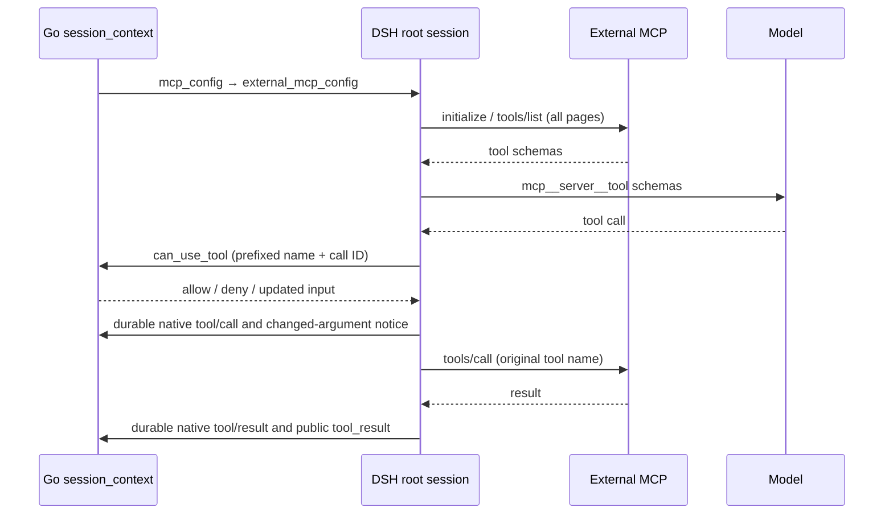

`internal/codesessions/mapper_mcp_result_test.go` 覆盖成功/失败 MCP 结果、根/子线程稳定关联、普通工具回归及内容保留；`oma-brain-dsh/tests/tool-results.test.ts` 覆盖缺少调用身份、同 call ID 的跨线程隔离、身份消费与轮次结束清理。`oma-brain-dsh/tests/external-mcp.test.ts` 使用本地受控 MCP、模型和 CCRv2 服务覆盖注册配置保留、分页发现、多服务器并行发现及配置顺序注册与失败上报、发现期间停止、禁用工具、真实 SDK HTTP/SSE 传输、模型工具目录、原始参数与结果 ID、拒绝与非法参数不调用、MCP 错误结果、断流后 unknown、主动中断本地收尾、子会话归属、恢复及根连接释放。`tests/external-mcp-session.test.ts` 另覆盖已标记未转发的 404 触发会话重建后，实际调用返回 503 时仍保持未知结果；Go 网关普通单测覆盖上游收到完整工具请求后返回同名标记时，网关移除该标记。运行入口为 `cd oma-brain-dsh && bun test tests/external-mcp.test.ts tests/external-mcp-session.test.ts`。这些普通测试不代表 Qoder/OMA 双端真实用例通过，也不覆盖 Microsoft Learn 可达性、真实模型选择工具、公开 SSE/历史的最终兼容断言或并行场景；双端回归与并行场景仍需单独授权。

并行发现的连接释放回归通过本地 HTTP/SSE MCP 服务和实际 SDK 传输验证。HTTP/HTTP、SSE/SSE 与 HTTP/SSE 组合在发现中停止后，服务端必须观察到未完成的 `tools/list` HTTP 请求取消，SSE 服务还必须观察到事件流断开；已经返回完整目录的 SSE 服务也必须关闭。单台 SSE 发现失败时，其连接必须在其他服务器仍等待发现结果时关闭，随后健康服务器仍能向模型提供工具。这些断言均在测试兜底清理之前完成，停止路径还检查没有模型请求或 `session.error`。

网关使用普通 CCRv2 身份、租户、epoch 和租约检查，调用共用 Environment 沙箱准备与续期能力，并转发 MCP 协议。Go 不再内嵌另一份工具目录或模拟 initialize/tools/list。沙箱创建复用 `environment_work`、`environment_sandboxes`：创建记录时短暂锁定 Work，多个请求等待同一份创建结果；远端创建和工具执行不持有数据库锁。

DSH 对沙箱 MCP 先尝试 `server/discover` 协商 2026-07-28，旧版服务回退到 initialize。Go 在沙箱创建时用 `server/discover` 检查嵌入式 MCP，成功后才把沙箱标为 `running`；后续工具调用不重复探测。网关透传新版 MCP 请求头及请求范围内的 SSE 响应流，固定设置 `X-Accel-Buffering: no`。所有工具使用普通 `tools/call`，Rust 不声明 Tasks 能力，Brain 不创建或查询 Tasks。用户中断通过官方客户端的 AbortSignal 关闭当前 HTTP 请求；Rust 按新版协议取消执行并清理 Bash 进程组。连接关闭后没有该请求的最终响应，因此本地 abort 不能证明远端已停止。结果缺失时记录失败工具结果并提示核实远端状态，不重放原调用；后续新输入可以继续。

网关在请求进入处理函数时设置 `X-Oma-Sandbox-Not-Forwarded: true`，在向沙箱发出请求前移除；若转发失败且 `httptrace` 未观测到建立连接（例如沙箱刚过期或重建导致连接被拒、DNS 失败），网关重新设置该标记，因为沙箱不可能收到请求。连接一旦建立，写到一半失败或响应丢失都不带标记，由 DSH 按未知结果处理；`WroteRequest` 回调发生在刷新到网络之前，不能证明请求没有到达沙箱。`tools/call` 的响应写超时延长到 15 分钟，覆盖 Bash 600 秒上限加沙箱准备时间，避免服务端 10 分钟 `WriteTimeout` 截断长命令结果。DSH 只信任 `tools/call` 响应上的该标记，收到时记为失败工具结果，文案包含最多 500 字符的网关错误，不记为未知结果、不 block 会话；工具已执行但返回非 text 内容时同样记为失败结果。

非 `notifications/*` 请求在转发前使用 provider `SetTimeout` 唤醒并续期沙箱，随后解析 MCP endpoint。续期按 provider 沙箱 ID 在进程内节流：同一沙箱在 `e2b.sandbox_timeout` 的 1/3 内已成功续期（包括 worker 心跳路径）时跳过，失败的续期不计入；因此转发时沙箱剩余寿命至少为 2/3 TTL，长时间工具调用仍由心跳续期。多实例各自节流，最坏情况每实例一次续期。E2B 非本地端口模式下，服务 host 由沙箱 ID 和端口确定，provider 按沙箱 ID 与端口缓存 5 分钟，避免每次请求都调用 `Connect`；本地端口查询模式不缓存。Brain 沙箱启动 `environment-manager task-run`，设置 `ENVRUNNER_SKIP_CLAUDE_CODE=true`；Manager 初始化工作目录并在同一进程中启动 `/mcp`，不运行独立的 `mcp-server` CLI。启动命令清空 `MCP_ALLOWED_HOSTS`，使 E2B 动态服务域名可以通过 Go 网关访问，Rust 仍拒绝未经允许的浏览器 Origin。沙箱网关仅转发新版协议需要的 MCP 请求头和可选参数头，不发送旧版 MCP 会话头及 OMA 自定义 client ID、scope。未知执行结果留在 DSH 私有日志中处理，不写后端 Brain blocked 状态。

本地协议联调可启动 Rust Manager，将其嵌入式 `/mcp` 地址设为 `OMA_RUST_MCP_URL`，运行 `TestProbeSandboxMCPReadyAgainstRustServer` 和 `TestBrainMCPRustServerInterop`；两项分别覆盖 Go 创建阶段的探测和 Go 网关到真实 Rust 工具的转发。同一地址也用于 DSH 的 `tests/sandbox-contract.test.ts`：它通过 `tools/list` 读取真实 server 的工具 schema，按类型、枚举、必填项和 `additionalProperties` 与 DSH 内置定义逐项比对，防止两份工具契约漂移；未设置 `OMA_RUST_MCP_URL` 时跳过。

`environment_runner.brain_sandbox_prewarm` 默认关闭。开启后，Runner 先完成沙箱准备，再发布任务；预热失败不会派发 Worker，避免已执行任务依赖失败的 Work。纯文本也可能预热沙箱。空闲回收和归档清理继续由共用 SandboxLifecycle 负责。

## 事件与执行状态

模型代理统一发布消息、工具调用和 model request end。Thinking 只作为无正文的状态事件公开，沿用稳定消息 ID。DSH 使用标准 CCRv2 私有事件恢复日志、公开事件及 worker 状态更新。所有执行端统一用 CCRv2 `result` 结束回合：DSH 先保存完成状态及待发送事件，等待消息、工具结果和 model span 发布完成，再发送稳定 UUID 的 result，最后确认输入 ACK。worker idle 只更新执行端状态和空闲时间，不推导公开回合结束；running 和 requires_action 的同步保留。注册不再协商终止事件能力，也不再在 worker binding 中保存该能力。

成功 result（含旧客户端未填写 subtype 的成功结果）映射为 `idle/end_turn`；失败 result 复用后端的安全错误分类，映射为 session.error 和 `idle/retries_exhausted`。DSH 不再自行发送公开终止事件或重复的 session.error，详细安全提示仍通过已有 system.message 发布。已确认的用户取消发送非失败 result，保留内部取消状态。后端直接按 result 的成功或失败字段映射，不查询历史推断取消，也不将失败 result 改判为正常结束。

result 复用既有事件 ID 去重、epoch 校验和队列过滤；普通成功结束在有待处理输入时不使公开 Session idle。主线程失败后的子线程结束不能覆盖会话的失败 stop reason。回归覆盖 result 与 worker idle 的各种到达顺序、重复 result、重新注册、迟到状态、中断后同会话继续，以及子线程失败原因保留。

公开 `user.interrupt` 经后端转换为 CCRv2 `control_request/interrupt`；执行端的两种中断入口都记录取消意图。主动中断保留内部取消处理，公开 `session.status_idle.stop_reason.type` 按 CMA 契约使用 `end_turn`，允许同会话继续；保留 `user.interrupt`，不生成 `Turn cancelled` 消息。这表示当前 Agent 回合已中断，不承诺远端进程已清理完成。

普通工具调用复用官方客户端与 HTTP transport，单次请求等待上限为 185 秒；Bash 按参数 `timeout`（默认 120 秒，最多计 600 秒）加 65 秒余量计算，且不低于 185 秒，避免命令仍在执行时客户端先超时并产生未知结果。Bun `fetch` 另有默认 5 分钟的套接字空闲超时（`BUN_CONFIG_HTTP_IDLE_TIMEOUT`），沙箱在命令执行期间通常不向响应写入任何字节，因此每次 `tools/call` 的 `fetch` 传 `timeout: false` 关闭该计时器，并改用该次等待时间加 15 秒的整体截止 signal 限制连接存活；Bun 1.4 之前会忽略正数 `timeout`（实测 1.3.11 在 300 秒切断），只有 `false` 在 1.3 与 1.4 上都生效。初始化等其他请求保持默认。不增加私有取消 RPC 或结果查询通道。中断与自然完成竞态以客户端实际收到的结果为准。收到完整工具结果时保留实际结果。只有执行 signal 已取消且 DSH 取消原因明确为 `kind: user` 时，缺失远端结果才转换为本地工具错误 `Tool call interrupted.`；不伪造 Bash 退出码、信号或远端 cancelled 状态。DSH 原生日志保存工具错误结果，当前轮发送非失败 CCRv2 result，由后端映射为 `idle/end_turn`，允许下一轮输入。

用户中断直接使用 DSH 原生取消，保留原生 aborted 回合及工具结果，不再追加 `oma-interruption` 消息或输入完成标记。后续模型上下文由原生日志和新用户消息构成；同一已接纳输入的重投不会重新执行。

主动中断的原 call ID 在当前执行日志中不能再次批准或 dispatch；已完成输入重复投递只补发事件和 ACK，不重新执行。恢复后保留本地中断结果及未确认的远端状态，不重放旧调用。下一轮新调用可以开始，接受与远端 Bash 清理短暂重叠的窗口。网络失败、超时和 Worker 停止产生原生失败工具结果；崩溃恢复时由 DSH 为未完成调用补齐恢复错误，不自动重放。新的用户输入可以继续，执行前应核实先前调用可能已经产生的副作用。

Rust 不维护 TaskManager、任务结果缓存或 TTL 回收器。Bash 正常收到取消时终止进程组并等待退出；执行 future 被丢弃时由进程组 guard 强制终止命令。grep/glob 取消时终止并等待子进程；明确请求的后台 Bash 保留原有语义。停止进程不会回滚已经发生的文件写入等副作用。

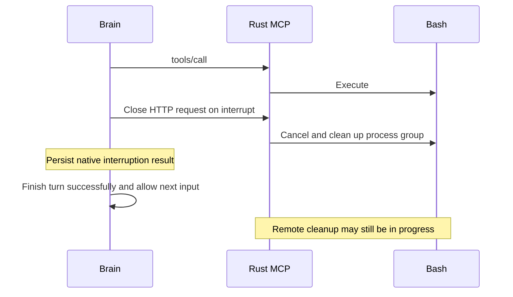

隔离协议测试先构建真实 Rust mcp-server，再在 oma-brain-dsh 运行 `OMA_TEST_MCP_BINARY=/absolute/path/to/mcp-server bun test tests/mcp-cancellation.test.ts --timeout 20000`。测试使用真实本机 MCP 与 Bash，覆盖断流后进程停止、结果未知时禁止重放、服务端失联和正常结果。进程停止通过本机观测断言，不是客户端获得了远端取消确认。`tests/runtime.test.ts` 覆盖主动与非主动取消分类、自然完成竞态和持久化失败；`tests/ccrv2.test.ts` 覆盖两个中断入口的成功 result、工具错误结果、恢复、重复输入与下一轮。真实模型、后端映射后的公开 SSE/历史与完整 session-interrupt-continue 场景仍需单独验收。

工具审批：云沙箱内策略为 `allow` 的内置工具由 DSH 本地放行，不发送 `can_use_tool`，也不上报 `requires_action`；公开 `agent.tool_use`（`evaluated_permission: allow`）仍由模型代理在 `span.model_request_end` 时按稳定事件 ID 发布。`ask`、`deny` 和策略缺失的工具继续使用现有 CCRv2 控制请求，由 Go 判定并发布对应公开事件。`/sandbox/mcp` 网关是最终执行点：关联公开 Session 时，每次 `tools/call` 都从该 Session 或指定子线程的最新 Agent 快照重新计算权限，工具名不在表中或为 `deny` 即返回 403，且不创建、续期或转发沙箱；`ask` 工具的人工审批仍由 DSH 执行。模型中的标准工具名在 MCP 边界转换为对应 server 名称。原始参数和审批后的参数分别保留；执行前再次校验有效参数。只读工具的并行策略与按 callId 记录的执行状态由 DSH 管理，Go 不为每次工具执行维护独立状态机。

DSH 将等待后端权限判定与等待用户确认分开：发送 `can_use_tool` 及等待自动批准/拒绝期间保持 `running`，不发布 `requires_action`。控制请求持久化确认后，执行端通过既有 Worker 状态读取接口核对匹配 request ID 的待确认工具记录；只有后端确实保存待确认请求时才发布 `requires_action`。审批结果可先于状态读取返回，此时立即结束等待并取消读取，不允许迟到结果重新暂停 Worker。待确认记录仍是后端输入拒绝的依据，真实用户审批与 `budget_reached` 暂停继续拒绝普通输入。

权限更新回归由 `tests/brain_tool_permission_updates_test.go` 覆盖同一会话的更新 API、最新上下文和网关拒绝，DSH 的 `tests/parallel-tools.test.ts` 覆盖 `allow` 改为 `ask` 后等待审批、改为 `deny` 后不再执行、刷新失败时停止模型请求，以及缺失权限表时回退审批；`tests/parallel-subagents.test.ts` 对保留的子 Agent 线程验证相同的策略更新。每次模型请求增加一次上下文读取，工具调用仍跳过 `allow` 的审批与状态写入。

DSH 的工具执行屏障直接建立在原生日志上：在工具体执行前刷新本地日志并等待远程复制确认，任一失败时不执行工具体。模型请求沿用 dsh 原生流程，日志异步复制，不无条件等待远程确认；完成 turn 后确认原生终态日志，再发布由其生成的公开结果，最后 ACK。审批参数变化时先确认公开参数提示，并保留原有模型上下文，不再保存 approvedCalls 或工具结果副本。只读失败仍最多重试一次；其他调用不自动重试。排空使用进程内活动副作用调用和结果确认队列，结果已到达但复制未确认时不能提前释放领取；这些集合不作为恢复日志。

### 原生日志恢复与协议输出

不保存额外交付快照、完成列表、发布游标或独立 outbox 文件，也不新增平台专属日志类型。dsh 原生日志格式、Header 和已产生的事件保持原样。外部普通输入已有的身份通过原生 `MessageId` 和 `freezeMessage` 公开 API 构造用户消息，使用原生 `id` 字段，不添加 inputId 字段或自定义 source。进程内维护已接纳输入的索引及待发队列，关闭后不单独保存。重启时从每个原生 turn 的首条 user-source 消息恢复输入身份，避免把审批参数上下文误认成新输入；原生回合终态用于生成完成或中断结果。无效输入和在原生接纳前被取消的输入，依赖服务端已确认的 processed 状态，不额外写占位日志。

普通输入先报告 processing。`agent/request` 钩子早于原生消息接纳，仅用于权限更新和必要的取消检查；不拦截 `llm/stream`，主线程和子线程均不在模型请求前无条件等待复制或排空公开输出。原生日志后台复制，工具执行、公开事件发布和 ACK 仍等待确认；确认前崩溃可能需要重新请求模型。已在原生日志中的输入重投不重新执行模型或工具，待原生结果及公开输出确认后再次 ACK。运行中的同一输入重投不提前 ACK，由原执行路径完成确认。

公开消息、工具结果和回合终态直接从原生 Header/Event 重建。每次恢复补发可重建历史，保持同一公开 UUID，依赖服务端幂等去重；不保存 sent 标记。主线程消息身份使用输入 ID 与原生 turn/step，子线程使用原生 turn/step 和事件 seq，不依赖重启时的主输入。工具结果产生后主动异步发布待发队列，发布仍先等待原生日志远程确认，不等待下一次模型请求或整轮结束，因此模型继续生成时界面也能看到工具完成。每批持久公开输出在发送前等待捕获时已有的流式预览确认，避免工具触发的后台发布越过先前预览；不等待之后产生的预览，也不逐帧串行等待 HTTP。发送失败保留进程内队列并重试，成功后仅消费本批捕获的队列前缀，保留等待期间新产生的事件。工具名按同一线程的原生 assistant/message 和 tool/call 推导。控制响应、进度、压缩提示及未写入原生模型日志的临时通知依赖服务端已接收事件和当前进程重试，不承诺在进程崩溃后重建。

CCRv2 传输层的旧 subtype envelope、Brain/Grok checkpoint、独立交付快照和批量 dsh_log 仍由协议适配层拒绝，不自动迁移。原生 JSONL 内的 Header 和 Event 则统一交给 dsh 原生格式校验：保留可忽略的未知扩展，拒绝原生不支持的必需事件，不按平台专属类型名称增设判断。Header 的缺省值和规范化直接采用原生 JSONL 回读结果，Brain 不手工补字段。主线程、子线程和已有本地日志遵循同一原生规则。

`tests/model-replication.test.ts` 覆盖主线程及子线程在复制延迟时继续请求模型、工具执行前确认、工具结果确认后在下一模型请求期间发布，以及公开结果确认前禁止 ACK、持久消息不能越过先前未确认的预览。`tests/native-input-recovery.test.ts` 覆盖原生身份去重、同内容不同输入、重启补发稳定身份、无额外交付记录及原生本地/远程事件一致性。`tests/session-reacquisition.test.ts` 覆盖 A→B→A 接管、远程新增子线程、历史不一致时保留原路径及损坏历史拒绝。`tests/review-reproduction.test.ts` 覆盖预览增量读取、会话 writer 故障隔离和原生持久化屏障。

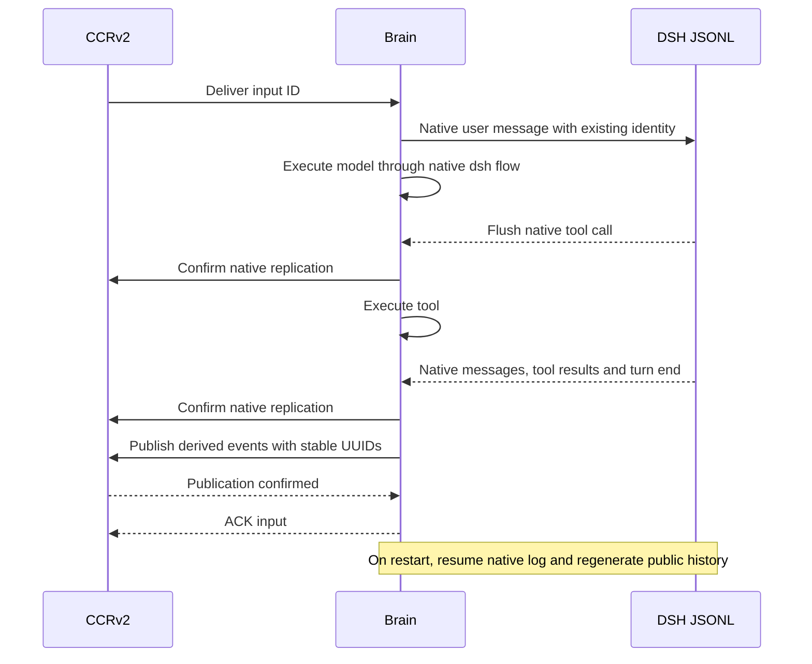

恢复工具名称同时读取 assistant/message 的原生 tool-call block，覆盖尚未产生 tool/call 的调用。DSH 的 `interruptedTurnClosers` 区分模型请求但未记录开始的 `TOOL_NOT_STARTED`，以及已记录 tool/call 但没有结果的 `TOOL_OUTCOME_UNKNOWN`。未知结果的原生错误提示模型先检查外部状态或询问用户，不盲目重试。OMA 不再维护 dispatch/blocked/result 状态机，不发布 unknown_tool_outcomes，不消费 tool_outcome_reconciliation，并移除对应运维 CLI 及专用 DB 入口。恢复不会自动重放未完成的输入；它完成该输入的失败交付，然后接受新输入。公开事件重发使用同一 UUID，依赖后端幂等去重；这不是跨系统的 exactly-once 事务。

子线程的名称、persona、模型和工具限制使用 DSH 原生 `subagent/descriptor` 保存，Header 的 parentSession 和传输层 agent_id 保留归属关系。恢复先从本地原生列表发现子线程；每次恢复枚举远程子线程并补齐缺失本地文件，以覆盖根日志未变化而子线程在其他实例新增的情况。通过原生描述符重建配置，并查询后端归档状态。恢复期间暂存线程 idle 通知，完成主线程和子线程原生日志重放后再排入发布队列，保证修复出的工具结果先于对应 idle 通知发布，公开恢复结果确认后才更新 Worker idle；远程恢复失败时不提前发布 idle。归档状态由服务端确认结果决定，不从未发送的进程内通知恢复。已完成原生回合恢复为 end_turn，未闭合回合恢复为 interrupted。无论公开状态是否 idle，只要 DSH 判断日志存在未闭合回合，就调用原生 resume 修复该线程；不采样模型、不重放工具。初始化中断只留下 Header 且后端没有公开线程、日志未开始 turn 时忽略该孤立记录；已开始执行的线程或其他查询错误不得被静默跳过。

`tests/crash.test.ts` 覆盖 SIGKILL 后主线程与并行子线程的原生日志修复、已确认兄弟结果保留、旧输入去重和新输入继续。`tests/session.test.ts` 覆盖原生日志检查点失败、公开事件重试、原生终态、公开发布与 ACK 顺序。`tests/parallel-subagents.test.ts` 覆盖独立子线程的失败隔离，不再测试已删除的运维解锁流程。

## 迁移与部署

Brain 实现尚未部署，不保留开发阶段创建独立 Brain 表、延迟沙箱字段和迁回 CCRv2 的中间迁移。最终模型直接复用现有 Code Session、公共配置与 CCRv2 私有事件，无需新增表或专用索引。应用过这些中间迁移的本地开发数据库需要重建；旧 Rust/Grok 客户端和旧 registration-token 任务不再兼容。

后端与 DSH 需要一起更新；JetStream `OMA_BRAIN_TASKS` stream 已删除，迁移 83 为 `code_sessions` 增加领取列。多实例后端继续共用 CCRv2 签名密钥、数据库、NATS 和事件对象存储；任一实例的派发都通过 Core NATS 唤醒所有实例上的长轮询，通知丢失只会让领取退回到每秒一次的兜底查询。

## 验证边界

普通测试覆盖并发领取互斥、领取期限与宽限期边界、idle 排除、失败退避与耗尽后的公开错误、旧 epoch 注册与心跳拒绝、20 秒租约、恢复保留配置、子 Agent 固定版本、惰性沙箱并发创建、MCP 转发和消息顺序。DSH 的测试使用真实原生 loop、受控模型/MCP/CCRv2 与领取服务，覆盖容量背压、准入失败与停机 release。

真实模型、实际云沙箱和端到端 SSE 对比通过 verify-be 的相关场景单独验收；仅在用户明确要求时执行，不以普通测试代替。

DSH Brain 源码作为主仓库的 `oma-brain-dsh/` 普通目录维护，使用自己的 Bun
依赖锁和 build/typecheck/test 命令。历史验收模板位于
`oma-brain-dsh/verification/testdata/`，属于复制到相应历史后端 harness 的输入数据，
不是独立的 Go package；当前后端验收继续使用 `tests/liveworker/` 中的场景。

任务准入对无效 JSON、无效任务身份以及明确拒绝的 HTTP 400/401/403/404/409/410/422 执行 JetStream TERM 并记录脱敏诊断。其他准入失败延迟 5 秒重投，最多尝试 10 次后 TERM；退出取消不终止任务。TERM 不引入 dead-letter 存储，后续恢复仍由已有 Work 恢复机制负责。

Session 创建在解析实际 Agent 版本快照和 Environment 后、生成 Session/Thread/Work 或资源前，校验声明的全部 MCP URL。limited 网络且 allow_mcp_servers 未开启时，每个主机和端口必须匹配 allowed_hosts，复用 networkpolicy 的规范化及通配符规则，否则公开 API 返回400且不持久化 Session。allow_package_managers 不豁免 MCP 主机检查。unrestricted 或 allow_mcp_servers=true 跳过此创建阶段主机限制。此校验不访问 DNS、不握手也不校验凭据；运行时连接、代理策略和审计仍各自生效。公开合同见 https://platform.claude.com/docs/en/managed-agents/mcp-connector#provide-authentication-at-session-creation 。

### Brain 公开回复与 Thinking 状态

DSH Brain 是 `agent.message`、`agent.thinking` 及其流式预览的唯一来源。模型代理按服务端已保存的 `metadata.config.worker_transport=claim` 识别 Brain，会记录原有鉴权、模型请求 start/end、usage、上游 request ID 和工具关联，但不生成普通回复、thinking 或对应的 span `event_ids`。无需模型请求用途 header；原生摘要和标题等内部调用不会因为代理观察到模型文本就成为公开回复。Claude Code 的代理发布路径保持原行为；工具权限、审批和代理已有的工具调用投影不随回复职责迁移而删除。

Brain 在 reasoning `block-start` 生成无正文 `event_start`，忽略 reasoning 正文 delta；普通文本使用 `event_start` 和 `event_delta`。AI SDK 的 `reasoning-end`、`text-end` 到达时立即产出对应 DSH `block-end`；工具参数的 `tool-input-end` 等待规范化 `tool-call` 后结束工具块，不提前派发工具。整个响应结束时仅结算 usage 与 finish，不再补发块结束；有未闭合块则返回传输错误。SDK 重新使用已结束的块 ID 时，为新片段分配新的原生 block index，保留文字、思考交替输出的顺序。块身份由 code session ID、上游 message ID、原生 block index 和事件类型派生，最终回复与恢复补发使用相同 ID。内部签名推理及原始模型响应仍用于续聊，公开边界继续清除 thinking 正文。

预览与完成块先经过串行的持久化检查点，再按模型帧到达顺序加入同一个 CCRv2 FIFO 上传队列，不在前端重排。检查点串行保证较晚 delta 不会越过等待日志确认的起始帧或完成块；入队后不逐帧等待 HTTP 确认，因此预览仍可复用 100ms 批处理。文本或思考 `block-end` 生成最终公共事件，先把公开内容和稳定 ID 写入所属原生 Session 的 `plugin:oma/assistant-block` 可忽略记录，远端确认后才投递；思考记录不含推理正文。完成块会刷新此前的预览批次。完整 `assistant/message` 仍用于模型历史，但不再重复发布本轮已逐块投递的消息。输入 processed 确认继续等待整轮日志复制及公开事件写入成功。子线程使用自己的日志及公开线程身份。

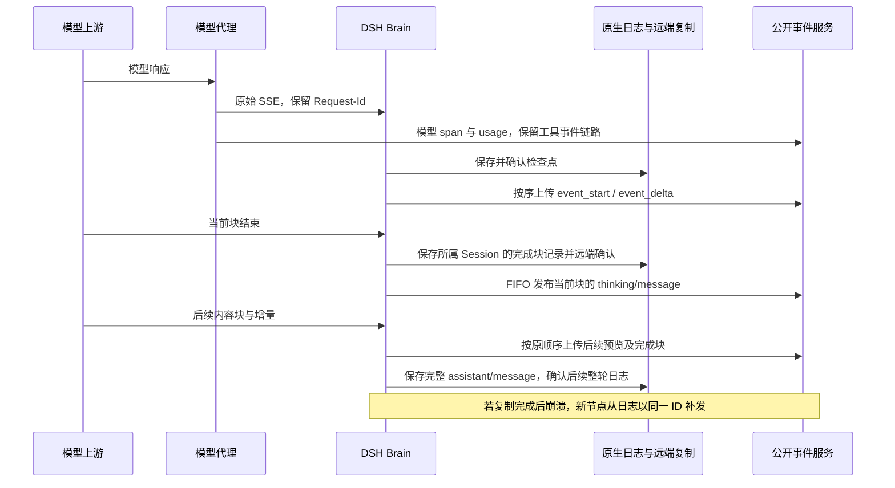

恢复仅从原生日志重建回复，不再次调用模型。完成块记录按原生 seq 参与重放，即使整个 assistant message 尚未保存，也能补发已确认的完整块；旧日志继续从 `assistant/message` 重建。相同公共 UUID 在重放批次中合并，后端去重已接收但确认丢失的回复。记录不进入模型可见的 surface，也不增加私有 HTTP payload 类型。预览尚未确认不能充当最终回复的持久化事实。模型 span 结束可先于 Brain 最终回复，客户端不能将 span end 当成消息已发布或用户回合已完成。

回归入口为 `TestModelReplyPublicationOwnership`、`TestBrainModelThinkingIsPublishedOnlyByWorker`、`TestModelThinkingStartHasStableIdentityAndNoContent`，以及 `model-output-order.test.ts`、`model-replication.test.ts`、`assistant-thinking.test.ts`、`session-reacquisition.test.ts`、`chat-completions.test.ts`、`crash.test.ts`。覆盖模型块边界即时推进、文字先于思考、块交错结束、SDK ID 复用、根/子完成块复制屏障、公开事件确认屏障，以及跨实例补发唯一回复且不重调模型。真实服务验收需另行明确运行，普通单测不代替该验收。

## Vault environment placeholders in Brain sandboxes

Brain sandbox startup carries resolved Vault environment placeholders in startup_context.environment_variables. Both eager/prewarm launch and lazy/replacement sandbox creation use the current managed-agent launch preparation. The sandbox receives opaque placeholders, never Vault secret values. Existing reserved-name filtering, attachment precedence and MITM requirements remain at PrepareEnvCredentialMount. Reusing a running sandbox does not restart it.

Regression TestBrainSandboxUsesEnvironmentLifecycle covers lazy and prewarm sessions bound to a real stored Vault credential and checks the provider launch payload for the exact stored placeholder and absence of the secret. These two scenarios failed before the mapping was wired into the Brain manager payload. This launch regression does not prove runtime HTTP/HTTPS egress substitution.

## 外部 MCP 大结果落盘

外部 MCP 执行成功返回后，Brain 按 Unicode 码点计算文本输出字符数。超过 100,000 字符时，通过本 Session 已绑定的 SandboxExecutor 将完整文本写入 `/tmp/tool-outputs/mcp_<随机ID>.txt`，再向模型和 CCRv2 工具结果发布含真实路径的头尾预览。恰好 100,000 字符保持内联；文件使用同一会话沙箱，随沙箱替换而失效。内部落盘不向模型注册或执行额外的用户 Write 工具，也不制造公开工具调用事件；后续 Read 仍经过正常工具权限和执行路径。

落盘是外部调用完成后的本地结果处理，不重试外部 MCP。保存失败返回明确的工具错误，不宣称文件已保存，不把完整输出重新塞回模型上下文。保留原 MCP 业务错误状态；取消继续遵循原执行取消流程。回归覆盖阈值与 Unicode、原文精确保留、独立文件名、写失败和取消，以及生产 Session 作用域中 MCP 结果经过沙箱保存后才进入下一次模型请求。真实 MCP RUN004 验证隐藏在预览之外的标记由实际 Read 读取。

## Self-hosted 外部工具执行

Self-hosted 的 queued Work 只由外部 SDK worker 领取、确认和续租。内置 Runner 仅在外部确认后创建 Brain 模型协调器，不创建 E2B 沙箱，不替外部 worker 确认或改写 Work CAS 心跳。协调器的 Code Session 租约独立恢复；外部 worker 的正常心跳不能掩盖已失效的模型租约。

内置工具仍通过既有权限入口发布准确的公开调用。允许的 self-hosted 调用保存原调用身份并等待外部 worker 的真实 `user.tool_result`，通过既有控制响应通道把原文本和错误标记送回 Brain。Brain 保留日志、结果和模型续跑流程，跳过沙箱 provision/call。结果必须匹配本会话保存的调用和线程；确认允许只确认授权，不代替工具结果。Cloud 和独立 Code Session 继续使用原执行路径。

普通回归覆盖结果关联拒绝、成功与失败字节保留、禁止本机沙箱执行和 cloud 执行顺序。Files EXT002 的外部 SDK worker 另行进行真实 API、SSE/history、容器字节及清理复测；本地回归不代表真实用例通过。

外部 MCP 的当前执行适配仅向模型和公开工具结果投影文本。远端已成功返回合法 image、audio、resource 或 resource_link 内容时，在该适配边界转为明确的“不支持非文本内容”工具失败，并持久化已知失败结果；模型仍可处理该工具错误和后续文本输入。不会将已收到的结果标为远端执行未知，不阻塞会话进行结果协调，也不会重放远端调用。此行为不代表已实现图片理解、二进制公开投影或资源自动下载。传输中断、协议解析失败或无法确定远端执行结果的原有未知结果保护保持不变。

Self-hosted 的允许调用不得在模型输出预览阶段成为可执行事件。实际 worker 回调先登记请求身份，再在同一公开事件批次发布调用和携带准确 `event_ids` 的 `requires_action` 状态。快速外部结果凭已登记的精确调用及线程关联接受，不依赖稍后到达的 Brain worker 状态上报；cloud 的模型预览行为保持原样。

### Self-hosted Work credentials

New self-hosted session Work items with attached Memory Stores carry a URL-safe base64 JSON secret containing a random per-Work `sessions_token`. The token is not a workspace API key. Authentication compares the stored Work secret and rechecks the live Work lease and unarchived session. It permits only that session read/event stream/event submission and that Work heartbeat/stop. Attached Memory Store reads are allowed; memory mutations additionally require a live `read_write` attachment. Store management, unrelated sessions/work/stores, Files, Vaults and Messages are denied. Stop, archive, deletion, lease expiry or attachment removal revoke the corresponding access. Raw secret payloads and tokens must never enter runtime logs.

工具结果持久化诊断仅记录 code-session/thread/call 标识的 SHA-256 关联摘要、阶段 start/confirmed、UTF-16 长度及是否含 NUL。confirmed 仅在状态保存得到确认后发出；HTTP 批量写入失败记录同一 code-session 标识的 SHA-256 关联摘要，避免把不同会话的错误混淆。诊断不记录工具正文、输入、认证信息或任意异常文本，也不改变写入确认、重试、工具结果或恢复语义。

### Model request retries

模型请求只对 `RATE_LIMIT`、`SERVER`、`TIMEOUT`、`TRANSPORT` 和 `EMPTY_RESPONSE` 重试。HTTP 408 映射为 `TIMEOUT`，429 映射为 `RATE_LIMIT`，5xx 映射为 `SERVER`；其他 4xx 为非重试错误，认证、额度和上下文窗口错误优先按专属分类处理。每个失败步骤最多重试四次，单次等待包含抖动在内不超过 30 秒。`tests/model-retry.test.ts` 通过完整 Brain 会话覆盖永久 4xx 仅请求一次和 408/429/5xx 恢复，并用确定性随机源验证实际等待上限。

### Runtime 与协议适配边界

`runtime/` 负责 DSH Agent 生命周期、原生事件转发、工具执行顺序、审批协调、取消、上下文刷新和有界重试。它不直接导入 `ccrv2/`；runtime contracts 不声明后端 Agent 快照、HTTP 错误 DTO 或公开事件 envelope。对照 Harness 的 `dsh-agent-loop`，原生 Session/Event 和 `agent/request-error` 保持为执行层接口；本次不改变重试策略、审批检查点或工具未知结果的恢复策略。

- `ccrv2/runtime-diagnostics.ts` 把通用 `model-retry` / `input-failed` 事实和原生 Session/Event 映射成现有 Worker 日志字段。根会话与子 Agent 分别使用自己的 session ID；错误正文、模型响应及输入内容不进入运行日志，日志 sink 失败不改变执行结果。
- `ccrv2/tool-transport.ts` 解析 OMA 网关未转发响应和连接失败。runtime 仅接收 `ToolNotForwardedError` 这个执行事实，不解析 HTTP Response。
- `ccrv2/subagents.ts` 生成 `sthr_` ID，把预定义 Agent 快照映射到公开线程创建事件。传给 runtime 的子 Agent 配置只包含名称、说明、提示词、模型和工具；恢复从原生 subagent descriptor 重建线程，并查询后端确认线程状态。
- `oma-sandbox/output.ts` 在沙箱 MCP 边界投影成功 Bash 的结构化 stdout；失败、stderr、截断或不一致元数据保留完整诊断文本。runtime 只做通用 MCP 文本提取。投影不修改原始响应；格式异常仍交给工具结果校验，避免被误判成远端执行结果未知。
- 已有 MCP 连接与鉴权通知由 CCRv2 回调构造公开 `session.error`。runtime 保留发现失败的事实回调，以等待适配层完成处理，不构造协议字段。

回归覆盖日志白名单与 sink 失败、协议 ID 和快照兼容、runtime 配置不携带快照，以及 Bash 投影后模型上下文与公开工具结果保持相同文本。真实 Worker、后端持久化服务和模型调用仍需单独集成验证。

## Native DSH context compaction

Brain mounts the pinned `@deepseek-ai/dsh-token-meter`, `dsh-compaction-basic`, `dsh-compaction-tool-result-pruner` and `dsh-compaction-image-offload` plugins. `dsh-compaction` and `dsh-commands` satisfy package/API dependencies; automatic compaction does not require a commands service or a `/compact` product entry. The Read-specific recovery implementation is removed. Ordinary model retries remain separate and do not retry context overflow themselves.

The native engine checks pressure before each step. Its defaults are `thresholdRatio=0.8`, `headroomTokens=65536`, `retainRatio=0.16`, `compactionRetries=1` and `maxOverflowRetries=1`. Given adapter capacity `W` and the effective request output reservation `O`, the trigger is `floor(min(0.8*W, W-O-65536))`; the retained-tail budget is `floor((W-O)*0.16)`. The native selector preserves valid message/tool pairing and indivisible units, so the actual retained size can exceed that budget. Pressure first invokes the optional model-free pruner, which uses the native 8192-character threshold and 4096/1024-character excerpts across tool names. If pressure remains, the engine summarizes a balanced old span. Provider-confirmed `CONTEXT_WINDOW_EXCEEDED` bypasses the normal pressure threshold and attempts bounded recovery. A successful response or idle transition resets its overflow retry sequence.

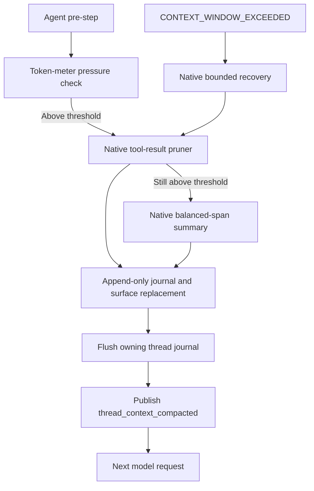

Summary requests use the same authenticated OMA model route with `purpose=compaction` and the native structured checkpoint instruction. The native requested generation budget defaults to 65536 tokens. OMA sets a route output ceiling for compaction requests from the selected model's `max_output_tokens`, or 32768 when omitted. Before invoking the AI SDK, the request converter takes the smaller of the requested budget and this ceiling; a smaller explicit summary budget stays unchanged. The route resolves the actual request session and model, including child sessions and the legacy `oma` provider, rather than applying a process-wide model limit. This rule applies to both Messages and Chat Completions and does not change ordinary calls' explicit-budget precedence. The native pressure headroom remains 65536 tokens, and its journal records the requested summary budget while the adapter enforces the wire-level ceiling. Compaction calls need no transport-purpose header. Brain owns public replies for all DSH model requests, so the proxy records request spans and usage without projecting model text or thinking into public replies. Existing tool permission and tool-event handling remains at the backend boundary. Summaries reuse the conversation prefix and tool schemas. They do not replace the business model-response ID or publish an assistant response to CCRv2. Native `compaction/start`, `compaction/summary`, `compaction/end`, `compaction/prune` and replacement events remain in the private append-only DSH journal; summaries replace the model-visible surface through a checkpoint user message. Original user, assistant and tool events remain available for history and replay. This reduces model context, not stored transcript size.

The CCRv2 adapter in `src/ccrv2/compaction.ts` owns compaction notification state and coalesces successful summary and prune changes until the next log flush. The runtime only forwards native session events and invokes generic `onOpen` and `afterFlushLog` adapter hooks; it does not inspect compaction events, measure pressure, track notification sequences or scan recovery history. The event hook includes the owning native session, and child bridges forward the same lifecycle hooks. Each native session has independent transient state. After the runtime flushes the owning root or child journal, the adapter publishes `agent.thread_context_compacted` with the token-meter's estimated pre-compaction pressure, before the next ordinary model request. A coalesced notification reports the first available pre-compaction measurement in the pending batch; the latest journal sequence is only its deduplication cursor and is not exposed as a public pressure timestamp. Each summary end clears the transient start measurement, including failed attempts, so an end without a matching live start measures current pressure rather than reusing an earlier episode. Failed summary attempts alone do not publish success. Replacement tool results stay private so each real execution still has exactly one public tool result. Failed persistence prevents the next model request and success notification.

Pending compaction is cleared only after its callback confirms remote replication of the owning journal and enqueues the notification. The adapter keeps an in-memory per-thread sequence cursor to avoid enqueueing the same notification twice in one process. Notifications use the existing pending publication queue, which retains entries when publication fails. Before the next model request, pending compaction notifications must be published successfully. Ordinary requests without pending compaction remain independent of replication lag.

Notification IDs are deterministic from session, thread and journal sequence. Restart scans the native journals and reconstructs the latest successful summary or prune notification for each opened session; the backend deduplicates previously published IDs. No BrainState, separate outbox checkpoint or custom native log event is added. A recovered notification omits `pre_compaction_tokens` when the original transient measurement is unavailable. The generic runtime only invokes adapter lifecycle hooks after local journal flush; remote confirmation and notification publication remain in CCRv2.

Every ordinary model step flushes the local JSONL journal. Before an ordinary root or child model request with queued public output, CCRv2 confirms the owning journal replication and waits for that output to be accepted by the backend. Requests without pending output retain asynchronous replication. This prevents a following request from overtaking its preceding tool result. The barrier uses the existing serialized publisher without recursively draining child runtimes. A rejected publication prevents the following request. Backend acceptance does not imply durable Core NATS delivery. Remote replication otherwise remains asynchronous unless a compaction callback, tool dispatch, public output or delivery checkpoint requires confirmation. Explicit replication checkpoints upload individual new native events, and repeated clean checkpoints perform no backend writes. 真实服务定向验收使用 `chat brain-compaction`，覆盖根/子线程通知、日志持久化和跨进程恢复；本次合并仅运行普通单测与静态检查，真实服务场景需另行执行。

Regression coverage checks 100 clean flushes after approximately 4 MiB of history produce zero backend writes and a subsequent dirty flush sends only the new event; this is an in-process contract check, not a production latency benchmark.

Model configuration comes from the unified provider catalog introduced on main. `GET /v2/sessions/{id}` publishes tenant-scoped `session_context.models`, containing each route's `id`, `api_backend`, optional `context_window`, `max_output_tokens`, `input_modalities` and `image_input`. Brain consumes this catalog directly at registration and refresh, with no temporary capacity map or additional database lookup. Qualified IDs and available unambiguous legacy aliases retain the catalog's keys. Provider credentials and upstream URLs remain on the server.

The per-request callback is `refreshSessionContext`, shared by root and child requests with the child's thread header when applicable. It reads model configs and runtime tool permissions in one request, validates both before replacing either, then updates the session-owned model metadata and returns the tool permissions for the runtime to apply. Invalid model configs or permissions stop that turn before calling the model; they do not silently retain a stale budget or partially apply the other field. A later turn can retry after the server returns valid context. Missing optional model configs clear the previous metadata, matching registration semantics.

Each root session registers a DSH adapter under the internal provider route `oma:<session_id>`. Its model-info callback reads that session's assignment by the exact requested model ID, returning the selected catalog entry's context window, output limit and input modalities. Children use the same session-owned provider route and select their own model entry. This keeps identical model names in different tenants from sharing limits through the process-wide DSH adapter registry. The registration belongs to the root's plugin scope and is released with that scope. The model token, HTTP backend and upstream model string continue to use the existing OMA proxy route.

Ordinary agent request configuration binds the session-owned provider and replaces any logged previous-model output budget with the currently selected model's `max_output_tokens`, or the shared default when omitted. The root's CCR model override is applied before the final binding; children use their own configured model. Thus set_model, configuration refresh and session restoration do not reuse a previous model's cap. Adapter metadata and the actual Messages/Chat Completions request use the same source. Auxiliary compaction requests bypass this hook and receive their output ceiling from the OMA route before SDK serialization. The generic AI SDK adapter still supports caller-specified request caps, with an optional route ceiling taking precedence when supplied.

`SessionRuntime` owns the single final `configureModel` call for each ordinary request. The order is session-context refresh, journal flush, protocol `beforeRequest`, native request-config resolution, optional root `selectModel` override, then `configureModel`. CCR supplies only the root model selector; it does not bind the budget again. Children use the same runtime binding path without inheriting the root selector. Regression tests count one binding per model request across root calls, children, model switching and restoration, and verify invalid refreshes leave the previous context unchanged without sending a model request.

Model-specific `context_window` and `max_output_tokens` take precedence. When a capacity is omitted, Brain follows main's shared defaults of 262144 context tokens and 32768 output tokens, without model-limit environment variables. Removing a configured limit replaces any stale ordinary-request budget with the shared default. The adapter metadata, runtime request budget and both API routes read the same unified catalog. Native pre-step pressure checks use the latest durable routed envelope, so a model switch can first be reflected by the next ordinary request, with bounded overflow recovery protecting that request if the smaller window rejects it.

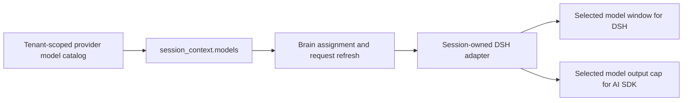

Image-offload recovery follows the native `IMAGE_OFFLOAD_REQUIRED` contract. OMA's adapter enforces configured image count, request variant bytes and the serialized proxy request limit; native image pricing uses the same target dimensions. Previously offloaded native images serialize as OMA placeholders without reading bytes. The remote AttachmentStore preserves normalized images across Brain instances. Opaque historical/URL `oma-image` and `oma-document` blocks retain their existing behavior and do not participate in offload. A huge uncompressible system prompt, tool schema, document or indivisible message can still exceed the upstream window. See [remote image attachments](brain-image-attachments.md).

Regression coverage uses in-process fake models and persistence. It covers pressure-triggered conversation summaries, summary failure, one bounded overflow retry, root/child Bash-result pruning, journal durability before retry and notification, public result uniqueness, replay and process restart, request-budget parity for both backends, auxiliary-response identity and offloaded-image placeholders. Compaction-budget tests exercise real AI SDK serialization with an in-process upstream that rejects budgets above configured limits, including native summary execution, root/child routes, missing limits, smaller explicit budgets and ordinary-call precedence. They do not establish real-provider summary quality, billing, image-budget behavior or production performance; verify-be remains an explicitly requested acceptance path.

### Repository sources in Brain sandbox startup

Brain sandbox startup forwards the server-resolved Git source URL, checkout ref and mount path through `startup_context.sources`, both when creating the runtime and when provisioning a sandbox lazily or during prewarm. Lazy provisioning resolves the current public Session resources before constructing the manager request. Source payloads exclude repository credentials; the outbound proxy continues to inject those after requests leave the sandbox. An empty source list is encoded as an array. Setting only the working directory cannot initialize a repository.

领取接口对缺少或错误的 fleet token 返回 401，对缺少 `X-Worker-ID` 或越界的 `block_ms` 返回 400；release 接受 `admission_failed`、`shutdown`、`idle` 与 `permanent` 四种原因，领取已不属于调用方时返回 409。响应设置 `Cache-Control: no-store`，运行日志只记录 `worker_id`、`code_session_id`、`worker_epoch` 等元数据，不记录凭据。

## 模型 API backend

统一模型配置使用 `session_context.models`，替换旧 `model_backends`。Server 与 Brain 必须成对更新：先停止接收新会话并等待现有任务结束，停止旧 Brain 与所有旧 Server，再执行数据库迁移并启动新版 Server、Brain。不能按混合版本滚动发布；旧 Brain 读取不到 `model_backends` 时可能按 Messages 路由，新 Brain 读取旧 Server 时同样可能回退。回滚也须同步恢复 Server、Brain 和数据库结构，迁移前需备份模型参数。

Provider 的 `api_backend` 决定 Brain 模型适配器，当前支持 `messages` 和 `chat_completions`。
`GET /v2/sessions/{id}` 为 claim transport 在 `session_context.models` 返回当前 workspace 的
模型路由索引，每项包含模型参数和 Provider 的 api_backend，不包含上游 URL 或 Key。映射构建失败返回 500 `api_error`，
公开文案为 `Could not resolve model API backends`；MCP 配置构建失败保留独立的 MCP 错误文案。
子 Agent 继承与覆盖模型、运行时切换模型均按实际
请求 model 查表。旧服务端没有该字段时沿用 Messages；显式映射中缺少模型或 backend 不支持时失败。

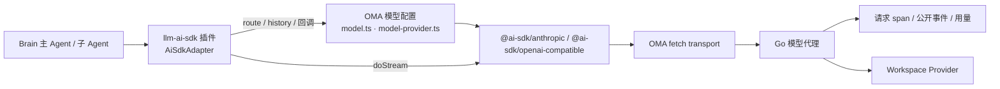

DSH 仍使用 provider `oma`，它表示平台模型适配器，不是用户配置的 Provider。路由映射在会话注册与
恢复时读取，Go 每次代理请求重新解析 Provider 并检查 backend。运行期间修改 Provider backend
可能使旧映射失效，此时明确报错并要求重新加载会话配置，不静默切换协议或自动重发。

Brain 只依赖 Vercel AI SDK 的 provider 层：`@ai-sdk/anthropic` 处理 Messages，
`@ai-sdk/openai-compatible` 处理 Chat Completions，二者都输出同一种 `LanguageModelV4`
stream part，并精确锁定版本。Brain 不引入 `ai` 核心包，也不使用其 `streamText`、重试或
工具执行循环；只调用 `doStream`，SSE 解析、协议字段编码和分片工具参数累积由 SDK 负责。
两种 provider 都以字符串追加累积工具参数，大参数流保持线性耗时，
`chat-completions.test.ts` 用 400 KB 参数守住该性质。

### 通用 adapter 与 OMA 配置的边界

协议转换位于 `oma-brain-dsh/src/llm-ai-sdk/`，按 DSH 插件形态组织（`name`、`inject: ["llm"]`、
`apply`、`Config`），只依赖 `@ai-sdk/*` 与 `@deepseek-ai/*`，不导入任何 OMA 模块；
`tests/llm-ai-sdk.test.ts` 守护该依赖方向。它目前只有 OMA 一个使用者，因此留在仓库内；
出现第二个使用者时可原样发布为独立 DSH 插件包，并补充模型目录、上下文窗口和配置化路由。

- `route.ts`：`AiSdkRoute` 描述一次调用使用的 `LanguageModelV4`、replay 格式名、是否需要签名
  reasoning、默认输出上限和 provider options；`AiSdkAdapterOptions` 定义 `route`、`history`
  与 `onCallStart`、`onRequestBody`、`onMessageID` 回调。
- `prompt.ts`：把 DSH 历史转换为 AI SDK prompt。系统提示合并为首条 system 消息；
  工具调用参数解析失败时保留 `__unparsedToolInput` 占位对象；工具结果支持文本与原生图片，
  错误结果映射为 `error-text`。Messages 图片保留在 tool_result 内，Chat 图片在连续工具结果后投影为 user 内容。需要签名的路由只在同格式 replay 带有 `signature` 或
  `redactedData` 时回传 thinking，否则降级为文本；其他路由以 reasoning 回传
  （Chat 为 `reasoning_content`）。temperature 与 stop 原样传递，每次调用附带 DSH
  `attributionHeaders()`。
- `stream.ts`：把 stream part 映射为 DSH `StreamChunk`。内容块按 SDK part ID 首次出现顺序
  编号：Messages 的文本与 thinking 对应原生 content block index，Chat 依次为 reasoning、
  文本和各工具，与 Go observer 的编号一致（规则见 `messages-proxy.md`）。block-end 在终态统一发出；`tool-calls` 必须含工具，
  `stop` 不能含工具，`length` 映射为 max-tokens，其余结束原因或缺少终态均视为
  `TRANSPORT` 失败，无内容为 `EMPTY_RESPONSE`。
- `adapter.ts`：`AiSdkAdapter` 串联上述步骤，处理取消并把错误转换为 `LlmError`。
- `index.ts`：插件入口，按 `providers` 注册 adapter。

OMA 侧只提供配置，由 `plugin.ts` 以 `providers: ["oma"]` 加载插件：

- `model-provider.ts`：按会话取得 assignment 与实际模型的 backend，每次请求用当前 model token
  创建 provider，Messages 使用 `authToken`（Bearer），Chat 使用 `apiKey`（Bearer）。自定义 fetch
  只允许向对应 Go 代理路径发送 POST，删除 `x-api-key`，为子 Agent 设置
  `X-Claude-Code-Agent-Id`，禁止重定向，流空闲超时 300 秒。两种协议的普通请求均按调用方显式 `maxTokens`、模型
  `max_output_tokens`、32768 的顺序选择输出上限。Messages 关闭 SDK 默认的
  `eager_input_streaming`；Chat 把 `max_tokens` 改名为 `max_completion_tokens`，未配置时也发送默认上限。
- `chat-reasoning.ts`：Chat 响应进入 AI SDK 前按与 Go 相同的规则规范化 reasoning 字段，
  只保留 `reasoning_content`，弥补 SDK 只识别 `reasoning_content ?? reasoning` 的差异。
  按完整 SSE 事件处理：多行 `data:` 先按规范拼接再解析，只有负载包含 `"reasoning` 的事件
  才会改写为单行 `data:`，其余事件与 `id:`、`event:` 等字段原样通过；跨网络分片的行先缓冲，
  保留 CRLF，并移除失效的 `content-length`。
- `model.ts`：`omaModelOptions` 组合路由，并用回调维护 `modelResponses`、记录系统提示诊断；
  `history` 把旧 `kind=pi-ai` replay 中的 `thinkingSignature` 转为 `oma-messages-v1` 签名。

错误以 `LlmError` 抛出，由 DSH 运行时转换为终态 finish chunk。HTTP 错误优先读取响应体
`error.message`，按上下文超限、额度耗尽、429、401/403、5xx 分类；流内错误同样分类。
对已实际观察的 HTTP 400 `InternalError.Algo.InvalidParameter: Range of input length should be [1, N]`，
只有原请求包含非空文本输入时才识别为上下文超限，交给既有的一次有界压缩恢复。
空输入、缺少请求证据、其他参数范围及非 400 响应保持原错误分类，不能把所有参数错误当作可压缩重试。
该识别补足字符估算低估 Unicode 输入时的恢复路径，不改变 token 估算、压缩阈值或重试上限。
取消时 adapter 主动取消 SDK stream，从而关闭到 Go 代理的 HTTP 响应体。

replay 继续使用 `oma-messages-v1` 与 `oma-chat-completions-v1`。response 保存模型消息 ID、
Go Request-Id 与原始结束原因；blocks 保存每个内容块的公开事件索引，Messages 另存
thinking 签名或 redacted 数据。CCRv2 实时预览、完成消息与历史恢复使用这些元数据生成
同一组稳定事件 ID。旧 `kind=pi-ai` replay 中的 `thinkingSignature` 仍可回传。

Worker 单测位于 `oma-brain-dsh/tests/chat-completions.test.ts` 与 `adapters.test.ts`，覆盖异常流、
HTTP 与流内错误、取消、工具分片、大参数线性耗时、用量尾帧、历史编码、公开身份、
主子模型 backend 选择和凭据轮换。

`Read(file_path)` 沿用沙箱现有 MCP read 工具。Brain 对图片结果校验、归一化并保存到远端 AttachmentStore 后，才生成包含原生 image 的 tool/result；日志不保存图片字节。文本结果继续保留原有 rawOutput 语义，图片转换失败返回工具错误。完整链路与黑盒验收见 [远端图片附件](brain-image-attachments.md#read-图片工具结果黑盒验收)。

`oma-brain-dsh/tests/chat-runtime.test.ts` 通过原生 Brain 与本地协议 fixture 执行工具审批、工具结果下一轮回传、关闭后历史恢复，确认恢复不会重复执行已完成的工具。该测试不连接真实模型或 Worker 沙箱。

### 默认输出预算

Messages 和 Chat Completions 的默认输出预算均为 32768 token，与通用 DeepSeek Harness 默认值一致，不按具体模型名称猜测。模型配置的 `max_output_tokens` 覆盖默认值，普通调用方显式 `maxTokens` 优先级最高。`purpose=compaction` 的摘要请求额外受当前模型输出上限约束，实际预算为显式请求值与模型上限的较小值，模型未配置上限时使用 32768。Chat 请求始终携带选定的 `max_completion_tokens` 上限。推理内容与最终正文共享输出预算；预算只声明单次请求上限，不扩大上游能力，也不能将截断结果视为成功。

升级影响：未配置逐模型上限时，Messages 的默认输出上限由 943718 降为 32768，Chat Completions 由省略上限改为默认发送 32768。需要保留更大输出预算的模型应显式配置 `max_output_tokens`。

## 懒加载沙箱的 Provider 过期恢复

Brain 保持运行而沙箱已被 Provider 删除时，下一次 MCP 调用先连接原沙箱。可恢复的 paused 沙箱继续复用；明确的 Provider 404 映射为 `sandboxruntime.ErrSandboxNotFound`。Runner 只把该错误对应的原沙箱记录标记为 failed，并沿用当前 Work 和 Code Session 创建 replacement，重新准备挂载和环境管理器。临时网络错误、鉴权错误或服务端错误保留原记录并返回错误，不据此销毁或替换沙箱。

并发 MCP 请求通过既有 Work 事务锁及 `CreateEnvironmentSandbox` 的 pending 检查复用同一个 replacement。恢复不更换宿主机 Brain 的 Code Session 或 worker epoch。Provider 已删除的临时文件与进程无法保留，持久化事件和已提交 Filestore 内容不受影响。

本地端口查询前也执行 SDK Connect，使 paused 恢复及过期错误分类与云端一致。端口查询本身返回 404 时同样识别为沙箱已删除。单测检查暂停连接、缺失分类及服务端错误保留；实际开发环境验收包含首次 Bash 调用、超过 TTL 后再次调用和环境信息查询。

## DSH 自定义问卷工具

主 Agent 显式启用 `ask_user_question` 后，Brain 注册 `AskUserQuestion`，不访问沙箱。
参数采用 DeepSeek 的 `questions`：每题必填唯一 `id`、`question`，可选 `header`、`options`、`multi_select`。
答案为 `{answers:[{id,selected,custom?}]}`；单选自由文本替代选择，多选自由文本补充选择。
沿用 `agent.custom_tool_use` / `user.custom_tool_result` 和现有控制通道，按调用 ID、问题 ID 关联答案。
服务端通过 `externalResult` 返回结果，不再兼容旧 Claude Code 的 `updatedInput.answers`。
不新增依赖、接口或存储；取消、线程归属、epoch 与恢复沿用现有机制。
