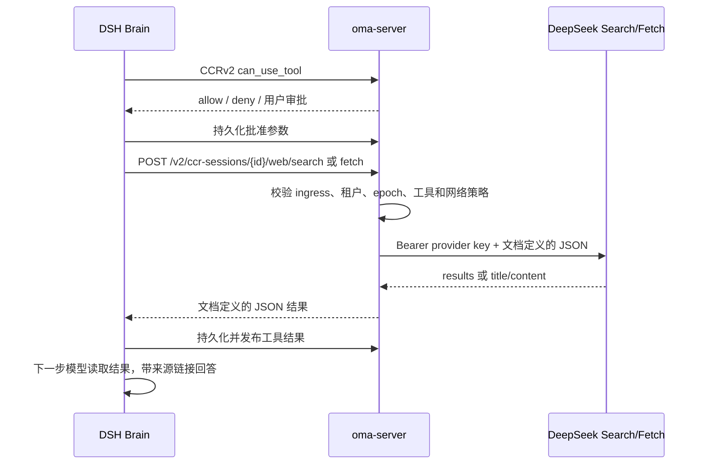

# Brain 内置 WebSearch / WebFetch

DSH 内置工具定义，oma-server 执行工具并持有 DeepSeek key。
工具的请求和结果按 DeepSeek 独立 JSON API 定义，不额外加入 Claude Code 风格的参数或结果包装。
模型推理仍经过配置的模型供应商，Search / Fetch 的 HTTP 调用不改变模型路由。

## 接口

| 内置工具 | Brain → OMA | 参数 | 结果 |
| --- | --- | --- | --- |
| WebSearch | POST `/v2/ccr-sessions/{id}/web/search` | `query`；可选 `count`、`ori_question`、`localization`、`need_content` | `{results:[...]}` |
| WebFetch | POST `/v2/ccr-sessions/{id}/web/fetch` | `url` | `{title,content}`，content 为 Markdown |

Search query 为 1–128 个 Unicode 字符，不能全为空白；count 为 1–50，默认 10。
ori_question 为 1–128 字符，null 视为未提供；localization 为定位用 IP 字符串，默认空字符串；
need_content 默认 false。query 原生支持 `site:`、`-site:`、精确短语、`lang:`、`after:`、`before:`。
不新增 allowed_domains / blocked_domains 参数。Search 无分页接口，count 是返回条数。

结果保留 `rerank_score`、`title`、`url`、`snippet`、`summary`、`content`、`site_name`、`site_icon`、`date`、`authority`。
无结果返回空数组；日期、站点名称和图标可以为 null。
Fetch 只接收 url，最多 8192 个 Unicode 字符；不新增 prompt 参数、摘要模型、缓存或截断包装。
未知请求字段按 DeepSeek 行为忽略；JSON 错误、重复字段和无效已知字段拒绝。
OMA 请求上限 32 KiB，上游结果上限 2 MiB，超限返回显式错误。

## 执行边界

OMA 端用 `web_tools.deepseek_api_key_file` 指向受保护的 key 文件，相对路径按 YAML 所在目录解析。
启动组装时读取并注入客户端；未配置时服务可启动，工具调用返回 unavailable。
凭据不进入 Brain、沙箱、assignment、事件或日志。Brain 仅用当前会话 ingress token 请求 OMA。
后端使用既有 Yourbatis 查询，从 Code Session 真实关系确定租户、Environment 与 Agent snapshot；
验证 Worker epoch、会话存活和 disabled 工具，Brain 通过既有 can_use_tool 完成 ask/allow/deny。
子 Agent 的有效工具列表控制是否注册 WebSearch/WebFetch，不引入独立权限系统。

执行不创建或恢复沙箱。用户目标只发送给固定 DeepSeek API，OMA 不直接拨号用户指定网址。
拒绝非 HTTP(S)、userinfo、IP 字面量、非标准端口及 localhost/local/internal/test/invalid 主机。
limited Environment 的 Search 使用 allowed_hosts 添加站点条件，并过滤返回链接。
DeepSeek Fetch 未提供最终 URL/重定向链，limited 环境下明确拒绝，避免声称完成最终域名授权。
公网抓取的 DNS、跳转和网页安全策略由 DeepSeek 执行。工具描述要求将网页视为不可信数据并引用来源。

服务端 30 秒 deadline 覆盖请求、读取及一次重试；408、429、5xx 等待一秒重试一次，其余 4xx 不重试。
取消终止 HTTP 请求与重试等待。错误映射为稳定的 OMA 应用错误，不透传 provider body 或凭据。
Brain 将失败记为普通工具结果；不以远程命令的未知副作用方式阻塞会话。
两种工具均标记为只读，沿用现有只读工具恢复规则，不创建有副作用工具的 dispatch 屏障。

## 与 Claude 的关系

对齐内置工具、审批、搜索后抓取、模型继续回答和可点击来源的用户行为。
参数与结果采用 DeepSeek 文档，不复制 Claude Code 的 `WebFetch(url,prompt)` 或其独立模型提取/缓存步骤。
不实现 Claude Messages 的 `server_tool_use`、专用 search/fetch result 内容块、加密引用和 `pause_turn`；
不能将 DeepSeek 数据伪造成 Anthropic 的 encrypted_content / encrypted_index。
链接引用由主模型按工具描述生成，不提供服务端加密引用或强制 URL provenance 登记。

## 验证与来源

针对性测试覆盖 provider 请求/结果字段、错误/限流重试/取消、私有 URL、网络策略、租户/旧凭据拒绝，
以及真实 DSH 循环中的审批、拒绝、OMA token、结果持久化、后续模型上下文与无沙箱执行。
实际付费服务和真实模型的 Search → Fetch → 链接回答以本次本地验收记录为准。

- [DeepSeek Search / Fetch 指南](https://api-docs.deepseek.com/zh-cn/guides/search)
- [DeepSeek Search API](https://api-docs.deepseek.com/zh-cn/api/search)
- [DeepSeek Fetch API](https://api-docs.deepseek.com/zh-cn/api/fetch)
- [Claude Web Search](https://platform.claude.com/docs/en/agents-and-tools/tool-use/web-search-tool)
- [Claude Web Fetch](https://platform.claude.com/docs/en/agents-and-tools/tool-use/web-fetch-tool)
- [Claude Code 工具说明](https://code.claude.com/docs/en/tools-reference)
