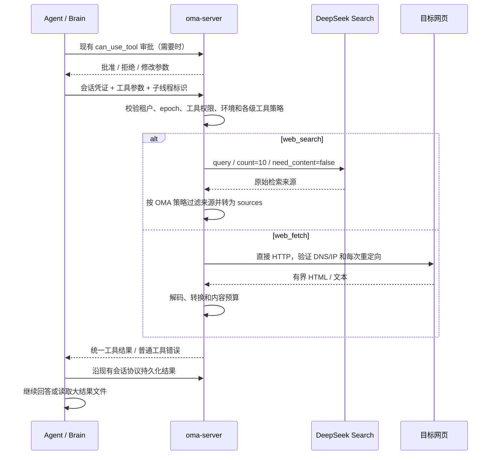

# Brain 内置 Web 工具

Brain 仅注册 `web_search({query})`、`web_fetch({url})` 并转发到 oma-server。
模型调用参数是 OMA 合同；CMA 公开文档仅用于 Agent/Session 配置和权限行为，不能据此宣称模型 input schema 完全一致。
不额外调用摘要模型，不实现 Messages API 的加密引用、server_tool_use 或 pause_turn。



## 配置与兼容范围

```yaml
web_tools:
  deepseek_api_key_file: secrets/deepseek-web-key
  dns_resolver: ""
```

相对路径按 YAML 所在目录解析；启动时读取密钥。密钥不进入 Brain、沙箱、assignment、事件或运行日志。
没有配置密钥时 Search 返回 unavailable；直接 HTTP Fetch 仍可用。
默认使用系统 DNS；如运行环境返回代理 Fake-IP，可由管理员设置 dns_resolver 为真实 DNS 的 IP:53，以 TCP 查询。它不放宽目标 IP 检查，也不修改机器的 DNS 设置。
SearchProvider 接口定义 `Search(context.Context, SearchRequest) (SearchResponse, error)`，DeepSeek 实现该接口并负责参数映射、凭据、上游错误与响应归一化。Client 接收 Provider；查询校验、Environment / 工具来源过滤由 OMA 统一执行，替换 Provider 不能绕过这些规则。
Search 厂商字段只存在于服务端适配器，不进入模型工具 schema；启动组装默认选择 DeepSeek，后续替换构造处的实现即可，不需要修改 Brain 或 HTTP handler。第一版没有插件注册表、动态加载或额外 Node 服务。
Fetch 使用 Go HTTP 和已有 HTML parser，参考官方 DSH 行为；不是直接运行 TS 的 dsh-web-fetch-http。

CMA 式 `agent_toolset_20260401.configs` 保留现有 enabled、permission_policy，并新增保存和校验：

- 两工具独立的 allowed_domains / blocked_domains，互斥；省略/null 不增加工具限制，空列表拒绝。
- 每列表 1–64 项，ASCII 可注册主机及子域名；允许下划线；不接受 IP、协议、端口、通配符或重复。拒绝 .localdomain 等本地主机后缀。域名错误标注列表名称与从零开始的索引，空列表标注具体字段。
- 工具域名匹配自身及子域名；Fetch 禁止路径，Search 支持区分大小写的路径前缀。
- Fetch max_content_tokens 为正整数；Search user_location 使用 CMA 的位置对象，但 DeepSeek 独立 Search API 不支持此定位合同，因此显式拒绝而不静默忽略。
- 最新 CMA SDK 的 url_sources 暂不支持，传入会被拒绝。也不接受 max_uses、citations、cache_control。

创建 Agent 和 Session 工具更新复用同一校验；创建/更新 Session 时检查工具允许域名不超出 limited 环境。
Environment allowed_hosts 继续使用既有精确 host/显式 wildcard/端口规则，不能用工具子域匹配替换它。

## 执行与安全

Server 使用既有 Yourbatis 会话策略查询、ingress 鉴权及 Worker epoch 校验。
主会话、调用祖先和当前子线程的域名条件同时满足才允许访问；权限被拒绝或线程无效时不请求网络。
内容预算按会话/调用者/当前线程逐级覆盖，不以取最小值代替配置继承。

Search 每次最多接收 128 个 Unicode query 字符，固定请求 10 个来源；返回 sources 的 title/url/snippet/date。
OMA 过滤每条来源及其附属内容，不转发 provider 综合总结或原始评分等字段。
不依赖 site: 作为访问控制，也不承诺供应商内部只检索白名单。
各级工具允许列表不存在共同域名/路径范围时，在调用 Provider 前返回 url_not_allowed；这与合法检索经过来源过滤后得到空 sources 不同。

Fetch 只访问公开 HTTP(S) 主机和标准端口；禁凭据及本地目标。
DNS 解析一次、检查全部地址、只拨号已验证的 IP，保留原始 Host/TLS 身份；禁止环境代理绕过此路径。
每次重定向重新执行环境与各级工具规则，最多跟随 5 次。白名单内正常抓取；越界返回 url_not_allowed。
30 秒 deadline 覆盖连接、响应体读取和跳转，取消向 HTTP 传播。下载/解码最多 5,000,000 字节；二进制和超限明确报错。
HTML 使用已有 golang.org/x/net/html 流式转换为基本 Markdown/文本，不执行 JS，不宣称浏览器渲染或智能正文提取。

Search 的 408/429/5xx 最多重试一次；取消不重试。Provider 的错误正文和凭据不透传。
两工具都是只读，沿用现有执行和恢复流程。正常短结果不创建沙箱。

## 内容预算与续读

max_content_tokens 默认为 20000。为兼容不同模型且不引入远端计数调用，第一版按 UTF-8 字节作为保守 token 预算；不是 Claude tokenizer 的精确计数。
工具包装和文件定位提示不属于页面内容预算。网页超过预算时，Server 返回有界预览和完整的有界正文；Brain 使用现有工具结果保存机制写入同会话沙箱，向模型返回预览及可由 Read 读取的文件路径。
这只在大结果时按需分配沙箱，不通过沙箱抓网页。保存失败返回已知工具错误，不谎报已保存路径，也不重复抓取。
受现有 sandbox MCP 1 MiB 请求上限约束，特别大的完整结果可能无法写入并明确报错；本版不新增分块写入协议。
文件在沙箱被替换后不可恢复，延续现有工具输出文件生命周期。

## 验收

覆盖实际 Server HTTP 入口、真实 PostgreSQL 租户/epoch/线程鉴权、配置保存与拒绝、limited 允许与越界跳转、私网地址、下载上限、取消、供应商错误、来源过滤、大结果可读和 Brain 最终回答。
HTTP 单测使用本地服务器及受控 transport；真实外网/模型结果必须单独记录，不能用模拟成功替代。

来源：[CMA Web 限制](https://platform.claude.com/docs/zh-CN/managed-agents/tools-web-restrictions)、[DSH HTTP Fetch](https://github.com/deepseek-ai/deepseek-harness/tree/master/packages/web/web-fetch-http)。
