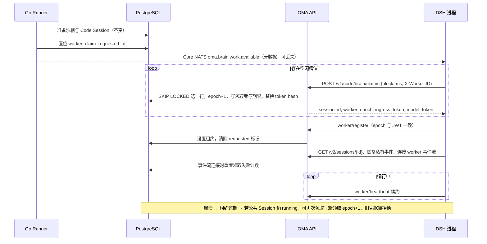
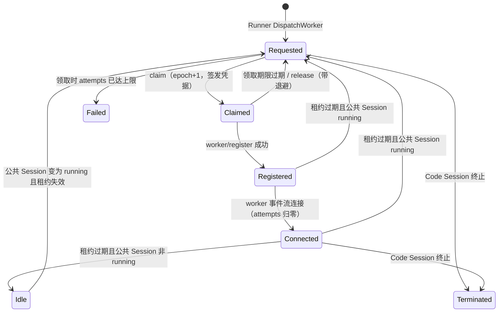

# Brain Worker 领取（替代 NATS 任务派发）

状态：草案，待评审。实现落地时同步更新 `brain-runtime.md` 中“启动与多节点恢复”与 NATS 准入相关段落，以及 `oma-brain-dsh/README.md`。

## 背景与问题

当前 Brain 启动链路为：Runner 领取 Environment Work → 创建或恢复 Code Session（轮换凭据和 epoch）→ 向 JetStream `OMA_BRAIN_TASKS` 发布携带凭据的任务 → 任一 DSH 进程通过共享 durable consumer `oma_brain` 拉取并准入，完成后 ACK。

这条链路存在两个任务队列：PostgreSQL 中的 `environment_work` 与 JetStream 中的任务消息。两者各自维护超时与归属，判断“任务归谁”的依据并不一致：

| 时钟 | 位置 | 值 |
| --- | --- | --- |
| Work 恢复判定 | `EnvironmentWorkMapper.ClaimNext` | `updated_at` 超过 60 秒 |
| 任务消息保留 | `OMA_BRAIN_TASKS` `MaxAge` | 60 秒，从发布起算 |
| 未确认重投 | consumer `ack_wait` | 60 秒 |
| CCR worker 租约 | `codeSessionWorkerLeaseTTL` + grace | 60 + 10 秒 |

由此产生的问题：

- **崩溃后消息不重投**：`ack_wait` 等于 `MaxAge`，DSH 在准入中崩溃或停机时，消息在重投前已过期，只能等 Work 恢复兜底。
- **同一 epoch 可能被两个进程执行**：`message.ack()` 不确认送达，ACK 丢失后另一进程可以用同一份凭据注册；`worker/register` 允许同一 epoch 重复注册。
- **容量无背压**：满载进程仍拉取任务后 `nak`，累计投递次数，最终被 `term`。
- **凭据落盘**：ingress/model token 以明文写入 JetStream 文件存储的多副本。

调参只能缓解，不能消除双队列带来的不一致。

## 目标与非目标

目标：

- 任务归属只有一个事实来源（PostgreSQL `code_sessions` 行）。
- 同一时刻至多一个 DSH 进程持有某 Code Session 的有效凭据。
- 领取由 DSH 按空闲容量主动发起，满载即停止领取。
- 进程崩溃后，Code Session 在租约过期后可被其他进程重新领取，不依赖消息重投。
- 凭据只经过 HTTPS 响应，不进入消息中间件。

非目标：

- 不改变 Runner 的沙箱准备、vault、memory、skill 解析和 Code Session 创建流程。
- 不改变 CCRv2 的输入投递、事件持久化、工具审批和心跳协议。
- 不做推送式调度（后端为指定 DSH 节点分配任务）。
- 不缩短现有 CCR worker 租约 TTL（见“待定问题”）。

## 方案概述

Runner 不再向 NATS 发布任务，只把 Code Session 标记为“需要执行端”。DSH 通过 HTTP 长轮询领取：一次领取在同一事务中锁定一行、推进 epoch、签发新凭据并记录领取者。凭据只返回给这一个领取者，因此同一 epoch 天然只有一个持有方。注册成功后，领取转为现有 CCR worker 租约，由现有心跳续约；租约失效即可再次领取。



## 数据模型

新增 goose migration `00083_add_code_session_worker_claims.sql`，在 `code_sessions` 上增加列，不新建表、不建外键：

| 列 | 类型 | 含义 |
| --- | --- | --- |
| `worker_claim_requested_at` | `timestamptz null` | Runner 请求执行端的时间；注册成功后清空 |
| `worker_claimed_by` | `text null` | 最近一次领取者的 `X-Worker-ID`，仅用于诊断和释放校验 |
| `worker_claim_expires_at` | `timestamptz null` | 领取期限；注册前保护该行不被他人领取 |
| `worker_claim_attempts` | `integer not null default 0` | 连续未完成准入的领取次数 |

部分索引：

```sql
create index if not exists code_sessions_worker_claim_v1_idx
    on code_sessions (worker_claim_requested_at)
    where deleted_at is null and status = 'active'
      and metadata #>> '{config,worker_transport}' = 'claim';
```

崩溃后重领依赖已有的 `code_sessions_worker_lease_expiry_v1_idx`。

`code_sessions.metadata.config.worker_transport` 新增取值 `claim`，由 Runner 在 brain 模式下写入（当前写入 `nats`，见 `internal/environments/runner.go` 中 `runtimeResources.workerTransport`）。

## 状态机

“领取状态”不单独存储，由现有列推导，所有转换都在锁定 `code_sessions` 行的事务内完成。



| 状态 | 判定 |
| --- | --- |
| Requested | `worker_claim_requested_at` 非空，或公共 Session `running` 且租约为空或已过期；同时领取期限为空或已过期 |
| Claimed | `worker_claim_expires_at > now()` 且 `worker_lease_expires_at` 为空 |
| Registered / Connected | `worker_lease_expires_at > now()`；Connected 另有 `connection_status = 'connected'` |
| Idle | 无 requested 标记、租约失效、公共 Session 非 `running` |

可领取条件（全部满足）：

1. `cs.status = 'active'`、`cs.deleted_at is null`、`worker_transport = 'claim'`。
2. `worker_claim_expires_at is null or worker_claim_expires_at <= now()`。
3. `worker_lease_expires_at is null or worker_lease_expires_at < now()`。
4. `worker_claim_requested_at is not null`，或关联公共 Session `status = 'running'` 且未删除。

第 4 条后半与现有 `ClaimNext` 的 nats 恢复分支判定相同，因此空闲后收到新输入的会话、执行端崩溃的会话，都通过同一条件重新进入领取，不再依赖 Work 恢复分支轮换凭据。公共 Session 为 idle 时即使租约失效也不可领取，与现状一致。

## 接口

### 领取

`POST /v1/code/brain/claims?block_ms=25000`

- 鉴权：`Authorization: Bearer <brain fleet token>`。不走 `/v1/*` workspace API key 鉴权；服务端只保存 token hash，用常量时间比较。
- 请求头 `X-Worker-ID`：DSH 进程 UUID，必填，按外部输入修剪一次。
- 请求体：空对象。容量由 DSH 自行控制，一次请求最多领取一个。
- `block_ms`：0 到 30000。
- 响应：
  - `200`：`{"session_id","worker_epoch","ingress_token","model_token","claim_expires_at"}`，设置 `Cache-Control: no-store`。
  - `204`：期限内无可领取任务。
  - `401`：fleet token 无效。
  - `400`：缺少 `X-Worker-ID` 或参数越界。

领取事务（Yourbatis Mapper，`code_session_claim_mapper.xml`）：

```sql
WITH picked AS (
    SELECT cs.uuid
    FROM code_sessions cs
    LEFT JOIN sessions s
      ON s.uuid = cs.session_uuid
     AND s.organization_uuid = cs.organization_uuid
     AND s.workspace_uuid = cs.workspace_uuid
     AND s.deleted_at IS NULL
    WHERE cs.deleted_at IS NULL AND cs.status = 'active'
      AND cs.metadata #>> '{config,worker_transport}' = 'claim'
      AND (cs.worker_claim_expires_at IS NULL OR cs.worker_claim_expires_at <= NOW())
      AND (cs.worker_lease_expires_at IS NULL OR cs.worker_lease_expires_at < NOW())
      AND (cs.worker_claim_requested_at IS NOT NULL OR s.status = 'running')
    ORDER BY COALESCE(cs.worker_claim_requested_at, cs.worker_lease_expires_at) ASC, cs.uuid ASC
    LIMIT 1
    FOR UPDATE OF cs SKIP LOCKED
)
UPDATE code_sessions cs
SET current_worker_epoch = cs.current_worker_epoch + 1,
    oauth_access_token_hash = #{params.OAuthAccessTokenHash,sensitive=true},
    worker_lease_expires_at = NULL,
    connection_status = 'disconnected',
    idle_since = NULL,
    worker_claimed_by = #{params.WorkerID},
    worker_claim_expires_at = #{params.ClaimExpiresAt},
    worker_claim_attempts = cs.worker_claim_attempts + 1,
    updated_at = NOW()
FROM picked
WHERE cs.uuid = picked.uuid
RETURNING cs.uuid, cs.external_id, cs.organization_uuid, cs.workspace_uuid,
          cs.current_worker_epoch, cs.worker_claim_attempts
```

- 提交后由 `codesessions.Service` 复用 `managedAgentCreateResult` 签发带 epoch 的 ingress JWT。model token 在事务前生成，事务内只写 hash。
- `worker_claim_attempts` 超过上限（默认 5）时，同一事务不返回凭据：清空 requested 标记，并走现有失败映射（公共 `session.error` + `idle/retries_exhausted`），然后继续寻找下一行。
- 领取期限默认 30 秒，只需覆盖“领取 → 注册”的两次 HTTP 往返。注册后由租约保护归属。

长轮询等待不能沿用 `environments.pollWorkRoute` 每 50ms 查一次 DB 的做法：

- 处理器订阅进程内的 Core NATS `oma.brain.work.available` 通知，收到通知或每 1 秒兜底时查询一次，直到 `block_ms` 到期。
- 每个等待中的 DSH 约产生每秒 1 次查询；通知只用于缩短延迟，丢失不影响正确性。

### 释放

`POST /v1/code/brain/claims/{code_session_id}/release`

- 鉴权同领取；请求体 `{"worker_epoch": N, "reason": "admission_failed" | "shutdown" | "capacity"}`。
- 仅当 `current_worker_epoch = N`、`worker_claimed_by = X-Worker-ID` 且租约为空时生效：把领取期限设为 `now() + backoff(attempts)`，退避为 `min(5s × 2^(attempts-1), 5min)`；`shutdown` 与 `capacity` 不退避，也不计入 attempts（同一事务内减一）。
- 不满足条件返回 `409`，DSH 忽略即可。

### 现有接口的变化

- `worker/register`：在 `RegisterCodeSessionWorkerAtEpoch` 的同一事务内清空 `worker_claim_requested_at` 与 `worker_claim_expires_at`。其余行为不变；旧 epoch 仍按现有 fence 拒绝。
- worker 事件流连接：`MarkCodeSessionWorkerConnectedForEpoch` 同时将 `worker_claim_attempts` 归零，作为“准入完成”的信号。
- `codesessions.Service.DispatchWorker`：由发布 JetStream 改为置位 `worker_claim_requested_at` 并发布无数据的 Core NATS 通知。签名不变，Runner 调用点 `finishManagedAgentRuntime` 无需修改。
- `EnvironmentWorkMapper.ClaimNext`：nats 恢复分支删除；`claim` transport 的崩溃恢复完全由领取条件覆盖。Work 的活动时间仍由 worker 心跳经公共 Work 续租路径更新。

## 并发与幂等

| 场景 | 结果 |
| --- | --- |
| 多个 DSH 同时领取 | `FOR UPDATE SKIP LOCKED` 保证每行只被一个事务选中 |
| 领取响应丢失（提交后连接断开） | 领取者拿不到凭据；领取期限过期后他人重领，epoch 再加一 |
| DSH 拿到凭据后崩溃、未注册 | 同上，最长延迟为领取期限（30 秒） |
| 注册后崩溃 | 租约过期（60 + 10 秒）后，若公共 Session running 则可重领 |
| 旧进程恢复连接 | 其 JWT epoch 小于 `current_worker_epoch`，register、事件流、心跳均被现有 epoch fence 拒绝 |
| 注册与领取并发 | 两者都锁同一 `code_sessions` 行，串行执行；领取会推进 epoch，使在途注册失败 |
| 同一进程重试注册 | 同一 epoch 允许重复注册，行为与现在一致 |
| Runner 创建时返回的凭据 | brain 模式下不再下发；首次领取会再轮换一次。这一次多余的轮换用来换取 Runner 零改动 |

同一 epoch 的凭据只返回给一个 HTTP 响应，因此不需要在 register 时额外绑定 `X-Worker-ID`。`worker_claimed_by` 只用于诊断与释放校验。

## DSH 侧变化

- 新增 `src/claim.ts` 替代 `src/transport.ts` 的 JetStream 消费；`admit` 去掉 ACK/NAK，其余阶段保持不变。
- 领取循环并发数为 `min(OMA_BRAIN_CLAIM_CONCURRENCY（默认 4）, maxSessions - sessions.size - 准入中数量)`；无空闲槽位时不发请求，有会话退役时唤醒。
- 不再在满载时淘汰空闲会话来腾位置。空闲会话仍按现有 60 秒规则退役。
- 准入失败调用 `release(reason=admission_failed)` 后退役本地会话；SIGTERM 时对准入中的会话调用 `release(reason=shutdown)`。
- 新增配置 `OMA_BRAIN_CLAIM_TOKEN`（必填）；`NATS_URL` 变为可选，仅用于订阅唤醒通知，未配置时按 1 秒间隔长轮询。
- 删除 `shouldTerminateTask` 及“第 10 次 TERM”逻辑；失败上限由服务端 `worker_claim_attempts` 统一判定。

## 权限边界

- fleet token 每个部署只有一个，所有 DSH 进程共用，可以领取任意租户的 Brain 会话，信任级别与当前 NATS 账号相同。以后如需按 environment 隔离 Brain 集群，可改用现有 environment key，并在领取 SQL 中增加 `environment_uuid` 条件。配置项为 `code_session.brain_claim_token_file`，与 JWT 签名密钥同样以文件方式挂载，不进入 `config.Config` 的明文字段，也不写日志。
- fleet token 只能调用领取与释放两个接口；领取之后的所有 CCRv2 调用继续使用 per-session ingress JWT，租户、epoch 与租约校验不变。
- 领取 SQL 关联 `sessions` 时显式带上 `organization_uuid`、`workspace_uuid`，与现有多租户规则一致。
- 运行日志只记录 `worker_id`、`session_id`、`worker_epoch`、`attempts`、`reason`，不记录响应体或 token。

## 错误合同

在 `internal/codesessions/errors.go` 中新增：

- `errBrainClaimUnauthorized`（401）
- `errBrainClaimInvalidRequest`（400）
- `errBrainClaimReleaseConflict`（409）

handler 只调用这些构造函数；DB 层返回 `ErrNotFound`、`ErrWorkerEpochMismatch` 等现有可识别错误，由 `errors.go` 映射。

## 测试计划

按仓库约定先写失败场景，再写成功场景。

Go：

- Mapper 单测：领取与释放语句的 SQL 片段（`FOR UPDATE OF cs SKIP LOCKED`、退避表达式）和参数绑定，token hash 标记为 sensitive。
- 真实 PostgreSQL：
  - 两个并发领取只得到一行；
  - 领取期限内不可重领，过期后可重领且 epoch 加一；
  - idle 公共 Session 租约失效时不可领取；
  - attempts 达到上限后转为失败并跳过；
  - register 清除 requested 标记；
  - 事件流连接后 attempts 归零；
  - 旧 epoch register 被拒绝。
- Handler：fleet token 缺失或错误、`X-Worker-ID` 缺失、`block_ms` 越界、`204` 空结果、`Cache-Control: no-store`、通知唤醒在 `block_ms` 内返回。
- 保留 `tests/files_api_test.go` 的 no-FK 守卫；运行 `just lint`、`just test`、`just dead-code`、`just duplicates`、`just complexity`。

DSH（使用 `tests/backend.ts` 受控后端）：

- 满载时不发领取请求，会话退役后恢复领取。
- 准入失败调用 release，且不阻塞其他领取。
- SIGTERM 释放准入中的领取。
- SIGKILL 后第二个进程在租约过期后重领，并恢复 journal（复用 `crash.test.ts` 场景）。
- 未配置 `NATS_URL` 时仍能领取。

真实集成（chat 相关 `verify-be` 场景）仅在用户明确要求时执行。

## 上线方式

`brain-runtime.md` 记录 Brain 实现尚未部署，因此建议直接替换，不保留 `nats` / `claim` 双 transport 兼容：

1. 后端：migration、领取与释放接口、`DispatchWorker` 改为置位、删除 `ClaimNext` 的 nats 分支、删除 `PublishBrainTask` 与 `OMA_BRAIN_TASKS` stream 创建。
2. DSH：`claim.ts` 替换 `transport.ts`，删除 `@nats-io/jetstream` 依赖；保留 `@nats-io/transport-node` 用于唤醒通知。
3. 文档：更新 `brain-runtime.md`、`nats-messaging-foundation.md`（说明 Brain 只使用 Core NATS 通知）与 `oma-brain-dsh/README.md`。

如果已有环境在运行 JetStream 方案，再增加过渡期：后端按 `worker_transport` 同时支持两种派发，DSH 通过 `OMA_BRAIN_TRANSPORT` 切换，全部切换后执行上述删除。

## 已决定

- fleet token 全部署共用一个（2026-10-18）。

## 待定问题

1. **崩溃检测延迟**：注册后崩溃仍需等待 60 + 10 秒租约。是否为 `claim` transport 单独缩短 TTL（例如 20 + 5 秒），代价是心跳频率更高。
2. **Runner 多余的凭据签发**：brain 模式下是否让 `CreateManagedAgentCodeSession` 跳过签发，以省掉首次领取前的一次轮换。
3. **失败可见性**：attempts 超限时公共事件的具体内容和安全错误分类，需要与现有 `session.error` 映射对齐。
4. **首次启动判定**：确认 Runner 调用 `DispatchWorker` 时公共 Session 状态与 requested 标记的先后关系，确保 prewarm 关闭时也不会出现“可领取但沙箱准备未完成”的窗口。
