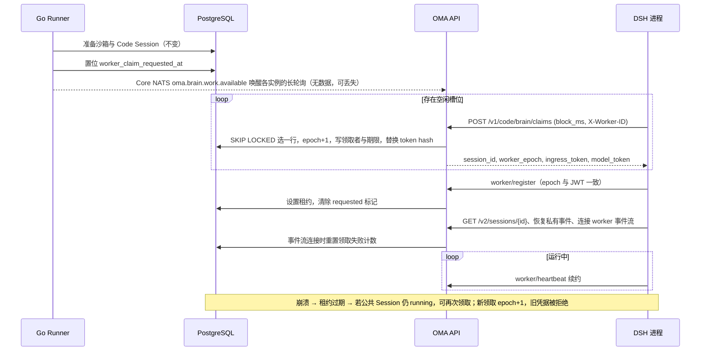
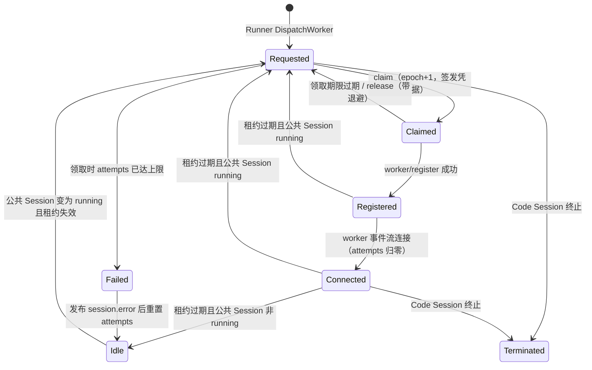

# Brain Worker 领取（替代 NATS 任务派发）

状态：已实现。运行时概要见 `brain-runtime.md`“启动与多节点恢复”，执行端配置见 `oma-brain-dsh/README.md`。

## 背景与问题

此前的 Brain 启动链路为：Runner 领取 Environment Work → 创建或恢复 Code Session（轮换凭据和 epoch）→ 向 JetStream `OMA_BRAIN_TASKS` 发布携带凭据的任务 → 任一 DSH 进程通过共享 durable consumer `oma_brain` 拉取并准入，完成后 ACK。

这条链路存在两个任务队列：PostgreSQL 中的 `environment_work` 与 JetStream 中的任务消息。两者各自维护超时与归属，判断“任务归谁”的依据并不一致：

| 时钟 | 位置 | 值 |
| --- | --- | --- |
| Work 恢复判定 | `EnvironmentWorkMapper.ClaimNext` | `updated_at` 超过 60 秒 |
| 任务消息保留 | `OMA_BRAIN_TASKS` `MaxAge` | 60 秒，从发布起算 |
| 未确认重投 | consumer `ack_wait` | 60 秒 |
| CCR worker 租约 | `codeSessionWorkerLeaseTTL` + grace | 60 + 10 秒 |

由此产生的问题：

- **崩溃后消息不重投**：`ack_wait` 等于 `MaxAge`，DSH 在准入中崩溃或停机时，消息在重投前已过期，只能等 Work 恢复兜底。
- **同一 epoch 可能被两个进程执行**：`message.ack()` 不确认送达，ACK 丢失后另一进程可以用同一份凭据注册；`worker/register` 允许同一 epoch 重复注册。
- **容量无背压**：满载进程仍拉取任务后 `nak`，累计投递次数，最终被 `term`。
- **凭据落盘**：ingress/model token 以明文写入 JetStream 文件存储的多副本。

调参只能缓解，不能消除双队列带来的不一致。

## 目标与非目标

目标：

- 任务归属只有一个事实来源（PostgreSQL `code_sessions` 行）。
- 同一时刻至多一个 DSH 进程持有某 Code Session 的有效凭据。
- 领取由 DSH 按空闲容量主动发起，满载即停止领取。
- 进程崩溃后，Code Session 在租约过期后可被其他进程重新领取，不依赖消息重投。
- 凭据只经过 HTTPS 响应，不进入消息中间件。

非目标：

- 不改变 Runner 的沙箱准备、vault、memory、skill 解析和 Code Session 创建流程。
- 不改变 CCRv2 的输入投递、事件持久化、工具审批和心跳协议。
- 不做推送式调度（后端为指定 DSH 节点分配任务）。
- 不改变非 `claim` transport（沙箱内 worker）的租约时长。

## 方案概述

Runner 不再向 NATS 发布任务，只把 Code Session 标记为“需要执行端”。DSH 通过 HTTP 长轮询领取：一次领取在同一事务中锁定一行、推进 epoch、签发新凭据并记录领取者。凭据只返回给这一个领取者，因此同一 epoch 天然只有一个持有方。注册成功后，领取转为 CCR worker 租约，由现有心跳续约；`claim` transport 的租约为 20 秒加 10 秒宽限，租约和宽限都过去后即可再次领取。



## 数据模型

新增 goose migration `00083_add_code_session_worker_claims.sql`，在 `code_sessions` 上增加列，不新建表、不建外键：

| 列 | 类型 | 含义 |
| --- | --- | --- |
| `worker_claim_requested_at` | `timestamptz null` | Runner 请求执行端的时间；注册成功后清空 |
| `worker_claimed_by` | `text null` | 最近一次领取者的 `X-Worker-ID`，仅用于诊断和释放校验 |
| `worker_claim_expires_at` | `timestamptz null` | 领取期限；注册前保护该行不被他人领取 |
| `worker_claim_attempts` | `integer not null default 0` | 连续未完成准入的领取次数 |

部分索引：

```sql
create index if not exists code_sessions_worker_claim_v1_idx
    on code_sessions (worker_claim_requested_at)
    where deleted_at is null and status = 'active'
      and metadata #>> '{config,worker_transport}' = 'claim';
```

崩溃后重领依赖已有的 `code_sessions_worker_lease_expiry_v1_idx`。

`code_sessions.metadata.config.worker_transport` 取值 `claim`，由 Runner 在 brain 模式下写入（`internal/environments/runner.go` 中 `runtimeResources.workerTransport`），替代原来的 `nats`。

## 状态机

“领取状态”不单独存储，由现有列推导，所有转换都在锁定 `code_sessions` 行的事务内完成。



| 状态 | 判定 |
| --- | --- |
| Requested | `worker_claim_requested_at` 非空，或公共 Session `running`/`rescheduling` 且租约为空或已超过宽限期；同时领取期限为空或已过期 |
| Claimed | `worker_claim_expires_at > now()` 且 `worker_lease_expires_at` 为空 |
| Registered / Connected | `worker_lease_expires_at > now()`；Connected 另有 `connection_status = 'connected'` |
| Idle | 无 requested 标记、租约失效、公共 Session 非 `running` |

可领取条件（全部满足）：

1. `cs.status = 'active'`、`cs.deleted_at is null`、`worker_transport = 'claim'`，且关联的公共 Session 存在且未删除（`s.uuid IS NOT NULL`），两个析取分支都适用，公共会话已删除的行不会再消耗一次领取和凭据轮换。
2. `worker_claim_expires_at is null or worker_claim_expires_at <= now()`。
3. `worker_lease_expires_at is null or worker_lease_expires_at + 宽限期 < now()`。宽限期内旧进程的心跳仍会被接受（见 `RecordCodeSessionWorkerHeartbeat`），不能在这段时间内抢走会话。
4. `worker_claim_requested_at is not null`，或关联公共 Session `status IN ('running', 'rescheduling')`。

第 4 条后半沿用原 `ClaimNext` nats 恢复分支的判定（另外接受 `rescheduling`），因此空闲后收到新输入的会话、执行端崩溃的会话，都通过同一条件重新进入领取，不再依赖 Work 恢复分支轮换凭据。公共 Session 为 idle 时即使租约失效也不可领取，与现状一致。

## 接口

### 领取

`POST /v1/code/brain/claims?block_ms=25000`

- 鉴权：`Authorization: Bearer <brain fleet token>`。不走 `/v1/*` workspace API key 鉴权；服务端只保存 token hash，用常量时间比较。
- 请求头 `X-Worker-ID`：DSH 进程 UUID，必填，按外部输入修剪一次。
- 请求体：空对象。容量由 DSH 自行控制，一次请求最多领取一个。
- `block_ms`：0 到 30000。
- 响应：
  - `200`：`{"session_id","worker_epoch","ingress_token","model_token","claim_expires_at"}`，设置 `Cache-Control: no-store`。
  - `204`：期限内无可领取任务。
  - `401`：fleet token 无效。
  - `400`：缺少 `X-Worker-ID` 或参数越界。

领取事务（`DB.ClaimNextCodeSession`，Mapper 为 `code_session_claim_mapper.xml`）在一个 Yourbatis transaction 内执行两步：

```sql
-- LockNextClaimable
SELECT cs.uuid, cs.external_id, cs.organization_uuid, cs.workspace_uuid, cs.session_external_id,
       cs.current_worker_epoch, cs.worker_claim_attempts
FROM code_sessions cs
LEFT JOIN sessions s
  ON s.uuid = cs.session_uuid
 AND s.organization_uuid = cs.organization_uuid
 AND s.workspace_uuid = cs.workspace_uuid
 AND s.deleted_at IS NULL
WHERE cs.deleted_at IS NULL AND cs.status = 'active'
  AND cs.metadata #>> '{config,worker_transport}' = 'claim'
  AND (cs.worker_claim_expires_at IS NULL OR cs.worker_claim_expires_at <= NOW())
  AND (cs.worker_lease_expires_at IS NULL
       OR cs.worker_lease_expires_at + #{leaseGraceMicros} * INTERVAL '1 microsecond' < NOW())
  AND (cs.worker_claim_requested_at IS NOT NULL OR s.status IN ('running', 'rescheduling'))
ORDER BY COALESCE(cs.worker_claim_requested_at, cs.worker_lease_expires_at, cs.updated_at) ASC, cs.uuid ASC
LIMIT 1
FOR UPDATE OF cs SKIP LOCKED;

-- Claim（attempts 未达上限时）
UPDATE code_sessions
SET current_worker_epoch = current_worker_epoch + 1,
    oauth_access_token_hash = #{params.OAuthAccessTokenHash,sensitive=true},
    worker_lease_expires_at = NULL, connection_status = 'disconnected', idle_since = NULL,
    worker_claimed_by = #{params.WorkerID}, worker_claim_expires_at = #{params.ClaimExpiresAt},
    worker_claim_attempts = worker_claim_attempts + 1, updated_at = NOW()
WHERE uuid = #{params.UUID}
RETURNING current_worker_epoch;
```

- 提交后由 `codesessions.Service.ClaimBrainWorker` 读取签发上下文并签发带 epoch 的 ingress JWT。model token 在事务前生成，事务内只写 hash。
- `worker_claim_attempts` 已达上限（5）时，事务改为 `HoldExhausted`：推进 epoch 并清空 `worker_claimed_by`，清空 requested 标记和已过期的租约（worker 注册后、事件流连接前崩溃时会残留非空的过期租约），把领取期限设为 1 分钟后，不返回凭据。推进 epoch 使仍卡在注册或打开会话中的旧领取者无法在失败公开后完成 register 或心跳，避免已宣告失败的会话被旧凭据重新挂上租约。`worker_claimed_by` 为空表示已经推进过，发布失败后再次进入 hold 时 epoch 不变，失败事件 ID 保持稳定。事务提交后服务发布 `session.error`（`retry_status: exhausted`）与 `session.status_idle(retries_exhausted)`，事件 ID 由 Code Session ID 和 hold 推进后的 epoch 稳定派生，重试发布不会重复；发布成功后 `ResetExhausted` 以 hold 推进后的 `current_worker_epoch` 为守卫把 attempts 归零并清空期限，未更新任何行时返回错误并记录告警。发布失败时 1 分钟后再次进入同一路径。公共会话变为 idle 后不再满足可领取条件，直到新输入使其重新 running。一次长轮询最多连续处理 10 个耗尽的行，然后继续寻找可领取的行。
- 已知边界：新输入恰好落在 `HoldExhausted` 与失败事件发布之间（毫秒级窗口）时，`session.status_idle(retries_exhausted)` 可能晚于新输入写入。之后公共会话一旦回到 running 即重新满足领取条件，可以自愈；该窗口未额外加锁处理。
- 领取事务提交后若签发凭据时发现会话已不存在（例如刚被删除），本次视为未领到并继续扫描下一行，不返回 500。
- 领取期限为 30 秒，只需覆盖“领取 → 注册”的两次 HTTP 往返。注册后由租约保护归属。

长轮询等待不能沿用 `environments.pollWorkRoute` 每 50ms 查一次 DB 的做法：

- 处理器通过 worker event broker 的 `BrainWorkSignal` 订阅 Core NATS `oma.brain.work.available`（内存 broker 在进程内广播），收到通知或每 1 秒兜底时查询一次，直到 `block_ms` 到期；客户端断开时立即结束。
- 每个等待中的领取循环约产生每秒 1 次查询。DSH 每个进程默认运行 `OMA_BRAIN_CLAIM_CONCURRENCY=4` 个循环，空闲时单进程约 4 QPS，容量按“进程数 × 并发数”估算。通知只用于缩短延迟，丢失不影响正确性。DSH 自身不连接 NATS。若数据库压力成为问题，可改为只保留一个长轮询循环，其余循环在收到唤醒或空槽位时再领取。

### 释放

`POST /v1/code/brain/claims/{code_session_id}/release`

- 鉴权同领取；请求体 `{"worker_epoch": N, "reason": "admission_failed" | "shutdown" | "idle" | "permanent"}`。
- 仅当 Code Session active、`current_worker_epoch = N` 且 `worker_claimed_by = X-Worker-ID` 时生效。注册前后都可以调用：清空租约、置 `connection_status = 'disconnected'`。`admission_failed` 与 `shutdown` 还把 `worker_claim_requested_at` 设为已有值或当前时间，使会话无论公共状态如何都能再被领取。
- `admission_failed` 把领取期限设为 `now() + min(5s × 2^(attempts-1), 5min)`；连续失败的退避依次为 5、10、20、40、80 秒，第 6 次领取进入耗尽分支，因此临时性故障约 155 秒（另加各次准入耗时）后才公开 `session.error`。
- `permanent` 用于重试也不会成功的失败（任务信封、`session_context` 或 assignment 校验失败）：`FailPermanently` 在同一条 UPDATE 中推进 epoch、清空 `worker_claimed_by`、租约与 requested 标记、把 attempts 提到上限并设置 1 分钟保持期，服务随即走与耗尽相同的发布与重置流程，用户几秒内即可看到 `session.error`。
- `shutdown` 立即可领取，并把 attempts 减一，不计为失败，同时通过 Core NATS 唤醒其他长轮询。DSH 本地容量竞争导致的放弃也使用 `shutdown`。
- `idle` 用于 DSH 关闭空闲会话（60 秒空闲退役、为新领取腾出容量、正常退出）：只清空租约并让领取期限立即过期，不设置 requested 标记、不改变 attempts。公共会话保持 idle 时不会被领取；之后的新输入让会话回到 running，任一进程即可立即领取，不必等待旧进程最后一次心跳的 20 秒租约与 10 秒宽限。
- 不满足条件返回 `409`，DSH 只记录告警。

### 现有接口的变化

- `worker/register`：在 `RegisterCodeSessionWorkerAtEpoch` 的同一事务内清空 `worker_claim_requested_at` 与 `worker_claim_expires_at`。其余行为不变；旧 epoch 仍按现有 fence 拒绝。
- worker 事件流连接：`MarkCodeSessionWorkerConnectedForEpoch` 同时将 `worker_claim_attempts` 归零，作为“准入完成”的信号。
- `codesessions.Service.DispatchWorker(ctx, session, codeSessionID)`：由发布 JetStream 改为置位 `worker_claim_requested_at` 并发布无数据的 Core NATS 通知；Runner 在 `finishManagedAgentRuntime` 中传入公共 Session 与 Code Session ID。
- `EnvironmentWorkMapper.ClaimNext`：nats 恢复分支删除，只领取 queued Work；`claim` transport 的崩溃恢复完全由领取条件覆盖。
- 公共输入入队后的 `resumeSandboxForCodeSession` 对 `claim` transport 直接返回，不再用 sandbox 续期延长 Brain worker 租约，也不安排 Work 恢复；沙箱由惰性沙箱网关按需准备。
- `workerevents`：删除 `PublishBrainTask` 与 `OMA_BRAIN_TASKS` stream，新增 `BrainWorkSignal`（JetStream broker 用 Core NATS，内存 broker 用进程内广播）。

## 租约时长

`claim` transport 使用独立的租约参数，其他 transport 保持 60 + 10 秒不变：

| 参数 | `claim` | 其他 transport |
| --- | --- | --- |
| 租约 TTL | 20 秒 | 60 秒 |
| 宽限期 | 10 秒 | 10 秒 |
| DSH 心跳间隔（`OMA_CCR_HEARTBEAT_INTERVAL_MS` 默认值） | 6 秒 | 20 秒 |
| 崩溃后最长不可领取时间 | 30 秒 | 70 秒 |

- 常量位于 `internal/codesessions/brain_dispatch.go`，默认值仍是 `ingress.go` 的 `codeSessionWorkerLeaseTTL`、`codeSessionWorkerLeaseGrace`。register 先用 `DB.GetCodeSessionWorkerTransport` 读取 `metadata.config.worker_transport`，再把 TTL 传给 `RegisterCodeSessionWorkerAtEpoch`；注册每次领取只发生一次，这次额外读取可以接受。heartbeat 不额外读取：`RecordCodeSessionWorkerHeartbeat` 接收 `WorkerLeasePolicy`，在原有的 `LockWorkerLeaseByExternalID … FOR UPDATE` 查询中一并取出 transport，再按策略决定 TTL 与宽限期。
- 领取 SQL 用同一宽限期判断租约是否失效，保证“心跳仍被接受”和“可被重新领取”两个判定互斥。
- DSH 心跳按固定节奏发送（下一拍在发出当前请求前就已排期，与请求耗时无关），间隔 6 秒、抖动 ±10%、请求超时 5 秒。上一次成功后若连续 2 拍失败，第 3 拍最晚在 19.8 秒内发出、24.8 秒内到达；即使已越过 20 秒租约，仍在 10 秒宽限内被接受并续约。会话只有在租约加宽限（30 秒）都过去后才能被其他进程接管。DSH 启动时校验 `间隔 × (1 + 抖动) + 超时 < 租约 TTL`，不满足则拒绝启动。
- 代价：每条 Brain 会话每 6 秒一次心跳，每次心跳仍是原来的一个事务（行锁读取、租约更新、Work 续租），只是频率约为原来的 3.3 倍，没有额外的数据库往返；GC 停顿、网络抖动或后端变慢超过约 30 秒时，会话会被判定失效并被其他进程领取，旧进程的写入随即被 epoch fence 拒绝，正在执行的工具调用走现有 blocked 恢复流程。
- 进程正常退出时以 `shutdown` release 准入中的领取和仍有活跃 turn 的会话，不需要等待租约过期；空闲会话以 `idle` release，只清除租约，不会被无意义地重新领取。

## 并发与幂等

| 场景 | 结果 |
| --- | --- |
| 多个 DSH 同时领取 | `FOR UPDATE SKIP LOCKED` 保证每行只被一个事务选中 |
| 领取响应丢失（提交后连接断开） | 领取者拿不到凭据；领取期限过期后他人重领，epoch 再加一 |
| DSH 拿到凭据后崩溃、未注册 | 同上，最长延迟为领取期限（30 秒） |
| 注册后崩溃 | 租约和宽限期过去后（最长 20 + 10 秒），若公共 Session running 则可重领 |
| 旧进程恢复连接 | 其 JWT epoch 小于 `current_worker_epoch`，register、事件流、心跳均被现有 epoch fence 拒绝 |
| 注册与领取并发 | 两者都锁同一 `code_sessions` 行，串行执行；领取会推进 epoch，使在途注册失败 |
| 同一进程重试注册 | 同一 epoch 允许重复注册，行为与现在一致 |
| Runner 创建时返回的凭据 | brain 模式下不再下发；首次领取会再轮换一次。这一次多余的轮换用来换取 Runner 零改动 |

同一 epoch 的凭据只返回给一个 HTTP 响应，因此不需要在 register 时额外绑定 `X-Worker-ID`。`worker_claimed_by` 只用于诊断与释放校验。

## DSH 侧变化

- `src/claim.ts` 替代 `src/transport.ts` 的 JetStream 消费：`BrainClaimClient` 调用领取与释放接口，`claimTasks` 运行 `OMA_BRAIN_CLAIM_CONCURRENCY`（默认 4，1–32）个长轮询循环，每个循环在“可用槽位 - 正在领取或准入的数量 > 0”时才发起 `block_ms=25000` 的请求，否则等待槽位释放（会话退役时唤醒，最多 1 秒重查）。
- `src/capacity.ts` 的 `SessionCapacity` 负责槽位：可用槽位为 `maxSessions` 减去忙碌会话数；准入时先同步预留一个槽位，若“会话数 − 退役中会话数 + 预留数”超过上限，就淘汰最久空闲且不在退役中的会话，直到满足上限；没有可淘汰的会话时释放预留、抛出 `CapacityExhaustedError` 并以 `shutdown` 原因 release。会话写入本地表后释放预留，因此并发准入不会选中同一个空闲会话，也不会超过上限。
- 启动时先做 `block_ms=0` 的领取作为探测，成功后才打印 ready：401/403 转为 `ConfigurationError` 并退出，提示核对 `OMA_BRAIN_CLAIM_TOKEN`；其他错误（后端仍在启动、网络抖动）按 1、2、5、10、30 秒退避重试。探测领到的会话交给第一个循环准入。运行期领取失败使用同一退避；运行中遇到 401/403（例如 fleet token 被轮换）时不退出进程，因为已有会话使用各自的 per-session 凭据仍可继续运行，只在每段连续拒绝的开始以 error 级别输出一次与启动相同的提示，并继续退避重试。
- 准入失败默认以 `admission_failed` release，由服务端 `worker_claim_attempts` 统一裁决何时公开失败。`register` 的确定性 4xx 不单独判为 `permanent`：404/410 表示会话已不存在或不再 active，release 不会命中、会话也不会再被领取，不存在 155 秒重试链；409 表示其他进程已推进 epoch 接管，不是该会话的失败；401/403 通常是部署级凭据或签名配置问题，判为 `permanent` 会让所有受影响会话同时失败，保留重试给运维修复配置的时间。`PermanentAdmissionError`（任务信封、`session_context`、assignment 校验失败）以 `permanent` release；停机期间以 `shutdown`。SIGTERM 时先停止会话，再 release 准入中的领取和忙碌会话，然后等待会话关闭。
- 同一会话被再次领取时一定是更高 epoch，本地旧会话直接退役。
- 新增 `OMA_BRAIN_CLAIM_TOKEN`（必填）与 `OMA_BRAIN_CLAIM_CONCURRENCY`；删除 `NATS_URL` 与 `@nats-io/*` 依赖。心跳默认间隔改为 6 秒，启动时校验 `间隔 × (1 + 抖动) + 超时 < 20000 ms`。
- 删除 `shouldTerminateTask` 及“第 10 次 TERM”逻辑；失败上限由服务端 `worker_claim_attempts` 统一判定。
- `scripts/verify.ts` 不再启动 NATS 容器，只构建产物并运行测试。

## 权限边界

- fleet token 每个部署只有一个，所有 DSH 进程共用，可以领取任意租户的 Brain 会话，信任级别与当前 NATS 账号相同。以后如需按 environment 隔离 Brain 集群，可改用现有 environment key，并在领取 SQL 中增加 `environment_uuid` 条件。配置项为 `code_session.brain_claim_token_file`，与 JWT 签名密钥同样以文件方式挂载，不进入 `config.Config` 的明文字段，也不写日志。
- fleet token 只能调用领取与释放两个接口；领取之后的所有 CCRv2 调用继续使用 per-session ingress JWT，租户、epoch 与租约校验不变。
- 领取 SQL 关联 `sessions` 时显式带上 `organization_uuid`、`workspace_uuid`，与现有多租户规则一致。
- 运行日志只记录 `worker_id`、`session_id`、`worker_epoch`、`attempts`、`reason`，不记录响应体或 token。

## 错误合同

在 `internal/codesessions/errors.go` 中新增：

- `brainClaimUnauthenticated()`（401）
- `brainClaimInvalidRequest(message, cause)`（400）
- `brainClaimFailure(cause)`（500）
- `mapBrainClaimReleaseError(err)`：`db.ErrPreconditionFailed` 映射为 409，其余为 500

handler 只调用这些函数；DB 层返回 `ErrPreconditionFailed`、`ErrNotFound` 等现有可识别错误。`code_session.brain_claim_token_file` 由 `main` 在组装阶段通过 `codesessions.LoadBrainClaimAuthenticator` 读取，经 `ServerDeps.BrainClaims` 注入 Handler；文件少于 32 个字符或无法读取时 `run` 返回错误，服务以可读的启动错误退出，资源包不 panic。

## 测试与验证

已实现的自动化测试（失败场景在前）：

- `internal/db/code_session_claim_mapper_test.go`：领取、释放、请求、耗尽保持、重置与永久失败语句的 SQL 片段与参数绑定，token hash 标记为 sensitive；心跳行锁查询带出 `worker_transport`。
- `internal/db/code_session_claims_postgres_test.go`（`TEST_MIGRATION_DATABASE_URL`）：非 claim transport、idle 会话、跨组织请求和未持有领取的 release 被拒绝；8 个并发领取只成功 1 个；领取期限、release 退避与立即释放；旧 epoch 注册被拒；注册清除请求、连接重置 attempts；宽限期内不可领取且旧心跳仍成功，超过宽限期后接管并拒绝旧心跳；耗尽后的 hold、以 epoch 守卫的 reset 与新输入后恢复领取；注册后、连接前崩溃残留的过期租约在耗尽时被清空，reset 后可再次领取；`FailPermanently` 只允许当前领取者调用，并使会话在 reset 前保持耗尽；耗尽与永久失败都推进 epoch，旧 epoch 的注册被拒，发布失败后再次 hold 时 epoch 不变，以被围栏的旧 epoch reset 失败；`idle` release 只允许当前领取者调用，清空租约后 idle 会话不可领取、新输入后立即可领取。
- `internal/workerevents/brain_test.go`：取消订阅后不再收到通知；Core NATS 与内存 broker 都能唤醒订阅者，且不再创建 `OMA_BRAIN_TASKS`。
- `internal/codesessions/brain_dispatch_test.go`：fleet token 文件长度与读取校验、Bearer 比较、`block_ms` 边界、transport 判定与租约参数。
- `internal/config`：brain 模式缺少 `code_session.brain_claim_token_file` 时拒绝启动。
- `tests/brain_worker_claim_test.go`（真实 PostgreSQL 与 HTTP 服务）：鉴权与参数错误；长轮询在派发后被唤醒、第二个 worker 领不到、注册成功且心跳返回约 20 秒租约；宽限期边界接管与旧 worker fence；release 冲突、失败退避、5 次后发布 `session.error` 与 `retries_exhausted` 并保持 idle；耗尽与 `permanent` 后旧凭据注册被拒；`permanent` release 立即发布同样的事件，新输入后可重新领取；`idle` release 后无新输入不可领取，会话回到 running 后立即可领取；公共会话已删除时不会被领取（epoch 与 attempts 不变）。`tests/brain_sandbox_provisioning_test.go` 改为统计 `DispatchWorker` 调用。
- DSH：`tests/capacity.test.ts` 复现评审中的并发准入场景（上限 2、空闲 A/B、并发准入 C/D 最终只保留 C/D）及预留释放；`tests/claim-loop.test.ts` 覆盖 401 启动失败、启动探测的临时错误重试、运行中 401 只报告一次并继续重试、准入失败按原因（`admission_failed`/`permanent`/`shutdown`）release 且不阻塞后续领取、容量为零时停止领取、准入中停机 release、临时错误退避恢复；`tests/claim-process.test.ts` 用独立进程覆盖错误或缺失 token 的启动失败、领取到 SSE 审批的完整回合，以及 SIGTERM 时忙碌会话以 `shutdown`、空闲会话以 `idle` 交还；`tests/oma-heartbeat.test.ts` 覆盖心跳与租约约束和领取配置。

`verify-be` 生成的配置写入 `code_session.brain_claim_token_file`，清理阶段与其他密钥一起删除；`tests/liveworker` 启动 Brain 时传入 `OMA_BRAIN_CLAIM_TOKEN`。真实 Brain、模型与 Docker 沙箱的 chat 场景未在本次改动中运行，仅在用户明确要求时执行。

`tests/ccrv2-inbound.test.ts` 偶发的 `CCRv2 session stopped` 未处理拒绝与领取逻辑无关，排查记录见 superduck-ai/open-managed-agents#457。

## 上线方式

已运行过 JetStream 方案的 NATS 服务器上会残留不再使用的 `OMA_BRAIN_TASKS` stream，可手工删除（`nats stream rm OMA_BRAIN_TASKS`）；迁移 83 的 Down 会删除领取列，符合仓库迁移惯例。

Brain 尚未部署，因此直接替换，不保留 `nats` / `claim` 双 transport：迁移 83 增加领取列，后端删除 `OMA_BRAIN_TASKS` stream 与 `PublishBrainTask`，DSH 删除 JetStream 消费与 NATS 依赖。部署时后端与 DSH 一起更新，并为两者配置同一个 fleet token。

## 已决定

- fleet token 全部署共用一个（2026-10-18）。
- `claim` transport 租约调整为 20 秒 TTL 加 10 秒宽限（2026-10-18），参数见“租约时长”。
- 领取失败耗尽后发布的公共错误使用 `unknown_error` 类型和固定文案，不暴露内部原因。
- 首次启动由 `worker_claim_requested_at` 驱动，不依赖公共 Session 状态；Brain 使用惰性沙箱，领取不需要等待沙箱准备完成。

## 待定问题

1. **Runner 多余的凭据签发**：brain 模式下 `CreateManagedAgentCodeSession` 仍会签发一次凭据并在首次领取时再轮换。是否跳过以省掉这次轮换，留待后续评估。
