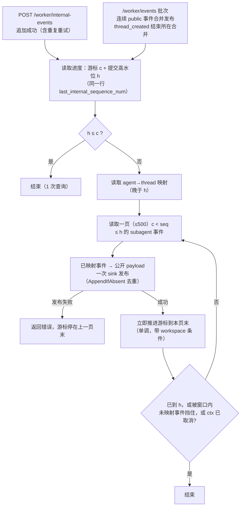

# CCR v2 Worker Internal Events 后端实现设计

本文记录 `POST/GET /v1/code/sessions/{code_session_id}/worker/internal-events` 的当前后端实现。该端点是 worker 私有 transcript 持久化通道，用于 CCR v2 resume；它不复用公开的 session event 表，也不会向前端 SSE 流发布事件。

相关文档：

- epoch 语义：[`ccr-v2-epoch-design.md`](ccr-v2-epoch-design.md)
- worker events delivery：[`ccr-v2-worker-events-delivery-backend-design.md`](ccr-v2-worker-events-delivery-backend-design.md)

---

## 1. 目标与边界

`/worker/internal-events` 只保存 Claude Code worker 产生的 transcript 事件：

| 能力 | 当前实现 |
|---|---|
| 私有 transcript 落库 | 是，写入 `code_session_internal_events` |
| 前端可见事件 | 否，不写 `session_events` |
| worker output event | 否；outbound 私有日志已移除，公开输出直接进入 `session_events` |
| 前端 SSE 广播 | 否 |
| CCR v2 resume 读取 | 是，配套 `GET /worker/internal-events` |
| worker epoch 写保护 | POST 在 DB 事务内校验 |

该接口当前是 CCR v2 resume 的 transcript 持久化通道，只接受可原样写回 Claude Code transcript JSONL 的 `TranscriptMessage` payload。真实 wire payload 是 `TranscriptMessage` 本体，`payload.type` 使用消息自己的 discriminator：`user` / `assistant` / `attachment` / `system`。公开 worker 输出仍走 `/worker/events`，worker delivery ACK 仍走 `/worker/events/delivery`。

协议来源以 `superduck-code` 的 TS 实现为准：

- `src/utils/sessionStorage.ts:isTranscriptMessage()` 将 transcript entry 限定为 `user` / `assistant` / `attachment` / `system`。
- `src/utils/sessionStorage.ts:persistToRemote()` 调用 `internalEventWriter('transcript', entry, ...)`。
- `src/cli/transports/ccrClient.ts:writeInternalEvent()` 构造 payload 时先写 `type: eventType`，再展开 `...payload`，因此 `entry.type` 会覆盖 `"transcript"`。
- resume 时 `hydrateFromCCRv2InternalEvents()` 会把 GET 返回的 `event.payload` 原样写回 JSONL transcript 文件。

---

## 2. 路由与鉴权

路由注册为同一个 handler：

```text
/v1/code/sessions/{code_session_id}/worker/internal-events
```

handler 支持：

| Method | 行为 |
|---|---|
| `POST` | worker 写入 transcript |
| `GET` | worker resume 读取 transcript |
| 其他 method | `405 invalid_request_error` |

本文统一使用 `code_session_id` 表示路由中的 code session external ID；数据库字段 `code_session_external_id` 存储的是同一个值。

处理入口先执行 worker/session 鉴权，再读取 `code_sessions`：

1. 鉴权失败返回 `401 authentication_error`。
2. code session 不存在返回 `404 not_found_error`。
3. 只有 `POST` 需要 body 中的 `worker_epoch`。
4. `GET` 不要求 `worker_epoch`，只做鉴权和 session 存在校验。

生产契约要求 `Authorization: Bearer <session_access_token>`。当前本地兼容层仍接受 `Authorization: Bearer <code_session_id>`，但该路径仅作为 local/non-production 兼容 shim，不是生产支持的鉴权模式。

---

## 3. POST 请求契约

### 3.1 Body

```jsonc
{
  "worker_epoch": 1,
  "events": [
    {
      "payload": {
        "uuid": "msg_01H...",
        "type": "user",
        "parentUuid": null,
        "isSidechain": false,
        "message": { "role": "user", "content": "hello" }
      },
      "is_compaction": false,
      "agent_id": "agent_01H...",
      "event_metadata": {
        "source": "sessionStorage"
      }
    }
  ]
}
```

| 字段 | 必填 | 当前校验 |
|---|---|---|
| `worker_epoch` | 是 | 必须是正整数；不匹配当前 epoch 返回 `409 conflict_error` |
| `events` | 是 | 必须是数组；允许空数组 |
| `events[].payload` | 是 | 必须是 JSON object |
| `events[].payload.type` | 是 | 必须是 `user` / `assistant` / `attachment` / `system` |
| `events[].payload.uuid` | 是 | 必须是非空字符串；作为幂等键 |
| `events[].is_compaction` | 否 | 如果存在，必须是 boolean |
| `events[].agent_id` | 否 | 如果存在，必须是 string |
| `events[].event_metadata` | 否 | 任意 JSON 值；持久化后在 GET 响应返回 |

`payload` 按 opaque JSON object 原样持久化。后端只做恢复路径必须的轻量校验，不重写 `payload.type`，也不把 transcript entry 再包一层。TS 侧 `TranscriptMessage = SerializedMessage & { parentUuid, isSidechain, agentId?... }`，常见字段包括：

| 字段 | 来源 | 说明 |
|---|---|---|
| `type` | `Message.type` | transcript discriminator，允许 `user` / `assistant` / `attachment` / `system` |
| `uuid` | `Message.uuid` | 幂等键来源 |
| `parentUuid` | `TranscriptMessage.parentUuid` | 父消息；compaction 边界可为 `null` |
| `logicalParentUuid` | `TranscriptMessage.logicalParentUuid` | session break/compaction 兼容字段，可选 |
| `isSidechain` | `TranscriptMessage.isSidechain` | 是否 sidechain |
| `agentId` | `TranscriptMessage.agentId` | subagent ID，可选；可补全顶层 `agent_id` |
| `cwd` / `userType` / `sessionId` / `timestamp` / `version` | `SerializedMessage` | Claude Code 写 transcript 时携带的 session-stamp 字段 |
| `message` / `attachment` / 其他字段 | `Message` subtype | 由具体 `type` 决定，后端不解析 |

`agent_id` 解析规则：

1. event 顶层 `agent_id` 与 `payload.agentId` 都存在时，两者必须相同，否则返回 `400 invalid_request_error`。
2. 只有顶层 `agent_id` 存在时使用顶层值。
3. 只有 `payload.agentId` 存在时兼容使用 payload 值。
4. 两者都缺失时视为 foreground transcript，数据库中 `agent_id is null`。

`events: []` 是合法请求。它只在事务中校验 `worker_epoch`，不插入事件，成功返回 `{"ok": true}`。

### 3.2 响应与错误

成功响应固定为：

```json
{
  "ok": true
}
```

错误响应继续使用 `httpapi.WriteError` 的 Anthropic-compatible 形状：

| 状态码 | 场景 |
|---|---|
| `400` | JSON 非法、缺少 `events`、payload 非 object、缺少 `payload.uuid`、非 transcript entry 类型等 |
| `401` | 鉴权失败 |
| `404` | code session 不存在 |
| `409` | `worker_epoch` 不是当前 epoch |
| `413` | body 超过现有大小限制 |
| `5xx` | 数据库或服务端错误 |

---

## 4. 写入事务

写入入口是：

```go
AppendCodeSessionInternalEvents(ctx, codeSessionID, workerEpoch, inputs)
```

事务流程：

1. `begin tx`。
2. `select code_sessions ... for update` 锁定目标 code session。
3. 校验 `current_worker_epoch == workerEpoch`。
4. 根据 `idempotency_key` 预读已存在事件。
5. 按请求顺序跳过重复事件，插入未见过的事件。
6. 对每条新事件递增 `code_sessions.last_internal_sequence_num`。
7. 如有新事件，更新 `code_sessions.last_internal_sequence_num` 和 `updated_at`。
8. `commit`。

事务内 epoch 校验是必要的：如果新 worker register 已经先拿到同一行锁并 bump epoch，旧 worker 的 POST 会在 append 阶段返回 `409`，不会继续写入 internal events。

### 4.1 幂等键

`payload.uuid` 是 transcript 事件的 canonical 幂等键。当前实现生成：

```text
<code_session_id>:internal:uuid:<payload.uuid>
```

重复重试返回成功，但数据库只保留一条 internal event。去重在同一个 code session 内生效。

### 4.2 顺序号

`sequence_num` 是 code session 级别的 internal transcript 顺序号，来源于 `code_sessions.last_internal_sequence_num + 1`。foreground 和所有 subagent 共用同一全局递增序列，因此 GET 合并流可以按 `sequence_num asc` 稳定分页。

---

## 5. 数据模型

schema 通过 goose migration：

```text
internal/db/migrations/00009_add_code_session_internal_events.sql
```

新增 `code_sessions.last_internal_sequence_num bigint not null default 0`。

新增表 `code_session_internal_events`，核心字段：

| 字段 | 含义 |
|---|---|
| `external_id` | 对外返回的 `event_id` |
| `organization_uuid` / `workspace_uuid` | 稳定的 scope 标识 |
| `code_session_uuid` / `code_session_external_id` | code session 稳定引用与协议标识 |
| `sequence_num` | code session 内 internal event 顺序 |
| `event_type` | 来自 `payload.type`，即 `user` / `assistant` / `attachment` / `system` |
| `payload_uuid` | `payload.uuid` |
| `agent_id` | null 表示 foreground；非 null 表示 subagent |
| `is_compaction` | compaction 边界标记 |
| `payload` | 原始 transcript payload |
| `payload_hash` | 保留空白、字段和编码形式的原始 JSON 内容 hash |
| `idempotency_key` | 基于 `payload.uuid` 的去重键 |
| `event_metadata` | 可选事件元数据 |
| `created_at` / `updated_at` / `deleted_at` | 标准时间字段 |

按项目 schema 规则，该表不创建 PostgreSQL foreign key。完整性由写入事务、测试和 no-FK guard 维护。

索引按当前查询路径设计，均包含 workspace/code session scope：

| 索引用途 | 查询 |
|---|---|
| sequence unique | 同一 code session 内 `sequence_num` 唯一 |
| idempotency unique | 同一 code session 内幂等插入 |
| foreground list | `agent_id is null` 的 GET 分页 |
| subagent list | `agent_id is not null` 的 GET 分页 |
| foreground compaction | foreground 最新 compaction 边界 |
| subagent compaction | 每个 subagent 最新 compaction 边界 |

---

## 6. GET 请求契约

`GET /worker/internal-events` 用于 CCR v2 resume 读取 transcript，不携带 `worker_epoch`。

Query 参数：

| 参数 | 默认 | 当前语义 |
|---|---|---|
| `subagents` | `false` | `false` 只读 foreground；`true` 只读所有 subagent 合并流 |
| `cursor` | 空 | 上一页最后一条 `sequence_num` 的十进制字符串 |

分页固定页大小为 500。`cursor` 必须是非负十进制整数，非法返回 `400 invalid_request_error`。

响应：

```jsonc
{
  "data": [
    {
      "event_id": "csev_int_...",
      "event_type": "user",
      "payload": { "uuid": "msg_01H...", "type": "user", "parentUuid": null, "isSidechain": false },
      "event_metadata": null,
      "is_compaction": false,
      "created_at": "2026-07-01T10:00:00Z",
      "agent_id": "agent_01H..."
    }
  ],
  "next_cursor": "123"
}
```

响应字段：

| 字段 | 含义 |
|---|---|
| `event_id` | internal event 的 external id |
| `event_type` | 来自 `payload.type`，与 payload 保持一致 |
| `payload` | 持久化的 transcript payload |
| `event_metadata` | POST 传入的 metadata；没有则为 `null` |
| `is_compaction` | 是否 compaction 边界 |
| `created_at` | 事件落库时间 |
| `agent_id` | subagent 事件才返回；foreground 省略 |

`next_cursor` 仅在还有下一页时返回字符串；没有更多数据时为 `null`。

---

## 7. Compaction 过滤

GET 不返回完整历史，而是从每个 scope 的最近一次 compaction 边界开始返回：

- foreground scope：`agent_id is null`，只计算 foreground 的最近 compaction。
- subagents scope：`agent_id is not null`，按每个 `agent_id` 独立计算最近 compaction，再合并返回。

边界事件本身会包含在结果中：

```text
old event
old event
compaction boundary   <- GET 包含
new event             <- GET 包含
```

原因是 compaction 边界事件携带压缩后的 resume state，worker 需要它来恢复对话上下文。

当前 list 查询通过 window function 计算 `boundary_sequence_num`：

```text
max(sequence_num) filter (where is_compaction) over (partition by agent_id)
```

然后过滤：

```text
sequence_num >= boundary_sequence_num
sequence_num > cursor
```

如果某个 scope 从未发生 compaction，则返回该 scope 的全部事件。

---

## 8. Scope 与安全过滤

读路径显式带入：

```go
WorkspaceUUID
CodeSessionExternalID
Subagents
AfterSequence
Limit
```

SQL 同时过滤：

```sql
e.workspace_uuid = CAST(:workspace_uuid AS uuid)
and e.code_session_external_id = :code_session_external_id
```

这样可以避免只按 external id 查询时误读其他 workspace 的数据，也让索引路径和迁移中的索引前缀一致。

---

## 9. 测试覆盖

当前测试覆盖点：

| 测试场景 | 期望 |
|---|---|
| POST success + GET | transcript 按顺序落库并读回 |
| private channel | 不创建公开 `session_events`，不广播前端流 |
| stale epoch | 返回 `409 conflict_error`，包括空 `events` 请求 |
| duplicate retry | 同一 `payload.uuid` 多次 POST 只存一条 |
| compaction filtering | 返回最近边界事件和之后事件，排除更旧历史 |
| subagents | `subagents=true` 排除 foreground，并按每个 `agent_id` 独立 compaction |
| cursor pagination | 500 固定页大小，无重复、无缺口 |
| invalid payloads | 缺少 `events`、payload 非 object、缺少 uuid、非 transcript entry 类型等返回 400 |
| invalid cursor | 返回 400 |
| unsupported method | 返回 405 |
| schema guard | no-FK 测试包含 `code_session_internal_events` |
| subagent 投影游标 | 发布失败不推进游标；未映射事件在窗口内挡住游标、映射到达后补发；超窗放弃后不再重读；陈旧映射快照不越过高水位之后已映射的事件；升级后单次调用从 0 逐页追平并补齐未投影尾部；积压超过一页时单次调用追平；取消后保留已提交页的进度并续跑；历史 100 与 1000 条时增量工作量相同；`thread_created` 结束所在合并发布（`internal/codesessions/subagent_publication_test.go`） |
| 游标持久化 | 迁移后旧行从 0 起步、读取进度含提交高水位、单调推进、workspace 隔离与回滚（`internal/db/code_session_subagent_cursor_postgres_test.go`，integration） |
| 投影失败补偿与同批归属 | 内部事件投影失败（payload 读取故障）后仅靠后续普通 public 事件补齐子线程；同一 `/worker/events` 请求内 `thread_created` 后接 agent-only `agent.message` 进入子线程而非主线程（`tests/subagent_publication_integration_test.go`，integration） |

---

## 10. 已知实现取舍

1. 当前幂等实现先查重再批量插入，没有使用 `insert ... on conflict do nothing`。由于事务持有 code session 行锁，同一 code session 的并发 append 已串行化，正确性不依赖数据库 conflict retry。
2. GET 的 compaction 查询先在 scoped CTE 内计算边界，再做 cursor/limit 分页。它优先保证语义清晰；如果 internal event 历史非常大，可以后续将 compaction boundary 查询拆成更窄的索引查找。
3. `created_at` 当前由 append 批次统一设置，同一批事件可能拥有相同时间戳；对外顺序以 `sequence_num` 为准。


## 11. 生命周期与历史保留

[私有 transcript 归档](../transcript-archive.md) 默认关闭，不改变 GET、cursor、500 条分页、compaction 边界或 epoch 围栏。模式 A 仅归档各 foreground/agent_id scope 最近 compaction 之前且至少 7 天的历史，边界本身与之后事件保留；没有 compaction 的 scope 不处理。新的 compaction 前移不会使已归档历史重新可达，恢复仍只读取既有 ListPage，不透明读取对象存储历史段。

模式 B 仅处理 archived_at/deleted_at 已满静置期、同一父 session 下所有 code session 均 idle 且无有效 lease 的会话。terminated 可以翻回 running，沙箱 idle_timeout 回收后仍可唤醒，两者都不能触发整份归档。archive/delete API 写事务不执行归档，独立 River sweep 同时覆盖上线前已删除但遗留的私有 transcript。

归档按 pending → 上传 → 回读校验 → attached → 分批软删除执行，观察期后由独立开关控制物理删除。原 payload_hash 仅保留为 worker 审计与幂等元数据，不能与 JSONB 读回字节重新计算比较。维护人员可用 CLI 导出完整历史或还原回 PG；不新增 /v1 路由，不修改公开 session_events、SSE 或 NATS。

## 12. Subagent 内部事件的公开投影

subagent 内部事件（`agent_id` 非空）需要先有 `session.thread_created` 建立 agent → thread 映射，才能投影为子线程的公开事件。两类事件经不同端点上传，映射可能晚于内部事件到达，因此投影由 reconcile 完成。

### 12.1 增量游标

`code_sessions.subagent_published_sequence_num`（migration 00118）记录“该序号及之前的 subagent 内部事件已完成投影”。迁移不回填，所有已有行从 0 起步：`last_internal_sequence_num` 只证明内部追加成功，旧实现投影失败时只记日志并返回 200，若以它为水位会越过从未公开的尾部。旧会话由下文的逐页追平补齐，已公开的部分被去重。



触发时机：

- `/worker/internal-events` 追加后总是执行，包括没有新事件的重复重试，用来修复上次崩溃或超时的遗留。
- 每次 public 发布（`publishWorkerPublicPayloads`：`/worker/events` 批次、状态、工具确认）成功后都执行。投影失败时 internal 请求仍返回 200，后续任何普通 public 事件都会重试补齐；游标追平时只有一次进度查询，代价与历史无关。
- `/worker/events` 把连续的 public action 合并为一次发布；control/stream action 与含 `session.thread_created` 的 action 结束当前合并。后者保证线程映射先提交，同批后续只带 `agent_id` 的事件才能推断出子线程归属。

正确性：

- 逐页追平：单次调用按页（`internalEventsPageSize`，500 条）循环直到追平 h，或被窗口内未映射事件挡住。每页发布成功后立即持久化推进游标；推进使用脱离取消的 ctx，确保已提交的发布不因请求取消而丢失进度；同时套用独立的固定超时（`subagentCursorAdvanceTimeout`，5 秒），推进卡住时返回错误并保留旧游标，下一次调用重新发布该页（去重）后再推进。请求超时或取消时，在下一页开始前返回，下一次从已保存的进度继续，不从 0 重来。因此积压超过一页时不依赖后续请求，也不会退回 #636 的“每次从头”。一次性追平只在升级后或长时间失败后发生一次；稳态下游标已追平，只有 1 次进度查询。不引入后台任务，也不恢复从 0 的全量重建。
- 高水位快照：`last_internal_sequence_num` 与内部事件在同一事务、code session 行锁下写入，读到 h 时序号不大于 h 的事件均已提交且可见。reconcile 先读 h 再读映射，扫描上界为 h，因此用于判定“未映射”的映射快照不早于被扫描的任何事件；之后提交的映射与事件留给下一次 reconcile。扫描到 h 且没有更多事件时游标直接推进到 h，跳过中间的 foreground 序号，使追平判断只需一次查询。
- 幂等仍由 `stablePublicEventID` 与 `AppendSessionEventsIfAbsent` 保证；游标只减少重复工作。
- 游标在 sink 发布成功后才推进。请求超时、ctx 取消或进程崩溃时，下一次 reconcile 从旧游标重做，不丢事件。并发 reconcile 只会重复发布（被去重），游标单调。

### 12.2 等待映射窗口

未映射事件不发布，并把游标挡在其前一位，映射到达后的下一次 reconcile 补发。为避免永远无法映射的 agent 让每次请求重新读取和发布其后的事件，等待有界：未映射事件落后提交高水位 h 达到 `subagentMappingGraceSequences`（200）时视为放弃，游标越过它并记录一次 `Warn`（`skipped_count`、`published_through`）。由于映射快照晚于 h（12.1），被放弃的事件在其 agent 映射已提交的情况下不会被误判。

取舍：

- Brain 在子线程开始运行前就等待 `thread_created` 发布完成，正常情况下映射先于内部事件；乱序只出现在两条上传队列重试交错时，窗口远大于这种乱序跨度。
- 窗口以内部事件序号计，与 Brain 上传参数是不同的量：内部事件单次请求最多 100 条（`maxBatchSize`），本地队列容量 200（`maxQueueSize`）。200 的窗口覆盖两个满批次，或一次排满的队列。
- 等待期间，每次 reconcile 会重新读取并发布被挡住事件之后、到本页末为止的已映射事件（去重）；挡住后本次调用即停止，最坏额外开销为一页，不随历史增长。
- 超窗放弃的事件仍保留在内部事件表中。`GET /v1/sessions/{id}/threads/{thread_id}/events` 发现子线程公开事件为空时，`PublishSubagentInternalEvents` 从序号 0 全量重建该会话的子线程投影（不读写游标），作为读路径兜底；子线程已有部分事件时不会触发该兜底，这是接受的残余风险（只发生在映射晚于事件 200 个序号以上时）。
