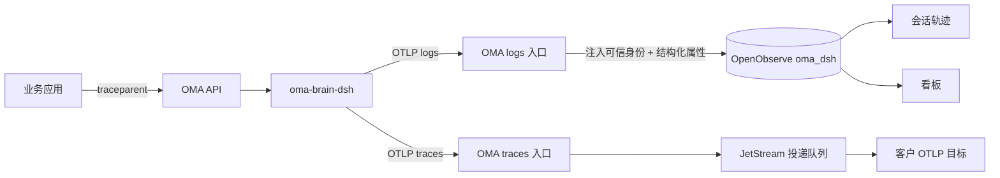

# DSH 可观测性

OMA 以 DSH Session v4 原生事件作为可观测数据合同，提供三项能力：

1. **轨迹**：会话详情页按泳道查看单个会话的原生事件。
2. **看板**：工作区与 Agent 范围的耗时、错误、调用量与 Token 聚合。
3. **OTel 导出**：Brain 产出 span，由 OMA 推送到客户配置的 OTLP 目标，见 [DSH OTel 导出](dsh-otel-export.md)。



## 1. 设计决定

| 决定 | 说明 |
|---|---|
| 日志账本是权威记录 | OpenObserve 中的原生事件，轨迹与看板都基于它，不修改、不替换 |
| 平台不存储 trace，也没有 trace 页面 | trace 只有与调用方链路拼接才有意义，因此按需产出并推送给客户，转发后不保留 |
| 一个 OMA 会话一条轨迹 | 子 agent 线程是泳道，轨迹跟随会话页当前泳道；可观测页只展示看板，不列会话 |
| 失败不影响聊天 | 采集、上报、查询、投递的任何失败只丢失可观测数据 |
| 租户身份只由 OMA 注入 | Worker 提供的资源与日志属性整体替换 |

不在范围：oma-server 内部耗时（模型代理、沙箱网关、沙箱启动）、“分析”下的用量与成本、拉取式 trace 导出。已删除 Claude Metrics/Logs/Detailed Trace 采集、旧 OTLP endpoint、span 投影和旧 panel/trace API，不提供兼容层。

## 2. 采集和传输

Brain 使用 `@deepseek-ai/dsh-session-telemetry` 的 `SessionTelemetryCoordinator`（`capture: live`、`includeHistory: true`）订阅原生事件与历史，再交给 `@deepseek-ai/dsh-otel` 的 `SessionLogReporter`。DSH 固定 `0.2.2-alpha.2`，OTLP instrumentation scope 的版本读取已安装的 `dsh-session/package.json`，与模块及独立二进制内的依赖一致；上游 `session-telemetry-otel` 只有 `FEEDBACK_ONLY`、`DISABLED`，因此复用其采集与 transport 自行组装，上游支持持续上报后可替换，数据和 UI 不变。每个根 code session 一个 exporter；子 Session 沿 `parentSession` 找到根 assignment，保留自己的 Session ID、header 和 seq。

Worker register 返回 `observability_enabled`，关闭时不创建 exporter。上报入口：

`POST /v1/code/sessions/{code_session_id}/worker/otlp/v1/logs`

- 支持 OTLP HTTP JSON、Protobuf 与 gzip，不提供 metrics 或 gRPC。JWT 绑定 code session path，鉴权校验 worker epoch，handler 再验证 active lease 和租户身份。
- 入口只解码一次 ExportLogsServiceRequest，整体替换 resource、scope 和 log attributes，注入 `oma.organization.uuid`、`oma.workspace.uuid`、`oma.session.id`、`oma.code_session.id`、`oma.agent.id`、`oma.agent.version`，最后编码一次。OpenObserve 凭据只在服务端。
- `content` 是完整原生事件 JSON，`dsh.header` 是原生 SessionHeader。服务端校验 version=4 与合法 seq/time，并从 envelope 派生 `dsh.session.id`、`dsh.event.seq`、`dsh.event.time`。OpenObserve 将属性名规范化为下划线（`dsh_session_id`）。原生 Session ID 取自 worker 上报的 header，入口只校验非空，不校验它属于该 code session 的线程：Brain 是平台组件，原生 ID 视为 worker 域的值。租户与 `oma_session_id` 来自可信身份，轨迹详情据此限定；看板按 `dsh_session_id` 去重配对，因此被攻破的 Brain 只能影响同一工作区内其他线程的聚合。
- `observability.content_capture_enabled=false` 时递归替换文本和参数，保留结构字段、数字与布尔值；脱敏用 UseNumber 保留数字原文，失败直接拒绝请求。
- 请求体有压缩前与解压后上限；转发保留 OTLP partial success、重试状态和 Retry-After。

Reporter 队列 4096、单批 128、周期 250ms、请求超时 2s。关闭 Session 时后台排空最多 2.5s，不阻塞 assignment 与 Worker 名额释放，使用关闭时的凭据快照；exporter 关闭后迟到事件不能重建它，同 ID 的新 assignment 可创建自己的 exporter。该链路是有界、尽力传输：超大事件、队列满、长期断网或进程崩溃会丢数据，不从私有 `dsh_log` 回填。

## 3. 可选依赖与降级

本地 dev-init 默认启用独立 OpenObserve，其他部署默认关闭。启用但配置不完整时输出结构化 warning 并关闭该组件，不影响启动与聊天。启动与 readiness 不探测 OpenObserve；运行中不可达只导致上报或查询失败，恢复后自动继续，失败期间的数据可能丢失。

配置删除了 `observability.openobserve.traces_stream`，logs stream 默认 `oma_dsh`，严格解析拒绝旧字段。Brain 使用 `OMA_API_URL` 上报。根 Compose、dev-init 与 verify-be 的 OpenObserve 固定 v1.1.2，配置测试防止版本偏离。

## 4. 结构化属性

OMA 入口在内容策略处理之前从原始事件解析结构字段，与 envelope 派生属性一起写入。每条记录写入全部键（缺失为空串、0 或 false），使 OpenObserve 的列在首条新记录后即存在：

| 属性 | 来源 |
|---|---|
| `dsh.event.type`、`dsh.turn`、`dsh.step` | 所有事件；turn/step 只接受正整数 |
| `dsh.tool.call_id`、`dsh.tool.name` | `tool/call` |
| `dsh.tool.call_id`、`dsh.tool.is_error`、`dsh.error.code` | `tool/result`；错误码仅在 `isError` 时取 |
| `dsh.turn.end_reason`、`dsh.error.code` | `turn/end` 的 `reason.kind` 与 `reason.error.code` |
| `dsh.model_request.status`、`dsh.error.code` | `assistant/message` 为 `ok`/`interrupted`；`assistant/attempt` 的 `aborted` 为 `cancelled`，其余为 `error` 并带 failure code |
| `oma.model_request.started_at`、`oma.model_request.first_token_at`、`gen_ai.request.model` | Brain 只在 `assistant/message`、`assistant/attempt` 上提供 |
| `gen_ai.usage.input_tokens`、`.output_tokens`、`.cache_read.input_tokens`、`.cache_creation.input_tokens`、`.reasoning.output_tokens` | 同上两类事件的 `data.usage`，只接受非负整数，否则为 0；四类计数互不重叠（DSH `TokenUsage` 约定） |

字符串只接受 1–256 个可见 ASCII 字符，否则置空。开始时间必须不晚于事件时间且不早于一小时；首 token 时间必须位于开始时间与事件时间之间；非法时只丢弃该属性。其他事件上的同名属性忽略。

模型请求开始时间：Brain 的 `NativeTelemetry` 监听 `agent/assistant-stream` 的 `start` 帧，按 DSH Session 记录最近一次时间，请求落账时取用并清空，`step/end` 时清空；没有 start 帧（重放历史）时，step 内第一次请求取 `step/start`，之后取上一次落账时间。start 帧在首个 chunk 之前发出，因此重试退避不计入模型耗时。首 token 时间由 `assistantStreamFirstTokenTime` 计算；模型名取 `message.source.model`，attempt 回退到最近一次 `request/context`。

Token 口径：`oma-brain-dsh/src/llm-ai-sdk/stream.ts` 输出 `inputTokens` 为未缓存输入，对已不含缓存的网关不再二次扣减；OMA 模型代理对 `cached_tokens > prompt_tokens` 的响应按全部为非缓存输入处理。历史记录不回填，入口解析上线前的记录计为 0。

## 5. 轨迹

### 5.1 查询合同

- `GET /api/organizations/{organization_id}/observability/trajectories`：按当前 workspace 以 `oma_session_id` 聚合，可带 `agent_id`、`session_id`、`start_time`、`end_time`、`offset`、`sort=recent|duration|errors`。默认最近一个月，最大一年，每页最多 50 条，返回 `items` 与 `next_offset`（无下一页为 null）。OpenObserve 只返回 Session ID 与首末事件时间，服务端再批量从 PostgreSQL 补全标题、Agent/版本、状态与子 agent 线程数，已删除或不存在的 Session 直接丢弃，因此单页可能少于 50 条。
- `GET /api/organizations/{organization_id}/observability/trajectories/{session_id}`：可带 `thread_id`、`segment`、`after_seq`（默认 -1）。每页最多 500 条，返回原生 `header`、`events`、`next_seq`、`has_more`、`segment` 与 `segments`（该泳道全部分段，按创建时间升序）。详情从存储起点查询，避免时间窗口截断 Session 前缀。

泳道映射：未带 `thread_id` 或为主线程时取该 Session 全部未删除 code session（`cse_*`），默认最新一段；子 agent 线程的原生 Session 即线程 ID（`sthr_*`），只有一段。活动 code session 终止后再次调度会新建 code session，因此主线程可能有多段。Session、线程或分段不属于当前 workspace 时返回同一个 404，不查询存储；存储查询同时带 `oma_session_id` 条件。

所有 SQL 强制带服务端 organization/workspace，Session 与 Agent 过滤先做本地存在性检查；stream 名限定为 SQL identifier，外部值转义；查询与写入凭据分离，响应 no-store，搜索响应上限 16MiB。

### 5.2 去重与连续性

查询按 `dsh_session_id + CAST(dsh_event_seq AS BIGINT)` 分组，用 `ARRAY_AGG(DISTINCT ...)` 返回候选；多个候选时以 UseNumber 解析比较，字段顺序或空白不同视为等价，真正差异返回 409 conflict。保留第一份原始 JSON，不重新序列化。单次查询最多 501 个序号，用于输出 500 条及 `has_more`。序号缺口返回 503 history gap，客户端只追加服务端接受的事件。错误合同集中在 `internal/observability/errors.go`。

### 5.3 UI

Vite 插件将发布包的客户端 factory 转为静态 ESM 引用（不使用 eval），Console 直接加载官方 `ConversationNodeAssembler` 并注册 `dsh-client-ui-trajectory` 的 view definitions，保留原生时间轴、Duration、Turns、Calls、搜索、模型 Usage/Timing 与工具展示；OMA 只提供语言、分页、状态订阅和主题。图片附件 slot 与本机附件读取不迁移。

轨迹只出现在会话详情的轨迹 tab，跟随 `activeLane`（见 [会话工作区](../../fe/sessions/session-conversation-workspace.md)）。首个返回的 `segment` 被固定，后续轮询都带该分段；泳道或 Session 改变时重置，主线程多段时用“运行”选择器切换。详情每 1s 轮询，连续失败后依次等待 2s、4s，第三次失败暂停并提示手动重试，保留已加载内容；成功一页后清零失败次数，scope 切换或卸载中止请求。查询失败文案不暴露存储产品名。

## 6. 看板

### 6.1 布局

```
可观测（仅工作区页显示标题）
[全部 Agent ⇕] [全部会话 ⇕] [全部版本 ▾] [模型/工具 ⇕]      [◀][🕐 最近 7 天 ▾][▶] [🔍−] [⟳|30s ▾]
总览 | 模型 | 工具 | 子 agent
```

工作区“可观测”页与 Agent 详情的可观测 tab 共用 `ObservabilityPage`。筛选与时间在各 tab 间共享，每个 tab 只在打开时查询，数字卡片带“较上一周期”与走势小图。

| Tab | 内容 |
|---|---|
| 总览 | 活跃会话、交互次数、Token 总量、模型请求；平均 TTFT、交互耗时 p50、每会话轮次与 Token 分位数；会话活动、模型请求成功/失败、Token 趋势、交互耗时 p50/p95、模型 Token 占比、工具调用 Top 10、结束原因；Agent 范围另有版本对比表 |
| 模型 | 请求数、失败率、重试率、耗时、TTFT、Token、缓存命中率；Token 与请求趋势、耗时趋势、按错误码的失败趋势；模型统计表与错误码分布 |
| 工具 | 调用、错误与错误率、耗时、总耗时；按工具的调用/耗时/错误趋势（前 5 其余合并）；工具统计表（含从 `mcp__<server>__<tool>` 解析的 MCP 服务器）与错误码分布 |
| 子 agent | 按名称的委派次数、线程数、turn 数、失败率、平均/最长耗时、Token |

口径：

- 交互只算主线程（`cse_*`）turn，子 agent 的 turn 在子 agent tab；取消和崩溃中断单列，不计入错误。
- 同一会话 `(turn, step)` 相同的多次模型请求计为重试；缺少 turn 或 step 的请求视为独立请求。
- 聚合先按 `(dsh_session_id, turn)`、`(dsh_session_id, seq)` 或 `(dsh_session_id, call_id)` 去重配对。已删除会话在保留期内仍计入聚合（OpenObserve 无法按删除状态过滤），会话选择器排除它们。
- 不提供会话失败率、估算成本（无价格来源）和看板内轨迹。

### 6.2 查询架构

```mermaid
flowchart LR
  UI[控制台 tab] -->|GET .../observability/dashboards/{tab}| H[platformapi]
  H --> SV[observability.Service]
  SV -->|tab 内引用的查询去重| C[(catalog.json + queries.sql)]
  SV -->|模板渲染 + 并发执行（上限 6）| O[(OpenObserve)]
  SV -->|按 render 类型映射；subagents 用 PostgreSQL 补全名称| UI
```

- **接口**：`GET /api/organizations/{org}/observability/dashboards/{overview|models|tools|subagents}`，参数 `agent_id`、`session_id`、`agent_version`（多值）、`start_time`、`end_time`，模型 tab 可带 `model`，工具 tab 可带 `tool`。带 `session_id` 时先校验归属（否则 404）。一次返回该 tab 全部 panel。
- **声明式目录**：`internal/observability/dashboard/catalog.json` 定义 tab → panel（`render`、`unit`、`span`、`query` 与字段、对比与副值、`trend`/`trend_series`、Top N、表格列、`requires: agent`）与每个查询的窗口、`lookback`、行数上限。SQL 在同目录 `queries.sql` 中以 `text/template` 的 `{{define}}` 块定义，块名与查询键一致。加载时校验全部引用；单测渲染每条查询并断言租户条件。
- **租户与过滤**：`{{.Source}}` 由后端生成，固定带组织、工作区、可选 Agent 与版本；模型、工具筛选只接受 1–256 个可见 ASCII 字符并经 `q` 转义，客户端不能提交 SQL。
- **上一周期**：`window: compare` 的查询把搜索窗口扩展为“上一同长窗口 + 当前窗口”，SQL 拆成 `x` 与 `x_previous` 两列；计数类字段空区间返回 0。
- **开始事件回看**：turn 与工具调用需要配对开始事件，引用这两类 CTE 的查询声明 `lookback: true`（SQL 必须用 `.From` 限定统计下界），搜索起点再向前 24 小时，统计仍按结束时间落在窗口内；超过 24 小时的 turn 不计入。
- **分桶**：从 1m、2m、5m、10m、15m、30m、1h、3h、6h、12h、1d 中选择使桶数不超过 100 的最小间隔，按 UTC epoch 对齐。
- **映射**：`stat` 读首行字段；`percentiles` 读 `p50/p90/p95`；`series` 读 `(bucket_start, series, value)`，无有效行时返回空列表，柱状与面积图补零、折线图空桶留空，可固定顺序或取 Top N 合并为 `other`；`bars` 读 `(name, value)`；`table` 按列投影；`subagents` 按线程名称汇总，无名称的线程以线程 ID 单独成行。`stat` 的 `trend` 按分桶求和放入 `data.trend`。
- **旧 schema**：OpenObserve 返回 stream 不存在（20002），或 20004 且未知字段属于看板结构化字段时按空结果处理；其他错误返回 503。

### 6.3 前端交互

交互对齐 Grafana：

- **URL 状态**：`from`、`to`、`refresh`、`timezone`、`obs_tab`、`agent_id`、`session_id`、`agent_version`、`model`、`tool`、`view_panel`，保留页面其他参数。时间变化用 `pushState`，后退可撤回缩放。
- **时间选择器**：快捷范围（5 分钟到 1 年、今天/本周/上月等，可搜索）；From/To 接受 `now-6h`、`now-1d/d`、`now/w`、`YYYY-MM-DD[ HH:mm[:ss]]` 与 13 位 epoch 毫秒，可用日历选整天；最近使用的 4 个绝对范围存于浏览器本地；浏览器时间或 UTC。月、年按日历月加减，超出目标月取月末。范围须在 1 分钟到一年之间，不合法时提示且不发请求。按钮文案、校验与查询使用同一个解析基准时间。
- **平移、缩小、刷新**：`◀`/`▶` 按半个跨度平移（不越过当前时间）；缩小把跨度翻倍，`now-Nu`→`now` 保持相对；相对范围刷新重算 `now`，绝对范围刷新使看板与会话列表查询失效；自动刷新 10s–1h，页面不可见时暂停。
- **图表**：拖选按桶对齐后改写全局时间；同一 tab 的时间序列共享 `syncId` 十字线，只有鼠标所在图显示 tooltip；图例单击只看该系列，Ctrl/⌘ 单击切换。颜色按语义或名称固定，同一实体在各图一致。
- **面板**：Card 样式，悬停标题出现菜单：查看（全屏，写入 `view_panel`）、检查数据（表格与 CSV）、复制链接。首次加载为骨架屏，刷新保留旧数据并在刷新按钮和面板标题旁旋转；无数据时显示带图标的空状态，值全为 0 的序列照常绘图。
- **快捷键**：`t ←`/`t →`、`t z`、`d r`、`v`、`Esc`；输入框内不触发，`Esc` 在菜单内也可退出查看。
- **选择器**：Agent、会话、模型、工具共用 Popover + Command 组件，带独立清除按钮。Agent 走服务端名称或 ID 搜索；会话列出时间范围内有事件的最近会话，也可粘贴 `sesn_` ID。

## 7. 测试与验收

- **普通单测**：OTLP 单次改写、数字精确脱敏、结构化属性与 token 解析（负数、缺失、非整数）、泳道映射与 404、已删除会话过滤、分页 offset、等价重放与冲突、缺口、组织可见性、exporter 关闭与 assignment 替换；看板目录校验、SQL 渲染与租户条件、上一周期拆分、回看、分桶、补零与 `trend`；轮询的失败预算、恢复与取消。
- **前端**：各 tab 的加载/空/错误状态、会话选择器、时间表达式解析、平移/缩小、URL 状态、非法范围、查看面板与 `Esc`、CSV 生成。拖选与十字线依赖真实布局，在浏览器中验证。`web/tests/trajectory.html` 仅用于 Vite 开发预览，不进入自动回归与生产构建。
- **真实验收**：`just verify-be chat doctor brain-observability` 与 `just verify-be chat brain-observability`（需 `OMA_BRAIN_BINARY`）以真实 Brain、OMA、PostgreSQL/Redis/NATS 与 OpenObserve 运行，上游模型固定脚本。阶段覆盖公开消息往返、原生事件与私有 `dsh_log` 一致、跨租户隔离、子 agent 泳道与按 Session 聚合、四个看板 tab 的聚合、已删除会话不可见，以及 OTel 导出（见 [DSH OTel 导出](dsh-otel-export.md)）。不覆盖 retention、长期断网与生产负载。

本地实例：在 `.run/dev-init.yaml` 设置 `local_openobserve: true` 后执行 `just restart-server`，环境组装启动独立 OpenObserve 并生成凭据；端口见 `just slot-info -json` 的 `stack.openobserve_port`，登录凭据在 `.run/secrets/openobserve.json`。详见 [worktree 环境](../../development-worktree-environments.md)。
