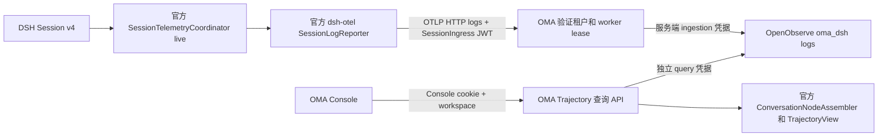

# DSH 原生 Trajectory 可观测性

OMA 使用 Harness 的 Session v4 原生事件作为可观测数据合同。已删除 Claude Metrics、Logs、Detailed Trace 采集变量、旧 OTLP endpoint、span 投影和 Console panel/trace API，不提供兼容层或旧数据转换。

## 采集和传输

Brain 使用 `@deepseek-ai/dsh-session-telemetry` 的 `SessionTelemetryCoordinator`，配置 `capture: live`、`includeHistory: true`。它负责原生事件订阅、历史恢复和采集游标。OMA backend 只绑定所属 assignment、SessionIngress 凭据与原生 header，再调用 `@deepseek-ai/dsh-otel` 的 `SessionLogReporter`。每个根 code session 有独立的 exporter；子 Session 沿 `parentSession` 找到根 assignment，同时保留自己的 Session ID、header 和 seq。

当前使用统一固定的 `0.2.1-alpha.2`。已核对发布的 `0.2.1-alpha.5` 和 `0.2.1-rc.2`，`session-telemetry-otel` 的 sharing mode 仍只有 `FEEDBACK_ONLY`、`DISABLED`，不能直接配置为持续上报。因此当前不加载该反馈上传 backend，而复用它依赖的官方采集和 transport。后续上游支持 live backend 后可替换这一组装，无需改变数据和 UI。

Worker register 返回 `observability_enabled`。关闭时不创建 exporter。上报仅使用：

`POST /v1/code/sessions/{code_session_id}/worker/otlp/v1/logs`

OTLP HTTP 支持 JSON、Protobuf 与 gzip，不提供 metrics、traces 或 gRPC。JWT 绑定 code session path，通用 SessionIngress 鉴权校验其 worker epoch，handler 再验证 active lease 和当前租户身份。OMA 清除客户端保留属性，注入可信的 `oma.organization.uuid`、`oma.workspace.uuid`、`oma.session.id`、`oma.code_session.id`、`oma.agent.id` 和 `oma.agent.version`。OpenObserve 凭据只在 OMA 服务端。

单条日志的 `content` 是完整原生事件 JSON，包含 `seq`、`time`、`type`、`data` 和原有 surface 元数据。`dsh.header` 是原生 SessionHeader。服务端校验 version=4、合法 seq/time，并从 envelope 派生 `dsh.session.id`、`dsh.event.seq`、`dsh.event.time`，不信任客户端单独提供的索引值。日志时间取事件的毫秒时间。OpenObserve 将属性列规范化为下划线名称，如 `dsh_session_id`、`dsh_event_seq`。

`observability.content_capture_enabled=true` 时完整保留原生事件和未知字段。关闭时在独立 telemetry 边界递归替换文本和参数，保留结构性字段、数字、布尔值。运行日志只记录固定失败描述和 session 标识，不记录事件正文。请求体有压缩前及解压后上限；转发保留 OTLP partial success、重试状态和 Retry-After。

Reporter 队列容量 4096，单批最多 128，周期 250ms；网络请求超时 2s。关闭 Session 时后台清理 exporter，不等待 telemetry 排空即可释放 assignment 和 Worker 名额；后台排空最多等待 2.5s，超时丢弃未发队列。清理期间保留该 assignment 的凭据快照，不依赖已释放的注册。该链路是有界、尽力传输，不是持久消息队列。超大单事件、队列满、网络长期不可用或进程崩溃会丢失数据，失败记录元数据告警。恢复时采集官方可读取的历史，但不承诺 OpenObserve 完整性，也不从 OMA 私有 `dsh_log` 回填。

## 可选依赖与降级

本地 dev-init 新模板默认启用独立 OpenObserve，现有本地显式设置与启动检查保持不变。其它部署默认关闭可观测性，不要求部署 OpenObserve。启用但配置不完整或非法时，配置文件仍可加载，HTTP 服务在组装可观测性组件时输出结构化 warning 并关闭该组件，不影响其它资源的启动和聊天。YAML 语法与未知字段仍遵循全局配置解析规则。

配置完整时，启动、健康及 readiness 检查不探测 OpenObserve。运行中不可达、超时或返回错误只导致 OTLP 上报或 Trajectory 查询失败，限流与超时仍限制可观测性资源占用；不会改变聊天状态或阻塞模型、工具执行及 Worker 释放。存储恢复后后续上报和查询自动继续，不因一次网络失败永久禁用。此前失败期间的数据可能丢失。

## 查询合同

- `GET /api/organizations/{organization_id}/observability/trajectories`：按当前授权 workspace 查询，可附 `session_id`、`agent_id`、`start_time`、`end_time` 和 `offset`。默认最近一个月，最大范围一年，每页 50 条。
- `GET /api/organizations/{organization_id}/observability/trajectories/{trajectory_id}`：`after_seq` 默认 -1，每页最多 500 条，返回原生 `header`、`events`、`next_seq`、`has_more`。详情从存储起点查询到范围终点，避免列表时间窗口截断 Session 前缀。

所有 OpenObserve SQL 均强制带服务端 organization/workspace，Session 与 Agent 过滤还需通过本地资源存在性检查。stream 名限定 SQL identifier，外部值转义。查询凭据与写入凭据分离，响应 no-store，搜索响应上限 16MiB。

OpenObserve 查询按 `dsh_session_id + CAST(dsh_event_seq AS BIGINT)` 分组，用 `ARRAY_AGG(DISTINCT ...)` 返回该序号的原始 header 和 content 候选。只有存在多个候选时，OMA 才以 UseNumber 解析并比较 JSON 值；字段顺序或空白不同视为等价，真正的内容差异返回固定的 409 conflict。保留第一份原始 JSON，不重新序列化事件，不计算指纹，不循环补读。重复上报不占事件分页，单次查询最多返回 501 个序号，用于输出 500 条及 `has_more`。

序号连续性只在服务端查询边界检查。缺口返回固定的 503 history gap，客户端仅追加服务端已接受的事件，不再重复校验连续性。迟到事件写入后可重试；OpenObserve retention 删除历史前缀后也不能保证完整投影。组织可见性通过平台统一入口校验，不可见返回 404；缺少 workspace、无效时间范围、cursor、offset 和 trajectory ID 各自使用 errors.go 中固定的错误合同。列表和详情使用独立 handler。

详情正常每 1s 轮询。请求连续失败后依次等待 2s、4s，第三次失败暂停自动查询并提示手动重试，保留已加载的投影。成功接受一页后清零失败次数；缺口补齐后可从原游标继续。手动重试重新从起点读取并获得新的失败预算。scope 切换或卸载中止请求并清理定时器。该策略限制永久缺口和存储故障带来的重复查询，不跳过缺失事件，也不提供不完整轨迹投影。

列表响应返回 `items` 和 `next_offset`，无下一页时后者为 null。客户端使用服务端 offset，不硬编码页大小。

OTLP 入口只解码一次 ExportLogsServiceRequest，整体替换 resource、scope 和 log attributes，在同一对象上校验、注入可信身份并处理正文，最后编码一次。脱敏使用 UseNumber 保留数字原文，失败直接拒绝请求，不写入 null 正文。

exporter 关闭立即标记该 assignment 实例，迟到事件不能重建 exporter。同 ID 的新 assignment 可创建自己的 exporter。排空只使用取出的实例和关闭时的凭据快照；全局 shutdown 阻止新建并等待已开始的排空，保留原有 2.5s 上限。

## 原生 UI

Vite 构建插件将发布包的客户端 factory 转为静态 ESM 引用，不使用 eval，不复刻投影规则。Console 直接加载官方 `dsh-client-ui-conversation` 的 `ConversationNodeAssembler`，注册官方 `dsh-client-ui-trajectory` 的 event/view definitions 并渲染原组件。原生时间轴、Duration、Turns、Calls、搜索、模型 Usage/Timing、工具参数和输出展示保留。Harness 原生主题令牌和 MIT license 随项目保留；OMA 只提供语言、分页、React 状态订阅和主题入口。

每个原生 Session 是一个 Trajectory；根会话和子会话均可从列表选择。客户端按 seq 增量读取，列表可见时每 3s 刷新，打开详情后暂停列表自动查询，返回列表时重新读取。缺少组织或工作区上下文时展示占位提示，查询失败文案不暴露存储产品名。采集的是已追加的持久 Session 事件，模型未落账的 token 流不单独上报；完成后的 assistant/message 包含原生 stream/timing。图片附件 slot 和本机附件读取不迁移，当前显示文本和工具结果，不提供 Harness 本机图片预览。

## 升级和验收

选择状态区分未决定、列表、已打开三个状态。Session 首次出现数据时提交轨迹 ID，之后只由用户选择或返回操作改变，列表实时排序不会切换或卸载正在看的时间轴。scope 改变时重置选择与分页。

普通回归覆盖轮询重排、返回列表、服务端分页 offset、单次 OTLP 重写、精确数字脱敏、等价重放与冲突、缺口与分页边界、组织可见性、关闭后迟到事件和 assignment 替换。

轮询回归另外覆盖永久缺口三次失败后停止、暂时缺口恢复后游标继续和预算重置、取消请求不更新视图、手动重试恢复，以及详情期间暂停列表查询。根 Compose 与 dev-init 的 OpenObserve 都固定为 v1.1.2，并通过配置测试防止版本偏离；verify-be 使用相同版本。

配置删除 `observability.openobserve.traces_stream`，logs stream 默认 `oma_dsh`；严格解析拒绝旧字段。升级时更新人工配置并重新生成环境配置。Brain 使用 `OMA_API_URL` 上报，开启可观测不再要求 sandbox API URL。

普通测试覆盖官方 live coordinator 到本地 OTLP receiver、子会话归属、动态凭据、禁用采集、OTLP envelope/正文策略、租户查询及原生 JSON 保留。浏览器 fixture 在 `/tests/trajectory.html` 使用原生模块验证时间轴和详情交互。真实 OpenObserve 写入/查询、retention 和生产负载需要单独集成验收；不以本地 HTTP fake 代替。

`web/tests/trajectory.html` 与 `trajectory-preview.tsx` 仅用于 Vite 开发预览，不属于 bun test 自动回归，也不进入生产构建。构建产物写入已有忽略目录，例如 `tmp/build/`，不放在仓库根目录。

## 独立本地实例与真实验收

在 `.run/dev-init.yaml` 设置 `local_openobserve: true`，先拉取 `public.ecr.aws/zinclabs/openobserve:v1.1.2`，再执行 `just restart-server`。环境组装自动启动独立 Compose 服务、生成私有凭据、等待 healthz 并生成 OMA 的 OpenObserve 配置。地址可从 `just slot-info -json` 的 `stack.openobserve_port` 获取，登录凭据在 `.run/secrets/openobserve.json`。详见 [worktree 环境](../../development-worktree-environments.md)。

`just verify-be chat doctor brain-observability` 与 `just verify-be chat brain-observability` 通过真实 Brain、OMA、PostgreSQL/Redis/NATS 和 OpenObserve 完成验收。必须将 `OMA_BRAIN_BINARY` 指向已构建的 oma-brain-dsh executable；上游模型固定脚本，telemetry transport 与存储不做 mock。场景覆盖公开消息往返、原生 Session v4 header/seq/事件内容与私有 canonical log 一致、游标读取和跨组织/工作区查询隔离。测试的 OpenObserve 容器随隔离 Compose 项目回收，不影响本地 worktree 的持久实例。
