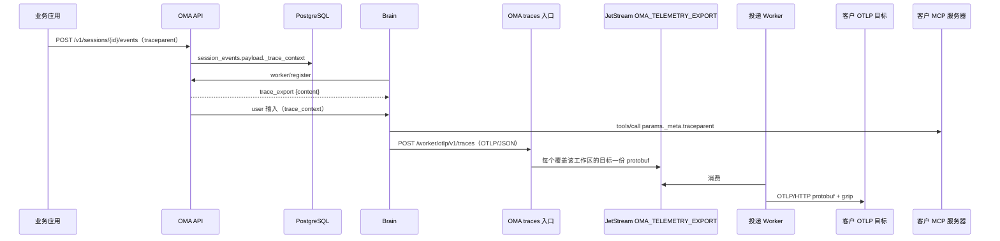

# DSH OTel 导出

Brain 产出符合 OTel GenAI 约定的 span，OMA 校验、改写租户属性，并按组织配置的导出目标推送到客户的 OTLP/HTTP 后端。agent 的 span 挂在调用方传入的 `traceparent` 下，调用客户 MCP 工具时再把 trace context 传出，因此客户可以在自己的 APM 中看到完整链路。平台不存储 span，也没有 trace 页面；只有覆盖该工作区的目标存在时才产出 span。管理面与 span 模型对齐 [Anthropic Telemetry Destinations](https://platform.claude.com/docs/en/api/beta/organization/telemetry_destinations) 与 [span 参考](https://platform.claude.com/docs/zh-CN/api/opentelemetry/spans)，名称使用 `oma.` 前缀。整体关系见 [DSH 可观测性](dsh-observability.md)。



## 1. 目标管理

所有请求带 `anthropic-beta: telemetry-destinations-2026-08-11`，挂在 Admin API 路由下。组织成员可列表和读取，创建、修改、删除和测试要求组织管理员；没有组织角色的调用（包括工作区 API key）返回 404。

| 操作 | 方法与路径 |
|---|---|
| 创建 | `POST /v1/organizations/telemetry_destinations` |
| 列表 | `GET /v1/organizations/telemetry_destinations`（`limit` 1–1000 默认 20、`page`、`workspace_ids[]`；返回 `data`、`next_page`） |
| 读取 | `GET /v1/organizations/telemetry_destinations/{destination_id}` |
| 更新 | `POST /v1/organizations/telemetry_destinations/{destination_id}` |
| 删除 | `DELETE /v1/organizations/telemetry_destinations/{destination_id}` |
| 测试 | `POST /v1/organizations/telemetry_destinations/{destination_id}/test` |

| 字段 | 说明 |
|---|---|
| `id` | `tdst_` 前缀 |
| `display_name` | 可选名称 |
| `endpoint_url` | OTLP/HTTP 基础地址：https、主机名、端口 443，不含凭据、query 与 fragment，最长 2048 字符 |
| `header_names` | 只返回 header 名称，值只写不读 |
| `state` | `enabled`，或 `disabled` 加原因：`caller`、`sustained_failure`、`invalid_address`、`redirect` |
| `traces` | `enabled`、`content_mode`（`metadata_only` 默认或 `content`）、`endpoint_url`（默认 `{endpoint_url}/v1/traces`，须与基础地址同 scheme、主机与端口）、`max_content_bytes`（单个 span 的内容总预算，上限与默认 786432） |
| `workspaces` | `type` 为 `all`、`include` 或 `exclude`，带 `workspace_ids`；响应也返回 `workspace_ids`（Anthropic 只在请求中出现，此为增量字段），已归档工作区不出现 |
| `delivery_health` | `last_error`、`last_error_at`、`last_success_at` |

限额：每个组织最多 10 个目标（含禁用）；每个目标最多 1000 个工作区、20 个 header；header 名不超过 128 字节，值不超过 4096 字节，合计不超过 16384 字节。

实现约定：

- 修改基础地址时，只有仍为默认值的 traces 地址跟随变化。`telemetry_export.allow_insecure` 仅供开发与验证环境放开 http、私网和端口。
- header 值以组织级信封加密保存（`VaultExternalID=telemetry_destination`，绑定目标 ID）；更新时传 `headers` 整体替换，`null` 清空。
- 更新以服务端读取时的 `updated_at` 做乐观并发，被并发修改返回 409；投递 worker 自动禁用时同样推进 `updated_at`，避免禁用前读取的编辑把目标写回启用。重新启用清除失败窗口。
- 删除为软删除并清空 header 密文。测试同步发送一个 `oma.test` span，不重试、不改变投递健康，两次至少间隔 10 秒（429）。
- 数据保存在 `telemetry_destinations` 与 `telemetry_destination_workspaces`（无外键，按 UUID 引用），失败窗口字段与 webhook 相同。

Console 在组织设置列出全部目标，在工作区设置（与 Webhooks 同级）按 `workspace_ids[]` 只列出覆盖当前工作区的目标，新建时默认 `include` 当前工作区；写操作都要求组织管理员。表单对齐 Anthropic Console：提供商（目前只有“自定义”）、名称、端点 URL、请求标头、内容模式、工作区范围，高级设置中有追踪端点与每个 span 的最大内容（以 MB 输入，上限 0.75 MB）。编辑时只有改动工作区范围才提交 `workspaces`。字段非法时在字段下提示并禁用提交；403、409、429、目标上限与投递错误映射为本地化文案。

## 2. Trace context

`POST /v1/sessions` 的初始事件与 `POST /v1/sessions/{id}/events` 的 `user.message` 读取请求头 `traceparent` 与 `tracestate`，按 W3C 校验，非法值忽略而不拒绝请求。合法值不新增列，由 `eventpayload` 作为内部字段 `_trace_context` 写入 `session_events.payload`：

- 客户端 body 中的 `_trace_context` 在输入归一化时删除，只有请求头能产生该字段；payload 转存对象存储时它留在内联摘要中。
- `RestorePublic` 与 `RestoreCreatedPublic` 把它取出到内存中的 `SessionEvent.TraceParent/TraceState` 并从 payload 删除，列表、SSE、webhook 与 API 响应都看不到它。
- 激活回放与即时入队都由这两个字段构造 worker 负载的 `trace_context`，不信任客户端自带的同名字段。

Brain 接收输入时记下 trace context：turn 以它为父 span；采样位为 0 时该 turn 及其子 span 都不产出；没有 trace context 时新建根 trace。DSH 在 turn 进行中拒绝新输入，每条消息启动自己的 turn，因此不产出 span link。工具确认后恢复的 turn 沿用同一父上下文。

调用外部 MCP 工具时，`tools/execute` 在 AsyncLocalStorage 中放入指向该工具 span 的 `traceparent`/`tracestate`，MCP 客户端写入 `tools/call` 的 `params._meta`。

## 3. Span 模型

```
调用方的 span
└─ oma.session.turn                  一次 turn
   ├─ oma.model_request              一次模型请求
   ├─ oma.tool_use <tool>            内置工具；oma.mcp_tool_use <tool> 为 MCP 工具
   ├─ oma.compaction                 上下文压缩
   └─ oma.session.turn（子 agent）     嵌套在主 agent 当时的 turn 下
```

| span | 开始 | 结束 | 规则 |
|---|---|---|---|
| `oma.session.turn` | `turn/start` 或审批后恢复 | `turn/end` 或进入人工确认 | 进入人工确认时以 `requires_action` 结束，确认后新开 turn |
| `oma.model_request` | 请求开始时间（start 帧，见 [结构化属性](dsh-observability.md#4-结构化属性)） | `assistant/message`/`attempt` 落账 | 失败尝试为 `ERROR` 并映射 `error.type`（如 `rate_limit_error`），取消为未设置 |
| `oma.tool_use` / `oma.mcp_tool_use` | 实际派发，缺省为 `tool/call` 落账 | `tool/result` 落账 | 多智能体工具（`send_to_agent`、`list_agents`、`archive_agent`）、被拒绝的调用、客户端执行的自定义工具与 `AskUserQuestion` 不产出 |
| `oma.compaction` | `compaction/start` | `compaction/end` | 只覆盖 DSH 压缩事件 |

状态：完成为 `OK`，失败为 `ERROR`，被用户中断为未设置。

属性（资源与通用属性由 OMA 入口写入，Brain 不能设置）：

| 范围 | 属性 |
|---|---|
| 资源 / scope | `service.name=oma-platform`、`oma.organization.id`、`oma.workspace.id`、`oma.session.id`；scope `oma.platform` |
| 所有 span | `gen_ai.conversation.id`：code session 映射为会话主线程 ID，`sthr_*` 保留 |
| `oma.session.turn` | `gen_ai.operation.name=invoke_agent`、`gen_ai.agent.id`（主线程，OMA 写入可信值）、`gen_ai.agent.name`（仅内联子 agent 且只发给 content 目标）、`gen_ai.request.model`、`oma.session.turn.stop_reason`、`error.type` |
| `oma.model_request` | `gen_ai.operation.name=chat`、`gen_ai.request.model`、`gen_ai.provider.name`、`oma.step`、`oma.model_request.ttft_ms`、`error.type` |
| 工具 | `gen_ai.operation.name=execute_tool`、`gen_ai.tool.name`、`gen_ai.tool.call.id`（OMA 映射为公共 `agent.tool_use` 事件 ID）、`oma.mcp.server.name`、`oma.tool.evaluated_permission`（`allow`/`ask`）、`oma.step`、`error.type` |
| 内容（仅 content） | turn 上的 `gen_ai.system_instructions`（仅线程首个 turn，只含智能体配置部分）、`gen_ai.input.messages`、`gen_ai.output.messages`；工具上的 `gen_ai.tool.call.arguments`、`oma.tool_result.content`；截断时 `oma.content.truncated=true` |

内容范围与客户通过公共会话事件能看到的一致，不含 Brain 注入的运行时上下文、模型 reasoning 与 OMA 拼接的系统提示词。主 agent 的名称与描述不导出，客户按 ID 关联。

与 Anthropic 的差异：有审批等待的 DSH turn 拆成两个 `oma.session.turn`（控制台看板仍按 DSH turn 计数，两者在有审批时不同）；`gen_ai.provider.name` 只写在模型请求 span 上；保留 `oma.compaction`；没有 OMA API 请求 span，turn 直接挂在调用方 span 下。

## 4. Brain 产出

只有注册响应带 `trace_export` 时才产出 span，`content=true` 表示至少一个目标选择了 content 模式，否则不计算内容属性。目标在会话进行中变化时，下次注册生效。`TraceProducer` 由 `NativeTelemetry` 驱动，输入为账本事件、start 帧、审批钩子和 `tools/execute` 派发。注册时间之前的事件属于重放历史，不产出 span；所有处理都在 try/catch 内，异常只丢失 span。

turn 的 trace/span ID 在接收输入时分配。Brain 每次保存 `dsh_brain_state` 时把未结束的已采样 turn（含子 agent thread）写入 `traceTurns`。worker 在 turn 中途失去 lease 后，旧 worker 的导出会被入口栅栏拒绝，新 worker 又把旧 `turn/end` 当作重放忽略；因此新 worker 在恢复路径按 `traceTurns` 补发这些 turn：沿用原 span ID，`ERROR`、`stop_reason=interrupted`、`error.type=worker_lost`，结束时间为恢复时间。旧 worker 未结束的模型尝试和工具调用不补发；若旧 worker 实际已导出该 turn，后端会看到同一 span ID 的两条记录。

Brain 到 OMA 使用 OTLP/JSON（trace/span ID 为 base64），每批最多 256 个 span 且不超过 8MB，队列 2048、超时 2 秒，失败直接丢弃。

## 5. OMA 入口与投递

`POST /v1/code/sessions/{cse}/worker/otlp/v1/traces` 复用日志入口的鉴权、epoch/lease 栅栏和可信身份，使用独立的并发预算。入口只接受上述 span 名称、合法 ID 与不超过 24 小时的时长，丢弃事件、状态消息和白名单外的属性，拒绝数以 partial success 返回。改写资源与通用属性后，为每个覆盖该工作区的目标生成一份副本：`metadata_only` 去掉全部内容属性与子 agent 名称；`content` 按 `max_content_bytes` 顺序截断。

副本按不超过 900KB 分批写入 `OMA_TELEMETRY_EXPORT`（WorkQueue、保留 1 小时、2 分钟去重窗口）。每条消息带生成时的内容策略（`metadata_only` 或 `content:<max_content_bytes>`），与目标当前策略不一致时丢弃，因此调低内容范围后不会按旧策略投递已排队内容；去重 ID 包含目标、内容策略和负载。

投递语义：

- 至少一次、尽力而为，客户按 trace ID 与 span ID 去重；平台只在队列中短期保留 span。
- worker 消费时读取目标并解密 header，以 protobuf + gzip 发送；目标对压缩请求返回 400/406/415/422 时不压缩重发一次。TLS 握手与响应 header 各 5 秒，单次总计 10 秒。
- 超时、连接错误与 408/429/5xx 按退避重试（`telemetry_export.max_attempts`），其他状态不重试。
- 3xx 立即以 `redirect` 禁用，解析到非公网地址以 `invalid_address` 禁用，持续失败超过 `failure_disable_after`（默认 24 小时）以 `sustained_failure` 禁用。禁用、删除或关闭 traces 的目标直接丢弃排队 span，重新启用后不补发。
- 连接复用 webhook 的公网地址拨号器（`networkpolicy.PublicDialer`），消费复用共享的 `jetstreamconsume` 运行时。

故障隔离：Brain 产出或上报失败只丢 span；入口校验失败只拒绝该批，不影响日志入口；客户目标不可用只触发重试或禁用。

## 6. 测试与验收

普通单测覆盖 W3C 解析、trace context 持久化与转发、目标 API 的校验/权限/并发/限额/测试限流、span 校验与租户改写、按目标的内容处理与分批、投递分类、JetStream worker 的重试/禁用/去重/策略变更丢弃；Brain 侧覆盖分批、turn 拆分、子 agent 嵌套、跳过的工具、采样、重放过滤、真实 agent loop 的 span 与 MCP `_meta`、模型重试后致命失败、worker 被 SIGKILL 后补发 turn（`tests/traces.test.ts`）。目标存储另有真实 PostgreSQL 测试，覆盖自动禁用后的过期编辑 409、删除清空密文与归档工作区过滤。

`just verify-be chat brain-observability` 的 `brain_observability_trace_export` 阶段用真实 Brain、OMA、JetStream 与本地 OTLP 接收器验证：调用方 `traceparent` 成为 turn 的父 span、子 agent turn 嵌套、失败模型请求为 ERROR、委派工具不产出 span、工具 span 的 `gen_ai.tool.call.id` 等于公共事件 ID、两个目标分别收到元数据与内容、加密 header 送达、投递健康更新。不覆盖外部 MCP 服务器收到的 `_meta`（单测覆盖）、长时间不可用的自动禁用与真实第三方后端兼容性。

## 7. 后续事项

- **Token 用量**：span 上暂不导出 `gen_ai.usage.*`。Brain 的 usage 口径已统一为互不重叠计数，下一步按 Anthropic 定义只写在模型请求 span 上。
- 工作区管理员自助把自己的工作区加入或移出 `include` 目标（当前只有组织管理员能修改）。
- 组织级强制内容限制（如强制 `metadata_only`）、Console 中常见平台的预设、拉取式导出、平台请求 span 与内部耗时。
