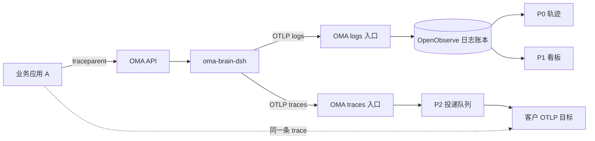
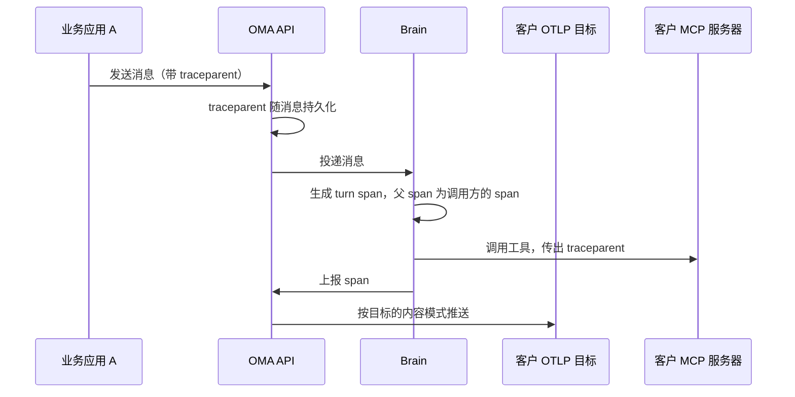

# DSH 平台可观测性方案

状态：方案，未实现，待评审。现有日志轨迹的实现见 [DSH 原生 Trajectory 可观测性](dsh-observability.md)。

## 摘要

OMA 已经通过日志账本采集 DSH 会话事件，并在控制台提供单会话轨迹。本方案补齐三件事：

1. **轨迹按会话组织（P0）**：一个 OMA 会话只有一条轨迹，子 agent 线程作为泳道，跟随会话页的当前泳道切换。
2. **控制台看板（P1）**：从日志账本聚合耗时、错误与调用量。
3. **OTel trace 导出（P2）**：Brain 产出符合 OTel GenAI 约定的 span，由 OMA 推送到客户配置的 OTLP 目标，与客户自己的链路连在一起。

核心取舍：**平台不采集、不存储 trace，也不做 trace 页面。** trace 只有和调用方的链路结合才有意义，因此交给客户自己的可观测系统。

## 1. 背景

### 1.1 现状

Brain 通过 `SessionTelemetryCoordinator` 把 DSH Session v4 事件以 OTLP logs 上报，OMA 校验并注入租户身份后写入 OpenObserve。控制台用官方 `dsh-client-ui-trajectory` 展示单会话轨迹，已经包含每条记录的耗时、TTFT 与解码拆分。

现有缺口：

- 轨迹按 DSH 会话组织：一个 OMA 会话的根会话和每个子 agent 线程各算一条轨迹，在列表中平铺，并显示内部 ID（`cse_*`）。
- 没有工作区、智能体维度的趋势与异常视图。
- 业务方无法在自己的链路里看到 agent 的执行过程。

### 1.2 为什么不在平台做 trace

trace 的价值在于把一次业务请求串成一条链，agent 只是其中一段：

```
用户 → 业务应用 A → OMA 会话 API → agent（模型、工具、子 agent）→ 客户的 MCP 工具 → A 的下游服务
```

业务方关心的是：这次请求为什么慢，是不是 agent 导致的，对应哪个功能、哪个用户。这些问题只有把 agent 的 span 和调用方的 span 放进同一条 trace，并在调用方自己的 APM、OTel 看板和告警里查看才能回答。平台自己存的 trace 无法与调用方的链路拼接。

因此平台只负责产出标准的 trace 并推送给调用方：

- **能接上调用方的链路**：读取调用方请求中的 `traceparent`，平台的 span 挂在调用方的 span 下；调用客户的 MCP 工具时再把 trace context 传出去。
- **复用客户已有的体系**：客户沿用自己的后端、看板、告警与保留策略。
- **数据归属清晰**：内容由客户自己的平台保存，平台不留存。
- **平台更轻**：不建设 trace 的存储、查询与界面，客户更换后端只改配置。
- **推送而非拉取**：数据实时进入客户链路；拉取要求平台先存一份 trace。

控制台保留轨迹和看板，两者都基于平台本来就要保存的会话记录，不依赖 trace。

**平台不主动采集 trace**：只有组织管理员为某个工作区配置了导出目标，Brain 才为该工作区的会话生成 span，OMA 转发后不保存。

## 2. 同类方案预研

| | Anthropic Claude Platform | OpenAI Agents API | Qoder |
|---|---|---|---|
| trace 交给谁 | 推送到客户配置的 OTLP 目标 | 平台保存；客户按会话拉取 OTLP JSON，不自动投递 | 只上报 Qoder 自己 |
| 与调用方链路结合 | 支持：读取 `traceparent`，并传给 MCP 工具 | 文档未说明 | 不支持 |
| 平台控制台 | 不展示 trace | 展示 trace | — |

- **Anthropic**：与本方案的判断一致，是管理面与 span 模型的参照。
- **OpenAI**：客户要接入自己的链路，需要自己拉取并转存，无法实时进入告警。
- **Qoder**：用户在社区 issue #88 中要求开放 OTLP 导出，说明只为平台自己采集满足不了客户。Qoder 是 coding agent 产品，这里只对比遥测数据的归属。

结论：采用推送到客户目标的方式，管理面与 span 模型对齐 Anthropic。

参考资料：[Anthropic OpenTelemetry 设置](https://platform.claude.com/docs/zh-CN/manage-claude/opentelemetry/api)、[Anthropic span 参考](https://platform.claude.com/docs/zh-CN/api/opentelemetry/spans)、[Anthropic Telemetry Destinations API](https://platform.claude.com/docs/en/api/beta/organization/telemetry_destinations)、[OpenAI Agents API Tracing](https://developers.openai.com/api/docs/guides/agents-api/tracing)、[OpenAI Agents API Observability](https://developers.openai.com/api/docs/guides/agents-api/observability)、[Qoder Usage APIs](https://docs.qoder.com/account/teams/openapi/usage)、[Qoder issue #88](https://github.com/Qoder-AI/qoder-community/issues/88)。

## 3. 方案决定与约束

| 决定 | 说明 |
|---|---|
| 平台不采集、不存储 trace | 只在客户配置导出目标时按需生成 span，转发后不保留 |
| 控制台不做 trace 页面 | 单会话排查用轨迹；一个会话一条轨迹，子 agent 线程作为泳道 |
| 看板从日志账本聚合 | 与轨迹使用同一份数据 |
| 推送到客户目标 | Console 与 Admin API 对齐 Anthropic 的 telemetry destinations |
| span 模型对齐 Anthropic | 结构、父子规则、属性定义对齐；名称使用 `oma.` 前缀 |
| 支持 Full content | 每个目标选 `metadata_only` 或 `content` |
| span 由 Brain 产出 | 包括模型请求 span；OMA 模型代理不产出 |

约束：

- 日志账本是权威记录，不修改、不替换。
- DSH 固定 `0.2.1-alpha.2`。
- 采集、上报、投递失败都不能影响聊天。
- 租户隔离、内容处理、seq 校验都在 OMA 边界完成，不引入第二套内容脱敏策略。
- 租户身份只由 OMA 服务端注入。

不在本方案范围：oma-server 内部耗时（模型代理、沙箱网关、沙箱启动，另立需求）；“分析”下的用量与成本页面；控制台 token 与成本；拉取式导出；OMA API 请求本身的 span。

## 4. 总体设计



| 阶段 | 给谁 | 数据来源 | 范围 |
|---|---|---|---|
| P0 轨迹 | 在控制台排查单个会话的开发者 | 日志账本 | 一个会话一条轨迹、跟随泳道切换线程、按会话列出、已删除会话过滤 |
| P1 看板 | 在控制台看整体趋势的业务方 | 日志账本 | 耗时、错误、调用量，按工作区、智能体、版本 |
| P2 导出 | 客户自己的 APM 或 LLM 可观测平台 | Brain 产出的 span | 目标管理、trace context 传播、span 产出与投递 |

## 5. P0 轨迹：按会话组织

**现状**：会话详情页的轨迹 tab 只按会话 ID 复用了可观测页的列表组件。列表按 DSH 会话分组，根会话（`cse_*`）和每个子 agent 线程（`sthr_*`）各算一条轨迹；打开时取最近活跃的一条，可能是子会话；标题显示内部 ID。正常情况下一个 OMA 会话只有一个根 DSH 会话（恢复会话时保留同一个 code session），多出来的轨迹都来自子 agent 线程。

**设计**：

- **一个会话一条轨迹**：轨迹以 OMA 会话（`sesn_*`）为单位，子 agent 线程是轨迹中的泳道。会话内不再出现轨迹列表、返回按钮和 `cse_*`。
- **跟随会话页的泳道**：会话详情页已有泳道模型：主线程为 lane 0，子 agent 线程来自 threads API，并有 `activeLane` 状态、minimap、跨线程跳转与归档线程折叠（见 [Session Detail Lane Timeline](../../fe/sessions/session-detail-lane-timeline-design.md)）。轨迹 tab 跟随 `activeLane`：主线程泳道显示根会话的轨迹，子 agent 泳道显示该线程的轨迹。泳道切换与跨线程跳转复用现有交互，不另做子 agent 导航。
- **不沿用 DSH 客户端的下拉**：DSH 客户端没有泳道，下拉是它自己的导航方式；OMA 的会话与线程模型和 Anthropic API 一致，会话页已经有完整的泳道交互，整页应只有一个“当前线程”。与 DSH 保持一致的只是渲染层，每个线程仍用原生轨迹组件渲染。
- **不混排多个线程**：原生组件一次只渲染一个 DSH 会话，并发子 agent 的事件混在一个列表里也难以阅读，所以按泳道切换。
- **可观测页**：工作区和智能体范围的列表改为按 OMA 会话列出（智能体、开始时间、最后活动、子 agent 数、状态），点击跳转到会话详情的轨迹 tab。轨迹查看器只保留在会话详情一处。
- **接口**：列表按 `oma_session_id` 聚合；详情改为 `GET /api/organizations/{organization_id}/observability/trajectories/{session_id}`，可带 `thread_id`。服务端把主线程映射到 code session、子 agent 线程映射到 `sthr_*`，并校验线程属于该会话，不再接受任意 DSH 会话 ID。
- **已删除会话**：目前工作区级的轨迹列表与详情只在带 `session_id` 时校验会话是否存在，已删除会话仍可被列出和打开。改为所有轨迹查询都排除已删除会话；新的详情接口必带会话 ID，校验自然覆盖。
- **实现时确认**：数据库没有强制一个会话只有一个 code session（`code_sessions` 上的会话索引不是唯一约束），目前也没有找到会创建第二个的路径。如果存在，主线程泳道需要按时间展示多段。

## 6. P1 看板

**做法**：日志正文是 JSON 字符串，直接聚合需要逐行解析、去重、配对，成本高。改为在同一条日志记录上增加结构化属性，不新增数据路径：

- OMA 入口在脱敏之前，从事件中提取 turn、step、工具名、callId、错误码、结束原因等结构字段，写成独立属性（附录 B）。
- Brain 上报模型请求的落账记录时，附带请求开始时间、首 token 时间和模型名（附录 B）。

**指标**：

| 类别 | 指标 | 口径 |
|---|---|---|
| Turn | 数量、时长 p50/p95、结束原因分布、错误率 | DSH turn，与轨迹一致；用户取消和崩溃中断单列，不计入错误 |
| 模型请求 | 次数、时长、首 token 延迟、失败率、重试率 | 从请求实际发出算起（附录 B），重试退避不计入模型耗时 |
| 工具 | 次数、时长、错误率、按总耗时排名 | 从工具调用落账到结果落账 |
| 子 agent | 委派次数、时长、失败率 | 子会话的 turn，按子 agent 名称分组 |
| 会话 | 活跃会话数 | 时间段内有事件的根会话 |

**呈现**：“可观测”页面（工作区）与智能体详情（智能体，增加版本对比）共用一个组件，分为“概览”和“会话”两个 tab。“会话”即 P0 中按 OMA 会话列出的列表，增加按耗时、错误排序。概览包含关键数字、趋势、模型表、工具表、子 agent 表；最慢和失败的会话下钻到会话详情的轨迹 tab，与子 agent 相关的行带上线程参数，直接定位到对应泳道。查询由服务端固定目录提供，强制带组织与工作区条件，客户端不能提交 SQL。

## 7. P2 OTel 导出

### 7.1 流程



### 7.2 目标管理

Admin API 与 Console 对齐 Anthropic 的 telemetry destinations：

- Admin API 挂在现有 `/v1/organizations/telemetry_destinations` 下，提供创建、列表、读取、更新、删除、测试，字段与限额见附录 C。
- Console 在组织设置中新增 OpenTelemetry 页面：添加和编辑目标、测试、启用、禁用、查看投递状态。
- 组织管理员可修改，开发者只读；目标的 header（通常含凭据）加密保存，只写不读。

### 7.3 Trace context

- **入站**：创建会话和发送消息时读取 W3C `traceparent`，随消息持久化并投递给 Brain。turn 是异步执行的，所以必须持久化。
- **采样**：采样标志关闭时，由这条消息启动的 turn 不产生任何 span；没有 `traceparent` 时，turn 作为新的根 trace。
- **合并消息**：一个 turn 由多条消息启动时，取第一条的 `traceparent` 为父 span，其余作为 span link。
- **出站**：调用外部 MCP 工具时，在 `tools/call` 的 `params._meta` 中传出指向该工具 span 的 `traceparent`。

### 7.4 Span 模型

结构与规则对齐 Anthropic Managed Agents，名称使用 `oma.` 前缀，属性见附录 D：

```
调用方的 span
└─ oma.session.turn                  一次 turn
   ├─ oma.model_request              一次模型请求
   ├─ oma.tool_use <tool>            内置工具；oma.mcp_tool_use <tool> 为 MCP 工具
   ├─ oma.compaction                 上下文压缩
   └─ oma.session.turn（子 agent）     子线程的 turn，嵌套在主 agent 当时的 turn 下
```

关键规则：

- **turn 的边界**：turn 从线程进入 `running` 开始，到离开 `running` 结束。
- **不产生工具 span 的情况**：多智能体工具（`send_to_agent`、`list_agents`、`archive_agent`）、被拒绝的工具调用、由客户应用执行的自定义工具。
- **状态**：完成为 `OK`，失败为 `ERROR`，被用户中断为未设置。

与 Anthropic 的差异：

| 差异 | 原因 |
|---|---|
| 一次 DSH turn 中有审批等待时，会拆成两个 `oma.session.turn`：前一个以 `requires_action` 结束，后一个由工具确认启动 | OMA 等待确认时线程状态为 `requires_action`，按“running 时段”定义 turn 就会拆分 |
| `gen_ai.provider.name` 只写在模型请求 span 上，取实际的模型 provider | Anthropic 本身就是 provider，所以在每个 span 上都写 `anthropic`；OMA 不是 |
| 保留 `oma.compaction` | Anthropic 只在 Messages API 上定义 compaction；DSH 的压缩有独立耗时 |
| 没有 OMA API 请求的 span，turn 直接挂在调用方的 span 下 | 请求 span 属于 oma-server 可观测需求 |

### 7.5 内容

- 每个目标选择 `metadata_only`（默认）或 `content`。`metadata_only` 不带任何内容属性。
- `content` 模式的范围与客户通过公共会话事件能看到的一致：用户消息、agent 消息、工具调用与结果。不包含 Brain 注入的运行时上下文、模型 reasoning，以及 OMA 平台拼接的系统提示词。
- 内容在 OMA 入口按目标分别处理：`metadata_only` 去掉内容属性，`content` 按目标的大小上限截断并加截断标记。Brain 只在存在 `content` 目标时才生成内容。

### 7.6 Brain 产出与 OMA 转发

**Brain**：在现有 `NativeTelemetry` 中新增 span 产出，与日志上报共用会话生命周期，输入包括：

| 输入 | 用途 |
|---|---|
| 账本记录 | 模型请求、工具、压缩的内容与落账时间 |
| `agent/assistant-stream` 的 start 帧 | 模型请求的真实开始时间（见下） |
| 线程状态变化 | turn 的边界与子 agent 的父级 |
| 消息携带的 `traceparent` | turn 的父 span 与采样 |

模型请求的开始时间：账本里没有“请求发出”这个时刻，用 step 开始时间近似会把请求准备和重试退避（每次 1–30 秒）都算进模型耗时。Brain 在 OMA 已有的 stream 监听中记录每个会话最近一次 start 帧的时间，下一条模型请求落账时取用；这个帧是只读事件，不在模型流路径上，不会影响回复。

其他规则：没有覆盖该工作区的目标时不产出 span；重放的历史不产出 span；所有处理都捕获异常，失败只影响该 span。

**OMA**：

- Brain 通过按会话的通道上报到新增的 `/worker/otlp/v1/traces`，鉴权沿用日志入口，并使用独立的并发预算，不挤占日志上报。
- 入口校验 span、替换为可信的租户属性，再按覆盖该工作区的每个目标生成一份副本并处理内容，写入投递队列。
- 投递复用 webhook 的基础设施（JetStream 队列、公网地址检查、失败窗口自动禁用），语义对齐 Anthropic：至少一次、尽力而为，有限重试，持续失败 24 小时自动禁用（附录 E）。

### 7.7 失败隔离

| 位置 | 故障 | 结果 |
|---|---|---|
| Brain | span 产出异常、上报队列满或网络失败 | 只丢 span，日志上报与回复不受影响 |
| OMA 入口 | 校验失败 | 拒绝该批 span，日志入口不受影响 |
| 投递 | 客户目标不可用 | 重试或自动禁用，不影响 OMA 其他功能 |

## 8. 安全与数据生命周期

- **租户隔离**：租户属性由 OMA 注入；目标只接收其覆盖工作区的 span；看板与轨迹查询强制带组织与工作区条件。
- **凭据**：目标的 header 加密保存，只在投递时使用；Brain 不接触客户凭据。
- **SSRF**：目标只允许 https 公网主机名，投递前检查解析地址，不跟随重定向。
- **内容**：导出的内容不超出客户通过公共会话事件能看到的范围；投递后由客户的平台保存。
- **已删除会话**：轨迹与看板不再展示；已推送到客户目标的 span 不受 OMA 控制。

## 9. 兼容性与依赖

- DSH：依赖的事件、header 字段与 `agent/assistant-stream` start 帧均已在 0.2.1-alpha.2 中确认存在。start 帧的发出位置取自 `dsh-agent-loop`，升级 DSH 时需要重新核对。
- Anthropic 的 span 定义仍处于 beta，变化时按需跟进；属性遵循 OTel GenAI 语义约定。
- OpenTelemetry JS 依赖与 `dsh-otel` 对齐；在 Bun 下的兼容性在 P2 第一步验证。
- 日志入口新增属性为增量变更，现有查询不受影响。

## 10. 实施计划与测试

| 阶段 | 内容 | 验收 |
|---|---|---|
| P0 | 轨迹接口改为会话加线程；轨迹 tab 跟随泳道；可观测页按会话列出并跳转；已删除会话过滤 | 一个会话只有一条轨迹；切换泳道或跨线程跳转时轨迹同步切换；已删除会话不可见 |
| P1 | 日志入口结构化属性、Brain 模型请求属性、查询目录、概览看板 | 第 6 节指标在工作区与智能体范围可用 |
| P2 | 目标管理 API 与 Console、`traceparent` 持久化、Brain span 产出、traces 入口与投递、MCP 出站传播 | 在任一 OTLP 后端看到业务应用 span 下嵌套的 turn、模型请求、工具与子 agent |

测试重点：

- P0：轨迹随泳道切换（含跨线程跳转、归档线程）；线程不属于该会话时拒绝；列表按会话聚合；已删除会话在列表和详情中都不可见。
- P1：结构化属性的提取与长度限制；去重后的配对；取消与中断不计入错误。
- P2：turn 边界（审批拆分、子 agent 嵌套）、模型请求开始时间、不产生工具 span 的情况、采样关闭、内容范围；目标 API 的校验与权限；按目标的内容处理；投递的重试、禁用与 SSRF 拒绝；各环节异常不影响回复。

## 11. 待确认

1. `service.name` 与 instrumentation scope 取 `oma-platform` 与 `oma.platform`。
2. 导出的系统提示词只包含智能体配置的部分，不包含 OMA 平台拼接的部分。
3. 内联子 agent 的名称由模型生成，只在 `content` 模式导出。
4. 控制台看板的 turn 沿用 DSH turn（含审批等待），导出的 turn 按“running 时段”定义。两者在有审批等待时数量与时长不同。

## 12. 后续事项

- 拉取式导出：如有离线导出需求，再增加 span 存储。
- 平台请求 span 与内部耗时：属于 oma-server 可观测需求，可通过同一 trace context 挂到本方案的 turn 上。
- token 用量：需先统一 Brain 的 usage 口径（附录 D），再在模型请求 span 上导出，并支持控制台 token 与成本。
- 组织级强制内容限制（例如强制 `metadata_only`）、Console 中常见平台的预设、原生轨迹的深链定位。

## 附录 A：名词

| 名词 | 含义 |
|---|---|
| 日志账本 | Brain 上报、存于 OpenObserve 的 DSH 原生会话事件，是平台的权威会话记录 |
| 轨迹 | 一个 OMA 会话的执行记录视图，基于日志账本，位于会话详情页 |
| 泳道 | 会话详情页中的线程维度：主线程为 lane 0，每个子 agent 线程一条；轨迹显示当前泳道对应线程的记录 |
| 导出目标 | 组织配置的客户 OTLP/HTTP 地址，平台把 span 推送到这里 |
| turn | 导出时指线程处于 `running` 的一段时间；控制台看板中指 DSH 的 turn |
| span | 一次 turn、模型请求、工具调用或压缩的时间区间与属性 |

## 附录 B：日志入口的结构化属性

OMA 入口在脱敏前从原始事件提取，只取结构字段，字符集与长度受限：

| 属性 | 来源 |
|---|---|
| `dsh.event.type` | 所有事件 |
| `dsh.turn`、`dsh.step` | 带 turn、step 的事件 |
| `dsh.tool.call_id`、`dsh.tool.name` | `tool/call` |
| `dsh.tool.call_id`、`dsh.tool.is_error`、`dsh.error.code` | `tool/result` |
| `dsh.turn.end_reason`、`dsh.error.code` | `turn/end` |
| `dsh.error.code` | 失败的 `assistant/attempt` |

Brain 在上报 `assistant/message`、`assistant/attempt` 时附带，不改动事件内容；OMA 校验类型与范围，非法时只丢弃属性：

| 属性 | 含义 |
|---|---|
| `oma.model_request.started_at` | 请求实际发出时刻：该会话最近一次 start 帧的接收时间，被下一条落账记录取用后清空，`step/end` 时也清空；没有 start 帧时，第一次请求取 `step/start`，之后取上一次落账时间 |
| `oma.model_request.first_token_at` | 首 token 时间，用 DSH `assistantStreamFirstTokenTime` 从 stream 计算 |
| `gen_ai.request.model` | 该请求使用的模型 |

同一会话同一时刻只有一个模型请求在进行，所以最近一次 start 帧一定属于下一条落账记录。

## 附录 C：目标管理 API

所有请求带 `anthropic-beta: telemetry-destinations-2026-08-11`。

| 操作 | 方法与路径 |
|---|---|
| 创建 | `POST /v1/organizations/telemetry_destinations` |
| 列表 | `GET /v1/organizations/telemetry_destinations`（`limit` 1–1000 默认 20、`page`、`workspace_ids[]`；返回 `data`、`next_page`） |
| 读取 | `GET /v1/organizations/telemetry_destinations/{destination_id}` |
| 更新 | `POST /v1/organizations/telemetry_destinations/{destination_id}`（含启用、禁用与工作区变更；并发修改返回 409） |
| 删除 | `DELETE /v1/organizations/telemetry_destinations/{destination_id}` |
| 测试 | `POST /v1/organizations/telemetry_destinations/{destination_id}/test`（发送一个 `oma.test` span，不重试，间隔至少 10 秒） |

目标对象：

| 字段 | 说明 |
|---|---|
| `id` | `tdst_` 前缀 |
| `display_name` | 可选名称 |
| `endpoint_url` | OTLP/HTTP 基础地址：https、主机名、端口 443，不含 query 与凭据，最长 2048 字符 |
| `header_names` | 只返回 header 名称，值只写不读 |
| `state` | `enabled`，或 `disabled` 加原因：`caller`、`sustained_failure`、`invalid_address`、`redirect` |
| `traces` | `enabled`、`content_mode`（`metadata_only` 或 `content`）、`endpoint_url`（完整 traces 地址，须与基础地址同主机）、`max_content_bytes`（默认 0.75 MB） |
| `workspaces` | `type` 为 `all`、`include` 或 `exclude`；`workspace_ids` 只出现在请求中 |
| `delivery_health` | `last_error`、`last_error_at`、`last_success_at` |
| `created_at`、`updated_at` | 时间 |

限额：每个组织最多 10 个目标（含禁用的）；每个目标最多 1000 个工作区、20 个 header；header 名不超过 128 字节，值不超过 4096 字节，合计不超过 16384 字节。工作区管理员可以把自己的工作区加入或移出 `include` 类型的目标。

## 附录 D：Span 属性

资源与通用属性（由 OMA 入口写入，Brain 不能设置）：

| 属性 | 值 |
|---|---|
| `service.name` / scope | `oma-platform` / `oma.platform`（待确认） |
| `oma.organization.id`、`oma.workspace.id` | 组织 ID、工作区 ID（`wrkspc_*`） |
| `oma.session.id` | 公共会话 ID（`sesn_*`） |
| `gen_ai.conversation.id` | 线程 ID：主线程由 OMA 映射为会话主线程 ID，子 agent 为 `sthr_*` |

各 span 属性：

| span | 属性 |
|---|---|
| `oma.session.turn` | `gen_ai.operation.name=invoke_agent`、`gen_ai.agent.id`、`gen_ai.agent.name`、`gen_ai.agent.description`、`gen_ai.request.model`、`oma.session.turn.stop_reason`（如 `end_turn`、`requires_action`、`interrupted`）、`error.type` |
| `oma.model_request` | `gen_ai.operation.name=chat`、`gen_ai.request.model`、`gen_ai.provider.name`、`oma.step`、`oma.model_request.ttft_ms`、`error.type`（按 Anthropic 错误类型映射，如 `rate_limit_error`） |
| `oma.tool_use` / `oma.mcp_tool_use` | `gen_ai.operation.name=execute_tool`、`gen_ai.tool.name`、`gen_ai.tool.call.id`、`oma.mcp.server.name`（仅 MCP）、`oma.tool.evaluated_permission`（`allow` 或 `ask`）、`oma.step`、`error.type`（`tool_error`、`mcp_authentication_failed_error`、`mcp_connection_failed_error`） |
| `oma.compaction` | `error.type` |

内容属性（仅 `content` 模式）：turn 上的 `gen_ai.system_instructions`（仅线程第一个 turn）、`gen_ai.input.messages`、`gen_ai.output.messages`；工具 span 上的 `gen_ai.tool.call.arguments`、`oma.tool_result.content`。按 OTel GenAI 消息格式编码，截断时设置 `oma.content.truncated=true`。

时间：

- turn：线程进入与离开 `running` 的时刻。
- 模型请求：附录 B 的开始时间到落账时间。
- 工具：实际派发时刻（没有派发记录的内置工具取 `tool/call` 落账时间）到 `tool/result` 落账时间。

`gen_ai.tool.call.id` 取客户在公共事件中能看到的工具调用事件 ID，实现时确认与 DSH callId 的映射位置。

token 用量（后续事项）：导出前需把 `oma-brain-dsh/src/llm-ai-sdk/stream.ts` 的 `input.noCache ?? input.total` 统一为“含缓存”口径，再按 Anthropic 的定义写入 `gen_ai.usage.*`，且只写在模型请求 span 上。

## 附录 E：投递语义

- 至少一次、尽力而为，客户按 trace ID 与 span ID 去重。
- OTLP/HTTP protobuf、gzip；目标对压缩请求返回 400、406、415、422 时改用不压缩重发。
- 超时、连接、TLS、DNS 失败或 408、429、5xx 时有限次重试，其他失败不重试。
- TLS 握手与响应 header 各 5 秒，单次投递总计 10 秒超时。
- 目标返回 3xx，或连续 24 小时全部失败时自动禁用；禁用期间的 span 丢弃，重新启用后不补发。
- 平台只在投递队列中短期保留 span，不落库。

## 附录 F：第三方 DSH 插件调研

| 插件 | 不采用的原因 |
|---|---|
| `@loongsuite/dsh-plugin`（讨论 #1699） | 进程级单 exporter，不能按会话区分租户；包装模型流，出错会影响回复；子 agent 为独立 trace |
| `dsh-plugin-langfuse` | 占用 `sessionTelemetry` 后端，与 `NativeTelemetry` 冲突；只输出到 Langfuse |
| `dsh-observability`、`dsh-langfuse` | 与 `NativeTelemetry` 冲突，或依赖 0.2.1-alpha.2 中不存在的事件 |

DSH 上游到 0.2.1-rc.3 都没有提供 trace 或 metrics。上游设计笔记拒绝的是“用 span 替代日志作为会话记录”，与本方案“日志为权威、trace 用于导出”的定位一致。
