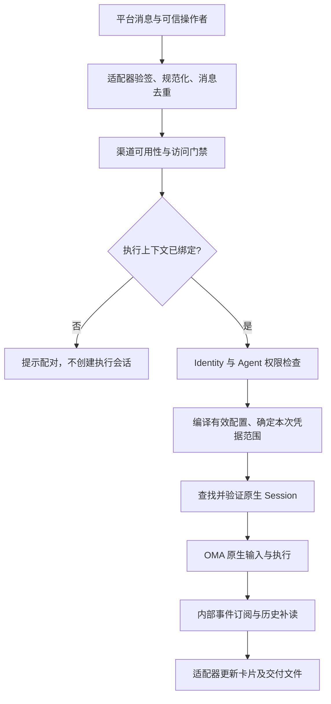

# 消息渠道与执行身份设计

状态：设计提案。本文定义产品行为与接口合同，不表示相关接口已经实现。现有验收服务、应用、凭据和会话继续保留，本文不触发部署或资源清理。

## 需求与问题

企业希望把一个机器人接到多个团队：客服群使用客服智能体，研发群使用开发智能体，个人私聊使用自己的业务授权。管理员需要知道每次执行属于谁、使用了哪些资源，并能单独停用某个业务身份，而不影响整台机器人。

把机器人连接、智能体配置、访问许可和个人凭据放在同一份渠道配置中，会产生四个问题：新增群组需要复制机器人；群配对容易与话题会话混淆；共享身份容易被误当成个人授权身份；配置改变后难以解释旧会话为什么还能恢复。

本设计将连接入口、执行归属、消息操作者和资源授权分别表达，并在进入 OMA 原生会话服务前汇合为一个可信执行上下文。

需要满足：

- 一个机器人连接可以服务多个已授权的私聊或群组，每个范围可以选择自己的智能体。
- 同一业务身份可以使用多个智能体，也可以经多个经过验证的入口访问；仅展示名相同不能合并身份。
- 私聊、群组和话题的会话边界明确，历史恢复不能绕过当前身份和资源权限。
- 个人工具授权属于原操作者，手动共享资源具有明确的使用范围。
- 创建、查询、更新、启停、解绑和清理均有可解释的行为。
- 飞书先提供完整入口，后续渠道只扩展平台协议能力。

## 资源及职责

| 概念 | 解决的问题 | 不承担的职责 |
| --- | --- | --- |
| Channel | 用哪个平台账号接收和发送消息 | 不代表消息发送者，不持有模型执行历史 |
| Identity | 执行属于哪个业务主体，归集配置、会话和审计 | 不是登录账号，不授予管理员权限，不自动获得个人凭据 |
| Actor | 当前实际发消息或点击卡片的平台用户 | 不由模型文本、昵称或可编辑 metadata 推断 |
| Agent / Agent Version | 使用什么智能体定义和执行环境 | 不保存平台连接密钥 |
| Pairing | 某个私聊用户或群组使用哪个 Identity 和 Agent | 不等同于个人 OAuth，不等同于话题会话 |
| Identity Config | 某个 Identity 使用某个 Agent 时的允许覆盖项 | 不另建 Agent、Vault 或执行器 |
| Session | 本次对话的输入、执行、工具和历史 | 继续使用 OMA 原生资源 |
| Vault | 凭据的加密保存、刷新与实际注入 | 不理解平台 open_id 或共享、个人分类 |

Identity、Actor 和管理 API 的调用主体是三种不同身份。管理员可以替某个业务 Identity 配置入口，但不能因此冒充任意 Actor 完成个人 OAuth。

所有资源以组织和工作区为边界。数据库沿用原生 identity 主键、UUID 和外部资源 ID；跨表引用使用 UUID，不增加外键。Identity 对外生成 `idn_` ID，业务系统的用户编号另存 `external_subject_id`，不占用原生资源 ID 的语义。

## 三条授权链路

| 链路 | 授权内容 | 成功后的结果 |
| --- | --- | --- |
| 平台连接授权 | 机器人可以接收和发送消息 | Channel 的连接凭据生效 |
| 执行上下文绑定 | 某个消息范围可以使用指定 Identity 和 Agent | 固定绑定或 Pairing 生效 |
| 工具个人 OAuth | 当前 Actor 可以调用目标业务服务 | 凭据写入该 Actor 关联的原生 Vault |

扫码连接成功不代表任意群组都可以调用 Agent；完成群组配对不代表任何成员都能使用配对管理员的个人凭据；个人工具授权也不改变机器人本身的连接状态。

## Channel 与执行上下文

渠道级执行配置与渠道在同一条 `channels` 记录内保存。固定 Identity、身份解析模式、执行修订号、连接健康与入口关闭状态各自独立。未配置身份模式的旧渠道沿用原有回退。Agent 版本由渠道现有挂载配置保存，固定渠道的展示与执行读取同一值，切换版本递增执行修订。迁移遇到固定渠道版本分歧时保留迁移前实际执行的版本，核对归属和配置后移除旧表。

`channel_pairings` 保存私聊用户或群与执行目标的范围配对。原准入审批记录随表改名为 `channel_access_pairings`，原记录和状态保留。

- `enabled`：管理员是否允许接收新的执行请求。
- `binding_status`：平台凭据为 `unbound`、`bound` 或 `expired`。
- `connection_status`：运行时观察到的连接健康，不允许客户端写入；暂时断网不直接判为凭据过期。
- `identity_resolution.mode`：`fixed` 或 `pairing`，创建后不变。
- 平台类型创建后不变；修改机器人应用账号属于更换连接身份，旧范围绑定与新会话必须重新核验。

### 固定上下文

创建时指定 `identity_id`、`agent_id` 和可选的固定版本。该渠道的合规消息使用同一业务执行归属，私聊和不同群组仍各自隔离 Session。

固定 Identity 不意味着共享某个用户的个人连接。每次私聊仍根据实际 Actor 查个人 Vault；群聊不自动挂载任何成员的个人 Vault。

### 按范围配对

群聊收到未经绑定的消息时记录待配对范围并提示配对，完成配对前不创建 Session。显式配置执行身份配对且入口未关闭的飞书私聊，只有已被明确拒绝的用户会被拦住；没有准入记录，或记录仍待审批，都不阻止自动配对。放行后按实际发送者的 open_id 找回或创建个人 Identity，激活范围配对并继续处理同一条入站消息。准入记录不会因此变成 Identity。已有配对沿用其 Agent 和版本，解绑后复用原 Identity 和 Vault。未配置执行身份的旧渠道保留原准入与历史恢复规则。升级前已发出的确认卡只处理同应用、私聊范围和操作者的原等待消息，渠道明确拒绝的操作者不能使用旧卡。范围配对的目标 Agent 必须已配置渠道执行环境。Friday 工具调用继续按需发起 OAuth。

| 范围 | 稳定键 | 含义 |
| --- | --- | --- |
| direct | Channel、平台账号、远端用户 ID | 一个私聊用户的执行上下文 |
| room | Channel、平台账号、远端群组 ID | 一个群组的执行上下文 |

群组中的成员和话题共用范围配对；Session 继续按聊天或话题隔离。群组配对只授权该业务上下文，群内输入归属和卡片操作仍逐次检查 Actor。

管理员可使用短期配对码或已查到的 Pairing ID 完成绑定。配对码不是管理凭证，调用方仍须具有该渠道、Identity 和 Agent 的管理权限。码过期不删除待配对记录；列表和详情不回显配对码，也不通过读取刷新配对码。

状态为 `pending → active → unbound`。未绑定记录由完成配对操作激活；已绑定记录使用更新操作改变目标。重复提交相同目标不改变绑定修订；解除配对幂等。解绑后再次触发产生新的待配对记录，旧卡片不能激活旧绑定。

触发配对的消息不自动进入后续执行，成功提示用户重新发送。这样权限确认前的输入不会在之后无意执行。

原有 `open / pairing` 访问门禁与这里的身份解析是两个配置维度。不能把原有允许名单直接解释成新的 Identity 配对。固定上下文也可要求访问批准。

## 消息与会话流转



执行上下文包含组织、工作区、Channel、平台账号、Actor、Identity、Agent、版本选择、Pairing 修订及有效配置引用。该上下文由可信入口确定，进入原生 Session 和工具调用上下文；metadata 仅用于展示和关联，不作为权限凭据。

Session 定位使用渠道、连接账号、配对范围、会话范围和执行绑定修订。私聊的会话范围是稳定私聊；群组是稳定群或平台规范化话题。不能仅用 Identity 定位会话，否则同一 Identity 的不同用户或群组会串话。

普通输入、恢复指定会话和历史列表共用同一组判定：当前入口与范围匹配，Identity 和 Agent 仍可用，绑定修订有效，资源配置兼容，当前个人 Vault 关联匹配。历史列表不能从旧 Session 的个人 Vault 字段反推当前身份。

以下变化影响后续新输入，不改写已接受执行的快照：Identity 或 Agent 改绑、固定版本变化、有效配置变化、个人 Vault 被删除后重建。旧会话保留历史，但不继续作为当前入口的可恢复会话。更新相同配置不制造新修订；普通 token 刷新不改变资源挂载身份，不切换会话。

Agent 使用跟随最新版本时，已创建 Session 保留其原生 Agent 快照；新 Session 解析当前版本。固定版本只使用明确版本，版本不存在或无权限时拒绝执行，不回退最新版。

## Identity 与个人凭据

Identity 用于业务执行归属；个人 OAuth 使用 Actor 的可信平台身份。两者建立关联，但不能互相替代。

Actor 键包含组织、工作区、渠道类型、平台应用账号和平台用户 ID。用户与 Vault 的既有关联继续保存在渠道身份关联表，使用原生 `vlt_` ID。同一 Actor 重用既有关联，不同 Actor 不因使用同一 Identity 而共用个人 Vault。跨平台账号合并必须经过显式核验与管理授权，不能凭邮箱、昵称或模型判断合并。

凭据范围按以下顺序确定：

1. 已经通过资源权限检查、明确用于共享的 Vault 挂载。
2. 私聊中当前 Actor 关联的个人 Vault；若已在共享挂载中出现，不重复追加。
3. 群聊只使用明确的共享挂载，个人 OAuth 引导至私聊，不能给整个群注入某个成员的凭据。

Identity Config 中的资源挂载属于明确的执行配置授权，不能通过填写其他用户的 Vault ID 获得访问权。只有具备授权该资源用于当前执行主体的调用方才能保存配置；操作审计记录授权人、资源和生效范围。

同名环境变量、同一 MCP 连接按 OMA 原生绑定选择规则选定凭据。固定凭据失败、被归档、被撤销或目标域名不允许时明确停止，不尝试换到另一位用户或另一个 Vault。

没有凭据时，由实际 CLI 或 MCP 工具调用产生原生 OAuth 需求，匹配已登记客户端后，向原操作者发起授权。渠道核验操作者并确定保存目标；PKCE、回调、换票、加密、刷新、出口注入和原工具等待继续使用 OMA 原生能力。授权链接不允许模型自行提供，完成结果不携带 token。

重启时，原生执行恢复使用原 Session 和原凭据范围，不把旧工具调用重新解释成新 Actor 的任务。原 Vault 已不可用时，明确等待重新授权或失败，不替换正在执行的身份。

## Identity Config 与有效配置

配置按 `Identity + Agent` 保存，每组最多一条生效配置。Agent 提供基础定义，Identity Config 保存允许的差异；不复制出一份长期漂移的 Agent。

首期开放原生会话可承载的资源挂载。模型、提示词、MCP、工具权限和 Skill 的个性化覆盖后续在原生配置编译模块统一扩展，渠道不实现自己的合并 DSL。执行环境由 Agent 的已授权配置确定，Identity Config 不改变环境隔离边界。

| 更新输入 | 定义 |
| --- | --- |
| 字段省略 | 保留当前覆盖 |
| 字段为 null | 删除覆盖，恢复继承 |
| 资源显式禁用 | 从有效挂载中移除，不能解释成恢复继承 |
| 有序列表出现 | 整体替换，顺序参与凭据优先级；空列表表示清空 |
| 普通对象出现 | 按已声明字段合并；不接受任意字段透传为运行时权限 |

环境变量统一在原生执行环境中配置。Identity Config 禁止新增环境变量覆盖，已有覆盖可清除，并且不计入有效配置。敏感值通过 Vault 或已有 Git 资源凭据引用注入。

提供两种读取：Config 返回保存的覆盖；Effective Config 返回权限检查与原生配置编译后的 Agent 快照、环境引用、资源引用和有序 Vault 列表，以及其来源和修订。有效配置不回显秘密，不把覆盖操作符传给执行器。

有效配置修订复用既有 Agent 快照、资源指纹与会话兼容性机制。若需要扩展，扩展原生编译入口，不在渠道内再维护一套哈希或配置缓存系统。可读到资源不等于可以执行；提交和恢复仍重新检查当前可用状态。

默认记忆库以 Identity 和 Agent 为范围，使用原生 Memory Store。`auto_memory_store` 首期默认关闭，用户可显式启用；关闭只停止未来的自动创建，不删除已有记忆。显式解绑默认库后不因普通新消息偷偷重建；重新启用需显式操作。群组共享身份使用共享记忆时在界面标识生效范围，不混入个人 OAuth 信息。

## 生命周期

| 操作 | 新输入 | 已接受的原生执行与结果 | 历史与其他资源 |
| --- | --- | --- | --- |
| 停用 Identity | 拒绝该身份的新执行，包括尚未送入原生入口的渠道排队消息 | 已接受执行自然完成，原待处理动作和取消仍校验后允许 | 不修改 Channel 人工开关、共享 Vault 或其他身份 |
| 启用 Identity | 允许后续新输入 | 保持原会话忙闲与排队规则 | 不自动重开渠道、不补跑错过的计划 |
| 停用 Channel | 不接收新执行 | 已受理任务允许在有效凭据下交付；平台连接按收尾需要保留 | 不停用 Identity，不删会话 |
| 平台凭据过期 | 阻止新的平台执行输入 | OMA 执行事实保留，平台交付明确显示不可用 | 重新绑定同一账号后核验原回执再恢复 |
| 解除配对 | 原范围不再接受新执行 | 仅允许原范围已受理任务的收尾；原审批仍校验 Actor | 不删除 Identity、Vault 或 Session；旧绑定不能用于新推送 |
| 删除 Channel | 不再收发或绑定 | 不承诺继续渠道交付，原 Session 仍可在 OMA 查看 | 不级联删除业务资源 |
| 删除 Identity | 不再创建或继续新一轮执行 | 已受理执行保留；紧急停止另用原生取消或吊销凭据 | 逻辑删除，保留审计；资源销毁使用显式清理 |

受理边界以原生输入与执行入口为准。停用不是紧急强杀，也不能承诺停用响应之后绝无已受理任务开始；紧急处置使用原生取消与凭据吊销。停用检查放在共用原生执行入口，API、渠道和计划不能各自遗漏。

### 清理 Identity

清理与删除分开：清理保留 Identity，本次操作解除其未来配置和入口关系、处理明确归属资源，并保留历史审计。

清理前预览当前会话、配置、计划、绑定与资源归属。首期存在未结束执行或授权等待时返回冲突，要求先通过原生能力停止；不悄悄取消任务。确认后复用原生归档、解绑、秘密吊销和资源删除能力；耗时操作使用已有 River 作业与重试机制，不新建清理执行器。

- 归档 Identity Config，撤销其有效配对，关闭指向该身份的固定渠道入口。
- 仅处理其明确拥有、未被其他主体共享引用的资源；共享资源仅解除本身份绑定。
- 自有个人 Vault 如需清理，先按原生能力归档凭据并清除秘密，再处理 Vault；不能仅改归属标签就声称凭据已经失效。
- 不因业务 Identity 清理而自动删除 Actor 的渠道个人 Vault；个人 Vault 的销毁需要确认其真实归属与其他使用关系。
- 文件、记忆、环境和计划按各资源的既有生命周期处理，不随意扩展为物理删除。
- 部分失败记录真实结果，可重试未完成项；不将数据库解绑成功报告成外部资源全部清理成功。

后台清理状态复用作业进度和失败信息。设计中的清理预览不是本次请求执行资源清理的授权。

## API 合同

以下路径相对于现有工作区管理 API 的资源前缀，统一使用当前 Principal、IAM、分页和错误结构。此处为拟定合同，不声明现有路由已支持；不另建令牌体系。

| 资源 | 接口 | 核心合同 |
| --- | --- | --- |
| Identity | POST /identities | 创建，接受业务主体编号、命名空间、展示名、开关和记忆选项 |
| Identity | GET /identities、GET /identities/{id} | 按状态、业务编号和搜索筛选；游标分页；不可见按原生错误规则处理 |
| Identity | PATCH /identities/{id} | 修改可编辑信息；业务编号变更不改变资源 ID 或平台关联 |
| Identity | POST /identities/{id}/enable、/disable | 启停；更新 enabled 使用相同入口规则 |
| Identity | DELETE /identities/{id} | 逻辑删除；重复操作按既有资源合同处理 |
| Identity | POST /identities/{id}/clear | 明确清理范围，存在运行项时返回冲突，否则返回原生作业引用或完成结果 |
| Identity | GET /identities/stats、GET /identities/{id}/agents | 从原生 Session/Usage 聚合数量与最近使用，不复制账本；明确时间窗口 |
| Identity Config | GET /identities/{id}/configs | 按 Agent、状态筛选；游标是配置资源 ID |
| Identity Config | GET、PUT /identities/{id}/agents/{agent_id}/config | 读取覆盖或按合同更新覆盖；每组一条生效配置，带修订控制 |
| Effective Config | GET /identities/{id}/agents/{agent_id}/effective | 返回编译结果与来源，不返回密钥；可选明确 Agent 版本 |
| Channel | POST、GET /channels | 创建及分页列表；支持类型、开关、绑定状态与执行目标筛选 |
| Channel | GET、PATCH、DELETE /channels/{id} | 查询、更新、删除；平台类型与解析模式不可改，凭据只写 |
| QR Session | POST /channels/{id}/qr_sessions | 按适配器能力创建连接授权，不创建工具 OAuth |
| QR Session | GET /channels/{id}/qr_sessions/{qr_id} | 权限绑定 Channel；返回状态和截止时间，不返回秘密 |
| Pairing | GET /channel_pairings、GET /channel_pairings/{id} | 列表与详情只显示可访问范围、状态及已绑定目标，不回显码 |
| Pairing | POST /channel_pairings | code 与 pairing_id 恰好传一个，同时提供 Identity 和 Agent |
| Pairing | PATCH /channel_pairings/{id} | 更新生效目标，至少一个字段，修订冲突返回 409 |
| Pairing | DELETE /channel_pairings/{id} | 幂等解绑，拒绝跨工作区操作 |

写入接口按原生请求幂等合同处理。创建重复业务主体返回冲突；配对 ID 重试相同目标返回已有结果，过期码不能被重试重新激活。列表统一沿用 OMA 的游标与上限，不为不同渠道定义不同分页结构。

固定 Channel 示例：

```json
{
  "name": "客服入口",
  "channel_type": "feishu",
  "identity_resolution": { "mode": "fixed" },
  "identity_id": "idn_service",
  "agent_id": "agent_support",
  "agent_version": 2,
  "enabled": true,
  "channel_config": {
    "response_options": { "include_tool_calls": true, "include_thinking": false }
  }
}
```

范围配对 Channel 示例：

```json
{
  "name": "团队机器人",
  "channel_type": "feishu",
  "identity_resolution": { "mode": "pairing" },
  "enabled": true
}
```

身份解析模式与目标组合不合法返回 400；资源不可见沿用原生 403/404 规则；Identity 停用、并发修订冲突返回 409；平台故障返回原生服务错误并保留可诊断原因。平台连接不可用和业务身份停用在 UI 与错误码中分别表达。

管理端继续使用 OMA 现有登录用户及 IAM。控制台创建执行会话时由受权用户明确选择业务 Identity；不为了管理操作再制造一个拥有特殊权限、不可变更的管理员 Identity。

## 适配器与原生能力边界

平台适配器负责连接、验签、平台账号与用户标识规范化、消息触发规则、私聊/群组/话题映射、附件和卡片操作。能力描述只列出实际支持的扫码、直连、文件、流式回复和交互方式。不支持扫码的平台不展示扫码入口，也不承诺扫码能自动创建平台应用。

渠道只请求完成收发所需的平台权限；文档、日历、数据平台等业务权限由实际工具按需发起个人授权，不能在接机器人时默认索取全部业务权限。凭据先校验后加密保存，连接重试和权限不足分别呈现，不明文回显秘密。

| 能力 | 使用位置 |
| --- | --- |
| 平台连接与配对交接 | channels 与平台适配器，保存平台事实 |
| Identity 与个性配置 | 原生业务资源层，供会话入口共用 |
| 组织/工作区授权 | 现有 Principal 与 IAM |
| 执行与工具等待 | sessions、codesessions、Brain 和 Worker 现有链路 |
| 实时回复与补读 | 与网页 SSE 共用内部事件订阅；同进程不绕 HTTP/SSE，不轮询历史 |
| OAuth、token 刷新和注入 | 现有 OAuth flow、Vault 与出口代理 |
| 附件、文件、Git 和 Memory | 原生资源、权限与配额，平台限制留在适配器 |
| 输入幂等、卡片及文件交付 | 原生输入请求与既有平台交付回执，不复制执行记录 |

对平台回执丢失的未知结果继续采用既有交付规则，不借本次 Identity 引入另一套消息总线、重放系统或执行状态机。

## 数据与实现安排

必要新增数据只有：业务 Identity、Identity 与 Agent 的覆盖配置，以及经过确认的外部 Actor 与 Identity 关联。已有配对和会话绑定记录扩展目标 UUID、范围、配置或绑定修订；原生 Session 增加正式 Identity 引用，不能仅依靠自由 metadata 实现身份隔离。

同一工作区的业务主体编号带命名空间唯一；外部 Actor 关联键包含平台应用账号，不能只使用 open_id。共享执行配置与个人 Vault 关联独立存储；Vault 沿用同一种资源和原生 ID。

已有资源表、原生资源引用、归属与配置编译能力能承载的部分直接复用；缺少字段时在对应原生模块扩展。数据库访问使用现有 Mapper 和单连接池，变更通过新编号迁移管理，不更改已应用迁移。

实施分四步：

1. 在原生资源层实现 Identity 与所有入口共用的受理检查，定义 Session 身份引用和资源授权合同。
2. 完成 Identity Config、有效配置读取和恢复兼容判定，再提供固定上下文的工作区渠道入口。
3. 扩展 Pairing 为范围执行绑定，补齐扫码与直连连接生命周期；飞书真实验收后再增加其他平台。
4. 在归属关系可证明、预览和部分失败合同具备后开放清理；统计从既有事实聚合。复杂配置覆盖按真实需求逐项开放。

现有按 Agent 创建渠道的入口保留兼容外观，内部映射到固定上下文。已有允许名单不能自动推导 Identity；需要管理员确认执行归属后建立新绑定。个人 Vault 关联、平台回执和历史 Session 保留；身份不明确的旧记录保持历史可查，不因猜测归属而自动赋权或删除。

## 产品入口与验收

工作区提供渠道与执行身份两个入口；Agent 页面提供使用该 Agent 的绑定视图。渠道详情分别显示连接状态、执行目标和范围配对；个人连接继续显示在当前用户的连接管理中。界面按平台能力呈现选项，不要求用户理解内部事件协议。

完成验收至少覆盖：

| 场景 | 可观察结果 |
| --- | --- |
| 同一机器人两个群组分别配对不同 Agent | 执行目标正确、历史和文件不串组 |
| 同一群组不同话题 | 配对共用，Session 与回复按话题隔离 |
| 同一 Identity 的两个私聊用户调用 Friday | 凭据写入各自原生 Vault，不借用对方授权 |
| 显式挂载共享 Vault | 共享凭据按固定绑定使用；失效不回退个人凭据 |
| 删除并重建个人 Vault | 普通消息切换新挂载；恢复和历史列表拒绝旧挂载会话 |
| 工具等待 OAuth、授权完成与刷新 | 原调用续跑，原生刷新，Bash 已执行部分不重放 |
| 配对码过期、按 ID 重试、并发改绑与解绑 | 无意外激活，无重复执行，旧修订不可恢复 |
| Identity 停用再启用 | 新执行被阻止，既有执行可收尾，不自动开启其他资源 |
| 配置覆盖、禁用及恢复继承 | Config 与 Effective Config 可解释，权限未扩大 |
| 清理碰到运行任务、共享资源或部分失败 | 冲突与保留范围明确，不误删共享凭据，不虚报完成 |
| 重启、断线与平台交付结果未知 | 原生历史恢复，不重复创建任务或盲目重发 |

静态设计和接口文档阅读不替代上述真实验收。现有单用户验收资源保留；真实双用户、其他平台和故障场景必须单独记录结果，不能用假数据检查替代。

## 资料目录

资料核对日期：2026-11-17。已阅读消息渠道接入说明以及渠道模块 12 篇、身份模块 15 篇同级 API 文档。上述 OMA 行为为本提案决策，不表示外部产品或当前 OMA 已经具备本文全部能力。

- [消息渠道接入](https://docs.qoder.cn/cloud-agents/message-channel-integration)
- 渠道：[创建](https://docs.qoder.cn/cloud-agents/create-a-channel)、[列表](https://docs.qoder.cn/cloud-agents/list-channels)、[详情](https://docs.qoder.cn/cloud-agents/get-channel)、[更新](https://docs.qoder.cn/cloud-agents/update-channel)、[删除](https://docs.qoder.cn/cloud-agents/delete-channel)。
- 连接授权：[创建扫码会话](https://docs.qoder.cn/cloud-agents/create-scan-authorization-session)、[查询扫码会话](https://docs.qoder.cn/cloud-agents/query-scan-session-status)。
- 配对：[列表](https://docs.qoder.cn/cloud-agents/list-channel-pairings)、[详情](https://docs.qoder.cn/cloud-agents/get-channel-pairing)、[更新](https://docs.qoder.cn/cloud-agents/update-channel-pairing)、[完成配对](https://docs.qoder.cn/cloud-agents/pair-channel)、[解除配对](https://docs.qoder.cn/cloud-agents/unpair-channel)。
- 身份：[创建](https://docs.qoder.cn/cloud-agents/create-identity)、[列表](https://docs.qoder.cn/cloud-agents/list-identity)、[详情](https://docs.qoder.cn/cloud-agents/get-identity)、[更新](https://docs.qoder.cn/cloud-agents/update-identity)、[删除](https://docs.qoder.cn/cloud-agents/delete-identity-soft-delete)、[清理](https://docs.qoder.cn/cloud-agents/clear-identity)、[停用](https://docs.qoder.cn/cloud-agents/disable-identity)、[启用](https://docs.qoder.cn/cloud-agents/enable-identity)。
- 管理与统计：[管理员身份](https://docs.qoder.cn/cloud-agents/ensure-admin-identity)、[汇总统计](https://docs.qoder.cn/cloud-agents/get-identity-stats)、[使用的智能体](https://docs.qoder.cn/cloud-agents/list-identity-templates)。
- 身份配置：[配置列表](https://docs.qoder.cn/cloud-agents/query-all-template-configurations-under-this-identity)、[创建更新](https://docs.qoder.cn/cloud-agents/create-update-identity-config)、[配置读取](https://docs.qoder.cn/cloud-agents/get-identity-config)、[有效配置](https://docs.qoder.cn/cloud-agents/query-effective-config-composite-results)。

## 实现状态

本分支在 `00161_business_identities.sql` 增加业务 Identity、Identity Config、Actor 关联、渠道执行上下文、范围配对、Session 身份引用和清理记录。公开 ID 使用 `idn_`。既有 `channel_pairings` 允许名单保持独立，不会自动变成执行身份。

控制台工作区入口为 `/workspaces/{workspaceId}/identities`，Agent 详情展示使用该 Agent 的绑定。渠道详情展示解析模式、连接状态和执行身份。管理 API 同时挂在控制台组织路由和已认证 `/v1`。

没有执行上下文的旧渠道继续走原有 Worker。带 `identity_id` 或 `identity_resolution` 的创建请求映射为固定或配对上下文；固定模式缺少身份、配对模式预先指定身份都会拒绝。共享凭据确认缺失或归档时执行保持拦截，不回退个人 Vault；查询失败则保留消息以便重试。停用只阻止带 `user.message` 的新一轮，工具结果仍可收尾。清理在存在运行会话或授权等待时返回冲突及会话 ID；读取保留凭据失败或其它部分失败时 `completed` 为 false，且不删除个人或共享 Vault。后续重试合并已记录的保留凭据和归档、解绑、关闭计数，不用空结果覆盖。恢复和历史在正式身份绑定读取失败时要求重试，不把读取失败当成不兼容。会话复用与恢复核对当前平台应用及正式绑定上的配置修订。原生创建事务锁定执行身份状态，停用与首次受理按提交先后生效。渠道创建会话与事件订阅一样拒绝已归档工作区。并发激活只有身份、智能体和版本都一致时才视为成功。

工作区渠道列表一次返回当前工作区的全部渠道，类型、开关、绑定状态和执行身份筛选作用在这份完整结果上，不使用游标。恢复和历史只读取已有个人 Vault，不在读取时创建或替换 Vault。配对码按哈希直接定位，不扫描第一页待配对记录。控制台与渠道共用原生会话创建事务。创建时先校验执行身份存在且已启用，再在同一事务内保存会话、身份绑定、环境任务及初始事件。渠道只在事务提交后记录外部会话映射。绑定失败时整个事务回滚，提交成功后才发布事件。事务内复查发现身份已不存在时返回 404，已停用时返回 409。

自动化测试覆盖决策、凭据隔离、话题 scope、配对修订、配置来源、清理冲突和停用受理。真实飞书双用户、扫码、断线重连和平台回执仍需桌面验收，不能用这些单测代替。
