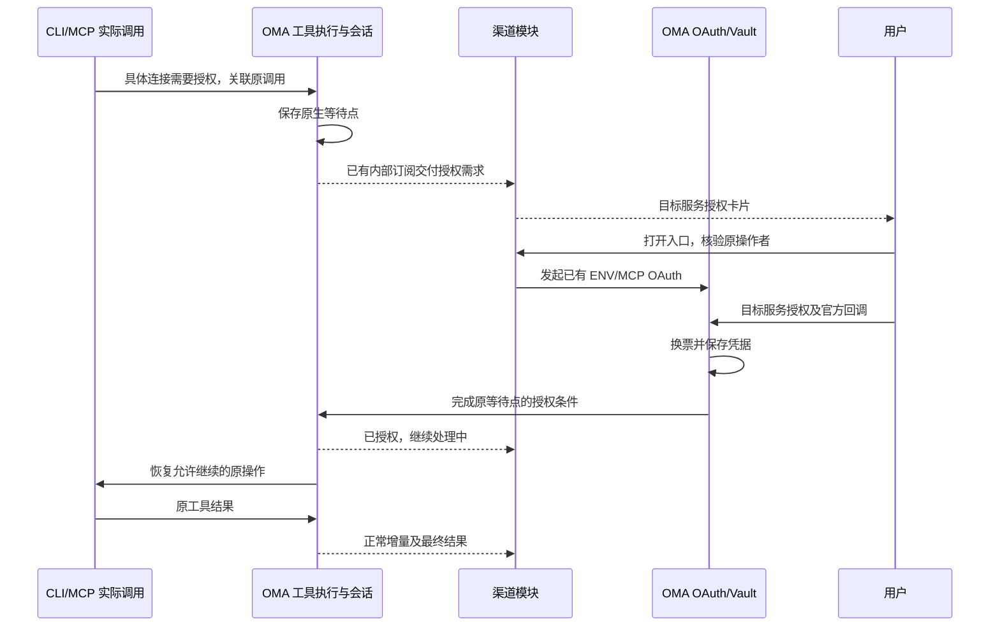

# 渠道对话按工具调用触发 OAuth

本文记录已批准的实现合同。当前处于开发与验收中，不能将局部单测和服务启动视为整条链路已经通过。

## 目标与边界

用户实际调用需要个人 OAuth 的 CLI 或 MCP 时才请求连接目标服务。普通对话、其他工具和其他用户不受影响。目标是 Friday、GitLab、Notion 等服务；消息平台的用户核验用于确认谁在授权，不代替目标服务的 OAuth。

渠道负责授权交互、操作者与个人连接的关联，以及将完成结果交还 OMA。OAuth 换票、凭据、刷新和工具等待由 OMA 原生能力承载。现有能力缺失的部分在原模块扩展，不在 channels 中复制执行器、凭据库或通信系统。

## 已核对的实现与缺口

- 新版 lark-channel 的 `oauth/gate.ts` 和 `manager.ts` 在输入阶段按 `requiredProviders` 检查全部连接。该入口不能直接沿用为按工具调用触发。
- 旧 Friday 查询使用沙箱 bash 调用 Friday CLI，通过 `FRIDAY_4A_TOKEN` 接收 Vault 占位符；GitLab 示例同样用 bash/curl。不能把它们当作 MCP 工具。
- OMA 的 ENV OAuth 已有提供方、PKCE、回调、原地重新授权、秘密加密、占位符注入和刷新租约。尚无凭据时，现有挂载过程不会产生相应占位符；出口代理不能凭请求域名可靠确定用户要连接哪个服务。
- MCP 注入已有首次 401 后强制刷新以及鉴权拒绝处理。Brain 已区分发现阶段和调用阶段的鉴权失败，但当前失败会遗漏工具或返回工具错误，并没有完整的 OAuth 等待及恢复合同。
- `ToolExecution`、会话事件、Worker 输入、取消、检查点和未知结果处理已有实现。授权等待需在这条链路扩展类型化需求与完成结果；它不是工具执行批准，不能以自动批准权限请求代替。

## 两条链路共用的合同

以下字段表示拟新增的语义，不预先锁定事件名称或数据库字段名：

| 内容 | 来源与用途 |
| --- | --- |
| 原 Session、thread、tool call ID | OMA 当前实际调用；定位等待点，不能由模型指定其他会话 |
| 连接引用 | 已配置的 ENV OAuth 提供方及变量绑定，或 MCP server 引用 |
| 需求原因 | 首次连接、刷新后仍需重新授权、可明确补充的 scope |
| 操作者 | 原输入的可信渠道来源，包含组织、工作区、渠道、平台账号和用户 |
| 调用进度 | 尚未发出、被明确拒绝、结果未知；决定恢复方式 |

授权完成事件只携带 flow、凭据引用及结果，不携带令牌。需求幂等定位到原工具调用和连接；同一用户同一连接的并发等待可共享一条授权流程，但每个调用仍分别恢复。不同用户不能合并。

会话执行记录保存等待点；渠道只保存平台操作者与凭据关联、原授权卡片回执及 flow 关联。授权协议状态留在现有 OAuth flow 中，不增加渠道 OAuth 状态机副本。

## bash / CLI：发现与继续

### 首次连接

任意 shell 字符串不能可靠映射到 OAuth 服务。首期支持明确接入的 CLI，例如 Friday；给该 CLI 的实际执行入口加薄适配，在执行目标命令之前调用 OMA 的凭据准备能力。连接引用来自管理员配置的工具/连接器绑定，调用只在当前工作区和操作者可用范围内解析。

适配层不实现登录、换票、刷新，不解析整段 shell，也不从 stdout/stderr 中提取授权 URL。没有接入此合同的任意 CLI，不承诺自动 OAuth。

1. 模型实际调用 bash，脚本运行到已接入 CLI。
2. CLI 入口请求当前 Session 的目标连接；已有凭据由 Vault 解析和刷新，成功则直接执行。
3. 缺失或需重新授权时，OMA 持久记录原 tool call 的授权需求，CLI 入口等待，不启动实际目标命令。
4. 渠道通过已有内部会话事件订阅收到需求，发送“连接 Friday”等卡片。
5. 用户身份核验后进入目标服务的 OMA 原生 ENV OAuth 流程。
6. 回调保存凭据，按原生挂载路径准备当前 Session 的变量占位符；薄适配仅取得占位符及非秘密配置，再继续启动目标命令。
7. bash 正常完成，工具结果沿原执行链路返回，模型继续回答。

这条路径保留原 bash 调用，不重新执行已运行的脚本前缀。例如 `生成文件; friday 查询; 上传文件` 停在 Friday 入口，授权后只继续原进程。

等待需要接入现有工具生命周期和取消信号，明确暂停工具的执行计时；不能保持一条普通、短超时 HTTP 请求并假定它会一直存活。跨进程使用现有 Worker/会话通信，渠道同进程消费内部事件，不新建通信链路。等待期间不调用模型，但原 shell/沙箱仍可能占用资源，不能声称完全不占 Worker 或沙箱。

### 已有连接运行中失效

出口替换首先复用 Vault 自动刷新。只有明确永久失效才产生重新授权需求；网络错误、限流、服务端错误和资源权限不足不一律转为 OAuth。

CLI 薄适配必须使用目标客户端的结构化鉴权结果，或出口注入返回的可关联凭据错误，定位到具体连接和当前调用。不同 CLI 的错误差异留在适配边界，不交给模型猜测。

- 尚未发送的目标调用：授权后继续原调用。
- 已明确被拒绝的只读操作：授权后允许从该操作入口重试，保留原 bash 调用。
- CLI 内部已执行多次请求、包含写操作或结果未知：不自动重新运行 CLI 或整段 bash。将已有结果和不确定性交还原会话，由既有未知结果处理继续核对。

原 shell 已退出、超时、用户停止或进程丢失时，授权成功只更新连接，不能声称回到了原进程。检查点未能证明原操作未执行时，不自动重放。

## MCP：发现与继续

### 首次未授权导致工具不可见

不能在每次会话初始化时，因为某个已配置 MCP 的发现请求返回 401，就立即强迫用户授权该服务。

已有可信工具定义时沿用其定义，实际调用时再准备凭据。没有工具定义时，提供按服务的原生工具发现入口，展示现有 MCP 配置中的名称和用途；模型实际选择发现该服务才发起连接。需要扩展现有 MCP 注册/发现流程，不伪造远端工具的名称、参数或 schema，也不建立另一份独立工具目录。

按需发现遇到 OAuth 需求后暂停该发现操作，授权完成再初始化并获取工具定义，重新开放给同一会话；原用户输入不重复提交，模型继续原轮次并选择真实工具。

### 实际 tools/call

1. 模型选择已注册 MCP 工具，原生工具权限校验通过。
2. MCP/Vault 链路解析具体服务的个人凭据，正常到期先自动刷新。
3. 缺少授权或刷新永久失败时，产生结构化授权需求，保留原 call ID、参数和实际进度；暂不把该调用作为普通失败结果交给模型结束本轮。
4. 渠道呈现授权卡片，目标服务的发现、PKCE、换票和凭据更新复用 OMA MCP OAuth。
5. 成功后重新解析同一凭据、重建必要的 MCP 连接，再继续原等待调用；工具定义发生变化时重新校验，不照旧参数盲目调用。
6. 正常结果提交原工具调用一次，模型继续原轮次。

仅在 OMA 已证明原请求未发出，或原生重试策略明确允许时恢复发送。`X-Oma-Mcp-Not-Forwarded` 可复用，但需核对它实际覆盖的传输边界，不能扩大解释成任意上游业务未执行。已经发出且结果未知的写调用，授权完成不构成重试许可。普通 403、模型网关鉴权失败和不带可验证 OAuth 关系的 401 不自动触发目标服务授权。

## 授权交互与回调

授权链接由服务端产生，只允许已绑定连接的提供方和 scope；scope 不由任意工具输出或模型自由扩大。飞书点击者核验和目标账号识别分别处理，不能比较两个应用作用域下的 open_id 来判断目标账号是否为本人。

浏览器回调持久保存完成结果后唤醒 OMA，卡片更新失败不阻止续跑，也不重新换票。浏览器 postMessage 只用于页面反馈。进程恢复通过现有 flow、会话历史和 Worker 恢复路径核对，不能只依靠一次内存通知。授权码到期复用原生 flow 期限，工具等待跟随原会话的取消及终结生命周期，不再叠加渠道固定有效期。

取消、会话重置、渠道停用或配对撤销后，迟到授权不能恢复已关闭的请求。执行权限批准与 OAuth 是两个条件，满足 OAuth 不得放宽已有工具权限。

## 隔离与扩展

渠道通过 `channel_user_vaults` 保存组织、工作区、渠道类型、应用 ID、操作者与原生 Vault UUID 的关联。身份组合和 Vault UUID 分别唯一；首次创建复用原生 Vault 插入，并与关联在同一事务中提交。新 Vault 使用原生 `vlt_` ID，不增加类型或专属 Vault 服务。已有验收 Vault 通过迁移补关联，不改 ID、凭据或令牌。`00157` 将原关联表重命名为 `channel_user_vaults`，保留 `00156` 历史迁移及现有关联数据。

渠道决定身份与挂载：手动挂载的 Vault 排在当前操作者关联的 Vault 前，前者用于明确共享，后者用于个人授权。群会话只使用手动挂载，个人授权继续在私聊进行。所有挂载仍通过原生 `vault_ids` 承载；其他用户的 Vault 不自动加入。

渠道创建会话时，将已确定的凭据使用方式放入原生调用上下文：`credential_binding_mode=first_vault` 表示同一变量或 MCP 连接固定采用挂载顺序中的第一份凭据，`oauth_vault_id` 指定按需授权的保存目标。它们不是新的渠道配置项或 Vault 类型。原生凭据模块不读取渠道 ID、应用 ID 或 open_id；它只使用挂载范围、顺序及授权目标。普通会话未指定该使用方式时保留原有行为。

启动变量注入、CLI 授权预检、ENV 出口替换和 MCP 代理共用原生凭据范围及绑定选择。固定连接不能在鉴权失败后改用其他 Vault；挂载 Vault 归档或删除时阻断使用，不能静默丢弃后回退到另一身份。访问令牌到期仍由原生 Vault 刷新原凭据。固定凭据需要重新授权且不属于当前授权保存目标时，提示其 Vault 管理者处理，不创建个人授权来替换共享身份。

Friday 入口可只声明变量名与目标域名。已有匹配的挂载凭据优先确定连接；否则通过原生 OAuth 客户端目录匹配启用、已配置、属于当前工作区或平台的客户端，同时核对默认变量及目标域名。没有匹配或匹配多项均不猜测。授权仍复用原生 ENV OAuth，回调只写渠道关联的 Vault。

个人 Vault 按组织、工作区、渠道平台账号及操作者关联，目标服务的连接分别作为原生凭据保存其中；个人 Vault 不自动加入渠道公共挂载。共享 Session 当前不具备逐调用用户凭据隔离，首期个人 OAuth 任务在私聊执行，不能动态替换群公共 Session 的 Vault。其他渠道复用相同需求和完成合同，仅实现操作者核验及消息呈现。

## 最小实施范围

1. 原生凭据解析增加可关联连接的结构化授权需求；区分 ENV/MCP、临时故障、配置错误及资源拒绝。
2. 在现有工具执行、事件和检查点链路增加授权等待与完成结果，不新建执行状态系统。
3. CLI 薄适配与未授权连接的原生占位符准备；先接 Friday，第二个服务验证不依赖名称硬编码。
4. MCP 按需发现及原调用等待恢复；复用现有客户端、代理和工具定义更新逻辑。
5. 渠道个人绑定、授权卡片、操作者核验和回调关联；共享网页/渠道的原生 OAuth 服务。

这些是现有能力需要补齐的部分，不能仅修改 channels 的发卡逻辑就称为闭环完成。

## 验收条件

- 普通聊天、无关 CLI 和未选择的 MCP 不触发 OAuth。
- Friday 首次使用触发正确服务授权，授权后原 bash 前缀只执行一次，取得真实查询结果。
- 令牌到期自动刷新不弹卡；明确撤销后重新授权；临时错误、资源 403 不误弹。
- 未授权 MCP 通过按需发现可进入授权并获得真实工具；已注册 MCP 调用在授权后继续原 call。
- 两条链路均覆盖取消、超时、重复回调、账号不符、双用户隔离和多服务分别授权。
- 结果未知或可能产生副作用的调用不因授权回调而重复执行；Worker 重启后不能盲目重跑 bash。
- 事件订阅与故障隔离沿用 OMA 已有链路；本设计不自动扩大此前暂缓的完整多实例/故障验收范围。

验收状态记录在本文末尾；既有验收服务、渠道、凭据及浏览器资源继续保留。

## 开发中的实现映射

飞书核验端点、SDK 用户信息查询及授权卡片布局位于 `internal/channels/feishu`。公共渠道层通过现有适配合同取得可信操作者标识、校验原请求并交接原生 OAuth，不包含飞书 SDK 或平台卡片格式。

- `request_oauth` 复用原生自定义工具请求、控制输入和检查点；OAuth 满足后仍保留原工具权限条件。
- ENV 和 MCP 原生 OAuth flow 增加可空的 `continuation`，只关联 Session、工具请求、渠道和浏览器绑定，不另建渠道运行记录。
- 原生 ENV flow 构建逻辑由控制台和渠道共用；MCP discovery、PKCE、换票及凭据保存继续使用原实现。
- 私聊 Session 初始挂载空个人连接 Vault，以遵守 OMA 运行期间不能修改 `vault_ids` 的约束；创建空 Vault 不触发目标服务授权。
- 原请求取消、已接受其他结果、会话被重置、配对被撤销时，不放行原等待点。成功回调的再次投递复用原输入幂等键；交接失败不得显示为已经续跑成功。
- MCP 的未授权服务按需发现；普通 403 和没有 OAuth challenge 的 401 不触发连接。只读或明确未转发的调用才允许重发，定义变化和结果未知写操作不重放。
- main 新增工作区 OAuth 提供方后，本分支渠道迁移顺排为 `00147` 至 `00153`；本次交接字段迁移为 `00154`。这不修改 main 已发布迁移。

## 旧版 Bash 脚本入口与工具预算

`scripts/friday-oauth.py` 作为环境中的 `friday` 入口。原 CLI 通过 `OMA_FRIDAY_EXECUTABLE` 指定，或从排除入口自身的 PATH 中查找。`OMA_FRIDAY_OAUTH_PROVIDER` 为已有 ENV OAuth 提供方引用，`FRIDAY_BASE_URL` 指向服务地址。提供方的默认变量必须为 `FRIDAY_4A_TOKEN`。令牌保存于原生 Vault，进入沙箱的只有占位符；验收中的非敏感入口参数由命令显式指定，不修改 Environment 变量传递链路，没有新增渠道配置表或凭据类型。

Manager 通过原工具执行上下文传入当前调用 ID 和 UUID。入口经已有出口代理和 WebSocket 请求固定内部目标 `http://oma.internal/oauth`；沙箱 JWT 留在 Manager 中。OMA 复用已有 Vault 刷新器准备凭据，只在缺失或刷新永久失败时请求授权。入口只获得占位符；授权完成后使用 exec 继续原命令，不重跑 Bash 前缀。帮助和版本查询不触发授权。

原生工具调用增加可空的 `oauth_wait_started_at`（迁移 `00155`），授权期间保持 running，暂停执行预算但仍保留执行器租约和取消。Manager 的外层截止与 Bash 内部超时共用原调用时钟。[配套 Manager PR #19](https://github.com/superduck-ai/environment-manager-rs/pull/19) 需要一并部署，可通过已有 `environment_runner.manager_artifact` 下发；当前已构建本地验收制品，尚未发布。

只有实际等待并完成授权时，CLI 才在工具输出中说明授权完成，防止模型将最终查询成功误述为没有发生授权。正常复用和自动刷新不输出该提示。

## 当前真实验收记录

2026-11-16，独立机器人「OMA工具授权验收1116」，使用真实飞书私聊、线上 Friday 和官方 Notion MCP：

| 场景 | 结果 |
| --- | --- |
| 普通对话 | 不触发 OAuth |
| Friday 首次授权 | 飞书授权卡片、操作者核验、Friday 同意授权及 HTTPS 回调成功，原 Bash 返回真实应用列表 |
| 授权等待与防止重跑 | 10 秒工具等待约 36 秒后继续成功，前缀文件计数为 1 |
| Friday 自然到期 | 原访问令牌 22:44:16 到期，下一次飞书调用由 Vault 刷新，到期时间更新至 22:50:12，不再弹卡 |
| Friday 撤销后到期 | 官方撤销接口返回 200；旧访问令牌自然到期后出现 `reauthorization_required`，授权后原 Bash 成功，前缀计数仍为 1 |
| Notion 首次授权 | 按需发现产生授权卡片，官方 OAuth 后同任务发现工具并成功调用 `notion-get-self` |
| Notion 撤销与恢复 | 官方移除专项客户端后再次要求授权；授权更新原凭据，同任务查询当前用户成功 |
| 取消与旧链接 | 飞书取消结束等待，旧卡片授权链接拒绝继续 |

验收发现并修复了根线程交接、取消字段、回调空白页，以及 MCP 永久刷新失败未清理旧秘密、导致重新授权被重复凭据约束拒绝的问题。清理复用原生凭据秘密 CAS，临时错误和其他并发成功的凭据不被清理。Notion 与 Friday 连接最终均恢复可用。

本轮未覆盖 Friday 撤销但访问令牌尚未到期时的 CLI 运行中鉴权拒绝、真实双用户授权隔离、授权链接自然超时及完整多实例/强杀恢复。不能把上述通过结果扩大为这些场景已通过。所有验收服务、沙箱、渠道和浏览器页面继续保留。

### 2026-11-17 关联与共享复验

新增迁移 `00156`，只建立身份与原生 Vault 的关联，并为已有验收记录补关联。PostgreSQL 回归验证同一用户八路并发只创建一个 Vault、不同用户分别创建、一个 Vault 不能同时关联不同用户，以及跨组织、工作区和应用读取失败。原生调用范围的绑定模式、授权目标和挂载顺序均已通过真实数据库扫描验证；挂载资源归档后不会回退其他连接。

真实飞书单账号复验：不指定提供方的 Friday 查询成功，个人令牌到期时只刷新个人凭据。手动挂载共享 Vault 后查询成功，共享凭据版本从 0 更新到 1，个人凭据保持版本 4。随后清除手动挂载，个人凭据撤销并到期后出现重新授权卡片；官方授权回调后原 Bash 完成，前缀计数为 1，个人凭据更新至版本 5，共享凭据保持版本 1。渠道挂载已恢复原空配置，两份连接及历史会话均保留。

按用户要求，真实第二个飞书账号的授权隔离留待用户手测；本轮后台隔离回归不冒充真人双账号验收。

迁移156仅回填身份字段齐全、且旧vlt_channel_标识与历史派生规则完全一致的记录；普通Vault的可编辑metadata不构成身份凭据，也不会因缺字段或重复声明身份阻断升级。此校验只承接旧数据，新Vault仍使用原生vlt_标识。删除Vault后，渠道在原工作区事务锁下重建原生Vault并替换已失效的关联；原会话仍引用旧挂载时切换到新会话，不改写旧执行历史。归档仍明确阻断，不自动换身份。迁移159只为存在真实渠道绑定、组织和工作区一致的旧群聊补齐first_vault模式，保留原Session、上下文及共享挂载，不给群聊补个人Vault。

普通消息、/resume恢复和无参数/resume的历史列表共用挂载兼容性判断：入口按当前消息操作者解析一次原生Vault关联，并把该Vault ID作为可信期望值传入。历史会话自带的personal_vault_id不能作为期望身份；关联已重建的旧会话不出现在可恢复列表，也不会先提示恢复成功再切换会话。关联读取失败时明确停止，不回退到历史声明。

### Friday 查询工具

在会话环境的环境变量中设置 `OMA_FRIDAY_OAUTH_PROVIDER`，值为原生 ENV OAuth 客户端引用。环境应安装 Friday CLI。带有此配置的新 DSH 主会话启用 Bash 后可使用 Friday 工具，例如传入 `{"args":["app","list"]}`。工具沿用 Bash 执行权限。

OMA 在提交 CLI 前读取会话环境的客户端引用，并检查 `FRIDAY_4A_TOKEN` 和目标主机 `friday-tx.seewo.com`。渠道沿用当前操作者、个人 Vault 和显式共享挂载的凭据范围。需要授权时，原生会话发布 OAuth 请求。授权完成后，工具使用原调用 ID 提交 Bash，沙箱只接收凭据占位符。Manager 按原有协议执行普通 Bash 调用。

等待授权时 Brain 退出，原卡片仍可授权。回调唤醒原会话的 Worker。接手的 Brain 先按调用 ID 查沙箱记录，已提交就取回结果；尚未提交时，从当前会话中与调用参数匹配的 RequestOAuth 事件补读授权结果。查询完成后，模型读取工具结果，在原对话中答复。

飞书私聊首次使用 Friday 时，原查询卡显示等待状态，飞书另发蓝色「连接 Friday」卡。用户授权后，连接卡原地变为绿色「已连接」，同一查询在授权卡下方的新回复卡中继续。原回复停在请求授权这一步。渠道在原交付记录中保存两张后续卡的飞书消息 ID，重启后沿用原交付。
