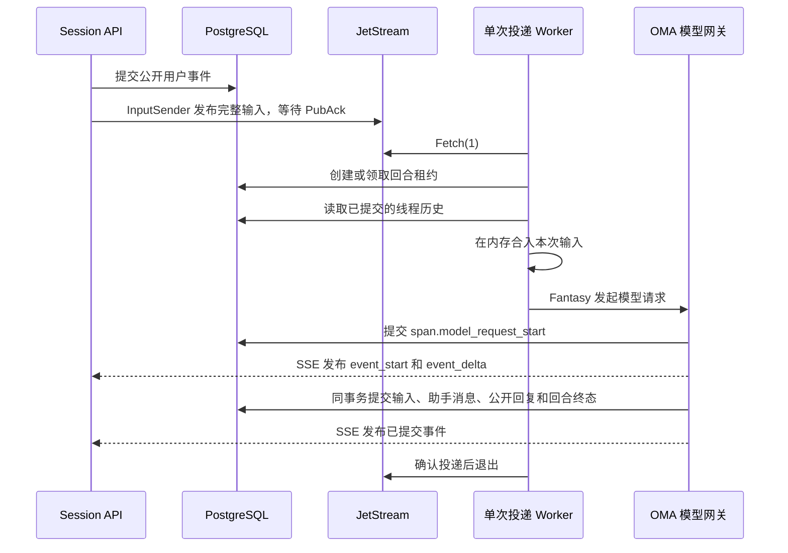
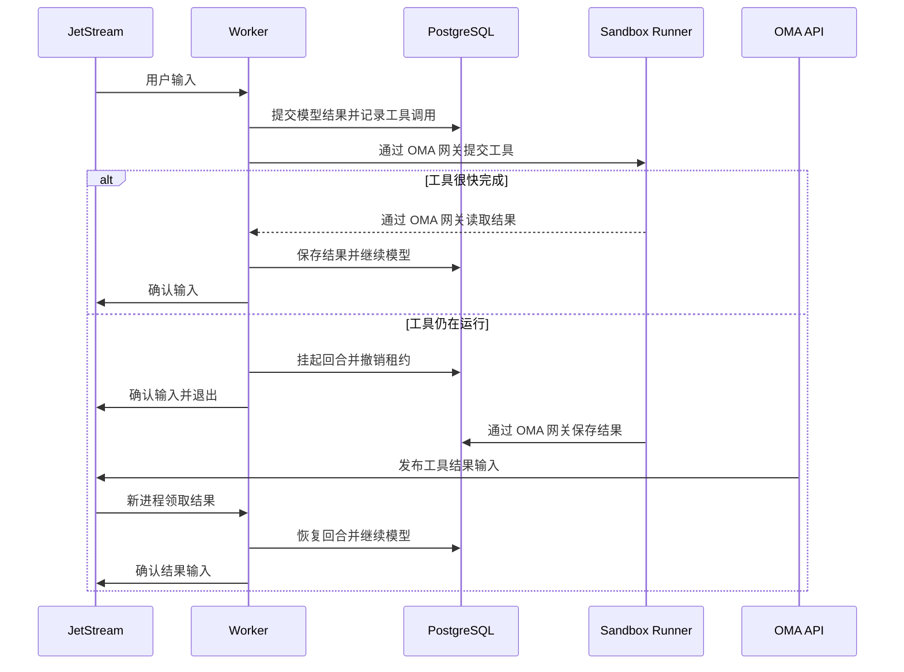

# 云端 Harness Worker

`environment_runner.cloud_harness: true` 为新建的云端 Session 固定选择 `cloud_harness`。设置默认关闭。启用时需要运行 Environment Runner，让公开 Session 转为可领取状态。已有 Harness Session 的运行时记录在数据库中。这些会话的输入投递需要保持开关开启。

文本输入使用 `initial_events` 或 Session Events API 中的 `user.message`。订阅回调和选择响应使用同一个 Session Events API。通过 Session SSE 发布文本预览和最终回复，并将最终回复写入 Session Events 历史。每条输入单独排队，同一 Session 按接收顺序处理。模型使用 Agent 上配置的 ID，并经 OMA `/v1/messages` 使用已有供应商配置。下面是直接生成文本的路径。



`internal/cloudharness` 定义 Infinity 风格的 `InputSender`、`ConversationStore`、`StateStore`、`AgentSystem.Step` 和纯状态转换函数 `Step`。Infinity 的 Lambda 从 SQS 读取输入，并在工具异步完成时接收工具结果输入。OMA 的 Worker 从 JetStream 每次领取一条输入，恢复线程后在进程内推进模型、同步工具和子线程。每次模型请求将本次输入合入已提交的历史后交给 Fantasy，成功结果统一由模型网关提交。模型凭证只在当前执行租约内有效，上游 API Key 由 OMA 网关持有。

Worker 按平台规则、Environment、Agent 或 specialist 指令、工作目录与 Memory 目录的顺序组装 system 文本。每次模型请求另附当前时间提醒。规则按 Harness 的工具与线程能力调整，详见 [Agent 分层系统提示词](agent-system-prompt.md)。

版本 4 的新投递包括用户文本、选择响应引用和沙箱工具结果引用。订阅回调使用用户输入格式。各类投递都带组织、工作区和会话范围。用户输入的 `Nats-Msg-Id` 使用公开事件 UUID，选择响应用 `choice_response:<event_uuid>`，异步工具完成用 `tool_result:<tool_uuid>`。

Session 激活时持有 Session 与 Code Session 行锁，从已提交的历史读取未处理输入，取得所有 PubAck 后切换到 active。在激活前提交的输入由这条路径交付。active Session 的 Events API 在数据库提交后直接调用 `InputSender`。发布失败时返回 503，客户端使用相同的 `Idempotency-Key` 重试，服务端复用原事件 UUID。后端在提交后、PubAck 前退出也由客户端重试恢复。

Worker 领取时在 `harness_thread_state` 的根线程行记录当前执行。`execution_input_uuid` 指向原始用户事件，`execution` 记录回合状态、当前阶段、租约、重试次数和恢复输入的身份。每个 Session 复用这个执行位置。较早的公开用户消息尚未处理时，后续投递延迟重试。领取时增加 worker epoch，有效租约内才允许开始和提交模型请求。回复、输入完成标记、空闲状态和回合终态由同一个事务提交。模型请求失败会重试，达到尝试上限时进入 `failed`。重投时，Worker 从当前已提交的阶段继续。回合结算或挂起后会确认当前输入。模型请求可能在外部调用成功但提交前中断时重新发出，公开回复只能由有效租约提交一次。

每个 Worker 进程由外部启动。它只领取一条投递，完成、挂起或归还该输入后退出。等待用户选择或长时间执行的沙箱工具时，Worker 确认本次投递并退出，下一条外部结果输入恢复原回合。

## 会话持久化

`HarnessConversationStore` 对照 Infinity 原版 Aurora DSQL 的 `DsqlConversationStore`，实现 `ConversationStore`。独立的 `HarnessStateStore` 实现 `StateStore`，提供元数据、订阅和待选项的持久化。两者使用同一个 PG 连接池、租户范围和回合租约。四张表都按组织、工作区、会话和线程隔离。

- `harness_conversation_history` 按线程和 `message_seq` 保存有序模型消息，用行内 `id` 作为主键，按线程内稳定的 `message_id` 去重。消息用序列化 JSON 文本保存，工具内容中的转义字符可原样往返。
- `harness_thread_hierarchy` 用 `thread_uuid` 标识线程。`root_thread_uuid` 和 `parent_thread_uuid` 引用这个标识，`spawn_message_seq` 记录子线程可继承的父线程消息上限。线程行同时保存触发工具 ID、线程标志和该线程的 `message_count`。
- `harness_compaction_summaries` 用行内 `id` 作主键，按线程和 `up_to_seq` 保存摘要。`up_to_seq` 是该摘要覆盖的最后一个消息序号。读取历史时支持祖先截止位置、fresh-context 边界和摘要后的消息。调度器尚未自动触发上下文压缩。
- `harness_thread_state` 按线程保存运行状态，使用与 Infinity DynamoDB 一致的 `metadata`、`active_subscriptions` 和 `pending_user_choices`。`version` 用于生成助手历史的消息标识。元数据存于根线程。

Worker 在持有租约时读取已提交的历史，并按稳定的消息 ID 将尚未写入的输入合入模型请求。模型网关成功提交时，在一个事务内追加本次输入和助手消息、写入公开事件并推进执行阶段。线程行锁保护历史去重和消息计数。Session 删除时清理对应的四张表。公开 API、SSE 与 Webhook 从 `session_events` 的公共事件字段读取。执行检查点只供 Worker 和网关使用。

输入在模型成功前可由原 NATS 投递、已保存的工具结果或子线程委派事件重新构造。模型失败且仍可重试时，Worker 归还原投递，下一次领取时重建同一步。模型成功时，历史键使用原输入事件 UUID、`<tool_uuid>:result` 或委派工具 UUID。用户选择回答只保存工具结果和唤醒引用，等续跑的模型成功后再追加到模型历史。回合中断或模型耗尽重试时，提交可用的工具结果以闭合已提交的工具调用。若没有结果且回合被中断，使用中断结果。兼容升级前已写入的暂存输入，回滚时按当前线程及 `turn_uuid` 清除尚无助手结果的历史。

| StateStore 字段 | 写入时机 |
| --- | --- |
| `metadata` | Worker 收到可处理的输入后，将其中的可选元数据写入根线程。缺省元数据沿用根线程现有值。 |
| `active_subscriptions` | 注册和取消工具在提交结果并推进到下一次模型时更新集合。最后一条回调与订阅移除在同一个 Session 输入事务中提交。 |
| `pending_user_choices` | 模型请求用户选择时写入，提交回答或拒绝时移除，并在同一事务里保存工具结果和恢复输入引用。 |

迁移 `00172` 删除原有 `state_data`，新状态表从空表开始。迁移会清空原列中的执行检查点、去重 ID、元数据、订阅和待选项。会话历史表和消息计数继续保存已有历史。

迁移 `00174` 删除 `cloud_harness_turns` 和 `cloud_harness_tools`。迁移 `00175` 在 `harness_thread_state` 增加执行字段，并删除 `session_events.harness_execution`。旧执行检查点不迁移。公开事件与会话历史继续保留。迁移 `00176` 删除线程级 `processed_message_ids`。迁移 `00177` 删除持久化的 `pending`。

## 工具执行

Cloud Harness 与 Brain 共用 Bash、Read、Write、Edit、Grep、Glob 的工具定义及沙箱执行队列。模型只看到会话当前允许自动执行的工具，提交沙箱调用时再次检查最新策略。沙箱按需创建。沙箱身份要求 Session 运行时和 Code Session 的 transport 都为 `cloud_harness`，并且沙箱仍绑定到同一租户的活动 Environment Work。沙箱 Manager 需要支持工具领取协议。本地镜像仍带 `0.1.0` 时，可通过 `environment_runner.manager_artifact` 安装与沙箱架构匹配的 `0.1.1` 或更新构件。人工确认、外部 MCP、宿主工具和图片工具结果尚未接入。

模型每次最多请求一个工具。网关将工具 UUID 关联到对应的助手历史行。工具名、原始调用 ID、参数和调用前文字从该历史消息读取。在模型结果事务内，关联历史行并将回合推进到工具阶段。当前 Worker 用稳定的工具 UUID 提交或取回同一条沙箱调用。沙箱结果未知时，向模型返回失败结果。重投复用原沙箱调用。

订阅控制和其他同步工具在同一 Worker 内执行。沙箱调用提交后给现有等待接口最多 1 秒。已完成的调用由当前 Worker 保存结果并触发下一次模型调用。超时未完成时，PG 持久化 `waiting_tool` 和恢复输入 UUID、撤销租约，Worker 确认当前投递后退出。API 的输入维护循环每秒检查已结算的沙箱调用，等待 JetStream PubAck 后清除待发布标记。沙箱在挂起之前完成时，查询同样能发现终态。维护循环也负责补发已提交的选择响应。

恢复 Worker 从 PostgreSQL 读取当前阶段和工具结果，将 `ToolResult` 合入下一次模型请求。公开工具结果及模型续跑引用在同一事务提交。模型成功时，以稳定的工具结果 ID 把结果和助手消息一起写入历史。模型继续执行后，唤醒输入仍能定位当前回合及最新阶段。每个主回合及每次子线程委派最多执行 16 次工具。



## 订阅和用户选择

`SubscribeToEvents` 和 `CancelSubscription` 由处理当前输入的 Worker 执行。注册结果返回稳定的订阅 UUID，由外部集成使用已有的 Session 写权限调用 `POST /v1/sessions/{session_id}/events`。回调进入原 Session 的主线程，按普通用户输入顺序处理。调用方可以用 `final: true` 关闭订阅并投递最后一条消息。取消或最终回调后，属于该 UUID 的新回调返回输入冲突。发布重试复用原 `Idempotency-Key`。Session 等待用户选择时，回调和普通文本都遵守已有的输入暂停规则。

```json
{
  "events": [
    {
      "type": "user.message",
      "content": [{"type": "text", "text": "构建完成"}],
      "subscription_event": {"subscription_id": "32974c91-fec5-43d6-a32a-9669d06d1437", "final": true}
    }
  ]
}
```

Agent 显式启用 `ask_user_question` 后，Harness 向模型提供 `AskUserQuestion`。每次可提出一个包含 2 至 4 个选项的单选问题。API 继续发布 `agent.custom_tool_use` 和带 `requires_action` 的 `session.status_idle`。现有 Web 问卷通过 `user.custom_tool_result` 返回选择、自定义文字或拒绝。API 同事务恢复 Session 的 running 状态并保存回答，随后通过 JetStream 发布选择响应引用，恢复原回合。重复或错误引用的回答无法推进当前回合。

## 子 Agent 委派

Harness 读取 Code Session 已固定的 `subagents` 配置，遵守 inline 开关和预定义 Agent 名单。主线程可用 `subagent` 创建线程，用 `send_message` 继续同一会话的空闲子线程，用 `list_agents` 查看线程 ID 和状态。预定义子 Agent 使用自身模型和系统提示词。子 Agent 可用的沙箱工具取父子策略的交集，提交工具时网关再次检查权限。子 Agent 的执行限制包括禁止嵌套委派、用户问卷和订阅控制。

线程创建沿用 Infinity 的 `SpawnContext` 语义。默认创建独立上下文，父 Agent 通过 `prompt` 显式交代任务与授权限制。显式设置 `fresh_context: false` 时，子线程只继承到未结算委派调用之前的父线程历史。续聊始终使用原子线程的历史。线程关系和模型历史分别保存在 `session_threads` 和 `harness_thread_hierarchy` / `harness_conversation_history`。

父线程提交委派工具调用后，当前 Worker 在同一个 PG 事务里登记或恢复子线程，并写入公开委派消息。子线程首个模型结果提交时一起写入委派输入。一个 Session 共享一把执行租约。Worker 使用当前输入继续执行子线程，直到等待沙箱结果或生成最终报告。报告写入子线程历史，也作为父调用的工具结果保存。子模型耗尽重试时，父调用得到失败结果，父回合可以继续。并行子线程和中间报告留给后续调度扩展。

根线程执行检查点中的 `subagent_thread_uuid` 和 `delegation_tool_uuid` 决定当前租约的执行线程和报告目标。子工具通过对应的助手历史行关联委派。旧投递重放时，Worker 按 PG 中的当前阶段继续，避免重复创建子线程或回填报告。子线程的模型预览、模型事件及工具事件都进入对应 Session Thread 事件流。委派和报告按现有规则在父子线程各留一个事件副本。

普通测试覆盖工具策略、预定义 Agent 选择和子任务输入。定向 PostgreSQL 回归覆盖旧租约拒绝、上下文隔离、沙箱任务检查点、报告回传、继续原线程和重试耗尽。

## 停止执行

控制台的停止按钮通过 Session Events API 提交 `user.interrupt`，立即在 PG 结算当前回合。请求指定子线程的 `session_thread_id` 时，只停止该子线程，父模型收到中断工具结果后继续。省略线程 ID 或指定主线程时，停止整个当前回合，包括它的活跃子线程。待答问卷随回合中断清除。

中断事务撤销当前租约，结算已打开的模型请求和待处理的工具调用，并写入空闲事件。Worker 在下一次续租失败时取消模型请求。排队的沙箱调用直接取消，运行中的调用由现有沙箱取消协议停止。子线程中断后父线程按 PG 检查点恢复。当前输入仍在处理时由同一 Worker 继续。子线程已因沙箱工具挂起时，API 发布已挂起的恢复输入，唤醒 Worker 继续父线程。重复停止已经空闲的子线程不会推进父任务。已停止的子线程可以通过 `send_message` 接受新任务。

```json
{"events":[{"type":"user.interrupt","session_thread_id":"sthr_..."}]}
```

## SSE 预览

Harness 的历史分页和 SSE 重放用原始接收时间排列 `user.message`，并用数据库写入顺序处理相同时间。用户输入结算时更新 `processed_at`，分页位置继续使用其接收时间。API 和 SSE 为 Harness 用户消息返回 `received_at`，控制台用它排列中断后的会话记录和显示用户消息时间。历史请求的时间筛选仍比较 `processed_at`。

Session 和主 Thread 的 SSE 连接可以通过 `event_deltas[]=agent.message` 请求文本预览。有文本输出时，事件顺序为 `span.model_request_start`、`event_start`、按内容块索引发送的 `event_delta`、最终 `agent.message`、`span.model_request_end`。文本预览和最终回复共用同一事件 ID，ID 由模型请求派生。新增的块索引按正文首次出现的顺序分配，最终回复沿用这些索引。请求 `event_deltas[]=agent.thinking` 时，模型开始 thinking 块会触发 `event_start`，完成后发布只含状态的 `agent.thinking`。

模型网关收到上游片段时通过 Core NATS 推送预览。每个 SSE 连接只展示自己收到过开始事件的模型请求。网关发布失败时停止发送该回复的后续文本片段，接收端发现内部序号缺口也只保留已收到的连续前缀。失败的模型请求通过 `span.model_request_end.event_ids` 关闭对应预览。公开历史只保存最终事件，重新连接后可补拉历史。

本地在 `.run/config.yaml` 启用 Harness 后，从 Herdr 控制分屏执行 `just restart`。后端就绪后会启动 `oma-harness` 分屏，由本地启动器为每次投递创建独立 Worker 进程。后端已经就绪时，也可以单独执行 `just restart-harness` 在前台启动同一个启动器。

在配置了 PostgreSQL、NATS、Redis 和模型供应商的独立测试环境中启动 OMA，然后构建并运行 Worker。

```sh
go build -o /tmp/oma-harness-worker ./cmd/oma-harness-worker
CONFIG_FILE=/absolute/path/config.yaml /tmp/oma-harness-worker -api-url http://127.0.0.1:18080
```

定向真实验证使用隔离 JetStream 和空的测试 Workspace，并从本机供应商文件选择一个 Messages 模型。测试验证激活期输入包含正文，制造一次发布失败并用原幂等键恢复，还会验证较晚输入无法抢先领取。Session 和主 Thread 的预览应与同一个最终回复对齐，未开启预览的连接直接收到最终回复。第二轮验证网关故障后的重投和会话恢复。最后重放已结算输入，并核对 Session 和 Thread 的历史事件。

```sh
CONFIG_FILE=/absolute/path/config.yaml \
LIVE_WORKER_API_URL=http://127.0.0.1:18080 \
LIVE_HARNESS_WORKER=/tmp/oma-harness-worker \
LIVE_HARNESS_PROVIDERS=/absolute/path/model-providers.yaml \
go test -tags=integration ./tests/liveworker -run '^TestCloudHarnessText$' -count=1 -v
```
