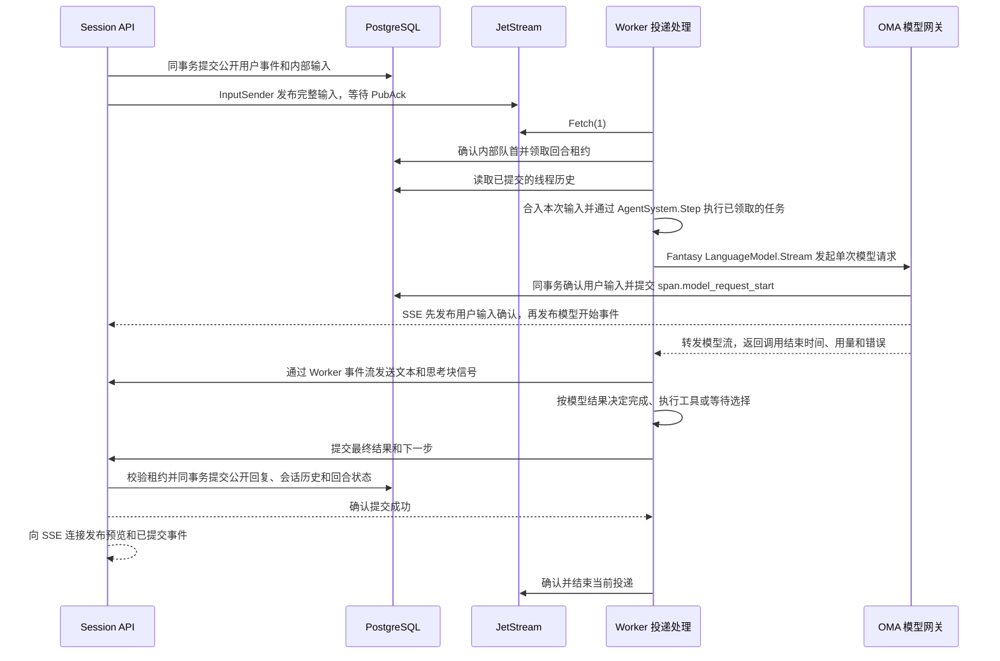
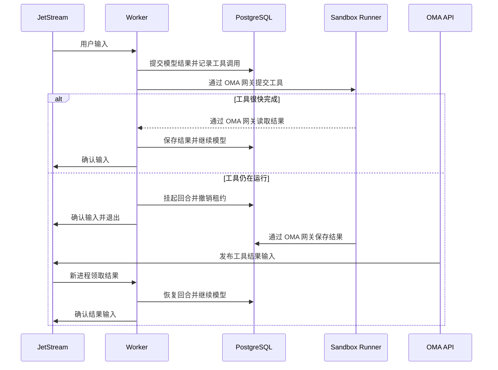

# 云端 Harness Worker

`environment_runner.cloud_harness: true` 为新建的云端 Session 固定选择 `cloud_harness`。设置默认关闭。启用时需要运行 Environment Runner，让公开 Session 转为可领取状态。已有 Harness Session 的运行时记录在数据库中。这些会话的输入投递需要保持开关开启。

文本输入使用 `initial_events` 或 Session Events API 中的 `user.message`。选择响应也使用 Session Events API。通过 Session SSE 发布文本预览和最终回复，并将最终回复写入 Session Events 历史。每条输入单独排队，同一 Session 按接收顺序处理。模型使用 Agent 上配置的 ID，并经 OMA `/v1/messages` 使用已有供应商配置。下面是直接生成文本的路径。



`internal/cloudharness` 定义 Infinity 风格的 `InputSender`、`ConversationStore`、`StateStore` 和批处理入口 `AgentSystem.Step`。Infinity 的 Lambda 从 SQS 读取输入，并在工具异步完成时接收工具结果输入。OMA 的 Worker 从 JetStream 每次领取一条输入，为每项已领取的工作向 `AgentSystem.Step` 提供模型或工具执行回调。模型凭证只在当前执行租约内有效，上游 API Key 由 OMA 网关持有。

`AgentSystem.Step` 按线程分组并依次加载各组，随后并发调度。线程执行对象按收到的顺序准备输入，负责去重、模型调用和工具派发。延迟输入在线程加载时过滤，保证多个线程按顺序访问延迟队列。

同一个内存存储上的 `Step` 批次串行进入。内存运行路径先在本轮缓冲输入，模型成功返回后，通过 `ConversationStore.AppendMessages` 一次追加输入和助手消息。输入按历史中的消息 ID 去重。模型失败时重投原输入，已取出的延迟输入放回队列。待执行的工具及待投递的工具结果保留在内存中供重试。

模型适配层调用一次 Fantasy 的 `LanguageModel.Stream`，按流事件触发 Worker 的 `OnTextDelta`、`OnReasoningStart` 和 `OnReasoningEnd`，同时收集并校验工具参数。模型流正常结束后，适配层返回 `ModelCompleted`。

线程执行层先准备输入，再执行模型，最后提交模型结果。输入阶段校验消息和工具结果是否匹配当前工作。模型完成阶段根据回复决定下一项工作。纯文本结束回合，普通工具生成工具任务，根线程的 `AskUserQuestion` 进入等待用户选择。Worker 在完成帧中提交动作，并等待 Session API 确认事务成功。事务校验租约并一起提交历史、公开事件和下一阶段。工具由下一项已领取任务执行。这对应 Infinity 先同步历史、再执行工具动作的顺序。

Worker 按平台规则、Environment、Agent 或 specialist 指令、工作目录与 Memory 目录的顺序组装 system 文本。每次模型请求另附当前时间提醒。每次模型请求按实际选中的模型查询所属组织的模型目录。首轮、工具续跑和子 Agent 请求都将配置的 `max_output_tokens` 传给 Fantasy。模型未配置该字段时使用 16,384 token。规则按 Harness 的工具与线程能力调整，详见 [Agent 分层系统提示词](agent-system-prompt.md)。

版本 4 的新投递包括用户文本、选择响应引用和沙箱工具结果引用。各类投递都带组织、工作区和会话范围。用户输入的 `Nats-Msg-Id` 使用公开事件 UUID，选择响应用 `choice_response:<event_uuid>`，异步工具完成用 `tool_result:<tool_uuid>`。

Session API 在同一个事务中写入公开用户事件和内部输入。Session 激活时持有 Session 与 Code Session 行锁，从内部队列读取待发布的输入，取得所有 PubAck 后切换到 active。active Session 的 Events API 在提交后立即尝试通过 `InputSender` 投递。发布失败时返回 503，客户端使用相同的 `Idempotency-Key` 重试，服务端复用原事件 UUID。Harness 输入维护循环也会补发 active Session 已提交但未记录 PubAck 的输入，包括进程在提交和投递之间退出的情况。

Worker 领取时锁定 `harness_thread_state` 的根线程回合。`execution_input_uuid` 指向原始输入，`execution` 记录回合状态、当前阶段、租约、重试次数和恢复输入的身份。当前回合未结束时，后续输入延迟重试。没有活跃回合时，Worker 只为 `harness_inputs` 的队首创建回合，并在同一事务中将输入转为 `claimed`。领取时增加 worker epoch，有效租约内才允许确认输入和开始模型请求。

`harness_inputs` 通过 `session_uuid` 关联会话，并复用公开事件 UUID 作为 `input_uuid` 和 JetStream 去重键。新输入的 `input_message` 保存正文和可选 metadata，外置内容沿用已有对象引用。队列按数据库内部 `id` 排序，PubAck 更新 `published_at`，领取前取消将状态改为 `cancelled`。已取消的输入重复投递时直接确认。迁移 `00178` 将现有待领取和活跃回合的输入带入内部队列。删除会话时清理对应输入。

服务端接受输入时返回并实时发布 `processed_at=null` 的接收回执。Worker 发起首个模型请求时，模型网关在现有启动事务中为同一条用户事件写入 `processed_at` 并记录模型开始。两条事件共用本次启动时间，提交后按用户输入确认、模型开始的顺序发布。模型重试沿用首次确认时间。

回复、空闲状态和回合终态在同一个事务提交。模型请求失败会重试，达到尝试上限时进入 `failed`。重投时，Worker 从当前已提交的阶段继续。回合结算或挂起后，Worker 确认队列投递。模型请求可能在外部调用成功但提交前中断时重新发出，公开回复只能由有效租约提交一次。

Infinity 的 AWS 部署使用 SQS FIFO，按线程设置 MessageGroupId，默认每次 Lambda 调用接收一条投递。不同消息组可并行调用。同一批含多个线程时，Infinity 的 `AgentSystem::step` 按线程分组，并发执行各组，等待全部结束。

OMA 对应的并发边界是一条投递。直接执行 `oma-harness-worker` 时，进程处理一条投递后退出。常驻模式 `-serve` 从 JetStream 逐条拉取，每收到一条就启动独立处理。每次只发起一个拉取请求，未确认投递数由 JetStream consumer 的 `MaxAckPending` 控制。每条投递独立执行步骤、续租、确认或归还投递。PostgreSQL 的队首检查和执行租约保证同一 Session 串行，不同 Session 可以同时运行。停机信号停止拉取、取消进行中的调用并等待各投递结算后关闭连接。

等待用户选择或长时间执行的沙箱工具时，处理循环确认本次投递并释放执行容量，下一条外部结果输入恢复原回合。常驻模式记录当前已领取的投递数，同一投递连续执行模型和工具步骤时只计一次。

## 会话持久化

`HarnessConversationStore` 对照 Infinity 原版 Aurora DSQL 的 `DsqlConversationStore`，实现 `ConversationStore`。独立的 `HarnessStateStore` 实现 `StateStore`，提供元数据和待选项的持久化。两者使用同一个 PG 连接池、租户范围和回合租约。四张表都按组织、工作区、会话和线程隔离。

- `harness_conversation_history` 按线程和 `message_seq` 保存有序模型消息，用行内 `id` 作为主键，按线程内稳定的 `message_id` 去重。消息用序列化 JSON 文本保存，工具内容中的转义字符可原样往返。
- `harness_thread_hierarchy` 用 `thread_uuid` 标识线程。`root_thread_uuid` 和 `parent_thread_uuid` 引用这个标识，`spawn_message_seq` 记录子线程可继承的父线程消息上限。线程行同时保存触发工具 ID、线程标志和该线程的 `message_count`。
- `harness_compaction_summaries` 用行内 `id` 作主键，按线程和 `up_to_seq` 保存摘要。`up_to_seq` 是该摘要覆盖的最后一个消息序号。读取历史时支持祖先截止位置、fresh-context 边界和摘要后的消息。调度器尚未自动触发上下文压缩。
- `harness_thread_state` 按线程保存运行状态，使用与 Infinity DynamoDB 一致的 `metadata` 和 `pending_user_choices`。`version` 用于生成助手历史的消息标识。元数据存于根线程。

Worker 在持有租约时读取已提交的历史，并按稳定的消息 ID 将尚未写入的输入合入模型请求。模型网关成功提交时，从内部输入记录读取正文，在一个事务内追加本次输入和助手消息、写入公开事件并推进执行阶段。线程行锁保护历史去重和消息计数。Session 删除时清理对应的四张表。公开 API、SSE 与 Webhook 从 `session_events` 的公共事件字段读取。执行检查点只供 Worker 和网关使用。

输入在模型成功前可由原 NATS 投递、已保存的工具结果或子线程委派事件重新构造。模型失败且仍可重试时，Worker 归还原投递，下一次领取时重建同一步。模型成功时，历史键使用原输入事件 UUID、`<tool_uuid>:result` 或委派工具 UUID。用户选择回答只保存工具结果和唤醒引用，等续跑的模型成功后再追加到模型历史。回合中断或模型耗尽重试时，提交可用的工具结果以闭合已提交的工具调用。若没有结果且回合被中断，使用中断结果。兼容升级前已写入的暂存输入，回滚时按当前线程及 `turn_uuid` 清除尚无助手结果的历史。

| StateStore 字段 | 写入时机 |
| --- | --- |
| `metadata` | Worker 收到可处理的输入后，将其中的可选元数据写入根线程。缺省元数据沿用根线程现有值。 |
| `pending_user_choices` | 模型请求用户选择时写入，提交回答或拒绝时移除，并在同一事务里保存工具结果和恢复输入引用。 |

迁移 `00172` 删除原有 `state_data`，新状态表从空表开始。迁移会清空原列中的执行检查点、去重 ID、元数据、订阅和待选项。会话历史表和消息计数继续保存已有历史。

迁移 `00174` 删除 `cloud_harness_turns` 和 `cloud_harness_tools`。迁移 `00175` 在 `harness_thread_state` 增加执行字段，并删除 `session_events.harness_execution`。旧执行检查点不迁移。公开事件与会话历史继续保留。迁移 `00176` 删除线程级 `processed_message_ids`。迁移 `00177` 删除持久化的 `pending`。迁移 `00179` 删除 Agent 订阅状态 `harness_thread_state.active_subscriptions` 和 `harness_thread_hierarchy.is_subscription_event`。

## 工具执行

Cloud Harness 与 Brain 共用 Bash、Read、Write、Edit、Grep、Glob 的工具定义及沙箱执行队列。根线程向模型提供已启用的沙箱工具。评估为 ask 的结构化调用在同一事务内保存参数、登记待确认的公开事件并进入 requires_action。匹配的 user.tool_confirmation 恢复原工具任务。allow 只授权该次调用，提交沙箱前再次检查当前策略；deny 将可选的 deny_message 作为失败工具结果返回模型。子线程继续只提供父子策略都允许自动执行的工具。沙箱按需创建。沙箱身份要求 Session 运行时和 Code Session 的 transport 都为 `cloud_harness`，并且沙箱仍绑定到同一租户的活动 Environment Work。沙箱 Manager 需要支持工具领取协议。本地镜像仍带 `0.1.0` 时，可通过 `environment_runner.manager_artifact` 安装与沙箱架构匹配的 `0.1.1` 或更新构件。外部 MCP、宿主工具和图片工具结果尚未接入。

模型每次最多请求一个工具。网关将工具 UUID 关联到对应的助手历史行。工具名、原始调用 ID、参数和调用前文字从该历史消息读取。在模型结果事务内，关联历史行并将回合推进到工具阶段。当前 Worker 用稳定的工具 UUID 提交或取回同一条沙箱调用。沙箱结果未知时，向模型返回失败结果。重投复用原沙箱调用。

沙箱调用提交后给现有等待接口最多 1 秒。已完成的调用由当前 Worker 保存结果并触发下一次模型调用。超时未完成时，PG 持久化 `waiting_tool` 和恢复输入 UUID、撤销租约，Worker 确认并结束当前投递。API 的输入维护循环每秒检查已结算的沙箱调用，等待 JetStream PubAck 后清除待发布标记。沙箱在挂起之前完成时，查询同样能发现终态。维护循环也负责补发已提交的选择响应。

恢复 Worker 从 PostgreSQL 读取当前阶段和工具结果，将 `ToolResult` 合入下一次模型请求。公开工具结果及模型续跑引用在同一事务提交。模型成功时，以稳定的工具结果 ID 把结果和助手消息一起写入历史。模型继续执行后，唤醒输入仍能定位当前回合及最新阶段。每个主回合及每次子线程委派最多执行 16 次工具。

Harness 在沙箱结果适配层沿用 DSH Brain 的 Bash 输出规则。执行成功、stderr 为空且文本块与 `structuredContent` 一致时，公开 `agent.tool_result` 和下一次模型请求共用原样 stdout，包括末尾换行和空输出。失败、stderr、截断或摘要不一致时，保留沙箱返回的诊断文本。



## 用户选择

Cloud Harness 的 Session 输入拒绝携带 `subscription_event` 的用户消息。

Agent 显式启用 `ask_user_question` 后，Harness 向模型提供 `AskUserQuestion`。每次可提出一个包含 2 至 4 个选项的单选问题。API 继续发布 `agent.custom_tool_use` 和带 `requires_action` 的 `session.status_idle`。现有 Web 问卷通过 `user.custom_tool_result` 返回选择、自定义文字或拒绝。API 同事务恢复 Session 的 running 状态并保存回答，随后通过 JetStream 发布选择响应引用，恢复原回合。重复或错误引用的回答无法推进当前回合。

## 子 Agent 委派

Harness 读取 Code Session 已固定的 `subagents` 配置，遵守 inline 开关和预定义 Agent 名单。主线程可用 `subagent` 创建线程，用 `send_message` 继续同一会话的空闲子线程，用 `list_agents` 查看线程 ID 和状态。预定义子 Agent 使用自身模型和系统提示词。子 Agent 可用的沙箱工具取父子策略的交集，提交工具时网关再次检查权限。子 Agent 的执行限制包括禁止嵌套委派和用户问卷。

线程创建沿用 Infinity 的 `SpawnContext` 语义。默认创建独立上下文，父 Agent 通过 `prompt` 显式交代任务与授权限制。显式设置 `fresh_context: false` 时，子线程只继承到未结算委派调用之前的父线程历史。续聊始终使用原子线程的历史。线程关系和模型历史分别保存在 `session_threads` 和 `harness_thread_hierarchy` / `harness_conversation_history`。

父线程提交委派工具调用后，当前 Worker 在同一个 PG 事务里登记或恢复子线程，并写入公开委派消息。子线程首个模型结果提交时一起写入委派输入。一个 Session 共享一把执行租约。Worker 使用当前输入继续执行子线程，直到等待沙箱结果或生成最终报告。报告写入子线程历史，也作为父调用的工具结果保存。子模型耗尽重试时，父调用得到失败结果，父回合可以继续。并行子线程和中间报告留给后续调度扩展。

根线程执行检查点中的 `subagent_thread_uuid` 和 `delegation_tool_uuid` 决定当前租约的执行线程和报告目标。子工具通过对应的助手历史行关联委派。旧投递重放时，Worker 按 PG 中的当前阶段继续，避免重复创建子线程或回填报告。子线程的模型预览、模型事件及工具事件都进入对应 Session Thread 事件流。委派和报告按现有规则在父子线程各留一个事件副本。

普通测试覆盖工具策略、预定义 Agent 选择和子任务输入。定向 PostgreSQL 回归覆盖旧租约拒绝、上下文隔离、沙箱任务检查点、报告回传、继续原线程和重试耗尽。

## 停止执行

控制台的停止按钮通过 Session Events API 提交 `user.interrupt`，从根线程状态定位并结算当前回合。请求指定子线程的 `session_thread_id` 时，只停止该子线程，父模型收到中断工具结果后继续。省略线程 ID 或指定主线程时，停止整个当前回合，包括它的活跃子线程。如果还没有活跃回合，则取消第一条待领取的用户输入。待答问卷随回合中断清除。

中断事务撤销当前租约，结算已打开的模型请求和待处理的工具调用，并写入空闲事件。Worker 在下一次续租失败时取消模型请求。排队的沙箱调用直接取消，运行中的调用由现有沙箱取消协议停止。子线程中断后父线程按 PG 检查点恢复。当前输入仍在处理时由同一 Worker 继续。子线程已因沙箱工具挂起时，API 发布已挂起的恢复输入，唤醒 Worker 继续父线程。重复停止已经空闲的子线程不会推进父任务。已停止的子线程可以通过 `send_message` 接受新任务。

```json
{"events":[{"type":"user.interrupt","session_thread_id":"sthr_..."}]}
```

## 排队输入与公开历史

CMA 允许在普通 `running` 状态下继续提交 `user.message`。服务端按接收顺序处理输入，排队期间 `processed_at` 为 `null`。List Events 按 `processed_at` 排序，默认升序。公开文档没有明确承诺排队输入从哪一刻起可查，也没有指定空时间戳在列表中的位置。[Events and streaming](https://platform.claude.com/docs/en/managed-agents/events-and-streaming) · [List Events](https://platform.claude.com/docs/en/api/beta/sessions/events/list)

OMA 在接收事务中写入 `session_events` 和 `harness_inputs`。以 A 执行 Bash 时收到 B 为例：

| 查询时点 | 实时 SSE | Session 和 Thread 的 List Events |
| --- | --- | --- |
| B 已接受，仍在排队 | B 的接收回执带原事件 ID 和 `processed_at: null`。 | 只返回已确认事件；刷新页面也看不到 B。 |
| A 的工具和回复已完成，B 开始处理 | 服务端用同一事件 ID 发布 B 的确认。 | 原 B 记录取得处理时间后首次出现在历史中，排在处理时间更早的 A 工具结果和回复之后。 |

历史按 `(processed_at, id)` 分页，同时间以写入顺序打破平局，降序时两项一起反向。时间范围筛选仍比较 `processed_at`。新分页游标只来自已确认事件。升级前签发的游标若指向仍在排队的输入，读取下一页时沿用其接收时间作为旧边界。每次查询使用当时已确认的记录。

实时 SSE 和输入投递仍可按 ID 查到待处理记录。对照实时 SSE 和最终历史时，按事件 ID 合并接收与确认版本，在确认出现的位置比较已处理事件。

## SSE 预览

Worker 按流内顺序提交思考块和模型完成。模型完成批次中的正文、工具调用和结束事件，其公开处理时间取网关结束时间与该请求最后一个已发布思考块的处理时间中较晚者。若时间相同，写入顺序仍保证思考、正文、模型结束的因果顺序。Harness SSE 重放按数据库写入顺序读取已确认事件。待处理 ID 仍可作为重连锚点；实时 SSE 继续发送排队回执。

Session 和主 Thread 的 SSE 连接可以通过 `event_deltas[]=agent.message` 请求文本预览。有文本输出时，事件顺序为 `span.model_request_start`、`event_start`、按内容块索引发送的 `event_delta`、最终 `agent.message`、`span.model_request_end`。文本预览和最终回复共用同一事件 ID，ID 由模型请求派生。新增的块索引按正文首次出现的顺序分配，最终回复沿用这些索引。请求 `event_deltas[]=agent.thinking` 时，Worker 的 `OnReasoningStart` 触发 `event_start`，`OnReasoningEnd` 触发同 ID 的 `agent.thinking` 状态。模型请求成功结束时会补发尚未提交的 thinking 状态。

Cloud Harness 的模型请求必须携带 Worker 事件流标识。Worker 通过 `POST /v1/code/sessions/{code_session_id}/worker/events` 发一条 NDJSON 流。服务端按流内顺序处理块，验证租约并通过 Core NATS 推送预览。模型网关提交模型开始事件，并在内部模型流末尾用 SSE 注释交付实际结束时间、用量和错误。Worker 将这些事实与最终输出一起提交，成功帧须携带 `next`。事件流中断时，服务端按当前租约结算失败尝试。

每个 SSE 连接只展示自己收到过开始事件的模型请求。发布失败时停止发送该回复的后续文本片段，接收端发现内部序号缺口也只保留已收到的连续前缀。失败的模型请求通过 `span.model_request_end.event_ids` 关闭对应预览。公开历史只保存最终事件，重新连接后可补拉历史。

本地在 `.run/config.yaml` 启用 Harness 后，从 Herdr 控制分屏执行 `just restart`。后端就绪后，`oma-harness` 分屏启动一个常驻 Worker，`harness-status` 显示它同时处理的投递数。后端已经就绪时，也可以单独执行 `just restart-harness` 在前台启动同一个启动器。

`internal/harnessworker` 的普通单测通过嵌入式 JetStream 验证单进程能在任何一条投递完成前启动八条投递，以及空闲时仅保留一个拉取请求。重启脚本回归覆盖同一 PID 下的并发计数和交错阶段。

在配置了 PostgreSQL、NATS、Redis 和模型供应商的独立测试环境中启动 OMA，然后构建并运行 Worker。

```sh
go build -o /tmp/oma-harness-worker ./cmd/oma-harness-worker
CONFIG_FILE=/absolute/path/config.yaml /tmp/oma-harness-worker -api-url http://127.0.0.1:18080
```

定向真实验证使用隔离 JetStream 和空的测试 Workspace，并从本机供应商文件选择一个 Messages 模型。测试验证激活期输入包含正文，制造一次发布失败并用原幂等键恢复，还会验证较晚输入无法抢先领取。Session 和主 Thread 的预览应与同一个最终回复对齐，未开启预览的连接直接收到最终回复。第二轮验证网关故障后的重投和会话恢复。最后重放已结算输入，并核对 Session 和 Thread 的历史事件。

```sh
CONFIG_FILE=/absolute/path/config.yaml \
LIVE_WORKER_API_URL=http://127.0.0.1:18080 \
LIVE_HARNESS_WORKER=/tmp/oma-harness-worker \
LIVE_HARNESS_PROVIDERS=/absolute/path/model-providers.yaml \
go test -tags=integration ./tests/liveworker -run '^TestCloudHarnessText$' -count=1 -v
```
