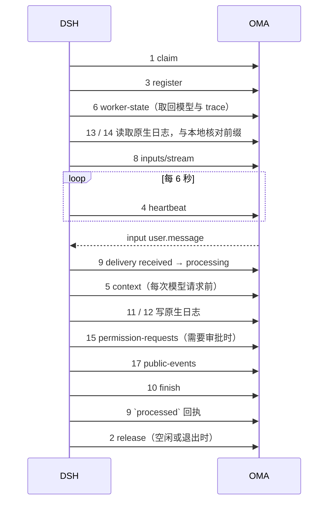

# DSRv1 接口参考

本文逐个说明 DSRv1 执行端接口：为什么需要它、什么时候调用和不该调用、请求与响应字段、状态码、对应的 CCRv2 接口，以及典型场景的时序示例。语义、状态机与不变量以 [DSRv1 协议](protocol.md) 为准；两者冲突时以协议文档为准，并同步修正本文。本文对应协议第 7 版（修订 7.3），仍是未冻结的设计草案。

## 0. 总览

| # | 接口 | 鉴权 | 用途 | 替代的 CCRv2 接口 | 协议章节 |
| --- | --- | --- | --- | --- | --- |
| 1 | `POST /v1/dsr/claims` | fleet | 长轮询领取一个会话 | `POST /v1/code/brain/claims` | 4.3 |
| 2 | `POST /v1/dsr/claims/{code_session_id}/release` | fleet | 释放领取 | `POST /v1/code/brain/claims/{id}/release` | 4.3 |
| 3 | `POST /v1/dsr/sessions/{code_session_id}/register` | session | 在当前 epoch 接管会话、开始租约 | `worker/register` | 4.4 |
| 4 | `POST /v1/dsr/sessions/{code_session_id}/heartbeat` | session | 续租 | `worker/heartbeat` | 4.5 |
| 5 | `GET /v1/dsr/sessions/{code_session_id}/context` | session | 读取会话上下文 | `GET /v2/sessions/{id}` | 4.5 |
| 6 | `GET /v1/dsr/sessions/{code_session_id}/worker-state` | session | 读取 worker state | `GET worker` | 4.6 |
| 7 | `PUT /v1/dsr/sessions/{code_session_id}/worker-state` | session | 更新 worker state | `PUT worker` | 4.6 |
| 8 | `GET /v1/dsr/sessions/{code_session_id}/inputs/stream` | session | SSE 接收输入 | `worker/events/stream` | 9.2 |
| 9 | `POST /v1/dsr/sessions/{code_session_id}/inputs/delivery` | session | 输入进度回执 | `worker/events/delivery` | 9.2 |
| 10 | `POST /v1/dsr/sessions/{code_session_id}/inputs/{input_id}/finish` | session | 结束 task 输入 | `worker/events` 中的 `result` 事件 | 9.4 |
| 11 | `PUT /v1/dsr/sessions/{code_session_id}/transcripts/{dsh_session_id}/header` | session | 写原生日志 Header | `worker/internal-events`（POST） | 6.4 |
| 12 | `POST /v1/dsr/sessions/{code_session_id}/transcripts/{dsh_session_id}/events` | session | 追加原生日志 Event | `worker/internal-events`（POST） | 6.5 |
| 13 | `GET /v1/dsr/sessions/{code_session_id}/transcripts` | session | 列出会话下的原生日志 | `worker/internal-events?subagents` | 6.7 |
| 14 | `GET /v1/dsr/sessions/{code_session_id}/transcripts/{dsh_session_id}` | session | 分页读取一条原生日志 | `worker/internal-events`（GET） | 6.7 |
| 15 | `POST /v1/dsr/sessions/{code_session_id}/permission-requests` | session | 创建或查询工具审批 | `worker/events` 中的 `can_use_tool` 控制请求，加轮询 `GET worker` | 7.1–7.3 |
| 16 | `POST /v1/dsr/sessions/{code_session_id}/permission-requests/{request_id}/cancel` | session | 取消工具审批 | 无 | 7.5 |
| 17 | `POST /v1/dsr/sessions/{code_session_id}/public-events` | session | 发布公开输出 | `worker/events` 中的公开输出 | 第 8 节 |

CCRv2 列中的相对路径都以 `/v1/code/sessions/{id}/` 为前缀。另有 10 个只迁移路径的运行时能力接口，见第 18 节。

### 一个会话的完整调用顺序



### 三类凭据

| 凭据 | 来源 | 用于 | 失效方式 |
| --- | --- | --- | --- |
| fleet token | 部署配置 `code_session.brain_claim_token_file` | 接口 1、2 | 运维轮换 |
| session token | claim 响应的 `session_token` | 接口 3–17 与第 18 节 | epoch 被推进后写接口拒绝；读接口仍可用 |
| model token | claim 响应的 `model_token` | `/v1/messages`、`/v1/chat/completions` | 下次 claim 时轮换；租约过期后暂时失效 |

## 通用约定

### 请求头

| 头 | 适用 | 说明 |
| --- | --- | --- |
| `DSR-Protocol` | 全部 | 协议版本，v1 固定为 `1`。缺失或不支持返回 `400 unsupported_protocol`。register 之后，同一 epoch 的请求必须使用注册时的版本 |
| `Authorization: Bearer <token>` | 全部 | 接口 1、2 用 fleet token，其余用 session token |
| `X-Worker-ID` | 1、2 | DSH 进程 UUID |
| `Content-Type: application/json` | 有请求体的接口 | — |

### 鉴权与 epoch

- session token 是 JWT，claims 含 `code_session_id`、`epoch`、`protocol: "dsr1"` 与租户身份。路径中的 `{code_session_id}` 必须等于 token 的 `code_session_id`。
- **请求体不带 epoch**。写接口在执行授权阶段与写事务内用 token 的 epoch 与 `current_worker_epoch` 比较，不一致返回 `409 epoch_superseded`。CCRv2 在请求体里另带 `worker_epoch`，两处来源可能不一致；DSRv1 只保留 token 一处。
- 读接口（5、6、13、14）只校验鉴权与归属，旧 epoch 的 token 也能读。

### 数据类型

- DSR 自有的 ID、epoch 与游标在 JSON 中为**字符串**：`worker_epoch`、`epoch`、`next_seq`、`from_seq`、`next_from_seq`、`turn`。这样可以避免 JavaScript 处理大整数时丢精度。
- 内嵌的原生 DSH 对象原样保留，`SessionEvent.seq` 是 **number**（非负安全整数）。
- 时间为 RFC 3339 UTC 字符串。

### 错误

错误体沿用 Anthropic 兼容形状：

```json
{ "type": "error", "error": { "type": "conflict_error", "message": "Worker epoch has been superseded" } }
```

Anthropic 错误体只有 `type` 和 `message`，放不下机器可读的细节，而且多种 409 的处理方式完全不同（有的要退役，有的要补发）。所以分支信息由响应头承载，DSH 只依据响应头处理：

| 头 | 说明 |
| --- | --- |
| `DSR-Error` | 错误码，完整枚举与 DSH 处理见 [协议 4.7](protocol.md#47-错误) |
| `DSR-Next-Seq` | 原生日志类错误时返回服务端的 `next_seq` |

缺少 `DSR-Error` 的 4xx（例如中间代理生成）按 `epoch_superseded` 的保守路径处理：停止写入、不 release，等租约自然过期。429/5xx 有界退避重试。各接口下文只列出它特有的错误。

### 幂等

DSH 的每个写操作都可能因网络中断而不知道是否成功，所以每个写接口都有幂等键：用相同请求重试，服务端返回首次结果，不重复产生副作用。

| 接口 | 幂等键 | 内容不同时 |
| --- | --- | --- |
| 10 finish | `(code_session, input_id)` | `409 finish_idempotency_mismatch` |
| 11 header | `(code_session, dsh_session_id)` | `409 transcript_conflict` |
| 12 events | `(code_session, dsh_session_id, seq)` | `409 transcript_conflict` |
| 15 permission-requests | 派生的 `request_id` | `409 permission_idempotency_mismatch` |
| 16 cancel | `request_id` | 返回当前终态 |
| 17 public-events | `(code_session, id)` | `409 public_event_idempotency_mismatch` |

"内容相同"按语义比较：对象键无序，数字按数值相等。

---

## 1. `POST /v1/dsr/claims`

### 作用

在多个 DSH 进程之间**分配**会话。它要保证三件事：一个会话同一时刻只分给一个进程；有任务时尽快分配，没任务时不空转打数据库；进程崩溃、准入失败或反复失败时，会话能被重新分配，或者按预算停下来并公开失败。

claim 推进 epoch，签发 session token 与 model token，但**不产生租约**。真正接管会话的是 register（接口 3）。

### 什么时候调用

- DSH 启动时先用 `block_ms=0` 调一次作为探测：401/403 说明 fleet token 配错，进程退出；其他错误按 1、2、5、10、30 秒退避。
- 之后每个领取循环在"可用槽位 − 正在领取或准入的数量 > 0"时，用 `block_ms=25000` 长轮询。每个进程默认 4 个循环（`OMA_BRAIN_CLAIM_CONCURRENCY`，1–32）。
- 运行中遇到 401/403 不退出：已有会话用的是各自的 session token，仍能继续运行；只按退避重试并记录一次错误日志。

### 哪些会话可以被领取

```text
Code Session active 且未删除
AND worker_transport = 'claim'
AND worker_protocol = 'dsr1'                     -- 旧 claim 对称地只领 ccrv2；migrating 两边都不领
AND worker_claim_expires_at 为空或已过期            -- 不在领取窗口、退避或耗尽 hold 中
AND (租约为空，或租约 + 10 秒宽限已过)              -- 没有活着的 owner
AND (
      worker_claim_requested_at 非空               -- Runner 派发，或 release 请求重领
   OR 公开会话为 running / rescheduling            -- 有输入在等待执行
   OR 存在 processing 且未结束的 turn               -- 等待审批时崩溃，公开会话停在 requires_action
   OR 存在已结束但 acked_at 为空的 turn             -- 结束上报之后、ACK 之前崩溃
)
AND 不在 budget_reached 暂停中
```

后两种"未结算 turn"条件是 DSRv1 新增的。没有它们，等待审批时崩溃或结束上报后 ACK 前崩溃的会话会永远卡住：此时公开会话已是 idle，现行条件不会命中，也就没有人去注册和收尾。

### 请求

| 位置 | 字段 | 类型 | 必填 | 说明 |
| --- | --- | --- | --- | --- |
| query | `block_ms` | integer | 否 | 0–30000，无可领取会话时最多等待的毫秒数 |
| header | `X-Worker-ID` | string | 是 | DSH 进程 UUID，用于诊断与 release 校验 |
| body | — | object | 是 | 空对象 `{}`；一次最多领取一个，容量由 DSH 自己控制 |

### 服务端处理

在一个事务内：

1. `SELECT ... ORDER BY 最早请求 LIMIT 1 FOR UPDATE SKIP LOCKED`：多个进程并发领取时各自跳过被锁住的行，不会互相阻塞，也不会领到同一行。
2. 连续准入失败次数（attempts）未达 5 次：epoch + 1、写入新 model token 的 hash、`worker_claimed_by`、`worker_claim_expires_at = now + 30s`、attempts + 1、清空租约。
3. 已达 5 次：进入耗尽 hold，同样推进 epoch，使卡在半路的旧领取者失效，停车 1 分钟，不返回凭据；提交后发布 `session.error` 与 `idle(retries_exhausted)`。一次长轮询最多连续处理 10 个耗尽行，然后继续找可领取的行。
4. 提交后签发凭据。

没有可领取会话时，处理器订阅 Core NATS `oma.brain.work.available`，收到通知或每 1 秒兜底时重查一次，直到 `block_ms` 到期。通知只用来缩短延迟，丢失不影响正确性。

### 响应 200

| 字段 | 类型 | 说明 |
| --- | --- | --- |
| `code_session_id` | string | Code Session ID（`cse_*`），即后续路径中的 `{code_session_id}`；现行 claim 中该字段名为 `session_id`，容易被误认为公开 Session ID，DSRv1 改名 |
| `worker_epoch` | string | 本次领取分配的 epoch |
| `session_token` | string | session token（JWT） |
| `model_token` | string | 模型代理凭据，见下文 |
| `claim_expires_at` | string | 必须在此之前 register |
| `trace_parent` | string | 可选，派发请求的 W3C trace context；租约过期接管时省略 |

响应带 `Cache-Control: no-store`。凭据明文只出现在这一次响应中，数据库只保存 hash。

### 其他状态

| 状态 | 含义 |
| --- | --- |
| `204` | `block_ms` 内没有可领取会话 |
| `400 invalid_request` | 缺少 `X-Worker-ID`，或 `block_ms` 越界 |
| `401 unauthorized` | fleet token 无效 |

### 为什么需要单独的 `model_token`

DSH 把 OMA 当作 Anthropic 或 OpenAI 兼容的模型服务，把 `model_token` 直接交给 AI SDK（`createAnthropic({ authToken })`、`createOpenAICompatible({ apiKey })`）。不复用 session token 的原因：

| 原因 | 说明 |
| --- | --- |
| 鉴权路径不同 | session token 的校验要求路径绑定到 `/v1/dsr/sessions/{code_session_id}/...`；`/v1/messages` 路径里没有会话 ID，走的是 `/v1/*` 的 API key 鉴权链，需要一个形如 API key 的不透明凭据 |
| SDK 兼容 | SDK 只会把凭据放进 `x-api-key` 或 `Authorization` 头，不透明 token 不需要改造 SDK |
| 不读 body 也能归属 | 服务端按 hash 反查会话与租户，计量、计费、审计不必解析请求体 |
| 最小权限 | model token 只能调模型，泄露后也写不了会话 |

它没有 epoch，靠两条规则失效：每次 claim 都用新 hash 覆盖旧值，新 owner 一领取，旧 owner 的 model token 立即失效；鉴权查询要求 `worker_lease_expires_at > NOW()`，租约过期后不能再调模型，同 epoch 重新 register 后又恢复有效。

### 示例

```http
POST /v1/dsr/claims?block_ms=25000
Authorization: Bearer <fleet token>
X-Worker-ID: 6f1c0d6e-0f5b-4c8e-9a51-2a3b8c0d1e2f
DSR-Protocol: 1
Content-Type: application/json

{}
```

```json
{
  "code_session_id": "cse_01HZX...",
  "worker_epoch": "7",
  "session_token": "eyJhbGciOi...",
  "model_token": "oma_mt_...",
  "claim_expires_at": "2026-11-02T10:00:30Z",
  "trace_parent": "00-4bf92f3577b34da6a3ce929d0e0e4736-00f067aa0ba902b7-01"
}
```

### 场景：三个进程抢两个会话

```text
会话 S1：新派发（requested_at = t0）
会话 S2：running，旧 owner 崩溃，租约加宽限已过

t=0  A、B、C 同时 claim
     A：锁住 S1（请求最早）→ epoch 3 → 200
     B：S1 已被锁，跳过；锁住 S2 → epoch 9 → 200
     C：没有可领取的行 → 等通知或每秒重查 → 25 秒后 204
t=1  S2 的旧 owner 网络恢复，用 epoch 8 的 token 心跳 → 409 epoch_superseded → 退役
```

### 已知边界

- 服务端已提交、但响应在路上丢失时，这次领取会消耗一次 attempt，并要等 30 秒领取期限过期才能再被领取。现行设计已接受这个代价，DSRv1 不加幂等键。
- 每个等待中的循环约每秒查一次数据库，空闲时单进程约 4 QPS，按"进程数 × 并发数"估算。

## 2. `POST /v1/dsr/claims/{code_session_id}/release`

### 作用

DSH 主动告诉后端"这次领取我不要了"，让会话按指定原因尽快进入下一步，而不是等 30 秒领取期限或"20 秒租约 + 10 秒宽限"自然过期。注册前后都可以调用。选择 `reason` 的关键是：下一步来得多快，以及算不算失败。

### 什么时候调用

| 场景 | 时机 | `reason` | 后端随后的行为 |
| --- | --- | --- | --- |
| 准入时临时失败 | claim 之后、输入流连上之前：网络抖动、后端 5xx、register 返回 401/403、读 context 失败 | `admission_failed` | 按 5、10、20、40、80 秒退避后可再领取；连续 5 次（约 155 秒）后公开 `session.error` |
| 准入时永久失败 | 任务信封、`session_context` 或 assignment 校验失败；原生日志版本不受支持 | `permanent` | 立即推进 epoch 并停车，几秒内公开 `session.error` 与 `idle(retries_exhausted)`，不再重试 |
| 运行中出现不可复制的日志 | 超过 15 MiB 的事件已写进本地日志，之后的事件都无法复制 | `permanent` | 同上 |
| 领到了但没容量 | 准入预留槽位时没有可淘汰的空闲会话 | `shutdown` | 立即可被其他进程领取，attempts 减一，不算失败 |
| 会话迁移中 | register 返回 `409 session_migrating` | `shutdown` | 迁移完成后再被领取 |
| 空闲退役 | 会话空闲 60 秒，或为新领取腾容量而淘汰最久空闲的会话 | `idle` | 只清租约，不请求重领；有新输入时任何进程都能立即领取 |
| 进程正常退出 | 收到 SIGTERM 并排空之后 | 有活跃回合或仍在准入：`shutdown`；空闲：`idle` | 同上 |

### 什么时候不要调用

| 情况 | 原因 |
| --- | --- |
| 收到 `409 epoch_superseded` | 会话已属于更新的 owner，release 会因 epoch 不符返回 409 |
| 收到 `404 session_not_found` | 会话已删除或不再 active，没有可释放的东西 |
| 收到 `410 lease_expired` | 先用同一 token 重新 register 恢复租约；重新注册也失败时，再按那次的错误处理 |
| 4xx 但没有 `DSR-Error` | 按保守路径处理：停止写入，不 release，等租约自然过期 |
| 进程崩溃 | 来不及调用，由租约过期和"未结算 turn"领取条件兜底 |

### 调用前必须做到

1. **先关闭输入流，再 release**，否则旧流可能继续从 JetStream 拉走新输入。后端有兜底：旧流退出时若 epoch 已被取代，会 NAK 归还它拉取过的消息，但客户端仍应按这个顺序。
2. **复制屏障**：结果已到达但原生日志尚未被远程确认的会话，必须等确认后才能 release，否则新 owner 拿不到这段历史。
3. **停机排空**：拒绝新的 Bash、Write、Edit 与外部 MCP 调用，等进行中的副作用调用结束、结果确认后再 release。

### 请求

| 字段 | 类型 | 必填 | 说明 |
| --- | --- | --- | --- |
| `epoch` | string | 是 | 要释放的 epoch，必须等于当前 epoch |
| `reason` | string | 是 | `admission_failed`、`permanent`、`shutdown`、`idle` |

请求头 `X-Worker-ID` 必须等于领取时的值。只有 Code Session active、epoch 相等、领取者相同时才生效。除 `permanent` 外，release 不推进 epoch。

### 响应

| 状态 | 含义 |
| --- | --- |
| `200 {"ok": true}` | 已释放 |
| `409` | 会话非 active、epoch 不符或领取者不符；DSH 只记录告警 |

### 示例

```http
POST /v1/dsr/claims/cse_abc/release
Authorization: Bearer <fleet token>
X-Worker-ID: 6f1c...
DSR-Protocol: 1

{ "epoch": "7", "reason": "idle" }
```

### 场景

```text
10:00:00  A claim cse_1（epoch 7）→ register → 执行用户输入 → 结束上报 → processed 回执
10:01:00  cse_1 空闲 60 秒 → A 关闭输入流 → release(idle)
10:05:00  用户发来新消息 → 会话变为 running → B 立即 claim（epoch 8）
          （如果 A 不 release，要等 A 最后一次心跳之后的 20 + 10 秒）

10:06:00  A claim cse_2（epoch 3）→ 读 context 发现配置非法 → release(permanent)
          → 后端几秒内公开 session.error，不再重试
          （如果误用 admission_failed，会白白重试约 155 秒）

10:07:00  A 收到 SIGTERM → 停止领取 → cse_3 有活跃回合：排空、等复制确认 → release(shutdown)
          → C 立即 claim cse_3 并恢复
```

## 3. `POST /v1/dsr/sessions/{code_session_id}/register`

### 作用

**claim 把会话分配给你，register 让你正式接管它。** register 不推进 epoch，只在 claim 分配的 epoch 上开始计算租约、绑定协议版本，并清理上一任 owner 留下的状态。

### 为什么和 claim 分开

CCRv2 的 brain 模式本来就是"claim 分配 → register 接管"两步（`internal/db/code_sessions.go` 的 `RegisterCodeSessionWorkerAtEpoch` 在给定 epoch 上注册、不推进）。只有原始的 sandbox 模式由 register 自己推进 epoch。DSRv1 保留两步，原因：

| 场景 | 分开时 | 合并时 |
| --- | --- | --- |
| claim 响应丢失 | 没有租约，只有 30 秒领取期限，过期后可再领取；状态干净 | 租约已开始计时，但领取者不知道自己拥有会话，不会心跳；连接状态显示一个从未连上的 worker |
| 拿到凭据后准入永久失败 | 会话从未注册，`FailPermanently` 直接停车并公开失败 | 要额外清理租约和连接状态，准入失败与运行中失败的边界变模糊 |
| 网络抖动约 30 秒后收到 410 | **同 epoch 重新 register 即可恢复**，内存状态、本地日志、模型流都保留 | 只能重新 claim，epoch + 1，退役并全量恢复，当前回合以 `recovered` 结束 |
| `worker_claim_expires_at` 的其他职责 | 继续承担耗尽 hold、退避与永久失败停车 | 失去这些职责，耗尽的行会被立即重新领取，`session.error` 重复发布 |

合并只能省一次 HTTP 往返，相比准入还要读 context、恢复日志、连接输入流，这一次往返的占比很小。

### 什么时候调用

- claim 成功后、`claim_expires_at` 之前，调用一次完成准入。
- 心跳返回 `410 lease_expired` 时，用同一 token 再调用一次，恢复租约。

### 请求

空对象 `{}`。会话来自路径，epoch 和协议来自 token。

### 服务端处理

在一个事务内：

1. 锁定 Code Session 行，与 claim、heartbeat、日志追加串行。
2. 校验会话 active、`worker_protocol = dsr1`（`migrating` 时返回 `409 session_migrating`）、token epoch 等于 `current_worker_epoch`。
3. 写入 `worker_lease_expires_at = now + 20s`、连接状态与活动时间，清空 `worker_claim_requested_at` 与 `worker_claim_expires_at`，记录 `dsr_protocol_version`。
4. **仅在该 epoch 的首次注册时**：把更早 epoch 的 pending 审批标为 `superseded`，并按 reducer 重算公开状态、写入状态事件。例如原来停在 `requires_action`，清理后仍有 processing 的 turn，就转为 `running`。
5. **不结束** open turn：未 ACK 的输入会被 JetStream 重投给新 owner，由新 owner 按原生日志恢复后调用结束上报。

### 响应 200

| 字段 | 类型 | 说明 |
| --- | --- | --- |
| `epoch` | string | 当前 epoch，供 DSH 核对 |
| `protocol` | string | 绑定到本会话的协议版本，v1 为 `"1"` |
| `lease.ttl_ms` | integer | 租约时长，当前 20000 |
| `lease.grace_ms` | integer | 宽限期，当前 10000 |
| `lease.heartbeat_interval_ms` | integer | 建议心跳间隔，当前 6000 |

DSH 启动该会话前校验 `heartbeat_interval × (1 + jitter) + timeout < ttl_ms`，不满足就拒绝这个会话。

### 错误

| 状态 | `DSR-Error` | DSH 处理 |
| --- | --- | --- |
| 409 | `epoch_superseded` | 退役，fence 主线程与全部子线程 |
| 409 | `session_migrating` | 以 `shutdown` release，稍后重领 |
| 404 | `session_not_found` | 退役，不 release |
| 401/403 | `unauthorized` | 以 `admission_failed` release，由服务端 attempts 裁决；不判为 `permanent`，以免部署级配置问题让所有会话同时失败 |
| 5xx | — | 在 30 秒领取窗口内有界重试 |

### 注意

- register 成功不代表准入完成。attempts 仍以**输入流连接成功**为归零信号；注册之后、连上流之前崩溃，仍算一次失败。
- 从 register 返回起就要按 `heartbeat_interval_ms` 心跳，恢复原生日志期间也不能停。

### 示例

```http
POST /v1/dsr/sessions/cse_abc/register
Authorization: Bearer <session token（epoch=7, protocol=dsr1）>
DSR-Protocol: 1

{}
```

```json
{ "epoch": "7", "protocol": "1", "lease": { "ttl_ms": 20000, "grace_ms": 10000, "heartbeat_interval_ms": 6000 } }
```

### 场景

```text
A. 正常接管（上一任 owner 在等待审批时崩溃）
   claim → epoch 7
   register → 租约开始；epoch 6 留下的审批 dsrp_x 标为 superseded；公开状态 requires_action → running
   读取原生日志恢复 → 连接 inputs/stream → 重投的输入 A 到达 → finish(recovered) → processed 回执

B. 网络抖动后恢复
   心跳连续失败约 30 秒 → 410 lease_expired → 用同一 token 再 register
     epoch 仍是 7：200，租约恢复，继续执行
     别人已 claim，epoch 变为 8：409 epoch_superseded，退役

C. 在迁移窗口里注册
   后台把会话转为 migrating（epoch 已 + 1）
   旧进程用 epoch 7 的 token 注册 → 409 → 回填期间无法写入
```

## 4. `POST /v1/dsr/sessions/{code_session_id}/heartbeat`

### 作用

续租，证明当前 owner 还活着。租约是后端判断"能否把会话交给别人"的唯一依据，也是 model token 是否有效的条件之一。

### 什么时候调用

register 成功后按 `heartbeat_interval_ms`（6 秒）固定节奏发送，抖动 ±10%，单次超时 5 秒。下一拍在发出当前请求前就已排期，与请求耗时无关。恢复原生日志、等待模型、等待审批期间都要持续发送。

按这个节奏，上一次成功后连续两拍失败，第三拍最晚在 19.8 秒内发出、24.8 秒内到达；即使越过了 20 秒租约，仍在 10 秒宽限内被接受。只有租约加宽限（30 秒）都过去，会话才可能被别人接管。

### 请求与响应

请求为空对象 `{}`。响应：

| 字段 | 类型 | 说明 |
| --- | --- | --- |
| `lease_expires_at` | string | 新的租约到期时间 |

### 错误

| 状态 | `DSR-Error` | DSH 处理 |
| --- | --- | --- |
| 409 | `epoch_superseded` | 退役 |
| 410 | `lease_expired` | 用同一 token 重新调用 register；仍是当前 epoch 则继续执行 |

### 对应 CCRv2

`POST /v1/code/sessions/{id}/worker/heartbeat`，语义不变；请求体不再带 epoch。

## 5. `GET /v1/dsr/sessions/{code_session_id}/context`

### 作用

读取会话上下文：Agent 配置、模型目录（`models`）、运行时工具权限（`runtime_tool_permissions`）、MCP 服务器与凭据引用等。权限可能在会话进行中被用户修改，所以 DSH 不能只在准入时读一次。

### 什么时候调用

- 准入时读一次，用于构造会话。
- **每次模型请求前**再读一次，刷新工具权限与模型目录。读取失败时停止该次模型请求，避免用过期权限执行。
- 子线程发起模型请求时带 `DSR-Thread-ID`，取得该子线程 Agent 快照对应的权限。

### 请求

| 位置 | 字段 | 必填 | 说明 |
| --- | --- | --- | --- |
| header | `DSR-Thread-ID` | 否 | 子线程 ID |

### 响应 200

| 字段 | 类型 | 说明 |
| --- | --- | --- |
| `context` | object | 与现行 `session_context` 相同 |

带 `Cache-Control: no-store`。自托管环境不返回 `runtime_tool_permissions`，审批由外部执行方处理。

### 场景：会话中途修改权限

```text
用户把 bash 从 allow 改为 ask
DSH 下一次模型请求前 GET context → bash 变为 ask
模型调用 bash → DSH 不再本地放行，改为 POST permission-requests → 202 pending → 等用户确认
```

### 对应 CCRv2

`GET /v2/sessions/{id}`，响应字段从 `session_context` 改为 `context`；子线程选择头从 CCRv2 的线程头改为 `DSR-Thread-ID`。

## 6. `GET /v1/dsr/sessions/{code_session_id}/worker-state`

### 作用

读取 DSH 自己写入、恢复时需要取回的少量状态。它替代 CCRv2 的 `external_metadata` 中仍有读者的两个字段：

| 字段 | 用途 |
| --- | --- |
| `model` | 用户用 `session.set_model` 选择的模型；新 owner 恢复时沿用，不回到默认模型 |
| `trace_turns` | trace 连续性数据（原 `oma_trace_turns`），让接管后的回合仍挂在同一条 trace 上 |

### 什么时候调用

接管恢复时调用一次，在开始处理输入之前。

### 响应 200

| 字段 | 类型 | 说明 |
| --- | --- | --- |
| `status` | string | `idle` 或 `running` |
| `model` | string \| null | 当前生效模型 |
| `trace_turns` | object \| null | trace 连续性数据 |

### 示例

```json
{ "status": "idle", "model": "model-a", "trace_turns": { "3": "00-4bf9...-01" } }
```

## 7. `PUT /v1/dsr/sessions/{code_session_id}/worker-state`

### 作用

按字段更新 worker state。**只用于诊断、空闲退役判断与恢复读回，不产生公开事件，也不影响公开会话状态、输入准入或删除准入。**

这是和 CCRv2 最大的区别：CCRv2 的 `PUT /worker` 上报 `running` 会触发公开的 `session.status_running`，上报 `requires_action` 会暂停会话，还附带一个自由 merge 的 `external_metadata`。DSRv1 把公开状态交给服务端 reducer，由输入接纳、审批与结束上报驱动；这个接口只剩下有类型的私有字段。

### 什么时候调用

| 时机 | 写入 |
| --- | --- |
| 开始执行回合 / 回合结束 | `status: "running"` / `"idle"` |
| 处理 `session.set_model` 成功后、ACK 之前 | `model` |
| 回合开始时记录 trace | `trace_turns` |

### 请求

以下字段任选，省略的字段保持不变，显式 `null` 表示清除：

| 字段 | 类型 | 说明 |
| --- | --- | --- |
| `status` | string | `idle` 或 `running` |
| `model` | string \| null | 当前生效模型 |
| `trace_turns` | object \| null | trace 连续性数据 |

未知字段返回 `400 invalid_request`，避免它重新变成自由存储。

### 响应 200

返回更新后的完整 state，形状同接口 6。

### 示例

```json
{ "model": "model-b" }
```

```json
{ "status": "running", "model": "model-b", "trace_turns": { "3": "00-4bf9...-01" } }
```

## 8. `GET /v1/dsr/sessions/{code_session_id}/inputs/stream`

### 作用

把发给这个会话的输入推送给 DSH：用户消息、中断、审批结果和切换模型。后端分别从任务与控制两个 JetStream durable consumer 拉取，写入 Redis ACK 定位后再推送。控制输入（例如审批结果）可以越过排队中的用户消息先到，所以等待审批时不会被后面的消息堵住。

输入是**至少一次**投递：未 ACK 的消息在断线、超时或换 owner 后会重投，`id` 保持不变，DSH 负责去重。

### 什么时候调用

register 之后、恢复原生日志之后连接；断开后立即重连。连接成功是准入完成的信号（attempts 归零）。

### 请求

| 位置 | 字段 | 说明 |
| --- | --- | --- |
| header | `Last-Event-ID` | 可选，语义同现行 |
| query | `from_sequence_num` | 可选，语义同现行；不修改 JetStream ACK floor |

### 响应

`Content-Type: text/event-stream`，`Cache-Control: no-cache`，`X-Accel-Buffering: no`。每帧：

```text
id: 1842
event: input
data: {"id":"evt_01J...","lane":"task","kind":"user.message","session_thread_id":"sthr_...","content":[{"type":"text","text":"跑一下测试"}]}
```

保活为 SSE 注释行（`: keep-alive`），不是输入，也不需要回执。

**`data` 公共字段**

| 字段 | 类型 | 说明 |
| --- | --- | --- |
| `id` | string | `input_id`：有稳定 payload UUID 时取该 UUID，否则取传输 ID；重投时不变。回执、结束上报与审批都用它 |
| `lane` | string | `task` 或 `control` |
| `kind` | string | 见下表 |

**按 kind 的字段**

| `kind` | lane | 字段 | 需要结束上报 |
| --- | --- | --- | --- |
| `user.message` | task | `session_thread_id`、`content`（CMA 内容块，文件与图片已物化为会话私有文件） | 是 |
| `user.interrupt` | control | `session_thread_id`（可选，缺省为全部线程） | 否 |
| `permission.resolved` | control | `request_id`、`resolution` | 否 |
| `session.set_model` | control | `model`（string，`null` 表示默认模型） | 否 |

`resolution` 的字段：

| 字段 | 类型 | 说明 |
| --- | --- | --- |
| `behavior` | string | `allow`、`deny` 或 `external_result` |
| `updated_input` | object | 可选，`allow` 时用户修改后的工具参数 |
| `message` | string | 可选，`deny` 时的原因 |
| `external_result` | object | `external_result` 时由 custom 工具或自托管外部执行提供的结果 |

后端只投递会话注册版本定义过的 kind。收到未知 kind 属于协议缺陷：DSH 不执行、不停止会话，以 `processed` 加 `error: "unsupported_input"` 回执并记录错误日志，后端发布 `session.error`，用户消息不会被静默吞掉。

### 处理方式

DSH 把 task 输入接到一条串行队列：上一条的工具调用、回复、持久化、输出、结束上报与 ACK 全部完成后，才开始下一条。control 输入走另一条队列，立即处理。

| kind | DSH 处理 |
| --- | --- |
| `user.message` | 回执 `received`，排队；轮到时回执 `processing`，执行回合 |
| `user.interrupt` | 取消目标线程的当前回合与待确认审批（服务端已在接纳中断时关闭 pending），回执 `processed` |
| `permission.resolved` | 找到本地等待项则继续或拒绝工具；找不到（已取消、已结束或属于旧 epoch）只回执，不执行 |
| `session.set_model` | 校验模型，`PUT worker-state` 写入 `model`，回执 `processed`；失败时带 `error: "invalid_model"` |

### 错误

`409 epoch_superseded`：连接时 epoch 不符，或连接中 epoch 被推进后服务端关闭流。

### 场景：执行中追加输入

```text
A 到达 → delivery(received) → delivery(processing) → 执行 A（调用工具中）
B 到达 → delivery(received) → 进入队列等待
A 完成 → output → finish(A) → delivery(A processed)
B 开始 → delivery(B processing) → 执行时可以看到 A 的完整历史
```

## 9. `POST /v1/dsr/sessions/{code_session_id}/inputs/delivery`

### 作用

告诉后端输入处理到了哪一步。HTTP 与 SSE 本身没有"处理完成"的确认，只有 DSH 回执 `processed` 后，后端才确认 JetStream 消息；在此之前消息随时可能重投。`received` 与 `processing` 用来延长投递时限，避免长任务执行中被重投。

### 什么时候调用

| status | 何时发送 | 服务端效果 |
| --- | --- | --- |
| `received` | SSE 收到每条输入后立即异步发送 | 延长投递时限（InProgress），刷新 Redis ACK 定位的 TTL（20 分钟） |
| `processing` | task 输入开始执行前；长任务周期性重发 | 同上；task 输入的 turn 从 accepted 变为 processing，写入 `processed_at`，首次向公开 SSE 发布这条用户消息；turn 已结束时不做改动 |
| `processed` | task 输入在结束上报成功之后；control 输入处理完成后 | DoubleAck 确认 JetStream 消息，写入 turn 的 `acked_at`，删除 Redis 定位 |

用户消息在排队期间不出现在公开 SSE 中，`processing` 时才首次发布，因为 CMA 约定排队期间 `processed_at` 为 null。所以 DSH 必须等首个 `processing` 回执成功后再开始调用模型。

### 请求

| 字段 | 类型 | 必填 | 说明 |
| --- | --- | --- | --- |
| `updates` | array | 是 | 1–64 项 |
| `updates[].id` | string | 是 | `input_id` |
| `updates[].status` | string | 是 | `received`、`processing`、`processed` |
| `updates[].error` | string | 否 | 仅 control 输入的 `processed` 可带，例如 `unsupported_input`、`invalid_model` |

DSH 用一个串行的批量上传器发送回执，网络错误与 5xx 一直重试；收到 409 时停止该 epoch 的回执。

### 响应 200

| 字段 | 类型 | 说明 |
| --- | --- | --- |
| `applied` | integer | 找到 ACK 定位并执行的条数 |
| `ignored` | integer | 没有 ACK 定位的条数（尚未推送、定位已过期、Redis 重启、重复 processed 等）；未 ACK 的消息会重投，不是丢失 |

### 错误

| 状态 | `DSR-Error` | 说明 |
| --- | --- | --- |
| 409 | `finish_required` | 批次中有 task 输入在结束上报之前报了 `processed`；整批不执行，错误消息给出第一个违规的 `id` |
| 409 | `epoch_superseded` | — |
| 400 | `invalid_request` | 条数越界、status 非法、在 task 输入上带 `error` |

### 对应 CCRv2

`POST /v1/code/sessions/{id}/worker/events/delivery`：

| | CCRv2 | DSRv1 |
| --- | --- | --- |
| 请求体 | `{"worker_epoch", "updates": [{"event_id", "status"}]}` | `{"updates": [{"id", "status", "error"?}]}` |
| `processed` 的前置条件 | 无 | task 输入必须已完成结束上报 |
| 只发 `processed` 不发 `processing` | 兼容，视为开始处理 | 不再兼容 |
| control 输入的处理结果 | DSH 另发 `control_response` 事件 | 在 `processed` 上附带 `error` |

### 示例

```json
{ "updates": [ { "id": "evt_01J...", "status": "processing" } ] }
```

```json
{ "applied": 1, "ignored": 0 }
```

## 10. `POST /v1/dsr/sessions/{code_session_id}/inputs/{input_id}/finish`

### 作用

声明一个 task 输入已经结束，以及结果是什么。服务端据此写入持久化的 turn 终态，关闭该输入下的待确认审批，发布公开的结束事件，并重新计算公开会话状态。

CCRv2 没有这个接口。DSH 往公开输出里发一条 Claude Code 格式的 `result` 事件，后端在 mapper 里把它翻译成 `idle(end_turn)` 或 `session.error` + `idle(retries_exhausted)`；后端并不知道"这个输入已经结束"这件事本身。DSRv1 把它变成有记录、有校验的独立动作，因为领取条件（已结束但未 ACK 也可领取）、删除准入和公开状态计算都依赖这个事实。

### 什么时候调用

结束顺序固定，不能调换：

```text
原生日志终态确认（next_seq 覆盖 turn/end）
→ 该输入的公开输出确认（POST public-events 成功）
→ POST inputs/{input_id}/finish
→ POST inputs/delivery processed
```

接管恢复时，对已在原生日志里完成、但可能还没结束上报或 ACK 的输入，按同样顺序补做：先回执 `processing`（已结束时不做改动），补发输出，再结束上报（返回首次结果），最后 ACK。

### 请求

| 字段 | 类型 | 必填 | 说明 |
| --- | --- | --- | --- |
| `result` | string | 是 | `success`、`cancelled`、`failed`、`recovered` |
| `reason` | string | `failed`/`recovered` 时必填 | `turn_failed`、`worker_shutdown`、`interrupted_recovery`、`quota_exhausted` |

**不接受自由文本**。服务端把 `reason` 映射为固定的公开文案与安全错误分类，避免把 provider 错误、凭据或堆栈带进公开事件。

| result | 何时使用 | 公开效果 |
| --- | --- | --- |
| `success` | 回合正常结束 | 无排队输入时 `idle(end_turn)`；有排队输入时保持 running |
| `cancelled` | 用户中断 | 同 `success`，允许同会话继续 |
| `failed` | 回合失败（模型错误、额度耗尽、执行端停机） | `system.message`（固定文案）、`session.error`、`idle(retries_exhausted)`；与现行一致，排队输入不抑制 |
| `recovered` | 接管恢复时发现上一任未完成的回合，按规则不重放 | 同 `failed`，文案提示先核实已发生的副作用 |

### 处理顺序

校验 epoch → turn 存在且属于本会话 → **若已结束，按幂等返回首次结果**（即使是更早的 epoch 写入的）→ 否则要求 turn 处于 processing → 写终态、关闭该输入的 pending 审批、写公开事件与状态。

"已结束优先"是为了让"结束上报成功但响应丢失"的重试，以及新 owner 的补做，都能拿到首次结果，而不是因为 processing 前置条件被拒绝。

### 响应 200

| 字段 | 类型 | 说明 |
| --- | --- | --- |
| `result` | string | 首次写入的 result |
| `public_status` | string | 提交后的公开会话状态：`running`、`idle`、`requires_action` |

### 错误

| 状态 | `DSR-Error` | 说明 |
| --- | --- | --- |
| 409 | `input_not_eligible` | 输入不存在、不属于本会话、不是 task 输入，或尚未 processing |
| 409 | `finish_idempotency_mismatch` | 已结束，但 result 或 reason 与首次不同 |
| 400 | `invalid_request` | 缺少必填的 `reason`，或 `success`/`cancelled` 带了 `reason` |

### 对应 CCRv2

| | CCRv2 `result` 事件 | DSRv1 结束上报 |
| --- | --- | --- |
| 形式 | 混在公开输出批次里的一条事件 | 独立接口，路径带 `input_id` |
| 结果分类 | `subtype` + `is_error`，只分成功与失败 | 四种 result |
| 失败文案 | DSH 自己发 `system.message`，自由文本 | 枚举 `reason`，服务端映射固定文案 |
| 关联哪个输入 | 隐式，靠 uuid 前缀约定 | 显式校验 |
| 持久化的事实 | 公开事件加 `worker_turn_started` 标记 | `dsr_turns` 终态记录 |
| 与 ACK 的约束 | 靠 DSH 自觉先发 result 再 ACK | 服务端强制 |

### 示例

```json
{ "result": "recovered", "reason": "interrupted_recovery" }
```

```json
{ "result": "recovered", "public_status": "idle" }
```

### 场景：结束上报成功但 ACK 前崩溃

```text
A：finish(success) 已提交 → 崩溃，没来得及 `processed` 回执
公开会话已 idle，但 turn 的 acked_at 为空 → 租约过期后满足领取条件
B：claim → register → 输入被重投
B：`processing` 回执（no-op）→ 从原生日志发现已完成 → 补发输出（幂等）
   → finish(success)，返回首次结果 → `processed` 回执
不重做工具，也不重复发布结束事件
```

## 11. `PUT /v1/dsr/sessions/{code_session_id}/transcripts/{dsh_session_id}/header`

### 作用

创建一条原生日志（transcript）并写入它的 Header。每个 DSH 原生 Session 一条：主线程一条，每个子线程各一条。transcript 指 DSH 原生 Session 日志，与可观测性的会话轨迹无关。

Header 记录日志格式版本与父子关系，服务端据此校验后续 Event 属于哪条日志。

### 什么时候调用

| 场景 | 时机 |
| --- | --- |
| 主线程 | 第一次准入、本地新建 DSH Session 之后，追加任何 Event 之前 |
| 子线程 | DSH 创建子 Agent 之后，**在发布它的 `session.thread_created` 之前** |
| 恢复 | 远程缺少 Header 时补写；已存在时重复调用是安全的 |

子线程的顺序很重要：DSH 现行流程先刷新含子线程 Header 的日志、等待远程确认，再发布 `thread_created`。所以 Header 不要求公开线程已存在，反过来由 `thread_created`（接口 17）校验日志已存在并绑定线程。

### 路径

`dsh_session_id` 是 DSH 原生 Session ID：主线程等于 `{code_session_id}`，子线程是 DSH subagent ID（也就是子线程的公开 `session_thread_id`）。

### 请求

| 字段 | 类型 | 必填 | 说明 |
| --- | --- | --- | --- |
| `parent_dsh_session_id` | string \| null | 子线程必填 | 父日志的 `dsh_session_id`，必须已存在于本会话；主线程为 `null` 或省略 |
| `header` | object | 是 | 原生 `SessionHeader`，原样保存 |

服务端校验：`header.id` 等于路径中的 `dsh_session_id`；`header.parentSession` 与 `parent_dsh_session_id` 一致；`header.version` 为 4。DSRv1 只支持原生格式 v4，不接受上游格式迁移后的接续写入。

### 响应 200

| 字段 | 类型 | 说明 |
| --- | --- | --- |
| `dsh_session_id` | string | 回显 |
| `next_seq` | string | 已确认的 Event 条数；新建时为 `"0"` |

### 错误

| 状态 | `DSR-Error` | 说明 |
| --- | --- | --- |
| 409 | `transcript_conflict` | 已存在，且 parent 或 Header 内容不同 |
| 400 | `unsupported_transcript_version` | `version` 不是 4；DSH 以 `permanent` release |
| 400 | `invalid_request` | `header.id` 或 `parentSession` 与请求不符、父日志不存在、JSON 含重复键 |

### 示例

```json
{
  "parent_dsh_session_id": "cse_01HZX...",
  "header": { "version": 4, "id": "sub_9f2c...", "parentSession": "cse_01HZX...", "...": "其余原生字段" }
}
```

```json
{ "dsh_session_id": "sub_9f2c...", "next_seq": "0" }
```

## 12. `POST /v1/dsr/sessions/{code_session_id}/transcripts/{dsh_session_id}/events`

### 作用

把本地原生日志的尾部复制到后端。DSH 的本地 JSONL 是主存储，这个接口负责异步复制，并由服务端保证：从 seq 0 起连续，已确认的内容不可改写。

响应中的 `next_seq` 是"远程已确认"的依据，供执行屏障使用：

- 工具体执行前，必须等该工具调用所在前缀被确认；
- 公开输出与回合结束前，必须等来源事件被确认；
- 模型请求前不等待复制。

### 什么时候调用

- 后台复制器在本地 append 之后持续上传尾部；失败时在后台重试，不阻塞本地写入。
- 执行屏障处显式调用，并等待响应覆盖目标 seq。
- 接管恢复时，本地领先远端的部分在这里补传。

### 请求

| 字段 | 类型 | 必填 | 说明 |
| --- | --- | --- | --- |
| `events` | array | 是 | 原生 `SessionEvent` 数组，原样保存 |
| `events[].seq` | number | 是 | 非负安全整数，必须连续递增 |
| `events[].type` | string | 是 | 原生事件类型 |

约束：

- **一个请求只属于一条日志**。DSH 现行的上传队列按根会话组织，一批可能混合主线程、子线程与子线程 Header；DSRv1 客户端必须按 `dsh_session_id` 拆队列，每条日志内保持顺序，Header 先于 Event。
- 单条事件的原始 JSON ≤ 15 MiB，请求体 ≤ 16 MiB。超限要在写本地日志之前拦截；超限事件已进入本地日志时会话无法继续，以 `permanent` release。
- 请求可以包含已确认的前缀：`seq < next_seq` 的条目与已存条目按语义比较，相同就跳过，不同就冲突。已存条目可能已归档，比较走合并读回路径。
- 整个请求在一个事务内完成，要么全部写入，要么全部不写。

### 响应 200

| 字段 | 类型 | 说明 |
| --- | --- | --- |
| `next_seq` | string | 写入后的已确认条数，例如确认 seq 0–42 后为 `"43"` |

### 错误

| 状态 | `DSR-Error` | 说明与处理 |
| --- | --- | --- |
| 409 | `transcript_header_required` | 尚未写 Header：先调用接口 11 |
| 409 | `transcript_gap` | 第一条未确认条目不等于 `next_seq`：按 `DSR-Next-Seq` 补发 |
| 409 | `transcript_conflict` | 已确认的 seq 内容不同：停止恢复，保留本地文件 |
| 409 | `session_migrating` | 会话迁移中 |
| 410 | `transcript_purged` | 最后一份副本已删除，会话不可恢复 |
| 413 | `payload_too_large` | 单条或请求体超限 |

### 对应 CCRv2

`POST /v1/code/sessions/{id}/worker/internal-events`。CCRv2 把每条原生事件包成 `{type: "dsh_log", uuid: "dsh_log:<cs>:<dsh>:<seq>", data}`，后端只按 uuid 去重，序号连续性、Header 前缀与冲突检测全在 DSH 端完成。DSRv1 把这些规则移到服务端的写入路径，存储位置仍是 `code_session_internal_events`。

### 示例

```json
{ "events": [
  { "seq": 41, "time": 1730541600123, "type": "tool/call", "data": { "callId": "toolu_01", "name": "bash" } },
  { "seq": 42, "time": 1730541600456, "type": "tool/result", "data": { "message": { "toolCallId": "toolu_01", "content": "ok" } } }
] }
```

```json
{ "next_seq": "43" }
```

### 场景

```text
A. 工具执行屏障
   本地 append seq 40（assistant/message，含工具调用）、41（tool/call）
   → 等待 POST events 返回 next_seq ≥ 42 → 才执行 bash
   → 本地 append seq 42（tool/result）→ 后台复制

B. 补发缺口
   DSH 以为远端到 38，发送 seq 38–42 → 409 transcript_gap，DSR-Next-Seq: 36
   → 改为从 seq 36 开始重发 → 200 {"next_seq": "43"}

C. 重复上传
   响应丢失后重发 seq 41–42 → 内容相同，跳过 → 200 {"next_seq": "43"}
```

## 13. `GET /v1/dsr/sessions/{code_session_id}/transcripts`

### 作用

列出本会话下的全部原生日志及其水位。接管时用它发现两类情况：其他实例新增的子线程（根日志没变，但子线程是新的），以及哪些日志远端比本地长。

### 什么时候调用

每次接管恢复时调用一次，在逐条读取（接口 14）之前。

### 响应 200

| 字段 | 类型 | 说明 |
| --- | --- | --- |
| `data[].dsh_session_id` | string | — |
| `data[].parent_dsh_session_id` | string \| null | 主线程为 `null` |
| `data[].session_thread_id` | string \| null | 已绑定的公开线程；子线程在 `thread_created` 被接受前为 `null` |
| `data[].header_present` | boolean | 是否已写 Header |
| `data[].next_seq` | string | 已确认条数 |

### 示例

```json
{ "data": [
  { "dsh_session_id": "cse_01HZX...", "parent_dsh_session_id": null, "session_thread_id": "sthr_main", "header_present": true, "next_seq": "128" },
  { "dsh_session_id": "sub_9f2c...", "parent_dsh_session_id": "cse_01HZX...", "session_thread_id": "sub_9f2c...", "header_present": true, "next_seq": "37" }
] }
```

## 14. `GET /v1/dsr/sessions/{code_session_id}/transcripts/{dsh_session_id}`

### 作用

分页读取一条原生日志，用于冷恢复与前缀核对。读取会合并已归档段与 PostgreSQL 中的行，并还原外置 payload，所以已归档的事件不会被当成缺口。

### 什么时候调用

接管恢复时，对每条日志：

| 本地与远端的关系 | 处理 |
| --- | --- |
| 本地没有 | 从 seq 0 读全量，写入临时 JSONL，关闭后回读并完整校验，通过后才写入正式本地文件 |
| 本地是远端的前缀 | 从本地长度读到末尾，追加远端尾部 |
| 本地比远端长 | 读远端全量核对前缀；一致则保留本地尾部，用接口 12 补传 |
| 互不为前缀 | 停止恢复，保留本地文件，不覆盖、不拼接 |

服务端 `next_seq` 只能证明远端有多长，不能证明内容一致，所以这一步的前缀核对不能省略。

### 请求

| query | 类型 | 默认 | 说明 |
| --- | --- | --- | --- |
| `from_seq` | string | `"0"` | 从该 seq 开始（包含），避免漏读 seq 0 |
| `limit_bytes` | integer | 4194304 | 软预算，上限 8388608；按原始字节累计，Header 计入 |

### 响应 200

| 字段 | 类型 | 说明 |
| --- | --- | --- |
| `header` | object \| null | 仅 `from_seq = 0` 时返回原生 Header |
| `events` | array | 原生 `SessionEvent`，按 seq 升序；每页至少一条（日志为空时为空数组），单条超出预算时该页只含这一条 |
| `next_from_seq` | string \| null | 下一页的 `from_seq`；已读到末尾时为 `null` |

### 错误

`409 session_migrating`、`410 transcript_purged`、`404 session_not_found`（日志不存在）。

### 示例

```http
GET /v1/dsr/sessions/cse_abc/transcripts/sub_9f2c...?from_seq=0&limit_bytes=4194304
```

```json
{
  "header": { "version": 4, "id": "sub_9f2c...", "parentSession": "cse_abc", "...": "其余原生字段" },
  "events": [ { "seq": 0, "type": "turn/start", "time": 0, "data": { "turn": 1 } } ],
  "next_from_seq": "1"
}
```

## 15. `POST /v1/dsr/sessions/{code_session_id}/permission-requests`

### 作用

为一次工具调用申请审批，或查询已有审批的结果。服务端按 Agent 快照计算权限，审批记录与相应的公开事件（`agent.tool_use`、`session.status_idle(requires_action)` 等）在**同一事务**内写入。所以不会出现"公开显示等待确认，却没有可解决的记录"的中间态。

### 为什么需要

CCRv2 的流程是：DSH 往公开输出里发一条 `can_use_tool` 控制请求；后端判定后，把待确认记录写进 `external_metadata`，再单独发布公开事件；DSH 不知道结果是"自动放行"还是"进入人工确认"，只能轮询 `GET /worker` 找对应的记录键。DSRv1 用一个同步接口直接返回判定结果，去掉这次轮询和其中的竞态。

### 什么时候调用

| 情况 | 是否调用 |
| --- | --- |
| 云沙箱内策略为 `allow` 的内置工具 | 不调用，DSH 本地放行；`/sandbox/mcp` 网关仍在执行时重算权限 |
| 策略为 `ask`、`deny`，或策略缺失的工具 | 调用 |
| custom 工具、自托管外部执行的工具 | 调用（先经 deny/ask 策略，再等外部结果） |
| 委派工具 `list_agents`、`subagent`、`send_message`、`interrupt_agent` | 调用，按 multiagent 配置判定 |
| 重试或查询已有审批的终态 | 用相同请求再调用，返回当前状态 |

### 请求

| 字段 | 类型 | 必填 | 说明 |
| --- | --- | --- | --- |
| `input_id` | string | 是 | 当前处于 processing 的 task 输入 |
| `turn` | string | 是 | 原生 turn 序号，用于诊断 |
| `dsh_session_id` | string | 是 | 发起调用的原生 Session（主线程或子线程） |
| `tool_use_id` | string | 是 | 工具调用 ID |
| `tool.kind` | string | 是 | `builtin`、`mcp`、`custom`、`delegation` |
| `tool.name` | string | 是 | 工具名 |
| `tool.server` | string | `mcp` 时必填 | MCP server 名 |
| `input` | object | 是 | 工具参数 |
| `available` | boolean | 否 | 工具当前是否可用，默认 `true` |

工具身份是结构化的 `{kind, name, server}`，后端不再从 `mcp__server__tool` 这类名字反解。

`request_id` 由服务端派生：`"dsrp_" + base32(sha256(code_session_id, dsh_session_id, tool_use_id))`。DSH 用同一规则在本地算出，并**在发送请求前**登记等待项，这样即使 `permission.resolved` 比 202 响应先到，也能完成等待。接管后的新进程即使不知道旧进程的状态，也能算出同一个 ID。

### 处理顺序

校验 epoch → **按 `request_id` 查找已有记录，命中直接返回**（墓碑、终态或 pending 都不再做后续校验）→ 校验 `input_id` 处于 processing、线程属于本会话 → 计算权限 → 写记录与公开事件 → 重算公开状态。

先查已有记录，是为了让终态重试和墓碑不会因为"输入已不在 processing"被拒绝。

### 响应

| 状态 | body | DSH 处理 |
| --- | --- | --- |
| `200` | `{"request_id","state":"resolved","decision":{"behavior":"allow"}}` | 执行工具 |
| `200` | `{"request_id","state":"resolved","decision":{"behavior":"deny","message":"..."}}` | 不执行，生成拒绝的工具结果 |
| `200` | `{"request_id","state":"resolved","decision":{"behavior":"external_result","external_result":{...}}}` | 重试时 custom 或外部执行已有结果，直接使用 |
| `202` | `{"request_id","state":"pending"}` | 进入等待：结果经输入流的 `permission.resolved` 送达；投递丢失时用相同请求重试取得 |
| `200` | `{"request_id","state":"cancelled" \| "closed" \| "superseded"}` | 不得执行 |

`decision` 字段：

| 字段 | 类型 | 说明 |
| --- | --- | --- |
| `behavior` | string | `allow`、`deny`、`external_result` |
| `updated_input` | object | 可选，`allow` 时用户修改后的参数；DSH 用它执行，并发布一条参数变更说明 |
| `message` | string | 可选，`deny` 的原因 |
| `external_result` | object | `external_result` 时的结果 |

重试返回首次判定，不随后续策略变化而改变。执行时是否重验由执行边界负责：`/sandbox/mcp` 网关每次调用都会重算。

### 审批记录的状态

| 状态 | 含义 | 由谁进入 |
| --- | --- | --- |
| `pending` | 等待用户确认或外部结果 | 本接口 |
| `resolved` | 已判定：allow、deny 或外部结果 | 本接口（自动判定），或用户确认、custom 结果 |
| `cancelled` | DSH 放弃等待 | 接口 16 |
| `closed` | 所属输入已完成结束上报、被中断或子线程已终止 | 服务端自动 |
| `superseded` | 被更高 epoch 接管 | register 时服务端自动 |

终态不可逆；竞争时只有一次转换成功，另一方读取并返回当前终态。

### 错误

| 状态 | `DSR-Error` | 说明 |
| --- | --- | --- |
| 409 | `input_not_eligible` | 新建时输入不在 processing，或线程不属于本会话 |
| 409 | `permission_idempotency_mismatch` | 同一 `request_id` 的请求内容不同 |
| 400 | `invalid_request` | `tool.kind` 非法、`mcp` 缺少 `server` |

### 示例

```json
{
  "input_id": "evt_01J...", "turn": "3", "dsh_session_id": "cse_01HZX...", "tool_use_id": "toolu_01",
  "tool": { "kind": "builtin", "name": "bash" },
  "input": { "command": "rm -rf build" }, "available": true
}
```

```json
{ "request_id": "dsrp_k3m9...", "state": "pending" }
```

### 场景

```text
A. 人工确认
   POST permission-requests → 202 pending（同一事务发布 agent.tool_use(ask) 与 idle(requires_action)）
   用户在 Console 批准 → 记录变为 resolved，公开状态回到 running
   → 输入流投递 permission.resolved(allow) → DSH 执行工具

B. 结果比 202 先到
   DSH 本地登记 dsrp_k3m9 → 发送 POST → 用户秒批 → permission.resolved 先到
   → 本地等待项完成 → 202 随后到达，忽略即可

C. 等待审批时崩溃（无需用户操作）
   A：202 pending → 崩溃 → 租约过期 → 存在 processing 的 turn，会话可领取
   B：claim → register → dsrp_k3m9 变为 superseded，公开状态重算
   B：恢复，原生日志中该工具无结果 → 不重放 → finish(recovered)
   用户看到审批被撤回和恢复提示，可以马上发新消息
```

## 16. `POST /v1/dsr/sessions/{code_session_id}/permission-requests/{request_id}/cancel`

### 作用

放弃等待一次审批，让服务端立即把它从待确认集合中移除并重算公开状态，不必等输入结束或执行端失联。

### 什么时候调用

- DSH 在等待审批时取消当前回合，例如执行端停机排空；
- DSH 自身判断不再需要这次调用。

用户发出的 `user.interrupt` 被接纳时，服务端已在同一事务内关闭目标线程的 pending，DSH 收到中断后不必再逐个 cancel；调用也无害，会返回当前终态。

### 为什么请求体要带身份字段

`request_id` 是哈希，不可逆。取消可能比创建先到达服务端（例如创建请求在网络上延迟，DSH 已经中断并取消）。这时服务端要写一条**墓碑**，让之后晚到的创建请求返回 `cancelled`、不重新打开审批，而写墓碑需要完整的身份字段。

### 请求

| 字段 | 类型 | 必填 | 说明 |
| --- | --- | --- | --- |
| `dsh_session_id` | string | 是 | 用于重新派生 `request_id` 并写墓碑 |
| `tool_use_id` | string | 是 | 同上 |
| `input_id` | string | 否 | 提供时校验归属 |

服务端按接口 15 的规则重新派生 `request_id`，与路径不一致返回 `400 invalid_request`。

### 响应 200

| 字段 | 类型 | 说明 |
| --- | --- | --- |
| `request_id` | string | — |
| `state` | string | 记录的当前状态：本次取消成功或写入墓碑时为 `cancelled`；已是其他终态时返回该终态（例如 `resolved`，并附 `decision`） |

### 场景：取消先于创建到达

```text
DSH：POST permission-requests（网络延迟中）
DSH：用户中断 → POST cancel → 记录不存在 → 写墓碑 → 200 cancelled
延迟的 POST permission-requests 到达 → 按 request_id 查到墓碑 → 200 cancelled
不会出现"已中断却还挂着一个待确认审批"的残留
```

## 17. `POST /v1/dsr/sessions/{code_session_id}/public-events`

### 作用

发布 DSH 自己产生的公开事件：流式预览、完成的助手块、工具结果、线程事件、`system.message` 与 MCP 连接错误。模型流产生的消息与工具调用由模型代理发布，不经过本接口；状态事件由服务端 reducer 发布，也不经过本接口。

### 什么时候调用

- 工具结果产生后主动异步发布，不等下一次模型请求或整轮结束，所以模型继续生成时界面也能看到工具完成。
- 发布前等待来源事件的原生日志确认；持久输出发送前还要等待捕获时已有的流式预览确认，避免越过之前的预览。
- 接管恢复时，从原生日志重建可公开的历史并补发，靠 `id` 去重。

### 请求

| 字段 | 类型 | 必填 | 说明 |
| --- | --- | --- | --- |
| `events` | array | 是 | 1–200 项 |
| `events[].id` | string | 是 | 客户端幂等键，必须由原生身份确定性派生（例如 `<input_id>_message_<turn>_<step>`、`<thread>_<kind>_<turn>_<seq>`），重启后补发得到相同值；公开事件 ID 由服务端从它派生，两者不同 |
| `events[].type` | string | 是 | 见下表 |
| `events[].session_thread_id` | string | 否 | 所属线程；缺省为主线程 |

### 事件类型与字段

| type | 字段 | 映射为公开事件 |
| --- | --- | --- |
| `preview.start` | `event: {type, id}` | `event_start` 流式预览 |
| `preview.delta` | `event_id`、`delta` | `event_delta` 流式预览 |
| `agent.message` | `content` | `agent.message` |
| `agent.thinking` | — | `agent.thinking`（无正文的状态事件） |
| `tool.result` | `tool_use_id`、`tool: {kind, name, server?}`、`is_error`、`content` | `agent.tool_result` 或 `agent.mcp_tool_result` |
| `system.message` | `content` | `system.message` |
| `session.thread_created` | `parent_thread_id`、`agent`、`agent_name` | 原样；要求对应原生日志已存在，接受时绑定线程 |
| `session.thread_status_running` / `_idle` / `_terminated` | `stop_reason`（`_idle` 时） | 原样 |
| `agent.thread_message_sent` | `to_session_thread_id`、`to_agent_name`、`content` | 原样 |
| `agent.thread_message_received` | `from_session_thread_id`、`from_agent_name`、`content` | 原样 |
| `agent.thread_context_compacted` | CMA 字段 | 原样 |
| `session.error` | `error`（仅 MCP 连接或鉴权失败类） | 原样 |

类型白名单由会话注册时的协议版本决定，未知类型返回 400。批次规则：

| 规则 | 持久事件 | 预览事件（`preview.*`） |
| --- | --- | --- |
| 校验 | 整批：任一条不合法则整批 400 | 同左，预览不合法也会让整批 400 |
| 写入 | 一个事务，要么全写，要么全不写 | 不落库 |
| 发布 | 提交后经现有管道扇出 | 持久事件提交后逐条扇出，每条单独发布；一条失败不影响其他预览与响应 |
| 幂等 | 按 `id` 去重，内容不同返回 409 | 不参与；重发的预览可能重复出现，由 SSE 消费方按事件 ID 合并 |
| 计入响应 | 计入 `accepted` / `duplicates` | 不计入 |

预览这样处理沿用 CCRv2 的现行做法：预览只是展示用的增量，避免一批预览因为单条过大或发布失败而全部失败。

### 与模型代理的分工

| 事件 | 写者 | 规则 |
| --- | --- | --- |
| 模型流产生的 `agent.message`、`agent.tool_use`、`span.model_request_*` | 模型代理 | 主写者，按稳定助手事件 ID 派生 |
| 预览与完成块的 `agent.message` / `agent.thinking` | 本接口 | 与模型代理使用相同的稳定 ID；先到者写入，后到者内容相同视为重复，不同则告警并保留先到者 |
| 工具结果、线程事件、`system.message` | 本接口 | 唯一写者 |
| 状态事件 | 服务端 reducer | 唯一写者 |

### 响应 200

| 字段 | 类型 | 说明 |
| --- | --- | --- |
| `accepted` | integer | 本次新写入的条数 |
| `duplicates` | integer | 因 `id` 已存在且内容相同而跳过的条数 |

### 错误

| 状态 | `DSR-Error` | 说明 |
| --- | --- | --- |
| 400 | `invalid_request` | 未知类型、字段非法；整批不写 |
| 409 | `public_event_idempotency_mismatch` | 同一 `id` 内容不同，或同一原生日志绑定到不同线程 |

### 对应 CCRv2

CCRv2 的 `POST worker/events` 同时承载 Claude Code 格式的 `assistant` / `user` / `result`、CMA 原生事件和控制请求，后端 mapper 两套格式都要识别，未知类型静默丢弃。DSRv1 把它拆成三个接口：公开输出（本接口）、审批（接口 15）、回合结束（接口 10），本接口只接受 DSR 词汇。

### 示例

```json
{ "events": [
  { "id": "evt_01J_dsh_42", "type": "tool.result", "session_thread_id": "sthr_main",
    "tool_use_id": "toolu_01", "tool": { "kind": "builtin", "name": "bash" },
    "is_error": false, "content": [ { "type": "text", "text": "ok" } ] }
] }
```

```json
{ "accepted": 1, "duplicates": 0 }
```

### 场景：创建子线程

```text
DSH 创建子 Agent sub_9f2c
→ PUT transcripts/sub_9f2c/header（parent = 主线程）→ 200
→ 等该 Header 远程确认
→ POST public-events [{ id: "sub_9f2c_created", type: "session.thread_created", session_thread_id: "sub_9f2c", ... }]
   服务端校验 sub_9f2c 的日志存在、parent 一致 → 绑定线程 → 200
→ 子线程开始工作，事件写入 transcripts/sub_9f2c/events
```

## 18. 只迁移路径的运行时能力接口

以下接口请求与响应格式不变，只把路径迁到 `/v1/dsr/sessions/{code_session_id}/` 下并改用 session token：

| 现路径 | DSRv1 路径 | 说明 |
| --- | --- | --- |
| `POST /v2/ccr-sessions/{id}/sandbox/mcp` | `POST .../sandbox/mcp` | 沙箱内置工具网关；每次 `tools/call` 从最新 Agent 快照重算权限，`deny` 或未声明的工具返回 403 且不创建沙箱 |
| `/v2/ccr-sessions/{id}/mcp` | `.../mcp` | 外部 MCP 代理 |
| `/v2/ccr-sessions/{id}/mcp/*` | `.../mcp/*` | 具名 MCP 代理 |
| `POST /v2/ccr-sessions/{id}/web/search` | `POST .../web/search` | 网页搜索 |
| `POST /v2/ccr-sessions/{id}/web/fetch` | `POST .../web/fetch` | 网页抓取 |
| `GET /v1/code/sessions/{id}/worker/subagent-threads/{thread_id}` | `GET .../threads/{thread_id}` | 子线程状态与归档标记，恢复时确认子线程是否仍可用 |
| worker 图片附件路由 | `.../attachments/*` | 读取远端图片附件 |
| `POST .../worker/diagnostics` | `POST .../diagnostics` | 运行诊断日志，只含白名单字段 |
| `POST .../worker/otlp/v1/logs` | `POST .../otlp/v1/logs` | OTLP 日志，供可观测性的会话轨迹使用 |
| `POST .../worker/otlp/v1/traces` | `POST .../otlp/v1/traces` | OTLP trace |

不变的接口：`/v1/messages` 与 `/v1/chat/completions`（模型代理，使用 `model_token`），以及沙箱侧使用 `role=sandbox` JWT 的 `/v1/code/upstreamproxy/*` 和 `/v1/code/sessions/{id}/sign-commit`。
