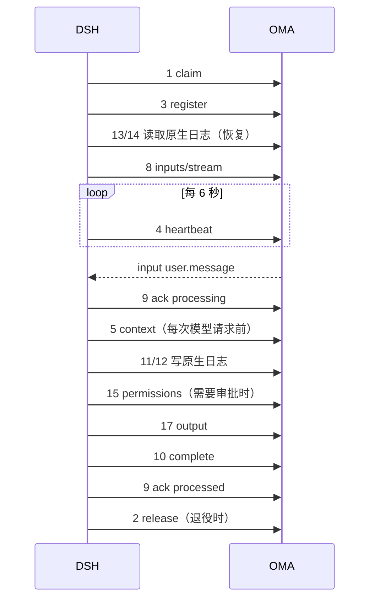

# DSRv1 接口参考

本文逐个说明 DSRv1 执行端接口的请求与响应：用途、调用时机、鉴权、字段、状态码、幂等与示例。语义、状态机与不变量以 [DSRv1 协议](protocol.md) 为准；两者冲突时以协议文档为准，并同步修正本文。本文对应协议第 7 版，仍是未冻结的设计草案。

## 0. 总览

| # | 接口 | 鉴权 | 用途 | 协议章节 |
| --- | --- | --- | --- | --- |
| 1 | `POST /v1/dsr/claims` | fleet | 长轮询领取一个会话 | 4.3 |
| 2 | `POST /v1/dsr/claims/{code_session_id}/release` | fleet | 释放领取 | 4.3 |
| 3 | `POST /v1/dsr/sessions/{id}/register` | session | 在当前 epoch 接管会话、开始租约 | 4.4 |
| 4 | `POST /v1/dsr/sessions/{id}/heartbeat` | session | 续租 | 4.5 |
| 5 | `GET /v1/dsr/sessions/{id}/context` | session | 读取会话上下文 | 4.5 |
| 6 | `GET /v1/dsr/sessions/{id}/state` | session | 读取 worker state | 4.6 |
| 7 | `PUT /v1/dsr/sessions/{id}/state` | session | 更新 worker state | 4.6 |
| 8 | `GET /v1/dsr/sessions/{id}/inputs/stream` | session | SSE 接收输入 | 9.2 |
| 9 | `POST /v1/dsr/sessions/{id}/inputs/ack` | session | 输入进度回执 | 9.2 |
| 10 | `POST /v1/dsr/sessions/{id}/inputs/{input_id}/complete` | session | 结束 task 输入 | 9.4 |
| 11 | `PUT /v1/dsr/sessions/{id}/transcripts/{dsh_session_id}/header` | session | 写原生日志 Header | 6.4 |
| 12 | `POST /v1/dsr/sessions/{id}/transcripts/{dsh_session_id}/events` | session | 追加原生日志 Event | 6.5 |
| 13 | `GET /v1/dsr/sessions/{id}/transcripts` | session | 列出会话下的原生日志 | 6.7 |
| 14 | `GET /v1/dsr/sessions/{id}/transcripts/{dsh_session_id}` | session | 分页读取一条原生日志 | 6.7 |
| 15 | `POST /v1/dsr/sessions/{id}/permissions` | session | 创建或查询工具审批 | 7.1–7.3 |
| 16 | `POST /v1/dsr/sessions/{id}/permissions/{request_id}/cancel` | session | 取消工具审批 | 7.5 |
| 17 | `POST /v1/dsr/sessions/{id}/output` | session | 发布公开输出 | 第 8 节 |

另有 10 个只迁移路径的运行时能力接口，见第 18 节。

典型调用顺序：



## 通用约定

### 请求头

| 头 | 适用 | 说明 |
| --- | --- | --- |
| `DSR-Protocol` | 全部 | 协议版本，v1 固定为 `1`。缺失或不支持返回 `400 unsupported_protocol`。register 之后，同一 epoch 的请求必须使用注册时的版本 |
| `Authorization: Bearer <token>` | 全部 | 接口 1、2 用 fleet token；其余用 claim 返回的 session token（`ingress_token` 字段） |
| `X-Worker-ID` | 1、2 | DSH 进程 UUID |
| `Content-Type: application/json` | 有请求体的接口 | — |

### 鉴权与 epoch

- session token 是 JWT，claims 含 `code_session_id`、`epoch`、`protocol: "dsr1"` 与租户身份。路径中的 `{id}` 必须等于 token 的 `code_session_id`。
- **请求体不带 epoch**。写接口在执行授权阶段与写事务内用 token 的 epoch 与 `current_worker_epoch` 比较，不一致返回 `409 epoch_superseded`。
- 读接口（5、6、13、14）只校验鉴权与归属，旧 epoch 的 token 也能读。

### 数据类型

- DSR 自有的 ID、epoch 与游标在 JSON 中为**字符串**：`worker_epoch`、`epoch`、`next_seq`、`from_seq`、`next_from_seq`、`turn`。
- 内嵌的原生 DSH 对象原样保留，`SessionEvent.seq` 是 **number**（非负安全整数）。
- 时间为 RFC 3339 UTC 字符串。

### 错误

错误体沿用 Anthropic 兼容形状：

```json
{ "type": "error", "error": { "type": "conflict_error", "message": "Worker epoch has been superseded" } }
```

机器可读的分支由响应头承载，DSH 只依据响应头处理：

| 头 | 说明 |
| --- | --- |
| `DSR-Error` | 错误码，完整枚举与 DSH 处理见 [协议 4.7](protocol.md#47-错误) |
| `DSR-Next-Seq` | 原生日志类错误时返回服务端的 `next_seq` |

缺少 `DSR-Error` 的 4xx（例如中间代理生成）按 `epoch_superseded` 的保守路径处理。429/5xx 有界退避重试。各接口下文只列出它特有的错误。

### 幂等

| 接口 | 幂等键 | 冲突时 |
| --- | --- | --- |
| 10 complete | `(code_session, input_id)` | `409 turn_idempotency_mismatch` |
| 11 header | `(code_session, dsh_session_id)` | `409 transcript_conflict` |
| 12 events | `(code_session, dsh_session_id, seq)` | `409 transcript_conflict` |
| 15 permissions | 派生的 `request_id` | `409 permission_idempotency_mismatch` |
| 16 cancel | `request_id` | 返回当前终态 |
| 17 output | `(code_session, id)` | `409 output_idempotency_mismatch` |

幂等键相同、请求内容（按语义比较）相同时，返回首次结果，不重复产生副作用。

---

## 1. `POST /v1/dsr/claims`

长轮询领取一个需要执行的会话。领取推进 epoch，签发 session token 与 model token；**不产生租约**，DSH 必须在 `claim_expires_at` 之前调用 register。

**请求**

| 位置 | 字段 | 类型 | 必填 | 说明 |
| --- | --- | --- | --- | --- |
| query | `block_ms` | integer | 否 | 0–30000，无可领取会话时最多等待的毫秒数。DSH 平时用 25000，启动探测用 0 |
| header | `X-Worker-ID` | string | 是 | DSH 进程 UUID |
| body | — | object | 是 | 空对象 `{}` |

**响应 200**

| 字段 | 类型 | 说明 |
| --- | --- | --- |
| `session_id` | string | Code Session ID（`cse_*`），即后续路径中的 `{id}` |
| `worker_epoch` | string | 本次领取分配的 epoch |
| `ingress_token` | string | session token（JWT），用于接口 3–17 与第 18 节 |
| `model_token` | string | 模型代理凭据，用于 `/v1/messages` 与 `/v1/chat/completions`；随租约有效，下次领取时轮换 |
| `claim_expires_at` | string | 必须在此之前 register |
| `trace_parent` | string | 可选，派发请求的 W3C trace context；租约过期接管时省略 |

响应带 `Cache-Control: no-store`。凭据明文只出现在这一次响应中。

**其他状态**

| 状态 | 含义 |
| --- | --- |
| `204` | `block_ms` 内没有可领取会话 |
| `400 invalid_request` | 缺少 `X-Worker-ID`，或 `block_ms` 越界 |
| `401 unauthorized` | fleet token 无效 |

**示例**

```http
POST /v1/dsr/claims?block_ms=25000
Authorization: Bearer <fleet token>
X-Worker-ID: 6f1c0d6e-0f5b-4c8e-9a51-2a3b8c0d1e2f
DSR-Protocol: 1
Content-Type: application/json

{}
```

```json
{
  "session_id": "cse_01HZX...",
  "worker_epoch": "7",
  "ingress_token": "eyJhbGciOi...",
  "model_token": "oma_mt_...",
  "claim_expires_at": "2026-11-02T10:00:30Z",
  "trace_parent": "00-4bf92f3577b34da6a3ce929d0e0e4736-00f067aa0ba902b7-01"
}
```

可领取条件、领取事务、attempts 与耗尽 hold 见协议 4.3 与 [Brain Worker 领取](../brain-worker-claim.md)。

## 2. `POST /v1/dsr/claims/{code_session_id}/release`

放弃一次领取。注册前后都可调用。

**请求**

| 字段 | 类型 | 必填 | 说明 |
| --- | --- | --- | --- |
| `epoch` | string | 是 | 要释放的 epoch，必须等于当前 epoch |
| `reason` | string | 是 | 见下表 |

| `reason` | 使用场景 | 服务端效果 |
| --- | --- | --- |
| `admission_failed` | 临时性准入失败 | 按 5、10、20、40、80 秒退避，耗尽后公开失败 |
| `permanent` | 任务信封或配置非法，重试也不会成功 | 立即推进 epoch 并停车，几秒内公开 `session.error` |
| `shutdown` | 进程退出、本地容量不足主动放弃 | 立即可被领取，attempts 减一 |
| `idle` | 空闲会话退役 | 只清租约，不请求重领 |

请求头需要 `X-Worker-ID`，必须等于领取时的值。

**响应**

| 状态 | 含义 |
| --- | --- |
| `200 {"ok": true}` | 已释放 |
| `409` | 会话非 active、epoch 不符或领取者不符；DSH 只记录告警 |

## 3. `POST /v1/dsr/sessions/{id}/register`

在 claim 分配的 epoch 上接管会话：开始计算租约，绑定协议版本，清理更早 epoch 留下的待确认审批。**不推进 epoch**，因此同一 token 可以重复注册：首次注册用于准入，收到 410 后再次注册用于恢复租约。

**请求**：空对象 `{}`。

**服务端动作**（同一事务）：

1. 锁定 Code Session，校验 active、`worker_protocol = dsr1`、token epoch 等于当前 epoch。
2. 写入租约、连接状态与活动时间，清空领取请求与领取期限，记录 `dsr_protocol_version`。
3. 若是该 epoch 的首次注册：把更早 epoch 的 pending 审批标为 `superseded`，并重算公开状态。

**响应 200**

| 字段 | 类型 | 说明 |
| --- | --- | --- |
| `epoch` | string | 当前 epoch，供 DSH 核对 |
| `protocol` | string | 绑定到本会话的协议版本，v1 为 `"1"` |
| `lease.ttl_ms` | integer | 租约时长，当前 20000 |
| `lease.grace_ms` | integer | 宽限期，当前 10000 |
| `lease.heartbeat_interval_ms` | integer | 建议心跳间隔，当前 6000 |

**错误**

| 状态 | `DSR-Error` | DSH 处理 |
| --- | --- | --- |
| 409 | `epoch_superseded` | 退役 |
| 409 | `session_migrating` | 以 `shutdown` release |
| 404 | `session_not_found` | 退役，不 release |
| 401/403 | `unauthorized` | 以 `admission_failed` release |

**示例**

```json
{ "epoch": "7", "protocol": "1", "lease": { "ttl_ms": 20000, "grace_ms": 10000, "heartbeat_interval_ms": 6000 } }
```

## 4. `POST /v1/dsr/sessions/{id}/heartbeat`

续租。DSH 按 `heartbeat_interval_ms` 固定节奏发送，抖动 ±10%，单次超时 5 秒；恢复原生日志期间也必须持续发送。

**请求**：空对象 `{}`。

**响应 200**

| 字段 | 类型 | 说明 |
| --- | --- | --- |
| `lease_expires_at` | string | 新的租约到期时间 |

**错误**

| 状态 | `DSR-Error` | DSH 处理 |
| --- | --- | --- |
| 409 | `epoch_superseded` | 退役 |
| 410 | `lease_expired` | 用同一 token 重新调用 register；仍是当前 epoch 则继续执行 |

## 5. `GET /v1/dsr/sessions/{id}/context`

读取会话上下文：模型目录、运行时工具权限、MCP 配置等。DSH 在准入时与每次模型请求前读取，用于刷新权限与模型。

**请求**

| 位置 | 字段 | 必填 | 说明 |
| --- | --- | --- | --- |
| header | `DSR-Thread-ID` | 否 | 子线程 ID；提供时返回该子线程 Agent 快照对应的权限与工具 |

**响应 200**

| 字段 | 类型 | 说明 |
| --- | --- | --- |
| `context` | object | 与现行 `session_context` 相同，包括 `models`、`runtime_tool_permissions` 等 |

带 `Cache-Control: no-store`。

## 6. `GET /v1/dsr/sessions/{id}/state`

读取 worker state。DSH 恢复时用它取回用户最后选择的模型与 trace 连续性数据。

**响应 200**

| 字段 | 类型 | 说明 |
| --- | --- | --- |
| `status` | string | `idle` 或 `running` |
| `model` | string \| null | 当前生效模型 |
| `trace_turns` | object \| null | trace 连续性数据（原 `external_metadata.oma_trace_turns`） |

## 7. `PUT /v1/dsr/sessions/{id}/state`

按字段更新 worker state。**只用于诊断、空闲退役与恢复读回，不产生公开事件，也不影响公开状态。**

**请求**：以下字段任选，省略的字段保持不变，显式 `null` 表示清除。

| 字段 | 类型 | 说明 |
| --- | --- | --- |
| `status` | string | `idle` 或 `running` |
| `model` | string \| null | 当前生效模型 |
| `trace_turns` | object \| null | trace 连续性数据 |

未知字段返回 `400 invalid_request`。

**响应 200**：返回更新后的完整 state，形状同接口 6。

## 8. `GET /v1/dsr/sessions/{id}/inputs/stream`

SSE 输入流。后端从任务与控制两个 durable consumer 拉取，写入 ACK 定位后再推送。断开不丢消息：未 ACK 的输入会重投。

**请求**

| 位置 | 字段 | 说明 |
| --- | --- | --- |
| header | `Last-Event-ID` | 可选，语义同现行 |
| query | `from_sequence_num` | 可选，语义同现行；不修改 JetStream ACK floor |

**响应**：`Content-Type: text/event-stream`，`Cache-Control: no-cache`，`X-Accel-Buffering: no`。每帧：

```text
id: 1842
event: input
data: {"id":"evt_01J...","lane":"task","kind":"user.message","session_thread_id":"sthr_...","content":[{"type":"text","text":"跑一下测试"}]}
```

保活为 SSE 注释行（`: keep-alive`），不是输入。

**`data` 公共字段**

| 字段 | 类型 | 说明 |
| --- | --- | --- |
| `id` | string | `input_id`，传输稳定 ID，重投时不变；回执与 complete 都用它 |
| `lane` | string | `task` 或 `control` |
| `kind` | string | 见下表 |

**按 kind 的字段**

| `kind` | lane | 字段 | 需要 complete |
| --- | --- | --- | --- |
| `user.message` | task | `session_thread_id`、`content`（CMA 内容块，文件与图片已物化） | 是 |
| `user.interrupt` | control | `session_thread_id`（可选，缺省为全部线程） | 否 |
| `permission.resolved` | control | `request_id`、`resolution` | 否 |
| `session.set_model` | control | `model`（string，`null` 表示默认模型） | 否 |

`resolution` 的字段：

| 字段 | 类型 | 说明 |
| --- | --- | --- |
| `behavior` | string | `allow`、`deny` 或 `external_result` |
| `updated_input` | object | 可选，`allow` 时用户修改后的工具参数 |
| `message` | string | 可选，`deny` 时的原因 |
| `external_result` | object | `external_result` 时由 custom 工具或自托管外部执行提供的结果 |

收到本会话协议版本未定义的 kind 属于协议缺陷：DSH 不执行，以 `processed` 加 `error: "unsupported_input"` 回执。

**错误**：`409 epoch_superseded`（连接时或连接中 epoch 变化后关闭流）。

## 9. `POST /v1/dsr/sessions/{id}/inputs/ack`

输入进度回执。只有 `processed` 才确认 JetStream 消息；其余状态只延长投递时限。

**请求**

| 字段 | 类型 | 必填 | 说明 |
| --- | --- | --- | --- |
| `updates` | array | 是 | 1–64 项 |
| `updates[].id` | string | 是 | `input_id` |
| `updates[].status` | string | 是 | `received`、`processing`、`processed` |
| `updates[].error` | string | 否 | 仅 control 输入的 `processed` 可带，例如 `unsupported_input`、`invalid_model` |

各状态的含义：

| status | 何时发送 | 服务端效果 |
| --- | --- | --- |
| `received` | SSE 收到后立即 | 延长投递时限 |
| `processing` | task 输入开始执行前；长任务周期性重发 | 延长投递时限；task 输入的 turn 从 accepted 变为 processing 并写 `processed_at`（首次时向公开 SSE 发布该消息）；turn 已 terminal 时不改动 |
| `processed` | task 输入在 `complete` 成功之后；control 输入处理完成后 | DoubleAck，写 turn 的 `acked_at` |

**响应 200**

| 字段 | 类型 | 说明 |
| --- | --- | --- |
| `applied` | integer | 找到 ACK 定位并执行的条数 |
| `ignored` | integer | 没有 ACK 定位的条数（尚未推送、已过期、重复 processed 等）；未 ACK 的消息会重投，不是丢失 |

**错误**

| 状态 | `DSR-Error` | 说明 |
| --- | --- | --- |
| 409 | `input_not_completed` | 批次中有 task 输入在 `complete` 之前报了 `processed`。整批不执行，错误消息给出第一个违规的 `id` |
| 409 | `epoch_superseded` | — |
| 400 | `invalid_request` | 条数越界、status 非法、在 task 输入上带 `error` |

**示例**

```json
{ "updates": [ { "id": "evt_01J...", "status": "processing" } ] }
```

```json
{ "applied": 1, "ignored": 0 }
```

## 10. `POST /v1/dsr/sessions/{id}/inputs/{input_id}/complete`

结束一个 task 输入。必须在该输入的原生日志终态与公开输出都确认之后、`ack processed` 之前调用。

**请求**

| 字段 | 类型 | 必填 | 说明 |
| --- | --- | --- | --- |
| `outcome` | string | 是 | `success`、`cancelled`、`failed`、`recovered` |
| `reason` | string | `failed`/`recovered` 时必填 | `turn_failed`、`worker_shutdown`、`interrupted_recovery`、`quota_exhausted` |

不接受自由文本。服务端把 `reason` 映射为固定的公开文案与安全错误分类：

| outcome | 公开效果 |
| --- | --- |
| `success`、`cancelled` | 无排队输入时 `idle(end_turn)`；有排队输入时保持 running |
| `failed`、`recovered` | `system.message`（固定文案）、`session.error`、`idle(retries_exhausted)`，与现行一致，排队输入不抑制 |

**处理顺序**：校验 epoch → turn 存在且属于本会话 → **若已 terminal，按幂等返回首次结果** → 否则要求 turn 处于 processing → 写 terminal、关闭该输入的 pending 审批、写公开事件与状态。

**响应 200**

| 字段 | 类型 | 说明 |
| --- | --- | --- |
| `outcome` | string | 首次写入的 outcome |
| `public_status` | string | 提交后的公开会话状态：`running`、`idle`、`requires_action` |

**错误**

| 状态 | `DSR-Error` | 说明 |
| --- | --- | --- |
| 409 | `input_not_eligible` | 输入不存在、不属于本会话、不是 task 输入，或尚未 processing |
| 409 | `turn_idempotency_mismatch` | 已 terminal，但 outcome 或 reason 与首次不同 |
| 400 | `invalid_request` | 缺少必填的 `reason`，或 `success`/`cancelled` 带了 `reason` |

**示例**

```json
{ "outcome": "recovered", "reason": "interrupted_recovery" }
```

```json
{ "outcome": "recovered", "public_status": "idle" }
```

## 11. `PUT /v1/dsr/sessions/{id}/transcripts/{dsh_session_id}/header`

写入一条原生日志的 Header。必须先于该日志的任何 Event；子线程的 Header 还必须先于它的 `session.thread_created` 输出。

**路径**：`dsh_session_id` 是 DSH 原生 Session ID；主线程等于 `{id}`，子线程是 DSH subagent ID（也就是子线程的公开 `session_thread_id`）。

**请求**

| 字段 | 类型 | 必填 | 说明 |
| --- | --- | --- | --- |
| `parent_dsh_session_id` | string \| null | 子线程必填 | 父日志的 `dsh_session_id`，必须已存在于本会话；主线程为 `null` 或省略 |
| `header` | object | 是 | 原生 `SessionHeader`，原样保存 |

服务端校验 `header.id` 等于路径中的 `dsh_session_id`；`header.parentSession` 与 `parent_dsh_session_id` 一致；`header.version` 为 4。

**响应 200**

| 字段 | 类型 | 说明 |
| --- | --- | --- |
| `dsh_session_id` | string | 回显 |
| `next_seq` | string | 当前已确认的 Event 条数；新建时为 `"0"` |

**错误**

| 状态 | `DSR-Error` | 说明 |
| --- | --- | --- |
| 409 | `transcript_conflict` | 已存在且 parent 或 Header 内容不同 |
| 400 | `unsupported_transcript_version` | `version` 不是 4 |
| 400 | `invalid_request` | `header.id` 或 `parentSession` 与请求不符、父日志不存在、JSON 含重复键 |

## 12. `POST /v1/dsr/sessions/{id}/transcripts/{dsh_session_id}/events`

向一条原生日志追加 Event。服务端保证从 seq 0 起连续、已确认内容不可变。DSH 以响应中的 `next_seq` 作为"远程已确认"的依据，供工具执行等屏障使用。

**请求**

| 字段 | 类型 | 必填 | 说明 |
| --- | --- | --- | --- |
| `events` | array | 是 | 原生 `SessionEvent` 数组，原样保存 |
| `events[].seq` | number | 是 | 非负安全整数，必须连续递增 |
| `events[].type` | string | 是 | 原生事件类型 |

约束：

- 一个请求只属于一条日志；不同日志分别调用，Header 先于 Event。
- 单条事件的原始 JSON ≤ 15 MiB，请求体 ≤ 16 MiB。
- 请求可以包含已确认的前缀：`seq < next_seq` 的条目按语义比较，相同则跳过，不同则冲突。
- 整个请求在一个事务内完成，要么全部写入，要么全部不写。

**响应 200**

| 字段 | 类型 | 说明 |
| --- | --- | --- |
| `next_seq` | string | 写入后的已确认条数，例如确认 seq 0–41 后为 `"42"` |

**错误**

| 状态 | `DSR-Error` | 说明与处理 |
| --- | --- | --- |
| 409 | `transcript_header_required` | 尚未写 Header：先调用接口 11 |
| 409 | `transcript_gap` | 第一条未确认条目不等于 `next_seq`：按 `DSR-Next-Seq` 补发 |
| 409 | `transcript_conflict` | 已确认的 seq 内容不同：停止恢复，保留本地文件 |
| 409 | `session_migrating` | 会话迁移中 |
| 410 | `transcript_purged` | 最后一份副本已删除，会话不可恢复 |
| 413 | `payload_too_large` | 单条或请求体超限 |

**示例**

```json
{ "events": [
  { "seq": 41, "time": 1730541600123, "type": "tool/call", "data": { "callId": "toolu_01", "name": "bash" } },
  { "seq": 42, "time": 1730541600456, "type": "tool/result", "data": { "message": { "toolCallId": "toolu_01", "content": "ok" } } }
] }
```

```json
{ "next_seq": "43" }
```

## 13. `GET /v1/dsr/sessions/{id}/transcripts`

列出本会话下的全部原生日志，用于接管时发现其他实例新增的子线程。

**响应 200**

| 字段 | 类型 | 说明 |
| --- | --- | --- |
| `data[].dsh_session_id` | string | — |
| `data[].parent_dsh_session_id` | string \| null | 主线程为 `null` |
| `data[].session_thread_id` | string \| null | 已绑定的公开线程；子线程在 `thread_created` 被接受前为 `null` |
| `data[].header_present` | boolean | 是否已写 Header |
| `data[].next_seq` | string | 已确认条数 |

## 14. `GET /v1/dsr/sessions/{id}/transcripts/{dsh_session_id}`

分页读取一条原生日志，用于冷恢复与前缀核对。读取合并已归档段与 PostgreSQL 行，并还原外置 payload。

**请求**

| query | 类型 | 默认 | 说明 |
| --- | --- | --- | --- |
| `from_seq` | string | `"0"` | 从该 seq 开始（包含） |
| `limit_bytes` | integer | 4194304 | 软预算，上限 8388608；按原始字节累计，Header 计入 |

**响应 200**

| 字段 | 类型 | 说明 |
| --- | --- | --- |
| `header` | object \| null | 仅 `from_seq = 0` 时返回原生 Header |
| `events` | array | 原生 `SessionEvent`，按 seq 升序；每页至少一条（日志为空时为空数组），单条超出预算时该页只含这一条 |
| `next_from_seq` | string \| null | 下一页的 `from_seq`；已读到末尾时为 `null` |

**错误**：`409 session_migrating`、`410 transcript_purged`、`404 session_not_found`（日志不存在）。

## 15. `POST /v1/dsr/sessions/{id}/permissions`

为一次工具调用申请审批，或查询已有审批的结果。审批记录与相应的公开事件在同一事务内写入。

**请求**

| 字段 | 类型 | 必填 | 说明 |
| --- | --- | --- | --- |
| `input_id` | string | 是 | 当前处于 processing 的 task 输入 |
| `turn` | string | 是 | 原生 turn 序号，用于诊断 |
| `dsh_session_id` | string | 是 | 发起调用的原生 Session（主线程或子线程） |
| `tool_use_id` | string | 是 | 工具调用 ID |
| `tool.kind` | string | 是 | `builtin`、`mcp`、`custom`、`delegation` |
| `tool.name` | string | 是 | 工具名 |
| `tool.server` | string | `mcp` 时必填 | MCP server 名 |
| `input` | object | 是 | 工具参数 |
| `available` | boolean | 否 | 工具当前是否可用，默认 `true` |

`request_id` 由服务端按 `"dsrp_" + base32(sha256(code_session_id, dsh_session_id, tool_use_id))` 派生，DSH 用同一规则在本地计算，并在发送前登记等待项。

**处理顺序**：校验 epoch → **按 `request_id` 查找已有记录，命中直接返回** → 校验 `input_id` 处于 processing 且线程归属正确 → 计算权限 → 写记录与公开事件 → 重算公开状态。

**响应**

| 状态 | body | 含义 |
| --- | --- | --- |
| `200` | `{"request_id","state":"resolved","decision":{"behavior":"allow"}}` | 允许，可以执行 |
| `200` | `{"request_id","state":"resolved","decision":{"behavior":"deny","message":"..."}}` | 拒绝 |
| `200` | `{"request_id","state":"resolved","decision":{"behavior":"external_result","external_result":{...}}}` | 重试时 custom 或外部执行已有结果 |
| `202` | `{"request_id","state":"pending"}` | 等待用户确认或外部结果；结果经输入流的 `permission.resolved` 送达，也可用相同请求重试取得 |
| `200` | `{"request_id","state":"cancelled" \| "closed" \| "superseded"}` | 已取消、所属输入已结束、被更高 epoch 接管；不得执行 |

`decision` 字段：

| 字段 | 类型 | 说明 |
| --- | --- | --- |
| `behavior` | string | `allow`、`deny`、`external_result` |
| `updated_input` | object | 可选，`allow` 时用户修改后的参数 |
| `message` | string | 可选，`deny` 的原因 |
| `external_result` | object | `external_result` 时的结果 |

**错误**

| 状态 | `DSR-Error` | 说明 |
| --- | --- | --- |
| 409 | `input_not_eligible` | 新建时输入不在 processing，或线程不属于该输入 |
| 409 | `permission_idempotency_mismatch` | 同一 `request_id` 的请求内容不同 |
| 400 | `invalid_request` | `tool.kind` 非法、`mcp` 缺少 `server` |

**示例**

```json
{
  "input_id": "evt_01J...", "turn": "3", "dsh_session_id": "cse_01HZX...", "tool_use_id": "toolu_01",
  "tool": { "kind": "builtin", "name": "bash" },
  "input": { "command": "rm -rf build" }, "available": true
}
```

```json
{ "request_id": "dsrp_k3m9...", "state": "pending" }
```

## 16. `POST /v1/dsr/sessions/{id}/permissions/{request_id}/cancel`

放弃等待一次审批，用于中断与停机。即使记录尚不存在也会生效：写入墓碑，使之后晚到的创建请求返回 `cancelled`。

**请求**

| 字段 | 类型 | 必填 | 说明 |
| --- | --- | --- | --- |
| `dsh_session_id` | string | 是 | 用于重新派生 `request_id` 并写墓碑 |
| `tool_use_id` | string | 是 | 同上 |
| `input_id` | string | 否 | 提供时校验归属 |

服务端按接口 15 的规则重新派生 `request_id`，与路径不一致返回 `400 invalid_request`。

**响应 200**

| 字段 | 类型 | 说明 |
| --- | --- | --- |
| `request_id` | string | — |
| `state` | string | 记录的当前状态：本次取消成功或写入墓碑时为 `cancelled`；记录已是其他终态时返回该终态（例如 `resolved`，并附 `decision`） |

## 17. `POST /v1/dsr/sessions/{id}/output`

发布 DSH 产生的公开事件：流式预览、完成的助手块、工具结果、线程事件、`system.message` 和 MCP 连接错误。模型流产生的消息与工具调用由模型代理发布，不经过本接口。

**请求**

| 字段 | 类型 | 必填 | 说明 |
| --- | --- | --- | --- |
| `events` | array | 是 | 1–200 项 |
| `events[].id` | string | 是 | 客户端幂等键，由原生身份确定性派生；公开事件 ID 由服务端从它派生，两者不同 |
| `events[].type` | string | 是 | 见下表 |
| `events[].session_thread_id` | string | 否 | 所属线程；缺省为主线程 |

**事件类型与字段**

| type | 字段 | 映射为公开事件 |
| --- | --- | --- |
| `preview.start` | `event: {type, id}` | `event_start` 流式预览 |
| `preview.delta` | `event_id`、`delta` | `event_delta` 流式预览 |
| `agent.message` | `content` | `agent.message` |
| `agent.thinking` | — | `agent.thinking`（无正文的状态事件） |
| `tool.result` | `tool_use_id`、`tool: {kind, name, server?}`、`is_error`、`content` | `agent.tool_result` 或 `agent.mcp_tool_result` |
| `system.message` | `content` | `system.message` |
| `session.thread_created` | `parent_thread_id`、`agent`、`agent_name` | 原样；要求对应原生日志已存在，接受时绑定线程 |
| `session.thread_status_running` / `_idle` / `_terminated` | `stop_reason`（`_idle` 时） | 原样 |
| `agent.thread_message_sent` | `to_session_thread_id`、`to_agent_name`、`content` | 原样 |
| `agent.thread_message_received` | `from_session_thread_id`、`from_agent_name`、`content` | 原样 |
| `agent.thread_context_compacted` | CMA 字段 | 原样 |
| `session.error` | `error`（仅 MCP 连接或鉴权失败类） | 原样 |

整批在一个事务内校验与写入，要么全部写入，要么全部不写。

**响应 200**

| 字段 | 类型 | 说明 |
| --- | --- | --- |
| `accepted` | integer | 本次新写入的条数 |
| `duplicates` | integer | 因 `id` 已存在且内容相同而跳过的条数 |

**错误**

| 状态 | `DSR-Error` | 说明 |
| --- | --- | --- |
| 400 | `invalid_request` | 未知类型、字段非法；整批不写 |
| 409 | `output_idempotency_mismatch` | 同一 `id` 内容不同，或同一原生日志绑定到不同线程 |

**示例**

```json
{ "events": [
  { "id": "evt_01J_dsh_42", "type": "tool.result", "session_thread_id": "sthr_main",
    "tool_use_id": "toolu_01", "tool": { "kind": "builtin", "name": "bash" },
    "is_error": false, "content": [ { "type": "text", "text": "ok" } ] }
] }
```

```json
{ "accepted": 1, "duplicates": 0 }
```

## 18. 只迁移路径的运行时能力接口

以下接口请求与响应格式不变，只把路径迁到 `/v1/dsr/sessions/{id}/` 下并改用 session token：

| 现路径 | DSRv1 路径 | 说明 |
| --- | --- | --- |
| `POST /v2/ccr-sessions/{id}/sandbox/mcp` | `POST .../sandbox/mcp` | 沙箱内置工具网关，每次调用重算权限 |
| `/v2/ccr-sessions/{id}/mcp` | `.../mcp` | 外部 MCP 代理 |
| `/v2/ccr-sessions/{id}/mcp/*` | `.../mcp/*` | 具名 MCP 代理 |
| `POST /v2/ccr-sessions/{id}/web/search` | `POST .../web/search` | 网页搜索 |
| `POST /v2/ccr-sessions/{id}/web/fetch` | `POST .../web/fetch` | 网页抓取 |
| `GET /v1/code/sessions/{id}/worker/subagent-threads/{thread_id}` | `GET .../threads/{thread_id}` | 子线程状态与归档标记 |
| worker 图片附件路由 | `.../attachments/*` | 远端图片读取 |
| `POST .../worker/diagnostics` | `POST .../diagnostics` | 运行诊断日志 |
| `POST .../worker/otlp/v1/logs` | `POST .../otlp/v1/logs` | OTLP 日志 |
| `POST .../worker/otlp/v1/traces` | `POST .../otlp/v1/traces` | OTLP trace |

不变的接口：`/v1/messages` 与 `/v1/chat/completions`（模型代理，使用 `model_token`），以及沙箱侧使用 `role=sandbox` JWT 的 `/v1/code/upstreamproxy/*` 和 `/v1/code/sessions/{id}/sign-commit`。
