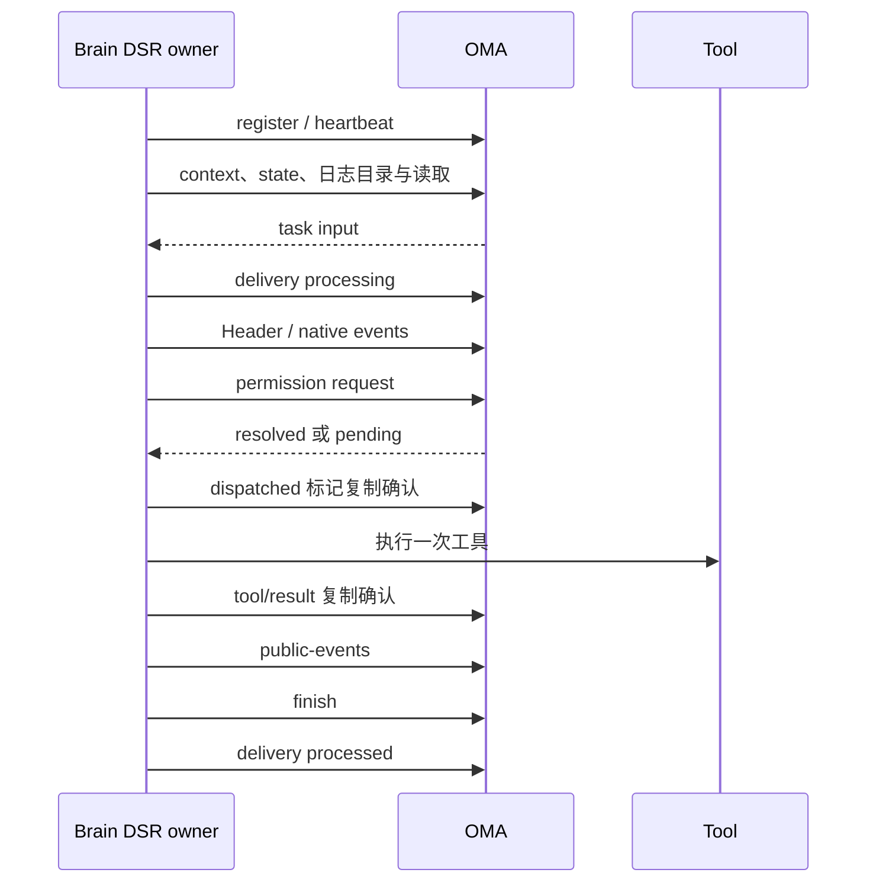

# DSRv1 实验实现状态

17 个主接口均已有后端实现，Brain 已新增可选择的 DSR 原生执行路径。后端新建 Brain 会话和 Brain 进程默认使用 DSRv1；协议仍未冻结。验证结论与剩余限制见文末。

## 逐接口实现与调用位置

路径相对于 `oma-brain-dsh/src/`。请求、响应和错误码的完整定义见 [接口参考](api-reference.md)。

| 编号 | 接口 | Brain 调用位置 | 关键边界 |
| --- | --- | --- | --- |
| 1 | claim | `dsr/worker.ts`、`dsr/claims.ts` | 按协议隔离领取，epoch 使用十进制字符串 |
| 2 | release | `dsr/worker.ts` | 排空输入与复制后释放，拒绝旧 owner |
| 3 | register | `dsr/worker.ts` | 同 epoch 恢复保留状态；补 ACK 由独立后台处理器负责 |
| 4 | heartbeat | `dsr/lease.ts` | 注册后独立运行，不被模型或审批阻塞 |
| 5 | context | `dsr/assignment.ts`、`oma-session.ts` | 准入与工具刷新复用配置组装 |
| 6–7 | worker-state GET/PUT | `dsr/session.ts` | 恢复模型与 trace，按字段 patch；模型控制按最高 broker sequence 与最新 input ID 确保有序更新 |
| 8 | inputs/stream | `dsr/worker.ts`、`dsr/input-stream.ts` | task/control 分别串行消费，审批等待时仍可处理控制输入 |
| 9 | inputs/delivery | `dsr/worker.ts`、`dsr/session.ts` | received 续报；执行前 processing；completed 后 processed 返回 scheduled；响应含 execution_status 与 cancel_requested_at |
| 10 | inputs/{id}/finish | `dsr/session.ts` | 日志与输出确认后写 finish，再 ACK；重复完成结果不可改变 |
| 11 | Header PUT | `runtime/replication.ts`、`dsr/replication.ts` | Header 先于事件，不可变身份 |
| 12 | events POST | 同上 | 每日志连续追加、JCS 重叠去重，冲突整批回滚 |
| 13 | directory GET | `dsr/subagents.ts`、`dsr/replication.ts` | 接管时完整枚举根/子日志 |
| 14 | transcript GET | `dsr/replication.ts`、`runtime/replication.ts` | 分页读取，校验原生结构与本地前缀 |
| 15 | permission-requests POST | `dsr/session.ts`、`dsr/executor.ts` | 批次预审批，确定性 request_id，重查不可重新执行策略 |
| 16 | permission cancel | `dsr/client.ts` | 显式放弃调用的接口；用户 interrupt 由后端事务关闭 pending 并持久标记 task 取消 |
| 17 | public-events POST | `dsr/session.ts`、`dsr/subagents.ts` | 持久输出收据与公开事件同事务；预览不入历史 |

后端 `code_session.brain_worker_protocol` 与 Brain 的 `OMA_BRAIN_PROTOCOL` 均默认 `dsr1`。回退 CCRv2 时须在两侧显式设置 `ccrv2`。已有活动会话不自动转换协议。Sandbox MCP、外部 MCP、web、附件、OTLP 使用 DSR 原生路径与签名凭据；模型请求继续使用已有模型入口。

## 执行、持久化与恢复



原生复制器是 CCRv2/DSR 共享的日志机制，网络适配器分离。DSR 不调用 CCRv2 worker 接口。固定 Harness `0.2.2-alpha.2` 通过 Bun patch 增加同 turn continuation 与无错误挂起。补丁仅作用于当前仓库依赖，未修改独立 deepseek-harness 仓库。

审批超时只挂起原生 turn，不生成虚假失败结果。冷接管从远程日志恢复同一 turn 的整个工具批次。`plugin:oma/dsr-dispatched` 必须在真实工具调用前复制确认；有标记而无持久结果时返回 `TOOL_OUTCOME_UNKNOWN`，不重放副作用，尚未派发的后续调用继续执行。该策略不提供外部系统 exactly-once 或自动对账。

`dsh_input_deliveries.ack_subject` 保存 broker ACK 位置，避免 Redis 投递索引丢失后无法结算 completed 输入。用户中断与 `cancel_requested_at` 同事务提交，控制输入先于重投 task 到达也能阻止恢复执行。模型控制按 ID 和 broker sequence 去重，旧控制重投不会覆盖较新的模型。

## 数据与事务边界

迁移 `00115` 至 `00118` 创建或演进 `dsh_transcripts`、`dsh_transcript_events`、`dsh_worker_states`、`dsh_input_executions`、`dsh_input_deliveries`、`dsh_permission_requests`、`dsh_public_receipts` 七张表。仅调整新增 DSH 表，不修改既有业务表 schema，不创建外键。应用 SQL 全部通过 Yourbatis。

写入按所属 Session/Code Session 加锁，并显式检查组织、工作空间、协议、epoch 和租约。公开输入接纳与 input execution 创建、确认与审批解决、公开输出与收据、finish 与 pending 关闭、公开 reducer 更新分别在同一事务中完成。提交后的 SSE/webhook fanout 复用现有服务。Worker state 不再保存 status；模型与 trace 均为会话级恢复信息。

Header/Event 拒绝重复 JSON 键，使用 RFC 8785 JCS 比较。事件批次最多 200，单事件最多 15 MiB，请求体最多 16 MiB；读取为 1–8 MiB 软预算，默认 4 MiB。目录与读取均分页。

## 验证范围

普通测试包含请求校验、Mapper SQL/参数、租户与凭据隔离、客户端响应解析，以及完整原生循环、审批冷恢复、真实 Bun 子进程 SIGKILL 双工具批次恢复和持久中断。真实 PostgreSQL 测试入口：

```bash
TEST_MIGRATION_DATABASE_URL='<isolated-url>' just test-integration ./internal/db -run '^TestDSH(Execution|Transcripts|Workers)Postgres$' -v
```

真实后端、Brain 可执行文件与 Docker Worker 的逐接口验证新增 `chat brain-dsr`，先运行 `chat doctor brain-dsr`。该场景使用脚本上游模型，覆盖公开 SSE/历史、私有日志合同、工具审批、取消、claim/release、SIGKILL 后租约接管及旧 epoch 拒绝。复现：

```bash
OMA_BRAIN_BINARY='<absolute-binary>' just verify-be chat doctor brain-dsr --worker-image '<image>'
OMA_BRAIN_BINARY='<absolute-binary>' just verify-be chat brain-dsr --worker-image '<image>'
```

实际运行结果在本次交付与 `tmp/dsrv1-review/`、`tmp/verify-be/` 报告中记录。测试结果不能代替下列未覆盖能力。

## 仍未覆盖或未实现

- 新 DSH transcript 仍存 PostgreSQL，尚无大事件对象外置、archive、保留/清理与 purged 生命周期。既有 Transcript GC 不会自动处理新表。
- 未实现存量 CCRv2 会话原地迁移或生产灰度控制。
- 尚无真实模型质量、生产性能基线、网络分区、云端沙箱、长工具故障对账或全部运行时能力的 DSR 集成验收。
- 子线程、压缩、附件和遥测复用现有原生机制；本轮 DSR 专项验证范围须以实际场景报告为准，不把 CCRv2 场景当成 DSR 验收。

## 本轮最终结果

`chat brain-dsr` 的 6 个必需阶段全部通过，17 个主接口均经过真实后端。显式 CCRv2 配置下的 `chat brain`、`chat roundtrip`、`chat tools`、`chat reliability`、`chat public` 同样通过，全部报告无 skip、无缺失阶段且清理成功。

Go 全部普通测试与要求的质量门禁、3 项独立 PostgreSQL 测试均通过。Brain frozen install、typecheck、构建通过；完整测试为 827 pass、5 skip、0 fail。5 项跳过沿用基线，不计入通过。

完整逐接口证据、Markdown/JSON 报告路径和未覆盖项见 [本地验收报告](../../../../tmp/dsrv1-review/validation.md)。真实 DSR 的 SIGKILL 场景在已完成回合后接管；执行中双工具批次 SIGKILL 由原生运行时测试覆盖，其后端为测试 HTTP fixture，不能扩大为所有真实依赖崩溃窗口已验收。

共享验证夹具显式配置委派能力，每个独立工具调用使用唯一 ID；Docker 不存在错误按大小写兼容解析，保留实际沙箱过期替换断言。

默认切换仅影响新建 Brain 会话及新启动进程；存量会话的协议标记不回写。verify-be 的传统 Brain 场景显式固定 CCRv2，DSR 场景显式使用 DSRv1，保持两条执行路径的独立覆盖。

2026-11-04 默认切换复核：Go 普通单测、lint、死代码、重复代码、复杂度、大文件检查通过；Brain typecheck、构建通过，完整测试为 828 pass、5 skip、0 fail。本次未重跑真实集成场景，以上集成报告保留为此前验收证据。复核日志位于 `tmp/dsrv1-default/`。

DSRv1 host 与 CCRv2 共用 `oma-brain-dsh ready` 启动标记，供 `just restart` 等待后继续启动 Web。专用 `dsr_brain_ready` JSON 诊断日志同时保留；真实 Bun 子进程回归见 `tests/dsr-startup.test.ts`。

## 输入执行模型调整，2026-11-04

`dsh_input_executions` 表示输入级逻辑执行。status 为 accepted/running/completed；delivery 的 received/processing/processed 保持不变。result 仅 success/cancelled/failed，failure_code 仅 failed 必填。开始和完成时间分别为 started_at、completed_at，首次取消意图为 cancel_requested_at。ACK 字段已迁到独立投递表，仅用于投递结算。epoch/租约继续归 Code Session，不增加 attempt、delivery 或 outbox 表。

Mapper、claim 资格、公开 reducer、Brain wire/client、原生完成 checkpoint 与测试同步修改。reducer 用当前执行和最近完成结果的摘要查询替代全历史加载；独立后台补偿只领取投递表中的 pending 行。

按本轮要求直接修改未冻结的原始 goose 定义，无新增迁移。00117 定义最终表，00118 不再追加旧表字段，取消仅追加字段的 00119。已有库不会重跑旧 migration；本轮只在全新隔离数据库验证，不重置现有开发数据。新旧实验版本不支持混跑，完成 checkpoint 改为 version 2，旧 version 1 重放明确失败。自动数据转换与清理不在本轮实现内。

前文既有结果是调整前的历史证据，本轮结果单独记录，不能用历史通过代替重验。

### 输入执行模型验收结果

最终版本的 Go 普通单测、lint、死代码、重复代码、复杂度和大文件门禁全部通过；Brain typecheck、构建及可执行文件构建通过，完整测试为 831 pass、5 skip、0 fail。独立 PostgreSQL 的 Execution、Transcripts、Workers 三组测试无 skip 并全部通过。

真实 `chat brain-dsr`、`brain`、`roundtrip`、`tools`、`reliability`、`public` 六个场景全部通过，资源清理成功。随后修正仅限 DSR 的队列准入，保留“新消息唤醒后按顺序恢复旧队列”的既有行为；Go 全部门禁与 PostgreSQL 三组测试再次通过，最终 `chat brain-dsr` 也重跑通过。CCRv2 实现未变化，未重复启动其五个场景。

17 个接口的实际调用位置、请求/响应检查、最终 Markdown/JSON 报告与未覆盖范围见 [输入执行模型验收](../../../../tmp/dsh-input-executions/validation.md)。现有开发数据库和服务未重置或升级；历史 goose 定义的修改不会自动应用到已有库。

### 907e 开发库原地转换

2026-11-04 后续按用户要求处理已有开发库。先停本 worktree 的 Brain 和后端，备份原执行表及 goose 记录，再在单个 PostgreSQL 事务中按 00117 的最终定义转换为 dsh_input_executions。3 条记录均已成功完成并 ACK，保留原 id、uuid、租户范围、输入身份、开始/完成时间与 ACK 信息，状态改为 completed。事务逐列比较映射后的全部数据，确认一致后删除旧表，并删除已并入当前定义的 goose 119 记录，当前版本为 118。没有新增 migration，也未重置整个开发环境。

随后通过 just restart-server 与 just restart-brain 启动新代码，healthz 返回 ok，readyz 的 database、tunnel_nats、tunnel_redis 均为 ok，Brain 输出 oma-brain-dsh ready 和 dsr_brain_ready。此次只核对开发库转换与服务启动，未再次执行聊天集成场景。备份及事务脚本仅保存在当前 worktree 的 tmp/dsh-input-executions/dev-db-upgrade/，备份文件权限为 0600，不纳入 Git。

## ACK 与执行解耦，2026-11-04

本节取代前文暂留 ACK 字段、注册补 ACK 与仅为结算领取 Brain 的实现说明。dsh_input_executions 只保存逻辑执行；dsh_input_deliveries 保存最新 Reply Subject、待确认状态、重试/短租约和 payload cleanup job UUID。finish 与投递 pending 同事务提交。NATS/Redis I/O 全部位于业务事务外，ACK 网络失败不回滚完成结果。

main 组装独立 DSHDeliveryWorker，每秒领取最多 16 条、30 秒租约、每次 1 秒 ACK 超时；错误指数退避至 60 秒，崩溃后租约过期恢复。多实例 SKIP LOCKED 领取，完成与失败均按完整范围及 lease_token CAS。成功时同事务推进对象 cleanup job。退役投递置 discarded；ACK 成功行立即删除；discarded 诊断记录保留 7 天后分批清理，等待或重试中的记录不按时间删除。

task SSE 先持久化投递定位，不再依赖 Redis ACK 索引。已 completed 的重投不交给 Brain。delivery processed 的 outcome 与计数为 scheduled，表示后台结算已接受。control 维持 Redis 定位与同步确认，但确认发生在业务事务外。完成 checkpoint 仍为 version 2，finish 结果合同不变。

ack_subject 取自 NATS message.Reply()。当前 SDK 的 ACK subject 携带多项投递元数据，新格式还可能带随机 token，不由 input_id 拼接。Redis 可以作为缓存，但本实现使用 PostgreSQL 持久待办保护 finish 与确认责任的一致性。

直接修改原始 00117，新增投递表并从执行表移除 ACK 列；不增加版本号。当前开发库另行事务转换，保留原执行数据与确认事实。验证结果将在本轮交付记录，早期报告不代表本次后台补偿已通过。

### ACK 解耦验收与开发库转换结果

Go 普通单测、lint、死代码、重复代码、复杂度与大文件门禁全部通过；Brain typecheck、构建通过，完整测试为 832 pass、5 项既有 skip、0 fail。真实 PostgreSQL 的 Execution、Deliveries、Transcripts、Workers 四组测试通过。嵌入式 NATS 另验证重复 DoubleAck。

真实 brain-dsr 的 7 个必需阶段全部通过，其中 dsr_ack_recovery 在没有 Brain 的情况下验证失败退避、恢复确认和不领取 Brain。brain、roundtrip、tools、reliability、public 五个相关回归同样通过。之后仅把 DSR 业务事件发布移到控制 ACK 前，避免控制确认失败跳过已提交事件；Go 全部门禁与最终 DSR 再次通过。报告索引见 [ACK 解耦验收](../../../../tmp/dsh-deliveries/validation.md)。ACK 场景显式推进 owner 租约过期，验证资格与恢复，不把它当成 TTL 壁钟时序验收。

当前 907e 库已停止旧 Brain/后端、保存权限 0600 的本地备份，并在一个事务内创建投递表、复制 ACK 事实、逐列验证业务数据后，原地删除执行表 ACK 列。3 条执行记录的 id/uuid、范围、结果与时间原样保留，3 条 ACK 地址和确认时间迁入新表。历史 delivery.delivered_at 是本次导入观察时间，旧表没有保存真实投递时间。goose 仍为 118，没有新增 migration，也没有重置整个开发环境。后端与 Brain 使用新协议一起重启；就绪检查与数据库检查见验收报告。

## 第 18 版：状态与回执收敛

直接修改原始 goose 00116–00118，保留七张 DSH 表。worker-state 删除 status，Brain 取消回合开始/结束两次状态上报；响应增加 model_control_sequence 字符串或 null。model patch 强制携带控制 input ID 与正 uint64 版本，不保留无版本写入旁路。

当前 model、水位和最新 input ID 同事务更新，跨 owner 保留。低版本忽略；等版本身份或模型变化冲突；高版本更新；null 清除模型仍保留新水位。删除 dsh_control_receipts，不再保证任意历史 input 的内容一致性。模型命令只有 model 一个业务值，直接比较当前 model 即可验证最高版本内容。

公开回执改为 payload_digest，值为 jcs-sha256-v1 加规范化原始事件的 SHA-256 hex。与公开历史的事务关系、相同 ID 冲突规则、preview 边界不变。公开回执不独立过期，待日志重放窗口和 GC 一并设计。

测试覆盖规范化等价与内容冲突、批次回滚、旧版本忽略、同版本 input/model 冲突、null 清除、uint64 边界、租户和 owner fencing。真实 brain-dsr 场景通过 HTTP 探针检查拒绝 status、无版本模型拒绝、模型乱序和清除、公开输出摘要重试，以及 replacement 读回水位。探针构造控制版本，不代表 NATS 控制输入的所有网络乱序场景。

## 第 19 版：ACK 成功即删除

dsh_input_deliveries 仅保存 waiting/pending/discarded，移除 acked_at 和成功历史索引。后端 DoubleAck 成功后，Yourbatis 事务先以完整租户、UUID、lease_token 删除当前 pending 行，匹配成功才推进关联 cleanup job；任一步失败整个事务回滚。新投递与旧租约 CAS 互斥，重复完成为幂等无操作。

已完成 execution 保留，故 ACK 后重投重新创建 pending 行也不会重跑 Brain。discarded 的 7 天保留不变；成功 ACK 不再等待定时清理。原始 goose 00117 直接修改，已应用开发库备份后删除历史 acked 行并原地删列/调整约束。

数据库回归覆盖 cleanup 推进失败回滚删除、旧租约与跨租户不能删除、新投递抵御旧完成、成功立即消失、删除后重投补 ACK、业务 execution 保留。真实 DSR 场景夹具同步为已确认行消失后，生成 run-owned JetStream 测试投递并读取原始 Reply Subject，再故障注入 pending 定位，最终以行消失断言后台补偿完成。此修改本身不代表该真实场景已重跑，实际运行以本轮验收记录为准。

## Brain 单协议收敛

Brain 已删除旧 worker bridge、client、claim/register/stream/delivery/heartbeat、私有事件 envelope 和旧 session host。启动入口只组装 DSR；OMA_BRAIN_PROTOCOL 省略或 dsr1 有效，其他值在发起网络请求前拒绝。后端旧接口及其他 Worker 本次保留；旧协议存量会话不由新 Brain 领取，也不自动转换历史。

原 ccrv2 目录中仍被 DSR 使用的助手输出、输入内容、系统上下文、JSON 比较、网络错误分类及可取消等待迁到 runtime，安全诊断迁到 observability。assignment 收敛为单一类型，epoch 为字符串；MCP、图片、web 和 telemetry 删除旧协议 URL 分支。模型代理与原生 replay 格式不变。

删除前已备份完整 Brain src/tests/scripts/配置与锁文件到 tmp/brain-ccrv2-removal/brain-before.tar.gz，并保存 SHA-256 和文件清单。旧桥接协议专属测试随源码归档；混合文件保留协议中立用例。新增 DSR 进程和独立可执行文件测试，覆盖启动拒绝、领取、真实原生模型循环、批准工具、日志与投递结算。历史旧桥接场景并非全部迁移到 DSR，不将归档用例计为通过。

Brain 的安装和使用以 oma-brain-dsh/README.md 为准。真实后端应选择 chat brain-dsr；历史强制旧协议的 Brain 场景需要先迁移夹具或使用对应历史二进制。
