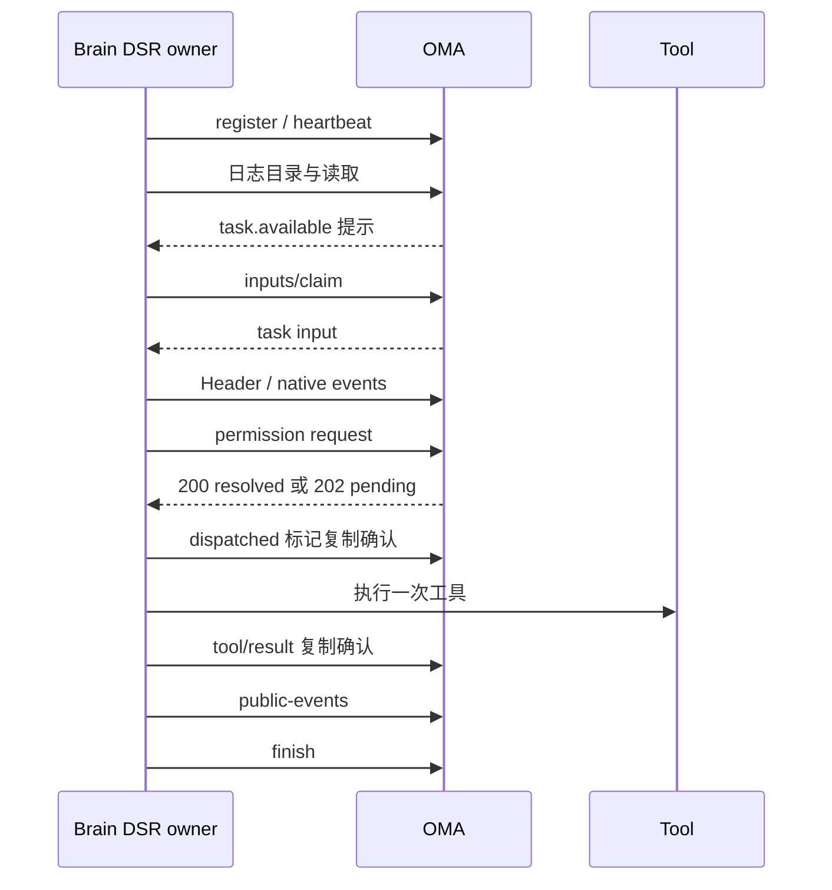
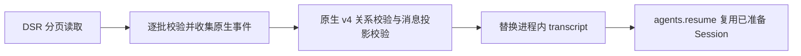
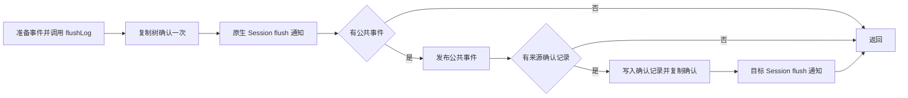

# DSRv1 实验实现状态

执行事务已区分 `session_terminated`、`session_archived` 与 `invalid_request`，前两者返回 410。授权层对已验签但上下文不可用的写请求，在原租户范围内补查会话状态。未知路由改为独立的 `404 route_not_found`，资源缺失仍为 `session_not_found`。Brain 只对 `lease_expired` 重新注册，新增错误不重试。回归覆盖 HTTP 错误映射、路由、授权范围、Brain 不重新注册，以及 PostgreSQL 中的终止/归档拒绝和历史读取。

当前 14 个主接口已有后端实现，Brain 使用 DSR 原生执行路径。后端新建 Brain 会话和 Brain 进程默认使用 DSRv1；协议仍未冻结。验证结论与剩余限制见文末。

## 逐接口实现与调用位置

路径相对于 `oma-brain-dsh/src/`。请求、响应和错误码的完整定义见 [接口参考](api-reference.md)。

| 编号 | 接口                     | Brain 调用位置                                 | 关键边界                                                                                                                |
| ---- | ------------------------ | ---------------------------------------------- | ----------------------------------------------------------------------------------------------------------------------- |
| 1    | claim                    | `dsr/worker.ts`、`dsr/claims.ts`               | 按协议隔离领取，epoch 使用十进制字符串                                                                                  |
| 2    | release                  | `dsr/worker.ts`                                | 排空输入与复制后释放，拒绝旧 owner                                                                                      |
| 3    | register                 | `dsr/worker.ts`                                | 同 epoch 恢复保留状态；补 ACK 由独立后台处理器负责                                                                      |
| 4    | heartbeat                | `dsr/lease.ts`                                 | 注册后独立运行，不被模型或审批阻塞                                                                                      |
| 5    | inputs/stream            | `dsr/worker.ts`、`dsr/input-stream.ts`         | 仅传 control 与 task.available 提示；interrupt 立即应用，control 按 ID 去重                                                 |
| 6    | inputs/delivery          | `dsr/worker.ts`、`dsr/session.ts`              | 仅 control 回执；响应含 applied、ignored 和 results，无 scheduled |
| 7    | inputs/{id}/finish       | `dsr/session.ts`                               | 日志与输出确认后写 finish；task 无 delivery ACK，重复完成结果不可改变                                                                 |
| 8    | records POST             | `runtime/replication.ts`、`dsr/replication.ts` | Header 与事件共用 JSONL，offset 连续，原始字节幂等                                                                      |
| 9 | inputs/claim POST | `dsr/worker.ts`、`dsr/client.ts` | 串行领取或恢复 running task；空队列 input=null |
| 10   | directory GET            | `dsr/subagents.ts`、`dsr/replication.ts`       | 接管时完整枚举根/子日志                                                                                                 |
| 11   | transcript GET           | `dsr/replication.ts`、`runtime/replication.ts` | 完整分页读取并验证远端原生日志，原子替换进程内历史                                                                      |
| 12   | permission-requests POST | `dsr/session.ts`、`dsr/executor.ts`            | 批次预审批，确定性 request_id，重查不可重新执行策略                                                                     |
| 13   | permission cancel        | `dsr/client.ts`                                | 显式放弃调用的接口；用户 interrupt 由后端事务关闭 pending 并持久标记 task 取消                                          |
| 14   | public-events POST       | `dsr/session.ts`、`dsr/subagents.ts`           | 持久输出收据与公开事件同事务；预览不入历史                                                                              |

后端 `code_session.brain_worker_protocol` 与 Brain 的 `OMA_BRAIN_PROTOCOL` 均默认 `dsr1`。已有活动会话不自动转换协议。Sandbox MCP、外部 MCP、web、附件、OTLP 使用 DSR 原生路径与签名凭据；模型请求继续使用已有模型入口。

## 执行、持久化与恢复



原生复制器是 CCRv2/DSR 共享的日志机制，网络适配器分离。DSR 不调用 CCRv2 worker 接口。固定 Harness `0.2.2-alpha.2` 通过 Bun patch 增加同 turn continuation 与无错误挂起。补丁仅作用于当前仓库依赖，未修改独立 deepseek-harness 仓库。

审批超时只挂起原生 turn，不生成虚假失败结果。冷接管从远程日志恢复同一 turn 的整个工具批次。`plugin:oma/dsr-dispatched` 必须在真实工具调用前复制确认；有标记而无持久结果时返回 `TOOL_OUTCOME_UNKNOWN`，不重放副作用，尚未派发的后续调用继续执行。该策略不提供外部系统 exactly-once 或自动对账。

task 通过数据库队列 claim 与 finish 推进，不再依赖 broker ACK。control 继续使用 Redis 投递定位。用户中断与 `cancel_requested_at` 同事务提交，控制输入先于重投 task 到达也能阻止恢复执行。

### Transcript 分批下载与导入

`RemoteTranscriptStore.read(rootSessionId, id)` 返回 `AsyncIterable<readonly DshLogData[]>`。DSR 适配器按分页产出记录，每批完成身份、格式、序号与重叠校验后才请求下一页。单次读取针对一条 transcript；目录接口返回根会话及子线程的元数据。

每次 `DsrSession.open()` 只完整枚举一次远端目录，并将该快照用于根日志和全部子线程恢复。`ensure(id, snapshot)` 传递 `{ nextOffset }` 表示目录中已存在的 transcript，传 `null` 表示目录中不存在；未提供快照的独立读取自行枚举目录并取得 `next_offset`。分页适配器用 BigInt 计算包含 Header 的记录条数，要求终页总量严格等于目录水位，未结束时总量必须小于该水位，拒绝提前结束、空尾页截断、超出水位或到达水位后仍要求续页。已列出的日志读取或水位校验失败会阻止恢复，不降级为空，不替换旧缓存，不建立较低的 confirmed；通用恢复边界也核对显式传入的期望总量。

读取期间按目录快照的固定水位恢复，观察到增长同样拒绝，不追读到新水位；下个 owner 重新获取目录。此约束复用现有目录和分页字段，不增加逐日志目录请求，也不是额外的数据库 MVCC 快照或内容校验和。



`runtime/transcript-persistence.ts` 提供原生 `sessionPersistence` 接口，运行时不挂载 JSONL 插件。Header 校验、连续序号、事件 envelope、未知必需事件拒绝，以及 v4 生命周期、工具、compaction 和历史引用规则继续使用原生依赖；恢复还使用原生 message projections 校验 image offload。事件深冻结后由恢复句柄返回 `shared-frozen`，不经 JSONL 编码、临时文件、缓存复制或文件锁。当前完整历史仍在内存中，关系校验和运行时重放并非恒定内存；本次没有实现流式关系校验。

逐条 envelope 与 v4 row admission 校验只在下载接纳时执行，不在整份历史校验中重复。下载完成后执行原生 v4 关系校验；替换进程内历史前，使用当前 SessionStore 的消息投影准备一个尚未发布的 Session，保留 image offload 等投影拒绝规则。OMA 的 SessionStore 适配器在 `agents.resume` 请求相同 header、相同冻结事件引用与相同投影配置时，一次性交接该 Session，避免重建后丢弃。追加事件、元数据或投影变化、原生恢复补充中断闭合事件时改用原生重新构建；已有活跃 Session 仍按原生规则拒绝重复进入。该适配器只使用原生公开接口，不修改依赖。

下载失败、校验失败或 owner 失效不替换现有进程内历史。替换拒绝活跃写入者，同一进程同一 session 只允许一个写句柄。跨进程归属由 DSR lease/epoch 与服务端写入检查保证。远端不存在时清除对应进程内记录；完整恢复后才建立复制确认水位。根日志和各子日志独立恢复，不提供整树原子提交。

运行中 `append` 只接受并冻结事件，再触发既有批量复制，不逐条等待网络。句柄与服务级 `flush`、原生 `session/flush` 均等待调用时捕获前缀的服务端确认；复制泵只捕获可上传事件，不反向调用远端 flush，避免递归等待。关闭写句柄会对自身追加执行有限期确认，失败仍释放进程内写入归属。工具执行、公共输出、输入完成与 shutdown 的远端确认屏障保持有效。

Brain 的事件追加适配器按十进制整数比较响应水位，要求 `next_offset` 不小于本批末条 `seq + 2`。服务端已确认更多事件时，重发旧前缀返回更高水位属于合法幂等成功；水位不足或格式非法仍视为永久失败。客户端继续逐批发送和确认本地事件，不因远端水位更高而跳过尚未比对的批次。普通回归通过真实 `DsrClient` 和模拟 HTTP 响应覆盖首次追加、相同批次重发、旧前缀重发、跨批重发及非法水位。

`TranscriptPersistence` 是插件层唯一的事件缓冲区。复制层通过只读 `view` 借用同一个 `record.events`，不再保存第二份事件数组，也不订阅 `session/event` 来维护副本；复制状态只保留调度、确认水位和累计字节索引。原生 Session 自身的模型日志仍由原生运行时持有。上传、flush 目标和背压计算都以这份 transcript 记录为准。

Session 进入 store 时同步核对已有 transcript 的 header 与事件前缀，接纳种子后关联活跃 Session。此后由持久化插件的单个事件监听追加冻结事件；writer 关闭后，只要 Session 仍活跃就继续捕获，直到 `session/disposed` 解除关联。活跃 Session 期间禁止句柄直接 append，防止绕过原生模型产生另一条历史；Session 脱离后仍可通过写句柄追加。监听捕获失败会标记记录错误，复制与确认必须失败，不以原生事件监听异常被包含为由静默继续。forget 后旧 Session 不能通过延迟 capture 重建记录。恢复替换同时拒绝活跃 Session 与活跃写句柄。

模型请求前先运行准备 hook，再执行一次 `SessionRuntime.flushLog()`；子 Agent 的准备阶段只等待事件队列处理完成，不嵌套刷新日志。`flushLog` hook 接管整次刷新，DSR 将其委派给根会话 checkpoint；没有 hook 时仍调用原生 `sessions.flush`。根、子请求都统一进入一次请求前 checkpoint，移除原先 `afterFlushLog` 与 `beforeRequest` 重复 checkpoint 的链路。

checkpoint 的每个持久化阶段先等待整棵会话树的复制确认，再调用原生 `sessions.flush` 通知根 Session 与本次来源 Session。此时持久化监听对已确认前缀快速返回，原生 telemetry 的 flush 通知仍会送达；若通知前又有新事件，仍会确认新增前缀。公开事件发布后，有来源确认记录才执行第二个复制阶段并通知目标 Session；没有来源记录时不额外 flush。工具中间件在 DSR 下通过原生 flush 保留执行前确认，不再紧接着重复调用 replication.flush；未走 DSR 执行器的原生调用仍受该屏障保护，非 DSR 的复制兜底仍保留。工具 dispatched、结果、输入完成与关闭的必要确认边界不合并跨越。



服务器是唯一持久恢复来源。进程崩溃或被 SIGKILL 时，未获服务器确认的内存尾部可能丢失，不再保留本地 WAL。旧 JSONL 目录不会读取、迁移或自动删除；`OMA_BRAIN_TRANSCRIPT_DIR` 不再参与启动或恢复。图片附件继续使用独立的远端存储与本地附件缓存。

恢复完成后，复制计费的 `byteBase`、`readyNext` 和 `requestedNext` 从远端已确认下一序号开始，累计字节索引初值仅为 `[0]`。`updateReady` 只序列化该基点之后的新事件，不重新计费已确认 Header 或恢复历史；背压按相对基点的累计字节差计算，在飞批次仍计入，分批确认后只扣除已确认前缀。这避免恢复后的首次捕获为了重建字节索引再次序列化整份历史。该索引仍会随本次恢复后接纳的事件增长，不代表完整运行期内存有硬上限。

### 复制背压的停止与归属校验

容量等待在捕获待上传事件后，先检查调用方 AbortSignal，再核对等待开始时捕获的成员身份，以及当前根会话和全部子线程的运行状态。容量判断与 waiter 注册之间保持同步执行。cancel、fenced 失败、drain 超时、forget 或 owner 替换发生在捕获期间时，等待以错误结束；等待期间新增的已暂停子线程也阻止继续执行。成功注册的 waiter 随停止通知或调用方取消结束。

普通回归使用受控事件捕获 Promise 固定交错顺序，覆盖上述状态变化、先前成员被释放和低于高水位时的取消。高水位在测试中缩小，验证相同的容量分支；不将这些测试作为默认 32 MiB 水位下的性能或真实心跳验收。

## 接管公共输出恢复

`DsrSession` 与子线程打开路径复用 `TranscriptPublication`，单次建立 turn 输入和工具身份索引。冷接管重新投影全部公共输出，由服务端回执及历史校验完成幂等。checkpoint 串行执行原生日志复制与公共发布；不再追加 `plugin:oma/dsr-publication`，旧记录不影响恢复。

模型代理对 `worker_protocol=dsr1` 只保留工具调用、span、用量和计费，不写助手最终消息。数据库在 Session 锁内核对已有历史与回执，冲突整批回滚；线程无变化状态仍按原有状态机处理。无需新增表或迁移。详细兼容边界与全量公共重放成本见 [DSRv1 协议 §8.3–8.4](protocol.md#83-公共输出的唯一写者)。

## 数据与事务边界

迁移 `00115_dsh_runtime.sql` 一次创建最终结构的六张表：`dsh_transcripts`、`dsh_transcript_records`、`dsh_worker_states`、`dsh_input_executions`、`dsh_permission_requests`、`dsh_public_receipts`。仅调整新增 DSH 表，不修改既有业务表 schema，不创建外键。应用 SQL 全部通过 Yourbatis。

写入按所属 Session/Code Session 加锁，并显式检查组织、工作空间、协议、epoch 和租约。公开输入接纳与 input execution 创建、确认与审批解决、公开输出与收据、finish 与 pending 关闭、公开 reducer 更新分别在同一事务中完成。提交后的 SSE/webhook fanout 复用现有服务。

DSH 普通写事务通过 `code_sessions FOR KEY SHARE` 校验并保护 epoch 与有效租约，不再持有会话级排他锁。append 另外通过 `dsh_transcripts FOR UPDATE` 串行化同一条日志的序号、重复事件比较与水位推进；不同 transcript、公开输出及 finish 不因这把 worker 锁互相串行。首次从 offset 0 写入时由 transcript 身份唯一约束处理同名并发创建。公开状态写入继续保留公开 Session 的业务锁。

心跳只取得兼容 `KEY SHARE` 的 `FOR NO KEY UPDATE`，完成校验和续租后提交。worker 查询通过物化 CTE 先取得锁，再以 `clock_timestamp()` 判断租约宽限期；Register/Heartbeat 在获锁后计算新的到期时间，避免等待消耗 TTL 或用等待前的时间复活已过期租约。注册与配置冻结继续使用排他锁。

claim、worker 注册、凭据轮换、永久失败、release、终止及沙箱回收的所有权修改语句都包含关联到目标 UUID 的 `SELECT ... FOR UPDATE`。这个显式 fence 与普通写事务的 `KEY SHARE` 冲突，必须等旧写事务提交后才能改变所有权；epoch 是非键字段，不能仅依赖 UPDATE 自动取得的锁。已在 Go 编排中取得排他锁的路径仍保留原锁顺序。事务内不能先取得弱更新锁再升级为 ownership fence，也不能先短事务校验 epoch、释放锁后再追加日志。

锁顺序保持为：公开 Session 业务锁（需要时）→ Code Session 身份锁 → transcript 或其他资源行锁。新增 Mapper 修改所有权时必须同样使用排他 fence，不能绕过该合同。真实 PostgreSQL 回归 `TestDSHLockingPostgres*` 用受控事务交错验证心跳、不同日志、公开输出及 finish 可继续，同日志追加串行，所有权变更等待且旧 epoch 被拒绝，以及获锁后的租约时钟和完整 TTL；该验证不代表生产大 payload 压测。

日志使用 JSONL。后端只校验 JSON 对象及顶层 seq，拒绝重复 seq；其余字段保持不透明。每批最多 200 条记录，单条最多 15 MiB，请求体最多 16 MiB；读取每页最多 200 条，Header 计入条数。目录独立分页。

记录追加通过 `DSHTranscriptMapper.InsertRecords` 的 foreach 绑定生成单条多行 INSERT。整批检查位置连续性和重复前缀字节一致性后，只插入新增尾部并更新一次 next_offset。全重复批次不写入；首次创建的元数据和记录一并回滚。普通单测覆盖绑定、敏感标记、批量写入、重复前缀和失败结果；PostgreSQL 回归覆盖 bytea、唯一约束、并发、回滚和旧 JSONB 迁移。

## 验证范围

普通测试包含请求校验、Mapper SQL/参数、租户与凭据隔离、客户端响应解析，以及完整原生循环、审批冷恢复、真实 Bun 子进程 SIGKILL 双工具批次恢复和持久中断。真实 PostgreSQL 测试入口：

```bash
TEST_MIGRATION_DATABASE_URL='<isolated-url>' just test-integration ./internal/db -run '^TestDSH(Execution|Transcripts|Workers)Postgres$' -v
```

真实后端、Brain 可执行文件与 Docker Worker 的逐接口验证新增 `chat brain-dsr`，先运行 `chat doctor brain-dsr`。该场景使用脚本上游模型，覆盖公开 SSE/历史、私有日志合同、工具审批、取消、claim/release、SIGKILL 后租约接管及旧 epoch 拒绝。复现：

```bash
OMA_BRAIN_BINARY='<absolute-binary>' just verify-be chat doctor brain-dsr --worker-image '<image>'
OMA_BRAIN_BINARY='<absolute-binary>' just verify-be chat brain-dsr --worker-image '<image>'
```

实际运行结果在本次交付与 `tmp/dsrv1-review/`、`tmp/verify-be/` 报告中记录。测试结果不能代替下列未覆盖能力。

## 仍未覆盖或未实现

- 新 DSH transcript 仍存 PostgreSQL，尚无大事件对象外置、archive、保留/清理与 purged 生命周期。既有 Transcript GC 不会自动处理新表；当前错误合同不包含 transcript_purged。
- 未实现存量 CCRv2 会话原地迁移或生产灰度控制。
- 尚无真实模型质量、生产性能基线、网络分区、云端沙箱、长工具故障对账或全部运行时能力的 DSR 集成验收。
- 子线程、压缩、附件和遥测复用现有原生机制；本轮 DSR 专项验证范围须以实际场景报告为准，不把 CCRv2 场景当成 DSR 验收。

## 本轮最终结果

`chat brain-dsr` 的 6 个必需阶段全部通过，当时的主接口集合均经过真实后端。显式 CCRv2 配置下的 `chat brain`、`chat roundtrip`、`chat tools`、`chat reliability`、`chat public` 同样通过，全部报告无 skip、无缺失阶段且清理成功。

Go 全部普通测试与要求的质量门禁、3 项独立 PostgreSQL 测试均通过。Brain frozen install、typecheck、构建通过；完整测试为 827 pass、5 skip、0 fail。5 项跳过沿用基线，不计入通过。

完整逐接口证据、Markdown/JSON 报告路径和未覆盖项见 [本地验收报告](../../../../tmp/dsrv1-review/validation.md)。真实 DSR 的 SIGKILL 场景在已完成回合后接管；执行中双工具批次 SIGKILL 由原生运行时测试覆盖，其后端为测试 HTTP fixture，不能扩大为所有真实依赖崩溃窗口已验收。

共享验证夹具显式配置委派能力，每个独立工具调用使用唯一 ID；Docker 不存在错误按大小写兼容解析，保留实际沙箱过期替换断言。

默认切换仅影响新建 Brain 会话及新启动进程；存量会话的协议标记不回写。verify-be 的传统 Brain 场景显式固定 CCRv2，DSR 场景显式使用 DSRv1，保持两条执行路径的独立覆盖。

2026-11-04 默认切换复核：Go 普通单测、lint、死代码、重复代码、复杂度、大文件检查通过；Brain typecheck、构建通过，完整测试为 828 pass、5 skip、0 fail。本次未重跑真实集成场景，以上集成报告保留为此前验收证据。复核日志位于 `tmp/dsrv1-default/`。

DSRv1 host 与 CCRv2 共用 `oma-brain-dsh ready` 启动标记，供 `just restart` 等待后继续启动 Web。专用 `dsr_brain_ready` JSON 诊断日志同时保留；真实 Bun 子进程回归见 `tests/dsr-startup.test.ts`。

## 数据库初始化

DSR schema 通过单个 goose migration `00115_dsh_runtime.sql` 初始化。Transcript 的元数据水位为 next_offset，记录从 offset 0 开始保存原始 bytea；worker-state 只保存不可变 context_snapshot 和更新时间；输入执行记录、审批与公开回执直接创建最终字段和约束。Down 删除本次创建的六张表，不更改既有业务表。

普通测试不连接真实数据库。`TestDSHRuntimeMigrationPostgres` 使用隔离 schema，验证从 114 升级只应用一个 migration、最终表与约束、原始字节往返、Down 到 114 及重新 Up。其他 DSR PostgreSQL 测试继续覆盖运行时事务与并发。

已应用旧实验 migration 的开发库不会自动升级到压缩后的定义。需要保留数据时，先备份，再制定结构与 goose 记录一致的数据转换；可以丢弃的隔离环境应显式重建。此次仅整理源码，未修改当前开发库、goose 记录或运行服务。

## Brain 单协议收敛

Brain 已删除旧 worker bridge、client、claim/register/stream/delivery/heartbeat、私有事件 envelope 和旧 session host。启动入口只组装 DSR；OMA_BRAIN_PROTOCOL 省略或 dsr1 有效，其他值在发起网络请求前拒绝。后端旧接口及其他 Worker 本次保留；旧协议存量会话不由新 Brain 领取，也不自动转换历史。

原 ccrv2 目录中仍被 DSR 使用的助手输出、输入内容、系统上下文、JSON 比较、网络错误分类及可取消等待迁到 runtime，安全诊断迁到 observability。assignment 收敛为单一类型，epoch 为字符串；MCP、图片、web 和 telemetry 删除旧协议 URL 分支。模型代理与原生 replay 格式不变。

删除前已备份完整 Brain src/tests/scripts/配置与锁文件到 tmp/brain-ccrv2-removal/brain-before.tar.gz，并保存 SHA-256 和文件清单。旧桥接协议专属测试随源码归档；混合文件保留协议中立用例。新增 DSR 进程和独立可执行文件测试，覆盖启动拒绝、领取、真实原生模型循环、批准工具、日志与投递结算。历史旧桥接场景并非全部迁移到 DSR，不将归档用例计为通过。

Brain 的安装和使用以 oma-brain-dsh/README.md 为准。真实后端应选择 chat brain-dsr；历史强制旧协议的 Brain 场景需要先迁移夹具或使用对应历史二进制。

## 第 20 版：注册配置不可变快照

register 返回 context，Brain 使用它构建 Assignment。普通输入携带本轮系统上下文与 trace。

dsh_worker_states 保存 context_snapshot，表结构由 goose 迁移管理。首次注册按 epoch 与租户锁定并冻结 Code Session 原始配置、初始模型、工作目录、模型目录及运行模式，之后 register/接管不覆盖。快照不包含当前 owner 运行时凭证，每次响应根据当前 token 组装 MCP 端点。配置组装完成后才建立租约，避免加载配置消耗新的租约时间。存量行首次下次注册初始化，无历史配置回填推断。

预定义子 Agent 使用 register.context.subagent_contexts 中按名字索引的 MCP 和权限快照；inline 继承根配置。实际 MCP 调用继续携带子线程头，网关的授权、租户、epoch 和生命周期校验保留。模型使用注册配置中的初始值。

当前主接口 14 个。协议仍为未冻结 DSR-Protocol:1，需要前后端同步升级。普通测试与定向 PostgreSQL 回归覆盖首次冻结、跨 owner 保留、租户与 epoch、配置加载失败不建租约、owner 凭证重绑和子 Agent 本地权限隔离；真实 DSR 验证是否执行以当次验收记录为准。

## 当前验收，2026-11-05

14 个主接口通过 `chat brain-dsr` 真实后端场景，7 个必需阶段及资源清理全部成功；`chat roundtrip` 验证中文预览、最终回复、历史恢复及队列清空。报告分别见 [DSR 验收](../../../../tmp/verify-be/verify-be-083b1d076872/report.md) 与 [聊天回归](../../../../tmp/verify-be/verify-be-05ec95247d31/report.md)。上游模型使用脚本，不涵盖真实模型质量、云端网络分区或生产性能。

Go 普通单测及 5 组隔离 PostgreSQL 回归通过，包含数据库升级保留配置快照、租户与 epoch 栅栏，以及新 owner 复用原配置。Brain 类型检查和可执行文件测试通过，264 pass、5 项既有 skip、0 fail。lint、死代码、重复代码、复杂度及大文件门禁通过。

## 输入流消费与恢复

`dsr/input-inbox.ts` 按 input ID 合并 queued/running task，最多接纳 64 个 task 和 16 MiB 序列化 UTF-8 输入。容量不足时不回 received，继续读流以保持 interrupt 可达，由 JetStream 后续重投任务。该上限约束已接纳输入，不包含 SSE 解析缓冲及运行时模型上下文。任务保持接纳顺序，不保证跨拒收与重投的全局 FIFO。

interrupt 的本地取消不等待回执网络请求；审批结果等待 received 后应用。控制记录在 owner 存活期间保留，重投只补回执，最多 4096 条，达到上限停止并释放 owner。received 与 control processed 共用串行上传器，每批最多 64 条且 input ID 不重复；同一输入的后续状态留到后续批次，重复待发状态共享确认 Promise；失败使所有待发回执失败并退出 owner。task 通过 inputs/claim 开始或恢复执行，完成后持久化 finish，不报告 delivery processed。空闲释放还要求没有未完成输入。

SSE 等待响应头最多 15 秒，建立后完整帧静默最多 45 秒。短连接 EOF 和网络错误均消耗连续 10 次失败预算；HTTP 200 不清零，完整帧活性持续 60 秒后清零。重连指数退避至 30 秒基数并加 ±25% 抖动，等待不少于 Retry-After。坏 JSON、非法输入和超限帧终止当前 owner，不重试坏帧。读取游标使用字符串和 BigInt，校验输入后推进，仅表示已读取位置；后端只校验游标，执行去重依赖稳定 input ID 和持久完成记录。

普通回归位于 `dsr-input-inbox.test.ts`、`dsr-input-stream.test.ts` 和 `dsr-client.test.ts`，覆盖阻塞回执时的 interrupt、控制重投、任务去重、数量/字节容量、回执批次与顺序、短连接失败预算、坏帧、响应头超时及大整数游标。

### delivery 批次与失败退出

上传器按每个 input ID 的入队顺序取状态，每批至多出现一次该 ID。received 和 processed 不能在同一批发送，前一个响应不会提前确认后一个状态。task processing 与 task processed 继续直接请求并等待逐项确认。

owner 只在明确收到 `epoch_superseded` 时跳过 release；其余错误均在停止后使用进程级凭证尽力释放，release 自身的 worker/epoch 校验防止影响新 owner。`finish_required` 表示完成前置条件被破坏，返回通用错误，不携带违规 input ID；Brain 不自动补写或猜测 finish，停止并释放后按持久记录恢复。

关闭取消输入流，也取消共享 signal 的在途 received/control 回执；输入队列 drain 只等待处理路径结束，不保证回执网络排空。未结算投递交由后端重投或补偿。定向回归由 `dsr-input-inbox.test.ts` 验证同 ID 分批、状态确认及 interrupt，`dsr-owner-release.test.ts` 验证错误分类、独立释放凭证及释放失败清理，`dsr-client.test.ts` 验证 finish_required 不自动构造完成结果。

## 数据库 task 队列，2026-11-09

task 接纳与公开输入仍同事务提交，新增 inputs/claim 负责有序领取、开始执行与 running 恢复；Brain 串行领取和执行，无任务时每 10 秒重查。NATS 不再保存新 task，control 仍使用原投递与回执机制。会话级 Brain claim 继续数据库轮询，因此唤醒通知丢失不影响最终发现任务。

task 的持久事实由 dsh_input_executions 承载。旧 broker task 消息直接确认和清理，不再发给 Brain。后端与 Brain 必须停旧后协调升级，不能混跑。

普通回归覆盖领取响应校验、控制流无游标、无 task 回执、Brain 进程领取执行；隔离 PostgreSQL 回归覆盖旧 epoch/跨租户拒绝、领取重试、运行任务优先、稳定排序、失败暂停及 finish 幂等。真实 Worker、外部模型与 verify-be 场景需单独授权，不由上述测试代表。

## 流式预览批次

`dsr/preview-buffer.ts` 将原始 preview 事件缓冲最多 100ms，达到 200 条或 4 MiB 目标时提前发送，单条超目标独立发送。payload、事件 ID 和线程标识原样保留，不做累计文本快照或文本拼接。块完成及 checkpoint 主动刷新预览，随后持久消息进入同一串行发布链；网络阻塞仍可能推迟后续正式发布，本次没有引入独立预览连接或跳过既有持久确认屏障。

纯预览经过轻量 worker 有效性检查后扇出，不进入 PublishDSHEvents 的 Session 锁、回执与 reducer 事务。检查复用已有 Yourbatis ShareWorker 查询和租约宽限规则；这是单条数据库校验，不是完全零数据库访问。主线程 ID 在一个 fanout 批次内只解析一次，子线程目标原样传递。含持久事件的混合批次继续使用原事务和提交后扇出顺序。

回归包括 `dsr-preview-buffer.test.ts` 的定时器、原始 delta、条数与字节边界，`dsr-preview-publication.test.ts` 的真实 Session checkpoint 顺序，以及 Go 的纯预览快速分支、失效 worker 拒绝和批次主线程解析。普通测试不代表真实 PostgreSQL 锁竞争、跨实例扇出延迟或生产吞吐基线。

## JSONL 记录流改造

日志读写统一为 `/transcripts/{dsh_session_id}/records`，传输使用 JSONL，游标为 `from_offset/next_offset`。后端仅校验 JSON 对象与顶层 seq：缺少 seq 的首条记录为 offset 0，有 seq 的记录映射为 seq+1。Harness 版本、字段与身份校验保留在 Brain。

`dsh_transcript_records.payload` 直接使用 bytea，保留 `UNIQUE(transcript_uuid,record_offset)`。幂等使用原始字节比较，父级单独传递。

普通回归覆盖 JSONL 边界、序号映射、字节冲突、批量写入、恢复水位、租约重注册与 JSONL HTTP 传输。定向 PostgreSQL 回归覆盖 bytea 绑定、唯一约束、并发与事务回滚。实际执行情况以本次交付结果为准；本次不自动运行 verify-be。

## JSON 无损解码与精确摘要

`decodeBody` 使用 jsontext 校验原始请求后直接解码 DTO。permission input、public-events payload 保留原始 JSON；工具调用公开映射使用 UseNumber，避免重新引入浮点舍入。

`internal/jsoncanonical` 对数字按十进制系数和任意精度指数归一化，用于比较和 `exact-json-sha256-v1` 摘要。规范化不改写存储内容，回执建表约束只接受 `exact-json-sha256-v1:<64位小写hex>`，幂等重试直接比较这一摘要。

测试入口为普通 Go 单测及 `TestDSHPublicPrecisionPostgres`、`TestDSHReceiptHistoryPrecisionPostgres`、`TestDSHPermissionPrecisionPostgres` 的定向集成测试。后者使用隔离 PostgreSQL schema，覆盖 JSONB 精度、等价重试、相邻大整数冲突与摘要相等时仍验证持久历史内容一致；不代表真实 Worker E2E。

## task 空领取与及时唤醒

ClaimDSHInput 在事务外用 NextExecution 读候选，空队列再用 ReadWorker 验证当前 epoch 和租约，两个查询都不加行锁，不访问主线程，不锁 Session。只有存在候选才进入原事务，并在 Session 锁内重新查询输入，处理候选在此期间已被完成、取消或替换的竞争。

TaskWorkSignal 为每个 Code Session 提供临时通知，NATS 适配器使用独立于 JetStream 输入主题的 Core NATS subject；内存适配器合并重复提示并在取消后回收订阅。新 user.message 已持久化后发送提示。DSR 控制流建连、重连后先发送 task.available，并转发本会话提示；不产生稳定输入、ACK 定位或业务完成状态。缺少信号能力或订阅失败不会阻止 SSE，仍靠 10 秒轮询恢复。

Brain 的 DsrTaskWake 在 claim 前捕获版本；提示在 HTTP 在途、空响应到达与 wait 注册之间、以及等待期间到达均可唤醒。正常任务串行执行，提示不会启动并发任务；任务内容和执行资格仍由 claim 响应决定。无提示时每 10 秒查询，但不再制造空领取的 Session 锁。

普通回归覆盖空领取无锁 SQL、旧 epoch/过期租约拒绝、候选在锁内消失的二次查询、Mapper 参数绑定、Core NATS 跨连接通知、会话隔离、取消清理、不持久化提示、版本防丢唤醒、10 秒兜底及 SSE 提示不进入控制回执。未执行真实 PostgreSQL 锁竞争或生产吞吐基线。

## 当前接口合同核对

接口 9 为 inputs/claim，接口 5 仅承载 control 与任务提示，task 完成只调用接口 7 finish。审批 pending 返回 202，resolved/cancelled 返回 200。delivery 删除 scheduled 计数和 outcome，后端、Brain 校验及测试 fixture 同步更新；协议未冻结，不保留兼容字段。日志 GET 可供旧 epoch 读取，输入流仍校验当前 owner。transcript 归档与 purged 生命周期尚未实现，已从当前错误枚举和 Brain 专用分支中移除。

回归覆盖审批 HTTP 状态、delivery 响应字段、Brain 拒绝 scheduled outcome、接受无 scheduled 响应及 202 pending。第 17 至 19 版的 task ACK 设计记录属于历史，不作为当前接口合同。

### 审批等待与只读重查

已有 permission request 经无锁 worker 校验和审批查询返回，保留请求身份、工具、原始参数与 available 的幂等比对，取消墓碑直接返回。首次创建仍在事务中加锁并重查，避免并发创建重复执行策略或发布事件。

Brain 的 DsrPermissionWaiter 由 permission.resolved 通知唤醒，输入 SSE 连接及重连成功时重查；10 秒查询作为通知丢失兜底，默认 60 秒后挂起原生 turn。首次请求必须完成 HTTP 校验，期间到达的决定缓存待用；后续在途查询可以被通知或重连唤醒并取消。普通回归覆盖无事务查询、租约与 epoch 拒绝、幂等冲突、通知竞态、取消、重连及查询间隔。


## Chat 发布与完成回归

最终助手消息与 thinking 继续由 Brain 从 transcript 投影并发布；模型代理仅记录工具调用、span、用量和计费。`model_request_end` 可以先于助手最终消息，SSE 和前端在成功请求结束时保留尚未完成的 preview。finish 集中等待 checkpoint，覆盖正常结束、取消与已有 finish 记录恢复。冷接管也投影已经完成的子线程，避免它们因不再执行而漏掉尚未发布的结果。

回归覆盖复制或发布失败阻止 finish、冷接管补发且不重跑模型、已完成子线程补发、丢响应与分批失败的幂等重放。工具 ID 按请求隔离；preview 内部字段清理与旧回合 idle、新回合 running 顺序保持修复。

## 并发公开事件顺序

DSR 的公开处理时间由持有 Session 行锁的写事务分配。新处理事件的 `processed_at` 至少晚于该 Session 已提交处理时间一个 PostgreSQL 微秒；同一事务生成的审批原件与镜像可以共享处理时间，并沿用行插入次序。排队输入仍先保存空处理时间，实际处理 ACK 再在相同行锁内分配时间。首次写入的原始 publication body、回执摘要和事件 ID 保持不变，HTTP history 与 SSE 统一使用持久化处理时间，并保留未知 JSON 数值的原始精度。

DSR SSE 将持久化事件 fanout 作为读取提示，按已提交的同线程 history 游标读取并投影。不同 API 生产者的 fanout 延迟或乱序不再改变公开顺序。订阅前记录处理历史边界，订阅后再次读取；重放与 live 提示重叠时不重复发布 processed 事件。保活也补读已提交历史。预览 delta 仍走原有实时传输，不为每个 delta 查询数据库，不改变 Brain 的发布、复制确认或 finish 屏障。

`user.message` 与 `user.tool_confirmation` 的 queued/processed 两个阶段共享事件 ID。输入型 `Last-Event-ID` 因而从该输入原始创建位置恢复，不能把可能只表示 queued ACK 的 ID 标记为 processed 完成。即使处理发生在重连读取游标之前，也保留中间事件和 processed ACK。跨连接的这段恢复可能重放相同稳定 ID；客户端继续按事件身份与处理阶段合并。同一连接仅发布一次 processed 版本。其他持久化事件游标保持后继事件重放语义。

定向回归覆盖早生成但晚提交的生产者、提交后 fanout 超越、same-ID queued ACK 更新、真实 handler 重连前后处理、错线程、重复通知、final 后晚到 delta、JSON 大整数，以及审批别名、归档发布屏障、首次写入与回执重放。真实 PostgreSQL 测试只使用隔离 schema；普通测试使用本地受控 fanout。该回归不代表生产吞吐或跨集群负载基线。

## 包含 NUL 的公开结果

DSR `public-events` 使用 `eventpayload.Store` 的既有完整 payload 路径。小于常规阈值但含实际 NUL 的 JSON 同样外置为 blob；字面反斜杠 `\u0000` 不被误认成 NUL。完整 JSON 字节、NUL、Unicode、未知数值与 `is_error` 均保留，不通过删字符或改为超时来适配 PostgreSQL JSONB。

需要外置时先在原 Session/worker fence 下读取投影，再在事务外完成对象上传。提交时重新投影并核验完整 JSON 摘要、blob 的组织/工作区、大小、字节 SHA、摘要结构、工具关联、事件类型与线程。事务只保存安全摘要及受信 blob 引用，原始 native publication 的回执摘要不变。协调事件的派生身份仍由现有 DB 投影产生，不采用调用方提供的镜像身份。上传失败不提交公开回执；事务拒绝后未引用的候选 blob 继续由既有延迟 GC 回收，不做可能删除已提交对象的急切清理。

重放先恢复原有 blob 并校验对象完整性，再从完整 payload 独立重建摘要。不能把数据库内已损坏的摘要作为新比较基准。并发候选 blob UUID 不同但内容证明相同的请求可幂等匹配；内容、类型、线程、租户、摘要或哈希不同仍拒绝。公开历史与 SSE 使用完整恢复后的 payload，Brain 继续负责结果的原生持久化与公开发布，并保持既有 finish 屏障。

定向隔离 PostgreSQL 回归包含短 NUL 结果直接 JSONB 写入的 `22P05` 控制、实际 SSE/history 全 payload、一致重放、并发重复、结果错误状态、错 workspace/旧 epoch、对象与摘要损坏，以及上传失败不留公开回执。对象存储采用受控内存实现；该检查不替代主控的新运行时真实 NUL 诊断与原用例复测，也不宣称覆盖生产 GC 时序或强制并发双上传时序。


## 受限 owned repository 诊断

仅显式设置 `OMA_OWNED_REPO_CAPTURE_SCOPE` 才启用本地诊断。默认关闭，不增加公开事件或接口，不改变响应、工具执行或 Brain 发布权。scope 文件必须是本进程用户拥有的私有普通文件，位于私有目录；拒绝 symlink、过期、超过 15 分钟和非单一 admission。admission 在新 Session POST 前绑定本轮 nonce、新 Agent ID/version/run_id、单一仓库 URL 摘要、mount 摘要和不可变 commit。服务从实际 Session/CodeSession/resource 关系重新核对这些字段，不从请求 header 学习身份。

输出固定为同目录 `native.jsonl`，最多 64 行、1 MiB，每行最多 96 KiB。只保留身份、阶段、状态、时间和白名单元数据的规范 JSON 摘要；不记录原 context、正文、HTTP header、token 或 reasoning。失败、缺失、截断、超限和未知 schema 都不能作为空目录证据。调用方保留完整原始诊断源并独立校验，不只依赖测试器布尔值。

仓库扫描必须实际成功，且冻结事务成功并首次写入，才生成 scan/freeze receipt。现有 Yourbatis freeze UPDATE 通过 RETURNING `clock_timestamp()` 提供实际 statement 时间。receipt 只在事务成功返回后使用，`freeze_statement_at` 不是 commit 时间；重复读取已有快照的 `freeze_written=false`，不产生新的扫描完成记录。不新增表、持久化标记或协调状态。

freeze 行的 `worker_epoch == owner_epoch` 是成功事务实际接受的 fence，`owner_epoch_source` 为 `successful_fenced_freeze_transaction`；提交后读到的当前 owner 单独记录为 `observed_owner_epoch >= worker_epoch`。`observed_at` 是 callback 观察时间，允许晚于注册或模型工作；startup 时序检查使用 `freeze_statement_at`，不猜测回调提前完成。

register 观察器位于真实成功注册及 JSON 响应 write 之后。只记录实际 status、完整/短写结果、response epoch 和 write 起止时间，证明名称为 `server_issued_dsr_snapshot_not_client_wire`，不声称客户端收到或解码。晚到的真实重注册仍保留，但不能代替 startup 前的注册。Git 记录来自 MITM ModifyResponse 的实际 response status；每个 native request 的本地 context ID 不来自上游 header。Git bootstrap 可以早于 register，epoch 来源明确为响应时实际观察到的 code owner，不制造注册记录。

目录元数据按实际字段、顺序和可选字段存在性完整规范化并摘要，包括 `requested_versions` 数组。仓库条目维持实际 `RepositorySkill` 的 name/description/path 三字段；绑定 Skill 才要求具体版本和完整不可变身份。Brain 的版本化目录校验区分这两种实际 renderer 输出，不给仓库条目伪造 version，也不放宽绑定身份。

本诊断只为已审核的 owned 用例提供材料，不自行授予平台通过。尤其 credential control 仍要求真实单个 Bash call/result 与根模型/native 工具身份，Git outcome 必须处于该实际 call/result 时间区间；bootstrap 或区间外的行保留但不替代结果，负向控制中的任何 Git 200 均不能证明失败。若失败发生在模型启动前且无法触发原 Bash 义务，应保留阶段缺口，不以通用 bootstrap error 替代。
