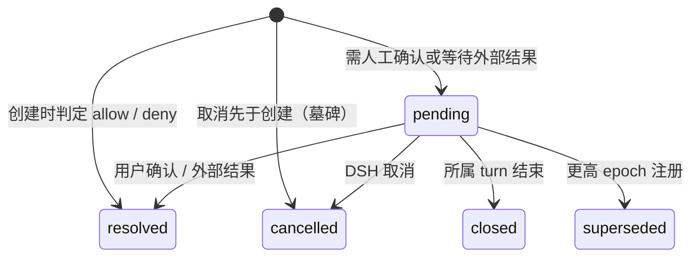
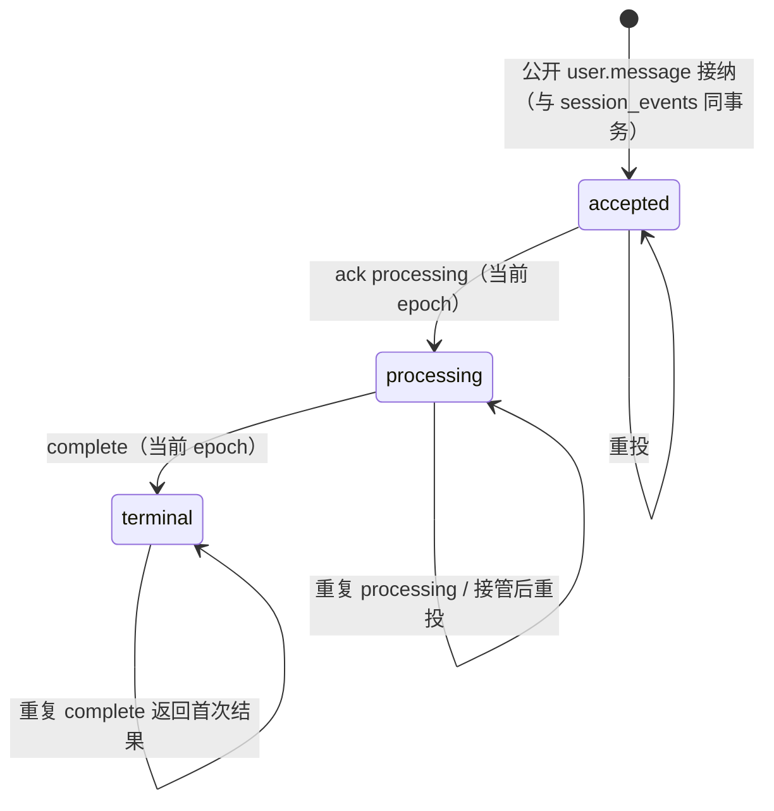

# DSRv1：DSH Session Remote 协议

状态：设计草案（第 3 版），**尚未冻结**，不进入实现。本文定义 `oma-brain-dsh`（下称 DSH）与 OMA 后端之间的执行端协议合同，用于替代当前 Brain 使用的 CCRv2。现行实现见 [沙箱外 Agent 与 CCRv2](../brain-runtime.md)、[Brain Worker 领取](../brain-worker-claim.md) 与 `docs/design/be/ccrv2/`。评审依据为提交 `64f3332`；修订记录见第 18 节。

冻结条件：第 7（审批）、第 9（输入与 turn）、第 10（公开状态 reducer）三个状态机的不变量经评审确认，第 17 节待定问题关闭。

## 1. 背景与结论

CCRv2 的 Worker 协议来自沙箱内运行的 Claude Code（superduck-code）：`oma-brain-dsh/src/ccrv2/wire.ts` 与 `internal/codesessions/worker_output_schema.go` 直接复刻了 Claude Code 的 `StdoutMessage`、transcript 与 `external_metadata`。DSH 接入后形成"DSH 原生 Session/Event → Claude Code 形状 → CMA 公开事件"的两次翻译，并积累了以下补丁：

| 问题 | 现状 |
| --- | --- |
| 私有日志借道 transcript | `dsh_log` 塞进 transcript 类型，靠拼接 UUID `dsh_log:<cs>:<dsh>:<seq>` 去重；seq 连续性、Header 前缀、冲突检测全部在 DSH 端 |
| 公开输出格式混合 | 同一 `/worker/events` 既有 Claude Code 的 `assistant`/`user`/`result`，又有 CMA 原生事件 |
| 回合与状态隐式 | 公开 running 由 worker 状态上报触发，idle 依赖 `result` 与 `worker_turn_started`，输入拒绝读 `worker_status` 与 `external_metadata` |
| 审批存在竞态补丁 | 发出 `can_use_tool` 后需轮询 `GET /worker` 判断是否进入人工确认；待确认记录存于 `external_metadata`，持久化与公开发布分两步 |
| 工具身份靠命名约定 | 后端从 `mcp__server__tool` 风格名称反解工具类型 |
| Claude Code UI 遗留 | `permission_mode`、`post_turn_summary`、`task_summary` 等字段 |

沙箱内 agent 模式已不再需要，DSH 成为唯一执行端。策略是**保留 CCRv2 的传输内核与执行屏障，替换语义层**。

**收益定位**：边界更清楚、删除兼容代码、把隐式状态变成显式不变量。没有测量依据支持性能收益，本文不以减少往返或降低延迟为目标。

**成本定位**：DSRv1 不只是换词汇，它新增了三个需要单独维护的状态机：trajectory 写入与迁移、审批记录生命周期、公开状态 reducer。第 2 节列出删除与新增的职责对照，作为是否值得实施的判断依据。

## 2. 删除与新增的职责对照

| 删除（或收敛） | 新增（或改写） |
| --- | --- |
| Claude Code 输出 schema 与 mapper 分支（`assistant`/`user`/`result`/`task_*`/`compact_boundary`） | DSR 输出白名单与边界映射（第 8 节） |
| internal subagent transcript 的公开投影 | — |
| `parseClaudeToolIdentity` 与名称反解 | 结构化工具身份（7.1） |
| 审批状态轮询与 `external_metadata` 中的待确认键 | `dsr_permission_requests` 与状态机（第 7 节） |
| `worker_turn_started` 与 worker 状态驱动的公开状态 | `dsr_turns` 与显式 reducer（第 9、10 节） |
| DSH 端 trajectory 前缀对账中的去重与冲突判定 | 服务端条件追加与 `dsr_trajectories` 元数据（第 6 节） |
| `external_metadata` 的自由 merge patch | 有类型的 worker state（4.6） |
| sandbox 模式、`session_ingress/*`、60+10 秒租约参数 | — |
| — | 回填任务与迁移围栏（第 13 节） |

不新建事件表：trajectory 继续存放在 `code_session_internal_events`，增加身份列，从而复用已有的全局 `sequence_num`、对象存储、归档、还原与物理删除机制（6.6）。

## 3. 目标、非目标与兼容边界

目标：

- 私有日志由服务端保证每个 DSH Session 的序号连续、身份一致、内容不可变。
- 审批有持久化记录、确定性身份、终态与接管清理；持久化与公开事件同事务。
- task 输入与 turn 有持久化事实，公开状态由一个显式 reducer 计算。
- 公开输出使用 DSR 事件词汇，后端只做校验、身份派生与 CMA 映射。
- 删除 sandbox 模式与 CCRv2 Worker 路由。

非目标：

- 不改变 JetStream 投递、三段 ACK、Redis ACK 定位与入站消息 30 天逻辑期限。
- 不改变 claim 的领取条件、attempts、耗尽 hold、`FailPermanently` 与长轮询。claim 响应丢失会消耗一次 attempt 并等待领取期限，这是现行已接受的行为，本次不改。
- 不改变沙箱侧（`role=sandbox` JWT）的上游代理、`sign-commit`、MITM 证书接口。
- 不改变 DSH 原生 JSONL 格式、本地主存储与异步复制、恢复语义。
- **不放松执行屏障**（3.1）。
- 不引入 outbox，不改变数据库提交与 NATS 发布之间的现有失败语义（3.2）。

### 3.1 保持不变的执行屏障

1. 工具体执行前，刷新本地日志并等待该工具调用所在前缀的 trajectory 远程确认；任一失败时不执行工具体。
2. 公开消息、工具结果与回合终态发布前，等待其来源事件的 trajectory 远程确认。
3. 持久公开输出在发送前，等待捕获时已有的流式预览确认。
4. task 输入按"trajectory 终态确认 → 公开输出确认 → `complete` 确认 → `ack processed`"的顺序结束。
5. 结果已到达但复制未确认时，不得 release 领取。
6. 模型请求前不无条件等待复制。

"远程确认"指追加接口返回的 `next_seq` 已覆盖目标事件。

### 3.2 提交、发布与接收

服务端 `2xx` 只表示 **PostgreSQL 事务已提交**，包括同事务写入的公开事件行。之后经 NATS 扇出到 SSE；发布失败沿用现有语义（不重试发布，客户端经历史与游标重放获得）。DSH 不得把 `2xx` 理解为公开客户端已收到。连接在收到响应前中断时，DSH 按幂等键重试，服务端返回首次结果。

### 3.3 公开 API 的兼容边界

公开事件类型、字段和 SSE 合同不变。但状态来源改变后，以下行为的**时序与归属**会变化，属于需要单独验收的兼容边界：

- `session.status_running` 由服务端在输入接纳、审批解决与接管时发布，不再由 worker 上报触发；公开 running 可能早于 worker 实际开始执行。
- `session.status_idle(requires_action)` 的发布时刻改为审批记录提交时，恢复路径由审批状态机决定。
- 状态事件 ID 改为确定性派生（10.4），重试不再追加内容相同而 ID 不同的状态事件。
- webhook 的 idle 映射与 `stop_reason.event_ids` 的取值来源改为审批表与 turn 表。

## 4. 通用约定与生命周期

### 4.1 路径、版本与能力

- 执行端接口挂载在 `/v1/dsr/` 下，按 chi 子路由注册，不走 `/v1/*` workspace API key 鉴权回退。
- 每个请求携带 `DSR-Protocol: 1`。缺失或不支持返回 `400`，`DSR-Error: unsupported_protocol`。
- 注册响应包含 `capabilities`（字符串数组），表示后端接受的输出类型与输入 kind。DSH 不发送不在其中的类型。v1 的输出与输入词汇固定，新增类型必须先扩展 `capabilities`，所以未知类型返回 400 不会在滚动升级中误伤（切流顺序见 13.2）。
- 所有 ID、epoch、序号在 JSON 中均为字符串。

### 4.2 鉴权

| 凭据 | 用途 | 说明 |
| --- | --- | --- |
| fleet token | `claims`、`release` | 沿用 `code_session.brain_claim_token_file` |
| session token | `/v1/dsr/sessions/{code_session_id}/*` | claim 签发的 JWT，claims 含 `code_session_id`、`epoch`、`protocol: "dsr1"` 与租户身份 |
| model token | `/v1/messages` | 沿用现行 |

epoch 只来自 session token，请求体不携带 `worker_epoch`；服务端在执行授权阶段与写事务内做 fence。CCRv2 路由拒绝 `protocol: "dsr1"` 的 token，DSR 路由拒绝不带该 claim 的 token。

### 4.3 Claim 与 Release

- `POST /v1/dsr/claims?block_ms=25000`：请求与响应字段同现行 claim（`session_id`、`worker_epoch`、`ingress_token`、`model_token`、`claim_expires_at`、`trace_parent`），token 增加 `protocol` claim。**不合并注册，不内嵌 context。**
- 领取 SQL 增加 `metadata.config.worker_protocol = 'dsr1'` 且 trajectory 迁移状态为 `ready`；旧 claim 接口**必须**同时增加 `worker_protocol IS DISTINCT FROM 'dsr1'`，否则新 DSH 以 `idle` 释放后，旧 DSH 可以重新领取并写入旧路径，造成 split-brain。这两个过滤属于 P1 的正确性要求。
- `worker_claim_expires_at` 保持现有职责：领取到注册的窗口，以及 `HoldExhausted`、`FailPermanently`、`admission_failed` 退避的停车列，`ResetExhausted` 与指标照常读取。
- `POST /v1/dsr/claims/{code_session_id}/release`：同现行，字段名不变。

### 4.4 Register

`POST /v1/dsr/sessions/{id}/register`，请求体 `{}`。

- 语义同现行 `worker/register`：同一 epoch 允许重复注册，在同一事务内清空领取请求与期限，写入租约与连接状态。
- **410 恢复路径**：租约过期但 epoch 未被推进时，DSH 以同一 epoch 重新 register 恢复租约，不需要重新 claim 和全量恢复；只有 `409 epoch_superseded` 才需要退役。
- **接管清理**：当本次注册的 epoch 高于审批记录或 turn 记录上的 epoch 时，同一事务内按 7.6 关闭旧 epoch 的 pending 审批，并按 10.3 重新计算公开状态。
- 响应：

```json
{
  "epoch": "7",
  "lease": { "ttl_ms": 20000, "grace_ms": 10000, "heartbeat_interval_ms": 6000 },
  "capabilities": ["output:agent.message", "input:user.message", "..."]
}
```

### 4.5 Heartbeat 与 Context

- `POST /v1/dsr/sessions/{id}/heartbeat`，请求体 `{}`，响应 `{"lease_expires_at": "..."}`；`409 epoch_superseded`、`410 lease_expired`。
- `GET /v1/dsr/sessions/{id}/context`，可选 `DSR-Thread-ID`；内容同现行 `session_context`，`Cache-Control: no-store`。

### 4.6 Worker state

`external_metadata` 替换为有类型的 worker state。先列依赖清单再删除：

| 现用途 | 读写方 | DSRv1 去向 |
| --- | --- | --- |
| `model`：恢复用户最后选择的模型 | DSH 写、DSH 恢复时读 | worker state `model` |
| `oma_trace_turns`：恢复 trace 连续性 | DSH 写与读 | worker state `trace_turns` |
| `managed_agent_tool_permission_request:*`、`pending_action(s)` | 后端写，输入拒绝、`stop_reason.event_ids`、DSH 轮询读 | `dsr_permission_requests`（第 7 节） |
| `task_summary`、`post_turn_summary`、`permission_mode` | 无实际读者 | 删除 |
| `worker_status` | 公开状态同步、输入拒绝、sandbox lifecycle SQL、telemetry | 保留列，值域收敛为 `idle`/`running`，**不产生公开副作用**；lifecycle SQL 改为 `IN ('idle','running')` |

实现前用代码搜索确认 `external_metadata`、`worker_status`、`worker_turn_started` 的全部读点已列入本表。

接口：

- `GET /v1/dsr/sessions/{id}/state` → `{"status": "idle"|"running", "model": "...", "trace_turns": {...}}`。
- `PUT /v1/dsr/sessions/{id}/state`：字段级 patch，只接受上述字段，未知字段 400。

### 4.7 错误

错误体保持 `internal/httpapi.WriteError` 的 Anthropic 兼容形状。机器可读的分支由响应头承载：`DSR-Error` 给出 code，`DSR-Next-Seq` 在 trajectory 错误时给出服务端水位。

| HTTP | `DSR-Error` | DSH 处理 |
| --- | --- | --- |
| 400 | `invalid_request` | 视为缺陷，不重试 |
| 400 | `unsupported_protocol` | 停止进程 |
| 401/403 | `unauthorized` | 停止该会话 |
| 404 | `session_not_found` | 退役会话 |
| 409 | `epoch_superseded` | fence 主线程与全部子线程，停止写入 |
| 409 | `trajectory_header_required` | 先写 Header 再追加 |
| 409 | `trajectory_gap` | 从 `DSR-Next-Seq` 补发 |
| 409 | `trajectory_conflict` | 停止恢复，保留本地文件 |
| 409 | `trajectory_migrating` | 释放为 `shutdown`，稍后重试 |
| 409 | `permission_idempotency_mismatch` | 视为缺陷，停止该会话 |
| 409 | `output_idempotency_mismatch` | 视为缺陷，停止该会话 |
| 409 | `turn_idempotency_mismatch` | 视为缺陷，停止该会话 |
| 409 | `input_not_eligible` | 视为缺陷，停止该会话 |
| 409 | `input_not_completed` | 不 ACK，先完成 `complete` |
| 410 | `lease_expired` | 同 epoch 重新 register（4.4） |
| 413 | `payload_too_large` | 当前输入以 `failed` 结束 |
| 429/5xx | — | 有界退避重试 |

- 缺少 `DSR-Error` 的 4xx（例如中间代理生成的错误）按 `epoch_superseded` 的保守路径处理：fence、停止写入、不 release，等待租约过期后重新领取。
- 429/5xx 重试耗尽的行为沿用现行 CCRv2 客户端对同一路径的处理：屏障路径耗尽时不执行后续工具，当前输入以 `failed` 结束；`complete` 或 heartbeat 耗尽时停止会话。
- 错误合同集中在承载 DSR 的资源包根目录 `errors.go`。

## 5. 身份词汇

| 名称 | 层 | 含义 | 是否公开 |
| --- | --- | --- | --- |
| `session_id`（`sesn_*`） | 公开 API | Managed Agents Session | 是 |
| `session_thread_id`（`sthr_*`） | 公开 API | 公开线程；主线程与子 Agent 线程 | 是 |
| `code_session_id`（`cse_*`） | 执行端 | 一个公开 Session 的执行容器，epoch、租约与 trajectory 的作用域 | 否 |
| `dsh_session_id` | 执行端 | DSH 原生 Session ID；主线程等于 `code_session_id`，子线程为原生 subagent Session ID（即现行传输层 `agent_id`） | 否，不是新的公开身份 |
| trajectory | 执行端 | 一个 `dsh_session_id` 的 Header 与 Event 序列 | 否 |
| `input_id` | 执行端 | task/control 输入的传输稳定 ID（5.1） | 否 |
| `request_id` | 执行端 | 审批记录 ID，确定性派生（7.1） | 否 |

映射关系：`dsh_session_id ↔ session_thread_id` 一对一，在写 Header 时固定且不可变；`parent_dsh_session_id` 必须与原生 `header.parentSession` 一致，服务端校验两者相等。

## 6. Trajectory（私有日志）

### 6.1 资源模型

- 每个 `dsh_session_id` 一条 trajectory，由一个 Header 与**从 0 开始**连续递增的 Event 组成，序号即原生 `SessionEvent.seq`。
- 服务端维护 `next_seq`（已确认条数，空日志为 `"0"`；确认 seq 0、1 后为 `"2"`）与 `header_present`，两者独立表达。

### 6.2 服务端校验的原生身份字段

| 对象 | 字段 | 规则 |
| --- | --- | --- |
| Header | `id` | 等于路径 `dsh_session_id` |
| Header | `parentSession` | 主线程缺省；子线程等于 `parent_dsh_session_id` |
| Header | `version` | 正整数；是否受支持由 DSH `assertVersion` 判定 |
| Event | `seq` | 非负整数，唯一序号来源，请求中不另设外层 seq |
| Event | `type` | 非空字符串 |

### 6.3 比较语义

- 比较定义在 **wire 值的语义**上，与 DSH 现行 `json-equality.ts` 一致：对象键无序，数字按 IEEE 754 双精度数值相等（`1`、`1.0`、`1e2`/`100` 分别相等），字符串按解码后的码点比较（`\uXXXX` 与字面字符相等）。
- 摘要使用 SHA-256 over [RFC 8785 JCS](https://www.rfc-editor.org/rfc/rfc8785)。JCS 恰好实现上述语义，并对重复键报错（返回 `400 invalid_request`）。
- 摘要只用于快速判定；**摘要不同时，服务端回读原行做语义比较再决定是否冲突**，避免历史数据的表示差异造成误判。
- 超过 2^53 的整数在两端都会丢失精度；原生日志不应包含此类数值，样本测试覆盖该边界。
- TS 与 Go 共用样本文件（键序、`1`/`1.0`、指数、转义、Unicode、嵌套、空对象/数组、大整数），两端测试必须得到相同摘要。

### 6.4 写 Header

`PUT /v1/dsr/sessions/{id}/trajectories/{dsh_session_id}/header`：

```json
{ "parent_dsh_session_id": "cse_...", "session_thread_id": "sthr_...", "header": { "...": "原生 SessionHeader" } }
```

- 幂等比较覆盖 `(parent_dsh_session_id, session_thread_id, header)`：全部相同返回 `200`，任一不同返回 `409 trajectory_conflict`。
- 子线程的 parent 必须是同一 Code Session 下已存在的 trajectory，`session_thread_id` 必须是该公开 Session 下已创建的线程。

### 6.5 追加

`POST /v1/dsr/sessions/{id}/trajectories/{dsh_session_id}/events`，请求体 `{"events": [<原生 SessionEvent>, ...]}`。

**一个请求只属于一条 trajectory**。DSH 现行上传队列按 root code session 组织，一个批次可能混合主线程、子线程与子线程 Header；DSR 客户端必须按 `dsh_session_id` 拆分队列，每条 trajectory 内保持顺序，Header 先于 Event。不同 trajectory 之间没有顺序要求。

事务（all-or-nothing）：

1. 锁定 Code Session 并校验 token epoch；不匹配返回 `409 epoch_superseded`。
2. 锁定 `dsr_trajectories` 行；Header 不存在返回 `409 trajectory_header_required`。
3. 请求内 seq 必须连续递增。`seq < next_seq` 的条目按 6.3 比较：相同则跳过，不同返回 `409 trajectory_conflict`。
4. 第一条未确认条目必须等于 `next_seq`，否则返回 `409 trajectory_gap`，并在 `DSR-Next-Seq` 中给出当前值。
5. 超过 32 KiB 的原始 JSON 走 `eventpayload` 外置；插入 internal event 行，分配全局 `sequence_num`，更新 `next_seq`。

响应 `200 {"next_seq": "42"}`。单条事件上限 16 MiB（与对象存储上限一致），请求体上限沿用 ingress 的 16 MiB；单条过大返回 `413`，不靠拆批解决。

### 6.6 存储

trajectory 存放在现有 `code_session_internal_events`，新增 goose migration：

- `code_session_internal_events` 增加 `dsh_session_id text null`、`dsh_seq bigint null`，以及部分唯一索引 `(code_session_uuid, dsh_session_id, dsh_seq) WHERE dsh_session_id IS NOT NULL AND deleted_at IS NULL`。Header 行 `dsh_seq` 为空，由元数据表引用。
- 全局 `sequence_num`、`payload_blob_uuid`、`payload_hash`、`deleted_at`、`uuid` 与租户列保持现有含义；归档、分段、还原、物理删除与 blob GC 继续按全局 `sequence_num` 工作，`transcript_archives` 的唯一键与 codec **不需要改动**。
- 新增元数据表，不创建外键：

```text
dsr_trajectories
  id bigint generated always as identity
  uuid uuid default gen_random_uuid()
  organization_uuid, workspace_uuid, code_session_uuid uuid not null
  dsh_session_id text not null
  parent_dsh_session_id text null
  session_thread_id text null
  header_event_uuid uuid null          -- 指向 code_session_internal_events.uuid
  next_seq bigint not null default 0
  migration_state text not null        -- legacy | migrating | ready
  migration_checkpoint jsonb null
  created_at, updated_at, deleted_at
  unique (code_session_uuid, dsh_session_id)
```

- 该表不对外暴露，不设 `external_id`；`id` 只承担 identity。若评审认为它属于核心业务表，再补 `external_id`。
- Mapper 按 [Yourbatis 指南](../yourbatis-guidelines.md) 拆分文件；bytea、jsonb、nullable 与部分唯一索引需要真实 PostgreSQL 测试。

### 6.7 读取

- `GET /v1/dsr/sessions/{id}/trajectories` → `{"data": [{"dsh_session_id","parent_dsh_session_id","session_thread_id","header_present","next_seq"}]}`。
- `GET /v1/dsr/sessions/{id}/trajectories/{dsh_session_id}?from_seq=0&limit_bytes=4194304` → `{"header": {...}|null, "events": [...], "next_from_seq": "37"|null}`。
  - `from_seq` 包含该序号，`header` 只在 `from_seq = 0` 时返回。
  - 按原始字节累计分页，至少一条，`limit_bytes` 上限 8 MiB。
  - 使用现有"归档 + PostgreSQL"合并读回与外置 payload 还原路径；已归档行不会被判为缺口。
- GET 只做鉴权与归属校验，不要求当前 epoch。旧 epoch 的 token 可以读，不能写。

### 6.8 保留与压缩

- trajectory 是长期日志，沿用 internal events 的保留、归档与物理删除规则，不适用入站消息的 30 天期限。
- 不再使用 `is_compaction` 过滤；原生压缩事件是普通 Event。

## 7. 工具审批

### 7.1 请求

`POST /v1/dsr/sessions/{id}/permissions`：

```json
{
  "input_id": "<input_id>",
  "turn": "3",
  "dsh_session_id": "cse_...",
  "tool_use_id": "toolu_...",
  "tool": { "kind": "builtin" | "mcp" | "custom" | "delegation", "name": "bash", "server": "github" },
  "input": { "command": "npm test" },
  "available": true
}
```

- **身份**：`request_id = "dsrp_" + base32(sha256(code_session_id, dsh_session_id, tool_use_id))`，由服务端派生并在响应中返回；DSH 用同样规则在本地计算。审批按 `(dsh_session_id, tool_use_id)` 去重，恢复者无需知道旧进程的随机 ID 就能取消或查询。
- **归属**：`input_id` 必须是该 Code Session 下处于 `processing` 的 task turn；`dsh_session_id` 对应的线程必须是该输入的目标线程或其委派出的子线程。不满足返回 `409 input_not_eligible`。
- **工具身份**：
  - `builtin`：DSH 内置工具，按 Agent 快照的内置工具集策略判定。
  - `mcp`：外部 MCP 工具，`server` 必填。
  - `custom`：用户定义工具，结果来自公开 `user.custom_tool_result`。
  - `delegation`：`list_agents`、`subagent`、`send_message`、`interrupt_agent`，权限按现行 `delegationToolPermission` 由 multiagent 配置推导。
  - 自托管环境的外部执行（现行 `external && agent_toolset`）由服务端根据环境判定，不由 DSH 声明；判定后与 custom 走同一等待结果路径。
- DSH **在发送请求前**于本地登记等待项（现行已如此），提前到达的 `permission.resolved` 也能完成等待。

### 7.2 记录状态机



- 每个 `request_id` 一行；所有转换都是对同一行的条件更新（`WHERE state = 'pending'`），竞争时只有一个成功，失败方读取并返回当前终态。
- 终态（resolved、cancelled、closed、superseded）不可再转换。

```text
dsr_permission_requests
  id bigint generated always as identity
  uuid uuid default gen_random_uuid()
  organization_uuid, workspace_uuid, code_session_uuid uuid not null
  request_id text not null
  input_id text null                   -- 墓碑为空
  turn bigint null
  dsh_session_id text not null
  session_thread_id text null
  tool_use_id text not null
  request_sha256 bytea null
  state text not null
  decision jsonb null
  public_event_id text null
  worker_epoch bigint not null
  created_at, updated_at
  unique (code_session_uuid, request_id)
```

### 7.3 创建与响应

一个事务完成：锁定公开 Session 与 Code Session（顺序同输入接纳）→ 校验 epoch 与归属 → 计算权限 → 写记录 → **在同一事务内写入公开事件行**（`agent.tool_use`、`session.status_idle(requires_action)` 等）→ 按 10.3 计算状态。事务失败返回 5xx，DSH 幂等重试；不存在"已返回 202 但公开事件缺失"或"公开 requires_action 但没有记录"的中间态。这要求把现行 `persistToolPermissionRequest` 与 `publishWorkerPublicPayloads` 合并为一个 Yourbatis 事务。

| 情形 | 响应 |
| --- | --- |
| 新请求，策略 allow | `200 {"request_id", "state": "resolved", "decision": {"behavior": "allow"}}` |
| 新请求，策略 deny | `200 {"request_id", "state": "resolved", "decision": {"behavior": "deny", "message": "..."}}` |
| 新请求，需人工确认 | `202 {"request_id", "state": "pending"}` |
| 新请求，custom 或外部执行 | 先按 deny/ask 策略判定，顺序与现行 `handleToolPermissionRequest` 一致；未被拒绝时 `202 pending` |
| 子线程已终止 | `200 resolved/deny`，沿用现行 terminated-thread 拒绝 |
| 重试，摘要相同 | 返回当前状态；`resolved` 附 `decision`（含 `external_result`），终态附 `state` |
| 重试，摘要不同 | `409 permission_idempotency_mismatch` |
| 已有墓碑 | `200 {"state": "cancelled"}`，不写公开事件 |

- 重试返回首次判定，不随后续策略变化改变。执行时的重验由 `/sandbox/mcp` 网关负责（每次 `tools/call` 重算，现行行为）；不经过网关的工具以本接口判定为准，与现行一致。
- 云沙箱内策略为 `allow` 的内置工具继续由 DSH 本地放行，不调用本接口。

### 7.4 解决

用户确认或外部结果到达时，公开 API 在事务内把记录从 `pending` 改为 `resolved`，**并在同一事务内按 10.3 重新计算状态**；全部待确认解决后由该事务发布 `session.status_running`。更新失败（记录已是其他终态）时按现行"工具确认已过期"处理公开请求，不投递。成功后经 control lane 投递：

```json
{
  "kind": "permission.resolved",
  "request_id": "dsrp_...",
  "resolution": { "behavior": "allow" | "deny" | "external_result", "updated_input": {}, "message": "...", "external_result": {} }
}
```

DSH 收到时若本地等待项不存在（已取消、turn 已结束或属于旧 epoch），只 ACK，不执行工具。投递丢失时，DSH 可用 7.3 的重试取得终态。

### 7.5 取消

`POST /v1/dsr/sessions/{id}/permissions/{request_id}/cancel`，请求体 `{}`：`pending` 改为 `cancelled` 并重新计算状态；记录不存在时插入墓碑；已是终态时返回当前终态。DSH 在中断与停机放弃等待时调用。

### 7.6 自动关闭

以下事务内，服务端关闭 pending 记录并按 10.3 重新计算状态：

| 触发 | 关闭范围 | 终态 |
| --- | --- | --- |
| `complete`（9.3） | 该 `input_id` 下的 pending | `closed` |
| 公开 `user.interrupt` 被接纳 | 目标线程（缺省为全部线程）的 pending | `closed` |
| 更高 epoch 注册（4.4） | `worker_epoch` 低于新 epoch 的 pending | `superseded` |
| 子线程终止 | 该线程的 pending | `closed` |

接管清理保证：DSH 崩溃后新进程即使不知道旧审批，公开状态也不会停在 `requires_action`，新 `user.message` 不会因残留记录被持续拒绝。

## 8. 公开输出

### 8.1 接口

`POST /v1/dsr/sessions/{id}/output`：

```json
{ "events": [ { "id": "<client idempotency key>", "type": "agent.message", "session_thread_id": "sthr_...", "...": "..." } ] }
```

- `id` 是**客户端幂等键**，必填；公开事件 ID 由服务端从它稳定派生（沿用现有派生规则），两者不同。新端点有独立的请求 schema，不复用要求 `uuid` 的 CCRv2 校验。
- 批次 all-or-nothing：任一条校验失败则整批 400，不部分写入。同 `id` 不同内容返回 `409 output_idempotency_mismatch`。
- 类型白名单由注册时的 `capabilities` 声明，未知类型返回 400。

### 8.2 词汇与边界映射

| DSR `type` | 字段 | 服务端映射 |
| --- | --- | --- |
| `preview.start` / `preview.delta` | `event: {type, id}` / `event_id`, `delta` | 映射为现行 `event_start` / `event_delta`，进入 `CategoryFor`、`IsStreamDelta` 与 `messageStreamPreview` 的既有识别路径；映射在边界完成，内部类型不新增 |
| `agent.message` / `agent.thinking` | `content?` | 原样 |
| `tool.result` | `tool_use_id`、`tool`、`is_error`、`content` | `agent.tool_result` / `agent.mcp_tool_result` |
| `system.message` | `content` | 原样 |
| `session.thread_created`、`session.thread_status_running`/`_idle`/`_terminated` | CMA 字段 | 原样 |
| `agent.thread_message_sent`/`_received`、`agent.thread_context_compacted` | CMA 字段 | 原样 |
| `session.error` | `error`（仅 MCP 连接/鉴权失败类） | 原样 |

- `system.message` 也是客户端可提交的输入类型（用于拒答问题的结算）。两者以写入路径区分：本端点的写入不进入输入接纳与 Worker 投递，这与现行 `/worker/events` 一致，DSRv1 不引入新的冲突。
- 删除 Claude Code 的 `assistant`、`user`、`result`、`task_started`、`task_notification`、`compact_boundary`，以及从 internal subagent transcript 投影公开事件的路径。

### 8.3 双写者合同

模型代理与 DSH 都会写入助手消息相关事件，DSRv1 把现有的隐式规则写成显式合同：

| 事件 | 写者 | 规则 |
| --- | --- | --- |
| 模型流产生的 `agent.message`、`agent.tool_use`、`span.model_request_*` | 模型代理 | 主写者，按 `StableAssistantEventID` 派生 ID |
| 流式预览、完成块的 `agent.message`/`agent.thinking` | DSH `/output` | 使用与模型代理相同的稳定 ID；先到者写入，后到者按 echo hash 比较，相同则视为重复，不同则记录告警并保留先到者 |
| 工具结果、线程事件、`system.message` | DSH `/output` | 唯一写者 |
| 状态事件 | 服务端 reducer（第 10 节） | 唯一写者 |

两侧之间没有顺序保证；SSE 消费方按现行规则去重。

## 9. 输入与 turn

### 9.1 输入身份与种类

`input_id` 是传输稳定 ID，即现行 SSE 帧的 `event_id`：有稳定 payload UUID 时取该 UUID，否则取 `csev_*` transport ID；重投复用同一 ID。

| `kind` | lane | 字段 | turn |
| --- | --- | --- | --- |
| `user.message` | task | `content`、`session_thread_id?` | 是 |
| `user.interrupt` | control | `session_thread_id?` | 否 |
| `permission.resolved` | control | `request_id`、`resolution` | 否 |
| `session.set_model` | control | `model` | 否 |

### 9.2 输入流与回执

- `GET /v1/dsr/sessions/{id}/inputs/stream`：SSE，帧为 `event: input`，`data` 为 `{"id","lane","kind",...}`；两路 consumer、Redis ACK 定位、`Last-Event-ID` 语义同现行。`keep_alive` 改为 SSE 注释行。
- `POST /v1/dsr/sessions/{id}/inputs/ack`：`{"updates": [{"id", "status": "received"|"processing"|"processed", "error"?}]}`，语义同 [Worker Events Delivery](../ccrv2/ccr-v2-api-worker-events-delivery.md)，另加：
  - task 输入的 `processing` 在同一事务内把 turn 从 `accepted` 推进到 `processing`，并写入 `processed_at`。
  - task 输入的 `processed` 必须已有 terminal turn，否则该项 `409 input_not_completed`，不 DoubleAck。
  - `error` 只允许出现在 control lane 的 `processed` 上。
- `complete` 与 `ack processed` 保持两个请求：PostgreSQL 与 JetStream 无法合并为一个事务，现行 ACK 依赖 Code Session 锁、DoubleAck 与重投；分离可以让两者的责任清楚。

### 9.3 Turn 状态机与 `dsr_turns`

```text
dsr_turns
  id bigint generated always as identity
  uuid uuid default gen_random_uuid()
  organization_uuid, workspace_uuid, code_session_uuid, session_uuid uuid not null
  input_id text not null
  session_event_uuid uuid not null      -- 公开 user.message 行
  session_thread_id text not null
  state text not null                   -- accepted | processing | terminal
  outcome text null                     -- success | cancelled | failed | recovered
  reason text null                      -- 见 9.4
  request_sha256 bytea null
  worker_epoch bigint null              -- processing/terminal 时的 epoch
  accepted_at, processing_at, completed_at timestamptz
  unique (code_session_uuid, input_id)
```



- `accepted` 行在公开输入接纳事务内写入，因此**turn 与公开输入同生共死**。
- 必须先 `processing` 再 `complete`；DSRv1 不保留"没有 processing 直接 processed"的旧兼容，恢复、重试路径也必须先回执 `processing`。
- 接管不重置 turn：新 owner 收到重投后以新 epoch 再次回执 `processing`，`worker_epoch` 更新为新值。
- terminal 行永久保留到会话删除或保留期清理，用于幂等与接管补 ACK；跨进程按 `(code_session_uuid, input_id)` 查询。

### 9.4 Complete

`POST /v1/dsr/sessions/{id}/inputs/{input_id}/complete`：

```json
{ "outcome": "success" | "cancelled" | "failed" | "recovered", "reason": "turn_failed" | "worker_shutdown" | "interrupted_recovery" | "quota_exhausted" }
```

- **不接受自由文本**。`reason` 仅在 `failed`/`recovered` 时必填，服务端映射为固定的公开文案（与现行 `turnOutcome` 的四种文案一致）以及现有安全错误分类，避免把 provider 错误、凭据或堆栈带入公开事件。
- 事务，锁顺序同输入接纳（公开 Session → Code Session）：
  1. 校验 token epoch。
  2. 校验 turn 属于该 Code Session 与租户、处于 `processing`；否则 `409 input_not_eligible`。
  3. 已 terminal：请求摘要相同返回首次结果，不同返回 `409 turn_idempotency_mismatch`。
  4. 写 terminal，按 7.6 关闭该输入的 pending 审批。
  5. 写入公开 `system.message`（failed/recovered）与 `session.error`，事件 ID 由 `input_id` 与 outcome 确定性派生。
  6. 按 10.3 计算并写入状态事件。
- 响应 `200 {"outcome", "public_status"}`。
- DSH 在本地 trajectory 中保留 `plugin:oma/input-completion`，用它决定何时调用 `complete`；输入在子线程全部结束或被中断后才算整体完成，由 DSH 在调用前保证。

### 9.5 接管、重试与并发

| 场景 | 行为 |
| --- | --- |
| `complete` 成功，响应丢失或 ACK 失败 | 输入重投给后续 owner；新 owner 从原生日志识别已完成输入，补发输出（幂等）、重调 `complete`（返回首次结果）、`ack processed`；不重做工具、不重复终态 |
| `ack processed` 早于 `complete` | `409 input_not_completed` |
| `complete` 早于 `processing` | `409 input_not_eligible` |
| `complete` A 与接纳 B 并发 | 共享公开 Session 锁串行；reducer 在锁内看到 B 是否已接纳 |
| A failed，B 已排队 | 见 10.2 |
| 旧 epoch 迟到的 `complete` | `409 epoch_superseded` |
| 输入属于其他会话 | `409 input_not_eligible` |

## 10. 公开状态 reducer

### 10.1 原则

公开 Session 与线程状态由**一个** reducer 计算，在持有公开 Session 锁的事务内运行。它是现行 `internal/db/session_event_state.go` 规则的移植，输入来源从 worker 状态与 `external_metadata` 换成 `dsr_turns` 与 `dsr_permission_requests`。**不从零重新推导**：粘滞规则、排队抑制与时间戳对齐按现行实现逐条迁移，并以现有测试固定。

### 10.2 输入事实与输出

输入（按线程）：

- 该线程 accepted/processing 的 turn；
- 该线程 pending 审批（含子线程）；
- 预算暂停（`budget_reached`）状态；
- 最近一次 terminal turn 的 outcome；
- 子线程由 DSH 输出的 `session.thread_status_*`。

规则（每个线程独立计算，再聚合到 Session）：

| 优先级 | 条件 | 线程状态 |
| --- | --- | --- |
| 1 | 预算暂停 | `idle(budget_reached)`，粘滞，按现行规则解除 |
| 2 | 该线程存在 pending 审批 | `idle(requires_action)`，`event_ids` 取 pending 记录的 `public_event_id` |
| 3 | 该线程存在 accepted 或 processing 的 turn | `running` |
| 4 | 子线程由 DSH 报告为 running | `running` |
| 5 | 否则 | `idle`，stop reason 取最近 terminal：`success`/`cancelled` → `end_turn`，`failed`/`recovered` → `retries_exhausted` |

Session 聚合：任一线程 `requires_action` → `idle(requires_action)`；否则任一线程 `running` → `running`；否则取主线程的 idle 原因。主线程失败后子线程结束不覆盖失败 stop reason；`retries_exhausted` 的粘滞与时间戳规则按现行 `resolveIdleStopReasonTx` 迁移。

**失败后仍有排队输入**：A 以 `failed` 结束且 B 已 accepted 时，按上表 B 使主线程保持 `running`，`session.error` 照常发布，DSH 继续处理 B。实现前需要与现行 `HasInputBlockingIdle` 等规则逐条核对；不一致时以现行行为为准并修订本节。

### 10.3 触发点

reducer 只在以下事务内运行，每个触发点都在同一事务内写入状态事件：

| 触发 | 典型结果 |
| --- | --- |
| 公开 `user.message` 接纳 | idle → running |
| 审批创建为 pending | running → requires_action |
| 审批 resolved/cancelled/closed/superseded | requires_action → running 或 idle |
| `complete` | running → idle 或保持 running |
| 更高 epoch 注册 | 清理旧 pending 后重新计算 |
| DSH 输出子线程状态事件 | 聚合变化 |
| 预算暂停与解除 | 按现行 |

`PUT state` 不是触发点。

### 10.4 状态事件 ID

状态事件 ID 由 `(code_session_id, 触发类型, 触发 ID, 结果状态, stop_reason)` 确定性派生，替代现行 `syncPublicSessionFromWorker` 与预算 idle 使用的随机 `ids.New("sevt_")`。同一触发的重试不会追加新的状态事件；结果状态与当前相同时不写事件，与现行"状态未变则丢弃"一致。

### 10.5 依赖迁移

| 现行读点 | DSRv1 来源 |
| --- | --- |
| `validateSessionInputBatch`：`worker_status == requires_action` 或 `external_metadata` pending 时拒绝 `user.message` | 该 Session 存在 pending 审批（任一线程）时拒绝；`budget_reached` 规则不变 |
| `pendingSessionInputTools` / `PendingToolEventIDs` | `dsr_permission_requests` 的 pending 行 |
| `prepareSessionRemovalTx`：`worker_turn_started` 阻止删除/归档 | 存在 processing 状态的 turn 时拒绝；accepted 未 processing 不阻止（与"接纳时清零标记"的现行效果一致） |
| sandbox lifecycle SQL：`worker_status IN ('idle','running','requires_action')` | `worker_status IN ('idle','running')` |
| `syncPublicSessionFromWorker` | 删除，由 10.3 替代 |
| webhook idle 映射与 `stop_reason.event_ids` | reducer 输出 |

`worker_turn_started` 与 `external_metadata` 的列在 P5 删除；在此之前对 dsr1 会话不读不写。

## 11. 运行时能力接口

以下接口语义不变，路径迁移到 `/v1/dsr/sessions/{id}/` 下并改用 session token：

| 现路径 | DSRv1 路径 |
| --- | --- |
| `POST /v2/ccr-sessions/{id}/sandbox/mcp` | `POST .../sandbox/mcp` |
| `/v2/ccr-sessions/{id}/mcp`、`/mcp/*` | `.../mcp`、`.../mcp/*` |
| `POST /v2/ccr-sessions/{id}/web/search`、`/web/fetch` | `.../web/search`、`.../web/fetch` |
| `GET .../worker/subagent-threads/{thread_id}` | `GET .../threads/{thread_id}` |
| worker 图片附件路由 | `.../attachments/*` |
| `POST .../worker/diagnostics` | `POST .../diagnostics` |
| `POST .../worker/otlp/v1/logs`、`/traces` | `POST .../otlp/v1/logs`、`/traces` |

沙箱侧 `/v1/code/upstreamproxy/*` 与 `/v1/code/sessions/{id}/sign-commit` 不在本协议范围。

## 12. 可观测与容量

指标与日志（扩展现有 `oma.brain_claim.*`，字段遵循 Go 日志规范，不记录 payload）：

- trajectory：追加延迟、批大小、`gap`/`conflict` 次数、DSH 端待确认积压。
- permission：创建结果分布（allow/deny/pending）、pending 时长、自动关闭原因（closed/superseded）。
- turn：`complete` outcome 与 reason 分布、`input_not_completed` 次数、processing 到 terminal 时长。
- 回填：会话状态分布、批次耗时、失败原因。
- reducer：每个触发点的状态转换次数。

容量：

- 单条 trajectory 事件 16 MiB，请求体 16 MiB，读取页 8 MiB；单会话 trajectory 无硬上限，按 internal events 现有保留规则治理。
- 追加、审批、`complete` 都锁 `code_sessions` 行，与现行 internal events 写入相同；审批与 `complete` 额外锁公开 Session，锁顺序固定为公开 Session → Code Session → 业务行。
- trajectory 原地存放在 internal events，不存在双份存储窗口。

## 13. 迁移与发布

开发分阶段与生产切流分开：开发可以多个 PR 合入，新接口在切流前不承接生产会话；切流按会话进行，一个会话任一时刻只允许一种协议写入。

### 13.1 开发阶段

| 阶段 | 内容 |
| --- | --- |
| P0 | sandbox 模式弃用。版本 N：`agent_mode: sandbox` 启动时输出弃用警告，行为不变。版本 N+1：删除 sandbox 分支，所有 `== "brain"` 判断变为无条件，`agent_mode` 字段被忽略并告警（不报错，避免旧部署起不来）。P0 前先核对配置模板、Runner、镜像与部署入口 |
| P1 | 后端状态来源替换：`dsr_turns`、`dsr_permission_requests`、reducer、输入拒绝与删除准入改读新表、确定性状态事件 ID；先只对 dsr1 会话生效 |
| P2 | 后端 DSR 接口：claim/register/heartbeat/state/context、inputs、trajectory、permissions（含同事务发布）、output、complete；协议围栏与两侧 claim 过滤；切换开关默认关闭 |
| P3 | 回填任务（13.3） |
| P4 | DSH `src/dsr/` 客户端，按 trajectory 拆队列，完整替换 `src/ccrv2/`；同一构建只说一种协议 |
| P5 | 切流（13.2），稳定后清理（第 14 节） |

P1 先于 P2：同步审批与 `complete` 依赖新的状态来源，反过来做会与旧 worker 状态机冲突。

### 13.2 切流

前置条件：全部后端实例已升级到 P2 版本（旧后端的领取 SQL 没有协议过滤，存在旧后端时不得开启）；回填在目标环境完成演练。

步骤：

1. 开启开关后，新建的 Code Session 直接写入 `worker_protocol = dsr1` 与 trajectory `ready`。
2. 存量会话在无租约时由后台任务回填，完成后转为 dsr1；转换事务推进 epoch，使旧 token 失效。
3. 旧 DSH 与新 DSH 并存，旧 DSH 只领取非 dsr1 会话；存量会话全部转换后下线旧 DSH。
4. 稳定一个发布周期后进入第 14 节清理。

### 13.3 回填

由于 trajectory 原地存放，回填只为已有 `dsh_log` 行补齐身份列并创建元数据行，不复制 payload。

- **执行位置**：后台 River 任务，不在 claim 或 register 请求路径上。
- **对象**：只处理无租约的会话；每批一个事务，事务内校验会话仍无租约、epoch 未变，并写入 `migration_checkpoint`；崩溃后从检查点续跑，可重入。
- **读取**：通过"归档 + PostgreSQL"合并读回并还原外置 payload；从 `encodeURIComponent` 编码的 UUID 解析 `dsh_session_id` 与 seq，Header 由 `:header` 后缀识别；子线程 parent 与公开线程从 Header `parentSession` 和现有子线程记录取得。
- **校验**：按 6.2 与 6.3 检查从 seq 0 起连续、身份一致、无冲突。历史上允许的保留与删除可能造成缺口，`last_internal_sequence_num` 也可能大于可见最大序号，这些都按校验失败处理。
- **状态**：`legacy → migrating → ready`。`migrating` 期间新旧 claim 都不选中该会话，DSR GET 返回 `409 trajectory_migrating`。
- **失败**：校验失败的会话回退为 `legacy`，继续由旧 DSH 服务直到会话结束，并记录告警；不 `permanent` 公开失败，不拼接修复。
- 旧路径数据在全部会话转换且新路径确认可用后才停止写入；由于原地存放，不需要删除旧行。

## 14. 删除范围

| 删除 | 时机 |
| --- | --- |
| sandbox 分支与 `agent_mode` 语义 | P0（两个版本） |
| `/v1` 与 `/v2` 的 `session_ingress/*`、`diag_logs`、WebSocket 退役占位 | P0 版本 N+1 |
| `/v1/code/sessions/{id}/worker/*`、`/v2/sessions/{id}`、`/v2/ccr-sessions/*` | P5 |
| Claude Code 输出 schema 与 mapper 分支、`IsClaudeCodeTranscriptEvent` | P5 |
| `is_compaction` 过滤、按 agent_id 的子线程分页 | P5 |
| `external_metadata`、`requires_action_details`、`worker_turn_started`、60+10 秒租约参数 | P5，删除前用代码搜索确认读点已全部迁移 |
| DSH `src/ccrv2/` | P5 |
| `docs/design/be/ccrv2/` 中仅描述 Claude Code 客户端的文档 | P5；仍有效的传输设计保留并更新路径 |

## 15. 测试计划

按"先失败场景，后成功场景"组织。以下为新增验收项，尚未执行。

- **Claim 与 Register**
  - 失败：旧 claim 不选中 dsr1 会话、新 claim 不选中非 dsr1 或 `migrating` 会话；耗尽 hold 与 `FailPermanently` 行为不变；旧 epoch 注册被拒；协议 token 与路由不匹配被拒。
  - 成功：410 后同 epoch 重新 register 恢复，不全量恢复；接管注册关闭旧 epoch 的 pending，并发布 running/idle。
- **Trajectory**（Mapper SQL 与参数绑定单测；真实 PostgreSQL 验证 bytea、jsonb、nullable 与部分唯一索引）
  - 失败：Header 缺失、seq 缺口、同序号语义不同、Header id 或 parent 不符、parent 或线程不存在、重复键、单条超过 16 MiB、旧 epoch 追加、`migrating` 时读写。
  - 成功：从 seq 0 首次追加返回 `"1"`；重复追加幂等；`from_seq = 0` 返回 Header 与 seq 0；按字节分页；外置 payload 还原；归档后合并读回无缺口；主线程与子线程分队列并行追加。
  - 比较：`1`/`1.0`、指数、键序、转义、大整数的 TS/Go 共用样本；摘要不同但语义相同时不判冲突。
- **Permission**
  - 失败：`input_id` 不属于该会话或未 processing、线程不属于该输入、同 `request_id` 不同内容、取消先到后创建不重开、resolved 与 cancel 竞争只有一个生效、complete 后迟到的确认不执行工具、旧 epoch 迟到审批、事务失败时不出现公开 requires_action。
  - 成功：allow/deny/pending、custom 与外部执行先经策略、delegation 按 multiagent 配置、子线程终止拒绝；resolved 早于 202 仍完成等待；POST 响应丢失后重试取得终态；接管时旧 pending 被 superseded，新输入不再 400；中断与 allow 竞态的两种结果。
- **Turn 与 complete**
  - 失败：任意或其他会话的 `input_id`、未 processing 即 complete、同 outcome 不同 reason、`ack processed` 早于 complete、旧 epoch complete、自由文本被拒。
  - 成功：complete 成功但 ACK 失败后接管，不重做工具、不重复终态；complete A 与接纳 B 并发不覆盖 running；A failed 且 B 排队时继续处理 B。
- **Reducer**：以现行 `session_event_state.go` 测试为基线逐条迁移；增加子线程 pending 对 Session 与线程状态的不同影响、`budget_reached` 粘滞、`retries_exhausted` 不被子线程覆盖、确定性状态事件 ID 重试不重复。
- **删除与归档准入**：processing 未完成时拒绝，accepted 未处理时允许，与现行行为对照。
- **Output**：未知类型 400、整批原子、重复 `id` 幂等、`preview.*` 映射进入既有预览路径、`tool.result` 映射、模型代理与 DSH 双写去重。
- **迁移**：归档历史回填、软删除缺口回退为 legacy、半途崩溃续跑、`migrating` 期间不可领取、转换推进 epoch 后旧 token 被拒、旧 DSH/新 DSH/升级后端并存。
- **DSH**：现有 `ccrv2.test.ts`、`session-reacquisition.test.ts`、`crash.test.ts`、`parallel-tools.test.ts`、`parallel-subagents.test.ts`、`model-replication.test.ts`、`input-recovery.test.ts` 的场景迁移到 DSR 客户端，覆盖 3.1 的全部屏障、A→B→A 接管与 SIGKILL 恢复。
- **集成**：需要真实验证时，按 verify-be Skill 选择 chat 域受影响的最小场景，以及 Transcript 归档、还原、物理删除场景；是否运行由用户决定。

## 16. 已决定

- 基于 CCRv2 传输内核演进，协议名 DSRv1，路径前缀 `/v1/dsr/`；收益定位为边界清晰、删除兼容代码与显式不变量。
- 执行屏障保持不变。
- claim 与 register 保持分离，context 独立读取；`worker_claim_expires_at` 保留 hold 职责；两侧 claim 都加协议过滤。
- epoch 只来自 session token。
- trajectory 原地存放在 `code_session_internal_events`，以 `dsh_session_id`/`dsh_seq` 与元数据表表达；seq 从 0 起，`next_seq`/`from_seq` 为字符串；比较按语义，摘要用 JCS。
- 审批 ID 确定性派生，按 `(dsh_session_id, tool_use_id)` 去重；持久化与公开事件同事务；终态不可逆；complete、中断、接管、子线程终止自动关闭。
- `dsr_turns` 作为 turn 事实来源；`complete` 只接受枚举 reason。
- 公开状态由移植自现行规则的单一 reducer 计算，状态事件 ID 确定性派生。
- 开发分阶段，状态来源替换先于同步审批；切流在后端全量升级后按会话进行；回填异步且失败回退。

## 17. 待定问题

- 10.2 失败后排队输入的行为，需与现行 `HasInputBlockingIdle` 等规则核对。
- `dsr_trajectories` 是否属于需要 `external_id` 的核心业务表。
- 中断时由服务端自动关闭目标线程的 pending（7.6）会改变现行"中断不清理待确认记录"的行为，需要确认公开 API 对迟到确认的现有响应是否保持。
- `session.set_model` 是否需要公开的确认事件。
- 读取分页 `limit_bytes` 默认值与 DSH 恢复内存预算是否匹配。

## 18. 修订记录

| 版本 | 变更 |
| --- | --- |
| 1 | 初稿 |
| 2 | seq 从 0 起；审批增加 `input_id` 与持久化状态机；输入增加持久化事实与 complete 事务；迁移改为全量后端升级后按会话切流 |
| 3 | 补充收益与成本定位及职责对照；claim 与 register 恢复分离，保留 `worker_claim_expires_at` hold 职责，明确 410 恢复与两侧协议过滤；`external_metadata` 依赖清单与有类型 worker state（保留 `model`、`trace_turns` 读回）；身份词汇表；trajectory 改为原地存放在 internal events，复用归档、blob 与保留机制，按 trajectory 拆批，语义比较与 JCS，序号用字符串，新增 `DSR-Next-Seq` 与独立错误码；审批 ID 确定性派生、同事务发布、接管/中断/子线程终止自动关闭；新增 `dsr_turns` 与显式 reducer（移植现行规则、线程维度、触发点、确定性状态事件 ID、依赖迁移）；complete 改为枚举 reason；output 独立 schema、`preview.*` 边界映射、`capabilities` 协商、双写者合同；可观测与容量；P0 两版本弃用；状态来源替换先于同步审批；回填为后台任务且失败回退 |
