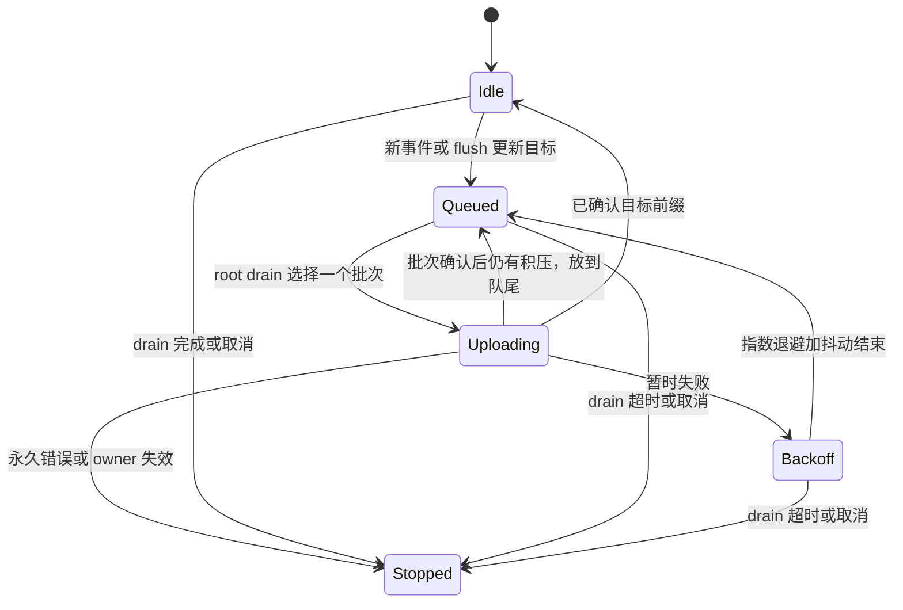
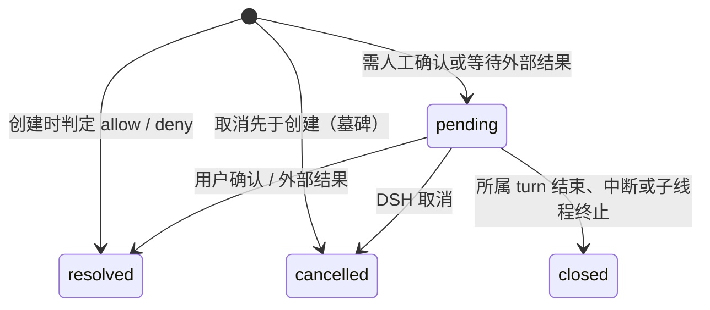
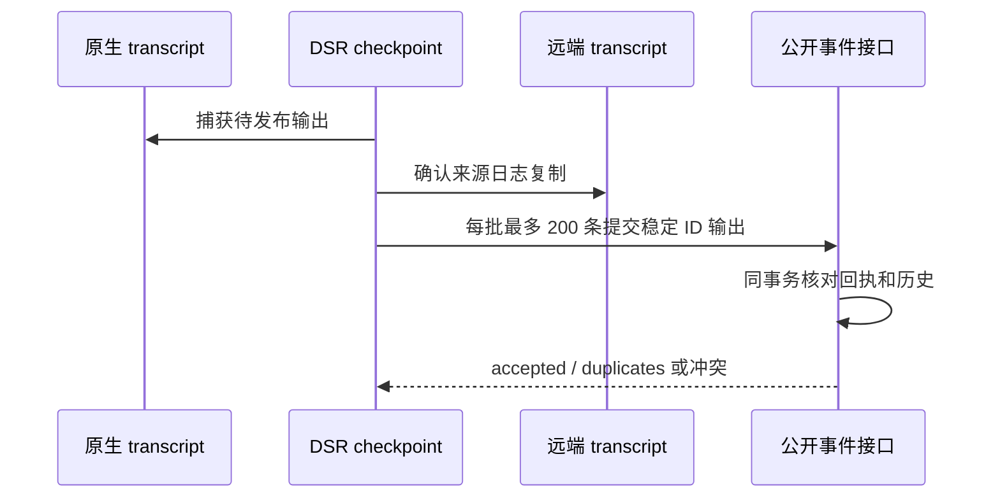
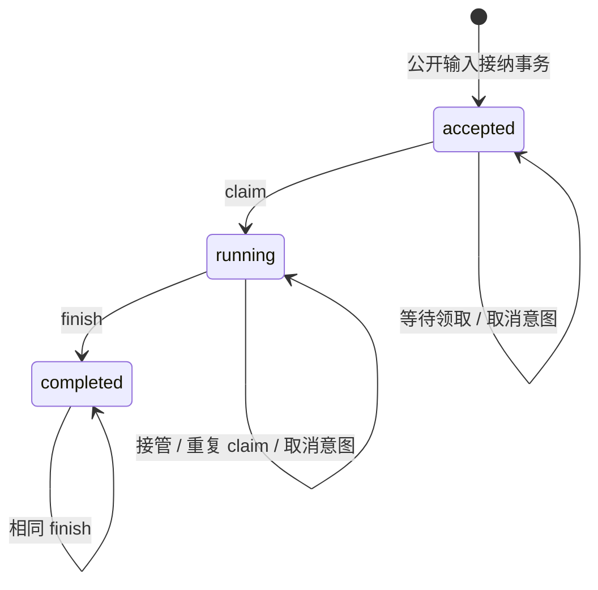

# DSRv1：DSH Session Remote 协议

状态：实验实现（第 20 版），**尚未冻结**，新建 Brain 会话默认使用 DSRv1，存量会话保留原协议。本文定义 `oma-brain-dsh`（下称 DSH）与 OMA 后端之间的执行端协议合同，用于替代当前 Brain 使用的 CCRv2。现行实现见 [沙箱外 Agent 与 CCRv2](../brain-runtime.md)、[Brain Worker 领取](../brain-worker-claim.md) 与 `docs/design/be/ccrv2/`。各接口的请求、响应、状态码与示例见 [DSRv1 接口参考](api-reference.md)。评审依据为 OMA 提交 `64f3332` 与 deepseek-harness 提交 `f3803c9697`（即 [沙箱外 Agent 与 CCRv2](../brain-runtime.md) 记录的 `dsh-v0.2.2-alpha.2` 发布标签所在提交；OMA 通过 npm 固定依赖该发布的包，实现时仍以 lockfile 解析出的版本为准）；修订记录见第 18 节。

当前 14 个主接口与 Brain 原生 host 已接通，已完成逐接口真实后端验收。完整实现边界、表结构差异和验证结果见 [实验实现状态](implementation.md)。归档、清理及生产切流仍不在本轮范围。

冻结条件：第 7（审批）、第 9（输入与 turn）、第 10（公开状态 reducer）三个状态机的不变量经评审确认。第 17 节的待定问题已在第 6 版全部决定，冻结前还需确认 15.1 的完整验收条件及生产生命周期边界。

兼容性复核见 [当前 Brain 与 deepseek-harness 验证](compatibility-review.md)。已确认当前原生 `resume` 会关闭未完成回合，且等待审批时已有 `tool/call`。本仓库已通过 Bun patch、持久执行开始标记与专用执行器补齐同 turn 恢复和挂起，并完成普通运行时测试；验证范围及保留限制见实验实现状态。

全部接口的调用位置、字段来源与请求响应评审见 [逐接口评审](interface-review.md)。当前 14 个主接口及运行时子路由见接口参考；当前普通测试不能代替 DSR 集成验收；实现和实际验证范围见实验实现状态。

## 1. 背景与结论

CCRv2 的 Worker 协议来自沙箱内运行的 Claude Code（superduck-code）：`oma-brain-dsh/src/ccrv2/wire.ts` 与 `internal/codesessions/worker_output_schema.go` 直接复刻了 Claude Code 的 `StdoutMessage`、transcript 与 `external_metadata`。DSH 接入后形成"DSH 原生 Session/Event → Claude Code 形状 → CMA 公开事件"的两次翻译，并积累了以下补丁：

| 问题                    | 现状                                                                                                                                |
| ----------------------- | ----------------------------------------------------------------------------------------------------------------------------------- |
| 私有日志借道 transcript | `dsh_log` 塞进 transcript 类型，靠拼接 UUID `dsh_log:<cs>:<dsh>:<seq>` 去重；seq 连续性、Header 前缀、冲突检测全部在 DSH 端         |
| 公开输出格式混合        | 同一 `/worker/events` 既有 Claude Code 的 `assistant`/`user`/`result`，又有 CMA 原生事件                                            |
| 回合与状态隐式          | 公开 running 由 worker 状态上报触发，idle 依赖 `result` 与 `worker_turn_started`，输入拒绝读 `worker_status` 与 `external_metadata` |
| 审批存在竞态补丁        | 发出 `can_use_tool` 后需轮询 `GET /worker` 判断是否进入人工确认；待确认记录存于 `external_metadata`，持久化与公开发布分两步         |
| 工具身份靠命名约定      | 后端从 `mcp__server__tool` 风格名称反解工具类型                                                                                     |
| Claude Code UI 遗留     | `permission_mode`、`post_turn_summary`、`task_summary` 等字段                                                                       |

沙箱内 agent 模式已不再需要，DSH 成为唯一执行端。策略是**保留 CCRv2 的传输内核与执行屏障，替换语义层**。

**收益定位**：边界更清楚、删除兼容代码、把隐式状态变成显式不变量。没有测量依据支持性能收益，本文不以减少往返或降低延迟为目标。

**成本定位**：DSRv1 不只是换词汇，它新增了三个需要单独维护的状态机：transcript 写入与迁移、审批记录生命周期、公开状态 reducer。第 2 节列出删除与新增的职责对照，作为是否值得实施的判断依据。

## 2. 删除与新增的职责对照

| 删除（或收敛）                                                                                    | 新增（或改写）                                       |
| ------------------------------------------------------------------------------------------------- | ---------------------------------------------------- |
| Claude Code 输出 schema 与 mapper 分支（`assistant`/`user`/`result`/`task_*`/`compact_boundary`） | DSR 输出白名单与边界映射（第 8 节）                  |
| internal subagent transcript 的公开投影                                                           | —                                                    |
| `parseClaudeToolIdentity` 与名称反解                                                              | 结构化工具身份（7.1）                                |
| 审批状态轮询与 `external_metadata` 中的待确认键                                                   | `dsh_permission_requests` 与状态机（第 7 节）        |
| `worker_turn_started` 与 worker 状态驱动的公开状态                                                | `dsh_input_executions` 与显式 reducer（第 9、10 节） |
| DSH 端 transcript 前缀对账中的去重与冲突判定                                                      | 服务端条件追加与 `dsh_transcripts` 元数据（第 6 节） |
| sandbox 模式、`session_ingress/*`、60+10 秒租约参数                                               | —                                                    |
| —                                                                                                 | 一次性切换与存量会话终止（第 13 节）                 |

**DSRv1 的新增数据使用 `dsh_` 表，不修改既有非 DSH 业务表结构**：transcript 事件写入新表 `dsh_transcript_records`，归档写入新表 `dsh_transcript_archives`，与 `dsh_transcripts`、`dsh_input_executions`、`dsh_permission_requests` 一起构成 DSR 的全部持久化。所有 migration 都是新增表，不 ALTER、不在现有大表上建索引、不原地改写历史行；新旧数据完全隔离（6.6），历史执行数据不迁移（第 13 节）。

## 3. 目标、非目标与兼容边界

目标：

- 私有日志由服务端保证每个 DSH Session 的序号连续、身份一致、内容不可变。
- 审批有持久化记录、确定性身份与终态，接管后由新 owner 继承；持久化与公开事件同事务。
- task 输入与 turn 有持久化事实，公开状态由一个显式 reducer 计算。
- 公开输出使用 DSR 事件词汇，后端只做校验、身份派生与 CMA 映射。
- 删除 sandbox 模式与 CCRv2 Worker 路由。

非目标：

- control 保留 JetStream 投递、delivery 回执和 Redis ACK 定位；task 使用数据库 claim/finish，不经 broker 投递。
- 不改变 claim 的领取条件、attempts、耗尽 hold、`FailPermanently` 与长轮询。claim 响应丢失会消耗一次 attempt 并等待领取期限，这是现行已接受的行为，本次不改。
- 不改变沙箱侧（`role=sandbox` JWT）的上游代理、`sign-commit`、MITM 证书接口。
- 保留 DSH 原生事件格式，采用进程内持久化适配与异步服务端复制；不挂载本地 JSONL 后端。恢复语义按 7.7 扩展为中途续执行，需要上游运行时能力。
- **不放松执行屏障**（3.1）。
- 不引入 outbox，不改变数据库提交与 NATS 发布之间的现有失败语义（3.2）。

### 3.1 保持不变的执行屏障

1. 工具体执行前，记录授权后的执行开始标记，捕获原生事件并等待覆盖该标记的 transcript 前缀远程确认；任一失败时不执行工具体。该标记见 7.7，是新增恢复能力的前置条件。
2. 公开消息、工具结果与回合终态发布前，等待其来源事件的 transcript 远程确认。
3. 持久公开输出在发送前，等待捕获时已有的流式预览确认。
4. task 输入按"transcript 终态确认 → 公开输出确认 → finish 确认"的顺序结束，不发送 delivery 回执。
5. 结果已到达但复制未确认时，不得 release 领取。
6. 模型请求前不无条件等待复制。

"远程确认"指追加接口返回的 `next_offset` 已覆盖目标事件。

### 3.2 提交、发布与接收

服务端 `2xx` 只表示 **PostgreSQL 事务已提交**，包括同事务写入的公开事件行。之后经 NATS 扇出到 SSE；发布失败沿用现有语义（不重试发布，客户端经历史与游标重放获得）。DSH 不得把 `2xx` 理解为公开客户端已收到。连接在收到响应前中断时，DSH 按幂等键重试，服务端返回首次结果。

### 3.3 公开 API 的兼容边界

公开事件类型、字段和 SSE 合同不变。但状态来源改变后，以下行为的**时序与归属**会变化，属于需要单独验收的兼容边界：

- `session.status_running` 由服务端在输入接纳、审批解决与接管时发布，不再由 worker 上报触发；公开 running 可能早于 worker 实际开始执行。
- `session.status_idle(requires_action)` 的发布时刻改为审批记录提交时，恢复路径由审批状态机决定。
- 状态事件 ID 改为确定性派生（10.4），重试不再追加内容相同而 ID 不同的状态事件。
- webhook 的 idle 映射与 `stop_reason.event_ids` 的取值来源改为审批表与 input execution 表。
- **等待审批时执行端崩溃**：现行会话停在 `requires_action`，用户响应后才重新领取，而恢复时会把未执行的工具调用直接结束，所以批准实际上不会生效。DSRv1 保留审批请求：会话保持 `idle(requires_action)`，不占用执行端；用户响应后唤醒领取，新 owner 从回合中途恢复（7.7），批准的工具照常执行。对用户而言，审批请求不会因为执行端崩溃而消失，也不会出现"批准了却没有执行"。

## 4. 通用约定与生命周期

### 4.1 路径与版本

- 执行端接口挂载在 `/v1/dsr/` 下，按 chi 子路由注册，不走 `/v1/*` workspace API key 鉴权回退。
- 每个请求携带 `DSR-Protocol: 1`。缺失或不支持返回 `400`，`DSR-Error: unsupported_protocol`。
- **词汇由协议版本固定，不在运行时协商。** v1 的输出类型（8.2）与输入 kind（9.1）以本文白名单为准。任何增删或字段语义变化都必须发布新的协议版本（例如 `DSR-Protocol: 2`），不在 v1 内追加。
- **版本绑定到会话**：register 把请求头中的版本记录到 Code Session（`metadata.config.dsr_protocol_version`）。此后该 epoch 的所有请求必须携带同一版本，否则返回 `400 unsupported_protocol`；后端只向该会话投递该版本定义过的输入 kind。新 epoch 注册时可以换成另一个受支持的版本。
- **部署顺序**：新版本先在全部后端实例上线（后端可同时支持多个版本，按请求头分派），确认没有旧实例后再升级 DSH 使用新版本；下线旧版本前，确认没有会话仍记录旧版本。这与 13.2 的切换顺序（先后端、后 DSH）是同一条纪律，因为版本支持是全后端统一的规则，不依赖单个实例在某次请求中的回答。
- 因此 `/public-events` 对未知类型严格返回 400 不会在升级中误伤：DSH 只发送它注册时所用版本定义的类型，而所有后端实例都已支持该版本。
- DSR 自有的 ID、epoch 与游标（`next_offset`、`from_offset`、`next_from_offset`）在 JSON 中为字符串。内嵌的原生 Header/Event 保持原样，`SessionEvent.seq` 仍是 number，服务端校验它是非负安全整数（≤ 2^53 − 1）。

### 4.2 鉴权

| 凭据          | 用途                                   | 说明                                                                                  |
| ------------- | -------------------------------------- | ------------------------------------------------------------------------------------- |
| fleet token   | `claims`、`release`                    | 沿用 `code_session.brain_claim_token_file`                                            |
| session token | `/v1/dsr/sessions/{code_session_id}/*` | claim 签发的 JWT，claims 含 `code_session_id`、`epoch`、`protocol: "dsr1"` 与租户身份 |
| model token   | `/v1/messages`、`/v1/chat/completions` | 沿用现行                                                                              |

session 路由的 epoch 只来自 session token，请求体不携带 `worker_epoch`；fleet token 认证的 release 例外，在请求体携带 `epoch`；服务端在执行授权阶段与写事务内做 fence。DSR 路由拒绝不带该 claim 的 token，旧 CCRv2 签发的 token 因此无法访问 DSR 接口。

### 4.3 Claim 与 Release

- `POST /v1/dsr/claims?block_ms=25000`：请求与响应字段同现行 claim，仅两处改名：`session_id` 改为 `code_session_id`，`ingress_token` 改为 `session_token`（字段为 `code_session_id`、`worker_epoch`、`session_token`、`model_token`、`claim_expires_at`、`trace_parent`），token 增加 `protocol` claim。**不合并注册，不内嵌 context。**
- 领取 SQL 增加 `metadata.config.worker_protocol = 'dsr1'`：新后端创建的会话都带这个标记，切换前创建的 CCRv2 会话没有它，不会被 DSH 领取（13.2）。
- **可领取条件增加未结算 execution**：除现行的"存在领取请求或公开会话 running/rescheduling"外，若租约加宽限已过，且存在以下任一 execution，也可领取：
  - `running` 且没有 pending 审批（执行中崩溃：公开会话可能已显示 idle 或 running，需要新 owner 接着执行）；
  - completed 输入不再构成领取条件，task 不维护 broker ACK。
- **只在等待审批的 execution 不会被领取**：它在等用户，没有可执行的工作，领取只会让新 owner 在内存里继续空等。审批被解决、取消或关闭时，该事务置位 `worker_claim_requested_at` 并发出领取唤醒（7.4），会话随即满足"存在领取请求"的条件。这也让等待审批成为挂起：执行端可以释放会话（7.7）。
- 这一扩展仍排除：`budget_reached` 暂停中的会话、`worker_claim_expires_at` 未到期的耗尽 hold 与退避行、非 active 或已终止的 Code Session。
- `worker_claim_expires_at` 保持现有职责：领取到注册的窗口，以及 `HoldExhausted`、`FailPermanently`、`admission_failed` 退避的停车列，`ResetExhausted` 与指标照常读取。
- `POST /v1/dsr/claims/{code_session_id}/release`：同现行，字段名不变。

### 4.4 Register

`POST /v1/dsr/sessions/{code_session_id}/register`，请求体 `{}`。

- 语义同现行 `worker/register`：同一 epoch 允许重复注册，在同一事务内清空领取请求与期限，写入租约与连接状态。
- **410 恢复路径**：租约过期但 epoch 未被推进时，DSH 以同一 epoch 重新 register 恢复租约，不需要重新 claim 和全量恢复；只有 `409 epoch_superseded` 才需要退役。
- **接管不清理审批与 turn**：pending 审批与 open turn 都由新 owner 继承。未完成 task 通过 claim 返回给新 owner，新 owner 按原生日志从回合中途恢复（7.7）：已解决的审批用同一 `request_id` 取回结果后继续执行，仍 pending 的审批继续等待或挂起。注册本身不改变公开状态。
- 响应：

```json
{
  "epoch": "7",
  "protocol": "1",
  "observability_enabled": false,
  "trace_export": { "content": false },
  "lease": {
    "ttl_ms": 20000,
    "grace_ms": 10000,
    "heartbeat_interval_ms": 6000
  },
  "context": {
    "model": "model-a",
    "models": { "model-a": { "id": "model-a", "api_backend": "messages" } },
    "cwd": "/workspace",
    "runtime_tools": [],
    "mcp_config": {},
    "subagent_contexts": {}
  }
}
```

`observability_enabled` 与 `trace_export` 保留现行注册响应的配置语义；迁移 OTLP 路径时不能丢失这两个开关。

### 4.5 Heartbeat 与 Context

- `POST /v1/dsr/sessions/{code_session_id}/heartbeat`，请求体 `{}`，响应 `{"lease_expires_at": "..."}`；`409 epoch_superseded`、`410 lease_expired`。
- register 响应必填 context，包含固定根配置与按模板名称索引的 subagent_contexts。首次注册将 Code Session 原始配置与模型目录冻结到 dsh_worker_states.context_snapshot，后续 owner 复用，运行时凭证重新绑定。

### 4.6 错误

执行事务先核对租户，再判断会话状态。已终止返回 `410 session_terminated`，已归档返回 `410 session_archived`；两者并存时终止优先。凭据验签成功但写请求的上下文不可用时，也在原租户范围内核对状态，避免终止被误报为不存在。上述 410 不属于 lease_expired，不触发重新 register，当前 owner 停止写入。

公开 Session 删除/归档沿用运行中保护：持有 Session 事务锁后，以 `dsh_input_executions.status=running` 判断 DSR 是否已经开始执行，拒绝移除运行中的会话；不依赖旧 `worker_turn_started`。仅已接受但尚未领取的输入仍可移除。公开 `user.tool_confirmation` 未指定线程且不存在待审批工具时继续返回 400；指定线程的非待审批输入保留 409 冲突语义。 子线程审批接受原始 child 工具事件 ID 和主线程投影 ID；审批落库与后续 `permission.resolved` 投递使用相同的身份匹配规则。公开确认保留调用方提交的原始引用，不改写历史 payload。

请求字段或业务参数非法仍返回 `400 invalid_request`。未知 DSR 路由返回 `404 route_not_found`，表示路径或协议接线错误；资源查询缺失仍返回 `404 session_not_found`。日志读取规则不变。

接口 1–14 的错误体保持 `internal/httpapi.WriteError` 的 Anthropic 兼容形状。第 11 节的 MCP、OTLP 与二进制附件保留各自原生协议响应，不统一改写错误体。机器可读的分支由响应头承载：`DSR-Error` 给出 code，`DSR-Next-Offset` 在 transcript 错误时给出服务端水位。

| HTTP    | `DSR-Error`                         | DSH 处理                                                                                                      |
| ------- | ----------------------------------- | ------------------------------------------------------------------------------------------------------------- |
| 400     | `invalid_request`                   | 视为缺陷，不重试                                                                                              |
| 400     | `unsupported_protocol`              | 停止进程                                                                                                      |
| 401/403 | `unauthorized`                      | 准入阶段（claim 之后、输入流连上之前）以 `admission_failed` release，由服务端 attempts 裁决；运行中停止该会话 |
| 404     | `session_not_found`                 | 退役会话                                                                                                      |
| 404 | `route_not_found` | 路径或协议接线错误，不重试，不解释为资源删除 |
| 410 | `session_terminated` | 停止当前 owner，不重新 register |
| 410 | `session_archived` | 停止当前 owner，不重新 register |
| 409     | `epoch_superseded`                  | fence 主线程与全部子线程，停止写入                                                                            |
| 409     | `transcript_header_required`        | 先写 Header 再追加                                                                                            |
| 409     | `transcript_gap`                    | 从 `DSR-Next-Offset` 补发                                                                                     |
| 409     | `transcript_conflict`               | 停止恢复，保留已有进程内状态                                                                                  |
| 409     | `permission_idempotency_mismatch`   | 视为缺陷，停止该会话                                                                                          |
| 409     | `public_event_idempotency_mismatch` | 视为缺陷，停止该会话                                                                                          |
| 409     | `finish_idempotency_mismatch`       | 视为缺陷，停止该会话                                                                                          |
| 409     | `input_not_eligible`                | 视为缺陷，停止该会话                                                                                          |
| 410     | `lease_expired`                     | 同 epoch 重新 register（4.4）                                                                                 |
| 413     | `payload_too_large`                 | 客户端主动按条数和字节组批；收到 413 不拆批、不重试，复制失败并以 `permanent` 释放（6.5）                     |
| 429/5xx | —                                   | 有界退避重试                                                                                                  |

- 接口 1–14 中，已取得 session owner 的请求收到缺少 `DSR-Error` 的未知 4xx 时，按保守路径 fence、停止写入、不 release，等待租约过期。claim 启动与运行期鉴权错误仍按 4.3 的领取重试规则处理。运行时能力接口的业务与原生协议错误不套此规则：附件 404、web 策略拒绝、MCP 上游错误和 OTLP 失败由对应客户端处理；网关自身的 epoch/lease 拒绝仍须带明确的 `DSR-Error`。
- 429/5xx 重试耗尽的行为沿用现行 CCRv2 客户端对同一路径的处理：屏障路径耗尽时不执行后续工具，当前输入以 `failed` 结束；结束上报或 heartbeat 耗尽时停止会话。
- 错误合同集中在承载 DSR 的资源包根目录 `errors.go`。

## 5. 身份词汇

| 名称                            | 层       | 含义                                                                                                           | 是否公开             |
| ------------------------------- | -------- | -------------------------------------------------------------------------------------------------------------- | -------------------- |
| `session_id`（`sesn_*`）        | 公开 API | Managed Agents Session                                                                                         | 是                   |
| `session_thread_id`（`sthr_*`） | 公开 API | 公开线程；主线程与子 Agent 线程                                                                                | 是                   |
| `code_session_id`（`cse_*`）    | 执行端   | 一个公开 Session 的执行容器，epoch、租约与 transcript 的作用域                                                 | 否                   |
| `dsh_session_id`                | 执行端   | DSH 原生 Session ID；主线程等于 `code_session_id`，子线程为原生 subagent Session ID（即现行传输层 `agent_id`） | 否，不是新的公开身份 |
| transcript                      | 执行端   | 一个 `dsh_session_id` 的 Header 与 Event 序列                                                                  | 否                   |
| `input_id`                      | 执行端   | task/control 输入的传输稳定 ID（5.1）                                                                          | 否                   |
| `request_id`                    | 执行端   | 审批记录 ID，确定性派生（7.1）                                                                                 | 否                   |

映射关系：子线程的公开 `session_thread_id` **等于**其 `dsh_session_id`（现行 `ccrv2/subagents.ts` 直接以 DSH 生成的 UUID 作为线程 ID），主线程的 `session_thread_id` 是公开 Session 的主线程，`dsh_session_id` 等于 `code_session_id`。该对应关系在子线程的 `session.thread_created` 被接受时固定，之后不可变（8.2）；`parent_dsh_session_id` 是独立业务元数据；Brain 保证与原生 `header.parentSession` 一致，服务端不读取该原生字段。

## 6. Transcript（DSH 原生日志）

术语说明：本文的 transcript 指 **DSH 原生 Session 日志**（Header + Event），存放在新表 `dsh_transcripts` 与 `dsh_transcript_records`，由 `transcriptarchive` 与 `transcriptretention` 扩展后归档、还原与删除。CCRv2 时期写入 `code_session_internal_events` 的 `dsh_log` 行不迁移（第 13 节）。它不是 CCRv2 时代的 Claude Code transcript 格式，也不是可观测性功能中经 OTLP 导出、在 Console 展示的会话轨迹（trajectory）。

### 6.1 资源模型与序号

每个 `dsh_session_id` 对应一条有序记录流。Header 与 Event 统一存储在 `dsh_transcript_records`，服务端只检查 JSON 对象和顶层 `seq`，不检查 `version`、`id`、`isSeeded`、`parentSession`、`type` 或 `data`。

- 缺少 `seq` 的记录作为 Header，位置为 `record_offset=0`，只允许是从位置 0 写入的第一条。
- `seq` 存在时必须为非负安全整数，`record_offset=seq+1`。`null`、字符串、小数、负数、超安全整数以及重复的顶层 `seq` 均拒绝。
- `record_offset` 与 `next_offset` 是存储位置，不是原生事件序号。Header-only 的 `next_offset` 为 `"1"`；Header 加两个 Event 后为 `"3"`。
- 不返回 `header_present`；目录不存在该项才表示未创建。`session_thread_id:null` 仍表示尚未绑定公开线程。

### 6.2 传输与边界

写入使用 `POST /v1/dsr/sessions/{code_session_id}/transcripts/{dsh_session_id}/records?from_offset=0`，Content-Type 为 `application/x-ndjson`。请求体为 UTF-8 JSONL，每条记录必须以 LF 结束，不允许空行；LF 是分隔符，不计入保存的 payload。每行必须是一个合法 JSON 对象。服务端不修剪、不规范化、不重新序列化记录，未知字段及数字文本原样保留。

`from_offset` 必填，为非负十进制字符串；每行映射出的 offset 必须等于 `from_offset + 零基行号`。上限为 200 条、单条 15 MiB、整个请求 16 MiB。

首次写入子日志时通过 query `parent_dsh_session_id` 提交独立父级元数据；父日志必须在同一 Code Session 已存在。根日志不得设置父级，子日志不得缺少父级或引用自身。该参数只在 `from_offset=0` 时允许，重试必须一致。无需先创建公开线程；日志创建成功后，`session.thread_created` 才绑定公开线程。

### 6.3 幂等

同一 transcript 的同一 offset 只允许一份内容。重复位置按 payload 原始字节比较，完全相同则跳过，不同则返回 `409 transcript_conflict`。键顺序、数字写法或空白变化也属于冲突。该规则仅适用于原生日志，公开事件回执继续使用其既有的 JSON 语义摘要。

### 6.4 统一创建与追加

不再提供 `/header` 和 `/events` 接口。Header 可以单独上传，也可与后续 Event 放入同一批 JSONL。成功返回 `200 {"next_offset":"3"}`，表示已确认的位置范围为 `[0,3)`。

### 6.5 事务与唯一约束

1. 在同一 Yourbatis 事务中对 Code Session 取得 `FOR KEY SHARE`，检查 epoch 和 lease。所有 owner 切换仍使用 `FOR UPDATE` fence。
2. 从位置 0 写入时按作用域唯一键创建 transcript，再锁定 transcript 行。非零位置写入不存在的日志返回 `transcript_header_required`。
3. 检查父级元数据、位置连续性和已存前缀的字节一致性。首条新记录必须等于 `next_offset`，否则返回 `409 transcript_gap` 并携带 `DSR-Next-Offset`。
4. 一条多行 INSERT 写入新尾部，更新 `next_offset`，一起提交；任一错误回滚，包括首次创建的 transcript。全重复请求不更新水位。

数据库的 `UNIQUE(transcript_uuid, record_offset)` 兜底位置唯一性；行锁保护连续性和水位。两者不能替代字节一致性比较。原生 `seq` 的解析属于 HTTP 边界，DB 接收命名记录类型并校验存储位置，不解析 payload。

### 6.5.1 客户端批量复制与背压

当前 DSR 客户端使用 OMA `sessionPersistence` 进程内适配器，以冻结的原生事件作为唯一待上传缓冲区，复制层借用其只读视图，不另存事件数组。没有本地 JSONL、WAL 或持久化 outbox；服务器确认是唯一持久化屏障。每条 transcript 使用以下下一序号水位：

| 水位            | 含义                                       |
| --------------- | ------------------------------------------ |
| `readyNext`     | 已捕获且可上传的进程内事件前缀             |
| `requestedNext` | drain 当前需要追赶的前缀                   |
| `confirmed`     | 远端已经确认的前缀，等价于 `confirmedNext` |

恢复使用一次目录枚举取得各 transcript 的 `next_offset`。分页接收的记录总数（包含 Header）必须严格等于该水位，提前结束、读取超过水位或到达水位后仍返回续页游标均拒绝恢复；旧缓存与确认水位不提交。读取期间观察到增长也拒绝，由下个 owner 重新获取目录，不逐 transcript 重新枚举目录。根日志和子线程采用相同规则。

恢复后，`readyNext` 与 `requestedNext` 直接从 `confirmed` 起步。字节索引以恢复时的已确认下一序号为基点，只计算之后新增事件的累计大小，不重新序列化已确认历史；背压继续包含在飞但尚未确认的事件。

只有已捕获且完成事件格式校验的事件可以上传。Header 必须先于本 transcript 的 Event，父 transcript 的 Header 必须先于子 transcript 的 Header。每批最多 200 条，常规目标为完整 JSONL 请求体的 4 MiB UTF-8 字节，计入每行的 LF。超过目标、但不超过 15 MiB 硬限制的单条独立发送；收到 413 直接作为永久失败处理，不拆批、不重试。主动组批不会等待攒满。

每个 root code session 使用一个 drain，最多一个 transcript 写请求在飞。新事件仅更新目标与合并调度，不为每个事件增加独立 Promise 同步任务。drain 每次只处理一个 Header 或一个 Event 批次，未完成的 transcript 放到队尾，与其它主、子 transcript 轮转；各 root 可独立复制。暂时失败的 transcript 退避期间不占用 root 的发送机会。

每个成功 Event 请求必须校验响应 `next_offset` 覆盖本批末尾的下一存储位置。只在确认成功后推进对应批次的水位；后续批次失败不撤回已确认进度。响应丢失时重传相同原生 seq，服务端根据内容一致性去重。`transcript_gap` 停止当前 owner 的复制并释放执行权；后续 owner 完整恢复远端日志，不在活跃运行时中对账或拼接本地历史。



背压按 root 汇总主、子 transcript 已捕获且远端未确认的原始事件字节，包含在飞批次和尚未确认的 Header。默认高水位为 32 MiB、低水位为 16 MiB，可通过复制服务配置覆盖。达到高水位后，模型请求与工具派发边界等待；降至低水位解除等待。正在执行的操作仍可追加并持久化结果，因此这是执行准入的软水位。持久化插件的 session/event 监听器同步捕获事件并通知复制泵，不等待网络；复制层不通过第二个监听维护事件副本。已有工具派发、模型请求、输入完成等强制复制屏障仍等待目标全部确认，不能被低水位放宽。

`flush()` 捕获调用时主、子 transcript 的目标前缀；该范围内的 Header 和事件得到确认后返回，之后新增事件不延长这次等待。暂时错误使当前 flush 显式失败，后台继续退避重试；容量等待者可继续等待恢复。owner 失效、历史冲突、不可序列化或超限事件、永久请求错误均停止复制并拒绝相关等待者。非法事件等 `TranscriptUploadError` 通过 worker 的 `permanent` 释放路径处理，避免反复领取同一份不可复制日志。

正常关闭先停止执行并捕获最终事件，再对最终目标执行有期限的 drain，默认 5 秒。超时或取消时中断在飞 HTTP、结束 flush 与容量等待，不推进确认水位，并报告未确认事件数、字节数和在飞状态。owner 的任务排空期限同样会中断复制，避免 shutdown 卡在网络等待。重新接管仅完整恢复远端日志，进程内未上传尾部不作为恢复依据；崩溃后可能丢失，不补传。

`status()` 提供未确认事件数、字节数、最早积压时长和在飞状态；背压等待/解除与 drain 失败输出仅含计数和时长的诊断。背压限制未确认积压，不是整个进程或完整历史缓存的内存硬上限。已确认历史仍由原生运行时与进程内 transcript 缓冲区持有，复制调度层不另存历史数组；本次不改变历史保留策略。

普通回归通过 `oma-brain-dsh/tests/transcript-upload.test.ts`、`replication-scheduling.test.ts`、`transcript-streaming.test.ts` 与 `dsr-runtime.test.ts` 覆盖 UTF-8 组批、非法水位、单条超限、413 不拆批且永久失败、主子公平调度、在飞背压、本地追加不受网络阻塞、flush 目标、响应丢失重传、部分批次成功、超时取消及原有冷接管/SIGKILL 行为。它们使用进程内持久化适配、fake 或临时 HTTP 服务，不代替真实 PostgreSQL、跨实例与对象存储验收。

真实复制集成验收使用 `just verify-be chat doctor replication` 与 `just verify-be chat replication`，范围和四个强制证据阶段见 [复制功能地图](../../../../.agents/skills/verify-be/features/replication.md)。完整 DSR owner/模型/沙箱另行验收，不以组件集成代替。

### 6.6 存储与迁移

`dsh_transcripts` 保留租户、Code Session、DSH ID、父级与公开线程绑定，以及 `next_offset`。`dsh_transcript_records` 保存租户、`transcript_uuid`、`record_offset` 和 `payload bytea`，不创建外键。

`00115_dsh_runtime.sql` 直接创建最终的 transcript 元数据和 bytea 记录表，Header 为 offset 0。Brain 恢复后只上传新增尾部，不重新上传确认前缀。DSR 的六张表在同一个 migration 中创建，Down 删除这些表。已应用旧实验 schema 的开发库需要显式重建或备份后转换，不会自动重跑修改后的 migration。

### 6.7 读取

目录仍使用 `GET /v1/dsr/sessions/{code_session_id}/transcripts`，按 DSH ID 分页，返回身份、父级、公开线程绑定和 `next_offset`。

记录使用 `GET /v1/dsr/sessions/{code_session_id}/transcripts/{dsh_session_id}/records?from_offset=0`，返回原始 JSONL，每页最多 200 条，Header 计入条数。响应头 `DSR-Next-Offset` 为当前确认水位；还有下一页时携带 `DSR-Next-From-Offset`，末页省略。GET 仍只做鉴权与归属检查，不要求当前 epoch。

Brain 以目录水位为本次恢复快照。逐行检查 offset 对应的原生 seq、Header 身份及 Harness 格式；每页水位必须与目录一致。分页提前结束、超过快照或停滞都拒绝恢复，不替换已有缓存。原生事件计数为 `next_offset-1`，与运行时的 confirmed/readyNext 分开。

### 6.8 保留与压缩

当前 DSH transcript 保存在 PostgreSQL，尚未实现大事件对象外置、归档、按保留期清理或 purged 状态。现有 Transcript GC 不处理这些新表，也没有删除最后副本的受支持操作。读取不存在的 transcript 返回 404 session_not_found；当前后端不返回 transcript_purged，Brain 不为它保留专用分支。

未来增加归档与清理时，必须同时定义最后副本删除后的持久标记、读取与追加的错误、领取过滤及恢复行为，再纳入协议和测试；不能只增加一个错误码。归档后删除 PG 行必须仍可从完整副本读取和还原，外置对象必须纳入引用检查。未实现这些条件前，不得把直接删除记录作为受支持的清理流程。

原生压缩事件是普通 Event，不使用 is_compaction 过滤。

### 6.9 Harness 格式升级

后端不限制 Harness 格式版本。Brain 负责版本支持、原生身份、父级一致性及恢复校验。DSR 仅依赖 JSONL 分隔和 `seq` 合同，新增原生字段或修改版本号无需同步修改后端。

已确认记录不可改写。会重写历史或改变 seq 的 Harness 迁移仍需独立的数据迁移方案，不能把转换后的前缀作为重试上传。`DSR-Protocol` 约束传输及序号语义，不协商 Harness 版本。本次仍为未冻结实验协议，需要 Brain 与后端同时升级。

## 7. 工具审批

### 7.1 请求

`POST /v1/dsr/sessions/{code_session_id}/permission-requests`：

```json
{
  "input_id": "<input_id>",
  "turn": "3",
  "dsh_session_id": "cse_...",
  "tool_use_id": "toolu_...",
  "tool": { "kind": "builtin" | "mcp" | "custom" | "delegation", "name": "bash", "server": "github" },
  "input": { "command": "npm test" },
  "available": true
}
```

- **身份**：`request_id = "dsrp_" + base32(sha256(code_session_id, dsh_session_id, tool_use_id))`，由服务端派生并在响应中返回；DSH 用同样规则在本地计算。审批按 `(dsh_session_id, tool_use_id)` 去重，恢复者无需知道旧进程的随机 ID 就能取消或查询。
- **归属**：`input_id` 必须是该 Code Session 下处于 `running` 的 task execution；`dsh_session_id` 对应的线程必须是该输入的目标线程，或同一 Code Session 内的子线程。不满足返回 `409 input_not_eligible`。
- **子线程执行与输入的关联**：同一子线程可以被多次委派，静态的 parent 关系只能证明它属于该会话，不能证明某次调用属于当前输入。DSRv1 以 DSH 声明的 `input_id` 为准；服务端能校验的只有"该输入正在 running"和"线程在同一会话树内"。由于 DSH 串行处理 task 输入，同一时刻至多有一个 running execution，这一约束足以排除跨输入串扰。
- **接管继承审批**：`request_id` 由 `(code_session_id, dsh_session_id, tool_use_id)` 派生，新 owner 从原生日志得到同一个 `tool_use_id`，就能算出同一个 `request_id`，用相同请求重新调用即可取得当前状态：`resolved` 时直接拿到决定，`pending` 时继续等待（7.7）。审批记录上的 `worker_epoch` 只是审计值，不影响继承。
- **工具身份**：
  - `builtin`：DSH 内置工具，按 Agent 快照的内置工具集策略判定。
  - `mcp`：外部 MCP 工具，`server` 必填。
  - `custom`：用户定义工具，结果来自公开 `user.custom_tool_result`。
  - `delegation`：`list_agents`、`subagent`、`send_message`、`interrupt_agent`，权限按现行 `delegationToolPermission` 由 multiagent 配置推导。
  - 自托管环境的外部执行（现行 `external && agent_toolset`）由服务端根据环境判定，不由 DSH 声明；判定后与 custom 走同一等待结果路径。
- DSH 在发送请求前登记等待项，缓存提前到达的 `permission.resolved`。首次 HTTP 响应完成请求校验后，通知直接完成等待；SSE 连接或重连成功时立即重查 pending 审批，无通知时每 10 秒重查，默认等待 60 秒后挂起原生 turn。

### 7.2 记录状态机



- 每个 `request_id` 一行；所有转换都是对同一行的条件更新（`WHERE state = 'pending'`），竞争时只有一个成功，失败方读取并返回当前终态。
- 终态（resolved、cancelled、closed）不可再转换。

```text
dsh_permission_requests
  id bigint generated always as identity
  uuid uuid default gen_random_uuid()
  organization_uuid, workspace_uuid, code_session_uuid uuid not null
  request_id text not null
  input_id text null                   -- 墓碑可为空
  turn bigint null
  dsh_session_id text not null         -- 墓碑也必填，由取消请求提供
  session_thread_id text null
  tool_use_id text not null            -- 墓碑也必填，由取消请求提供
  request_sha256 bytea null
  state text not null                    -- pending | resolved | cancelled | closed
  decision jsonb null
  public_event_id text null
  worker_epoch bigint not null
  created_at, updated_at
  unique (code_session_uuid, request_id)
```

### 7.3 创建与响应

一个事务完成：锁定公开 Session 与 Code Session（顺序同输入接纳）→ 校验 epoch 与归属 → 计算权限 → 写记录 → **在同一事务内写入公开事件行**（`agent.tool_use`、`session.status_idle(requires_action)` 等）→ 按 10.3 计算状态。事务失败返回 5xx，DSH 幂等重试；不存在"已返回 202 但公开事件缺失"或"公开 requires_action 但没有记录"的中间态。这要求把现行 `persistToolPermissionRequest` 与 `publishWorkerPublicPayloads` 合并为一个 Yourbatis 事务。

| 情形                      | 响应                                                                                            |
| ------------------------- | ----------------------------------------------------------------------------------------------- |
| 新请求，策略 allow        | `200 {"request_id", "state": "resolved", "decision": {"behavior": "allow"}}`                    |
| 新请求，策略 deny         | `200 {"request_id", "state": "resolved", "decision": {"behavior": "deny", "message": "..."}}`   |
| 新请求，需人工确认        | `202 {"request_id", "state": "pending"}`                                                        |
| 新请求，custom 或外部执行 | 先按 deny/ask 策略判定，顺序与现行 `handleToolPermissionRequest` 一致；未被拒绝时 `202 pending` |
| 子线程已终止              | `200 resolved/deny`，沿用现行 terminated-thread 拒绝                                            |
| 重试，摘要相同            | 返回当前状态；`resolved` 附 `decision`（含 `external_result`），终态附 `state`                  |
| 重试，摘要不同            | `409 permission_idempotency_mismatch`                                                           |
| 已有墓碑                  | `200 {"state": "cancelled"}`，不写公开事件                                                      |

校验顺序：鉴权与 epoch → **按 `request_id` 查找已有记录**（墓碑或任何终态、pending，命中则按上表返回，不再做后续校验）→ 新建前的归属校验（`input_id` 处于 running、线程归属）→ 权限计算。终态重试和墓碑因此不会因为execution 已不再 running 而被拒绝。

- 重试返回首次判定，不随后续策略变化改变。执行时的重验由 `/sandbox/mcp` 网关负责（每次 `tools/call` 重算，现行行为）；不经过网关的工具以本接口判定为准，与现行一致。
- 云沙箱内策略为 `allow` 的内置工具继续由 DSH 本地放行，不调用本接口。

### 7.4 解决

公开 `user.tool_confirmation`、`user.tool_result` 的 `tool_use_id` 和 `user.custom_tool_result` 的 `custom_tool_use_id` 在事件入口归一化为 `SessionEvent.ToolUseID`。DSR 在接纳结果及查询已解决审批时，使用这一字段匹配审批的 `public_event_id`；指定线程时还须符合审批归属。普通工具结果和自定义工具结果均映射为 `external_result`，保留 `content` 与 `is_error`。

用户确认或外部结果到达时，公开 API 在事务内把记录从 `pending` 改为 `resolved`，**并在同一事务内按 10.3 重新计算状态**；全部待确认解决后由该事务发布 `session.status_running`。如果此时没有有效租约（执行端崩溃或已挂起），同一事务置位 `worker_claim_requested_at`，提交后发出领取唤醒，使会话被重新领取。取消（7.5）与自动关闭（7.6）同样在没有有效租约时请求领取，以便新 owner 结束该 turn。更新失败（记录已是其他终态）时按现行"工具确认已过期"处理公开请求，不投递。成功后经 control lane 投递：

```json
{
  "kind": "permission.resolved",
  "request_id": "dsrp_...",
  "resolution": { "behavior": "allow" | "deny" | "external_result", "updated_input": {}, "message": "...", "external_result": {} }
}
```

DSH 收到时若本地等待项不存在（已取消、turn 已结束或属于旧 epoch），只 ACK，不执行工具。投递丢失时，DSH 可用 7.3 的重试取得终态。

### 7.5 取消

`POST /v1/dsr/sessions/{code_session_id}/permission-requests/{request_id}/cancel`：

```json
{
  "dsh_session_id": "cse_...",
  "tool_use_id": "toolu_...",
  "input_id": "<input_id>"
}
```

- `request_id` 不可逆，服务端无法从它还原身份，所以请求体必须提供 `dsh_session_id` 与 `tool_use_id`。服务端按 7.1 重新派生，结果与路径不一致返回 `400 invalid_request`。`input_id` 可选，提供时按 7.1 校验归属。
- `pending` 改为 `cancelled` 并重新计算状态；记录不存在时用这些字段插入墓碑；已是终态时返回当前终态。
- DSH 在中断与停机放弃等待时调用。

### 7.6 自动关闭

以下事务内，服务端关闭 pending 记录并按 10.3 重新计算状态：

| 触发                         | 关闭范围                             | 终态     |
| ---------------------------- | ------------------------------------ | -------- |
| 结束上报（9.3）              | 该 `input_id` 下的 pending           | `closed` |
| 公开 `user.interrupt` 被接纳 | 目标线程（缺省为全部线程）的 pending | `closed` |
| 子线程终止                   | 该线程的 pending                     | `closed` |

接管不关闭审批。执行端崩溃后，pending 审批原样保留，公开状态保持 `requires_action`，这与事实一致：会话确实在等用户。用户可以批准、拒绝或中断；任何一种都会关闭等待并唤醒领取。

### 7.7 接管恢复与挂起

**DSH 的恢复要求**（P4 的前置条件）：新 owner 从原生日志**从回合中途继续**，而不是把未完成的回合直接结束。恢复必须检查整个未完成工具批次，不能只检查最后一个工具调用。

**实现阻断**：当前 `tool/call` 在审批之前记录，所以“有 `tool/call`、没有 `tool/result`”也可能是尚未批准、从未执行的调用。需增加授权后、工具体前持久化并远程确认的执行开始标记，按该标记区分未执行与结果未知；同时提供不自动补齐回合终态的恢复接口。下表基于这一待验证标记，不代表当前依赖已具备这些能力。具体要求见 [兼容性复核](compatibility-review.md)。

| 原生日志中的状态                                           | 含义                       | 恢复动作                                                                                                                                                                  |
| ---------------------------------------------------------- | -------------------------- | ------------------------------------------------------------------------------------------------------------------------------------------------------------------------- |
| 模型步骤已记录（`assistant/message`），后续没有工具调用    | 模型已经回答               | 从下一步继续，不重新请求模型                                                                                                                                              |
| 有工具调用块，但没有执行开始标记，无论是否已有 `tool/call` | 工具体尚未派发             | 需要审批的工具：用同一 `request_id` 和原始参数调用 permission-requests，`resolved` 按决定执行或拒绝，`pending` 继续等待；不需要审批的工具：经执行开始标记及复制屏障后执行 |
| 有执行开始标记，没有 `tool/result`                         | 工具可能已经执行，结果未知 | **不重放**，沿用 `TOOL_OUTCOME_UNKNOWN`，提示模型先核实                                                                                                                   |
| 有 `tool/result`                                           | 工具已完成                 | 从下一步继续                                                                                                                                                              |

审批记录为 `cancelled` 或 `closed` 时，按拒绝处理该工具调用；所属输入已被中断时，以 `cancelled` 结束该 turn。

**挂起**：会话的所有 open turn 都只在等待 pending 审批时，DSH 可以在等待超过空闲退役时限（默认 60 秒）后关闭输入流并以 `idle` release，释放执行端容量。此时：

- input execution 保持 `running`，审批保持 `pending`，公开状态保持 `requires_action`；
- task 保持数据库 running 状态，新 owner 通过 inputs/claim 恢复；
- 审批被解决、取消、关闭，或收到中断时，服务端唤醒领取（7.4），新 owner 按上表恢复。

挂起不改变任何公开事件，用户感知不到执行端是否在内存中等待。

**边界**：等待超过入站消息的 30 天逻辑期限时，输入会过期，turn 无法再恢复。此时服务端以 `failed` 结束该 turn 并关闭其审批，公开 `session.error`。

## 8. 公开输出

### 8.1 接口

`POST /v1/dsr/sessions/{code_session_id}/public-events`：

```json
{
  "events": [
    {
      "id": "<client idempotency key>",
      "type": "agent.message",
      "session_thread_id": "sthr_...",
      "...": "..."
    }
  ]
}
```

- `id` 必填。普通输出以它作为客户端幂等键，由服务端按现行规则派生公开 ID。模型相关 `agent.message`/`agent.thinking` 则沿用 Brain 与模型代理已生成的 `StableAssistantEventID`，该 `sevt_*` 直接作为最终公开 ID，不再二次派生。预览指向同一最终 ID，并保留 `model_request_start_id` 关联。新端点有独立请求 schema，不复用要求 `uuid` 的 CCRv2 校验。
- 每批 1–200 条。**校验**对整批生效：任一条（包括预览）不合法则整批 400，不写入也不扇出。
- **持久事件**（除 `preview.*` 外的全部类型）在一个事务内写入，要么全部写入，要么全部不写。回执只保存原始事件的版本化摘要 `exact-json-sha256-v1:<SHA-256 hex>`，使用精确十进制规范化后计算。相同 ID 比较摘要，字段顺序与空白变化仍幂等；内容变化返回冲突。公开映射、线程创建与回执提交保持同事务。回执暂不独立过期，随可重放日志生命周期设计清理。
- **预览事件**（`preview.start`、`preview.delta`）不落库、不参与持久回执幂等比较、不计入 accepted/duplicates。纯预览批次校验当前 worker epoch 与租约后直接扇出，跳过持久事务、Session 行锁与状态归约；混合批次先提交持久事件再逐条扇出预览。Brain 原样缓冲追加片段最多 100ms，每批最多 200 条，常规目标 4 MiB；不发送累计文本快照。块结束、持久输出 checkpoint 前刷新缓冲并保持发送顺序，停止时取消定时器。
- 响应 `200 {"accepted": <新写入条数>, "duplicates": <因 id 已存在且内容相同而跳过的条数>}`。
- 类型白名单由会话注册时的协议版本决定（4.1），未知类型返回 400。

### 8.2 词汇与边界映射

| DSR `type`                                                                      | 字段                                         | 服务端映射                                                                                                                                             |
| ------------------------------------------------------------------------------- | -------------------------------------------- | ------------------------------------------------------------------------------------------------------------------------------------------------------ |
| `preview.start` / `preview.delta`                                               | `event: {type, id}` / `event_id`, `delta`    | 映射为现行 `event_start` / `event_delta`，进入 `CategoryFor`、`IsStreamDelta` 与 `messageStreamPreview` 的既有识别路径；映射在边界完成，内部类型不新增 |
| `agent.message` / `agent.thinking`                                              | `content?`、`model_request_start_id?`        | 原样；模型块保留最终公开 ID 与请求关联                                                                                                                 |
| `tool.result`                                                                   | `tool_use_id`、`tool`、`is_error`、`content` | `agent.tool_result` / `agent.mcp_tool_result`                                                                                                          |
| `system.message`                                                                | `content`                                    | 原样                                                                                                                                                   |
| `session.thread_created`、`session.thread_status_running`/`_idle`/`_terminated` | CMA 字段                                     | 原样                                                                                                                                                   |
| `agent.thread_message_sent`/`_received`、`agent.thread_context_compacted`       | CMA 字段                                     | 原样                                                                                                                                                   |
| `session.error`                                                                 | `error`（仅 MCP 连接/鉴权失败类）            | 原样                                                                                                                                                   |

- `session.thread_created` 被接受的前提：对应 `dsh_session_id` 的 transcript 已存在，且其 parent 与事件中的 `parent_thread_id` 一致；接受时把 `session_thread_id` 写入 `dsh_transcripts`。重复的同一事件幂等，同一 transcript 绑定不同线程返回 `409 public_event_idempotency_mismatch`。
- 线程状态与线程消息事件的 `id` 必须由原生身份确定性派生（例如 `<thread>_<kind>_<turn>_<seq>`），替代现行 `crypto.randomUUID()`，以便重启后补发时去重。
- `system.message` 也是客户端可提交的输入类型（用于拒答问题的结算）。两者以写入路径区分：本端点的写入不进入输入接纳与 Worker 投递，这与现行 `/worker/events` 一致，DSRv1 不引入新的冲突。
- 删除 Claude Code 的 `assistant`、`user`、`result`、`task_started`、`task_notification`、`compact_boundary`，以及从 internal subagent transcript 投影公开事件的路径。

### JSON 精度与旧回执兼容

JSON 接口先按 RFC 7493 校验原始请求，拒绝重复键、无效 UTF-8/Unicode、非对象根值与尾随 JSON，再从原始字节解码协议 DTO。校验不产生替换请求体。permission 的 input 与 public-events 的事件保留为 RawMessage；工具调用公开映射使用 json.Number，不经过 float64。finish 等固定协议字段继续使用命名类型。

幂等比较与摘要使用 `exact-json-sha256-v1`。对象键按 Go JSON 编码器的字符串排序规则排序，字符串按 JSON 编码规则转义；数组保持顺序。数字按十进制系数与指数无损归一化，去掉系数首尾零，零统一为 0，指数为零时省略指数。例如 1、1.0、1e0 相等，9007199254740992 与 9007199254740993 不等。指数运算使用任意精度整数，不展开巨大指数。规范化仅用于比较和摘要，不用于改写存储 payload。回执建表约束仅接受 `exact-json-sha256-v1:<64位小写hex>`；重试直接比较摘要，摘要不同返回 `public_event_idempotency_mismatch`，对应持久历史不一致返回 `public_event_history_inconsistent`。

JSONB 保存准确数值，不保证空白、键序和数字写法；数值仍受 PostgreSQL JSONB/numeric 的范围限制。字节级原样保存仅属于 transcript records 的 bytea 合同。回归覆盖 HTTP 原始解码、工具公开映射、精确数字等价、不同大整数冲突，以及隔离 PostgreSQL 的 permission/public-events 读回与旧回执检查。

### 8.3 公共输出的唯一写者

DSRv1 的最终 `agent.message` 和 `agent.thinking` 只由 Brain 的 `/public-events` 发布。模型代理继续记录 `span.model_request_*`、用量、计费与工具调用，保留 span 中的助手事件 ID 引用，供最终消息关联。工具调用仍用于审批关联。CCRv2 的写入行为不变。

| 事件 | 写者 | 规则 |
| --- | --- | --- |
| 最终 `agent.message` / `agent.thinking` | Brain `/public-events` | 稳定助手事件 ID，公开 thinking 不含思考正文 |
| `agent.tool_use`、`agent.mcp_tool_use`、`span.model_request_*` | 模型代理 | 保留工具审批、请求关联与计费 |
| 工具结果、线程事件、`system.message` | Brain `/public-events` | 确定性 ID |
| 主会话状态 | 服务端 reducer | 由执行事实归约 |

预览不持久化，不能替代最终消息。`model_request_end` 仅表示模型请求结束，可以早于最终助手消息。`event_ids` 只关联消息身份，不是发布回执。回合完成以 Brain 等待 transcript 复制、公共发布成功后调用 finish 为准；恢复已有 finish 记录也必须经过该检查。成功 model end 不关闭尚未完成的预览。

公开回执与历史在同一 Session 锁和事务中处理。首次发布前核对已有历史，写入后再次检查。已有回执须同时满足请求摘要相同、对应历史存在、类型与线程归属相同、公开内容相同，才能返回 duplicate。助手内容比较忽略模型请求关联、处理时间等代理元数据；thinking 不比较私密正文。其他持久输出比较完整规范化 JSON。线程状态可能被状态机判定为无变化而不产生历史，因此不要求每条状态回执都有同 ID 历史。

无回执但已有相同历史时，补建回执；历史不同返回 `409 public_event_idempotency_mismatch`。有回执但历史缺失或不同返回 `409 public_event_history_inconsistent`，整批回滚，不静默覆盖。历史若使用外部 payload blob，当前一致性检查拒绝自动认定相同，需单独核对修复。升级前已形成的冲突不会自动选择某一正文覆盖另一正文。

### 8.4 接管时的公共发布重放

`dsh_public_receipts` 是唯一的持久发布确认来源。Brain 不再追加 `plugin:oma/dsr-publication`；旧日志中的记录保留，但其版本和 through 均不参与恢复判断。每次冷接管从根会话及所有已配置子线程的完整原生日志重投影助手输出和工具结果，已 idle 或 terminated 的子线程也重放但不启动执行，使用稳定 ID 交给后端去重及一致性检查。主、子日志各自维护仅在进程内有效的投影游标和身份索引，同一进程不重复处理同一原生事件。



响应丢失或后续批次失败后，冷接管重放全部可投影输出。已提交部分去重，未提交部分补写。回执和历史一起缺失时可补建；只有历史缺失时显式报错。发布期间追加的事件保留在后续队列，不能被较早批次跳过。原生日志复制仍使用 next_offset 增量上传，此处的全量重放仅针对公共输出。

输入 turn→ID、显式 tool/call 和 assistant 工具块回退身份采用单次索引。投影复杂度为 O(原生事件数 + 消息块数)，冷接管网络成本随公共输出总量增长。5000 条原生事件、1250 条公共输出的 fixture 重发 7 批；每条输出含 16 KiB 内容时约上传 20.7 MB。这是去掉第二个持久水位的明确代价，不代表真实服务性能基线。

回归覆盖 `dsr-open-replay.test.ts`、`dsr-publication.test.ts`、代理单写者单测以及隔离 PostgreSQL 的 `TestDSHPublicationTwoWritersPostgres`、`TestDSHPublicationDetectsHistoryCorruptionPostgres`。覆盖旧 marker 不再屏蔽输出、响应丢失、部分批次失败、历史缺失或篡改、整批回滚及同内容重试。fake 回滚测试不是数据库正常提交会丢失历史的证明。

## 9. 输入与 input execution

### 9.1 输入身份与种类

`input_id` 是传输稳定 ID，即现行 SSE 帧的 `event_id`：有稳定 payload UUID 时取该 UUID，否则取 `csev_*` transport ID；重投复用同一 ID。

| `kind`                | lane    | 字段                            | input execution |
| --------------------- | ------- | ------------------------------- | --------------- |
| `user.message`        | task    | `content`、`session_thread_id?` | 是              |
| `user.interrupt`      | control | `session_thread_id?`            | 否              |
| `permission.resolved` | control | `request_id`、`resolution`      | 否              |

`user.message` 还保留服务端生成的 `oma_system_context: [{id, text}]` 与 `trace_context`。前者是本轮会话输入上下文，后者用于 trace 关联。服务端从可信上下文构造这些字段，不透传公开请求中同名字段；缺省行为沿用当前 Brain。

### 9.2 数据库领取与控制流

空队列领取先走租户范围内的无锁候选查询及 worker epoch/租约校验，跳过 Session 锁和事务。有候选才进入领取事务，取得锁后重新查询和校验。控制 SSE 的 `event: task.available`、`data: {}` 是临时领取提示，建连后发送一次，新任务提交后尽力唤醒；不携带 input ID，不参与 ACK，不替代持久任务。提示按 Code Session 隔离，通过 Core NATS 发布，不写 JetStream；丢失或暂不可用时 10 秒轮询兜底。Brain 捕获 claim 前的通知版本，收到提示即解除空等待，避免查询和等待之间的丢唤醒。

- `POST /v1/dsr/sessions/{code_session_id}/inputs/claim` 每次返回一条 task，响应为 `{"input": {...}, "cancel_requested_at"?: "..."}`；无可执行输入时为 `{"input": null}`。input 沿用 9.1 的 task schema，包含附件、系统上下文及 trace 上下文。
- 领取事务锁定 Session 与 Code Session，验证租户、epoch、注册与租约。优先返回当前 running execution；否则按 `accepted_at, input_id` 领取最早 accepted execution，并执行预算、审批和失败暂停资格检查，原子写入 running、started_at 与公开输入 processed_at。
- Brain 每次只领取并执行一条 task，完成后提交 finish，再领取下一条；无任务时最多等待 10 秒重查。启动、接管及网络重试走同一路径，running 输入不会因响应丢失而丢失。会话发现保留既有 Brain claim 的数据库轮询，唤醒通知只用于降低延迟。
- `GET /v1/dsr/sessions/{code_session_id}/inputs/stream` 仅推送 control，保留 Redis ACK 定位及 broker 重投。帧不再带 SSE id；`from_sequence_num` 或非空 `Last-Event-ID` 返回 400 invalid_request，不提供伪游标。
- `POST /v1/dsr/sessions/{code_session_id}/inputs/delivery` 仅接收 control 的 received/processing/processed；已知 task ID 返回 409 input_not_eligible，整批不执行 broker 操作。未知 control kind 使用 processed + unsupported_input。
- control 的响应仅包含 applied、ignored 与逐项 results，outcome 仅允许 applied 或 ignored。task 不再发送 received、processing、processed，完成只需 finish。
- Brain 控制流独立于 task 执行；控制记录及回执仍有容量上限，避免在长期 owner 内无限增长。task 不再在 Brain 中预取 64 条或维护 16 MiB 待办队列。

### 9.3 输入执行状态机与 `dsh_input_executions`

一条记录表示一个被接纳的 task 输入从开始到完成的逻辑执行。它可以跨多个原生 turn、子线程和 owner。原生 `turn` 仍用于 Harness 日志与审批定位，不能用作这张表的身份。

| 字段                                                         | 含义                                                     |
| ------------------------------------------------------------ | -------------------------------------------------------- |
| `id` / `uuid`                                                | 内部 identity 主键 / 稳定业务 UUID                       |
| `organization_uuid` / `workspace_uuid` / `code_session_uuid` | 租户及所属执行会话，全部查询显式限制这三个范围           |
| `input_id`                                                   | 公开输入 ID；与三个范围字段构成幂等键                    |
| `session_thread_id`                                          | 输入所属公开线程；当前只接纳根线程 task                  |
| `status`                                                     | `accepted`、`running`、`completed`，独立于 delivery 状态 |
| `result`                                                     | completed 时必填，`success`、`cancelled`、`failed`       |
| `failure_code`                                               | 仅 failed 时必填，枚举见 9.4                             |
| `accepted_at` / `started_at` / `completed_at`                | 接纳、首次开始、首次完成时间；重投和接管不重置           |
| `cancel_requested_at`                                        | 首次取消意图提交时间，可空；不代表最终结果一定 cancelled |
| ACK 字段                                                     | task 不保存 broker 信息，也不维护投递结算表              |



- 接纳与公开输入同事务；开始写入 `started_at` 及公开输入的 `processed_at`。后者表示开始处理，不表示完成。
- 数据库约束保证 accepted 无开始/完成时间和结果，running 有开始时间而无完成时间和结果，completed 有开始/完成时间及结果。failed 必须有合法 failure_code，其余结果不得有 failure_code。每个 Code Session 最多一个 running execution。
- 首次 finish 必须已 running。重复 finish 比较 result 和 failure_code，相同返回首次结果，不同返回 `409 finish_idempotency_mismatch`，不得重写完成时间。
- 接管沿用 input execution，不另建 attempt。epoch、lease 与 owner 归 Code Session 管理，本表不复制这些字段。
- 中断用 COALESCE 保留首次 `cancel_requested_at`。Brain 在恢复原生执行前读取它，按真实结局上报结果。
- finish 只提交业务终态、关闭 pending 审批并更新公开状态，不访问 broker，也不生成投递补偿待办。
- 保留已完成记录以支持幂等和恢复；本轮未实现该表的自动保留期清理，不承诺无限期存储或已接通旧 Transcript GC。

### 9.3.1 升级与恢复边界

task 的持久事实由 dsh_input_executions 承载；公开输入及原生 transcript 分别保存其数据。新 task 与首次激活 task 不再发布到 NATS。旧 task 消息被后端直接确认，不交给 Brain；引用的投递对象走既有清理 job。ACK 失败可由旧消息重投重试，不再需要数据库投递补偿处理器。

后端与 Brain 必须协调升级，先停止旧 Brain，再升级数据库和后端，最后启动新 Brain。新后端拒绝旧 task 回执，新 Brain 要求 claim 接口，不支持新旧版本混跑。回滚 migration 只恢复空投递表，不能重建旧投递事实，不支持带未完成任务的直接降级。

执行恢复继续依赖会话级 owner/epoch/lease 和原生 transcript。相同 owner 的 claim 重试返回同一 running 输入，不代表允许同一 owner 并发执行。完成结果幂等不保证任意外部工具副作用恰好执行一次。

### 9.4 结束上报

`POST /v1/dsr/sessions/{code_session_id}/inputs/{input_id}/finish`：

```json
{ "result": "failed", "failure_code": "interrupted_recovery" }
```

`result` 仅支持 success、cancelled、failed。failed 必须携带 `failure_code`，允许 execution_failed、worker_shutdown、interrupted_recovery、quota_exhausted；其他结果必须省略 failure_code。不接受自由文本或旧 reason 字段。恢复是执行过程，成功恢复仍上报 success；无法安全继续才上报 failed 和相应 failure_code。

事务按公开 Session → Code Session 的顺序加锁，校验租户、协议、token epoch 与租约，再校验输入。已 completed 则比较首次结果；未 completed 必须 running。随后写 completed、关闭该输入 pending 审批、运行公开状态 reducer，一起提交。响应为首次 `result` 和可选 `failure_code`。当前 finish 负责终态与状态事件，模型或执行错误的展示事件由公开输出路径提交，不额外伪造 system.message 或 session.error。

Brain 先持久化原生日志中的 `plugin:oma/dsr-finish` version 2，包含 inputId 与精确 completion，再确认日志复制和公开输出，然后调用 finish；不发送 task delivery 回执。重复请求从该记录重建。version 1 的 checkpoint 在重放时明确拒绝为 unsupported_finish_version，不自动重写或重放工具。所有子线程结束或被中断后才允许整体完成。

数据库 task 队列由 dsh_input_executions 实现，与公开输入和 transcript 一起初始化。后端与 Brain 需协调升级；不得把旧 task delivery 当作新协议的完成确认。

### 9.5 接管、重试与并发

| 场景                              | 行为                                                                                                                                   |
| --------------------------------- | -------------------------------------------------------------------------------------------------------------------------------------- |
| 结束上报成功，响应丢失 | 相同 finish 返回首次结果；completed task 不再被 claim，不重做工具、不重复终态 |
| 等待审批时崩溃                    | 不立即领取，会话保持 `requires_action`；审批被解决、取消或中断时唤醒领取；新 owner 按 7.7 从回合中途恢复，已批准的工具照常执行         |
| 执行中崩溃                        | 租约过期后按 running execution 领取（4.3）；新 owner 按 7.7 恢复，结果未知的工具不重放                                                 |
| task 使用 delivery 回执           | `409 input_not_eligible`                                                                                                               |
| 结束上报早于 claim                | `409 input_not_eligible`                                                                                                               |
| 结束上报 A 与接纳 B 并发          | 共享公开 Session 锁串行；reducer 在锁内看到 B 是否已接纳                                                                               |
| A failed，B 已排队                | 见 10.2                                                                                                                                |
| 旧 epoch 迟到的结束上报           | `409 epoch_superseded`                                                                                                                 |
| 输入属于其他会话                  | `409 input_not_eligible`                                                                                                               |

## 10. 公开状态 reducer

### 10.1 原则

公开 Session 与线程状态由**一个** reducer 计算，在持有公开 Session 锁的事务内运行。它是现行 `internal/db/session_event_state.go` 规则的移植，输入来源从 worker 状态与 `external_metadata` 换成 `dsh_input_executions` 与 `dsh_permission_requests`。**不从零重新推导**：粘滞规则、排队抑制与时间戳对齐按现行实现逐条迁移，并以现有测试固定。

### 10.2 输入事实与输出

主线程根据范围内的执行摘要、pending 审批与预算暂停计算状态。摘要用 EXISTS 和最近一条 completed 记录计算，不读取所有历史 execution；最近按 accepted_at、input_id 倒序选取。

| 优先级 | 条件                                            | 主线程状态                                                     |
| ------ | ----------------------------------------------- | -------------------------------------------------------------- |
| 1      | 任一 pending 审批                               | idle(requires_action)，event_ids 取 pending 的 public_event_id |
| 2      | 预算暂停                                        | idle(budget_reached)                                           |
| 3      | 存在 running execution 或可继续的 accepted 输入 | running                                                        |
| 4      | 最近完成结果为 failed                           | idle(retries_exhausted)                                        |
| 5      | 其他                                            | idle(end_turn)                                                 |

可继续的 accepted 输入指尚无 completed，或最近结果为 success/cancelled，或其 accepted_at 晚于最近 completed_at。失败前已排队的输入不会自行解除失败状态；失败后新接纳的输入会唤醒整个队列，原有排队输入继续按顺序执行。子线程继续使用原生公开线程状态，pending 审批优先产生 requires_action。Session 汇总时优先取任一运行线程，其次任一 pending 审批，最后主线程停止原因。公开线程或 Session 已 terminated 时保持终止状态。

### 10.3 触发点

reducer 只在以下事务内运行，每个触发点都在同一事务内写入状态事件：

| 触发                           | 典型结果                          |
| ------------------------------ | --------------------------------- |
| 公开 `user.message` 接纳       | idle → running                    |
| 审批创建为 pending             | running → requires_action         |
| 审批 resolved/cancelled/closed | requires_action → running 或 idle |
| 结束上报                       | running → idle 或保持 running     |
| DSH 输出子线程状态事件         | 聚合变化                          |
| 预算暂停与解除                 | 按现行                            |

### 10.4 状态事件 ID

状态事件 ID 替代现行 `syncPublicSessionFromWorker` 与预算 idle 使用的随机 `ids.New("sevt_")`：

- **输入字段**：`code_session_id`、目标（`session` 或具体 `session_thread_id`）、完整公开事件类型（如 `session.status_idle`、`session.thread_status_idle`）、触发类型、触发 ID、`stop_reason.type`、`stop_reason.detail`，以及排序去重后的 `stop_reason.event_ids`。
- **编码**：固定域前缀 `oma.dsr.status.v1`，各字段按上述固定顺序以"长度前缀 + UTF-8 字节"拼接，`event_ids` 内部同样逐项长度前缀，取 SHA-256 后以 `sevt_` 加 base32 前 26 位表示。
- 同一触发改变多个线程时，目标与事件类型不同，ID 不冲突；同一触发的重试得到相同 ID，不追加事件。
- **等价判断比较完整可观察状态**：状态、`stop_reason.type`、`detail`，以及排序去重后的 `event_ids`，与现行 `session_event_state.go` 的比较一致。两个 pending 解决一个后，状态仍是 `requires_action`，但 `event_ids` 变了，必须写入新事件。

### 10.5 依赖迁移

| 现行读点                                                                                                             | DSRv1 来源                                                                                      |
| -------------------------------------------------------------------------------------------------------------------- | ----------------------------------------------------------------------------------------------- |
| `validateSessionInputBatch`：`worker_status == requires_action` 或 `external_metadata` pending 时拒绝 `user.message` | 该 Session 存在 pending 审批（任一线程）时拒绝；`budget_reached` 规则不变                       |
| `pendingSessionInputTools` / `PendingToolEventIDs`                                                                   | `dsh_permission_requests` 的 pending 行                                                         |
| `prepareSessionRemovalTx`：`worker_turn_started` 阻止删除/归档                                                       | 存在 running 状态的 execution 时拒绝；accepted 未开始不阻止（与"接纳时清零标记"的现行效果一致） |
| sandbox lifecycle SQL：`worker_status IN ('idle','running','requires_action')`                                       | `worker_status IN ('idle','running')`                                                           |
| `syncPublicSessionFromWorker`                                                                                        | 删除，由 10.3 替代                                                                              |
| webhook idle 映射与 `stop_reason.event_ids`                                                                          | reducer 输出                                                                                    |

`worker_turn_started` 与 `external_metadata` 的列在 P5 删除；在此之前对 dsr1 会话不读不写。

## 11. 运行时能力接口

以下接口保留原生协议，路径迁移到 `/v1/dsr/sessions/{code_session_id}/` 下并改用 session token：

| 现路径                                                | DSRv1 路径                         |
| ----------------------------------------------------- | ---------------------------------- |
| `POST /v2/ccr-sessions/{id}/sandbox/mcp`              | `POST .../sandbox/mcp`             |
| `/v2/ccr-sessions/{id}/mcp`、`/mcp/*`                 | `.../mcp`、`.../mcp/*`             |
| `POST /v2/ccr-sessions/{id}/web/search`、`/web/fetch` | `.../web/search`、`.../web/fetch`  |
| `GET .../worker/subagent-threads/{thread_id}`         | `GET .../threads/{thread_id}`      |
| worker 图片附件路由                                   | `.../attachments/*`                |
| `POST .../worker/diagnostics`                         | `POST .../diagnostics`（待定）     |
| `POST .../worker/otlp/v1/logs`、`/traces`             | `POST .../otlp/v1/logs`、`/traces` |

完整方法、请求、响应、调用位置与遗漏项见 [逐接口评审第 5–6 节](interface-review.md)。`attachments/*` 必须展开为图片 PUT/HEAD/GET 及消息附件 GET；MCP 需迁移 GET/POST/DELETE、named gateway URL 与 OAuth protected-resource metadata。diagnostics 当前没有生产 Brain 调用者，不能按“请求格式不变”冻结，需明确是否删除或补 typed schema。

运行时 sandbox/MCP/web 的子线程选择继续使用 `X-OMA-Session-Thread-ID`；模型代理保留 `X-Claude-Code-Agent-Id`。MCP 与 OTLP 保留原生错误体，附件保留二进制与 HEAD 响应。业务 4xx 不代表 owner 丢失；网关生命周期错误以 `DSR-Error` 区分。MCP 工具体不套通用自动重试。

沙箱侧 `/v1/code/upstreamproxy/*` 与 `/v1/code/sessions/{id}/sign-commit` 不在本协议范围。CA 证书读取当前不鉴权，是 sandbox JWT 描述的例外。

## 12. 可观测与容量

指标与日志（扩展现有 `oma.brain_claim.*`，字段遵循 Go 日志规范，不记录 payload）：

- transcript：追加延迟、批大小、`gap`/`conflict` 次数、DSH 端待确认积压。
- permission：创建结果分布（allow/deny/pending）、pending 时长、自动关闭原因（complete、中断、子线程终止）、挂起时长与唤醒领取次数。
- input execution：结束上报的 result 与 failure_code 分布、非法 task delivery 次数、running 到 completed 时长。
- 切换：被终止的存量会话数、切换后仍尝试访问旧接口的请求数。
- reducer：每个触发点的状态转换次数。

容量：

- 单条 transcript 事件 15 MiB，请求体 16 MiB，读取页软预算 8 MiB；单会话 transcript 无硬上限，按 Transcript 保留规则治理。
- 追加、审批创建与状态转换、结束上报锁 `code_sessions` 行；审批写入与结束上报额外锁公开 Session，锁顺序固定为公开 Session → Code Session → 业务行。已有审批的重查只读校验当前 epoch、有效租约与请求幂等性，不开启事务、不锁 Session。
- 旧 `code_session_internal_events` 中的 `dsh_log` 行不迁移、不再写入，按现有保留规则自然过期；新旧数据不存在需要同步的双份窗口。

## 13. 发布与切换

**不兼容历史执行数据。** 切换前由 CCRv2 执行的会话，其私有执行状态（`code_session_internal_events` 中的 `dsh_log`、`external_metadata` 中的待确认记录、`worker_turn_started` 等）不迁移到 DSRv1，这些会话也不能在 DSRv1 上继续执行。公开历史（`session_events`）不受影响，用户仍可查看。由此省去协议并存期、迁移状态、静止检查与回填。

### 13.1 开发阶段

| 阶段 | 内容                                                                                                                                                                                                                                                |
| ---- | --------------------------------------------------------------------------------------------------------------------------------------------------------------------------------------------------------------------------------------------------- |
| P0   | sandbox 模式弃用。版本 N：`agent_mode: sandbox` 启动时输出弃用警告，行为不变。版本 N+1：删除 sandbox 分支，所有 `== "brain"` 判断变为无条件，`agent_mode` 字段被忽略并告警（不报错，避免旧部署起不来）。P0 前先核对配置模板、Runner、镜像与部署入口 |
| P1   | 后端状态来源：新表（第 6、7、9 节）、reducer、输入拒绝与删除准入改读新表、确定性状态事件 ID；只对带 `worker_protocol = dsr1` 的会话生效                                                                                                             |
| P2   | 后端 DSR 接口：claim/register/heartbeat、inputs、transcript、permission-requests（含同事务发布）、public-events、finish；部署开关 `code_session.brain_worker_protocol` 默认 `dsr1`，开关为 `dsr1` 时新会话写入标记并只由 DSR 领取                   |
| P3   | DSH `src/dsr/` 客户端，按 transcript 拆队列，完整替换 `src/ccrv2/`；同一构建只说一种协议；**实现回合中途恢复与等待审批时挂起（7.7）**                                                                                                               |
| P4   | 一次性切换（13.2）                                                                                                                                                                                                                                  |
| P5   | 删除 CCRv2 代码与文档（第 14 节）                                                                                                                                                                                                                   |

P1 先于 P2：同步审批与结束上报依赖新的状态来源，反过来做会与旧 worker 状态机冲突。P1–P3 可以分多个 PR 合入，开关保持 `ccrv2` 时不影响生产。

### 13.2 一次性切换

前置条件：新后端与新 DSH 在测试环境通过 15.1 的冻结验收；DSH 已实现 7.7。

在同一个发布窗口内依次执行：

1. **停止旧 DSH**：旧进程停止领取并以 `shutdown` 释放会话。
2. **部署新后端并打开开关**（`code_session.brain_worker_protocol: dsr1`）：新建的会话写入 `worker_protocol = dsr1`；CCRv2 Worker 路由与旧 claim 接口返回 `404`，不再接受任何写入。
3. **终止存量会话**：一次性任务找出所有 active 且没有 `dsr1` 标记的 Code Session，逐个复用现有会话终止路径：推进 epoch 使旧 token 失效，终止 Code Session 与关联 Work，对仍为 active 的公开 Session 发布 `session.error`（固定文案：执行端已升级，此会话无法继续，请新建会话）与 `session.status_terminated`。任务按会话幂等，可以重复执行。
4. **部署新 DSH**：开始领取 `dsr1` 会话。

说明：

- 步骤 2 到 4 之间新会话可以创建、输入照常接纳，只是暂时没有执行端，等新 DSH 上线后被领取。
- 不存在两种协议同时写同一会话的情况，所以不需要协议过滤以外的围栏，也不需要迁移状态。
- 回滚只适用于切换的早期窗口：回滚到旧版本后，切换后新建的 DSR 会话同样无法被旧 DSH 执行，按同样方式终止。

### 13.3 旧数据

- `code_session_internal_events` 中的 `dsh_log` 行、`external_metadata`、`requires_action_details`、`worker_turn_started` 不再写入，也不迁移，按现有保留规则自然过期。
- 不写清理 migration。旧列与旧表是否 DROP，在 P5 删除代码后另行评估。

## 14. 删除范围

| 删除                                                                                        | 时机                                   |
| ------------------------------------------------------------------------------------------- | -------------------------------------- |
| sandbox 分支与 `agent_mode` 语义                                                            | P0（两个版本）                         |
| `/v1` 与 `/v2` 的 `session_ingress/*`、`diag_logs`、WebSocket 退役占位                      | P0 版本 N+1                            |
| `/v1/code/sessions/{id}/worker/*`、`/v2/sessions/{id}`、`/v2/ccr-sessions/*`、旧 claim 接口 | P4 切换时返回 404，P5 删除代码         |
| Claude Code 输出 schema 与 mapper 分支、`IsClaudeCodeTranscriptEvent`                       | P5                                     |
| `is_compaction` 过滤、按 agent_id 的子线程分页                                              | P5                                     |
| `external_metadata`、`requires_action_details`、`worker_turn_started`、60+10 秒租约参数     | P5，删除前用代码搜索确认读点已全部迁移 |
| DSH `src/ccrv2/`                                                                            | P5                                     |
| `docs/design/be/ccrv2/` 中仅描述 Claude Code 客户端的文档                                   | P5；仍有效的传输设计保留并更新路径     |

## 15. 测试计划

按"先失败场景，后成功场景"组织。以下为新增验收项，尚未执行。

- **Claim 与 Register**
  - 失败：DSR claim 不选中没有 `dsr1` 标记的会话；耗尽 hold 与 `FailPermanently` 行为不变；旧 epoch 注册被拒；协议 token 与路由不匹配被拒。
  - 成功：410 后同 epoch 重新 register 恢复，不全量恢复；接管注册继承 pending 与 open turn，注册本身不改变公开状态。
- **Transcript**（Mapper SQL 与参数绑定单测；真实 PostgreSQL 验证 bytea、jsonb、nullable 与部分唯一索引）
  - 失败：Header 缺失、seq 缺口、同位置字节不同、非法或重复 seq、错误 offset、parent 或线程不存在、单条超过 15 MiB、旧 epoch 追加。
  - 成功：Header 与 seq 0 首次追加返回 next_offset `"2"`；原始字节重复追加幂等；`from_offset=0` 返回 Header 与事件；按每页最多 200 条记录分页；外置 payload 还原；归档后合并读回无缺口；主线程与子线程分队列并行追加。
  - 比较：键序、空白、数字写法或转义变化均冲突；未知字段和大整数文本原样保存。公开回执的精确十进制规范化与摘要约束拒绝旧版本的样本单独验证。
- **Permission**
  - 失败：`input_id` 不属于该会话或未 claim、线程不属于该输入、同 `request_id` 不同内容、取消先到后创建不重开、resolved 与 cancel 竞争只有一个生效、结束上报后迟到的确认不执行工具、旧 epoch 迟到审批、事务失败时不出现公开 requires_action。
  - 成功：allow/deny/pending、custom 与外部执行先经策略、delegation 按 multiagent 配置、子线程终止拒绝；resolved 早于 202 仍完成等待；POST 响应丢失后重试取得终态；接管后新 owner 用同一 `request_id` 继承 pending 或取回结果；中断与 allow 竞态的两种结果。
- **Turn 与结束上报**
  - 失败：任意或其他会话的 `input_id`、未 claim 即结束上报、同 result 不同 failure_code、task 使用 delivery 回执、旧 epoch 结束上报、自由文本被拒。
  - 成功：结束上报响应丢失后重试，不重做工具、不重复终态；结束上报 A 与接纳 B 并发不覆盖 running；A failed 且 B 排队时继续处理 B。
- **Reducer**：以现行 `session_event_state.go` 测试为基线逐条迁移；增加子线程 pending 对 Session 与线程状态的不同影响、`budget_reached` 粘滞、`retries_exhausted` 不被子线程覆盖、确定性状态事件 ID 重试不重复。
- **删除与归档准入**：processing 未完成时拒绝，accepted 未处理时允许，与现行行为对照。
- **协议版本**：缺失或不支持的版本返回 `unsupported_protocol`；同一 epoch 内换版本被拒；后端不向会话投递其注册版本未定义的输入 kind；同时支持两个版本的后端按请求头正确分派。
- **Output**：未知类型 400、整批原子、重复 `id` 幂等、`preview.*` 映射进入既有预览路径、`tool.result` 映射、模型代理与 DSH 双写去重。
- **切换**
  - 失败：开关打开后旧接口返回 404；旧 token 访问 DSR 接口被拒；存量会话终止任务重复执行不重复发布事件。
  - 成功：存量会话被终止并发布固定文案的 `session.error`，公开历史仍可读取；新会话从第一条输入起就有 `dsh_input_executions`；新 DSH 上线前接纳的输入在上线后被领取执行。
- **接管**：等待审批时 SIGKILL，会话保持 `idle(requires_action)` 且不被领取；用户批准后唤醒领取，新 owner 用同一 `request_id` 取回 allow 并执行工具；用户拒绝或中断后同样唤醒，新 owner 按拒绝或 `cancelled` 结束；执行中 SIGKILL 后按 running execution 领取，已记录的模型步骤不重新请求，结果未知的工具不重放；completed 输入重投时后端直接持久化结算待办，不交给 Brain。
- **子线程引导**：子线程 Header 在 `thread_created` 之前写入成功；`thread_created` 在 transcript 不存在或 parent 不符时被拒；同一 transcript 绑定不同线程被拒；线程状态事件重启补发后不重复。
- **归档保真**：归档后同序号重复追加被判为重复或冲突，而不是插入新行；新 codec 段还原后 `dsh_session_id`、`seq`、`sequence_num` 与摘要和原值一致；物理删除后仍能从归档段读回完整 transcript。
- **新表隔离**：migration 只包含 CREATE TABLE；blob GC 不回收新表引用的外置对象。
- **取消墓碑**：缺少 `dsh_session_id` 或 `tool_use_id` 被拒；派生 ID 与路径不符被拒；墓碑后到的创建返回 `cancelled`。
- **原生格式**：DSH 升级后继续向旧版本 transcript 追加；改写已确认 Header 被判为冲突。
- **DSH**：现有 `ccrv2.test.ts`、`session-reacquisition.test.ts`、`crash.test.ts`、`parallel-tools.test.ts`、`parallel-subagents.test.ts`、`model-replication.test.ts`、`input-recovery.test.ts` 的场景迁移到 DSR 客户端，覆盖 3.1 的全部屏障、A→B→A 接管与 SIGKILL 恢复。
- **集成**：需要真实验证时，按 verify-be Skill 选择 chat 域受影响的最小场景，以及 Transcript 归档、还原、物理删除场景；是否运行由用户决定。

### 15.1 冻结验收条件

以下是冻结前必须通过的场景，尚未执行：

- [ ] pending 审批时 SIGKILL：会话保持 `requires_action`、不被领取；用户批准后由新 owner 执行该工具，拒绝或中断后正确结束。
- [ ] 等待审批超过空闲时限后挂起（release idle），解决后唤醒领取并从回合中途恢复，公开事件与未挂起时一致。
- [ ] 执行中崩溃后从回合中途恢复：已记录的模型步骤不重新请求，未开始的工具照常执行，结果未知的工具不重放。
- [ ] 结束上报提交后丢失响应：相同 finish 返回首次结果，execution 保持 completed，task 不再被 claim。
- [ ] 在测试环境演练 13.2 的切换步骤：存量会话全部终止且公开历史可读，旧接口返回 404，新会话正常执行。
- [ ] 记录不存在时先 cancel 再晚到 create：墓碑落库，不会重新打开审批；终态重试不因输入已结束被拒。
- [ ] 子线程首次创建时，不需要放松工具执行或公开输出的复制屏障。
- [ ] 待实现：归档、清理与最后副本删除的完整生命周期，包括身份、水位、错误合同和领取过滤；当前版本不提供此能力。
- [ ] 一个触发改变多个线程时事件 ID 不冲突；pending 集合缩小但状态仍为 requires_action 时，照常发布状态变化。
- [ ] reducer 行为对照表覆盖失败后排队、并行审批（其他线程继续执行时 Session 为 running）、预算暂停与线程终止，并与现行测试一致。
- [ ] Brain 原生格式版本策略与后端 seq 合同、超限事件的永久失败规则、切换步骤与存量会话终止任务已确定。
- [ ] 接管时本地更长、内容不同或缓存损坏均被验证后的远端日志替换；下载、远端校验或替换前锁获取失败时保留旧缓存；远端不存在时清除本地缓存。
- [ ] 审批等待时已有 `tool/call`，但没有执行开始标记：新 owner 取回 allow 后能执行，不能误判结果未知；有执行开始标记但无结果时不重放，覆盖主线程、子线程与同批多个工具。
- [ ] 挂起不会写补偿工具结果、`turn/end`、input completion 或 finish，不关闭 pending、不 ACK task；仍有可运行线程或未确认结果时拒绝挂起。
- [ ] 注册保留遥测开关，输入保留可信系统上下文及 trace 字段，配置随 register 冻结；问答工具与修改参数的恢复场景保持现有公开行为。

- [ ] claim 响应丢失后返回相同 running 输入；租户和 epoch 校验、稳定顺序、失败暂停、取消意图、完成后不再领取均有回归。
- [ ] 日志目录分页或总量上限、Header-only 残留处理、MCP metadata 路由与未使用 diagnostics 的去留已确定。
- [ ] MCP/OTLP/附件原生请求响应、运行时业务错误及三个线程头的分工保持正确，不把资源 404 或工具拒绝误判成 owner 失效。

## 16. 已决定

- 基于 CCRv2 传输内核演进，协议名 DSRv1，路径前缀 `/v1/dsr/`；收益定位为边界清晰、删除兼容代码与显式不变量。
- 执行屏障保持不变。
- claim 与 register 保持分离，context 随 register 返回；`worker_claim_expires_at` 保留 hold 职责；两侧 claim 都加协议过滤。
- session 路由的 epoch 只来自 session token；fleet 认证的 release 以请求体 `epoch` 指定待释放的领取代。
- DSRv1 只写新表（`dsh_transcripts`、`dsh_transcript_records`、`dsh_transcript_archives`、`dsh_input_executions`、`dsh_permission_requests`），不修改现有表结构；回填复制而不原地改写；原生 seq 从 0 起，Header offset 为 0、Event offset 为 seq+1；`next_offset`/`from_offset` 为字符串；原生日志按字节比较。
- 审批 ID 确定性派生，按 `(dsh_session_id, tool_use_id)` 去重；持久化与公开事件同事务；终态不可逆；结束上报、中断、子线程终止自动关闭，接管继承审批。
- `dsh_input_executions` 作为输入执行事实来源；失败上报只接受枚举 failure_code。
- 公开状态由移植自现行规则的单一 reducer 计算，状态事件 ID 确定性派生。
- 开发分阶段，状态来源替换先于同步审批；不兼容历史执行数据，一次性切换并终止存量会话，不做回填与协议并存。
- 存在 processing 且没有 pending 审批的 turn、租约过期时可被领取；只在等待审批的 turn 不被领取，审批解决、取消、关闭或中断时唤醒领取。
- 接管继承审批与 turn，不再有 `superseded` 状态；DSH 从回合中途恢复（7.7）是 P4 的前置条件；等待审批时允许挂起。
- 终态输入不再被 claim；相同 finish 返回首次结果，不重写终态。
- 唯一索引不以 `deleted_at` 为条件；archive codec v2 保存身份列，v1 段按幂等键重建。
- 子线程 Header 不依赖公开线程，由 `thread_created` 绑定；线程事件 ID 确定性派生。
- 取消请求必须携带 `dsh_session_id` 与 `tool_use_id`；状态事件 ID 包含线程维度。
- 已确认的 transcript 不可改写；Harness 版本支持由 Brain 决定，后端只约束 seq。重写历史的升级需要独立迁移方案。
- 可领取条件只覆盖可执行输入；completed 不再领取 Brain，task 不维护 ACK。
- 审批按 `request_id` 查找已有记录，先于新建前的归属校验。
- Session 聚合沿用现行优先级（running 优先），子线程等待审批时其他线程可继续执行。
- 失败后有排队输入时保留现行行为：照常发布 `idle(retries_exhausted)`。
- 状态事件 ID 的输入包含目标与完整事件类型，按固定域与长度前缀编码；等价判断比较完整可观察状态。
- 单条原生事件上限 15 MiB；超限事件已进入本地日志时永久失败。
- 归档、保留清理及最后副本删除仍待实现，见 6.8；当前不发布 purged 错误合同。
- 原生 seq 保持 number，字符串只用于 DSR 自有 ID 与游标。
- 不设 `capabilities`：词汇由协议版本固定，版本在 register 时绑定到会话；词汇变化发布新版本，先全量升级后端再升级 DSH。

## 17. 产品与运维决定

第 6 版关闭了此前的全部待定问题。每条决定都给出理由与可撤回的边界。

| 问题                                                                                        | 决定                                                                                                                                           | 理由                                                                                                                                                                                                                                                                 |
| ------------------------------------------------------------------------------------------- | ---------------------------------------------------------------------------------------------------------------------------------------------- | -------------------------------------------------------------------------------------------------------------------------------------------------------------------------------------------------------------------------------------------------------------------- |
| 等待审批时崩溃：主动撤回，还是保留审批等用户响应                                            | **保留审批，恢复后继续**（第 8 版改定，见 3.3、4.3、7.7）。会话保持 `requires_action`，用户响应后唤醒领取，新 owner 从回合中途恢复并按决定执行 | 第 6 版选择撤回，是因为当时 DSH 恢复会放弃未完成的回合，批准不会生效。确定性 `request_id` 与原生日志已经足以让新 owner 取回审批结果并继续，缺的只是 DSH 的回合中途恢复能力，因此改为把它列为 P4 前置条件。这样审批不会因执行端故障消失，等待期间还能挂起、释放执行端 |
| 中断时服务端是否自动关闭目标线程的 pending                                                  | **关闭**（7.6），终态为 `closed`。之后迟到的确认按现行"工具确认已过期"响应                                                                     | DSH 收到中断后本来就放弃等待，只是把清理交给可能丢失的 cancel 请求。由服务端在接纳中断的事务内关闭，不依赖执行端存活，也避免中断后会话停在 requires_action、新输入被拒。迟到确认沿用已有的过期响应，公开 API 不新增错误类型                                          |
| 历史执行数据是否兼容                                                                        | **不兼容**（第 10 版改定，见第 13 节）：一次性切换，终止存量会话，公开历史保留                                                                 | 省去协议并存、迁移状态、静止检查与回填，切换路径简单可演练；代价是切换时进行中的会话需要用户新建。第 6 版的 legacy 截止日期因此不再需要                                                                                                                              |
| `dsh_transcripts`、`dsh_input_executions`、`dsh_permission_requests` 是否需要 `external_id` | **不需要**                                                                                                                                     | `external_id` 的作用是兼容 Anthropic API 的资源 ID。这三张表是执行端内部的元数据与状态，不通过任何公开 API 暴露，也不进入事件 payload；`uuid` 已满足稳定标识与跨表引用规则。日后若需要对外暴露，再通过迁移补列                                                       |

## 18. 修订记录

第 14 版补齐六个执行端点和 Brain 原生 host，增加持久 ACK及中断事实；新增 DSH 表允许由后续 goose migration 演进。第 13 版统一把新表前缀改为 `dsh_`，增加私有状态表 `dsh_worker_states`。以下章节保留完整目标设计；已实现内容以实验实现状态为准。

| 版本 | 变更                                                                                                                                                                                                                                                                                                                                                                                                                                                                                                                                                                                                                                                                    |
| ---- | ----------------------------------------------------------------------------------------------------------------------------------------------------------------------------------------------------------------------------------------------------------------------------------------------------------------------------------------------------------------------------------------------------------------------------------------------------------------------------------------------------------------------------------------------------------------------------------------------------------------------------------------------------------------------- |
| 1    | 初稿                                                                                                                                                                                                                                                                                                                                                                                                                                                                                                                                                                                                                                                                    |
| 2    | seq 从 0 起；审批增加 `input_id` 与持久化状态机；输入增加持久化事实与 complete 事务；迁移改为全量后端升级后按会话切流                                                                                                                                                                                                                                                                                                                                                                                                                                                                                                                                                   |
| 3    | 补充收益与成本定位及职责对照；claim 与 register 恢复分离，保留 `worker_claim_expires_at` hold 职责，明确 410 恢复与两侧协议过滤；身份词汇表；trajectory 改为原地存放在 internal events，复用归档、blob 与保留机制，按 trajectory 拆批，语义比较与 JCS，序号用字符串，新增 `DSR-Next-Offset` 与独立错误码；审批 ID 确定性派生、同事务发布、接管/中断/子线程终止自动关闭；新增 `dsh_input_executions` 与显式 reducer（移植现行规则、线程维度、触发点、确定性状态事件 ID、依赖迁移）；complete 改为枚举 reason；output 独立 schema、`preview.*` 边界映射、`capabilities` 协商、双写者合同；可观测与容量；P0 两版本弃用；状态来源替换先于同步审批；回填为后台任务且失败回退 |
| 4    | 等待审批时崩溃的领取条件（open turn）；terminal 优先的重试与 no-op processing；协议状态 `migrating` 进入即推进 epoch、两侧注册拒绝；存量会话静止转换与投递时补建 turn；唯一索引去掉 `deleted_at` 条件、archive codec v2 与 v1 按幂等键重建；子线程 Header 不依赖公开线程、由 `thread_created` 绑定、线程事件 ID 确定性派生；取消墓碑必填身份字段；状态事件 ID 增加线程维度；新增 DSH 原生格式升级约束（6.9）                                                                                                                                                                                                                                                            |
| 5    | 可领取条件增加 terminal 未 ACK 的 turn（`acked_at`），并排除预算暂停与耗尽 hold；审批先按 `request_id` 查找已有记录再做归属校验，说明子线程多次委派时的输入关联与接管不继承；Session 聚合改为沿用现行 running 优先；失败后排队输入保留现行 `idle(retries_exhausted)`；状态事件 ID 增加目标与事件类型并定义编码，等价判断包含 `event_ids`；原生 seq 保持 number；原生格式固定 v4 并区分传输回填与原生迁移；单条事件 15 MiB、超限进入本地日志即永久失败；软页预算；归档中的 trajectory 定位与 `purged`；接管时保留前缀核对；静止检查加入 consumer 状态；legacy 截止日期与退出指标；新增 15.1 冻结验收条件                                                                 |
| 6    | 关闭全部待定问题：等待审批时崩溃主动撤回审批；中断由服务端关闭目标线程 pending；legacy 截止默认 30 天并经发布说明、启动日志与指标告警通知；三张内部表不设 `external_id`                                                                                                                                                                                                                                                                                                                                                                                                                                                                                                 |
| 7    | 删除 register 响应中的 `capabilities`，原因是单个实例的回答无法代表滚动升级中的整个后端，且只覆盖后端到 DSH 一个方向；改为词汇由协议版本固定，版本在 register 时绑定到会话并在响应中回显，词汇变化发布新版本，按先后端、后 DSH 的顺序部署                                                                                                                                                                                                                                                                                                                                                                                                                               |
| 7.1  | 新增 [接口参考](api-reference.md)，逐个说明请求、响应、状态码与示例；同步明确 `/output` 每批 1–200 条及响应 `{accepted, duplicates}`、`inputs/ack` 遇到 `input_not_completed` 时整批不执行、Header 写入的响应字段                                                                                                                                                                                                                                                                                                                                                                                                                                                       |
| 7.2  | 把原生日志从 trajectory 改名为 transcript，避免与可观测性的会话轨迹撞名：路径 `/transcripts`、表 `dsh_transcripts`、错误码 `transcript_*` 与 `unsupported_transcript_version`；迁移中的错误码改为 `session_migrating`，因为它表示整个会话处于迁移状态。修订记录中的历史条目保留原名                                                                                                                                                                                                                                                                                                                                                                                     |
| 7.3  | 接口改名：路径前缀 `/v1/dsr/sessions/{id}` 改为 `/v1/dsr/code-sessions/{code_session_id}`，`output` 改为 `public-events`，`inputs/ack` 改为 `inputs/delivery`，`inputs/{input_id}/complete` 改为 `inputs/{input_id}/outcome`，`permissions` 改为 `permission-requests`；错误码 `input_not_completed`、`turn_idempotency_mismatch`、`output_idempotency_mismatch` 改为 `outcome_required`、`outcome_idempotency_mismatch`、`public_event_idempotency_mismatch`；claim 响应的 `ingress_token` 改为 `session_token`；明确预览事件不落库、逐条扇出、不参与整批原子性与幂等                                                                                                  |
| 7.4  | 为避免与 CMA Outcomes 功能（`user.define_outcome`、`span.outcome_evaluation_*`、会话配置 `outcomes`）混淆，结束接口改为 `inputs/{input_id}/finish`，请求与响应字段 `outcome` 改为 `result`，`dsh_input_executions.outcome` 列改为 `result`，错误码改为 `finish_required` 与 `finish_idempotency_mismatch`，正文称为"结束上报"                                                                                                                                                                                                                                                                                                                                           |
| 7.5  | 路径前缀改回 `/v1/dsr/sessions/{code_session_id}`：`/v1/dsr/` 命名空间只面向执行端，公开 Session 不会出现在这些路径中，且 ID 自带 `cse_` 前缀；保留路径参数名 `{code_session_id}` 以示区分。claim 响应字段 `session_id` 改为 `code_session_id`，与路径参数和 release 路径一致                                                                                                                                                                                                                                                                                                                                                                                           |
| 8    | 等待审批时崩溃由"撤回审批"改为"保留审批、恢复后继续"：删除 `superseded` 状态与注册时的接管清理；领取条件只对没有 pending 审批的 processing turn 生效；审批解决、取消、关闭或中断时在无有效租约的情况下唤醒领取；新增 7.7 节定义 DSH 回合中途恢复规则与等待审批时挂起，并列为 P4 前置条件                                                                                                                                                                                                                                                                                                                                                                                |
| 9    | 存储改为只用新表：transcript 事件写入 `dsh_transcript_records`、归档写入 `dsh_transcript_archives`，Header 存于 `dsh_transcripts`；不再给 `code_session_internal_events` 加列和索引；回填改为解包后复制，旧行不动；`transcriptretention` 与 blob GC 扩展到新表；补充双份存储窗口与新表隔离测试                                                                                                                                                                                                                                                                                                                                                                          |
| 10   | 不兼容历史执行数据：删除回填、迁移状态（`migrating`、`migration_state`）、静止检查、存量输入补建、协议并存期与 legacy 截止日期，以及 `session_migrating` 错误码与旧 claim 的协议过滤；改为一次性切换：停止旧 DSH、部署新后端并打开开关、终止存量会话、部署新 DSH                                                                                                                                                                                                                                                                                                                                                                                                        |
| 11   | 核对当前 Brain 与同版本 deepseek-harness 并运行 21 项定向测试；标出 resume、tool/call 判据与挂起阻断；补齐注册遥测和输入上下文字段；修正接管清理 pending 的陈旧条款；新增兼容性验证报告，执行开始标记与续执行接口待验证                                                                                                                                                                                                                                                                                                                                                                                                                                                 |
| 12   | 逐项核对主接口及运行时子路由；修正 trace 数组、release epoch 例外、Header 时机、错误协议范围、批次超限处理、delivery 逐项确认、未知输入分流、finish 响应及助手公开 ID；新增逐接口调用评审与 805 pass/5 skip 的现行 Brain 基线，剩余冻结阻断见评审                                                                                                                                                                                                                                                                                                                                                                                                                       |

| 13 | 开始隔离实验实现；新增三张 dsh_ 表、DSR 领取过滤与签名凭据隔离、租约和状态 API、Transcript 条件追加和目录分页、运行时能力入口与独立客户端；输入、审批、公开状态事务、归档和原生 continuation/suspend 尚未实现，维持 CCRv2 默认执行路径 |
| 14 | 补齐 6 个执行端点及 Brain 原生 host；Bun patch 支持 continuation/挂起；增加持久 ACK 和中断事实；接口实测与默认协议回归通过，保留归档/清理及生产验收边界 |
| 15 | 后端新建 Brain 会话与 Brain 进程默认改为 `dsr1`；两侧均保留显式 `ccrv2` 回退，存量协议标记不回写，传统验证夹具显式固定 CCRv2 |

第 14 版接口扩展：delivery task 结果返回 `cancel_requested_at`，保证中断控制先于 task 重投到达时仍有效。具体字段与调用点见接口参考及实验实现状态。

第 17 版：以输入执行为粒度改名 dsh_input_executions；status 为 accepted/running/completed，result 为 success/cancelled/failed，failure_code 替代 reason，cancel_requested_at 记录取消意图。delivery 状态保持 received/processing/processed，响应使用 execution_status。完成 checkpoint 升为 version 2。原始 goose 定义直接调整，旧库不自动升级。


工具调用身份按模型请求隔离。Go 代理与 Brain 使用同一规则：`toolu_ + hex(SHA256("model-tool-call-v1\0" + requestID + "\0" + providerToolID))[0:32]`。同一请求内身份稳定，跨请求复用供应商 ID 不会复用审批或 dispatched 记录；已有 transcript 中的旧 ID 不改写。
