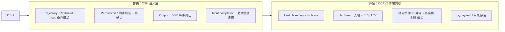
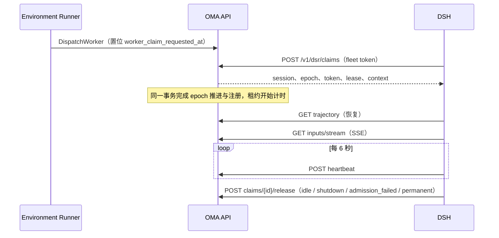
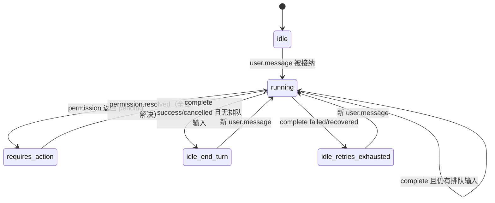

# DSRv1：DSH Session Remote 协议

状态：设计草案，尚未实现。本文定义 `oma-brain-dsh`（下称 DSH）与 OMA 后端之间的执行端协议合同，用于替代当前 Brain 使用的 CCRv2。现行实现见 [沙箱外 Agent 与 CCRv2](../brain-runtime.md)、[Brain Worker 领取](../brain-worker-claim.md) 与 `docs/design/be/ccrv2/`。

## 1. 背景与结论

CCRv2 的 Worker 协议来自沙箱内运行的 Claude Code（superduck-code）：`oma-brain-dsh/src/ccrv2/wire.ts` 与 `internal/codesessions/worker_output_schema.go` 直接复刻了 Claude Code 的 `StdoutMessage`、transcript 与 `external_metadata`。DSH 接入后，链路变成"DSH 原生 Session/Event → Claude Code 形状 → CMA 公开事件"的两次翻译，并积累了以下补丁：

| 问题 | 现状 |
| --- | --- |
| 私有日志借道 transcript | `/worker/internal-events` 原本只接受 Claude Code transcript，DSH 塞入 `type: "dsh_log"`，靠拼接 UUID `dsh_log:<cs>:<dsh>:<seq>` 去重；seq 连续性、Header 前缀、冲突检测全部在 DSH 端完成，后端只看到不透明 JSON |
| 公开输出格式混合 | 同一 `/worker/events` 既有 Claude Code 的 `assistant`/`user`/`result`，又有 CMA 原生的 `agent.thinking`、`session.thread_created`、`session.error`；`mapper.go` 两套都要识别 |
| 回合结束表达不足 | CCRv2 只有 `result`；DSH 另写 `plugin:oma/input-completion` 区分单个 turn 与整个输入完成，worker idle 又被降级为不代表回合结束 |
| 审批存在竞态补丁 | 发出 `can_use_tool` 后，DSH 需轮询 `GET /worker` 的 `external_metadata.managed_agent_tool_permission_request:*` 才能判断是否进入人工确认 |
| 工具身份靠命名约定 | 后端从 Claude Code 风格的 `mcp__server__tool` 名称反解工具类型（`parseClaudeToolIdentity`） |
| 生命周期冗余 | claim 已推进 epoch 并签发凭据，DSH 仍需再调用 `worker/register` 与 `GET /v2/sessions/{id}` |
| Claude Code UI 遗留 | `permission_mode`、`post_turn_summary`、`task_summary` 等字段 DSH 只能填 null |

沙箱内 agent 模式（`environment_runner.agent_mode: sandbox`）已不再需要，DSH 成为唯一执行端。因此不另起新协议栈，而是**保留 CCRv2 已经验证的传输内核，替换其语义层**，形成 DSRv1：



## 2. 目标与非目标

目标：

- 私有日志成为一等资源，由服务端保证每个 DSH Session 的 seq 连续与内容不可变。
- 审批请求同步返回判定结果，删除状态轮询。
- 公开输出使用 DSR 事件词汇，后端只做校验、身份派生与 CMA 映射，不再解析 Claude Code 格式。
- 输入完成作为显式协议动作，公开 Session 状态不再依赖 worker 状态推断。
- 一次 claim 完成注册，减少准入往返。
- 删除 sandbox 模式与 CCRv2 Worker 路由。

非目标：

- 不改变公开 Managed Agents API、SSE 合同和事件语义。
- 不改变 JetStream 投递、三段 ACK、Redis ACK 定位、大 payload 与 30 天逻辑期限的现有设计。
- 不改变沙箱侧（`role=sandbox` JWT）使用的上游代理、`sign-commit`、MITM 证书接口。
- 不改变 DSH 原生 JSONL 格式、本地主存储与异步复制策略、工具执行屏障和恢复语义。
- 不引入 outbox，也不改变数据库提交与 NATS 发布之间的现有失败语义。

## 3. 通用约定

### 3.1 路径与版本

- 所有执行端接口挂载在 `/v1/dsr/` 下，按 chi 子路由注册在 `internal/api/server.go`，不走 `/v1/*` workspace API key 鉴权回退。
- 每个请求携带 `DSR-Protocol: 1`。缺失或不支持的版本返回 `400 invalid_request_error`，`DSR-Error: unsupported_protocol`。
- 请求与响应均为 JSON（输入流为 SSE）；所有 ID 为字符串。

### 3.2 鉴权

| 凭据 | 用途 | 说明 |
| --- | --- | --- |
| fleet token | `claims`、`release` | 部署级，沿用 `code_session.brain_claim_token_file` 与常量时间比较 |
| session token | `/v1/dsr/sessions/{code_session_id}/*` | claim 签发的 JWT，claims 含 `code_session_id`、`epoch`、租户身份；签名、路径绑定与现有 ingress JWT 相同 |
| model token | `/v1/messages` 模型代理 | 沿用现有 per-claim model token |

**epoch 只来自 session token**，请求体不再携带 `worker_epoch`。服务端在执行授权阶段与写事务内用 token epoch 做 fence，与现在"body epoch 必须等于 claims epoch"等价，但消除了两处来源不一致的可能。

### 3.3 错误

错误体保持 `internal/httpapi.WriteError` 的 Anthropic 兼容形状。由于 409 有多种含义且 DSH 的处理不同，服务端额外设置 `DSR-Error` 响应头，DSH 只依据该头分支：

| HTTP | `DSR-Error` | DSH 处理 |
| --- | --- | --- |
| 400 | `invalid_request` / `unsupported_protocol` | 视为缺陷，不重试 |
| 401/403 | `unauthorized` | 停止该会话；claim 端按现有退避 |
| 404 | `session_not_found` | 退役会话 |
| 409 | `epoch_superseded` | 立即 fence 主线程与全部子线程，停止写入 |
| 409 | `trajectory_gap` | 按响应中的 `last_seq` 补发 |
| 409 | `trajectory_conflict` | 停止恢复，保留本地文件（与现行"互不为前缀即报错"一致） |
| 410 | `lease_expired` | 停止会话，等待重新领取 |
| 413 | `payload_too_large` | 视为缺陷 |
| 5xx | — | 有界退避重试 |

错误合同集中定义在 `internal/codesessions/errors.go`（或拆出的 DSR 资源包的 `errors.go`）。

## 4. 会话生命周期



### 4.1 Claim（合并注册）

`POST /v1/dsr/claims?block_ms=25000`，请求头 `X-Worker-ID`，请求体 `{}`。

`200` 响应：

```json
{
  "code_session_id": "cse_...",
  "epoch": "7",
  "token": "<session token>",
  "model_token": "<model token>",
  "lease": { "ttl_ms": 20000, "grace_ms": 10000, "heartbeat_interval_ms": 6000 },
  "trace_parent": "00-...",
  "context": { "...": "与 GET context 相同" }
}
```

- `204` 无可领取任务；`400`、`401` 同现行合同。
- 领取条件、`FOR UPDATE SKIP LOCKED`、attempts 上限、`HoldExhausted`、`FailPermanently` 和长轮询唤醒全部沿用 [Brain Worker 领取](../brain-worker-claim.md)。
- **变化**：领取事务同时完成现在 `RegisterCodeSessionWorkerAtEpoch` 的工作——写入租约（`worker_lease_expires_at = now + ttl`）、连接状态与活动时间，并清空 `worker_claim_requested_at`。`worker_claim_expires_at` 不再承担"领取到注册"的窗口，改由租约保护；准入期间 DSH 必须开始心跳。
- `lease` 由服务端下发，DSH 不再自行配置 TTL 相关参数，仍在启动时校验 `interval × (1 + jitter) + timeout < ttl_ms`。
- `context` 是首次的会话上下文，省去准入时的 `GET /v2/sessions/{id}`。
- attempts 归零仍以输入流连接成功为准入完成信号。

### 4.2 Release

`POST /v1/dsr/claims/{code_session_id}/release`，fleet token，请求体 `{"epoch": "7", "reason": "admission_failed" | "shutdown" | "idle" | "permanent"}`。语义与现行完全一致，仅字段名由 `worker_epoch` 改为 `epoch`。

### 4.3 Heartbeat

`POST /v1/dsr/sessions/{id}/heartbeat`，请求体 `{}`。

- `200 {"lease_expires_at": "..."}`。
- `409 epoch_superseded`、`410 lease_expired`；租约与宽限期判断和 Work 续租不变。

### 4.4 Context

`GET /v1/dsr/sessions/{id}/context`，可选请求头 `DSR-Thread-ID` 选择子线程的 Agent 快照。响应 `{"context": {...}}`，内容与现行 `session_context` 相同（含 `models`、`runtime_tool_permissions`），`Cache-Control: no-store`。DSH 每次模型请求前读取以刷新权限与模型，频率不变。

### 4.5 Worker 状态

`PUT /v1/dsr/sessions/{id}/state`：

```json
{ "status": "idle" | "busy", "model": "deepseek-..." }
```

- 只用于诊断、`idle_since` 与 DSH 空闲退役判断；**不产生任何公开事件，也不修改公开 Session 或线程状态**。
- 删除 `requires_action` 状态、`requires_action_details` 与 `external_metadata`；`model` 为可选的当前生效模型，替代 `external_metadata.model`。
- 公开状态的来源见第 9 节。

## 5. 入站输入

### 5.1 输入流

`GET /v1/dsr/sessions/{id}/inputs/stream`，SSE。后端仍分别从任务与控制两个 durable consumer 拉取，ACK 定位写入 Redis 后再 flush，保留 `Last-Event-ID` 与 `from_sequence_num` 的现有语义。

帧格式：

```text
id: <stream sequence>
event: input
data: {"id":"<stable input id>","lane":"task"|"control","kind":"...", ...}
```

`keep_alive` 改为 SSE 注释行，不再作为输入。

| `kind` | lane | 字段 | 取代 |
| --- | --- | --- | --- |
| `user.message` | task | `content`（已物化的 CMA 内容块）、`session_thread_id?` | Claude Code `user` 输入 |
| `user.interrupt` | control | `session_thread_id?` | `interrupt`、`user.interrupt`、`control_request/interrupt` |
| `permission.resolved` | control | `request_id`、`resolution`（见 7.3） | `control_response`（工具确认与 custom tool result） |
| `session.set_model` | control | `model`（`null` 表示默认） | `control_request/set_model` |

- 删除 `control_request/initialize` 与 DSH 回发的 `control_response`：控制类输入只通过 ACK 表达处理结果；`session.set_model` 校验失败时 DSH 以 `processed` 加 `error` 回执（见 5.2），由后端发布 `session.error`。
- 未知 `kind` 时 DSH 以 `processed` 加 `error: "unsupported_input"` 回执，不停止会话。

### 5.2 输入回执

`POST /v1/dsr/sessions/{id}/inputs/ack`：

```json
{ "updates": [ { "id": "<input id>", "status": "received" | "processing" | "processed", "error": "..." } ] }
```

- 1–64 项；`received`/`processing` 发送 InProgress 并刷新 Redis TTL；`processed` 在事务内校验 epoch 后 DoubleAck。语义、响应 `{"applied","ignored"}` 与故障处理同 [Worker Events Delivery](../ccrv2/ccr-v2-api-worker-events-delivery.md)。
- `processing` 继续驱动用户消息的 `processed_at` 写入与首次 SSE 发布。
- `error` 只允许出现在 control lane 的 `processed` 上。

## 6. Trajectory（私有日志）

### 6.1 资源模型

- 每个 DSH Session 是一条 trajectory，以 `dsh_session_id` 标识：主线程等于 `code_session_id`，子线程等于 DSH 原生 subagent 的 Session ID（即当前传输层的 `agent_id`）。
- trajectory 由一个 Header 和 seq 从 1 连续递增的 Event 组成；`data` 是原生 `SessionHeader` / `SessionEvent` 的原样 JSON，服务端不解析业务字段。
- 子线程归属由 Header 的 `parentSession` 与 trajectory 的 `parent_dsh_session_id` 表达，替代按 `agent_id` 过滤分页。

### 6.2 写 Header

`PUT /v1/dsr/sessions/{id}/trajectories/{dsh_session_id}/header`：

```json
{ "parent_dsh_session_id": "cse_...", "header": { "...": "原生 SessionHeader" } }
```

- 不存在时创建；已存在且规范化 JSON 摘要相同返回 `200`；不同返回 `409 trajectory_conflict`。
- `parent_dsh_session_id` 主线程为空，子线程必须指向同一 Code Session 下已存在的 trajectory。

### 6.3 追加 Event

`POST /v1/dsr/sessions/{id}/trajectories/{dsh_session_id}/events`：

```json
{ "events": [ { "seq": 41, "data": { "...": "原生 SessionEvent" } }, { "seq": 42, "data": {} } ] }
```

事务（Yourbatis transaction executor）：

1. 锁定 Code Session 行并校验 token epoch，不匹配返回 `409 epoch_superseded`。
2. 锁定 trajectory 行，读取 `last_seq`；Header 不存在返回 `409 trajectory_gap`，`last_seq: 0`。
3. 请求内 seq 必须连续。`seq ≤ last_seq` 的条目逐条比较摘要：相同则跳过，不同返回 `409 trajectory_conflict`。
4. 第一条新条目必须等于 `last_seq + 1`，否则返回 `409 trajectory_gap` 与当前 `last_seq`。
5. 插入新条目并更新 `last_seq`。

响应 `200 {"last_seq": 42}`。单次最多 200 条，body 上限沿用现有 ingress 限制。

这把现行"相同 seq 相同内容只应用一次、不同内容报错、序号缺口拒绝"的规则从 DSH 端移到服务端的写入路径，DSH 的已确认前缀直接取响应中的 `last_seq`。

### 6.4 读取

- `GET /v1/dsr/sessions/{id}/trajectories` → `{"data": [{"dsh_session_id","parent_dsh_session_id","last_seq","created_at"}]}`：恢复时枚举远程子线程，替代 `subagents` 私有流。
- `GET /v1/dsr/sessions/{id}/trajectories/{dsh_session_id}?after_seq=0&limit=500` → `{"header": {...}, "events": [{"seq","data"}], "next_after_seq": 500 | null}`：Header 只在 `after_seq = 0` 时返回。

GET 只做鉴权与归属校验，不要求当前 epoch，与现行 `GET internal-events` 一致。

### 6.5 压缩

不再有 `is_compaction` 过滤。DSH 原生压缩事件就是 trajectory 中的普通 Event，恢复由 DSH 原生逻辑完成；服务端始终返回完整序列。

### 6.6 数据模型

新增 goose migration，不创建外键：

```text
dsr_trajectories
  id bigint generated always as identity
  uuid uuid default gen_random_uuid()
  organization_uuid, workspace_uuid, code_session_uuid uuid not null
  dsh_session_id text not null
  parent_dsh_session_id text null
  header jsonb not null, header_sha256 bytea not null
  last_seq bigint not null default 0
  created_at, updated_at
  unique (code_session_uuid, dsh_session_id)

dsr_trajectory_events
  id bigint generated always as identity
  code_session_uuid uuid not null
  dsh_session_id text not null
  seq bigint not null
  data jsonb not null, data_sha256 bytea not null
  created_at
  unique (code_session_uuid, dsh_session_id, seq)
```

- 摘要基于规范化 JSON（键排序），与 DSH 现行"不受 JSON 属性顺序影响"的身份规则一致。
- Mapper 遵循 [Yourbatis 指南](../yourbatis-guidelines.md) 的文件拆分：`dsr_trajectories.go`、`dsr_trajectory_mapper.go`、`dsr_trajectory_mapper.xml`。
- 归档、导出、还原与物理删除由 `transcriptretention` / `transcriptarchive` 覆盖新表，替换对 `dsh_log` internal events 的处理。

## 7. 工具审批

### 7.1 请求

`POST /v1/dsr/sessions/{id}/permissions`：

```json
{
  "request_id": "<uuid>",
  "session_thread_id": "sthr_...",
  "tool_use_id": "toolu_...",
  "tool": { "kind": "builtin" | "mcp" | "custom", "name": "bash", "server": "github" },
  "input": { "command": "npm test" },
  "available": true
}
```

- `tool` 显式给出工具身份，`server` 仅 `kind = mcp` 时必填；替代 `parseClaudeToolIdentity` 对 `mcp__server__tool` 的反解。
- `request_id` 是幂等键：相同请求重复提交返回首次的结果；同一 `request_id` 内容不同返回 `409 invalid_request`。

### 7.2 响应

服务端在一个事务内完成权限计算、待确认记录与公开事件写入，同步返回：

| 结果 | 响应 | 服务端副作用 |
| --- | --- | --- |
| 允许 | `200 {"decision": "allow"}` | 发布 `agent.tool_use`（`evaluated_permission: allow`） |
| 拒绝 | `200 {"decision": "deny", "message": "..."}` | 发布对应公开事件 |
| 需人工确认 | `202 {"decision": "pending"}` | 保存待确认记录，发布 `agent.tool_use`（`ask`）与 `session.status_idle(requires_action)` |
| custom tool | `202 {"decision": "pending"}` | 等待公开 `user.custom_tool_result` |

- DSH 收到 `202` 即进入确认阶段，**不再读取 Worker 状态，也不再上报 `requires_action`**。
- 云沙箱内策略为 `allow` 的内置工具继续由 DSH 本地放行而不调用本接口；`/sandbox/mcp` 网关仍是最终执行点，每次调用重新计算权限。

### 7.3 解决

用户确认或 custom tool result 到达后，后端清理待确认记录，并经 control lane 投递：

```json
{
  "kind": "permission.resolved",
  "request_id": "<uuid>",
  "resolution": {
    "behavior": "allow" | "deny" | "external_result",
    "updated_input": {},
    "message": "...",
    "external_result": {}
  }
}
```

全部待确认请求解决后，公开状态回到 running 的规则与现行一致。

### 7.4 取消

`POST /v1/dsr/sessions/{id}/permissions/{request_id}/cancel`，幂等。DSH 在中断或停机放弃等待时调用；后端清除仍待确认的记录，不发布新的 `requires_action`。输入完成（第 9 节）时后端也会清除属于该输入、仍未解决的待确认记录。

## 8. 公开输出

`POST /v1/dsr/sessions/{id}/output`：

```json
{ "events": [ { "id": "<stable id>", "type": "agent.message", "session_thread_id": "sthr_...", "...": "..." } ] }
```

`id` 替代 `uuid`，作为幂等键，并由服务端按现有规则派生公开事件 ID。服务端按白名单校验，**未知 `type` 返回 `400`**，不再静默丢弃。

| DSR `type` | 字段 | 公开映射 |
| --- | --- | --- |
| `preview.start` / `preview.delta` | `event: {type, id}` / `event_id`, `delta` | 现行 `event_start` / `event_delta` 流式预览 |
| `agent.message` / `agent.thinking` | `content?` | 原样 |
| `tool.result` | `tool_use_id`、`tool: {kind,name,server?}`、`is_error`、`content` | `agent.tool_result` / `agent.mcp_tool_result`，取代 Claude Code `user` + `tool_result` |
| `system.message` | `content` | 原样 |
| `session.thread_created`、`session.thread_status_running` / `_idle` / `_terminated` | CMA 字段 | 原样 |
| `agent.thread_message_sent` / `_received`、`agent.thread_context_compacted` | CMA 字段 | 原样 |
| `session.error` | `error`（仅 MCP 连接/鉴权失败类） | 原样 |

- 模型代理继续负责发布模型产出的消息、工具调用与 `span.model_request_end`；`/output` 只承载 DSH 自身产生的事件。
- 删除 Claude Code 的 `assistant`、`user`、`result`、`task_started`、`task_notification`、`compact_boundary` 以及从 internal subagent transcript 投影公开事件的路径。
- "工具执行、公开发布与 ACK 前等待 trajectory 远程确认"的顺序不变；trajectory 确认以 6.3 的 `last_seq` 为准。

## 9. 输入完成与公开状态

### 9.1 接口

`POST /v1/dsr/sessions/{id}/inputs/{input_id}/complete`：

```json
{ "outcome": "success" | "cancelled" | "failed" | "recovered", "message": "..." }
```

- 取代 `result` 与 `failedOutput` 的 `system.message + result` 组合；`message` 由后端发布为 `system.message`（`failed`/`recovered` 时）。
- 以 `input_id` 幂等：重复调用返回首次结果；同一输入不同 outcome 返回 `409 invalid_request`。
- 调用顺序：trajectory 终态确认 → 该输入的公开输出确认 → `complete` → `inputs/ack processed`。
- DSH 仍保留 `plugin:oma/input-completion` 作为本地 trajectory 中的恢复依据；它不再是协议的一部分。

### 9.2 公开状态来源

公开 Session 与主线程状态只由以下服务端事实推导，不再读取 worker 状态：



- `requires_action` 在公开 API 中仍表示为 `session.status_idle(requires_action)`。
- `success` 与 `cancelled` 映射为 `idle/end_turn`（与现行用户中断语义一致）；`failed`、`recovered` 映射为 `session.error` 与 `idle/retries_exhausted`，使用现有安全错误分类。
- 主线程失败后子线程结束不覆盖失败 stop reason；`budget_reached` 暂停、排队输入与输入拒绝规则不变。
- 迁移 64 的 `worker_turn_started` 标记不再需要，由 `complete` 的幂等记录替代。

## 10. 运行时能力接口

以下接口语义不变，路径迁移到 `/v1/dsr/sessions/{id}/` 下并改用 session token：

| 现路径 | DSRv1 路径 |
| --- | --- |
| `POST /v2/ccr-sessions/{id}/sandbox/mcp` | `POST .../sandbox/mcp` |
| `/v2/ccr-sessions/{id}/mcp`、`/mcp/*` | `.../mcp`、`.../mcp/*` |
| `POST /v2/ccr-sessions/{id}/web/search`、`/web/fetch` | `.../web/search`、`.../web/fetch` |
| `GET /v1/code/sessions/{id}/worker/subagent-threads/{thread_id}` | `GET .../threads/{thread_id}` |
| worker 图片附件路由 | `.../attachments/*` |
| `POST .../worker/diagnostics` | `POST .../diagnostics` |
| `POST .../worker/otlp/v1/logs`、`/traces` | `POST .../otlp/v1/logs`、`/traces` |

沙箱侧接口不在本协议范围：`/v1/code/upstreamproxy/*`、`/v1/code/sessions/{id}/sign-commit` 继续使用 `role=sandbox` JWT。

## 11. 删除范围

| 删除 | 说明 |
| --- | --- |
| `environment_runner.agent_mode` 与 runner/dispatch/environment manager 中的 sandbox 分支 | DSH 是唯一执行端，`worker_transport` 固定为 `claim`；配置出现该字段时启动报错 |
| `/v1` 与 `/v2` 的 `session_ingress/*`、`diag_logs`、WebSocket 退役占位 | Claude Code worker 入口 |
| `/v1/code/sessions/{id}/worker/*`、`/v2/sessions/{id}`、`/v2/ccr-sessions/*` | 迁移完成后删除 |
| `worker_output_schema.go` 与 `mapper.go` 中的 Claude Code 分支、`IsClaudeCodeTranscriptEvent` | 输出改为 DSR 词汇 |
| internal events 的 transcript 类型、`is_compaction` 过滤、按 agent_id 的子线程分页 | 由 trajectory 取代 |
| `external_metadata`、`requires_action_details`、非 claim transport 的 60+10 秒租约参数 | — |
| DSH `src/ccrv2/`（`wire.ts`、`protocol.ts`、`worker-put.ts` 等） | 由 `src/dsr/` 取代，`runtime/` 不受影响 |
| `docs/design/be/ccrv2/` 中仅描述 Claude Code 客户端的文档（如 `claude_code-permission-modes.md`、`worker-get-api.md`） | 仍有效的传输设计（epoch、delivery、SSE 扇出、上游代理）保留并更新路径 |

## 12. 迁移与发布

DSRv1 不保留旧协议的长期兼容，但为了滚动升级，迁移期间后端同时提供 CCRv2 Brain 路由和 DSRv1。

1. **P0 删除 sandbox 模式**：纯删除，不改变 Brain 行为。
2. **P1 生命周期与输入**：claim 合并注册、heartbeat、context、input stream/ack、运行时能力路径。DSH 以 `DSR-Protocol: 1` 调用 claim；服务端在 Code Session `metadata.config.worker_protocol` 写入 `dsr1`。同一会话一旦以 `dsr1` 领取，CCRv2 Worker 路由对其返回 `409 epoch_superseded`，避免新旧执行端交替写入。
3. **P2 Trajectory**：新增两张表。首次以 `dsr1` 领取时，领取事务后的回填步骤把 `code_session_internal_events` 中的 `dsh_log` 行按 UUID 解析出的 `dsh_session_id` 与 seq 写入新表，并校验连续性；校验失败的会话以 `permanent` 失败公开，不做拼接修复。
4. **P3 Permission**：同步审批与取消。
5. **P4 Output 与 complete**：DSR 输出词汇、公开状态推导，删除 mapper 的 Claude Code 分支。
6. **P5 清理**：全部 DSH 进程升级后删除 CCRv2 路由、旧数据入口与文档，并删除 `worker_protocol` 的分支判断。

每个阶段独立 PR，并同步更新 [沙箱外 Agent 与 CCRv2](../brain-runtime.md)、[Brain Worker 领取](../brain-worker-claim.md) 和受影响的 `ccrv2/` 文档。

## 13. 测试计划

按"先失败场景，后成功场景"组织。

- **Claim**：并发领取只有一个成功；领取即注册后旧 epoch 的写入与心跳被拒；准入期间未心跳导致租约过期后可被重新领取；`unsupported_protocol`；attempts 耗尽与 `permanent` 行为不变。
- **Trajectory**（Mapper SQL 与参数绑定单测，以及真实 PostgreSQL 的 JSONB/bytea 绑定与扫描）：seq 缺口、重复 seq 内容不同、Header 冲突、子线程父不存在、旧 epoch 追加；相同内容重放幂等；跨页读取；回填的连续性校验。
- **Permission**：未知工具身份、同 `request_id` 不同内容、取消后迟到的 resolved 不再恢复执行；allow/deny/pending/custom 四种结果与公开事件；`allow` 改为 `ask` 或 `deny` 的策略刷新。
- **Output**：未知类型 400、重复 `id` 幂等、`tool.result` 映射到内置与 MCP 结果事件、子线程归属。
- **Complete 与状态**：outcome 冲突、重复调用、排队输入时不 idle、失败 stop reason 不被子线程覆盖、complete 早于或晚于 ACK 的各种到达顺序。
- **DSH**：现有 `ccrv2.test.ts`、`session-reacquisition.test.ts`、`crash.test.ts`、`parallel-tools.test.ts`、`parallel-subagents.test.ts`、`model-replication.test.ts` 的场景迁移到 DSR 客户端，覆盖 A→B→A 接管和 SIGKILL 恢复。
- **集成**：需要真实验证时，按 verify-be Skill 选择 chat 域中受影响的最小场景集（输入投递、工具确认、SSE、历史恢复、跨实例交付、Runner 启动）以及 Transcript 归档/还原场景；是否运行由用户决定。

## 14. 已决定

- 基于 CCRv2 传输内核演进，不另建协议栈；协议名为 DSRv1，路径前缀 `/v1/dsr/`。
- epoch 只来自 session token。
- 公开状态由服务端事实推导，worker 状态不产生公开副作用。
- 私有日志按 `(code_session, dsh_session_id, seq)` 条件追加，冲突判定在服务端。
- 工具身份显式结构化。

## 15. 待定问题

- `inputs/{id}/complete` 与 `ack processed` 是否合并为一次请求：合并可以减少一次往返，并让状态事务与 DoubleAck 更接近原子；代价是把公开状态与 JetStream ACK 耦合。当前选择分离。
- trajectory 单会话体量上限与对象存储 offload：现行 internal events 的大 payload 策略是否直接沿用。
- `session.set_model` 是否需要在公开 API 中保留可观察的确认事件。
- 迁移期间 `worker_protocol = dsr1` 的会话被旧版 DSH 领取时的处理：当前设计是旧版 DSH 不发送协议头，claim 跳过这类会话。需确认领取 SQL 的过滤条件与索引。
