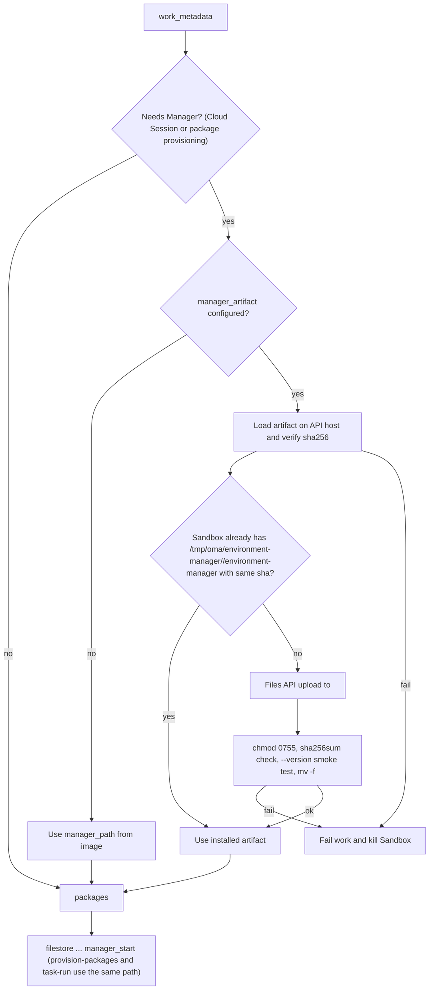
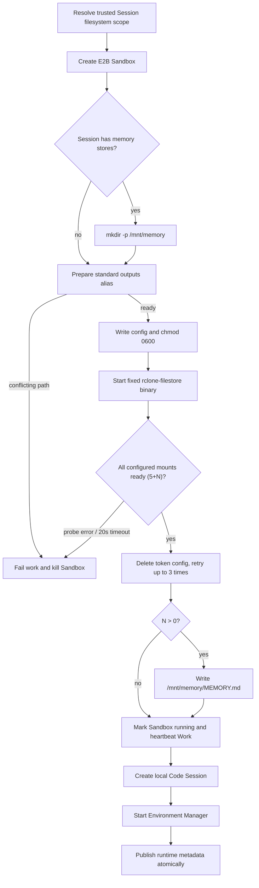

# E2B Sandbox 镜像合同

## 范围

本文定义 Open Managed Agents 的 Cloud Session 启动代码可以依赖的 E2B 镜像能力。镜像构建位于部署侧；本仓库的 Runner 只校验和消费合同，不通过配置猜测二进制位置，也不在 Sandbox 启动时下载安装运行依赖。

## 必需二进制与权限

镜像必须满足：

- `/opt/rclone/rclone-filestore` 存在、是 Linux 可执行文件，并支持 `multimount --config <path>`。
- Sandbox 具有 rclone-filestore 创建五个固定 FUSE mount、以及最多 8 个 `/mnt/memory/{slug}` 附加 mount 所需的设备、capability 和 mount namespace 权限。
- `/usr/local/bin/environment-manager` 与 `/opt/claude-code/bin/claude` 默认可执行；这两个路径仍可通过既有 Environment Runner 配置覆盖。配置 `environment_runner.manager_artifact` 后，镜像内的 Manager 只作为未配置制品时的回退，见下文“Environment Manager 独立升级”。
- 配置 Manager 制品时，镜像必须提供 `sh`、`sha256sum`、`cut`、`chmod`、`mv`，并允许 Runner 写入和执行 `/tmp/oma/environment-manager/`。
- `rclone-filestore multimount` 可以创建 `/mnt/user-data/outputs`、`/mnt/session/uploads`、`/mnt/transcripts`、`/mnt/user-data/tool_results` 和 `/root/.claude/skills` 的挂载点，并能在配置包含 memory store 时创建 `/mnt/memory/{slug}`；同时必须能写入 `/tmp`，且允许 Runner 在本地盘创建 `/mnt/memory`。
- Runner 必须能创建 `/mnt/session`，并将 `/mnt/session/outputs` 软链到 `/mnt/user-data/outputs`。标准输出路径若已存在，只接受目标一致的软链或空目录；其他内容停止启动并保留数据。
- 镜像和 Environment Manager 不能重新创建 `/root/.claude/skills` 软链，也不能依赖 `/mnt/skills` 或 `/workspace/skills` 解压目录。

`rclone-filestore` 路径固定为 `/opt/rclone/rclone-filestore`，不提供 `rclone_filestore_path` 配置。镜像若缺失该文件或没有执行权限，后台命令启动失败或 ready marker 在 `20s` 内不会出现；Runner 会把 Sandbox 标记为失败并 Kill，不会启动 Environment Manager。

## Claude Code 版本

Claude Code 随镜像发布，Environment 使用其绑定模板中的版本。Runner 检查 Manager 和 Claude 二进制可执行，并以 `--claude-agent-version current --claude-path <镜像内路径>` 启动 Environment Manager。

`current` 模式读取二进制的 `--version`，使用并记录实际版本；无法识别版本时初始化失败，不尝试下载安装。

升级 Claude Code 通过发布新镜像完成，构建时固定版本并校验产物。已有 Environment 继续使用绑定模板，不在会话启动时升级。

## Environment Manager 独立升级

Environment Manager 可以独立于镜像发布。部署在 `environment_runner.manager_artifact` 中配置一个 Linux 可执行制品，二选一：

- `path`：API 服务所在主机的本地文件，例如 environment-manager 发布流程产出的 `dist/environment-manager_linux_arm64`。Runner 每次启动前比较文件大小与修改时间，变化后重新读取并计算 SHA-256，因此原子替换（同目录写临时文件后 `mv`）即可让后续 Sandbox 使用新版本，无需重启服务。可选的 `sha256` 用于固定预期版本，不一致时拒绝启动。
- `url`：HTTP(S) 下载地址，必须同时提供 `sha256`。由 API 服务下载并校验，按进程缓存；更换版本时同时修改 `url`/`sha256` 并重启服务。Sandbox 不需要访问该地址。

制品上限为 512 MiB，必须与 Sandbox 架构匹配。未配置时 Runner 行为不变，直接使用 `manager_path`（默认镜像内 `/usr/local/bin/environment-manager`）。



安装发生在 Runner 的 `manager_install` 阶段，位于 `work_metadata` 之后、`packages` 之前，所以包安装的 `provision-packages` 与启动会话的 `task-run` 使用同一个 Manager。新建 Session 与恢复（resume，Runner 为已有 Code Session 创建 replacement Sandbox 并以 `--session-mode resume-cached` 启动 Manager）共用这一入口，Brain 模式按需创建的 Sandbox 也一样；因此已有 Session 在下一次恢复时就会切换到当前配置的 Manager，旧镜像无需重新打包。

约束与失败语义：

- 配置了制品就 fail-closed：读取、下载、校验、上传、`--version` 冒烟或激活任一步失败都会以 `environment manager artifact install failed` 结束本次 Work 并终止 Sandbox，不静默回退到镜像内版本，避免同一部署混跑未知版本。
- 安装路径按 SHA-256 区分，激活使用同目录 `mv -f`，Manager 不会看到半写入文件；Sandbox 中已存在同 SHA 的可执行文件时跳过上传。
- E2B 暂停后自动恢复的 Sandbox 会恢复原进程内存，正在运行的 Manager 不会被替换；新版本在该 Session 下一次创建 replacement Sandbox 时生效。
- 日志只记录 `sandbox_id`、`manager_sha256` 与大小，不记录制品 URL 中可能存在的查询参数。

## Runner 创建的临时状态

镜像不应预置以下运行时文件：

| 路径 | 所有者 | 生命周期 |
| --- | --- | --- |
| `/tmp/rclone-mount-config.json` | Runner/rclone | E2B Files API 写入后设为 `0600`，ready 后最多重试三次删除 |
| `/tmp/rclone-mounts/ready` | rclone-filestore | 配置中的全部 mount（五个固定盘 + N 个 memory）ready 后创建 |
| `/mnt/memory` | Runner | 有 memory store 时 `mkdir -p` 出的本地盘；不是 Filestore mount |
| `/mnt/memory/MEMORY.md` | Runner | rclone ready 后由 E2B Files API 写入；只在本 Session 有效 |

Runner 每次创建新的 Sandbox，通过 E2B 后台进程 API 启动 rclone，不在 Sandbox 中写 PID 或 exit marker。Runner 只通过 E2B Files API 每 `200ms` 探测 ready marker，最长 `20s`，不探测 rclone PID。`/tmp/rclone-mounts/ready` 必须只表示配置里的全部 mount 均已可用（五个固定盘，加上 Session 快照中的 N 个 `/mnt/memory/{slug}`）；部分就绪不能创建 marker。父目录 `/mnt/memory` 不是第 N+1 条 rclone 挂载。

## 固定文件系统视图

ready 后镜像内必须呈现：

```text
/mnt/user-data/outputs       # read-write
/mnt/session/outputs         # symlink to /mnt/user-data/outputs
/mnt/session/uploads         # readonly
/mnt/transcripts             # readonly
/mnt/user-data/tool_results  # readonly
/root/.claude/skills         # readonly virtual archive tree
/mnt/memory                  # local disk when N>0; not a FUSE mount
/mnt/memory/MEMORY.md        # session-local index written after ready
/mnt/memory/{slug}           # optional FUSE mount per attached store
```

File resource 不新增独立 FUSE mount，也不创建逐文件软链接。resource 写事务已经在当前 Session 的 `filesystem_id` 下插入借用 Files 对象的数据库 entry，rclone 只负责把 `/uploads` 权威 namespace 整体只读挂载到 `/mnt/session/uploads`。显式请求 `mount_path=/workspace/data.csv` 会映射为 Filestore 与公开响应中的 `/uploads/workspace/data.csv`；省略时使用 `/uploads/<file_id>`，Sandbox 中对应 `/mnt/session/uploads/<file_id>`，不使用原始文件名。镜像、Runner 和 Environment Manager 都不负责下载、复制、调和或投影单个 File resource，Runner 也不再把 `type=file` resource 转发给 Environment Manager。

同一 `filesystem_id` 的 namespace 在 mount 存活期间继续由数据库维护。运行中增删 File resource 不重建 FUSE mount；现有 Sandbox 在 `/uploads` 的 `1s` metadata cache 刷新后读取到新的 namespace 状态。

`/root/.claude/skills` 是 Filestore `/skills` 的直接 mount。`rclone-filestore multimount` 在内部对 destination 执行 `MkdirAll`，Runner 不再单独准备五个固定挂载目录；archive 解包视图由 Filestore 服务虚拟生成，镜像和 Environment Manager 不下载、不复制、不解压 skill zip。该 mount 与其他只读 mount 一样使用只读 Token、`readonly=true`、`uid=999`、`gid=1000`、目录权限 `0755` 和文件权限 `0644`。

有 memory store 时例外：Runner 在启动 rclone 前 `mkdir -p /mnt/memory`，把父目录留在本地盘上，再让 rclone 把每个 `{slug}` 挂到其子路径。`MEMORY.md` 不是 Filestore 对象。

## 启动顺序合同



File resource 与 `/uploads` entry 的一致性由 resource 写事务负责，Runner 不在启动时修复 namespace。Environment Manager 不能先于 rclone ready 启动；身份解析、启动或 ready 错误进入统一失败清理。ready 后配置删除失败会有限重试并记录脱敏告警，不会杀掉已经就绪的 Sandbox；outputs token 在协议层只允许写 `/outputs`。

## 镜像验收

仓库中的真实 E2E 固定使用
`ghcr.io/superduck-ai/managed-agent-sandbox:latest`，避免测试配置静默回退到不含
`rclone-filestore` 的通用 template。部署前仍应将通过验收的镜像 digest 固化到发布系统，
不能把可变的 `latest` 当作生产可复现性边界。

发布新的 E2B template 前至少验证：

1. `test -x /opt/rclone/rclone-filestore` 成功。
2. 用临时测试 filesystem 启动固定 multimount（含 0 或 N 个 `/memory/{slug}`），ready marker 在超时内出现。
3. `/mnt/session/outputs` 与 `/mnt/user-data/outputs` 可读写同一文件，经标准路径写入的文件可由 Session Files 列表发现并下载，另外四个固定 destination 拒绝写入；`/root/.claude/skills/<skill>/SKILL.md` 可由 Claude Code 直接发现。有 store 时 `/mnt/memory/{slug}` 按快照权限可写或只读，父目录 `/mnt/memory` 仍是本地盘。
4. 只通过 Files API 上传对象并给 Session 添加 File resource，不在测试侧直接写 Filestore；确认 resource 写入已创建 `/uploads/workspace/data.csv` 的数据库引用，启动后可通过 `/mnt/session/uploads/workspace/data.csv` 读取且写入失败。
5. 正常路径 ready 后 `/tmp/rclone-mount-config.json` 不存在；模拟删除失败时确认最多重试三次、记录脱敏告警且 Sandbox 继续运行。日志和进程命令行不包含 Filestore Token，outputs token 不能写入其他 source。
6. 镜像不得预置 `/root/.claude/skills` 软链；`rclone-filestore multimount` 负责创建 destination，Environment Manager 启动后不得创建软链或产生 `/workspace/skills` 解压副本。
7. ready 探测失败或 `20s` 内未出现 marker 均不会启动 Environment Manager，并会终止 Sandbox。
8. 有 memory store 时 ready 后存在 `/mnt/memory/MEMORY.md`；无 store 时不创建 `/mnt/memory`。Memory mount 或 `MEMORY.md` 写入失败与固定盘失败一样 fail-closed。跨 Session 寿命见 `tests/environments_memory_sandbox_e2e_test.go`。

Token 当前固定一小时有效且不刷新；长生命周期 Sandbox 的续签不属于此镜像合同。


## Git 资源准备

Git 资源 URL 必须以 `.git` 结尾（不接受 `.git/`），由 OMA 统一校验后原样下发。该规则也适用于已存储资源的运行时校验；旧资源需更新为以 `.git` 结尾的克隆地址，不自动补全。Environment Manager 复用既有 sources 编排，在启动 Claude 前准备 Git 工作树。OMA 下发 `git_info.ref` 和 `mount_path`，默认分支省略 ref，指定分支使用 `refs/heads/<name>`，提交仅接受完整的 40 或 64 位十六进制 SHA；Git 凭据由已有 OMA 代理注入，不进入启动参数。

Git 准备失败沿用既有初始化失败流程，不下发继续启动开关，不改写 Claude settings 或注入资源告警 hook。源码变更需构建匹配的 Manager artifact 才会进入新 Sandbox；可通过 `environment_runner.manager_artifact` 下发，无需更新运行镜像。

Memory 沙箱 E2E 在 Environment Manager 启动前从 Worker 事件队列记录初始化提示词；Worker 确认后的消息不再依赖旧的数据库 inbound-event 查询。
