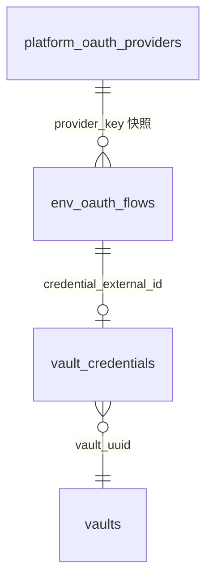
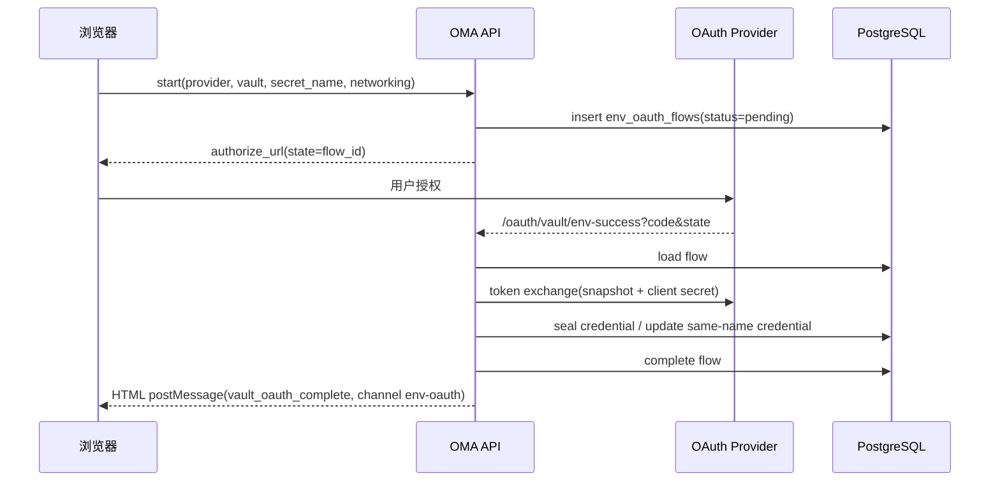
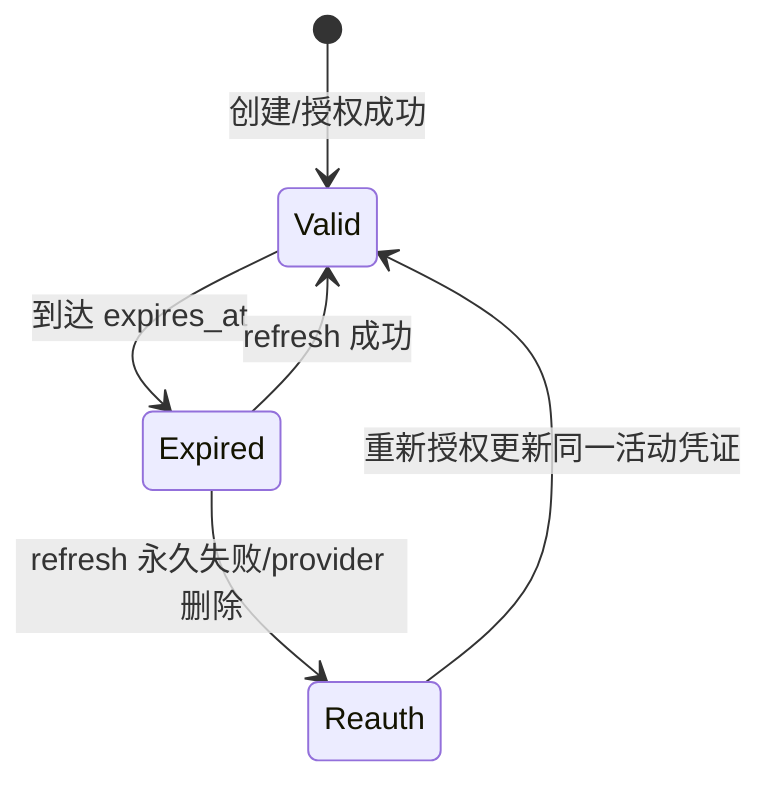

# ENV OAuth 凭证与平台 OAuth 客户端注册

## 目的与范围

本文描述 Vault 的 `env_oauth` 凭证类型、平台级 OAuth 客户端注册表、授权流程与运行时刷新/替换语义。
`env_oauth` 复用 `environment_variable` 的 Opaque Placeholder 与 CONNECT MITM Egress Secret Substitution，
出站时按 provider 的允许域名把占位符替换为当前 access token；沙箱始终只看到占位符。

非目标：组织级 OAuth 客户端隔离（本期全局）、沙箱协议变更、在数据库中保存内置飞书 client secret、
改造通用 Vault 注入框架。

## 数据模型

迁移 `internal/db/migrations/00116_env_oauth.sql`：

- `vault_credentials.auth_type` CHECK 扩展 `env_oauth`。
- `platform_oauth_providers`：全局 OAuth 客户端注册表，`client_secret_envelope` 保存 `secrets.Service`
  信封；`created_by_platform_admin_uuid` 记录超管；`token_endpoint_auth_method` 与
  `token_endpoint_encoding` 决定换票方式。
- `env_oauth_flows`：授权中间态，保存 provider 快照（端点、client_id、scope、认证方式/编码）、
  `secret_name`、`networking_type`、`allowed_hosts`、创建者与过期时间；状态
  `pending → completed | failed`。



Provider 与 flow 均不建外键；引用以 UUID/外部 ID 表达。

## 凭证公开结构与秘密

公开 `auth`（`vault_credentials.auth`）：

```json
{
  "type": "env_oauth",
  "provider": "builtin:feishu",
  "secret_name": "LARKSUITE_CLI_USER_ACCESS_TOKEN",
  "placeholder": "oma_ph_...",
  "networking": {"type": "limited", "allowed_hosts": ["open.feishu.cn", "accounts.feishu.cn"]},
  "injection_location": {"header": true, "body": false},
  "expires_at": "2026-11-06T10:00:00Z",
  "scope": "offline_access",
  "has_refresh_token": true
}
```

密封秘密 `secret_payload`（仅进程内 transient，落库前 Seal）：

```json
{"type": "env_oauth", "access_token": "u-...", "refresh_token": "ur-..."}
```

`credential_key = secret_name`，与 `environment_variable` 共用同一活动唯一索引。`injection_location`
固定 header（`Authorization: Bearer <token>`），不接受 body 注入。Provider 与 `secret_name` 创建后不可变。

## Provider

- `builtin:feishu`：授权端点 `https://accounts.feishu.cn/open-apis/authen/v1/authorize`，令牌端点
  `https://open.feishu.cn/open-apis/authen/v2/oauth/token`，默认 scope `offline_access`，默认变量名
  `LARKSUITE_CLI_USER_ACCESS_TOKEN`，默认域名 `open.feishu.cn` / `accounts.feishu.cn`，令牌端点编码
  `json`，认证方式 `client_secret_post`。client_id/client_secret 来自部署配置
  `vault.feishu_oauth_client`，不落数据库；未配置时列表可见但 `vault-auth/start` 返回 503。
- `custom:<provider_external_id>`：来自 `platform_oauth_providers`，client secret 信封加密；运行时按
  provider key 重新解析。provider 被删除后存量凭证 refresh 失败并进入重新授权语义。

## 组织侧接口

| 方法 | 路径 | 说明 |
|---|---|---|
| GET | `/api/organizations/{orgUuid}/env-oauth/providers` | 列出内置与自定义 provider；不含 secret |
| POST | `/api/organizations/{orgUuid}/env-oauth/vault-auth/start` | 校验并创建 flow，返回 `{oauth_flow_id, authorize_url}` |
| GET | `/oauth/vault/env-success?code&state` | 公共回调；换票、落库、完成 flow，返回 postMessage HTML |

`start` 校验：org 与 principal 一致、workspace/vault 存在且未归档、provider 可用、secret_name 合法、
limited 必须有 allowed_hosts；同 vault 同名活动凭证若为同一 provider 的 `env_oauth` 允许重新授权，否则 409。

回调流程：



回调 HTML 同时向 `BroadcastChannel("env-oauth")` 与 `window.opener` 发送
`{type:"vault_oauth_complete", status:"ok"|"error", flow_id, vault_id, credential_id?, error_code?}`。

## 运行时注入与刷新

- Session 挂载时，`PrepareEnvCredentialMount` 同时收集 `environment_variable` 与 `env_oauth` 的
  `secret_name → placeholder`；同名冲突时显式 `environment_variable` 优先。任一类型存在且 MITM 关闭 →
  `ErrMITMRequiredForEnvCredentials`。
- MITM 出站先做环境变量替换，再做 `env_oauth` 替换：仅当 `credentialNetworkingCoversHost` 命中且请求
  文本包含占位符时解析 token；未命中直接透传占位符。
- token 未过期直接复用；过期后按 credential 级 refresh lease + CAS 单飞刷新，`expires_in > 0` 时更新
  `expires_at`，否则沿用未过期旧值或清空。刷新使用 provider 当前配置；失败 fail-closed（不替换、返回
  `ErrSubstitutionRejected`），永久失败（4xx 非 408/429、缺 refresh token）标记需重新授权。
- 读取信封缺失时 `openCredentialSecret` 返回 `ErrEnvOAuthReauthorizationRequired`。



## 平台管理接口

前缀 `/api/platform-admin`，沿用 verified login + CSRF + `platform:access`：

| 方法 | 路径 | 说明 |
|---|---|---|
| GET | `/oauth-providers` | 列表；永不返回 secret |
| POST | `/oauth-providers` | 创建；名称重复 409 |
| PATCH | `/oauth-providers/{id}` | 部分更新；`client_secret` 缺省表示不改 |
| DELETE | `/oauth-providers/{id}` | 删除；不影响已存 flow 快照与已建凭证的可读性 |

响应含 `id, name, authorize_endpoint, token_endpoint, scope, client_id, has_client_secret,
token_endpoint_auth_method, token_endpoint_encoding, created_at, updated_at`。内置飞书不在该列表中，
前端以只读卡片展示。

## 部署配置

```yaml
vault:
  feishu_oauth_client:
    client_id: "cli_..."
    client_secret: "..."
```

两项必须同时配置或同时省略；省略时内置飞书不可用，不影响其他凭证类型。

## 测试与验收

- `internal/vaults`：schema 往返、create/update 校验、占位符合并优先级、replacement planner、token
  refresh 与 CAS、JSON/form token 端点编码。
- `internal/db`：新 Mapper 的 SQL/参数绑定/敏感标记单测；集成测试覆盖真实 PostgreSQL 读写。
- `internal/api`（`integration`）：start 参数、callback 换票落库、重新授权原地更新、失败状态、平台
  provider CRUD 与 secret 不回显。
- `internal/config`：飞书凭据成对配置校验。
