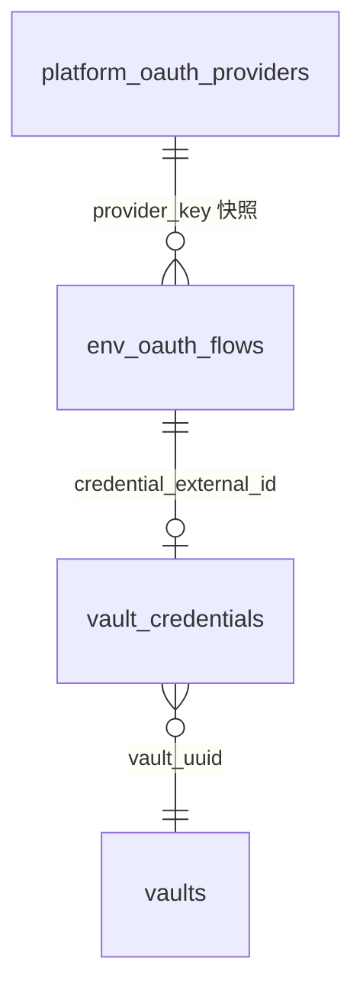
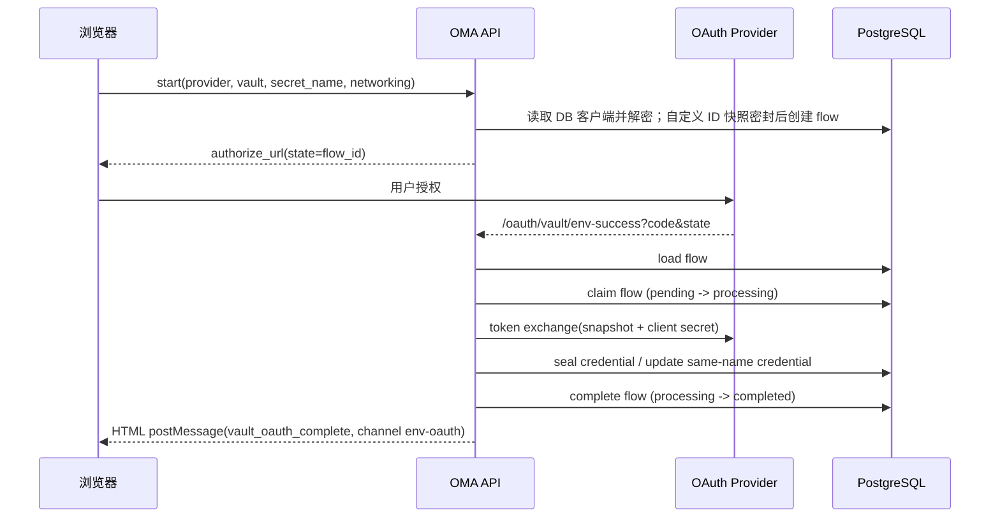
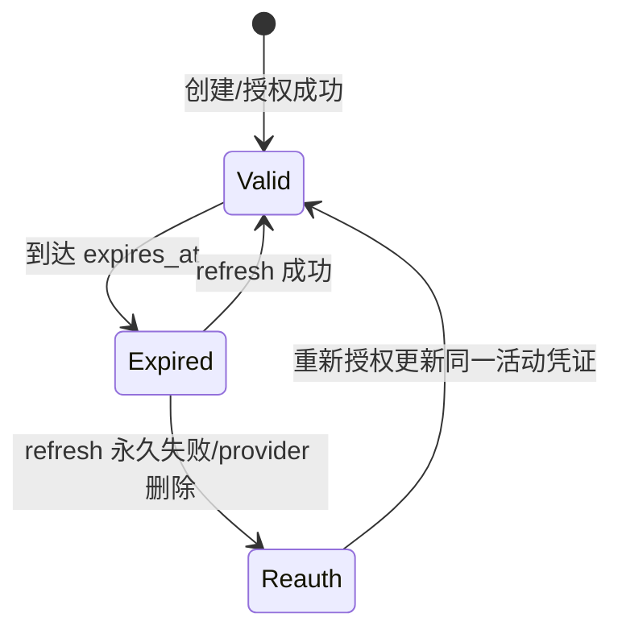
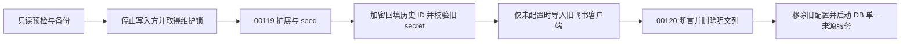

# ENV OAuth 凭证与平台 OAuth 客户端注册

## 目的与范围

本文描述 Vault 的 `env_oauth` 凭证类型、平台级 OAuth 客户端注册表、授权流程与运行时刷新/替换语义。
`env_oauth` 复用 `environment_variable` 的 Opaque Placeholder 与 CONNECT MITM Egress Secret Substitution，
出站时按 provider 的允许域名把占位符替换为当前 access token；沙箱始终只看到占位符。

非目标：组织级 OAuth 客户端隔离（本期全局）、沙箱协议变更、门户 SSO/飞书渠道/MCP 客户端迁移、改造通用 Vault 注入框架。

## 数据模型

迁移 `internal/db/migrations/00117_env_oauth.sql`：

- `vault_credentials.auth_type` CHECK 扩展 `env_oauth`。
- `platform_oauth_providers`：全局 OAuth 客户端注册表，`client_secret_envelope` 保存 `secrets.Service`
  信封；客户端 ID 使用独立 `client_id_envelope`；`created_by_platform_admin_uuid` 记录超管（内置 seed 可空）；`token_endpoint_auth_method` 与
  `token_endpoint_encoding` 决定换票方式。
- `env_oauth_flows`：授权中间态，保存 provider 快照（端点、client_id、scope、认证方式/编码）、
  `secret_name`、`networking_type`、`allowed_hosts`、创建者与过期时间；内置飞书的 `client_id_envelope` 必须为 NULL，换票时与 client_secret 一同读取当前数据库行；自定义 provider 的 ID 快照加密保存，secret 不进入 flow。状态
  `pending → completed | failed`。



Provider 与 flow 均不建外键；引用以 UUID/外部 ID 表达。

远程迁移 `00118_env_oauth_builtin_client_id.sql` 清除了飞书 flow 的客户端 ID；自定义快照保持不变，回滚只移除约束，不恢复清除值。增量 `00119_builtin_oauth_provider.sql` 增加受保护身份、默认值、版本和可空信封字段，seed 飞书元数据行；`00120_seal_oauth_client_ids.sql` 在断言全部历史自定义 ID 已回填后删除两表明文列。不得修改旧迁移。两个阶段之间只能停机维护，不允许运行普通业务进程。Down 拒绝重建明文；恢复旧二进制必须恢复升级前配套数据库与密钥备份。

飞书永久使用 `external_id=poap_FeishuBuiltinOAuthClient`、`builtin_key=feishu`、`protected=true`，UUID 由数据库生成并保留。自定义行 builtin_key 为空、protected 为 false、创建人非空。CHECK 约束保护身份映射及信封成对状态，Mapper 删除额外要求 `protected=false`。自定义名称部分唯一索引允许历史自定义 `Feishu` 与 seed 并存；保留 external_id 冲突使迁移失败，不收编或覆盖既有记录。`version>0`，管理更新、导入和密钥重新包装均 CAS 递增。

`00122_require_custom_oauth_client_envelopes.sql` 恢复双信封 CHECK 内置分支的 `builtin_key IS NOT NULL` 守卫，避免 PostgreSQL 的 NULL 语义放行自定义双空信封。自定义行必须同时具有两个通过结构校验的信封；飞书与 Friday 仍允许双空未配置状态，均不允许单空。合法存量行无须改写即可升级；若 00121 已写入双空自定义行，00122 原子失败并保留版本及记录，须在停机维护期间补齐有效加密凭据后重试，不自动删除或伪造凭据。真实 PostgreSQL 回归覆盖插入、更新、存量升级失败与修复后重试，以及既有身份、保护、信封结构和版本约束。

两个客户端字段分别使用现有 `secrets.Service.Seal/Open`，随机 DEK 与 nonce 各自独立。secret 的 AAD 为 `platform/platform/platform_oauth_providers/<external_id>`；ID 的最后一项为 `<external_id>:client_id`。flow ID 绑定实际组织 UUID、工作区 UUID、`env_oauth_flows`、flow external_id。绑定集中在 `internal/platformoauth`；换字段、复制到另一行或凭证均无法解密。KMS 调用在数据库事务之外执行，双信封用同一次 CAS 原子写入。

`vault.master_key` 仍是唯一部署主密钥来源，复用组装层的同一服务；不在业务表保存 KEK 或 KMS 身份。SQL 的 JSON 结构校验不替代应用完整信封和解密校验。删除活动 schema 明文列不代表擦除旧 WAL、备份和介质。

## 凭证公开结构与秘密

公开 `auth`（`vault_credentials.auth`）：

```json
{
  "type": "env_oauth",
  "provider": "builtin:feishu",
  "secret_name": "LARKSUITE_CLI_USER_ACCESS_TOKEN",
  "placeholder": "oma_ph_...",
  "networking": {"type": "limited", "allowed_hosts": ["open.feishu.cn", "accounts.feishu.cn"]},
  "injection_location": {"header": true, "body": false},
  "expires_at": "2026-11-06T10:00:00Z",
  "scope": "offline_access",
  "has_refresh_token": true
}
```

密封秘密 `secret_payload`（仅进程内 transient，落库前 Seal）：

```json
{"type": "env_oauth", "access_token": "u-...", "refresh_token": "ur-..."}
```

`credential_key = secret_name`，与 `environment_variable` 共用同一活动唯一索引。`injection_location`
固定 header（`Authorization: Bearer <token>`），不接受 body 注入。创建和更新时省略 injection_location 使用 header=true/body=false；显式禁用 header、启用 body、null 或类型错误均返回参数错误，不静默改写。Provider 与 `secret_name` 创建后不可变。

## Provider

- `builtin:feishu`：授权端点 `https://accounts.feishu.cn/open-apis/authen/v1/authorize`，令牌端点
  `https://open.feishu.cn/open-apis/authen/v2/oauth/token`，默认 scope `offline_access`，默认变量名
  `LARKSUITE_CLI_USER_ACCESS_TOKEN`，默认域名 `open.feishu.cn` / `accounts.feishu.cn`，令牌端点编码
  `json`，认证方式 `client_secret_post`。端点、scope 和默认值均来自受保护数据库行；两个客户端信封初始为 NULL，未配置时列表仍可见且 `configured=false`，`vault-auth/start` 返回 503。scope 可编辑且必须包含 `offline_access`。
- `custom:<provider_external_id>`：来自 `platform_oauth_providers`，两个客户端字段信封加密；拒绝 `custom:<内置 external_id>` 别名，运行时按
  provider key 重新解析。provider 被删除后存量凭证 refresh 失败并进入重新授权语义。

自定义 provider 的 `default_allowed_hosts` 可为 `null`；前端将其视为空域名列表，limited 仍须填写域名，unrestricted 可直接继续。

## 组织侧接口

| 方法 | 路径 | 说明 |
|---|---|---|
| GET | `/api/organizations/{orgUuid}/env-oauth/providers` | 仅从数据库逐行列出 provider 与 configured；不解密或返回客户端字段 |
| POST | `/api/organizations/{orgUuid}/env-oauth/vault-auth/start` | 校验并创建 flow，返回 `{oauth_flow_id, authorize_url}` |
| GET | `/oauth/vault/env-success?code&state` | 公共回调；换票、落库、完成 flow，返回 postMessage HTML |

`start` 校验：org 与 principal 一致，按 body 目标工作区重新解析成员权限并要求资源使用权限（保留组织管理员和平台管理员授权语义），workspace/vault 存在且未归档、provider 可用、secret_name 合法、
limited 必须有 allowed_hosts；同 vault 同名活动凭证若为同一 provider 的 `env_oauth` 允许重新授权，否则 409。
`redirect_url` 只接受固定回调路径 `/oauth/vault/env-success`：不允许 userinfo、query、fragment 或其他路径；
非 `dev` 环境必须 HTTPS；配置了 `auth.console_url` 时 scheme 与 host 必须与之一致，避免授权码被送往其他站点。

已完成 state 的顺序重放返回 `status=error`、`error_code=invalid_request`，不再次换票、不返回 credential_id、不修改 flow 或凭证；并发回调由 `processing` 认领互斥，未认领到的一方返回 `flow_in_progress`。换票 HTTP 客户端拒绝跟随 3xx，避免携带 `client_secret`、`code`、`refresh_token` 的请求体被重发到其他 origin。

回调保存前再次检查同名凭证的 provider；不同 provider 返回 `credential_key_conflict`，保留既有凭证及秘密。同 provider 允许原地重新授权。

回调流程：



回调 HTML 同时向 `BroadcastChannel("env-oauth")` 与 `window.opener` 发送
`{type:"vault_oauth_complete", status:"ok"|"error", flow_id, vault_id, credential_id?, error_code?}`。

## 运行时注入与刷新

- Session 挂载时，`PrepareEnvCredentialMount` 同时收集 `environment_variable` 与 `env_oauth` 的
  `secret_name → placeholder`；同名冲突时显式 `environment_variable` 优先。任一类型存在且 MITM 关闭 →
  `ErrMITMRequiredForEnvCredentials`。
- MITM 出站先做环境变量替换，再做 `env_oauth` 替换：仅当 `credentialNetworkingCoversHost` 命中且请求
  文本包含占位符时解析 token；未命中直接透传占位符。
- token 未过期直接复用；过期后按 credential 级 refresh lease + CAS 单飞刷新，`expires_in > 0` 时更新
  `expires_at`，否则沿用未过期旧值或清空。刷新使用 provider 当前配置；失败 fail-closed（不替换、返回
  `ErrSubstitutionRejected`），永久失败（4xx 非 408/429、缺 refresh token）标记需重新授权。
- refresh CAS 冲突后仅把刷新负责的到期时间、scope 和 refresh token 标记合并到最新 auth，保留最新 networking、provider、placeholder。若 access token 或 refresh token 来源已变更，复用未过期的最新 token；最新 token 不可用时拒绝覆盖，等待后续请求重新解析。
- 读取信封缺失时 `openCredentialSecret` 返回 `ErrEnvOAuthReauthorizationRequired`。



## 平台管理接口

前缀 `/api/platform-admin`，沿用 verified login + CSRF + `platform:access`：

| 方法 | 路径 | 说明 |
|---|---|---|
| GET | `/oauth-providers` | 列表；永不返回 secret |
| POST | `/oauth-providers` | 创建；名称重复 409 |
| PATCH | `/oauth-providers/{id}` | 部分更新；`client_secret` 缺省表示不改 |
| DELETE | `/oauth-providers/{id}` | 删除；不影响已存 flow 快照与已建凭证的可读性 |

响应保留 `id`（external_id）、名称、端点、scope、client_id、has_client_secret、认证方式、编码与时间，新增 `provider_key`、`builtin`、`protected`、`has_client_id`、`configured`、`version` 和只读默认值。client_id 仅在超管授权后解密，客户端列表不解密 secret；所有平台客户端响应使用 `Cache-Control: no-store`。未配置 ID 返回空串，解密失败返回 503 `platform_oauth_provider_unavailable`，不能冒充未配置。API、日志和审计永不回显 secret 或信封。

名称上限按 Unicode 字符计数（200 字符），不是字节数。`prod` 环境拒绝 `http` 端点，其他环境仍允许本地联调使用 `http`。

POST 仅创建自定义，拒绝 builtin_key/protected/uuid 等未知系统字段。PATCH 内置仅允许 scope、client_id、client_secret（另需 expected_version）；禁止字段即使同值或 null 也拒绝。secret 省略保持，空串/null 拒绝；首次配置及修改 ID 必须同时提交新 secret；仅换 secret 不重封 ID。DELETE 内置返回 409 `oauth_provider_protected`；自定义删除仍是 204/404。PATCH/DELETE 必须提交 `expected_version`，过期为 409 `oauth_provider_version_conflict`，名称冲突仍是 `oauth_provider_name_conflict`。

平台页将飞书与 Friday 内置行排在同一表格前部，显示本地化名称、内置 Badge、配置状态；保留共享 shadcn 组件与现有路由。内置名称、端点、认证方式、编码和默认值只读，不显示删除和重置操作。编辑弹窗只发送允许字段，提示更换应用可能需要重新授权。Vault 表单使用组织 API 元数据，未配置禁用授权按钮，保留手工令牌保存；普通用户仅看到联系管理员，具有 platform:access 的用户可进入平台配置页。

结构化安全审计复用注入的 slog logger：create/update/delete、首次 configure、import、rewrap、保护拒绝和内置缺失完整性故障。只记录 actor UUID 或 maintenance/system、provider UUID/key、action、changed_fields、result、request_id/错误码与事件时间；不记录客户端值、scope 内容、信封或上游 body。成功在提交后记录，失败在资源最终处理处记录；日志与数据库不承诺原子持久化。中英文文案按稳定错误码翻译。

## 离线升级与部署

旧部署块 `vault.feishu_oauth_client` 已从普通 Config 删除；出现该键时明确要求导入后移除，运行时没有配置回退、自动导入、双读或双写。门户 SSO、飞书消息渠道和 `vault.platform_oauth_clients` 保持各自原有来源。

1. 备份数据库、旧配置和匹配的主密钥；准备不含旧飞书块的当前 CONFIG_FILE。旧文件通过受控路径单独传入，不接受命令行 secret。
2. 默认只读预检：`CONFIG_FILE=/etc/oma/config.yaml go run ./cmd/oauth-provider-migrate --legacy-config /secure/legacy.yaml`。旧飞书块均缺失可保持未配置，半配置失败；预检不会执行 schema 或数据写入，输出 `success=<已回填> pending=<待回填> skipped=<无需处理> failed=0`，`pending` 是 `--apply` 前判断是否真有数据要迁移的依据。预检被信号取消时以 `canceled` 非零退出，不计入数据失败。
3. 停止共享该数据库的 API、worker 和其他写入方，再加 `--apply`。命令获取 goose 会话维护锁，仅前进到 00119；分页对全部状态的自定义 provider/flow ID Seal/Open 往返验证并按 UUID/旧值 CAS 回填，校验原 secret 可解密；重入验证已有信封并跳过，不重新生成密文。
4. 飞书两信封均空才原子导入旧配置；已有 DB 配置仅校验并跳过，绝不覆盖管理员最新值。KMS、坏信封、半配置或 CAS 冲突非零退出，保留可续跑状态。
5. 全部回填完成再前进到 00120，断言并删除明文列，真实读取解密验证。随后前进到 00121 seed Friday，再应用 00122 收紧自定义凭据约束；已到 00122 只校验或补齐未配置内置行，绝不降级。输出仅含版本、行 UUID、计数和白名单错误码。
6. 从部署源、人工配置、初始化模板及生成来源移除旧块，再按环境正常生成并启动；不能只修改生成配置。旧配置与备份按既有敏感文件策略清理或隔离。



保留 `builtin:feishu`、已有 credential auth、占位符、host 范围及 refresh lease/CAS 合同。飞书 callback 使用当前 DB 客户端，自定义 callback 使用历史 ID 快照与当前 secret，refresh 使用当前客户端。更换应用可能使旧 token/refresh token 需要重新授权；不新增旧 secret 历史或在途兼容分支。维护超过 flow 的 15 分钟 TTL 时重新发起授权。

## 测试与验收

- `internal/vaults`：schema 往返、create/update 校验、占位符合并优先级、replacement planner、token
  refresh 与 CAS、JSON/form token 端点编码。
- `internal/db`：新 Mapper 的 SQL/参数绑定/敏感标记单测；集成测试覆盖真实 PostgreSQL 读写。
- `internal/api`（`integration`）：start 参数、callback 换票落库、重新授权原地更新、失败状态、并发回调只认领一次、平台
  provider CRUD 与 secret 不回显。
- `internal/api`（单测）：`redirect_url` 回调路径与 console origin 校验、换票客户端拒绝跟随重定向、
  `processing` 认领与完成失败的响应。
- `internal/db`：`Claim` 的 SQL 与敏感绑定标记；`Complete` 只接受 `processing`，`Fail` 接受 `pending`/`processing`。
- `internal/platformadmin`：名称按字符计数、`prod` 拒绝 `http` 端点。
- `internal/config`：普通服务拒绝遗留飞书块并给出离线导入指引。
- `cmd/oauth-provider-migrate`（`integration`）：真实 00118 升级、空库、四状态回填、名称/保留 ID 冲突、阻断与续跑、无明文列/外键、重入和已有配置保护。
- `cmd/vault-migrate`：平台双信封/flow 单信封 CAS、跨 provider 和 local 版本选择、失败整行不变，轮换后 Open 与本地 stub OAuth 刷新。
- 前端：内置表格行、固定字段只读、最小 PATCH、空 secret 保留、首配/换 ID 校验、并发提示、Vault 未配置禁授权与手工保存、中英文键一致。

定向真实 PostgreSQL 使用 `just test-integration`，通过 TEST_MIGRATION_DATABASE_URL 指向隔离数据库。普通单测不连接外部服务。stub 结果不代表真实飞书扫码或上游兼容验收；不自动运行 verify-be，既有 D1/C7 真实验收报告仅作历史基线。


## Friday 内置服务方增量

`00121_builtin_friday_oauth_provider.sql` 扩展受保护身份与双信封约束，新增 `builtin_key=friday`、`external_id=poap_FridayBuiltinOAuthClient` 的独立行，保留飞书和自定义行。新行默认未配置，客户端 ID 与 secret 均为 NULL；不得在 SQL seed 中填写明文客户端。UUID 保留，名称可以与历史自定义 Friday 并存。两个内置行缺失均使列表拒绝服务并按实际 provider_key 记录完整性审计。

Friday 授权端点为 `https://friday-tx.seewo.com/open/api/oauth/authorize`，令牌端点为 `https://friday-tx.seewo.com/open/api/oauth/token`，scope 固定为上游支持的 `read`，采用 `client_secret_basic` 与 `application/x-www-form-urlencoded`，使用 S256。默认网络白名单为 `friday-tx.seewo.com`；没有已确认的 CLI 变量合同，因此默认变量名为空，由 Vault 用户填写。Friday 与飞书各自读取 DB 端点及客户端，不共享飞书端点、scope 或应用凭据。

上游依据是 Friday 仓库 `OAuthDiscoveryController.kt`、`OAuthController.kt`、`OAuthService.kt` 和 `docs/oauth-configuration.md`：公网 origin 可由 `friday.oauth.public-url` 覆盖，客户端在上游通过配置中心或环境注入的 `friday.oauth.clients` JSON 数组注册，字段为 `id`、`secret`、`name`、`redirectUris`。仓库文档的 `friday-bridge` 是示例 ID，不是已确认生产应用，不能直接 seed。`friday.oauth.signing-secret` 是上游签名密钥，不是 OAuth 客户端 secret，禁止作为客户端导入。

离线命令新增 `--friday-config /secure/friday.yaml`。文件只包含顶层 `client_id` 与 `client_secret`，均须填写，拒绝未知字段；应由受控配置源注入并限制为 0600，不将真实值提交仓库。默认只读预检，停机后 `--apply` 持维护锁前进至 00122，双信封同时为空才 Seal/Open 校验并 CAS 写入，已配置仅验证不覆盖。与 `--legacy-config` 可以同时使用，旧飞书导入语义保持。重新包装自动覆盖 Friday 两个字段，仍使用独立 AAD、整行 CAS、版本递增和安全审计。

回调继续使用 OMA 的 `/oauth/vault/env-success`。在上游 `friday.oauth.clients.redirectUris` 精确登记实际 OMA HTTPS 回调地址，禁止用户信息及片段；文档中的桥接示例回调不作为 OMA 回调。Friday flow 与飞书一致不保存客户端 ID 信封，回调读取当前 Friday 客户端；Friday 独有的随机 PKCE verifier 存在 `code_verifier_envelope` 中，AAD 为 flow 的租户/UUID 身份加 `:code_verifier` 后缀，回调解密提交 verifier，绝不把 verifier 放入 URL 或响应。00121 约束仅 Friday flow 必须携带该信封，其余 flow 为空；重新包装扫描同时覆盖自定义 ID 快照与 Friday verifier，并保持 NULL 与整行 CAS。已有自定义 flow 仍保留 ID 快照。管理页和 Vault 表单分别显示两个内置名称、标识和配置状态；未配置可保存手工 token，授权仍拒绝。Friday 的名称、端点、认证和编码不可编辑，scope 仅接受 `read`，客户端编辑、轮换、删除保护及权限沿用内置合同。

验收覆盖 Friday seed、旧库 00120→00121、保留 ID 冲突、加密导入与重入、成对信封/身份约束、独立端点/Basic/form/S256、真实 PostgreSQL callback 凭证落库、拒绝删除、secret 不回显、AAD 隔离、跨版本重新包装、中文英文名称和前端首配。真实 PostgreSQL 集成使用 `integration` 标签与隔离临时 schema，上游换票由本地 HTTP fixture 驱动，不代表连接真实 Friday。

## 分支合并迁移编号

保留远程已发布的 00116（API Key 运行身份）、00117（ENV OAuth）与 00118（内置飞书明文清理），SQL 内容不变。本地独有的四个增量迁移由 00118–00121 顺延至 00119–00122，SQL 内容不变；离线维护工具与测试同步使用新编号。旧本地编号的开发数据库不能直接继续迁移，须保留配套备份并在隔离数据库验证；不得修改已应用迁移记录来伪装升级。
