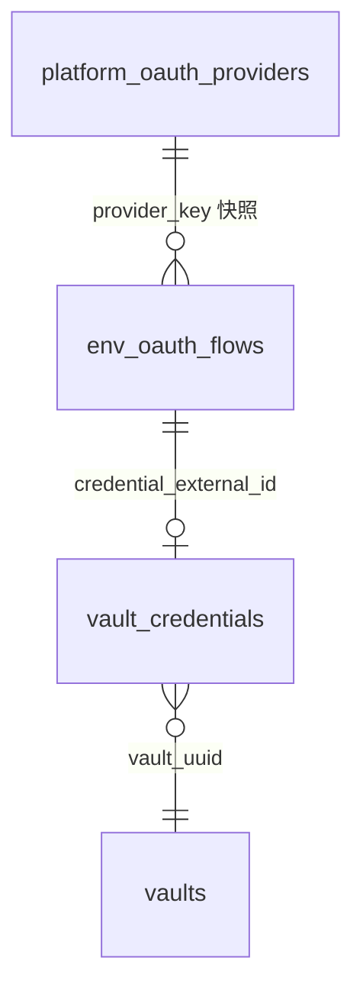
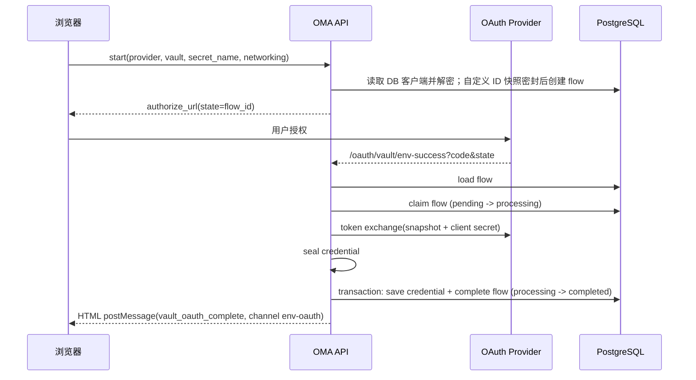
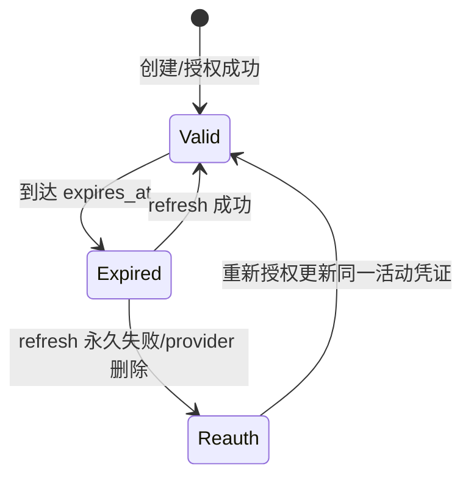

# ENV OAuth 凭证与平台 OAuth 客户端注册

## 目的与范围

本文描述 Vault 的 `env_oauth` 凭证类型、平台级 OAuth 客户端注册表、授权流程与运行时刷新/替换语义。
`env_oauth` 复用 `environment_variable` 的 Opaque Placeholder 与 CONNECT MITM Egress Secret Substitution，
出站时按 provider 的允许域名把占位符替换为当前 access token；沙箱始终只看到占位符。

非目标：组织级 OAuth 客户端隔离（本期全局）、沙箱协议变更、门户 SSO/飞书渠道/MCP 客户端迁移、改造通用 Vault 注入框架。

## 数据模型

迁移 `internal/db/migrations/00119_env_oauth.sql`：

- `vault_credentials.auth_type` CHECK 扩展 `env_oauth`。
- `platform_oauth_providers`：全局 OAuth 客户端注册表，`client_secret_envelope` 保存 `secrets.Service`
  信封；客户端 ID 使用独立 `client_id_envelope`；`created_by_platform_admin_uuid` 记录超管（内置 seed 可空）；`token_endpoint_auth_method` 与
  `token_endpoint_encoding` 决定换票方式。
- `env_oauth_flows`：授权中间态，保存 provider 快照（端点、client_id、scope、认证方式/编码）、
  `secret_name`、`networking_type`、`allowed_hosts`、创建者与过期时间；内置飞书的 `client_id_envelope` 必须为 NULL，换票时与 client_secret 一同读取当前数据库行；自定义 provider 的 ID 快照加密保存，secret 不进入 flow。状态
  `pending → completed | failed`。



Provider 与 flow 均不建外键；引用以 UUID/外部 ID 表达。

远程迁移 `00120_env_oauth_builtin_client_id.sql` 清除了飞书 flow 的客户端 ID；自定义快照保持不变，回滚只移除约束，不恢复清除值。增量 `00121_builtin_oauth_provider.sql` 增加受保护身份、默认值、版本和可空信封字段，seed 飞书元数据行；`00122_seal_oauth_client_ids.sql` 在断言全部历史自定义 ID 已回填后删除两表明文列。不得修改旧迁移。当前启动按迁移顺序完成最终 schema，不提供历史中间版本的数据回填工具。Down 拒绝重建明文；恢复旧二进制必须恢复升级前配套数据库与密钥备份。

飞书永久使用 `external_id=poap_FeishuBuiltinOAuthClient`、`builtin_key=feishu`、`protected=true`，UUID 由数据库生成并保留。自定义行 builtin_key 为空、protected 为 false、创建人非空。CHECK 约束保护身份映射及信封成对状态，身份字段仅用于稳定 provider_key 与协议解析，平台管理不按该字段限制编辑或删除。自定义名称部分唯一索引允许历史自定义 `Feishu` 与 seed 并存；保留 external_id 冲突使迁移失败，不收编或覆盖既有记录。`version>0`，管理更新和密钥重新包装均 CAS 递增。

`00125_env_oauth_flows_processing_status.sql` 把 `env_oauth_flows_status_check` 扩展为 `pending/processing/completed/failed/expired`，支撑回调认领状态；该迁移由常规启动迁移应用。Down 移除 `processing`，因此降级前必须确认没有进行中的认领。

两个客户端字段分别使用现有 `secrets.Service.Seal/Open`，随机 DEK 与 nonce 各自独立。secret 的 AAD 为 `platform/platform/platform_oauth_providers/<external_id>`；ID 的最后一项为 `<external_id>:client_id`。flow ID 绑定实际组织 UUID、工作区 UUID、`env_oauth_flows`、flow external_id。绑定集中在 `internal/platformoauth`；换字段、复制到另一行或凭证均无法解密。KMS 调用在数据库事务之外执行，双信封用同一次 CAS 原子写入。

`vault.master_key` 仍是唯一部署主密钥来源，复用组装层的同一服务；不在业务表保存 KEK 或 KMS 身份。SQL 的 JSON 结构校验不替代应用完整信封和解密校验。删除活动 schema 明文列不代表擦除旧 WAL、备份和介质。

## 凭证公开结构与秘密

公开 `auth`（`vault_credentials.auth`）：

```json
{
  "type": "env_oauth",
  "provider": "builtin:feishu",
  "secret_name": "LARKSUITE_CLI_USER_ACCESS_TOKEN",
  "placeholder": "oma_ph_...",
  "networking": {"type": "limited", "allowed_hosts": ["open.feishu.cn", "accounts.feishu.cn"]},
  "injection_location": {"header": true, "body": false},
  "expires_at": "2026-11-06T10:00:00Z",
  "scope": "offline_access",
  "has_refresh_token": true
}
```

密封秘密 `secret_payload`（仅进程内 transient，落库前 Seal）：

```json
{"type": "env_oauth", "access_token": "u-...", "refresh_token": "ur-..."}
```

`credential_key = secret_name`，与 `environment_variable` 共用同一活动唯一索引。`injection_location`
固定 header（`Authorization: Bearer <token>`），不接受 body 注入。创建和更新时省略 injection_location 使用 header=true/body=false；显式禁用 header、启用 body、null 或类型错误均返回参数错误，不静默改写。Provider 与 `secret_name` 创建后不可变。

## Provider

- `builtin:feishu`：授权端点 `https://accounts.feishu.cn/open-apis/authen/v1/authorize`，令牌端点
  `https://open.feishu.cn/open-apis/authen/v2/oauth/token`，默认 scope `offline_access`，默认变量名
  `LARKSUITE_CLI_USER_ACCESS_TOKEN`，默认域名 `open.feishu.cn` / `accounts.feishu.cn`，令牌端点编码
  `json`，认证方式 `client_secret_post`。端点、scope 和默认值均来自受保护数据库行；两个客户端信封初始为 NULL，未配置时列表仍可见且 `configured=false`，`vault-auth/start` 返回 503。scope 可编辑且必须包含 `offline_access`。
- `custom:<provider_external_id>`：来自 `platform_oauth_providers`，两个客户端字段信封加密；拒绝 `custom:<内置 external_id>` 别名，运行时按
  provider key 重新解析。provider 被删除后存量凭证 refresh 失败并进入重新授权语义。

自定义 provider 的 `default_allowed_hosts` 可为 `null`；前端将其视为空域名列表，limited 仍须填写域名，unrestricted 可直接继续。

## 组织侧接口

| 方法 | 路径 | 说明 |
|---|---|---|
| GET | `/api/organizations/{orgUuid}/env-oauth/providers` | 仅从数据库逐行列出 provider 与 configured；不解密或返回客户端字段 |
| POST | `/api/organizations/{orgUuid}/env-oauth/vault-auth/start` | 校验并创建 flow，返回 `{oauth_flow_id, authorize_url}` |
| GET | `/oauth/vault/env-success?code&state` | 公共回调；换票、落库、完成 flow，返回 postMessage HTML |

`start` 校验：org 与 principal 一致，按 body 目标工作区重新解析成员权限并要求资源使用权限（保留组织管理员和平台管理员授权语义），workspace/vault 存在且未归档、provider 可用、secret_name 合法、
display_name 最多 255 个字符，limited 必须有 allowed_hosts；unrestricted 省略主机时持久化空数组。新增请求遇到同 vault 同名活动凭证时返回 409 `credential_key_conflict`。重新授权必须显式携带匹配的 `credential_id`，目标须为同 vault、同变量名、同 provider 的活动 `env_oauth` 凭证，否则返回同一冲突错误。
`redirect_url` 只接受固定回调路径 `/oauth/vault/env-success`：不允许 userinfo、query、fragment 或其他路径；
非 `dev` 环境必须 HTTPS；配置了 `auth.console_url` 时 scheme 与 host 必须与之一致，避免授权码被送往其他站点。

已完成 state 的顺序重放返回 `status=error`、`error_code=invalid_request`，不再次换票、不返回 credential_id、不修改 flow 或凭证；并发回调由 `processing` 认领互斥，未认领到的一方返回 `flow_in_progress`。换票 HTTP 客户端拒绝跟随 3xx，避免携带 `client_secret`、`code`、`refresh_token` 的请求体被重发到其他 origin。

回调保存前再次检查同名凭证及 flow 中保存的目标 ID；仅当目标 ID、变量名和 provider 匹配时原地重新授权，否则返回 `credential_key_conflict`，保留既有凭证及秘密。重新授权的目标凭证已不存在时返回 `credential_unavailable`，不回退为新建。

回调保存错误按原因返回 `credential_limit_exceeded`、`credential_version_conflict`、`credential_unavailable` 或 `credential_save_failed`，不冒充换票失败。到期时间从收到换票响应后采样的时间计算。

回调流程：



回调 HTML 同时向 `BroadcastChannel("env-oauth")` 与 `window.opener` 发送
`{type:"vault_oauth_complete", status:"ok"|"error", flow_id, vault_id, credential_id?, error_code?}`。

## 运行时注入与刷新

- Session 挂载时，`PrepareEnvCredentialMount` 同时收集 `environment_variable` 与 `env_oauth` 的
  `secret_name → placeholder`；同名冲突时显式 `environment_variable` 优先。任一类型存在且 MITM 关闭 →
  `ErrMITMRequiredForEnvCredentials`。
- MITM 出站先做环境变量替换，再做 `env_oauth` 替换：仅当 `credentialNetworkingCoversHost` 命中且请求
  文本包含占位符时解析 token；未命中直接透传占位符。
- token 未过期直接复用；过期后按 credential 级 refresh lease + CAS 单飞刷新，`expires_in > 0` 时更新
  `expires_at`，否则沿用未过期旧值或清空。刷新使用 provider 当前配置；失败 fail-closed（不替换、返回
  `ErrSubstitutionRejected`），永久失败（4xx 非 408/429、缺 refresh token）标记需重新授权。
- 刷新只发送凭据已知的 scope，响应未返回 scope 时保留原值，不把服务方默认值当成授权结果。换票失败后重载凭据，若并发胜出方已写入可用的新令牌则复用，材料未变化时仍返回原错误。
- refresh CAS 冲突后仅把刷新负责的到期时间、scope 和 refresh token 标记合并到最新 auth，保留最新 networking、provider、placeholder。若 access token 或 refresh token 来源已变更，复用未过期的最新 token；最新 token 不可用时拒绝覆盖，等待后续请求重新解析。
- 读取信封缺失时 `openCredentialSecret` 返回 `ErrEnvOAuthReauthorizationRequired`。



## 平台管理接口

前缀 `/api/platform-admin`，沿用 verified login + CSRF + `platform:access`：

| 方法 | 路径 | 说明 |
|---|---|---|
| GET | `/oauth-providers` | 列表；永不返回 secret |
| POST | `/oauth-providers` | 创建；名称重复 409 |
| PATCH | `/oauth-providers/{id}` | 部分更新；`client_secret` 缺省表示不改 |
| DELETE | `/oauth-providers/{id}` | 删除；不影响已存 flow 快照与已建凭证的可读性 |

响应保留 `id`（external_id）、名称、端点、scope、client_id、has_client_secret、认证方式、编码与时间，新增 `provider_key`、`builtin`、`protected`、`has_client_id`、`configured`、`version` 、`enabled` 和可编辑的默认变量名。client_id 仅在超管授权后解密，客户端列表不解密 secret；所有平台客户端响应使用 `Cache-Control: no-store`。未配置 ID 返回空串，解密失败返回 503 `platform_oauth_provider_unavailable`，不能冒充未配置。API、日志和审计永不回显 secret 或信封。

名称上限按 Unicode 字符计数（200 字符），不是字节数。`prod` 环境拒绝 `http` 端点，其他环境仍允许本地联调使用 `http`。

客户端表单将令牌端点认证方式和请求编码放在默认折叠的“高级配置”中。新建沿用 `client_secret_post` / `form` 默认值，编辑沿用已存配置；折叠和展开不改变字段值，管理员需要时可展开修改。

平台客户端仅由超级管理员统一登记和管理，不按内置或自定义设置编辑、删除或启停差异；普通用户创建凭证时填写的客户端覆盖配置仅属于该凭证或授权流程，不写入平台目录。保留已有 provider_key 身份，避免改变凭证绑定与授权协议。

所有平台客户端都可编辑名称、Logo、端点、scope、认证方式、编码、默认变量名及客户端配置。secret 省略保持，空串/null 拒绝；首次配置及修改 ID 必须同时提交新 secret；仅换 secret 不重封 ID。PATCH/DELETE 必须提交 `expected_version`，过期为 409 `oauth_provider_version_conflict`，名称冲突仍是 `oauth_provider_name_conflict`。删除任一客户端不影响其他客户端的列表查询。

平台列表展示管理员设置的名称、头像和状态，最右侧统一使用三点“更多操作”菜单，提供启用/停用和删除，点击整行进入编辑。Vault 表单使用组织 API 元数据，未配置禁用授权按钮，保留手工令牌保存；普通用户仅看到联系管理员，具有 platform:access 的超级管理员可进入平台配置页。

结构化安全审计复用注入的 slog logger：create/update/delete、首次 configure、rewrap和解析不可用故障。只记录 actor UUID 或 maintenance/system、provider UUID/key、action、changed_fields、result、request_id/错误码与事件时间；不记录客户端值、scope 内容、信封或上游 body。成功在提交后记录，失败在资源最终处理处记录；日志与数据库不承诺原子持久化。中英文文案按稳定错误码翻译。

### 凭证列表

凭证详情列表支持名称或 ID 搜索与 Auth 类型组合筛选，并展示创建时间和更新时间。当前保险库最多允许 20 条活动凭证，列表一次读取 50 条覆盖该上限。

### 浏览器凭证编辑与重新授权

ENV OAuth 服务方选择器在选中项和候选项名称前显示方形服务图标，不添加「内置」前缀；搜索与授权仍使用原服务方标识。OAuth 管理与选择器共用服务方头像，只读取配置的 `logo_url`；未配置时显示通用图标，不打包品牌图片或按服务方名称映射。

ENV OAuth 表单的「已有 Token？手动填写」折叠区只提供 Access token 输入，不提供 refresh token 或过期时间输入。编辑时不回显密封令牌，访问令牌留空保留当前值；保存表单不提交 refresh_token 或 expires_at，保留授权流程写入的刷新令牌、到期时间及自动刷新能力；服务方与变量名仍不可修改。客户端信息继续由平台管理统一配置。

编辑弹窗提供独立「重新授权」入口，复用 start 接口及同名同服务方原地更新合同。入口要求共享确认、合法网络配置及服务方已配置；保存元数据与授权是独立操作。授权等待期间允许取消并关闭弹窗；授权失败保留草稿供重试，匹配 flow 的成功回调刷新凭证列表并关闭编辑弹窗。回归覆盖启动失败重试、目标变量保持、成功回调和不调用手工保存。

## 初始化与部署

本功能没有旧部署兼容需求。应用启动通过现有 goose 入口执行 SQL 迁移并初始化服务方记录；客户端在 OAuth 管理页配置。提供可用的信封加密配置后即可启用授权。

不提供旧飞书配置导入、历史明文客户端分页回填、分阶段 schema 升级或相应维护 CLI。已有 SQL 迁移文件及其约束回归测试保留，当前版本的密钥轮换仍使用 `cmd/vault-migrate`。

保留 `builtin:feishu`、已有 credential auth、占位符、host 范围及 refresh lease/CAS 合同。飞书 callback 使用当前 DB 客户端，自定义 callback 校验授权开始时的 provider_version 后，使用同一版本的 ID 快照与 secret，refresh 使用当前客户端。更换应用可能使旧 token/refresh token 需要重新授权；不新增旧 secret 历史或在途兼容分支。维护超过 flow 的 15 分钟 TTL 时重新发起授权。

## 测试与验收

- `internal/vaults`：schema 往返、create/update 校验、占位符合并优先级、replacement planner、token
  refresh 与 CAS、JSON/form token 端点编码。
- `internal/db`：新 Mapper 的 SQL/参数绑定/敏感标记单测；集成测试覆盖真实 PostgreSQL 读写。
- `internal/api`（`integration`）：start 参数、callback 换票落库、重新授权原地更新、失败状态、并发回调只认领一次、平台
  provider CRUD 与 secret 不回显。
- `internal/api`（单测）：`redirect_url` 回调路径与 console origin 校验、换票客户端拒绝跟随重定向、
  `processing` 认领与完成失败的响应。
- `internal/db`：`Claim` 的 SQL 与敏感绑定标记；`Complete` 只接受 `processing`，`Fail` 接受 `pending`/`processing`。
- `internal/platformadmin`：名称按字符计数、`prod` 拒绝 `http` 端点。
- `cmd/vault-migrate`：平台双信封/flow 单信封 CAS、跨 provider 迁移、失败整行不变，轮换后 Open 与本地 stub OAuth 刷新。
- 前端：统一平台表格行、字段可编辑、完整配置 PATCH、空 secret 保留、首配/换 ID 校验、并发提示、Vault 未配置禁授权与手工保存、中英文键一致。

定向真实 PostgreSQL 使用 `just test-integration`，通过 TEST_MIGRATION_DATABASE_URL 指向隔离数据库。普通单测不连接外部服务。stub 结果不代表真实飞书扫码或上游兼容验收；不自动运行 verify-be，既有 D1/C7 真实验收报告仅作历史基线。

## 通用授权码保护

ENV OAuth 授权流程统一使用 S256 PKCE，不按服务方名称分支。随机 verifier 加密保存在 flow 的 `code_verifier_envelope` 中，AAD 使用 flow 的组织、工作区及标识；回调解密后提交 verifier。该信封沿用现有重新包装和 CAS 校验。自定义服务方的名称、端点、scope、客户端、默认变量名、网络白名单和 Logo 全部通过 OAuth 管理配置，不预置企业服务方。

## 分支合并迁移编号

main 的 00118 为组织级模型服务方迁移。ENV OAuth 当前迁移为 00119–00123、00125–00129；约束测试使用对应编号。00123 已精简为通用 PKCE verifier 信封列及结构约束，企业专属 seed 和约束已删除；原 00124 是对已删除专属约束的修正，已一并移除。原编号的开发数据库不能直接继续升级，不得修改迁移记录伪装为新编号。

## 可选客户端配置与 Logo

迁移 `00126_oauth_provider_logo_optional_clients.sql` 为服务方新增默认空串的 `logo_url`，并为内置飞书记录写入默认头像 URL `https://www.feishu.cn/favicon.ico`；该 URL 仍可通过 OAuth 管理修改或清除。迁移同时允许自定义服务方与内置服务方均以双空客户端信封保存为未配置状态；仍禁止只有一个客户端信封。既有身份保护、信封结构与 CAS 版本约束保持不变。降级到旧约束前须先补齐未配置自定义客户端，否则 Down 事务失败并保留数据。

平台注册与编辑支持可选 `logo_url`；只接受无 userinfo 的 HTTP(S) 地址，首尾空白在管理入口清理。创建缺省为空，PATCH 缺省保留、空串清除。客户端 ID／Secret 可以同时不填，首次设置或更换 ID 必须同时提供 Secret；已配置客户端更新时 Secret 缺省保留。Logo 与 Scope 可在未配置状态独立更新，不触发客户端配置成功审计。未配置客户端继续显示在组织服务方列表，但不能启动 OAuth 授权。

管理表单将客户端 ID 和 Secret 同行放在令牌端点下方，Logo URL 可选。管理列表及 Vault 服务方选择器展示配置的 Logo；没有 URL 或图片加载失败时使用现有通用图标；更新 URL 后重新尝试加载。图片由浏览器直接加载且不发送 Referrer，后端不代理或抓取图片。

查询直接读取当前 schema 的 Logo 字段，不保留旧 schema 回退；密钥轮换跳过双空客户端。

## ENV OAuth 刷新失败与请求策略

令牌解析器将刷新锁内重载及 CAS 重试得到的凭证状态返回给出网替换调用方。返回令牌后，以该状态重新检查当前目标主机，避免把新令牌按刷新前的旧域名范围注入；未覆盖的请求保留占位符。

上游刷新成功但本地密封或保存失败时，使用原换票信封作条件清理，在脱离请求取消的短超时上下文内作废已消费的旧秘密，并返回需要重新授权。清理沿用数据库已有信封 CAS，不删除并发写入的新秘密。

## 回调一致性

迁移 00127 为授权流程增加 provider_version。授权开始时记录服务方版本；回调检测到版本变化或旧流程缺少版本时，不请求 Token 端点，返回 invalid_request 并要求重新发起授权。无需保存客户端 Secret 历史或增加在途配置兼容分支。

重新授权只替换令牌与到期信息，保留凭证当前的网络范围、占位符和元数据；网络修改单独保存。编辑弹窗检测到网络草稿变化时拒绝发起重新授权，提示先保存网络配置；仅空白分隔变化不阻止授权。创建／更新凭证和 flow 的 processing → completed 转换使用同一 Yourbatis 事务，任意一步失败都回滚。上游换票与密封仍在事务外，避免长时间持有数据库锁。

初始化服务方仍由 SQL seed 完成，不额外读取迁移版本或记录启动 seed 审计。运行时管理、重新包装及完整性错误的安全审计保持原合同。OAuth 密钥迁移复用 secrets.Service 的信封校验，不维护重复的结构规则；通用存储回归运行一次，服务方及 PKCE 由 OAuth 专项测试覆盖。

## 本轮评审回归

OAuth 管理的创建／更新响应复用本次已验证的客户端 ID，写入成功后不再解密；列表读取仍校验并解密。版本冲突刷新列表，关闭并重开时使用最新版本。表格提供键盘可达的编辑按钮，并加入控制台页面搜索；错误使用 alert 语义。Quickstart 的 MCP 凭据门禁只提供 MCP OAuth 与 Bearer 类型，ENV OAuth 不参与该门禁。

### 客户端默认变量名与启停

注册和编辑 OAuth 客户端均可设置默认变量名，所有平台客户端统一管理；名称在入口按现有环境变量规则校验。创建凭证选择服务方时自动带出默认值，保留用户已自行填写的变量名，修改默认值不重命名已有凭证。

客户端默认启用。停用前确认：“从工作区可选服务方中隐藏。已有凭证和会话继续可用；停用不会撤销授权或自动刷新能力。”新建凭证的选择器隐藏停用服务方，编辑已有凭证仍显示原服务方。服务端拒绝停用服务方的新建授权和手工新建凭证；同保险库、同变量名及同服务方的已有凭证仍可重新授权，已有请求替换及自动刷新继续使用当前客户端配置。启停复用客户端更新接口和版本并发检查，不删除客户端或凭证。状态与默认变量名更新均进入既有字段审计。

SQL 迁移 `00128` 仅增加客户端启用状态，不修改已配置的变量名。

OAuth 管理支持归档和恢复：归档保留客户端配置及归档前的启停状态，已有凭证和自动刷新继续可用，但服务方不再可用于新建授权和手工新建凭证。管理列表默认显示“活跃”（未归档）项，支持按启用、停用、归档及全部筛选；状态独立成列，名称旁不再展示配置完整性标签。

编辑 ENV OAuth 凭证时手填新访问令牌会清除旧过期时间，避免新令牌被旧授权的过期状态阻断；未填写令牌时保留现有授权及自动刷新元数据。

新增 ENV OAuth 凭证遇到重复变量名时返回冲突，前端通过全局 toast 显示变量名，保留表单并关闭授权空白窗口；不更新已有凭证。重新授权请求显式传入当前 credential_id，流程复用 credential_external_id 保存目标，只更新匹配的凭证。


## 工作区自定义服务方与默认主机

普通工作区成员可以在创建 ENV OAuth 凭据的服务方选择器中选择“自定义 OAuth 服务方”。创建表单默认只显示名称、授权端点、令牌端点及可选 Scope；客户端 ID 和密钥放在默认折叠的“客户端配置”中，成对填写或同时留空。变量名和允许主机在外层凭据表单中填写；客户端密钥仍加密保存、不回显。注册完成后自动选中新服务方，按配置带入默认变量名和允许主机，不提交尚未完成的凭据表单。

`00131_workspace_oauth_providers.sql` 为服务方增加可空的 `workspace_uuid`。空值表示既有平台服务方；工作区记录只能是自定义服务方，同名约束分别限制平台目录和各工作区。平台管理员列表只列出平台记录，工作区目录列出平台记录和当前工作区记录。查询与创建均使用 `/api/organizations/{orgUuid}/env-oauth/providers?workspace_id={workspaceId}`，POST 复用现有会话 CSRF 校验，并验证工作区资源使用权限。客户端所属工作区由服务端写入，不能由请求体指定。授权启动、回调、手工新建凭据和自动刷新均检查工作区归属。

OAuth 管理支持编辑服务方的 `default_allowed_hosts`；创建、更新及清空均沿用既有主机校验，默认值不从 OAuth 端点猜测，也不按品牌名称写死。更改默认值只影响后续选择时的带入，不改变已有凭据的网络范围。

自定义服务方创建沿用服务方选择器的下拉面板，在同一面板内切换列表与表单；面板与选择框同宽，不打开第二层弹窗。返回或取消恢复服务方列表，成功后关闭面板并选中新服务方，保留原凭据草稿。

创建服务方请求进行中禁止通过 Escape、点击外部或选择框关闭下拉面板；请求失败后恢复关闭能力，成功后选中新服务方。未配置客户端时提示手工填写令牌，或在创建服务方时填写客户端配置，不再链接到无法管理工作区记录的平台目录。

列表与创建表单切换后分别聚焦搜索框和名称输入框。客户端 ID／密钥只填写一项时，提交会展开客户端配置、显示关联的校验错误并聚焦缺失项；两项都留空仍可创建未配置服务方。
