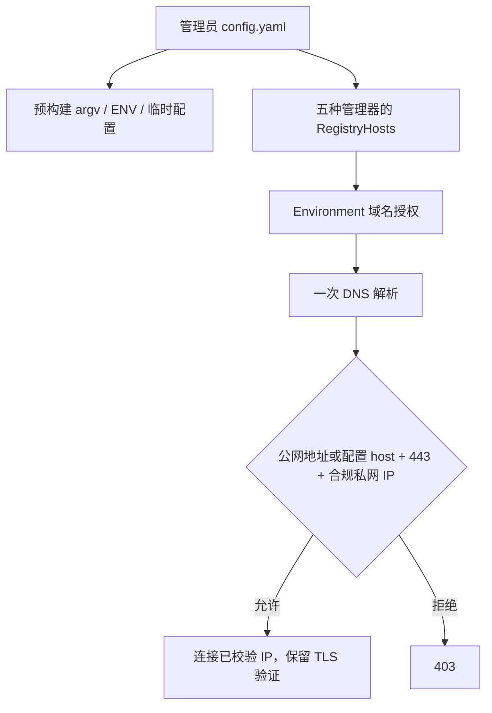
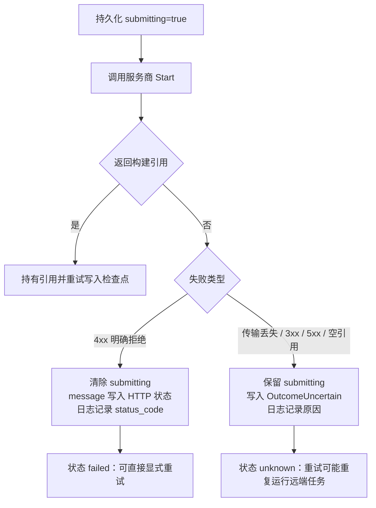

# Environment Package 安装

Cloud Environment 可以通过与 Claude 兼容的 `config.packages` 配置 `apt`、`cargo`、`gem`、`go`、`npm` 和 `pip` package。HTTP 边界负责校验 package 对象与 spec，将省略的列表规范化为 `[]`，并将编码后的 v1 manifest 限制在 1 MiB 以内。package 配置为空时，保持既有 Sandbox 启动与 runtime 发布流程不变。

对于非空 package 配置，如果环境尚未绑定已完成的预构建模板，Runner 创建 Sandbox、持久化 provider ID，然后执行：

```text
/usr/local/bin/environment-manager provision-packages --protocol v1 --stdin
```

JSON manifest 只通过 stdin 发送。命令结果必须是单个严格的 v1 JSON 值，且不得超过 16 KiB。仅当 status 与进程退出码一致时才继续启动；错误只暴露白名单内的 category、manager 和 stage，不包含 package spec 或原始 stdout/stderr。

Package 安装发生在 rclone 和 Environment Manager 启动之前。安装失败时，Runner 停止 Work 并终止已创建的 Sandbox。安装成功后，Runner 检查 Work heartbeat；如果并发 stop 已经生效，则执行清理，不再启动 rclone 或 Manager。没有 package 的 Environment 保持原有顺序：创建 Code Session、启动 Manager，然后发布 runtime metadata。

安装命令使用独立的 `environment_runner.package_provision_timeout`，默认 2 分钟。E2B 命令超时与本地 context deadline 使用同一预算：前者约束 Sandbox 进程，后者保证网络或 Wait 调用不会无限阻塞。

Sandbox 镜像或自定义 E2B template 必须提供 `/usr/local/bin/environment-manager`，并实现 `provision-packages` v1 合同。持久化清理协调以及事务化 Session event 交接不在本功能范围内。

## 部署配置的软件源与内网例外

`config.yaml` 的 `environment_packages` 由部署管理员管理，不属于 Environment API 的可写字段。增量覆盖 npm、pip、go、cargo、gem 声明过的源；未声明的管理器与字段继续使用镜像已有配置。空配置不改变安装行为，也不产生 CONNECT 私网例外。Environment API 的包列表只接收 package spec，拒绝 registry 字段、未知管理器和命令行选项。

```yaml
environment_packages:
  npm:
    # 可选，省略时保留镜像的默认 registry。
    # registry: "https://packages.example.internal/npm/"
    scoped_registries:
      "@example": "https://packages.example.internal/npm-private/"
      "@acme": "https://packages.example.internal/npm-acme/"
  pip:
    index_url: "https://packages.example.internal/pypi/simple/"
  go:
    proxy: "https://packages.example.internal/goproxy/"
  cargo:
    registries:
      example: "https://packages.example.internal/cargo/index/"
  gem:
    sources:
      - "https://packages.example.internal/rubygems/"
```

所有 URL 仅允许 HTTPS 443，禁止 userinfo、query、fragment、`$`、反斜杠、空白与控制字符，包括路径中的编码形式。npm scope、Cargo registry 名与 hostname 在启动时校验。未知字段或未实现的管理器（包括 `apt`）使启动失败；APT 软件包列表仍可用，但动态 APT 源由基础镜像或预构建节点管理。原 `environment_packages.network.private_endpoints` 已移除，旧配置会明确报错，不提供 CIDR 配置项。

| 管理器 | 预构建 | 启动安装 |
| --- | --- | --- |
| npm | `npm install --global [--registry=...] [--@scope:registry=...] -- pkgs`，独立 argv | 复制原 userconfig，追加声明的源；仅配置默认 registry 时设置 `NPM_CONFIG_REGISTRY` |
| pip | `env PIP_INDEX_URL=... pip install pkgs` | 安装进程的 `PIP_INDEX_URL`，保留原 pip.conf 与认证 |
| go | `env GOPROXY=... go install spec` | 安装进程的 `GOPROXY`；不改变 `GOSUMDB` |
| cargo | 临时 TOML，通过 `cargo --config file install pkgs` 叠加命名 registry 条目 | 临时 Cargo 包装命令传入相同 `--config`；保留 `CARGO_HOME`、原配置与 credentials |
| gem | `gem install --source URL ... pkgs`，独立 argv | `GEMRC` 追加临时 sources 配置，原生合并并保留原 .gemrc 与认证 |

Cargo 不改变镜像的 `registry.default`，不自动查找私有源或回退。部署希望从命名私有源安装时，需在镜像原配置中选定该默认 registry；这里只补充该名称的 index URL。Cargo 原配置由其原生 `--config` 合并机制保留，包括同名 registry 的其他字段与认证。

临时目录由 `mktemp -d` 创建，npmrc、Cargo TOML、Cargo 包装命令与 gemrc 在同一安装进程中使用，通过 EXIT 和信号 trap 清理；成功、失败与信号退出均保留 Manager 的 stdin、stdout、stderr 和退出码合同。原 npm 配置依次读取非空的 `NPM_CONFIG_USERCONFIG`、`npm_config_userconfig`，仅在 `HOME` 非空时回退到 `$HOME/.npmrc`；均未指定时直接使用临时配置。预构建的 ENV 仅作用于对应 RUN 进程，不写 Dockerfile ENV，不留下永久配置文件或包装命令。部署 YAML 不包含认证；认证由镜像原配置或流水线私密配置提供。整份 `environment_packages` 计入预构建 provider key，源变更会改变标识；已完成模板仍按既有合同复用。

所有管理器的 URL 抽取并规范化 host，经 `RegistryHosts()` 去重后，在 Environment 的 `allow_package_managers: true` 下纳入 Sandbox AllowOut 与 CONNECT host 策略；关闭时仍需显式 `allowed_hosts`。完成 Environment 授权后，只有配置过的精确 host、443 端口、RFC1918 / ULA / CGNAT 地址可获得自动私网例外。loopback、link-local、metadata 地址仍拒绝，包括 CGNAT 与 ULA 内的已知 metadata 地址。DNS 只解析一次，随后拨号已校验 IP。MCP proxy 与其他使用 `PublicAddress` 的服务不继承此例外。



YAML 不能创建私有网络路由、DNS 或 VPN。预构建发生在 Aliyun Flow，流水线构建节点需要独立配置网络访问；`environment_prebuilds.template.network` 影响模板创建，不能配置 Flow 构建容器。启动安装发生在 Sandbox relay 启动之前，也依赖 Sandbox 提供方的网络与 DNS；OMA CONNECT 例外不替代提供方的网络限制。只允许构建期访问内网时，应在构建节点配置访问并使用已完成模板，运行 Environment 保持有限网络且关闭内网域名授权。

该配置不会自动放行 tarball、重定向或依赖引用的其他域名。公开额外目标需配置 Environment `allowed_hosts`；私网目标还必须作为软件源 URL host 出现在源配置中。配置变更需重启服务；已运行的 Sandbox 网络列表需重新创建后更新。

## 软件包预构建

`Prebuild` 为单个环境提前安装软件包并生成可启动模板。开启 `environment_prebuilds` 后，创建环境或修改未归档环境的软件包会在保存环境的同一事务内插入 River 任务；每个环境独立构建。执行链路为 Aliyun Flow 构建镜像 → CubeSandbox 制作模板 → 绑定环境的 `resolved_template`。

Environment 的 `build_job_id` 直接引用 River 的 bigint 主键 `river_job.id`，不新增构建表。任务类型与队列均为 `environment_prebuild`。River args 保存 workspace、environment、服务商配置标识和 Dockerfile；output 保存远端任务引用及检查点。Dockerfile 在入队时固定基础镜像和软件包输入。

APT 列表非空时，索引更新与软件包安装在同一条 `RUN` 中执行。启用镜像构建缓存后，输入不变时可复用该层，APT 包列表变化时同时重新更新索引和安装；列表为空时跳过 APT。包名通过独立的位置参数传给固定脚本，不拼接为 shell 代码。

环境行锁协调修改、重试、取消及检查点，所有远端请求在事务之外执行。查询校验任务类型、workspace 和 environment；检查点及绑定 SQL 校验当前 job ID，防止旧任务覆盖新配置或已删除的环境。取消请求在检查点写入时合并，避免并发 worker 丢失取消意图。

软件包更新或清空后，旧任务下次执行时取消；已提交的 Flow 构建会先请求远端取消，失败则保留构建引用并每 5 秒重试，接受取消后结束旧 River job。提交过程中发生更新也会先保存返回的构建引用，再执行取消。已经结束的构建不重复取消；当前 CubeSandbox 模板构建不支持取消，旧结果不会绑定到环境。

提交远端任务前先持久化提交标记。响应丢失时停止自动提交，避免重复创建；远端成功返回任务引用后，当前 worker 持有该引用并持续重试检查点写入，成功落库后才延后任务继续轮询。worker 在引用落库前退出时保留 `submitting` 标记，结果仍按不确定处理。查询进度失败时继续轮询。其他检查点写入失败时持续延后 River 任务，即使观察时间已经超限，也要等检查点可写后先保存不确定结果，再结束观察。超时、停用或服务商配置变化会停止观察，远端任务可能仍在执行；状态显示为 `unknown` 时提示显式重试可能重复运行远端任务。显式重试创建新 River job 和镜像 tag，使用当前配置，从镜像阶段完整重跑。

提交失败必须区分「服务商已明确拒绝」和「结果不可知」：4xx 响应在服务商执行任何远端工作之前就被拒绝，因此清除 `submitting` 标记、把 HTTP 状态写入 `message`，并以 `status_code` 记录结构化日志，状态显示为 `failed`，操作者据状态码直接定位凭据或端点配置错误，显式重试不会重复运行远端任务。传输丢失、未跟随的重定向、5xx 响应以及缺少构建引用只证明请求结果不可知，此时保留 `submitting` 标记并写入 `OutcomeUncertain` 与稳定文案，详细原因只进入结构化日志，不进入面向操作者的 `message`；检查点写入失败时任务继续延后，不会在结果落库前结束观察。



模板绑定遵循以下规则：

- 仅修改名称、描述、网络或环境变量时保留原构建；清空软件包时解除绑定并恢复基础模板。
- 不带 `config` 的更新不解析已存配置，也不协调预构建，因此名称、描述等字段仍可在旧配置中的软件包格式无效时更新。带 `config` 的更新必须产生有效的新配置；若旧软件包无法解析，则将其视为变化，允许有效配置修复旧数据并解除旧任务绑定。
- 已成功的模板继续复用，不因构建开关、基础镜像或服务商设置变化而重建。新建环境、修改软件包及显式重试使用当前配置。
- Runner 通过 `build_job_id != nil && resolved_template != ""` 选择已完成模板并跳过启动时安装；待构建或失败时使用当前基础模板并临时安装。
- 没有关联任务的环境继续使用基础模板与启动期安装；保存包含 `config` 的更新时，按当前 E2B 配置刷新基础模板，手动开始预构建后才建立任务关联。
- River 清理任务记录不影响成功模板，因此 `build_job_id` 不设外键；详情过期后不再返回 job ID、时间或日志。

### 配置与服务商合同

完整配置见 [`docs/configuration-reference.yaml`](../../configuration-reference.yaml) 的 `environment_prebuilds` 部分。`image.base_image` 支持 tag 或 digest，但必须显式写出 registry 主机名；构建产物固定写入同一镜像仓库，去掉基础镜像的 tag 和 digest，使用环境 UUID 与 River job ID 组成的新 tag。`image.flow` 保存流水线地址与 token。

`image.base_image` 的 registry 主机名判定与 Docker 的 `splitDockerDomain` 一致：首个路径段包含 `.` 或 `:`、等于 `localhost`（忽略大小写），或不是全小写时才是 registry 主机名。省略主机名的引用（如 `team/base:stable`）以及带协议的引用（如 `https://registry.example.com/team/base`）在配置校验阶段即被拒绝，因为 Docker 会把前者的首段当作默认 registry（docker.io）上的命名空间、直接拒绝后者，两者都会让预构建推送到运维从未配置的仓库，并在流水线的远端日志或 CubeSandbox 的拉取阶段以无法定位的形式失败。

Flow 运行请求的 `params` 为 JSON 字符串，其中 `envs` 仅包含 `DOCKERFILE_TEXT`、`IMAGE_REPO` 和 `IMAGE_TAG`。Dockerfile 内容使用 `base64:` 前缀加 Base64 编码传递。

配置按默认值、YAML 覆盖、输入整理、校验的顺序加载。默认值统一由 `defaultConfig()` 提供：`timeout` 为 `1h`，`template.disk_size` 为 `20G`；启用预构建时，超时必须为正数、磁盘大小不能为空、`image.base_image` 必须带显式 registry 主机名与仓库路径，显式无效值不回退为默认值。

CPU 单位为毫核，内存单位为 MiB；CPU/内存为 `0` 时由集群选择默认规格。网络 DNS 填写 IP，出站列表填写 CIDR；配置层只整理首尾空白，具体格式交由模板 API 处理，空列表不发送。`allow_internet` 和 `inject_egress_ca` 默认 `true`，显式 `false` 原样发送。

模板请求遵循 [CubeSandbox v0.7.0 API](https://github.com/TencentCloud/CubeSandbox/blob/v0.7.0/CubeAPI/src/models/mod.rs)，网络字段为 `dns`、`allowOut`、`denyOut`、`allowInternetAccess`、`with_cube_ca`。端点、流水线、输出仓库、模板资源及网络设置计入服务商配置标识；凭据、运行时域名及已快照的基础镜像不参与标识。

私有仓库拉取凭据位于 `template.registry_auth.username` / `password`，必须同时设置或同时留空，仅通过 HTTPS 模板请求发给 CubeSandbox，不进入 River job、配置标识或日志。Flow 推送凭据由流水线私密变量管理。镜像引用使用 `registry/repository:tag`，不带协议。

### API 与控制台

已保存环境的详情页在配置表单下方展示工作队列，通过 `GET /v1/environments/{id}/work` 加载工作项 ID、状态、创建时间和更新时间，并提供加载提示、空状态及错误提示；归档环境仍可查看。新建环境页面仅显示配置表单。

API 沿用 `/v1/environments` 的鉴权和 `beta=true` 要求，返回 `build` 对象。`job_id` 全程使用十进制字符串，避免 JavaScript 大整数精度丢失。
开始或取消操作在读取环境后仍会于事务中重新加锁；如果环境在两次读取之间被删除，返回环境不存在的 404。

| 路由（相对于 `/v1/environments`） | 行为 |
| --- | --- |
| `GET /{id}/prebuild` | 当前状态、时间、`can_start`、`can_cancel` 和日志能力；有软件包但未关联任务时为 `idle`。 |
| `POST /{id}/prebuild` | 无请求体；活动任务和成功结果直接复用，失败、取消或无成功模板且详情过期时创建新任务，不提供强制重建。 |
| `GET /{id}/prebuild/logs?stage=image\|template&job_id=...&cursor=...` | 读取当前任务指定阶段的日志；过期、不匹配或尚未提交远端阶段的任务返回冲突。 |
| `POST /{id}/prebuild/cancel` | 请求体为字符串 `job_id`，仅取消当前任务；服务商不支持时明确返回不支持。 |

控制台在软件包标题旁显示预安装状态，详情弹窗呈现两个阶段、状态、发起时间、耗时及可用操作。耗时包含排队与观察时间。操作遵从后端能力，归档环境不显示操作；软件包有未保存修改时显示「待保存」。软件包输入框每次添加一个包，通过「添加」按钮或 Enter 生成独立条目；空白输入或同时输入多个包时禁用按钮，输入法组词确认不提交；创建或保存环境时统一提交草稿。包名、输入框和日志禁用字体连字，确保版本符号逐字符显示。

状态缓存按组织、workspace、环境及已保存的软件包隔离，仅活动任务轮询。日志缓存另按 job ID 和阶段隔离，拼接分页后去除 ANSI 颜色控制码，以纯文本呈现且不入库。前端连续读取分页，追上输出后每 3 秒查询新增日志，直到服务商确认完整；构建结束不提前停读，暂时性下载失败保留已读内容并从失败游标重试。Flow 日志缩短导致游标失效时返回 409，控制台提示从头加载并重置该任务阶段的分页缓存；416 缺少长度或与游标不一致时，通过无 Range 下载确认是否发生截断，当前位置恰好位于末尾时继续正常轮询。自动跟随末尾，用户上滚时保留位置。Flow 已完成步骤读完后继续下一步。不支持日志的阶段显示失败原因或「此阶段不提供日志」。

### 验证

```bash
go test ./internal/config ./internal/environments ./internal/db -run 'Test(BuildHTTP|LoadEnvironmentPrebuild|Prebuild|EnvironmentMapper|BuildPackage|NormalizePackages|ValidatePackage|ProvisionPackages)' -count=1
go test ./internal/runtime/e2bruntime -count=1
go test ./internal/environments -run TestRegistryProvisioningInstallsFromLocalRegistry -count=1 -v
```

示例统一使用 `@example/demo-cli` 和占位 registry。真实 npm 安装测试在进程内启动 HTTPS registry，通过只允许测试域名的本地 CONNECT 代理下载自生成软件包，保留 TLS 校验并检查原 userconfig 的认证配置。它覆盖未配置源时的 404、默认 registry 与 scoped registry 的成功安装，不访问外部 registry、私有 DNS 或部署网络。未安装 `npm` 或 `node` 时，该项测试显式跳过；其余配置与协议单测不需要这些工具。

CubeSandbox HTTP 测试验证模板请求与状态映射，`BuildHTTP` 测试验证服务商状态码被区分为明确拒绝或结果不可知。真实部署还需验证镜像推送、拉取、模板转换及 Session 回连；镜像与模板构建本身无需 Sandbox 回连 OMA，启动 Session 后的注册、心跳、消息与模型代理需要此连通性。

### 环境列表筛选与归档详情

`GET /v1/environments` 支持可选 `search`（名称不区分大小写的字面子串或精确 external ID）与 `status=all|active|archived`。搜索输入在 HTTP 边界修剪一次；查询通过绑定参数保持 workspace 范围和原有游标排序，不把 `%` / `_` 解释为通配符。未传状态时保留原有 `include_archived` 语义；`active` 排除归档，`archived` 只返回归档，`all` 仍由 `include_archived` 决定是否包含归档。

控制台按搜索、状态和游标分别缓存，每次只请求一页（最多 50 项），不再下载全量列表进行本地筛选。切换或清空搜索、状态时同时清空选择并重置到第一页；筛选结果也支持前后翻页。归档详情显示 Archived 徽标与只读说明，配置和工作队列仍可查阅。

验收覆盖筛选 SQL 与参数绑定、真实 PostgreSQL/API 的搜索及归档分页、前端筛选往返的分页重置，以及归档详情提示。

迁移使用 `00068_environment_prebuilds.sql`，避免与 main 的会话输入迁移 00064 冲突。新增 `build_job_id` 时使用 `IF NOT EXISTS`，兼容在 PR 合并前已通过旧编号安装该列的开发数据库。
