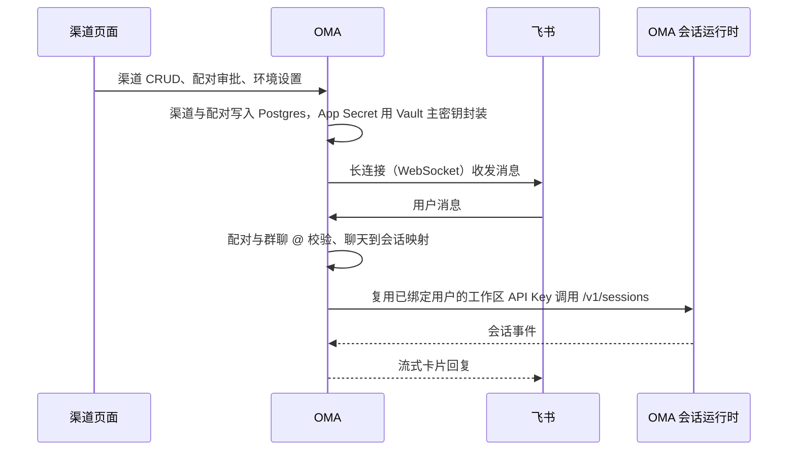
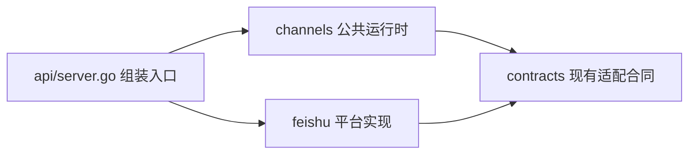

# 飞书渠道原生运行时

## 目标

Agent 渠道不再依赖独立的 `lark-channel` 服务。OMA 自己保存渠道与配对状态、持有飞书应用凭据、维持飞书长连接，并在收到消息后直接驱动 OMA 会话。

渠道运行时只有一套：`NewService` 始终创建原生运行时。不再保留无效的 `channel_bridge`、`channels.runtime` 配置或转发到 `lark-channel` 的代理链。

`channels.oma_url` 是原生运行时调用自身公开 API 的地址，留空时按 `server.addr` 回退到 `http://127.0.0.1:<port>`。

`channels` 整段配置都可以缺省：没有飞书应用、没有渠道记录时服务照常启动，运行时不建立任何连接，渠道页返回空列表；只有真正绑定并启用渠道后才会建立长连接。

## 服务边界

## 多渠道执行边界

运行时按 `ChannelRecord.ChannelType` 选择已注册的适配器工厂。历史空类型只在构造入口按飞书兼容，未知类型明确拒绝，不能误建飞书连接。当前真实适配器只有飞书；新增渠道应实现适配接口，不复制会话与执行逻辑。

共享层使用自有的 `channelMessage`、`channelAttachment`、`channelReply` 与回复流接口，负责作用域、配对策略、会话绑定、命令、串行队列、事件归约、附件挂载和产物筛选。共享执行文件不导入飞书 SDK。适配层负责平台连接、事件规范化、平台身份与提及处理、附件下载、消息/媒体发送和卡片呈现。飞书原始事件的根消息、话题及资源在适配入口映射为标准消息。

代码按职责分包：`internal/channels` 保留会话、持久交接、作用域队列、事件状态归约及 OAuth 交接；`internal/channels/feishu` 承载 SDK 长连接、富文本与提及解析、输入合批、卡片布局、按钮事件归一化、文件收发、应用注册、凭据校验和操作者核验。`contracts` 只保存原适配接口及跨包消息/回复数据，不包含调度器、注册中心或另一套状态机。

原适配方法导出为跨包接口；回复流接收公共层生成的回复视图，由平台渲染，不再接收公共 Worker 或会话状态对象。在线状态、归一化入站和输入调度沿原入口回调。共享 OAuth 通过适配接口获取操作者核验配置与用户标识，仍由 OMA 原生 flow/Vault 处理目标服务授权。公共生产文件不直接导入飞书 SDK 或 `feishu` 实现包，平台工厂和原有注册/校验依赖由 API 服务组装层静态注入，该边界有结构回归检查；保留在公共包的飞书集成测试用于覆盖平台与 OMA 会话的交接，纯平台测试随实现放在 `feishu` 包中。

会话元数据以实际渠道类型保存 `source`，操作者保存为 `actor_id`；仅飞书额外保存已有 `open_id`，兼容历史会话。类型分派、生命周期、会话复用、命令与文件链路由不依赖飞书 SDK 的独立测试适配器覆盖；该测试不代表第二个真实平台已经接入。配置与授权页面、持久交付和交互回调的进一步统一仍属于迁移清单待完成内容。

停止命令先取消本地订阅消费以让出队列，再确认远端停止。确认后更新原回复卡片为“已停止”；失败时更新为“停止待确认”并保留会话。飞书以原消息 ID 同步更新卡片，由共享层统一重试，不因原订阅关闭而另发运行卡片。

## 数据

渠道配置、绑定与交接使用以下表：

- `channels`：渠道名称、模式、启停、绑定状态、App ID、加密后的 App Secret、展示开关。
- `channel_pairings`：配对申请人（单聊用户或群聊），只保存标识，不保存聊天正文。
- `channel_sessions`：渠道内聊天（`chat:<chat_id>`）到 OMA 会话的映射，会话归档后自动重建。
- `channel_agent_settings`：按组织、工作区、智能体保存执行环境。
- `channel_inputs`：原消息、固定批次与OMA输入交接关联；平台确认前持久接收，交接结束清除临时正文。
- `channel_reply_deliveries`：OMA输入到平台卡片的交付许可及回执，不保存模型执行历史。

App Secret 使用 `secrets.Service` 以渠道为 AAD 封装，跨渠道或跨工作区移动密文无法解密；列表与更新响应不回显密钥，编辑时留空保留原值。

同一飞书 App ID 在整个 OMA 实例内只能绑定一个未删除的渠道，停用渠道仍保留绑定。创建或编辑渠道时遇到重复绑定，保存接口返回 HTTP 409、错误类型 `conflict_error` 和错误码 `channel_app_already_bound`。控制台根据错误码和当前界面语言显示通用的应用绑定冲突提示。

## 渠道运行身份

创建、保存渠道以及发起扫码授权时，在当前已认证用户的请求中准备工作区专用凭据，并传递 `Principal.RuntimeUserUUID()`。普通成员使用用户 UUID，API Key 和平台组织管理员使用稳定账号 UUID；创建者审计与运行身份分别保存。

首次创建必须有运行用户。已有凭据只在运行用户为空时通过同一个 Yourbatis 事务补齐，不更换密钥，也不覆盖已绑定的用户；补齐失败或信封解密失败时整笔事务回滚。停用的 Key 不自动替换。

后台 worker 与进程重启只能读取已经绑定运行用户的凭据，不允许匿名创建或继续使用空身份的 Key。旧空身份渠道需要已登录用户重新保存配置，之后恢复正常执行。

## 飞书应用授权自动化

扫码授权和跳转授权共用飞书官方 Go SDK（`scene/registration`）的同一条设备码流程，前端既能把 `url` 渲染成二维码，也能直接打开该链接：

1. `POST /v1/channels/authorizations` 先落库一条 `channel_registrations` 记录，再在后台调用 SDK `RegisterApp`：传入 `Source=open-managed-agents`、`AppPreset.Name=渠道名`，并用 `Addons` 预置应用身份和用户身份权限、接收消息事件（`im.message.receive_v1`）及卡片交互回调（`card.action.trigger`）。权限申请清单见[消息渠道接入](/docs/zh/message-channels#手动接入)，实际开通状态以飞书后台为准。
2. SDK 的 `OnQRCode` 回调把确认地址与过期时间写回记录并唤醒请求，HTTP 响应因此能同步拿到 `url`；`OnStatusChange` 同步 `slow_down` 后的轮询间隔。
3. SDK 在本进程内完成后续轮询与 Lark 域名切换；成功、拒绝（`access_denied`）、过期（`expired_token`）分别落为 `bound` / `denied` / `expired`，其他失败落 `unknown`。
4. 渠道向导里的扫码入口用 `GET /v1/channels/{channel_id}/qr`（工作区级，只需渠道 ID），授权成功后直接把应用凭据绑定到该渠道并启动运行时；过期或拒绝后再次请求会重新发起。
5. 创建/更新渠道时携带 `authorization_id` 表示复用已完成的工作区授权，OMA 直接从授权记录里取应用凭据绑定渠道。

进度落在 `channel_registrations`（`owner` 记录发起实例、`heartbeat_at` 随 SDK 轮询刷新），所有状态写入都是 `WHERE phase = 'waiting'` 的条件更新：多实例轮询同一记录时，别的实例不会把刚完成的终态覆盖回 `waiting`；没有本地任务的实例看到心跳仍然新鲜就继续返回 `pending`，只有心跳超过 45 秒才算任务丢失并落 `unknown`。进程重启或实例下线导致的 `unknown` 需要重新发起；同一渠道已有的过期/拒绝/未知记录会先删除再重建，不会撞唯一索引。渠道删除会取消对应的扫码任务。

## 行为

- 开放模式直接放行；配对模式要求单聊用户或群聊分别获批，未获批时只登记一条待审批申请并回复提示；所有命令同样先过配对鉴权。
- 群聊必须 @ 机器人，由飞书 Channel SDK 的策略网关拦截未 @ 消息。
- 每条渠道的长连接都显式配置官方 SDK 的事件分发器（`event/dispatcher`）：`OnMessage`、`OnCardAction` 依赖它注册 `im.message.receive_v1` 与卡片回调；缺少分发器时连接会建立成功（页面显示已连通），但所有入站事件被 SDK 静默丢弃。
- 长连接退出（握手失败、鉴权失败或不再重连）会释放该渠道的 worker，下一次 30 秒对账重新拉起；`connected` 只反映当前 worker 的连接状态，因此启动失败不会永久卡在“已连通但无回复”。
- 作用域统一用 `scopeKey`：群聊开启话题回复时按 `thread:<chat_id>:<root_id|thread_id|message_id>` 隔离，根消息和首次回复使用同一个根消息标识；关闭话题回复时按 `chat:<chat_id>` 共用。当前私聊保留既有 thread 绑定行为，与旧主 bridge 的私聊平铺差异列入迁移清单。已有旧 thread 映射仅在当前根没有映射且确实携带该旧 thread 时复用，不能退回整个群的最后一个会话。会话归档后自动新建。
- SDK 入站批次限定为单条，避免 SDK 先按 chat 合并不同话题；OMA 在入站规范化后固定 scopeKey，再按该值合批和排队，后续不能用合批消息重新推导作用域。本人 bot 提及占位在富文本恢复之后移除，保留其他人的提及，群 @ 命令不会被当作模型输入。
- 附件消息逐条进入作用域队列，不参与文本合批；下载始终使用附件所属的 message_id，避免合批后只保留最后一条消息身份。
- 会话 metadata 写入 `source=feishu`、`channel_id`、`app_id`、`scope_id`、`chat_type`、`open_id`、`actor_id`，控制台按既有渠道来源识别会话。
- 回复使用飞书流式卡片，结束条件为 `session.status_idle` 且 `stop_reason` 为 `end_turn`/`interrupted`/`retries_exhausted`，或会话错误。订阅与网页 SSE 使用相同生命周期，沿用调用方上下文，不另设总时限。
- 展示开关在原生运行时生效：
  - `include_tool_calls`：将工具调用与返回按事件 ID 关联，展示可折叠的输入/输出面板和运行、成功、失败图标。连续三个及以上工具调用完成后折叠成摘要；运行中保留最近一个面板。单工具输入截断至 600 字、输出截断至 1200 字。
  - `include_thinking`：会话事件接口会剥离 `agent.thinking` 的正文，因此只展示 `_🧠 正在思考…_` 状态，收到正式回复或工具调用后自动消失；该开关不改变回复的消息格式。普通对话始终使用卡片流，蓝色标题随思考、工具调用、输出、完成、停止和错误变化。
  - `reply_in_thread`：通过飞书回复接口并显式设置 `reply_in_thread=true` 新建话题；Channel SDK 的回复封装不带该参数，所以话题模式由运行时自己发首条消息再接管流式更新。
- 多实例部署：每个实例启动时加载全部可运行渠道并每 30 秒对账一次，配置或启停变化会重建/停止本地 worker；飞书长连接按应用维度分发事件，会话映射与配对状态都在 Postgres 共享。禁用或删除后在下次对账前旧 worker 仍可能收到消息，因此每条消息都会重新校验渠道记录，非 `enabled` 或已删除的渠道直接丢弃，不再回复。
- 删除渠道停止运行、清除会话映射并软删除记录，历史 OMA 会话保留。

## 消息执行

- 入站解析、平台策略与鉴权通过后先持久接收原消息，再确认平台回调；合批提交前固定完整来源与正文，约30秒的旧租约到期后可由新实例恢复。见[渠道输入持久交接](channel-input-handoff.md)。同一进程内，同一作用域的会话解析、命令、提交、回复和产物交付按到达顺序执行，不同作用域独立。`/new`、`/reset`、`/stop` 只有先通过鉴权才能取消当前本进程回复，排队执行前再次读取渠道状态与权限；未授权命令不得先打断合法运行。用户停止关闭对应输入交接，服务停止则保留；命令分派结果未知时不自动再次执行。
- 回复通过同一会话服务的内部订阅逐事件消费，不再定时查询完整历史。以输入处理通知确定本轮边界；下一条输入已处理时结束当前回复，避免连续输入串轮。断线从最后成功消费的持久事件补读，以事件 ID 抑制重复。维护定时器只检查绑定、空闲期限和交付租约，不查询会话历史。
- 回复按本次输入事件 ID 对齐：发送 `user.message` 后取响应里的事件 ID 作为基线，只消费其后的事件；取不到时退回发送前已记录的会话尾事件，不能在提交后再取尾部而跳过快速回复。会话尾读取失败时不提交本轮，保留明确失败结果。
- `/stop` 向当前作用域映射的会话发送 `user.interrupt`，轮询远端至 idle/terminated 后确认停止并保留映射。`/new`、`/reset` 使用同一停止确认流程，确认后取消该作用域所有回复任务并删除映射。10 秒内未确认或查询失败时保留映射，不报告重置成功。
- `/status` 读取当前会话的实际状态、智能体版本、环境与待完成回复数量；未绑定时不创建会话。`/help` 返回本地命令说明。命令与普通对话一样经过渠道启用及配对鉴权，不作为提示提交模型。
- `/resume` 分页读取当前工作区和智能体的会话，按 source/channel_id/app_id/scope_id 筛选最近 20 个兼容、空闲且未归档的会话；更早的会话可直接使用 `/resume <session_id>`。恢复要求智能体、环境、Memory、Vault、Git 地址/挂载路径/checkout 与当前配置一致，普通输入/输出文件不参与配置比较。当前作用域有未完成回复或远端不为空闲时不能切换绑定，其他渠道或话题的会话不能恢复。
- 附件：小型 PNG/JPEG/GIF/WebP 图片以原生 image 内容块进入 `user.message`；按 Base64 编码后的大小累计 4 MiB 请求预算，并为原文和信封保留空间，超出预算的图片沿用 Files 挂载。普通文件（包括 PDF、文本、ZIP、其他二进制与空文件）使用 Files 挂载；不另设渠道附件数量、单文件或整批总量预算，上传及挂载复用 OMA 原生 Files 与会话资源校验。先下载并校验整批，再执行上传/挂载；任一必需附件缺失、下载失败或不符合限制时不提交部分内容。附件整批校验和富文本附件区解析已部署；真实文件/多图及失败场景的覆盖情况以迁移验收台账为准。
- 挂载：渠道保存 `memory_store_id`、`vault_ids` 与 File/Git 的 `resources` 数组，兼容读取旧 `vault_id` 和 `git_repository`。每个 Git 的令牌独立信封加密，响应只返回 `tokenConfigured`。资源校验复用原生会话规则，创建会话时 Memory/File/Git 写入 `resources`，Vault 写入 `vault_ids`；修改配置后后续输入采用匹配的新会话，已有会话及资源保留。

## File/Git 多资源配置

渠道创建和编辑使用原生形状的 `resources` 数组，支持 `file` 与 `github_repository`。File按当前工作区确认对象存在，路径、source、数量及目录冲突复用Session的FileSpec与聚合校验；Git的URL、检出、挂载路径、重复仓库及目录冲突复用GitRepositorySpec和聚合校验。现有独立Memory配置继续计入原生总资源上限。数组最多使用原生500项预算，渠道资源配置请求体与Session创建共用32 MiB上限，不再被旧单仓库表单的32 KiB限制提前拒绝。

网页复用会话已有资源编辑器和File/Git字段，无改动保存保留原数组顺序，编辑任何项后提交完整数组；令牌状态按仓库URL回显，明文值不读回。持久配置每个Git持有独立的加密信封，响应只给tokenConfigured；省略或空字符串保留相同URL的既有凭据，重排和修改挂载路径不丢凭据，替换令牌只影响对应仓库，明确null可清除令牌。删除资源移除它的配置关联，已有会话及文件不删除。运行前解密失败明确中止，不用空令牌替代。

历史git_repository和独立GitTokenEnvelope读入时映射为资源配置；新写入只持久化资源数组与各自信封，未修改的旧字段继续兼容读取。旧单仓库写入仅允许当前零/一个Git配置，已有文件或多个资源时拒绝单值覆盖，避免旧客户端清空其他资源。新旧字段同时提交明确拒绝。响应提供完整resources，恰好一个Git时保留旧单仓库别名。

会话仍由OMA保存实际资源，不复制资源执行状态。新建会话在原元数据记录声明资源的摘要，摘要包含凭据版本对应的加密信封身份，不包含明文。这样聊天后来上传的附件不影响配置复用，而声明资源增删、检出或凭据变化会建立匹配的新会话。首次迁移保存旧配置时保留旧资源摘要兼容标记，使无改动迁移不打断旧会话；摘要变化后不能再复用持旧凭据的会话。复用还核对声明资源的实际File/Git挂载：File沿用原生uploads到沙箱路径映射，并允许额外聊天附件。原生挂载会生成具有新File ID的会话副本，因此源文件身份由配置摘要核对，实际资源核对挂载路径，不要求副本与源文件ID相等；Git和独立Memory逐项一致。/resume使用同一规则。连接预检使用现有File元数据接口核对全部配置文件，预检不执行仓库clone或沙箱任务。

## 多 Vault 配置

渠道使用原生 `vault_ids` 字符串数组配置多个 Vault，顺序原样保留。省略字段保留当前列表，空数组或null清空；空标识、重复项、错误类型，以及任一不存在、已归档、已删除或不属于当前工作区的Vault使整个保存失败。共享渠道层按当前工作区逐项复用Vault查询与权限范围；创建Session只把完整ID数组交给已有原生会话服务，凭据解析与注入仍由OMA负责。

历史 `vault_id` 单值配置读入时转成列表，响应同时提供完整 `vault_ids`，恰好一项时保留旧单值回显。旧单值写入继续支持零/一项配置；已挂多个Vault时拒绝单值更新，避免旧客户端静默丢掉其他项。新旧字段同时提交明确拒绝，调用方应选择一种合同。配置更新只持久化一份列表，使用现有JSON配置，无新表。

网页复用会话已有的多Vault选择器，编辑、侧栏及详情均显示全部选中项，取消不保存。绑定复用与/resume比较完整列表；增删或调整顺序后，下一条输入建立匹配的新Session并保留旧会话。连接预检逐个查询全部Vault，不把其中一项可用当成整批可用。

## 智能体版本策略

渠道创建与编辑接受 `agent_version`：省略时保留当前策略，`null` 表示新会话使用最新版，正整数表示固定版本。保存时复用 `GetAgentVersion` 按当前工作区和渠道所属智能体校验，不存在、已归档、错误类型及非正整数明确拒绝。版本策略与现有执行配置一起保存在 `channels.mounts`，不增加执行状态表。响应返回选定版本或 `null`，页面通过 OMA 既有版本列表接口分页加载选择项，编辑、取消及再次保存保留原策略。

创建会话直接复用 OMA 的 `agent: {id, version}` 合同；未固定时继续发送 Agent ID，由原生会话服务解析当时的最新版。原生会话负责保存完整智能体快照，渠道不复制快照。固定版本的会话元数据保存所用策略标记，以区分同一实际版本下的“默认最新”和“固定版本”两种配置；旧的无标记会话按默认策略兼容。切换固定版本或改回默认策略后，后续消息建立匹配的新会话，旧会话保留；`/resume` 和历史列表使用相同兼容校验，不能恢复不兼容策略或其他版本的会话。默认策略不因智能体后来发布新版本而打断既有会话，最新版仅对新会话生效。

连接预检查询被固定的具体智能体版本，验证渠道运行身份能访问它；这不代表工具执行或资源挂载已验收。策略字段位于共享渠道配置与会话创建层，新增渠道复用同一路径。

## 会话内交互

普通运行卡片包含“停止对话”按钮，终态移除。回调绑定发起人、渠道、作用域、会话及本轮输入事件；其他人、其他聊天、已切换会话和后续轮次的旧按钮均不能停止任务。按钮提交中断请求后由会话真实终态更新卡片，不能提前显示已停止。命令和配置提示沿用独立文本回复，不受普通对话卡片渲染控制。

- 审批：`agent.tool_use`、`agent.mcp_tool_use` 的 `evaluated_permission` 为 `ask` 时在当前对话卡片中展示允许/拒绝按钮，使用卡片 2.0 原生按钮元素，不使用已移除的 action 容器；回调写入 `user.tool_confirmation`（`tool_use_id` + `allow|deny`），MCP 工具使用 `mcp_tool_use_id` 作为确认引用。
- 问卷：`agent.custom_tool_use` 且工具名为 `AskUserQuestion` 时在当前对话卡片中生成表单，按 `multi_select` 渲染单选/多选控件，支持多题与自定义文本，回传 `{answers:[{id,selected,custom}]}`；单选和多选填写自定义文本时均以文本为准，`selected` 为空；取消问卷回传 `is_error=true` 和“用户取消了问卷”。审批与问卷不受思考/工具详情开关影响，也不另外发往主聊天。已收到审批、问卷结果或工具结果时移除对应交互元素，终态和中断时同样移除。
- 问卷保留选项说明；提交时从持久化事件读取原题目与多选规则，不信任卡片值携带的题目规则或线程。每题必须有答案，单选必须恰好一项，多选按提交顺序去重；选项必须属于原题，其他文本按旧版限制为 10000 个 UTF-16 码元。空答、错误类型、无效选项和超长文本不提交结果，在原话题回复可公开的校验原因并成功确认飞书回调，用户可修改后再次提交；不能把校验失败作为长连接协议错误返回，导致表单停留在提交中。无效问卷结构整份回退控制台处理，不静默删除部分题目或选项。
- 卡片值携带 `channel_id`、`scopeKey`、`session_id`、`tool_use_id`、发起人 `open_id` 与 `chat_type`；点击时校验渠道、会话、聊天、操作人，并重新读取当前配对授权。按 OMA事件里已有的结果核对重复点击或控制台已处理结果；并发回调和写入未知的持久许可仍未完成，不据此声称已经覆盖全部防重场景。
- 交互仍更新同一张运行卡片，不恢复上游单独发送审批卡的旧路径；原卡片更新失败采用最多5次指数退避更新，初次发送结果未知不以更新重试为理由另发新卡。
- 合入的重启监听属于局部能力：成功处理卡片操作后若无当前回复任务，补建按事件尾开始的监听，空闲2分钟退出；它不能恢复原卡片或入站队列，快速结果边界、原卡持久恢复和完整自动恢复仍按迁移清单修复后验收。

## 附件与产物

- 入站：原生图片预算内的图片直接作为image内容；其他附件从飞书下载后上传 OMA Files（`POST /v1/files`），再挂载为会话file资源。保留用户原文，并追加本轮实际Files挂载路径，逐项交接回执用于复用已成功的上传和挂载。
- 富文本接收入口同时兼容直接包含 title/content/content_v2 的消息体与带语言外层的消息体；在文本合批和附件排队前恢复正文与资源，避免 SDK 将实际接收格式降为占位文字。
- 普通文件与超出原生图片预算的文件保留原始文件名，挂载到 `/uploads/<上传 File ID>/<文件名>`。SDK 自动生成的纯媒体占位不作为用户原文提交；富文本保留用户文字，已转成原生内容的图片不重复提交占位链接。
- 会话挂载会复制文件身份，入站附件排除集使用挂载响应返回的会话级 File ID，不能使用上传得到的工作区 File ID。
- 出站：每轮开始前记录会话资源ID、File ID与更新时间基线，会话主状态正常结束后只回传原生`/mnt/user-data/outputs/`命名空间中新增或更新的file资源；相似前缀目录及uploads不属于产物。下载前读取原生Files元数据，核对File ID、非负大小，不按数量或整轮总量截断，也不施加渠道独立单文件预算；按原生元数据声明的大小加一字节限制读取，下载后长度必须与元数据一致。共享渠道层将合法空文件交给平台适配器判断，不假定所有平台都拒绝空文件。图片走image消息、其余走file消息；不以子话题空闲结束整轮，不重发未变化的历史产物，也不回传本轮用户上传的附件。元数据无效或文件长度不符时不发送该文件，并保留原交付计划供核对。
- 文件发布可能晚于会话终态。发生工具调用的轮次结束后，每 2 秒观察资源清单，连续三个快照一致才交付，最多观察 1 分钟；纯文本轮次不增加稳定性等待。开始前无法读取资源基线时不提交本轮输入，避免将历史文件误当新增产物。
- 只有主会话以 end_turn 正常结束才自动交付产物，失败、终止、重试耗尽和中断均不回传半成品。本轮出现 user.interrupt 后，即使上游把最终 stop_reason 标为 end_turn，仍按中断处理；中断请求发出后卡片显示正在停止，实际终态到达后显示已停止。卡片终态清除“正在思考”，并明确显示失败、会话结束或停止状态。
- 失败处理：附件下载、上传或挂载失败时回复具体原因并阻止整批提交，不会出现正文已发出、附件静默丢失；明确拒绝和结果未知按后文逐项交接规则恢复。

## 本阶段未覆盖

- 语音、视频等需要转码的附件类型；当前整批拒绝并提示。
- 多实例及进程重启期间交互交付的完整恢复验证。

## 渠道预检

`GET /v1/agents/{agent_id}/channels/{channel_id}/check` 在当前组织/工作区/智能体范围内读取渠道记录，返回命名的checks、总体ok和execution_verified=false。检测读取启停、绑定和运行实例连接状态，绕过运行Key缓存重新读取当前凭据，再用该Key只读访问Agent、执行环境和配置的Memory/Vault，拒绝已归档或不匹配的资源。整个请求限时15秒，不创建Session、不提交模型、不变更渠道配置，也不检查Git实际检出或Vault实际注入；通过只代表连接与配置预检通过，不能替代真实执行验收。

网页检测按钮调用该接口并重新刷新详情，请求中禁用，失败只显示公开的失败环节；原始Key、私有异常原因及凭据内容不进入响应。该通用预检不导入飞书SDK，后续渠道复用相同配置检查。

## 向导保存的环境原子性

渠道创建/更新请求接受可选的environment_id。提供时在服务入口验证同工作区且未归档，随后把环境与渠道字段交给同一个数据库事务：渠道写入失败不修改环境，环境写入失败回滚渠道新增/更新。未提供时保持既有环境，兼容旧API客户端；独立/settings接口保留，但网页向导不再先调用它。

此事务不改变已有Session的资源/环境快照，也不代表已经完成配置指纹、固定Agent版本、多资源、请求幂等和未知结果恢复。环境切换对后续输入/既有会话的语义继续按完整迁移清单验收。

## 会话状态未知与分页异常

读取现有作用域绑定失败时，仅明确的数据库未找到才进入新会话路径；其他读取异常保留绑定。已有绑定的OMA会话读取失败（包括401、404、503或响应解析失败）也不能被解释为可自动新建，当前输入不提交，并向用户说明原会话尚未确认、没有创建替代会话。会话被确认归档或当前资源配置不兼容时仍沿既有规则为后续输入建立新会话；该规则不代表创建响应丢失或绑定写入失败已具备持久核对。

事件历史与/resume历史分页分别追踪本次查询已出现的next_page。重复或多页循环游标明确失败，不返回不完整事件作为可继续消费的历史，也不继续无限查询；正常跨1000条事件的分页保留。此检查不替代持久事件游标、外部输入归属与完整重启恢复。

## 复用 OMA 记录的渠道交接边界

执行状态唯一来源是 OMA 的 Session、输入队列和事件历史。渠道不复制模型阶段、工具结果、任务终态或另一套执行日志；现有 channel_sessions 继续只保存渠道作用域到 OMA Session 的绑定。后续持久化只针对 OMA 无法掌握的交接信息：尚未提交的外部输入、平台消息到 OMA 输入事件的关联、回复卡片或附件的交付回执。

公开事件入口 normalizeInputEvent 仍生成 sevt_ ID，不使用客户端传入的 id。公开输入现支持可选Idempotency-Key：请求标识、指纹与原事件ID在OMA输入事务内共同提交，并发或重启后重试返回原输入；省略时保留原行为。渠道使用渠道类型、渠道ID、应用账号及原消息锚点计算稳定标识。详见[会话输入请求幂等](session-input-idempotency.md)。内部Worker传输的稳定ID仍由既有机制管理，不应在渠道复制排队后的执行记录。Session元数据保留渠道归属，输入事件metadata保留外部消息关联。

现有普通入站消息在 user.message.metadata 保存 channel_id、channel_type、channel_account_id、channel_message_id、channel_chat_id、channel_actor_id。适配器提供的全部来源消息 ID 保存为 channel_message_ids，保留合批中的原顺序；channel_message_id 继续作为回复锚点，兼容既有消费者。飞书仅合批同作用域、同发送人的连续文本，不将其他人的正文归到最后一人名下；命令与附件先交接同一发送人的缓冲文本，再进入共享作用域队列。请求发生异常、响应无法解析或没有事件编号时，只读取同一 Session 的事件历史；找到上述字段及来源序列精确一致且唯一的 user.message 后，继续跟踪其原事件 ID，不再 POST 同一输入。找不到、找到多条、其他身份或历史读取失败时保持提交未知，不自动重发。元数据用于关联回执，不替代现有渠道/工作区权限判断。

输入关联与OMA请求幂等不能代替平台回调成功前的持久接收。提交前交接、合批记录的跨进程接管及平台卡片/附件回执分别验收；已有平台ID的原卡恢复见后文。模型与工具记录仍全部从OMA历史读取。

## 卡片交付回执与原卡恢复

channel_reply_deliveries 只保存平台交付信息：渠道/输入事件/Session关联，原渠道类型/应用账号、原消息与聊天/操作者标识，回复卡片ID，展示选项，以及发送许可和交付回执。不保存输入正文、模型阶段、工具结果或执行历史。pending/sending/sent/completed/unconfirmed分别表示尚未发卡、已占用发卡许可但未确认平台回执、已有卡片ID、已确认本卡及本轮可自动交付的文件处理结束、交付结果未知或原绑定已失效；不作为OMA执行状态。

首次发送先用条件更新把pending改为sending，同一输入只能有一个实例获得许可。取得平台message_id后才写sent；发送结果或回执写入未知时不自动再发另一张卡。已知卡片ID的sent记录通过30秒租约接管，活跃跟踪每10秒续租，平台更新前核对持有者；旧持有者失权后不能继续发起更新。所有读写都经当前渠道的组织/工作区约束。此许可只管理卡片写入，不是另一套会话执行锁。

原生worker连接就绪后及既有对账周期读取过期的sent和sending回执。sending缺少可恢复的平台ID，或渠道类型、应用账号、作用域绑定已变化时，一次性退役为unconfirmed并退出恢复调度，避免反复空转。原发送者稍后取得的真实平台ID仍可补记为sent，恢复时重新核对原绑定；不会据此新发卡片。若原渠道类型和应用账号一致，且原作用域仍绑定原Session，则从OMA事件历史的原输入事件开始重建正文、工具面板及状态，并通过适配器resumeReply更新原平台message_id，不再提交用户输入或新发卡片。恢复沿用发卡时的展示选项。看到OMA真实终态并完成卡片写入后，正常结束且原产物基线已知的轮次继续处理文件交付；其余轮次将交付回执标为completed。

原卡恢复与入站持久交接、OMA输入幂等和控制输入许可共同工作。交付结果未知时不会自动向平台核对或重发；文件交付使用下述独立平台回执，不复制OMA执行记录。

## 同进程会话事件订阅改造

渠道与会话服务在同一进程，消费现有会话服务的内部订阅。网页 SSE 作为同一订阅能力的 HTTP 出口，仅负责协议编码与心跳；渠道直接接收内部事件，不增加 HTTP/SSE 客户端、消息总线或 Worker 专用通信链路。

共享入口负责会话权限、工作区与线程过滤、历史补读、补读与实时重叠去重及订阅生命周期。保留原 streamHub 的每订阅 256 条缓冲和非阻塞分发；慢消费者溢出后关闭，由消费者重新补读。平台卡片更新不得在公共事件分发回调中执行。

输入事件存在由待处理到已处理的更新，不能只按事件 ID 丢弃全部后续通知。补读去重记录同时保留已处理标记，同一用户消息或工具确认允许一次待处理到已处理的更新，其后重复通知继续抑制。待处理输入作为本轮边界时，还需要等待其实际处理后再补读本轮输出，避免历史按 processed_at 排序变化导致串轮。

当前进度：共享订阅入口及网页 SSE 接入已实现；输入处理更新去重已有回归。共享入口已增加 WaitForInput 选项：先注册实时订阅，再读取指定用户输入；未处理时仅等待其处理通知，处理后以原补读入口交付输入锚点及后续历史，并过滤实时队列中早于该输入处理时间的旧事件。等待与旧事件过滤已有单测；数据库下的实际状态转换仍待专项验证。渠道回复循环现已直接消费内部订阅，并在断流后从最后消费的持久事件重订阅；定时器仅维护绑定、空闲检查和租约。原 API Key 解析逻辑已提供 context 入口，组装层校验 Key 与工作区后调用同一个 sessions Handler。卡片已消费原预览事件，按事件 ID 归约临时正文并由最终消息替换，250 毫秒合并更新；预览不推进持久游标，断线清理临时正文。已部署并通过942真实普通对话；真实断线/性能与慢卡片故障隔离仍待验收。上述目标不能作为已经部署或端到端验收通过的描述。恢复以 OMA 原有事件历史为准，渠道仅保留输入关联与平台交付回执，不增加执行状态或工具历史副本。

正常停机时，渠道取消回复消费并有界等待收尾。已发送但未完成的卡片交付由当前持有者释放租约，保留原输入关联、卡片ID和交付状态；新实例可以立即接管原卡。释放操作同时核对租户、渠道、输入、持有者及sent状态，旧持有者不能释放新实例租约。普通任务停止不释放该租约，以保留停止确认后的原卡更新权。发送结果未知的sending状态不在此放行范围内。异常退出无法执行释放，仍依赖原租约超时；到期后的恢复调度还需优化和实测。

回复恢复调度读取本渠道其他owner最早的sent租约到期时间，并由现有维护时钟在到期时调用原恢复入口；不对会话历史定时查询。该调度及正常停机释放租约均已部署，真实跨进程恢复性能仍待复验。944暴露主进程HTTP关闭先于渠道停止的问题：停机阶段渠道仍可能访问已关闭的本机HTTP资源接口。主进程已在HTTP关闭之前同步停止渠道并等待释放租约，945实测新实例在原租约期限前接管同一原卡，且没有产物失败误报。跨实例接管后的会话空闲至原卡完成为1.90秒单次样本。既有10秒HTTP停机期限可能中断在途工具请求并报告未知结果，不属于渠道重新提交输入。

内部订阅在交付补读历史之前先处理已就绪的维护信号，避免历史积压延后消费者的绑定、租约和展示刷新。共享分发保持原有非阻塞隔离；渠道平台更新在各自消费任务内执行。同一渠道一个卡片更新阻塞时，另一会话的节流预览与最终完成已有故障注入回归。已测的约250毫秒是消费层节流到平台替身的延迟，不是飞书网络端到端性能。

卡片回调以平台实际messageID查询已有交付回执，在访问OMA事件接口前核对channel type、应用账号、Session、scope、chat、actor及sent状态。配对门禁使用回执保存的实际聊天类型，回调参数不能改写该类型。真实回执查询按组织/工作区/渠道隔离，转发或其他卡片消息不能冒充原卡。真实回执及轮次校验代码已部署，停止、审批允许/拒绝、问卷回答/取消已真实点击验证，审批与问卷原卡已通过正常重启恢复；生命周期规则见下文用户更正。

渠道与网页SSE复用同一内部订阅生命周期，不设置独立卡片有效期、30分钟总时限或恢复任务两分钟空闲退出；订阅沿用调用方上下文，停止、停用或服务退出时取消，断线按原持久游标补读。操作仅在回执关联输入的当前轮次内有效：后轮输入已处理或本轮终结时拒绝，排队输入不会冒充下一轮已开始。审批目标必须为该轮实际ask工具，提交线程取原OMA事件。交互成功后的输出与重启恢复共用原卡交付入口，保留原输入、操作者和平台回执及产物回传。相关代码已部署并通过分层测试与真实平台四类控制输入验收。控制输入复用 OMA 请求幂等，目标竞争直接核对既有会话事件，见 `session-input-idempotency.md`；真实网络丢响应及强制崩溃仍需单独验证。问卷字段校验失败不提交控制事件，错误提示携带可信回执的聊天类型和原卡标识，群话题提示仍回复原话题。

## 渠道输入归属

渠道提交的新 user.message 已携带渠道类型、渠道、账号、平台消息、聊天与操作者关联。回复消费在原输入锚点之后遇到其他 user.message 时，先核对这些来源字段：同渠道、账号、聊天且来源消息/操作者完整的输入沿用正常排队分轮；同一群内其他已放行操作者不被误判为外部输入。其他输入无论是否已处理，都以“已暂停”结束渠道交付，说明需要在 OMA 核对并新建会话，不发 user.interrupt 干扰控制台任务，不将外部回复和产物回传给原聊天。控制台审批/工具结果不属于普通 user.message 冲突。

后续发送前读取现有历史，在附件准备和输入提交前核对来源。首次已知渠道输入之前、未带来源字段的历史按旧会话兼容保留；明确声明其他来源的输入，以及首次已知渠道输入之后的未标记或不匹配输入，都会阻止新提交。这里不推断未标记旧历史的真实所有者，也不是数据库事务内的会话独占许可；创建响应未知、外部输入与提交并发窗口及跨实例互斥仍须分别验收。它只复用 OMA 原事件，不增加渠道执行记录或独立事件系统。

每次新提交核对 OMA 原生用户输入历史，回复过程仍用内部订阅，不增加按秒轮询。首次核对完整输入历史，通过后从已核对且处理完成的同源输入事件 ID 增量补读；该位置只用于减少重复读取，不代替本轮关联和断线恢复所用的原持久输入/交付回执。

## 附件整批准备边界

共享附件准备只校验必需附件完整性和可表示的资源类型，不设置渠道额外数量或总量限制。飞书适配器负责平台消息资源下载及图片格式限制；入站读取上限直接使用服务已有 storage.max_file_bytes，与 OMA 原生 Files 上传限制一致，不新增渠道配置。普通file不按内容嗅探结果拒绝：二进制和空文件仍挂载，image仅接收PNG/JPEG/GIF/WebP，原4 MiB原生图片请求预算保持不变，较大的合法图片回退Files挂载。

所有下载及策略校验完成前不上传或挂载任何本批附件。上传或挂载本身若失败，仍阻止user.message提交，但此前已成功的上传/挂载可能存在，不冒充跨文件原子事务。共享层不增加整批100 MiB预算；没有新增附件执行状态表。准备完成记录不再写skipped；兼容读取旧字段时，只要存在跳过项就拒绝恢复部分内容，已有accepted输入不撤销。

附件通过同进程注入的原生会话附件入口写入，不再经 HTTP 上传 Files 后挂载副本。入口复用工作区凭据认证、会话资源权限、归档及环境限制，调用已有 `filestore.Service.PutSessionAttachment`；大小、工作区配额、事务及孤儿对象清理均沿用原生存储。渠道不新增附件策略或状态表。

路径复用 `messagemedia.AttachmentPath` 的附件命名空间，以渠道与平台消息标识的摘要、原资源顺序及文件名形成稳定目标。同名附件保持不同位置；用 `GetSessionAttachmentFileByPath` 查询已完成写入，再按需调用原生存储。写入成功但回执丢失时恢复复用原文件，不再维护 Uploading/Mounting 两段许可。旧记录只保留解码兼容：已确认资源继续复用，已确认上传且未开始挂载的记录转入原生附件写入；旧上传或挂载结果不明时明确阻断，不能将其冒充新流程可恢复记录。

准备进度仍使用既有 `channel_inputs.prepared_content`，最终正文包含原生沙箱实际路径，已完成批次直接复用。全部附件完成前不提交 `user.message`；这不是跨文件原子事务。正常完成或失败均删除下载临时文件，平台文件与会话验收资源保留。

## 本轮附件位置

附件路径经现有 `sandboxmount.SandboxPath` 映射到实际沙箱路径，返回的原生会话 File ID 用于排除入站文件回传。保留用户原文，为非内联附件追加文件名、MIME 和沙箱路径说明；原生 image 内容块的小图不增加文件清单。

### 多图与工具历史的验收边界

图片回归同时覆盖普通多图输入和混合文件路径说明、工具调用后的下一次模型请求，逐项核对图片字节与顺序。真实973以限定消息的临时出站摘要关联原模型span，确认工具前后均传递原图；该验收只证明传输保真，不证明模型识别正确。本次红图被答成白色，语义结果仍需继续定位。临时探针不是生产功能，验收后已恢复标准Worker启动。

## 出站文件交接

迁移00124在既有channel_reply_deliveries增加artifact_delivery JSONB，仅保存原产物基线、冻结候选文件及元数据、发送许可、平台消息ID和交付结果。原基线先写入channel_inputs.prepared_content；OMA接受输入后，先建立含原基线的回复交接，再清除准备内容。未知基线编码为null，已知空基线编码为{}；旧记录不能用恢复时的当前资源冒充原基线。

首次正常结束后，按原基线筛选并冻结文件计划。后续接管从OMA事件重建原卡，沿原计划下载原File ID，不重新筛选当前资源。发卡完成不提前完成整条交付；文件阶段每10秒续持30秒租约，续租失败取消当前传输。配对撤销后不继续发文件。

每个文件先持久保存sending许可，再调用平台上传与发送；取得平台消息ID后保存sent回执。明确的平台上传拒绝保留pending并延后一分钟重试；下载或元数据读取失败也保留原计划。连接异常、缺失消息ID或成功回执落库失败不能证明平台未发送：恢复遇到sending时转为unknown并停止自动重发。unknown不等于成功，也不表示已实现平台回执自动核对。元数据无效为skipped；没有pending或sending项后才完成交接。

共享层只依赖适配器返回的平台消息ID，飞书SDK调用和平台错误分类留在飞书适配器，后续渠道复用相同交接机制。图片上传明确被拒绝后，飞书适配器可将原字节和原文件名改发文件；权限不足、上传响应未知或消息发送失败均不触发降级。不新增附件策略配置；未知回执自动核对仍待实现与验收。

### 飞书图片降级与上传错误分类

图片上传响应明确失败且未进入消息发送时，允许沿原交付许可上传为普通文件，再保存最终文件消息ID；不新建另一份文件计划。缺失image_key、上传网络异常、HTTP 5xx或408均按未知结果处理，不降级、不标为可自动重试的明确拒绝。文件上传使用相同错误分类。发送图片消息失败也不降级，避免图片已发送却又收到文件。

权限不足不以改发文件绕过：HTTP403、已知权限错误码及SDK的permission_violations均阻止图片降级。结构化应用权限提示沿用[飞书官方权限错误说明](https://open.feishu.cn/document/faq/trouble-shooting/how-to-fix-the-99991672-error?lang=zh-CN)中的字段合同；独立补权卡片与完整补权后端到端续传仍待验收。图片文件降级必须保留原字节和file_name字段，multipart文件分段的filename由SDK生成，不拿它替代平台file_name合同。

## 配对状态与真实操作边界

群聊按chat目标、单聊按user目标分别准入，群聊已批准不能放行同一操作者的单聊，单聊撤销不能撤销既有群聊授权。pending只提示等待批准；rejected（包括撤销既有授权）提示当前聊天未获授权，不再误报等待中。普通消息、产物发送和卡片操作共用当前配对决定，撤销后不提交新的OMA输入；重新批准后复用原有绑定，拒绝期间的消息不自动补交。

真实配对验收通过ego已有登录态创建独立飞书应用，在OMA页面批准、撤销并重新批准群聊及单聊，跨目标隔离与原会话继续均有平台消息及OMA事件证据。飞书用户身份OpenAPI不能向机器人发起单聊时改用飞书网页编辑器，不通过伪造服务事件代替真实消息。详见验收台账982–990。

### 历史读取、附件缓冲与旧代理清理

正常入站的归属检查复用 OMA 事件列表的 `types[]=user.message` 和 原生事件 ID 分页游标。首次检查逐页读取该会话的输入历史，解码时仅保留 ID、类型、metadata 和 processed_at，不保存正文或跨页累积；通过后只记录最近核对过且已处理的同源输入事件 ID，后续从该位置补读，以保留未标记旧输入与接管后外部输入的判断。位置只在当前 worker 内保留，重启后重新检查 OMA 历史，不新增表或执行日志。实时回复继续复用内部订阅。历史 HTTP 响应完整解码，不再截断到 4 MiB；分页循环仍明确拒绝。

入站附件逐个下载到权限为 0600 的标准临时文件，整批成功校验后才上传和挂载。小图在原生事件预算内读取并编码，其余附件以 `io.Reader` 直接写入现有会话附件服务，复用原生大小、配额和存储逻辑。完成或失败均关闭并移除临时文件；平台文件、OMA Files 和会话不因此删除。飞书 SDK 下载仍缓冲单个文件，渠道不再保留整批字节，也不再构造整份 multipart 内存副本。

产物去重统一使用既有 `channel_reply_deliveries.artifact_delivery` 的冻结计划与逐项交付回执，删除 worker 内的第二份去重表及无持久回执的发送旁路。测试亦使用同一持久交接路径。旧外置 bridge 的代理路由、凭据同步及专属实现和测试删除；原生路由保留共享 CSRF、凭据验证和租户/归档边界检查。删除没有运行时消费者的channels.runtime与channel_bridge配置；部署前应移除旧配置字段。

运行凭据直接复用 `EnsureChannelWorkspaceCredential`，每次使用时读取原生凭据状态与密文；渠道不再永久缓存明文 Key，凭据更新与停用不依赖 worker 重启。

## ENV OAuth 与旧渠道个人授权对照

main 的 `env_oauth` 已支持内置飞书和自定义 OAuth 提供方、授权码/PKCE、回调状态、Vault 加密凭据、自动刷新及刷新租约、环境变量占位符和出口替换。渠道会话已有的 `vault_ids` 可直接携带这种凭据；不需要另建 token 表、刷新任务或 CLI 凭据同步器。

旧渠道的个人授权不能仅以 MCP OAuth 或机器人应用创建授权代替。旧 `work-assistant/chat-auth.ts` 校验 App ID 与用户 open_id，按应用和用户维护 Vault 关联；通过 CLI 完成刷新后读取其加密令牌，将 access token 同步为 OMA `environment_variable` 凭据。旧 UI 的 `user-im.ts` 另有设备码登录、授权状态及用户身份群列表；bridge 提示词要求私聊发起用户授权、等待完成后继续任务。群消息订阅权限的补权属于应用权限，不能与个人 OAuth 混为一谈。报告和计划功能仍不在迁移范围。

| 旧行为 | OMA 可复用能力 | 渠道职责 |
| --- | --- | --- |
| CLI 设备码与轮询 | ENV OAuth 授权入口、PKCE、原生回调与流程状态 | 私聊中的链接/二维码引导及完成反馈；无需复制设备码协议 |
| 读取 CLI 密钥库、解密 token、同步静态变量 | `env_oauth` Vault 凭据、加密服务和自动刷新 | 保存渠道用户与 Vault/凭据的关联，不保存 token 副本 |
| App ID/open_id 校验与个人 Vault | 原生工作区/Vault 权限及会话 `vault_ids` | 授权主体与消息操作者的可信关联，禁止把个人授权自动共享给整个群或渠道 |
| 到期、撤销、重新授权 | 原生刷新租约、提供方版本/可用性及重新授权错误 | 将错误呈现为重新授权入口，并在授权后继续原任务 |
| 授权等待与任务继续 | 原生会话、工具执行、事件订阅与取消 | 授权完成与待处理输入的关联，避免重复提交 |
| 群列表与邀请机器人 | 已授权凭据及现有飞书 SDK/API | 按用户身份调用和 scope 校验；机器人 token 不能替代用户身份 |

提供方的 OAuth Client ID 与渠道机器人 App ID 可能不同；open_id 是应用内身份，不能跨应用直接比较。当前先使用渠道应用核验原消息发送者，再进入目标服务的原生 ENV/MCP OAuth。原生 flow 的可空 continuation 只补充原会话、请求、渠道及浏览器关联，不保存 token 副本。

当前已实现私聊个人 Vault 挂载、授权卡片、操作者核验、原生回调交接及取消。真实飞书中的 CLI 首次授权、自然到期刷新、撤销后到期重新授权，以及 Notion 首次授权、撤销、取消与重新授权续跑已通过。群列表与邀请机器人不包含在本轮迁移中；其余验收边界见 [工具 OAuth 设计与记录](channel-tool-oauth.md)。

这条旧逻辑也用于普通个人对话：`shared-chat.ts` 在 `prepareCredentials` 返回个人 Vault，并在有运行任务时定期调用 `ChatCredentials.prepare` 同步 CLI 刷新后的 token；并非只用于报告。因此报告功能排除在外不构成遗漏普通对话个人授权的理由。新实现应由 OMA `env_oauth` 在实际出口请求时解析/刷新凭据，删除对话层的定时同步职责。旧按需 scope 与原生提供方固定 scope 的配置合同也需对齐，渠道不能自行扩大平台提供方的授权范围。

回执表沿用原生id、uuid、external_id标识，以channel_uuid关联渠道，不建立外键。迁移158为已应用旧版140的数据库补齐标识并保留输入关联、卡片ID及文件交付记录；迁移157仅将用户与Vault关联表改名为channel_user_vaults，不改变Vault资源或已有授权。
