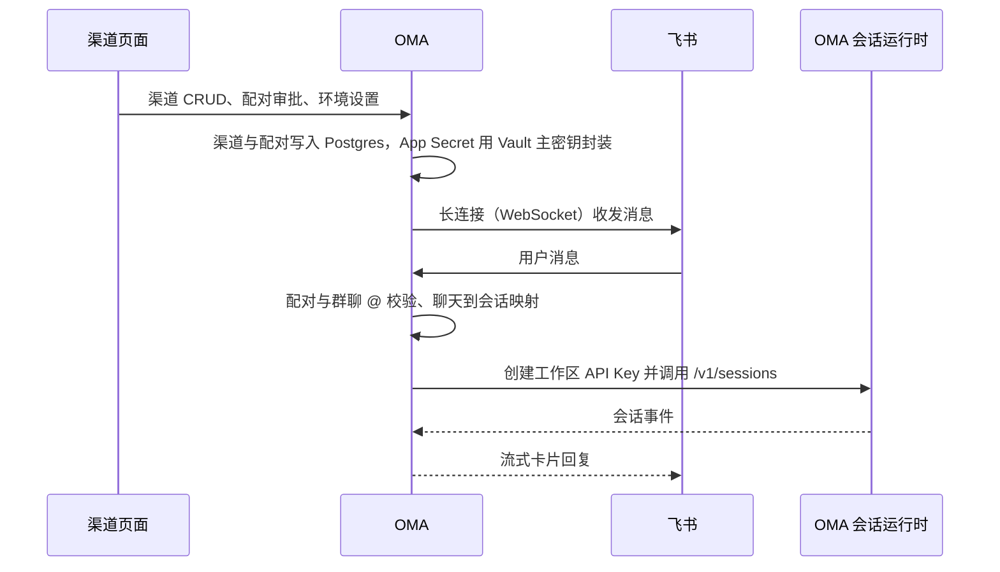

# 飞书渠道原生运行时

## 目标

Agent 渠道不再依赖独立的 `lark-channel` 服务。OMA 自己保存渠道与配对状态、持有飞书应用凭据、维持飞书长连接，并在收到消息后直接驱动 OMA 会话。

`channels.runtime` 取值：

- `auto`（默认）：未配置 `channel_bridge.url`/`token` 时启用原生运行时，否则继续走桥接。
- `local`：强制原生运行时。
- `bridge`：继续转发到 `lark-channel`，供灰度回退。

`channels.oma_url` 是原生运行时调用自身公开 API 的地址，留空时按 `server.addr` 回退到 `http://127.0.0.1:<port>`。

## 服务边界

## 数据

新增四张表：

- `channels`：渠道名称、模式、启停、绑定状态、App ID、加密后的 App Secret、展示开关。
- `channel_pairings`：配对申请人（单聊用户或群聊），只保存标识，不保存聊天正文。
- `channel_sessions`：渠道内聊天（`chat:<chat_id>`）到 OMA 会话的映射，会话归档后自动重建。
- `channel_agent_settings`：按组织、工作区、智能体保存执行环境。

App Secret 使用 `secrets.Service` 以渠道为 AAD 封装，跨渠道或跨工作区移动密文无法解密；列表与更新响应不回显密钥，编辑时留空保留原值。

## 行为

- 开放模式直接放行；配对模式要求单聊用户或群聊分别获批，未获批时只登记一条待审批申请并回复提示。
- 群聊必须 @ 机器人，由飞书 Channel SDK 的策略网关拦截未 @ 消息。
- 单聊固定复用 `chat:<chat_id>` 会话；同一聊天连续对话继续落在同一个会话，会话归档后自动新建。
- 会话 metadata 写入 `source=feishu`、`channel_id`、`app_id`、`scope_id`、`chat_type`、`open_id`、`actor_id`，控制台按既有渠道来源识别会话。
- 回复使用飞书流式卡片，结束条件为 `session.status_idle` 且 `stop_reason` 为 `end_turn`/`interrupted`/`retries_exhausted`，或会话错误、30 分钟超时。
- 删除渠道停止运行、清除会话映射并软删除记录，历史 OMA 会话保留。

## 本阶段未覆盖

以下能力仍由 `lark-channel` 提供，原生运行时暂不实现，对应接口返回 `InvalidState`：

- 扫码创建/绑定应用与工作区级设备码授权（`/qr`、`/authorizations`）。
- 卡片按钮交互、工具审批、问卷作答。
- 图片、文件、音频等附件与产物回传。
- Memory、Vault、Git 仓库挂载与话题（thread）隔离。
- 多人并发的队列与打断命令（`/stop`、`/new`）。

迁移这些能力时按同一服务边界补齐，不需要改动前端。
