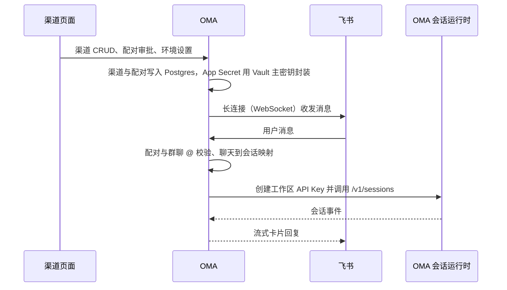

# 飞书渠道原生运行时

## 目标

Agent 渠道不再依赖独立的 `lark-channel` 服务。OMA 自己保存渠道与配对状态、持有飞书应用凭据、维持飞书长连接，并在收到消息后直接驱动 OMA 会话。

渠道运行时只有一套：`NewService` 始终创建原生运行时。`channel_bridge`、`channels.runtime` 仍可解析，避免旧配置启动失败，但不再参与运行决策，也不会再转发到 `lark-channel`。

`channels.oma_url` 是原生运行时调用自身公开 API 的地址，留空时按 `server.addr` 回退到 `http://127.0.0.1:<port>`。

`channels` 整段配置都可以缺省：没有飞书应用、没有渠道记录时服务照常启动，运行时不建立任何连接，渠道页返回空列表；只有真正绑定并启用渠道后才会建立长连接。旧 `channel_bridge` 配置仅保留解析兼容。

## 服务边界

## 数据

新增四张表：

- `channels`：渠道名称、模式、启停、绑定状态、App ID、加密后的 App Secret、展示开关。
- `channel_pairings`：配对申请人（单聊用户或群聊），只保存标识，不保存聊天正文。
- `channel_sessions`：渠道内聊天（`chat:<chat_id>`）到 OMA 会话的映射，会话归档后自动重建。
- `channel_agent_settings`：按组织、工作区、智能体保存执行环境。

App Secret 使用 `secrets.Service` 以渠道为 AAD 封装，跨渠道或跨工作区移动密文无法解密；列表与更新响应不回显密钥，编辑时留空保留原值。

## 飞书应用授权自动化

扫码授权和跳转授权共用飞书官方 Go SDK（`scene/registration`）的同一条设备码流程，前端既能把 `url` 渲染成二维码，也能直接打开该链接：

1. `POST /v1/channels/authorizations` 先落库一条 `channel_registrations` 记录，再在后台调用 SDK `RegisterApp`：传入 `Source=open-managed-agents`、`AppPreset.Name=渠道名`，并用 `Addons` 预置机器人所需权限（`im:message`、`im:message:send_as_bot`、`im:chat:readonly`）与事件（`im.message.receive_v1`），创建完的应用不需要再手工勾选。
2. SDK 的 `OnQRCode` 回调把确认地址与过期时间写回记录并唤醒请求，HTTP 响应因此能同步拿到 `url`；`OnStatusChange` 同步 `slow_down` 后的轮询间隔。
3. SDK 在本进程内完成后续轮询与 Lark 域名切换；成功、拒绝（`access_denied`）、过期（`expired_token`）分别落为 `bound` / `denied` / `expired`，其他失败落 `unknown`。
4. 渠道向导里的扫码入口用 `GET /v1/channels/{channel_id}/qr`（工作区级，只需渠道 ID），授权成功后直接把应用凭据绑定到该渠道并启动运行时；过期或拒绝后再次请求会重新发起。
5. 创建/更新渠道时携带 `authorization_id` 表示复用已完成的工作区授权，OMA 直接从授权记录里取应用凭据绑定渠道。

进度落在 `channel_registrations`（`owner` 记录发起实例、`heartbeat_at` 随 SDK 轮询刷新），所有状态写入都是 `WHERE phase = 'waiting'` 的条件更新：多实例轮询同一记录时，别的实例不会把刚完成的终态覆盖回 `waiting`；没有本地任务的实例看到心跳仍然新鲜就继续返回 `pending`，只有心跳超过 45 秒才算任务丢失并落 `unknown`。进程重启或实例下线导致的 `unknown` 需要重新发起；同一渠道已有的过期/拒绝/未知记录会先删除再重建，不会撞唯一索引。渠道删除会取消对应的扫码任务。

## 行为

- 开放模式直接放行；配对模式要求单聊用户或群聊分别获批，未获批时只登记一条待审批申请并回复提示。
- 群聊必须 @ 机器人，由飞书 Channel SDK 的策略网关拦截未 @ 消息。
- 作用域统一用 `scopeKey`：话题消息按 `chat:<chat_id>:thread:<thread_id|root_id>` 隔离，普通聊天按 `chat:<chat_id>`；会话映射、回复任务和卡片交互都挂在同一作用域上。会话归档后自动新建。
- 会话 metadata 写入 `source=feishu`、`channel_id`、`app_id`、`scope_id`、`chat_type`、`open_id`、`actor_id`，控制台按既有渠道来源识别会话。
- 回复使用飞书流式卡片，结束条件为 `session.status_idle` 且 `stop_reason` 为 `end_turn`/`interrupted`/`retries_exhausted`，或会话错误、30 分钟超时。
- 展示开关在原生运行时生效：
  - `include_tool_calls`：读取事件顶层的 `name`（`agent.tool_use` / `agent.mcp_tool_use` / `agent.custom_tool_use`），在回复里追加 `🔧 工具名`。
  - `include_thinking`：会话事件接口会剥离 `agent.thinking` 的正文，因此只按现有合同展示状态——回复改用卡片流，正文下方显示 `_🧠 正在思考…_`，收到正式回复或工具调用后自动消失。
  - `reply_in_thread`：通过飞书回复接口并显式设置 `reply_in_thread=true` 新建话题；Channel SDK 的回复封装不带该参数，所以话题模式由运行时自己发首条消息再接管流式更新。
- 多实例部署：每个实例启动时加载全部可运行渠道并每 30 秒对账一次，配置或启停变化会重建/停止本地 worker；飞书长连接按应用维度分发事件，会话映射与配对状态都在 Postgres 共享。禁用或删除后在下次对账前旧 worker 仍可能收到消息，因此每条消息都会重新校验渠道记录，非 `enabled` 或已删除的渠道直接丢弃，不再回复。
- 删除渠道停止运行、清除会话映射并软删除记录，历史 OMA 会话保留。

## 消息执行

- 入站处理只做校验、鉴权、会话解析，随后登记回复任务并立即返回；回复监听在独立 goroutine 中轮询事件，因此 `/stop`、`/new` 不会被上一轮的流式回复阻塞。
- 回复按本次输入事件 ID 对齐：发送 `user.message` 后取响应里的事件 ID 作为基线，只消费其后的事件；取不到时退回发送前最后一条事件 ID。
- `/stop` 向当前作用域映射的会话发送 `user.interrupt`，保留映射；`/new` 先取消该作用域所有回复任务、中断当前轮次，再删除映射，旧回复任务不会再写入消息。
- 附件：图片、PDF、纯文本以 base64/text 内容块进入 `user.message`；单个附件上限 20 MB、单条消息上限 10 个，下载或体积失败时明确回复原因，不静默丢弃。
- 挂载：渠道保存 `memory_store_id`、`vault_id`、`git_repository`（token 单独信封加密，响应只返回 `tokenConfigured`）。创建会话时 Memory/Git 写入 `resources`，Vault 写入 `vault_ids`；修改挂载后重建 worker，后续新建会话采用新配置，已有会话保持原资源，需要同步时走既有会话资源接口。

## 会话内交互

- 审批：`agent.tool_use` 的 `evaluated_permission` 为 `ask` 时发送允许/拒绝卡片，回调写入 `user.tool_confirmation`（`tool_use_id` + `allow|deny`）。
- 问卷：`agent.custom_tool_use` 且工具名为 `AskUserQuestion` 时生成表单卡片，支持多题、多选与自定义文本，回调以 `user.custom_tool_result` 回传 `{answers:[{id,selected,custom}]}`。
- 卡片值携带 `channel_id`、`scopeKey`、`session_id`、`tool_use_id` 和发起人 `open_id`；点击时校验渠道、会话、聊天和操作人，并按 OMA 事件里已有的 `user.tool_confirmation` / `user.custom_tool_result` 去重，重复点击、控制台已处理和进程重启后都不会重复提交。

## 附件与产物

- 入站：从飞书下载后上传 OMA Files（`POST /v1/files`），再挂载为会话 file 资源（`POST /v1/sessions/{id}/resources`）；正文不再拼接挂载路径，纯附件消息只补一行文件名，同一文件已挂载时不重复挂载。
- 出站：每轮开始前记录会话资源 ID 基线，轮次结束后只把新增的 file 资源下载并上传飞书（图片走 image 消息、其余走 file 消息）；不重发历史产物，也不回传本轮用户上传的附件。产物超过 10 个或 30 MB 时回复提示到 OMA 会话查看。
- 失败处理：附件下载、上传或挂载失败时回复具体原因并终止本轮提交，不会出现正文已发出、附件静默丢失。

## 本阶段未覆盖

- 语音、视频等需要转码的附件类型；当前按不支持跳过并提示。
- 卡片表单的字段级校验（如必填、多选上限）。
