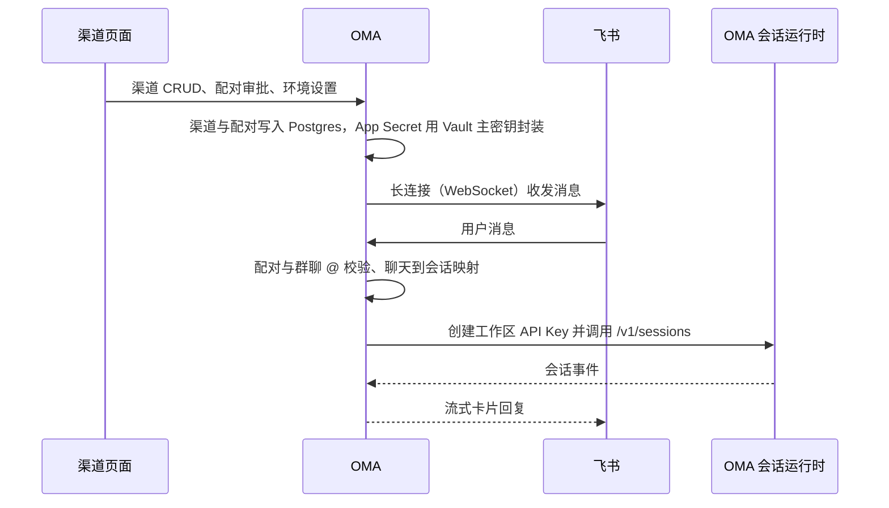

# 飞书渠道原生运行时

## 目标

Agent 渠道不再依赖独立的 `lark-channel` 服务。OMA 自己保存渠道与配对状态、持有飞书应用凭据、维持飞书长连接，并在收到消息后直接驱动 OMA 会话。

`channels.runtime` 取值：

- `auto`（默认）：未配置 `channel_bridge.url`/`token` 时启用原生运行时，否则继续走桥接。
- `local`：强制原生运行时。
- `bridge`：继续转发到 `lark-channel`，供灰度回退。

`channels.oma_url` 是原生运行时调用自身公开 API 的地址，留空时按 `server.addr` 回退到 `http://127.0.0.1:<port>`。

`channels` 整段配置都可以缺省：没有飞书应用、没有渠道记录时服务照常启动，运行时不建立任何连接，渠道页返回空列表；只有真正绑定并启用渠道后才会建立长连接。配置了 `channel_bridge` 的部署继续走桥接，行为不变。

## 服务边界

## 数据

新增四张表：

- `channels`：渠道名称、模式、启停、绑定状态、App ID、加密后的 App Secret、展示开关。
- `channel_pairings`：配对申请人（单聊用户或群聊），只保存标识，不保存聊天正文。
- `channel_sessions`：渠道内聊天（`chat:<chat_id>`）到 OMA 会话的映射，会话归档后自动重建。
- `channel_agent_settings`：按组织、工作区、智能体保存执行环境。

App Secret 使用 `secrets.Service` 以渠道为 AAD 封装，跨渠道或跨工作区移动密文无法解密；列表与更新响应不回显密钥，编辑时留空保留原值。

## 飞书应用授权自动化

扫码授权和跳转授权共用同一条设备码流程，前端既能把 `url` 渲染成二维码，也能直接打开该链接：

1. `POST /v1/channels/authorizations` 向 `https://accounts.feishu.cn/oauth/v1/app/registration` 发起 `action=begin`，拿到一次性 `device_code` 与飞书确认地址，附带 `from/sdk source/open-managed-agents tp/sdk name`，落库时设备码加密。
2. `GET /v1/channels/authorizations/{id}` 按记录里的 `next_poll_at` 惰性轮询 `action=poll`：`authorization_pending` 保持等待、`slow_down` 抬高间隔、`access_denied`/`expired_token` 置为失败、Lark 租户自动切到 `accounts.larksuite.com`；拿到 `client_id`/`client_secret` 后先校验凭据再落库，状态变为 `bound`。
3. 渠道向导里的扫码入口用 `GET /v1/agents/{agent}/channels/{id}/qr`，同样惰性轮询，授权成功后直接把应用凭据绑定到该渠道并启动运行时；过期或拒绝后再次请求会重新发起。
4. 创建/更新渠道时携带 `authorization_id` 表示复用已完成的工作区授权，OMA 直接从授权记录里取应用凭据绑定渠道。

所有轮询都由前端请求驱动，服务端没有后台轮询循环；同一个设备码只会被消费一次，请求结果未知时状态停在 `unknown`，避免重复领取凭据。

## 行为

- 开放模式直接放行；配对模式要求单聊用户或群聊分别获批，未获批时只登记一条待审批申请并回复提示。
- 群聊必须 @ 机器人，由飞书 Channel SDK 的策略网关拦截未 @ 消息。
- 单聊固定复用 `chat:<chat_id>` 会话；同一聊天连续对话继续落在同一个会话，会话归档后自动新建。
- 会话 metadata 写入 `source=feishu`、`channel_id`、`app_id`、`scope_id`、`chat_type`、`open_id`、`actor_id`，控制台按既有渠道来源识别会话。
- 回复使用飞书流式卡片，结束条件为 `session.status_idle` 且 `stop_reason` 为 `end_turn`/`interrupted`/`retries_exhausted`，或会话错误、30 分钟超时。
- 删除渠道停止运行、清除会话映射并软删除记录，历史 OMA 会话保留。

## 本阶段未覆盖

以下能力原生运行时暂不实现：

- 卡片按钮交互、工具审批、问卷作答。
- 图片、文件、音频等附件与产物回传。
- Memory、Vault、Git 仓库挂载（提交时返回 `InvalidArgument`）与话题（thread）隔离。
- 多人并发的队列与打断命令（`/stop`、`/new`）。

迁移这些能力时按同一服务边界补齐，不需要改动前端。
