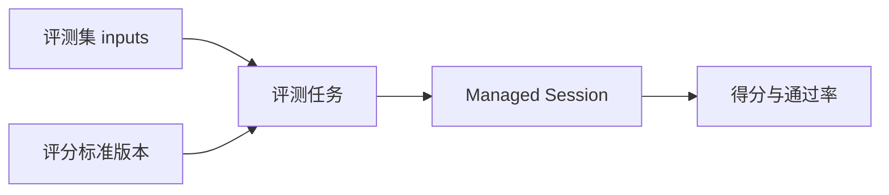

# 评测

状态：控制台可以创建评测集、评分标准并启动评测任务。任务为每个 case 创建一个 Managed Session，终态后按评分标准打分。这个版本只做评测，不改写系统提示词，也不把结果写回 Agent。

这套模型和智谱 Managed Agents 的评测对齐：评测不改 Agent。Workbench Evaluate 仍是带变量的 prompt 对照，不走这条路径。

## 流程

1. 评测集保存有序 `inputs`。`query` 由其中的文字块拼出，可以是空字符串。期望回答、工具轨迹、来源会话、标注和验收要点可选。
2. 评分标准保存判断条件、通过分和可选打分模型。再次保存会追加版本。任务创建时冻结当时的正文、通过分和版本号。
3. 评测任务绑定 Agent 版本、环境、评测集版本和评分标准版本。每个 case 目前把快照里的 `query` 文字发给一条 `user.message`。省略 `agent_version` 时使用当前版本。
4. Session 以 `end_turn` 结束则 case 完成并打分。终止或 `retries_exhausted` 记为系统异常，不进入通过率分母。创建任务时 `mode` 只能是 `evaluate`，接口不接受迭代，也没有把候选提示词写回 Agent 的动作。

报告里的得分是已成功打分 case 的平均分。通过率是这些 case 里 `passed` 的比例。系统异常和无法解析的评分单独计数。

## 数据

`00117_evaluation_datasets.sql` 不建外键。租户条件同时带 `organization_uuid` 和 `workspace_uuid`。

| 表 | 前缀 | 作用 |
| --- | --- | --- |
| `evaluation_datasets` / `evaluation_dataset_versions` | `evalds_` / `edv_` | 评测集和版本。当前写入版本 1 |
| `evaluation_cases` | `evalcase_` | `inputs` 是有序内容块。`query` 由其中的文字块拼出，可以是空字符串。期望回答、工具轨迹、来源会话、标注和验收要点可选 |
| `evaluation_rubrics` / `evaluation_rubric_versions` | `evalrb_` / `erv_` | 评分标准。版本只增不改。`00118_evaluation_rubrics.sql` |
| `evaluation_tasks` | `evaltask_` | 只写入 `evaluate`。状态 `pending`、`running`、`completed`、`failed`、`cancelled` |
| `evaluation_task_items` | `evalitem_` | 一个 case，`round = 1` |
| `evaluation_task_scores` | `evalscore_` | 一条 item 一行。`completed` 才有有效分数。`answer` 保存打分时读到的 Agent 最终回答，`00127_evaluation_score_answer.sql` 增加 |

删除评测集、用例或评分标准是软删除。已经跑过的任务保留自己的快照，不能再被新任务选中。`evaluation_cases.inputs` 由 `00119_evaluation_case_inputs.sql` 增加。任务表在 `00125_replace_evaluation_schema.sql`，它会按当前结构重建评测表；`00126_evaluation_case_inputs_after_task_schema.sql` 在这次重建后再补上 `inputs`。旧的 `00115_managed_evaluation.sql` 与渠道凭证迁移共用版本号，不再保留。

## 控制台

路由在 `/api/console/organizations/{orgUuid}/workspaces/{workspaceId}/evaluations`。

- `POST/GET /datasets`，`GET/DELETE /datasets/{id}`
- `GET/POST /datasets/{id}/cases`，`POST /datasets/{id}/cases/{caseId}`，`DELETE /datasets/{id}/cases/{caseId}`
- `POST /datasets/{id}/cases:import`，`POST /datasets/{id}/cases:generate`
- `GET /datasets/{id}/session-turns?session_id=`，`POST /datasets/{id}/cases:from-session`
- `POST/GET /rubrics`，`GET/DELETE /rubrics/{id}`，`GET /rubrics/{id}/versions`，`POST /rubrics/{id}/versions`，`POST /rubrics/generate`
- `POST/GET /tasks`，`GET /tasks/{id}`，`POST /tasks/{id}/cancel`，`POST /tasks/{id}/retry`
- `GET /tasks/{id}/items/{itemId}/trace`

任务列表和详情都返回 `resource_count`、`vault_count`。详情、创建、取消和重试的返回还带 `agent_name`、`dataset_name`、`rubric_name` 和 `usage`。名称按任务记录的 Agent 版本、评测集和评分标准读取；评测集或评分标准已删除时名称为空，前端改显示编号。`usage` 汇总这次任务各 item 会话里 `span.model_request_end` 的输入、输出和缓存读取 token，不含评分模型的调用。item 返回 `acceptance`，`score.answer` 是 Agent 最终回答。

轨迹接口读取 item 对应会话的事件，按时间顺序返回 `user`、`answer`、`tool_use`、`tool_result` 和 `error` 步骤，其余事件不返回。工具调用的 `name` 是工具名，`text` 是输入 JSON。每步文字最多 4000 字节，截断时不留半个字符。item 还没有会话时返回空步骤；超过 2000 个事件的会话按参数错误拒绝。

前端入口在托管智能体的「评测」。页面有任务、评测集和评分标准。

新建评测集可以上传或粘贴 JSON、JSONL、CSV，也可以上传带单元格图片的 xlsx，并下载样例。上传页写明只有 xlsx 能放图片。JSON、JSONL、CSV 样例只有文字，Excel 样例在单元格里带一张图片。上传和粘贴各自保留内容。文件内容随创建请求一次写入；解析失败时不会留下空评测集。只提供 `query` 时，服务端保存成一个文字块。`inputs` 可以按顺序包含文字、图片和文档。图片和文档只引用当前工作区的 `file_id`，类型与会话消息一致；Base64 和外部 URL 会被拒绝。详情页列出用户问题、期望回答和按行保存的验收要点。问题列在文字下显示图片缩略图，点开查看大图；文档显示文件名。缩略图走控制台预览，读取当前工作区里的图片字节。会话导入的图片会带上用例里的会话，再读取会话附件。公开文件下载接口仍然拒绝不可下载的上传文件。不能预览的文件返回 “File is not previewable”。图片加载失败时显示「图片」。编辑用例使用同样的缩略图，移除按钮在缩略图角上，界面不显示文件编号。标注分不标注、正例和负例；只有负例按条填写验收要点。编辑用例时未提交的工具轨迹保持原值，并只读取这一条用例的轨迹。多行 JSONL 按行导入；`{"cases":[...]}` 也会被接受。xlsx 里单元格图片（`DISPIMG`）和浮动图片由浏览器直接读出字节，上传到文件库后再保存文件编号。用户不填写 `file_id`，也不用按文件名再选一次。CSV 和旧版 xls 没有图片字节，遇到单元格图片公式时提示改传 xlsx。编辑从会话导入的用例时，文件库里已有的文件直接使用。只有文件不在文件库时，才按用例记录的会话读取会话附件。该会话已不存在时，这个附件返回 Session not found。只改文字或文件库文件时，不因会话消失而失败。编辑用例和从会话导入仍然直接使用已经上传或会话里已有的文件。名称、说明、问题和验收要点按字符计数。

评测集列表按 15 条分页。从会话导入时先选择当前工作区的会话，选择器可以继续加载后续会话，再把轮次从左侧移到右侧。一轮从一条用户消息开始，到下一条用户消息之前。可以导入的轮次保留文字，以及这场会话能读到的图片和文档文件。手动添加和 JSON 导入只接受文件库里可见的 `file_id`。只有 Base64 或 URL 的轮次不出现在选择器里；如果导入请求仍指向这样的轮次，该轮次计入 `skipped`，不写入用例。已经导入成功的轮次会从可选列表移除，避免再次导入变成重复用例。导入进行中不能更换会话或轮次，完成后按提交时的会话和轮次标记已导入。Agent 的文字回复只用来辨认该轮，不写入期望回答。每个选中且可导入的轮次各成为一条用例。轮次移到右侧之后再选标注；只有负例填写验收要点，并应用到这次导入的全部用例。超过 2000 个事件的会话拒绝导入。

生成用例接受 1 到 50 条，可以带补充说明、Agent 和该 Agent 的版本。指定版本时使用该版本的系统提示词。模型返回用例 JSON 数组；`{"cases":[...]}` 也会被接受。外层 Markdown 代码围栏会先去掉。模型输出无法解析时按生成失败返回。生成失败时删除刚创建的空评测集。

评分标准可以手写，或按评测目标、Agent、评测集、正例和负例生成。生成要求模型直接返回 Markdown；若整段回复是 JSON 对象或数组，则拒绝落库。模型若用 Markdown 代码块包住正文，保存时去掉围栏。标题可以留空。列表按 15 条分页。正文和模型名按字符计数。详情先展示标题、编号、版本、创建时间和评分规则正文。版本历史按版本号倒序列出每一版的正文和通过分，可以选择查看。点编辑后再保存，保存会追加版本，已经存在的评测任务不受影响。删除是软删除。

任务列表的列是 ID、任务、Agent、状态、创建时间、操作。开始评测的表单是智能体、运行环境、凭据库、资源、评测集、评分标准和评测关注项。评测关注项会写进这次任务冻结的评分标准。一次任务只跑一轮，不改 Agent。一个任务最多 200 条用例。取消只作用于尚未结束的任务。重试只重置已结束任务里失败的用例。

任务详情页顶部是「评测 / 任务编号」面包屑、任务名、「评测任务」和状态标签、可复制的编号、创建时间，右侧「操作」菜单放重试失败项和终止。下面分「任务信息」和「任务报告」两个标签页，不做内容变化页，因为这一版不改 Agent。任务信息分基本信息、评测配置、执行与资源三组；失败时先显示失败原因。任务报告依次是：

1. 整体结论：结论文字、平均得分环、样例数、通过数、通过率和通过分。有系统异常时下方提示这些样例不计入通过率。
2. 质量分析：通过、未通过、系统异常、进行中四类的分布条和占比，有维度分时列出各维度均分。
3. 数据明细：按四类筛选，可下载 CSV。列是用户问题、Agent 最终回答、自动打分、结果、评分依据、验收要点（没有时显示期望回答）和查看轨迹。

item 的会话失败或被取消、评分失败都算系统异常。会话已完成但还没有分数算进行中。查看轨迹打开右侧抽屉，显示问题、分数、结果、会话链接、评分依据和执行过程；没有 Agent 回答时提示本轮暂无最终回答。任务或 item 未结束时，详情和轨迹每 3 秒刷新。

`evaluation_tasks.created_by_user_uuid` 和 `created_by_api_key_uuid` 是可空 `uuid`。控制台会话没有 API key 时这两列为空。

Session 终态沿用 `publishSessionEvents` 上的观察者。打分在观察者里异步进行，不占用事件写入的返回。任务启动时只把用例快照里的文字 `query` 发给会话，图片和文档内容块还不会进入这条 `user.message`。
