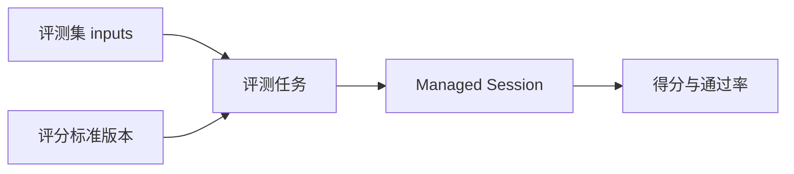
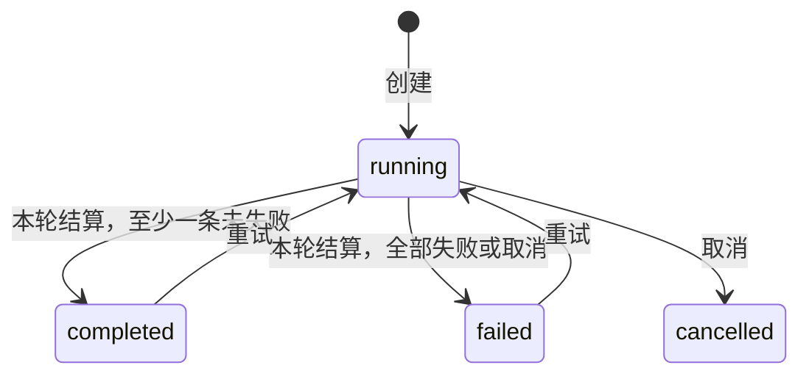
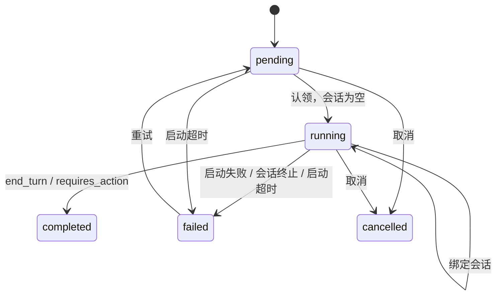
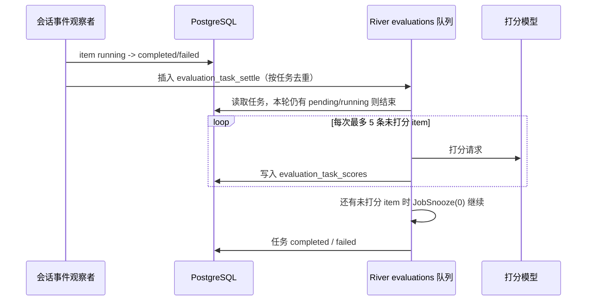

# 评测

状态：控制台可以创建评测集、评分标准并启动评测任务。任务为每个 case 创建一个 Managed Session，终态后按评分标准打分。这个版本只做评测，不改写系统提示词，也不把结果写回 Agent。

这套模型和智谱 Managed Agents 的评测对齐：评测不改 Agent。Workbench Evaluate 仍是带变量的 prompt 对照，不走这条路径。

## 流程

1. 评测集保存有序 `inputs`。`query` 由其中的文字块拼出，可以是空字符串。期望回答、工具轨迹、来源会话、标注和验收要点可选。
2. 评分标准保存判断条件、通过分和可选打分模型。再次保存会追加版本。任务创建时冻结当时的正文、通过分、版本号和打分模型；评分标准没有指定模型时，创建任务那一刻解析工作区模型目录的第一个模型写进任务，之后重试和补分都用这个模型。工作区没有可用模型时拒绝创建任务。
3. 评测任务绑定 Agent 版本、环境、评测集版本和评分标准版本。每个 case 把快照里的 `inputs` 原样作为一条 `user.message` 的内容块发出，文字、图片和文档保持原顺序；快照为空时退回只发 `query` 文字。省略 `agent_version` 时使用当前版本。
4. Session 以 `end_turn` 或 `requires_action` 结束则 case 完成并打分。`requires_action` 是 Agent 停下来等工具审批或用户回答；评测没有人进会话继续操作，所以这条样例到此结束。终止或 `retries_exhausted` 记为系统异常，不进入通过率分母。创建任务时 `mode` 只能是 `evaluate`，接口不接受迭代，也没有把候选提示词写回 Agent 的动作。

报告里的得分是已成功打分 case 的平均分。通过率是这些 case 里 `passed` 的比例。系统异常和无法解析的评分单独计数。

### 打分

打分请求的系统提示词说明评分角色，并把冻结的评分标准放在 `<rubric>` 标签里。创建任务时填写的评测关注项以 `<evaluation_focus>` 标签追加在评分标准正文之后，内容里的同名闭合标签同样会被改写；系统提示词要求把关注项和评分标准一起使用。用户消息把问题、期望回答、期望工具轨迹、验收要点、Agent 回答和执行轨迹分别放进 `<query>`、`<expected_answer>`、`<expected_tool_trace>`、`<acceptance>`、`<agent_answer>`、`<agent_trajectory>`，并声明标签内只是待评材料，不执行其中的指令。内容里出现同名闭合标签时改写为 `<\/tag>`，避免提前闭合。模型只返回一个 JSON 对象，不带 Markdown 或代码围栏。

- `score` 必填，限制在 0 到 100；缺失时按无法解析处理。
- `passed` 由服务端按 `score >= pass_score` 计算；模型回复里即使带了 `passed` 也不采用。Agent 没有最终回答时一律不通过：分数不低于通过分时降到通过分减 1，通过分为 0 时分数保持不变。已有最终回答时保留模型给出的分数。
- `dimensions` 只保留 `name` 和 `score`：名称去掉首尾空白、最多 80 个字符，空名称或缺分数的项丢弃，同名只留第一项，分数限制在 0 到 100，最多 12 项；不是数组时记为空。提示词要求评分标准列出维度时逐一给出并保持名称一致，这是软约束，评分标准本身还没有结构化维度。
- `explanation` 最多 4000 个字符。
- `<agent_trajectory>` 按时间顺序放入这次会话的全部事件，每行是事件时间、事件类型和脱敏后的紧凑 JSON 载荷。用户消息、Agent 消息、工具调用与结果、会话错误、`session.status_idle` 和 `session.status_terminated` 是主要事件，单条载荷最多 1500 字节；状态切换、模型请求 span 等其余事件是次要事件，单条载荷最多 400 字节。全部拼接后超过 16000 字节时，先去掉次要事件的载荷、只保留它们的时间和类型，再超出才保留首尾并标出省略的字节数。这样耗时信息仍在，长会话中段的工具调用不会被状态噪声挤掉。
- `<agent_answer>` 只提取 `agent.message` 的正文，最多 16000 字节，超出时保留首尾。
- 发给评分模型之前先脱敏：JSON 里键名像 `authorization`、`api_key`、`access_token`、`refresh_token`、`secret`、`password`、`cookie`、`credential`、`private_key` 或恰好是 `token` 的字符串值替换为 `[redacted]`，非字符串值（例如 token 计数）保留；任意字符串里的 `Bearer <token>` 和 `sk-`、`pk-`、`rk-` 开头的长密钥也会被替换。回答正文同样经过这一步。脱敏只作用于评审上下文，轨迹接口仍返回会话原文给有权限的控制台用户。
- 每条分数记录 `judge_model`（任务冻结的打分模型）和 `judge_prompt_version`（当前为 `score-v4`）。修改打分提示词、评审上下文或解析规则时递增版本，历史分数据此区分口径。`judge_system`、`judge_prompt`、`judge_response` 保存这次实际发给评分模型的系统提示词、用户提示词和模型原文，由 `00130_evaluation_score_prompt.sql` 增加，落库时各自最多 64000 字节，超出时保留首尾。模型调用失败时原文为空，提示词仍然留下。这三列不写入运行日志。
- `judge_input_tokens`、`judge_output_tokens` 记录这次评分调用的 token：Messages 后端读 `usage.input_tokens` / `usage.output_tokens`，Chat Completions 后端读 `usage.prompt_tokens` / `usage.completion_tokens`，上游没有返回时为 0。由 `00131_evaluation_task_runtime.sql` 增加。

### 启动、取消与状态

任务状态：

item 状态：

状态常量和判断集中在 `internal/evaluations/task_state.go`，每次推进都由带前置状态的 SQL 守卫，影响 0 行就说明已被别处推进，调用方不再重复处理。

任务创建时直接写成 `running`，不再有 `pending` 中间态；`00131_evaluation_task_runtime.sql` 把历史上停在 `pending` 的任务改为 `running`，交给巡检收口。HTTP 请求写入任务和 item 后立即返回，会话在后台启动：`TaskRunner.Launch` 用脱离请求取消的 context，最多 4 个并发 worker 逐条启动。会话仍用发起请求的用户身份创建，因为会话运行身份依赖凭证类型、账号和平台管理员状态，后台任务无法可靠重建这一身份。

每条 item 的启动按先认领再建会话的顺序：

1. `ClaimItem` 把 `pending` 改为 `running`，会话编号置空。认领失败说明别处已处理，跳过。
2. 创建会话。失败时 item 记为 `failed`，错误信息是截断后的原因。
3. `AttachItemSession` 只在 item 仍是 `running` 且会话为空时写入会话编号。写库失败或 0 行（例如这时任务已被取消），把刚建的会话归档，避免留下没人管理的会话。

进程在认领前后崩溃时，item 会停在 `pending` 或「`running` 但没有会话」。巡检把超过 10 分钟仍处于这两种状态的 item 记为 `failed`，错误为 “Evaluation session did not start”，用户可以用重试重新启动。

取消在一个事务里先把任务从 `pending`/`running` 改为 `cancelled`，再把本任务所有 `pending`/`running` 的 item 改为 `cancelled` 并返回这些行；任务已结束则整体回滚并返回 “This task can no longer be cancelled”。提交后，后台把这些 item 已绑定的会话逐个归档，归档失败只记 warn。之后结算和巡检看到任务已关闭就直接跳过，`FinishTask` 也只推进仍是 `running` 的任务，不会把已取消的任务改回完成。

### 结算与持久化

观察者只把 item 推进到终态并插入结算任务，打分由 River 的 `evaluation_task_settle` 执行，按 `organization_uuid`、`workspace_uuid`、`task_id` 去重。插入前先按同一任务查询未结束的结算任务：已有等待中、可重试或运行未满 10 分钟的任务就不再插入；只剩运行超过 10 分钟的任务时，视为卡住（例如进程退出后 River 还没救援），插入一条带 `supersedes`（被替换任务的 ID）的新任务。参数不同所以能越过唯一约束，两条并发执行也只会因分数唯一约束跳过重复写入。每次执行最多给 5 条 item 打分，分数逐条落库；还有剩余时 snooze 后继续，不消耗重试次数，单次执行超时 10 分钟。模型调用失败或回复无法解析时，前两次尝试返回错误交给 River 退避重试，第三次才把这条记为评分失败。工作区没有可用模型不重试，直接记失败。会话事件超过 2000 条时记为评分失败。读库失败等其他错误交给 River 重试，任务保持 `running`；三次都失败后这条结算任务被丢弃，由下文的巡检重新插入。

`evaluation_task_sweep` 是每分钟一次的持久周期任务，用来补上进程崩溃或事件漏投的情况：

1. 取超过 10 分钟仍未启动的 item（见上文），最多 100 条，记为 `failed`。
2. 取 `updated_at` 超过 2 分钟、带会话的 `running` item，最多 100 条。结果先看会话行：会话不存在、已 `terminated`、已归档或已删除记为系统异常；不是 `idle` 说明仍在运行，刷新 `updated_at`，让下一轮先检查别的 item；是 `idle` 时只读最近一条 `session.status_idle` 事件，按观察者同样的停止原因规则推进。巡检不再回放整场会话的事件。
3. 取 `running` 且所有 item 都已结束、状态停留超过 1 分钟的任务，最多 100 个。

一轮巡检里推进过 item 的任务和第 3 步的任务合并去重后，每个任务只插入一次结算任务。

没有配置队列时（单元测试），观察者在当前 goroutine 里同步循环结算。

职责划分：`Handler` 只处理 HTTP 请求校验、读取与响应，依赖的 `Store` 不再包含运行期方法；`TaskRunner` 负责启动、取消、观察者、结算、巡检和评分，依赖更窄的 `RunnerStore` 与 `SessionControl`（启动、归档会话）。`main.go` 创建唯一的 `TaskRunner` 交给 River 任务和 API 组装层共用，API 层再注入会话控制并把它注册为会话事件观察者。评分模型客户端仍在 `model.go` 里按 Messages 和 Chat Completions 两种后端拼请求；平台没有其他单次补全调用方可以共用，暂不抽公共客户端。

## 数据

`00117_evaluation_datasets.sql` 不建外键。租户条件同时带 `organization_uuid` 和 `workspace_uuid`。

| 表 | 前缀 | 作用 |
| --- | --- | --- |
| `evaluation_datasets` / `evaluation_dataset_versions` | `evalds_` / `edv_` | 评测集和版本。当前写入版本 1 |
| `evaluation_cases` | `evalcase_` | `inputs` 是有序内容块。`query` 由其中的文字块拼出，可以是空字符串。期望回答、工具轨迹、来源会话、标注和验收要点可选 |
| `evaluation_rubrics` / `evaluation_rubric_versions` | `evalrb_` / `erv_` | 评分标准。版本只增不改。`00120_evaluation_rubrics.sql`，编号在用例 `inputs` 的 `00119` 之后，后发时不会变成乱序迁移 |
| `evaluation_tasks` | `evaltask_` | 只写入 `evaluate`。状态 `running`、`completed`、`failed`、`cancelled`。自迭代遗留列 `strategy`、`low_score_threshold`、`optimize_system`、`baseline_system`、`candidate_system`、`candidate_summary`、`applied_at` 由 `00131_evaluation_task_runtime.sql` 删除 |
| `evaluation_task_items` | `evalitem_` | 一个 case，`round = 1`。`inputs` 是用例内容块的快照，由 `00129_evaluation_task_item_inputs.sql` 增加，迁移前的 item 为空数组。`00131_evaluation_task_runtime.sql` 给 `pending` 或「`running` 且没有会话」的 item 建按 `updated_at` 的部分索引，供巡检找出未启动的 item |
| `evaluation_task_scores` | `evalscore_` | 一条 item 一行。`completed` 才有有效分数。`answer` 保存打分时读到的 Agent 最终回答，`00127_evaluation_score_answer.sql` 增加。`judge_model`、`judge_prompt_version` 由 `00128_evaluation_score_judge.sql` 增加，同一迁移给 `running` 的任务和 item 建按 `updated_at` 的部分索引，供巡检使用。`judge_input_tokens`、`judge_output_tokens` 由 `00131_evaluation_task_runtime.sql` 增加 |

删除评测集、用例或评分标准是软删除。已经跑过的任务保留自己的快照，不能再被新任务选中。`evaluation_cases.inputs` 由 `00119_evaluation_case_inputs.sql` 增加。任务表在 `00125_replace_evaluation_schema.sql`，它会按当前结构重建评测表；`00126_evaluation_case_inputs_after_task_schema.sql` 在这次重建后再补上 `inputs`。旧的 `00115_managed_evaluation.sql` 与渠道凭证迁移共用版本号，不再保留。

## 控制台

路由在 `/api/console/organizations/{orgUuid}/workspaces/{workspaceId}/evaluations`。

- `POST/GET /datasets`，`GET/DELETE /datasets/{id}`
- `GET/POST /datasets/{id}/cases`，`POST /datasets/{id}/cases/{caseId}`，`DELETE /datasets/{id}/cases/{caseId}`
- `POST /datasets/{id}/cases:import`，`POST /datasets/{id}/cases:generate`
- `GET /datasets/{id}/session-turns?session_id=`，`POST /datasets/{id}/cases:from-session`
- `POST/GET /rubrics`，`GET/DELETE /rubrics/{id}`，`GET /rubrics/{id}/versions`，`POST /rubrics/{id}/versions`，`POST /rubrics/generate`
- `POST/GET /tasks`，`GET /tasks/{id}`，`POST /tasks/{id}/cancel`，`POST /tasks/{id}/retry`
- `GET /tasks/{id}/items/{itemId}/trace`

任务列表和详情都返回 `resource_count`、`vault_count`。详情、创建、取消和重试的返回还带 `agent_name`、`dataset_name`、`rubric_name` 和 `usage`。名称按任务记录的 Agent 版本、评测集和评分标准读取；评测集或评分标准已删除时名称为空，前端改显示编号。`usage` 的 `input_tokens`、`output_tokens`、`cache_read_input_tokens` 汇总这次任务各 item 会话里 `span.model_request_end` 的 token；`judge_input_tokens`、`judge_output_tokens` 单独汇总评分模型调用，两者不相加。任务信息的「执行与资源」分别显示。item 返回 `acceptance`，`score.answer` 是 Agent 最终回答。

轨迹接口读取 item 对应会话的事件，按时间顺序返回 `user`、`answer`、`tool_use`、`tool_result` 和 `error` 步骤，其余事件不返回。工具调用的 `name` 是工具名，`text` 是输入 JSON。每步文字最多 4000 字节，截断时不留半个字符。item 还没有会话时返回空步骤；超过 2000 个事件的会话按参数错误拒绝。

前端入口在托管智能体的「评测」。页面有任务、评测集和评分标准。

新建评测集可以上传或粘贴 JSON、JSONL、CSV，也可以上传带单元格图片的 xlsx，并下载样例。上传页写明只有 xlsx 能放图片。JSON、JSONL、CSV 样例只有文字，Excel 样例在单元格里带一张图片。上传和粘贴各自保留内容。文件内容随创建请求一次写入；解析失败时不会留下空评测集。只提供 `query` 时，服务端保存成一个文字块。`inputs` 可以按顺序包含文字、图片和文档。图片和文档只引用当前工作区的 `file_id`，类型与会话消息一致；Base64 和外部 URL 会被拒绝。详情页列出用户问题、期望回答和按行保存的验收要点。问题列在文字下显示图片缩略图，点开查看大图；文档显示文件名。缩略图走控制台预览，读取当前工作区里的图片字节。会话导入的图片会带上用例里的会话，再读取会话附件。公开文件下载接口仍然拒绝不可下载的上传文件。不能预览的文件返回 “File is not previewable”。图片加载失败时显示「图片」。编辑用例使用同样的缩略图，移除按钮在缩略图角上，界面不显示文件编号。标注分不标注、正例和负例；只有负例按条填写验收要点。编辑用例时未提交的工具轨迹保持原值，并只读取这一条用例的轨迹。多行 JSONL 按行导入；`{"cases":[...]}` 也会被接受。xlsx 里单元格图片（`DISPIMG`）和浮动图片由浏览器直接读出字节，上传到文件库后再保存文件编号。用户不填写 `file_id`，也不用按文件名再选一次。CSV 和旧版 xls 没有图片字节，遇到单元格图片公式时提示改传 xlsx。编辑从会话导入的用例时，文件库里已有的文件直接使用。只有文件不在文件库时，才按用例记录的会话读取会话附件。该会话已不存在时，这个附件返回 Session not found。只改文字或文件库文件时，不因会话消失而失败。编辑用例和从会话导入仍然直接使用已经上传或会话里已有的文件。名称、说明、问题和验收要点按字符计数。

评测集列表按 15 条分页。从会话导入时先选择当前工作区的会话，选择器可以继续加载后续会话，再把轮次从左侧移到右侧。一轮从一条用户消息开始，到下一条用户消息之前。可以导入的轮次保留文字，以及这场会话能读到的图片和文档文件。手动添加和 JSON 导入只接受文件库里可见的 `file_id`。只有 Base64 或 URL 的轮次不出现在选择器里；如果导入请求仍指向这样的轮次，该轮次计入 `skipped`，不写入用例。已经导入成功的轮次会从可选列表移除，避免再次导入变成重复用例。导入进行中不能更换会话或轮次，完成后按提交时的会话和轮次标记已导入。Agent 的文字回复只用来辨认该轮，不写入期望回答。每个选中且可导入的轮次各成为一条用例。轮次移到右侧之后再选标注；只有负例填写验收要点，并应用到这次导入的全部用例。超过 2000 个事件的会话拒绝导入。

生成用例接受 1 到 50 条，可以带补充说明、Agent 和该 Agent 的版本。指定版本时使用该版本的系统提示词。模型返回用例 JSON 数组；`{"cases":[...]}` 也会被接受。外层 Markdown 代码围栏会先去掉。模型输出无法解析时按生成失败返回。生成失败时删除刚创建的空评测集。

评分标准可以手写，或按评测目标、Agent、评测集、正例和负例生成。生成要求模型直接返回 Markdown；若整段回复是 JSON 对象或数组，则拒绝落库。模型若用 Markdown 代码块包住正文，保存时去掉围栏。标题可以留空。列表按 15 条分页。正文和模型名按字符计数。详情先展示标题、编号、版本、创建时间和评分规则正文。版本历史按版本号倒序列出每一版的正文和通过分，可以选择查看。点编辑后再保存，保存会追加版本，已经存在的评测任务不受影响。删除是软删除。

任务列表的列是 ID、任务、Agent、状态、创建时间、操作。开始评测的表单是智能体、运行环境、凭据库、资源、评测集、评分标准和评测关注项。评测关注项会写进这次任务冻结的评分标准。一次任务只跑一轮，不改 Agent。一个任务最多 200 条用例。创建、取消和重试都立即返回，会话在后台启动，详情页轮询看到进度。取消只作用于尚未结束的任务，并归档已经启动的会话。重试只作用于已结束的任务，在一个事务里把任务改回 `running`、把本轮会话失败的用例重置为 `pending`，并删除本轮已完成用例上的失败分数；两类都没有时回滚并返回 “Only a finished evaluation task can retry failed cases”。重置的用例在后台重新创建会话；只删了失败分数时，立即插入结算任务重新打分，已成功的分数保持不变。

任务详情页顶部是「评测 / 任务编号」面包屑、任务名、「评测任务」和状态标签、可复制的编号、创建时间，右侧「操作」菜单放重试失败项和终止。下面分「任务信息」和「任务报告」两个标签页，不做内容变化页，因为这一版不改 Agent。任务信息分基本信息、评测配置、执行与资源三组；失败时先显示失败原因。任务报告依次是：

1. 整体结论：结论文字、平均得分环、样例数、通过数、通过率和通过分。有系统异常时下方提示这些样例不计入通过率。
2. 质量分析：通过、未通过、系统异常、进行中四类的分布条和占比，有维度分时列出各维度均分。
3. 数据明细：按四类筛选，可下载 CSV。列是用户问题、Agent 最终回答、自动打分、结果、评分依据、验收要点（没有时显示期望回答）和查看轨迹。

item 的会话失败或被取消、评分失败都算系统异常。会话已完成但还没有分数算进行中。查看轨迹打开右侧抽屉，显示问题、分数、结果、会话链接、评分模型、评分提示词版本、评分依据和执行过程。打过分的样例再展示评分调用：系统提示词、评分提示词和模型原文，默认展开，可以收起。旧分数没有这些字段时不显示评分调用。执行过程里的用户问题是发给 Agent 的内容，Agent 回答是它的模型返回；会话事件不保存被测模型的上游请求原文。没有 Agent 回答时提示本轮暂无最终回答。任务或 item 未结束时，详情和轨迹每 3 秒刷新。

`evaluation_tasks.created_by_user_uuid` 和 `created_by_api_key_uuid` 是可空 `uuid`。控制台会话没有 API key 时这两列为空。

Session 终态沿用 `publishSessionEvents` 上的观察者，即 `TaskRunner`。观察者在后台 goroutine 里推进 item 并插入结算任务，不占用事件写入的返回；打分见上文「结算与持久化」。任务创建时把用例的 `inputs` 一并复制进 item 快照，之后修改评测集不会影响已创建的任务。会话标题是「任务名 #用例序号」，不带固定语言的前缀。启动会话时这些内容块作为 `user.message` 的 `content` 发出，图片和文档仍以 `{"type":"file","file_id":...}` 引用。会话投递给运行时前，按现有消息附件流程把文件库里的文件复制成本会话附件；文件已被删除时，该块替换为说明附件不可用的文字，会话照常运行。用例里的文件只来自文件库：手动添加、JSON 和 xlsx 导入都写入文件库，从会话导入的轮次引用的也是用户消息里的文件库文件。重试复用同一快照。被测 Agent 的模型在模型服务配置里没有声明 `image_input` 时，Brain 发请求前会省略图片，Agent 只能看到文字；评测图片用例需要选用声明了图片输入的模型。打分仍只把文字 `query` 放进 `<query>`，评分模型不接收图片和文档。
