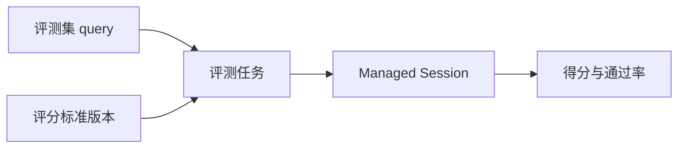

# 评测

状态：控制台可以创建评测集、评分标准并启动评测任务；任务为每个 case 创建一个 Managed Session，终态后按评分标准打分。这个版本只做评测，不改写系统提示词，也不把结果写回 Agent。

这套模型和智谱 Managed Agents 的评测对齐：评测不改 Agent。Workbench Evaluate 仍是带变量的 prompt 对照，不走这条路径。

## 流程

1. 评测集每条数据必须有 `query`。`expected_answer`、`expected_tool_trace`、`polarity` 与 `acceptance` 可选。导入接受 JSON 数组、JSONL 和带 `query` 列的 CSV，这三种都能读入上述可选列。新建评测集的上传和粘贴页提供对应样例下载。也可以从已有 Session 导入：先选择当前工作区的会话，再用左右列表把轮次移到「将导入」。一轮从一条用户消息开始，到下一条用户消息之前；这一轮里的 Agent 文字回复只用于辨认，不写入期望回答。每个选中的轮次各成为一条用例。轮次移到右侧之后再选标注；只有负例按条添加验收要点，并应用到这次导入的全部用例。
2. 评分标准保存判断条件、通过分和可选打分模型。再次保存会追加版本。任务创建时冻结当时的正文、通过分和版本号。
3. 评测任务绑定 Agent 版本、环境、评测集版本和评分标准版本。每个 case 发一条 `user.message`。省略 `agent_version` 时使用当前版本。
4. Session 以 `end_turn` 结束则 case 完成并打分。终止或 `retries_exhausted` 记为系统异常，不进入通过率分母。创建任务时 `mode` 只能是 `evaluate`，接口不接受迭代，也没有把候选提示词写回 Agent 的动作。

报告里的得分是已成功打分 case 的平均分。通过率是这些 case 里 `passed` 的比例。系统异常和无法解析的评分单独计数。

## 数据

`00115_managed_evaluation.sql` 不建外键。租户条件同时带 `organization_uuid` 和 `workspace_uuid`。

| 表 | 前缀 | 作用 |
| --- | --- | --- |
| `evaluation_datasets` / `evaluation_dataset_versions` | `evalds_` / `edv_` | 评测集和版本。当前写入版本 1，任务快照 case 字段 |
| `evaluation_cases` | `evalcase_` | `query` 必填 |
| `evaluation_rubrics` / `evaluation_rubric_versions` | `evalrb_` / `erv_` | 评分标准。版本只增不改 |
| `evaluation_tasks` | `evaltask_` | 只写入 `evaluate`。状态 `pending`、`running`、`completed`、`failed`、`cancelled` |
| `evaluation_task_items` | `evalitem_` | 一个 case，`round = 1` |
| `evaluation_task_scores` | `evalscore_` | 一条 item 一行。`completed` 才有有效分数 |

删除评测集或评分标准是软删除。已经跑过的任务保留自己的快照，不能再被新任务选中。

已有表里的 `strategy`、`candidate_system`、`applied_at` 等列先留着。新任务把它们写成空值，接口不再返回，也不再根据这些列改写或应用系统提示词。

## 控制台

路由在 `/api/console/organizations/{orgUuid}/workspaces/{workspaceId}/evaluations`。

- `POST/GET /datasets`，`POST /datasets/{id}/cases:import`，`GET /datasets/{id}/session-turns?session_id=`，`POST /datasets/{id}/cases:from-session`，`POST /datasets/{id}/cases:generate`
- `POST/GET /rubrics`，`POST /rubrics/{id}/versions`，`POST /rubrics/generate`
- `POST/GET /tasks`，`GET /tasks/{id}`，`POST /tasks/{id}/cancel|retry`

前端入口在托管智能体的「评测」，不显示 Beta 标识。列表沿用资源页的页头、表格、空态和每页 15 条游标。

- 评测集可以上传 JSON/JSONL/CSV、粘贴，或按条数和补充说明调用 `cases:generate`。上传区是虚线拖拽框，样例下载单独放在文件说明下面。详情页直接列出用户问题、期望回答和按行保存的验收要点。标注分不标注、正例和负例；只有负例保存验收要点，用来说明怎样才算修好。从 Session 导入时先选会话，再把轮次从左侧移到右侧，然后标注；只有负例出现验收要点。来源列显示为会话导入。
- 评分标准可以手写，或按评测目标、Agent、评测集、正例和负例生成。标题可以留空。手动编写提供评分模板。查看后保存会追加版本。
- 任务列表的列是 ID、任务、Agent、状态、创建时间、操作。开始评测的表单是智能体、运行环境、凭据库、资源、评测集、评分标准和评测关注项。评测关注项会写进这次任务冻结的评分标准。一次任务只跑一轮，不改 Agent。

`evaluation_tasks.created_by_user_uuid` 和 `created_by_api_key_uuid` 是可空 `uuid`。控制台会话没有 API key 时这两列为空。

Session 终态沿用 `publishSessionEvents` 上的观察者。打分在观察者里异步进行，不占用事件写入的返回。

## 还没有做

- XLSX/XLS 上传。
- 暂停、恢复、中止后的沙箱清理。
- 评分标准用正例和负例做区分度校验，生成任务的进度、取消和后台记录。
- 报告下载和逐条执行轨迹。当前只展示得分分布和模型返回的维度均分。
- 自定义工具 mock、只读记忆挂载的专门字段、每日额度。任务沿用 Session 已有的 `resources` 和 `vault_ids`。
