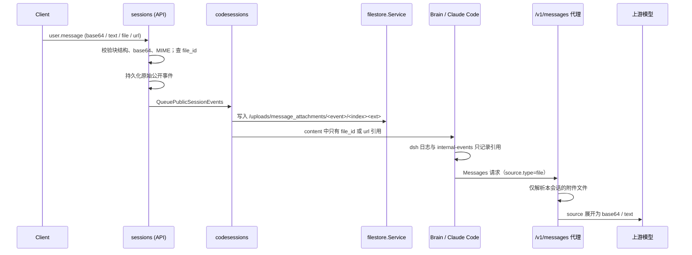

# user.message 图片与文档附件

## 对外契约

`POST /v1/sessions/{id}/events` 的 `user.message.content` 按 Claude Managed Agents 的 `BetaManagedAgentsUserContentBlock` 接受三类块：

| 块 | 来源 | 校验 |
| --- | --- | --- |
| `text` | — | 非空文本 |
| `image` | `base64`、`url`、`file` | base64 必须可解码且非空；`media_type` 只接受 `image/jpeg`、`image/png`、`image/gif`、`image/webp`，且解码后的文件头必须与声明类型一致 |
| `document` | `base64`、`text`、`url`、`file`，可带 `title`、`context` | base64 只接受 `application/pdf`，文件头必须是 PDF；`text` 来源固定 `text/plain` |

`url` 来源必须是带主机名的绝对 `http`/`https` URL。类型或 URL 无效的块在入站时返回 400，不会进入历史；否则它们会在每一轮重建模型请求时重复失败。

`file` 来源在发送事件时查询同一 workspace 的可见 Files 记录：不存在返回 400 `was not found`，MIME 不在上表时返回 400。事件请求体仍受 sessions 资源 4 MiB 上限约束。公开事件历史、发送响应、SSE 和 webhook 原样回显用户提交的内容，包括 base64。

## 内部表示：统一为会话文件引用

worker 不接收附件原始字节。投递 `user.message` 前，`codesessions` 把 `base64`、`text`、`file` 三种来源物化为会话 Filestore 中的私有文件，并把块的 `source` 改写为 `{"type":"file","file_id":"file_..."}`；`url` 来源保持原样，由上游模型抓取。`title`、`context` 等其他字段保留。

- **路径**：`/uploads/message_attachments/<event_external_id>/<block_index><ext>`，扩展名由 MIME 决定。路径是事件 ID 与块序号的纯函数，物化可重入：路径已存在时直接复用，激活重放、重试和并发投递都不会重复写入。
- **可见性**：附件是 `session_resources` 中 `payload IS NULL` 的私有文件，不出现在 `/v1/files` 列表和 Session 文件 Catalog 中，随 Session filesystem 清理任务一起回收。Sandbox 中可以只读访问 `/mnt/session/uploads/message_attachments/...`。File Resource 不应挂载到 `/message_attachments`，否则路径冲突会使附件写入失败。
- **快照语义**：`file` 来源在物化时复制对象内容。重放 `file` 来源时先按候选扩展名查找已物化的附件，命中即复用，因此之后用户删除原 Files 记录不影响已投递的消息。
- **降级**：物化时源文件已不存在、MIME 不再受支持、复制的文件头与 MIME 不一致、内容超过 `storage.max_file_bytes`，或进程未配置附件存储时，该块替换为一段说明附件不可用的 `text` 块，绝不回退为内联字节。超限对象不会被截断入库，暂存对象按孤儿清理流程回收。数据库或对象存储的瞬时失败会作为投递错误向上返回，由现有重试路径处理。
- **覆盖面**：物化发生在公开事件转换为 worker 载荷的唯一入口（`QueuePublicSessionEvents` 与激活重放），因此 sessions API、Deployment `initial_events` 等所有来源一致生效。

因此 internal-events（`dsh_log`、`dsh_brain_state` 以及 Claude Code transcript）不包含用户上传的附件原始内容。

## Messages 代理展开

Session 凭证调用 `POST /v1/messages` 时，代理复用通用的文件引用解析（见 [messages-proxy](messages-proxy.md)），在转发前把 `source.type=file` 的 `image`/`document` 块展开为内联内容：

- 先按同一 workspace 的可见 Files 记录查找；不存在时再回退到该凭证所属 public Session 拥有的 `/uploads/message_attachments/` 私有文件。其他 Session 的附件视为不存在。
- 图片和 PDF 展开为 `base64`，`text/plain` 文档展开为 `text` 来源；`cache_control` 等块字段保持不变。
- 找不到的文件返回 404，超限返回 413，对象缺失以外的存储或校验失败按通用文件引用错误返回。
- 请求不含 `file_id` 时请求体按原字节转发。

## Brain 表示

Brain 收到的 `image` 块若带 `file` 或 `url` 来源，映射为 dsh 内容块 `{"type":"oma-image","source":...}`，AI SDK 适配器以 `{"type":"reference","reference":{"anthropic":"file_..."}}` 或 URL 文件部件发出，Anthropic provider 序列化为 `image` 的 `file`/`url` 来源，再由代理展开。`document` 块映射为 `oma-document`，同样保留 `file` 引用。仍携带 base64 的图片沿用本地 dsh attachment 路径。无效块使本轮以错误结束，不停止会话；构建模型请求时的转换错误（例如无法解析的 URL）同样归一为模型错误。

## 验收覆盖

- `internal/messagemedia`：来源与 URL 校验、文件头匹配、候选类型、路径与引用。
- `internal/db`：两个附件查询的 SQL 与参数绑定契约。
- `internal/filestore`：附件写入、幂等、失败传播、超限拒绝、源文件复制与文件头不匹配拒绝。
- `internal/messages`：文件引用展开、缺失文件、超限与无文件请求原样转发。
- `tests/session_message_media_test.go`：真实 PostgreSQL 与对象存储上的入站拒绝（含无效 URL 与类型不符）、引用改写、Files API 隐藏、历史回显、删除源文件后的重放复用，以及代理只展开本会话附件。
- `oma-brain-dsh`：`oma-image` 的引用映射与 AI SDK 文件部件转换。
