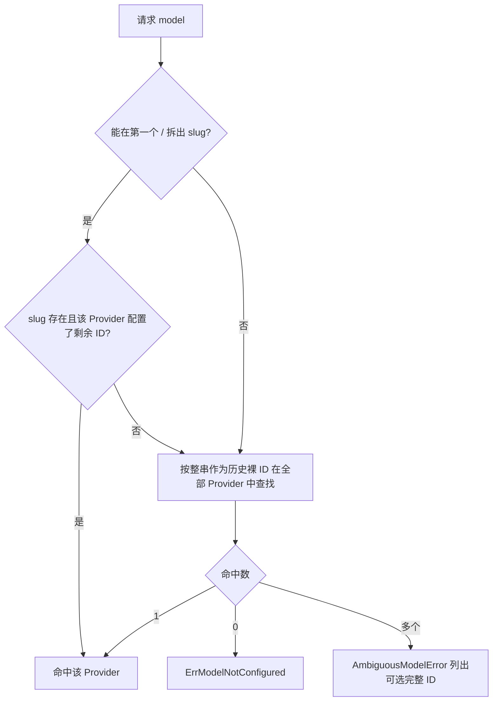
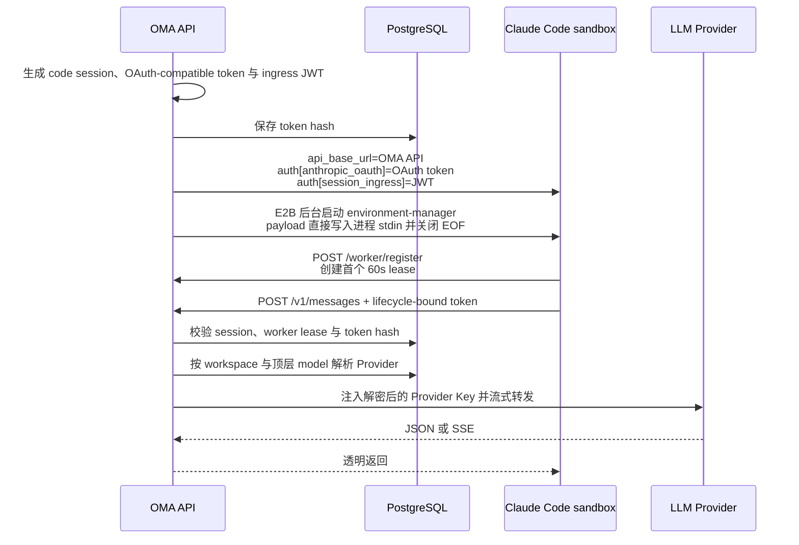
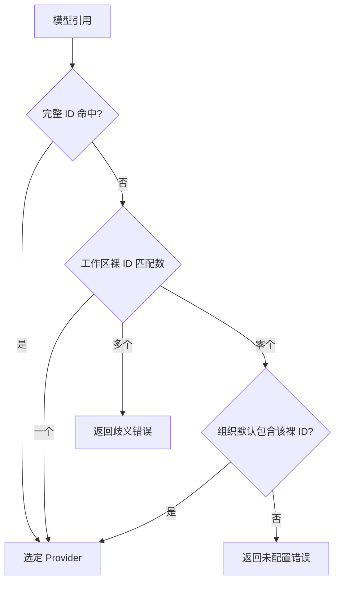

# Workspace BYOK 与 Messages 代理

## 配置模型

LLM 上游不是进程级 YAML。每个 workspace 可以配置多个 Provider；每个 Provider 保存：

- `name`：可修改的展示名称，同一 workspace 内唯一；
- `slug`：模型命名空间，同一 workspace 内唯一，创建后不可修改；
- `base_url`
- `api_backend`：`messages` 或 `chat_completions`；已有 Provider 通过迁移 86 回填为 `messages`。创建省略时默认 `messages`，更新省略时保留当前值，其他值包括 `responses` 返回 `api_backend_invalid`。
- Vault 信封加密的 `api_key`
- 零个或多个真实 `model_ids`

`model_ids` 保存上游真实 ID。同一 workspace 内不同 Provider 可以配置同名模型；对外暴露的模型 ID 是带 Provider 前缀的 `{slug}/{upstream_model_id}`，详见下文「模型命名与解析」。OMA 不提供 `claude-*` 别名或默认 Anthropic 回退。

## 模型命名与解析

`slug` 必须匹配 `^[a-z0-9][a-z0-9._-]{0,31}$`，因此不含 `/`。完整模型 ID 只在**第一个** `/` 处拆分：前半段是 slug，剩余部分原样作为上游模型 ID，上游 ID 自身可以继续包含 `/`。

| 完整模型 ID | slug | 上游模型 ID |
| --- | --- | --- |
| `oma/kimi-k2.5` | `oma` | `kimi-k2.5` |
| `oma/deepseek-ai/deepseek-v4.1-flash` | `oma` | `deepseek-ai/deepseek-v4.1-flash` |

创建 Provider 时可传入 `slug`；省略或为空时服务端选择当前 workspace 中第一个未占用的 `default`、`default-2`、`default-3`……。更新请求可以省略 `slug` 或回传相同值，传入不同值返回 `400 llm_provider_slug_immutable`，避免已保存的 Agent 引用失效。格式非法返回 `400 llm_provider_slug_invalid`，重复返回 `409 llm_provider_slug_conflict`。

`llmproviders.Catalog.Lookup` 是唯一解析入口，Messages、Chat Completions、Batches、Workbench、管理后台代理、Agent 与 Session 模型覆盖、Brain `models` 都通过它解析：



- 带前缀的匹配优先。即使某个 slug 恰好等于历史裸 ID 的第一段，例如 slug `deepseek-ai` 与 `deepseek-ai/xxx`，也按「slug + 上游 ID」解析。
- 历史裸 ID 长期兼容：外部 SDK 和脚本仍可使用 `kimi-k2.5`，只要它在 workspace 内只属于一个 Provider。被多个 Provider 配置时返回 `400 invalid_request_error`，消息列出可用的完整 ID，引导调用方迁移。Batch 在提交校验时把顶层 `params.model` 规范化为完整 ID 后入队，后续新增同名模型不会改变已接受请求的 Provider 归属；其他参数保留原始 JSON 字节。
- `GET /v1/models`、Workbench 模型列表和控制台目录只展示完整 ID。
- Agent 创建/更新与 Session 模型覆盖在写入时把能唯一解析的裸 ID 规范化为完整 ID 后保存，新数据不再出现裸 ID。
- Brain `models` 以完整 ID 为键；为兼容旧运行时配置，能唯一解析到同一上游 ID 的裸 ID 也作为键保留。

迁移 `00090_llm_provider_slug.sql` 在同一事务内完成存量兼容：

1. 每个 workspace 内按 `created_at, uuid` 排序为已有 Provider 回填 `default`、`default-2`……，再加上非空、格式检查与 `(organization_uuid, workspace_uuid, slug)` 唯一约束。
2. 迁移前模型 ID 在 workspace 内唯一，因此可以确定性地把引用改写为完整 ID：`agents.model`、`agent_versions.model`、`sessions.agent_snapshot.model` 与 `code_sessions.model`，对象形态改写 `id`，字符串形态整体替换。改写只改变表示，不增加 Agent 版本。
3. 指向已删除 Provider 或已移除模型的引用保持原样，行为与迁移前一致，运行时返回「模型未配置」。

后续数据迁移 `00091_pin_resume_and_batch_models.sql` 补齐 `code_sessions.worker_external_metadata.model` 与状态为 `queued` / `in_flight` 的 Batch 参数。Brain 会从恢复元数据读取模型并覆盖启动配置，因此恢复元数据必须使用完整 ID。迁移按 organization/workspace 唯一匹配裸 ID，保留歧义、孤儿、空值及已可解析的完整 ID，同时保留其他元数据和请求参数；已完成的 Batch 结果不改写。迁移重复执行不会再次添加前缀，Down 不还原已规范化的引用。Provider 配置已产生歧义的历史裸 ID 需要显式修正，迁移不猜测其原始归属。

迁移与新代码需要一起发布：旧版本服务无法解析带前缀的 ID。Down 迁移只删除 `slug` 列与约束，不回滚已改写的模型引用。

进程 YAML 不再包含 `anthropic_upstream`。上游地址和 Key 来自工作区 Provider 或组织默认 Provider。

控制台入口为「LLM 模型」，API 为：

```text
GET    /api/console/organizations/{orgUuid}/workspaces/{workspaceId}/llm_providers
POST   /api/console/organizations/{orgUuid}/workspaces/{workspaceId}/llm_providers
PUT    /api/console/organizations/{orgUuid}/workspaces/{workspaceId}/llm_providers/{providerId}
DELETE /api/console/organizations/{orgUuid}/workspaces/{workspaceId}/llm_providers/{providerId}
```

工作区 Provider 读取接口允许工作区成员只读访问；写入、预览和同步只允许组织管理员访问。读取接口只返回 `has_api_key` 与 `api_key_last4`，不返回明文 Key。更新时省略或留空 `api_key` 表示保留原 Key。

控制台在「获取模型列表」时可通过下列接口向该网关请求模型列表，而不会把 Key 回写到响应里：

```text
POST   /api/console/organizations/{orgUuid}/workspaces/{workspaceId}/llm_providers/preview_models
POST   /api/console/organizations/{orgUuid}/workspaces/{workspaceId}/llm_providers/{providerId}/models/sync
```

`preview_models` 接受可选的 `api_backend`，省略时按 `messages` 处理。`models/sync` 使用已存储的 backend。Chat Completions 的模型发现只发送 Bearer，不发送 Anthropic 头。

`messages` backend 的 `preview_models` 用请求里的 `base_url` 和 `api_key` 调用上游 `{base_url}/v1/models`，只返回 `model_ids`。请求同时带 `X-Api-Key`、`Authorization: Bearer` 和 `anthropic-version`，兼容 Anthropic 与智谱等只认 Bearer 的网关。`data: []` 是合法空列表；缺少 `data`、`success:false` 或带 `error` 的信封视为失败。

`models/sync` 解密已保存的 Key，始终保留该 Provider 已保存的模型，再把上游新发现的 ID 去重、合并并应用 100 个模型的上限。其他 Provider 是否配置同名模型不影响同步结果。上游失败返回 `502`，不改写现有配置。

Provider 控制台错误响应包含稳定的 `code`，前端不得依赖英文 `message` 判断错误。例如：

```json
{
  "error": "invalid_request",
  "code": "llm_provider_slug_conflict",
  "message": "provider slug already exists"
}
```

`base_url` 必须是绝对 HTTP 或 HTTPS URL，且不得包含 userinfo、query 或 fragment。允许 localhost、私网地址和自定义端口，因为这是 workspace 管理员配置的网关，不是沙箱选择的任意目标。Code-session CONNECT 代理仍使用独立的公网 SSRF 边界。代理客户端不跟随重定向，避免把 Provider Key 发到另一个主机。

## HTTP 契约

Anthropic Messages 规范入口为：

```text
POST /v1/messages
```

handler 通过 `http.MaxBytesReader` 把请求体限制为 32 MiB，并在转发前将这段有界请求体读入内存。完整扫描顶层对象可以确认 `model` 恰好出现一次，避免不同 JSON 解析器对重复键取值不同而绕过 Provider 白名单。解析出 Provider 后，只把顶层 `model` 的值字节替换为上游模型 ID（例如 `oma/kimi-k2.5` → `kimi-k2.5`），其余字节保持原样；请求已使用上游 ID 时不复制 body。另一处改写是下文的托管会话文件引用边界。上游响应中的 `model` 不回写为带前缀的 ID。响应 body 继续逐块流式转发，不做整包缓冲。

托管会话绑定的 Code Session 模型凭据存在一个文件引用边界：在访问上游前，OMA 解析 `messages[].content` 及嵌套 `tool_result.content` 中 document/image 的 `source.type=file`。文件按凭据所属 workspace 查询；同 workspace 的文件可在明确引用时复用，scope 元数据不引入额外的会话授权限制。Files 中找不到时回退到凭据所属 public Session 的 `user.message` 私有附件（见 [message-media-attachments](message-media-attachments.md)），其他 Session 的附件视为不存在。已删除、缺失或跨 workspace 引用返回相同的404，不向模型发送不透明的本地 file_id。普通 API key / 平台调用保持原始请求字节透传，允许其使用 Provider 自己的文件引用。

读取仅限于配置的文件对象存储，核验长度和SHA256，不通过外部URL下载。text/plain 文档在未启用引用时采用与 Brain 内联文档相同的带 title/context 边界的文本表示；开启 citations 时保留原生 document/source.text。PDF和图片转换为对应 MIME 的原生 base64 source；不匹配的类型、非UTF-8文本及超过有界模型请求尺寸的文件在推理前明确拒绝，不截断文件内容。原始公开会话事件、file_id及历史不改写，文件读取结果仅用于当前模型请求。


顶层 `model` 必须是没有首尾空白的非空字符串；服务端不会通过 trim 把另一个输入静默归一化为已配置模型。

同时执行以下边界处理：

- 删除调用方的 `Authorization`、`X-Api-Key`、`Cookie`、组织/workspace 内部 header 和 hop-by-hop header；
- 解密该模型所属 Provider 的 Key，同时注入为上游 `X-Api-Key` 和 `Authorization: Bearer`；
- 把顶层 `model` 替换为该 Provider 的上游模型 ID；
- 将请求发往 `{provider.base_url}/v1/messages`；
- 透传上游状态码、响应 body、SSE 数据和限流等响应 header；Code Session 上游 401 按下述失败语义转换；
- SSE 响应逐块 flush，并关闭代理缓冲；
- 请求 body 上限为 32 MiB。

管理后台继续使用原平台路径 `POST /api/organizations/{orgUuid}/proxy/v1/messages`。该路由及其独立代理实现不作为 `/v1/messages` 的兼容别名，也不承载 Claude Code 的 session-scoped token。它与公共 Messages 入口走同一条 Provider 解析、唯一顶层 `model` 校验、顶层 `model` 替换和 32 MiB 请求上限。Batches 在逐条发送时、Workbench 在构造上游请求时执行相同替换。

`GET /v1/models` 保留 Anthropic 列表信封的 `data`、`has_more`、`first_id` 与 `last_id`。列表内容是当前工作区和组织默认配置的完整模型 ID `{slug}/{upstream_model_id}`；由于 Provider 配置不维护能力目录，`display_name` 使用模型 ID，`created_at` 使用 Unix epoch，token 上限与 `capabilities` 显式返回 `null`。已有 Provider 但尚无模型时返回 `200`、`data: []` 和空游标；未配置 Provider 时返回 `503` 与英文消息 `This workspace has no LLM provider configured`；配置读取失败时返回 `500` 与英文消息 `Workspace model configuration is unavailable`。不额外返回机器可读 `error.code`。

服务端不提供 `/v1/code/sessions/{code_session_id}/bridge`。managed-agent 在创建 code session 时直接获得 OAuth FD、WebSocket FD 和初始 worker epoch；后续 worker 所有权切换统一使用 `/worker/register`。

## 鉴权与权限

| 凭证                                | 可访问 `POST /v1/messages` | 其他 `/v1/*`  | 模型约束   |
| ----------------------------------- | -------------------------- | ------------- | ---------- |
| workspace API key                   | 是                         | 按原 API 权限 | 无额外约束 |
| platform `sessionKey` cookie        | 是                         | 按原平台权限  | 无额外约束 |
| code-session OAuth-compatible token | 是                         | 否            | 无额外约束 |

code-session token 只有在以下条件全部满足时才通过鉴权：

- token SHA-256 hash 命中 `code_sessions.oauth_access_token_hash`；
- public session 未终止、未删除，code session 为 `active` 且未删除；
- CCR v2 `worker_lease_expires_at > now()`；
- 请求方法和路径严格对应 `POST /v1/messages`。

environment-manager 在启动 Claude Code 前调用 `/worker/register`，建立首个 60 秒 lease；Claude 之后每 20 秒调用 `/worker/heartbeat` 续租。Claude 异常退出时不再续租，OAuth-compatible Messages 凭证最多在最后一个 lease TTL 内继续有效。session-ingress JWT 校验签名、固定 claims 和请求路径绑定；managed-agent JWT 还携带 `worker_epoch`，入口会按租户回查 active Code Session 的 `current_worker_epoch`。heartbeat grace 和 OTLP active lease 仍由各自 handler 的状态机判断；OTLP 不读取单独的 epoch header。

code-session 请求来自受信任的沙箱调用方。公共 Messages 入口完整扫描有界请求体的顶层对象，只读取唯一的 `model` 以选择 Provider；其余字段仍由上游按 Anthropic Messages 合同校验。本服务负责入口鉴权、请求大小限制、header 清洗、Provider 解析和响应流式代理。

Claude Code 所需的 `ANTHROPIC_MODEL` 等变量名保留，值为 Agent 保存的完整模型 ID（`{slug}/{upstream_model_id}`）；Worker 用该值调用 OMA，由 OMA 在转发前替换为上游 ID。Provider Key 不进入 sandbox。
Runner 在 Worker 启动环境中固定设置 `CLAUDE_CODE_DISABLE_TERMINAL_TITLE=1`。在支持的 Claude Code 2.1.251 中，这会跳过 Agent SDK/headless 模式的后台标题生成请求，避免其 JSON 响应被 Messages 代理记录为公开 `agent.message`；显式创建或更新 Session 的 `title` API 不受影响。该变量独立于 `CLAUDE_CODE_DISABLE_NONESSENTIAL_TRAFFIC`，因此启用 OTLP 时仍生效。

Agent PATCH 只有在请求显式携带 `model` 时才校验新模型；只修改名称、描述等字段时原样保留旧模型，即使管理员已经从 Provider 删除了该模型。这样旧 Agent 仍可通过后续 PATCH 切换到有效模型；实际运行仍按当前 Provider 配置失败关闭。

## 凭证生命周期与持久化

创建 managed-agent code session 时生成随机 `sk-ant-oat01-...` token。数据库只保存 hash，不保存明文或独立过期时间：

- `oauth_access_token_hash text`；
- 未删除记录的非空 hash 具有唯一索引。

OAuth-compatible token 没有 11 分钟或 8 小时墙钟上限，但每次 `/v1/messages` 鉴权仍复核 active code session、未 terminated 的 public session 和 worker lease。managed-agent 启动时签发的 session-ingress JWT 也不写入独立 `exp`；它复用现有 worker epoch 支持 fencing：Code Session 终止或 Sandbox 恢复递增 epoch 后，携带旧 epoch 的 JWT 在下一次请求时失效。worker lease 是否有效仍由具体 ingress handler 判断，不在 JWT 鉴权阶段统一要求。

进程启动时只创建一份 `SessionCredentials`。启动组合根把它注入 API server，并用它构造 environment runner 所需的 code-session service；Runner 通过 `RunnerDependencies` 接收这个最终 service，不自行读取密钥或生成临时签名器。密钥配置错误和 Runner 缺少依赖都会在 worker 启动前返回错误，保证签发端与验签端使用同一套密钥。

## 启动与调用流程



`environment-manager` 的 `auth[type=anthropic_oauth]` 使用 lifecycle-bound OAuth-compatible token；`auth[type=session_ingress]` 使用自包含的 `sk-ant-si-<JWT>`。前者只访问 `/v1/messages`，后者供 worker、relay 与 upstream proxy 使用。启动 payload 不再包含 `auth[type=anthropic_api]` 或 `CLAUDE_CODE_SESSION_ACCESS_TOKEN`，避免环境变量遮蔽 WebSocket FD。Runner 创建 Cloud Session Sandbox 后，先等待 rclone-filestore 配置中的全部挂载 ready（五个固定盘，加上 Session 快照中的 N 个 memory mount），并最多重试三次删除临时 Token 配置；其中 `/uploads` namespace 已整体只读挂载到 `/mnt/session/uploads`，不执行逐文件 projection。随后把 sandbox 标记为 `running`、建立首个 environment work heartbeat，才创建 local Code Session 并通过 E2B 后台进程 API 启动 environment-manager、按 PID 直接发送并关闭 stdin。environment-manager 启动失败时 Runner 立即终止该 Code Session；启动成功后才以一个数据库事务把 runtime metadata 发布到 Session 和 Environment Work。environment-manager 在启动 Claude 前 register CCR worker。work heartbeat 只维护 environment 租约，不参与 code-session token 鉴权。payload 不写入沙箱文件系统，发送或关闭失败时终止未完整初始化的进程。

Managed Agent 的 initialize 控制事件把 Agent snapshot 中的 `system` 原样映射为 `systemPrompt`，并通过 `appendSystemPrompt` 追加 OMA 管理的 sandbox 文件合同。追加提示只描述环境，不替代 Agent 角色；它告诉 Claude 使用真实 sandbox 路径访问上传文件、把用户交付物写入输出挂载，并明确禁止根据 `file_id` 猜测或重建文件路径。该合同是所有 Session 共用的静态文本，不拼接资源清单、文件 ID、Memory Store 名称、挂载路径或记忆策略，以保持稳定的 prompt cache 前缀；记忆目录含义只写在沙箱本地的 `/mnt/memory/MEMORY.md`。它由 OMA 的 Session 启动配置统一注入，不依赖 CCRv2 模式切换。

## 失败语义

- workspace 和组织均没有 Provider：`503 api_error`，英文消息 `This workspace has no LLM provider configured`；
- 请求模型未配置：`400 invalid_request_error`；
- 历史裸 ID 被多个 Provider 配置：`400 invalid_request_error`，消息列出可选完整 ID；
- Key 解密失败、Provider 数据损坏或配置读取失败：`500 api_error`，英文消息 `Workspace model configuration is unavailable`；失败关闭，不回退；
- 上游地址或网络不可用：`502 api_error`；
- 请求超过 32 MiB：`413 request_too_large`；
- token 无效、session 终止、worker lease 过期或用在其他资源：`401 authentication_error`；
- Code Session 已通过本地鉴权，但上游拒绝 Provider 凭据：将上游 `401` 转为 `403 permission_error`，消息为 `Messages upstream rejected its configured credentials`，并设置 `X-Should-Retry: false`。不转发上游 body、`WWW-Authenticate` 或 `Retry-After`，避免 Claude Code 将 Provider 凭据错误当成自身 OAuth token 失效并进入凭据恢复等待。模型请求 span 仍记录 `http_error` 和上游 request ID；失败结果与 idle 仍由真实 Worker 协议推进；
- 普通 API key、平台 cookie 调用的上游非 2xx，以及 Code Session 的其他上游非 2xx 状态和 body：原样透传。

所有本地生成的错误继续通过 `internal/httpapi.WriteError` 返回 Anthropic 兼容结构。

## 最小实现边界

- 不建独立 Model 表；`model_ids` 直接存 Provider JSON 数组，只保存上游 ID，不带前缀。同名模型可分属不同 Provider，因此写入不再需要跨 Provider 的归属检查或 advisory lock；slug 唯一性由数据库唯一约束保证，并发冲突返回 `409 llm_provider_slug_conflict`。
- 工作区 Provider 的读写同时绑定 `organization_uuid` 和 `workspace_uuid`；组织默认 Provider 的读写绑定 `organization_uuid` 并限定 `workspace_uuid IS NULL`。两种范围分别查询，不能省略组织过滤。
- 不加缓存；删除或修改 Provider 立即生效。
- 不建立只有单实现的 Resolver 接口；调用方直接使用 `internal/llmproviders`。

## 验收覆盖

- `tests/messages_api_test.go`：缺少 Provider、未配置模型、跨资源使用、未 register、lease 过期、public session 终止、长时间运行、普通 API key、平台 cookie、header 清洗与响应 header 透传；
- `internal/messages/handler_test.go`：有界缓冲后保留原始请求体，并拒绝重复顶层 `model`；
- `internal/llmproviders/model_ref_test.go`：slug 校验、首个 `/` 拆分、`default-N` 选择、完整/历史 ID 解析与歧义、顶层 `model` 字节级替换；
- `internal/db/llm_provider_slug_migration_postgres_test.go`：真实 PostgreSQL 上的 slug 回填、引用改写、歧义与孤儿引用保留、唯一与格式约束；
- `internal/db/resume_batch_models_migration_postgres_test.go`：真实 PostgreSQL 上的 Brain 恢复模型、待执行 Batch 模型、租户隔离、未知与完整引用保留，以及重复迁移；`internal/batches/model_normalization_test.go` 验证入队规范化、非模型参数保留，以及新增同名模型后原 Provider 归属不变；
- `tests/messages_upstream_auth_test.go`：三种上游 401 body 的 Worker 错误转换、不可重试 header、模型 span，以及普通 API key 调用的原始响应；
- `tests/liveworker/chat_upstream_errors_test.go`：公开 Runner 通过 environment-manager 的真实 OAuth FD 启动 Worker，两种持续上游 401 在 90 秒内产生 `session.error`、以 `retries_exhausted` 自然 idle 并清空队列，不生成助手回复；
- `tests/session_worker_error_status_test.go`：失败结果不提前结束 Session、API 错误消息不公开、失败 idle 原因和重复报告幂等，以及下一轮成功恢复 `end_turn`；
- `tests/llm_providers_api_test.go`：workspace Provider CRUD、slug 默认值/冲突/不可变、并发 slug 唯一、同名模型按 slug 解析、空模型转换、Key 加密、模型发现与同步；
- `tests/models_api_test.go`：`GET /v1/models` 返回完整模型 ID，并区分空 Provider 列表与空模型列表；
- `tests/platform_proxy_directory_api_test.go`：管理后台原有独立路径的 JSON 与 SSE 转发；
- `internal/environments/environment_manager_test.go`：沙箱 payload 不含上游 key 或 Claude 凭证环境变量，api base URL 和 lifecycle-bound token auth 正确，启动 payload 会被删除；
- `tests/environments_runner_cloud_test.go`：真实 runner 组装出的 runtime payload 使用 session-scoped token，并在 initialize 事件中携带 Agent system prompt 与 OMA append system prompt；
- `tests/environments_full_e2b_bridge_integration_test.go`：真实 E2B 中验证 Files API 上传、只读 uploads 挂载、Agent 生成 outputs、session 文件 Catalog 和 Files API 下载闭环。
- `tests/environments_memory_sandbox_e2e_test.go`：真实 E2B 中验证 initialize `appendSystemPrompt` 不含记忆策略，记忆说明只出现在沙箱 `/mnt/memory/MEMORY.md`。

## Brain Chat Completions

`POST /v1/chat/completions` 只接受有效的 code-session model token，且对应会话的
`metadata.config.worker_transport` 必须为 `claim`。workspace API key、平台会话、Sandbox 模式
code session 和过期 worker lease 均不能使用该入口。复用现有 token hash、租户与 active session
校验，不向 Worker 下发 Provider Key。鉴权通过后若会话已删除，transport 查询返回 not found 时仍返回
401 `authentication_error` / `Invalid API key`；其他 transport 查询故障保持 500。Responses 暂不支持，也不注册对应路由。

入口只支持 Brain 所需的 `stream=true` 和 `n=1`，省略 `n` 等价于 1。它不是完整的公共 OpenAI API。
请求仍执行唯一顶层 model 校验与 32 MiB 上限，并按模型所属 Provider 的 `api_backend` 校验路由。
`messages` 模型不能调用 Chat Completions；Chat Completions 模型也不能调用 Messages、Batches、
Workbench 或管理后台 Messages 代理。未支持入口显式拒绝，不进行协议转换或自动回退。
Workbench 的 backend mismatch 返回 400 `invalid_request_error`，公开文案说明入口协议限制与重新加载会话要求。

Base URL 保持 API 根地址合同。最终地址为 `{base_url}/v1/chat/completions`，保留已有路径前缀；
调用方不要在 Base URL 中再添加 `/v1`。上游只使用服务端 Bearer Key，删除 Anthropic 专属请求头。
响应原始 SSE 字节流透传，保持取消、flush、无代理缓冲和禁止重定向。OMA `Request-Id` 仍等于模型
请求 start ID，上游 `Request-Id` 或 `X-Request-Id` 单独记录。

共用请求生命周期和 model request end 持久化。Go observer 只承担代理侧公开事件和用量观察，
不替代 Brain 模型适配器的协议转换。Brain 与 Go 各自解析同一份 Chat 响应，二者必须遵守
同一组规则，事件 ID 才能在实时预览与持久化消息之间去重：

- SSE 事件：按完整事件（以空行结束）解析，同一事件的多行 `data:` 按规范以换行拼接后再解析 JSON。
- reasoning 字段：每个 delta 依次检查 `reasoning_content`、`reasoning`、`reasoning_text`，
  取第一个非空字符串，映射为 thinking；空字符串视为缺失。Go 由 `firstChatReasoning` 实现，
  Brain 在代理 fetch 中把响应规范化为只含 `reasoning_content` 的 delta 后交给 AI SDK。
- 内容索引：thinking、文本和各工具按首次出现顺序分配；同一 delta 内依次处理 reasoning、
  正文、工具调用，与 AI SDK provider 的输出顺序及“先推理后正文”的模型语义一致。
  上游 tool index 范围仍为 0–1023，用于定位对应工具。
- 工具索引：工具块在其 tool index 首次出现非空名称时才分配内容索引，与 AI SDK provider
  取得工具名后才创建工具块的行为一致。名称到达前的工具 ID 与参数分片按 tool index 暂存，
  分配后合并；结束时仍有未取得名称的工具视为无效响应。

工具 ID、名称采用首次非空值，参数按分片累积。

正常结束要求有效 `finish_reason`，支持 `[DONE]` 或有效结束原因后的正常 EOF，usage 尾帧继续读取。
只有 EOF 而没有 finish reason 的断流仍失败，Brain 侧同样要求有效结束原因。
`TestBrainChatCompletionsProxyLifecycle` 的截断 fixture 不发送 finish reason；有效结束原因后的正常 EOF 由 `TestChatObservationFinishAtEOF` 覆盖。
`stop`、`length` 只用于无工具响应，`tool_calls` 必须存在工具调用；过滤、拒绝、未知结束原因
和异常断流不能记为成功。单帧及累计公开内容保留 4 MiB 观察上限。

用量仅来自实际上游 usage，缺失时不补零。`completion_tokens` 映射为输出 token；
`prompt_tokens_details.cached_tokens` 映射为缓存读取，非缓存输入为 prompt tokens 减去缓存读取，
与现有 Anthropic 分项统计保持一致。缓存数超过输入数或负数属于畸形响应。

普通单测与 PostgreSQL/httptest 合同测试入口：
`internal/messages/chat_observation_test.go`、`internal/llmproviders/backends_test.go`、
`tests/chat_completions_api_test.go`。覆盖 backend 的存取、默认与更新保留、模型发现请求头、
Brain 凭据限制、协议拒绝、错误与断流收尾、稳定消息 ID、缓存用量和 lease 失效。
真实 Worker/上游集成需另行明确授权后按 verify-be 工作流执行，普通测试不代表该验收通过。

## 组织默认 Provider

组织管理员可在组织设置的「LLM 配置」中管理一个跨工作区共享的默认 Provider。它与工作区 Provider 使用同一张 `llm_providers` 表，`workspace_uuid` 为 NULL，slug 固定为 `organization`；组织级部分唯一索引保证每个组织最多一条。支持 `messages` 与 `chat_completions`，复用现有密钥加密、URL 校验和模型同步。



显式 `organization/{model}` 选择组织默认；裸模型 ID 优先使用工作区 Provider，组织默认不增加工作区歧义计数。`/v1/models`、Workbench、Agent、Session、Batches 和 Brain backend 目录使用相同的合并目录。两个来源的同名模型以不同完整 ID 保留；组织配置读取失败时调用链失败关闭，不静默跳过组织 Provider。

Console API（相对 `/api/console/organizations/{orgUuid}`）：

| 方法 | 路径 | 权限 |
| --- | --- | --- |
| GET | `/llm_provider` | 当前组织成员只读 |
| PUT / DELETE | `/llm_provider` | 组织管理员 |
| POST | `/llm_provider/preview_models` | 组织管理员 |
| POST | `/llm_provider/models/sync` | 组织管理员 |

组织模型预览不依赖工作区。读取只返回 Key 是否存在及末四位，PUT 省略或留空 Key 保留旧密钥；首次创建返回 201，更新返回 200，不存在返回 404。组织 Provider 不混入工作区 Provider 管理 API 的列表。

迁移 `00094_organization_llm_provider.sql` 从主干版本 91 追加升级，不修改已有迁移。已有工作区 slug `organization` 改为当前空间中第一个未占用的 `organization-N`，同步改写 `agents.model`、`agent_versions.model`，以及 `sessions`、`session_threads`、`deployments`、`deployment_runs` 的 `agent_snapshot` 顶层模型；同时改写 Agent、版本的 `multiagent` 列与上述快照中的 `multiagent.advisor.model`，并递归处理展开 roster（`multiagent.agents`、`multiagent.subagents.predefined_agents`、`multiagent.workflows.predefined_agents`）内嵌的模型引用。Code Session 模型与恢复元数据、queued / in_flight Batch 的对应完整引用也同步改写。改写仅作用于发生 slug 变更的组织和工作区，支持字符串及对象模型，保留模型的其他字段、roster 顺序和其他 JSON 内容；`metadata.model`、无关引用、其他租户数据与已完成 Batch 不改写。外部调用方若使用旧 `organization/{model}`，需改用迁移后的工作区 slug。Down 删除组织 Provider 及索引并恢复 workspace 非空，不回退已经改名的工作区 slug 和引用；回退前需备份组织配置。

组织 Provider 的通用 API 和配置不包含任何公司网关预设、公司控制台链接或专属域名。

## Brain 压缩摘要请求

已认证 Worker 可用内部 header `X-OMA-Model-Purpose: compaction` 标记辅助摘要请求。Messages 和 Chat Completions 都继续执行模型路由、权限/epoch 校验、请求 span 和 usage 记账，但不把摘要输出映射成公开 assistant、thinking 或 tool 事件，也不向 span 添加这些公开事件 ID。普通请求保持原有投影行为；内部 header 不转发给上游。实际压缩结果仍由 DSH 私有日志和 CCRv2 的 `agent.thread_context_compacted` 通知表达。

`TestCompactionObservationKeepsUsageWithoutPublicAssistantEvents` 覆盖两种协议的辅助/普通响应与 usage，`TestCompactionPurposeHeaderDoesNotReachUpstream` 覆盖 header 清理。`chat brain-compaction` 在真实代理链路中要求普通回复计数准确，从而拒绝摘要正文混入公开历史。
