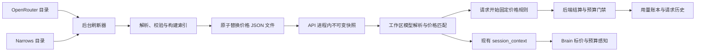

# 模型标价旁路更新与 Brain 读取方案

状态：已实现，验收结果见关联 PR 评论。日期：2026-10-22。

基线为 [PR #384](https://github.com/superduck-ai/open-managed-agents/pull/384) 的 `b6d92f5019155f2cf30fb8b2a51a75ff3a24d6d7`，本次在其上增量实现。

## 现状与结论

PR 中 `main.go` 在数据库初始化后、HTTP 服务启动前同步执行价格拉取。`internal/pricing/openrouter.go` 每次请求最多等待 15 秒、最多读取 8 MiB，随后事务替换 `model_price_catalog`；没有周期刷新。失败保留旧目录，但网络等待仍在启动路径上。

`internal/db/model_prices.go` 同时负责读取工作区供应商、匹配目录、构造计费器。模型请求开始时读取并固定规则快照，结束时写入费用与快照。应拆开“供应商配置查询”和“公共标价目录存储”，保留已有请求快照及历史金额语义。

最新提交还包含 Narrows 价格源，尽管 PR 描述仍写着不接 Narrows。按已确认范围，OpenRouter 和 Narrows 的当前标价目录一起迁移到同一份 JSON 文件，均停止读写价格目录表，采用旁路刷新和内存读取。保留 Narrows 独立匹配、汇率和禁止跨来源回退的行为。

价格来源统一按实际模型路由解析得到的 Provider slug 选择：约定 Narrows Provider 使用 `narrows`，对应文件中的 `sources.narrows`；`default` 暂时兼容映射到 Narrows；其他 Provider 沿用 OpenRouter 参考价策略，对应 `sources.openrouter`。删除按网关域名选择来源的逻辑，不新增供应商类型字段。Narrows 价格获取地址仍为 `https://narrows.seewo.com/pricing/api/rules`。

AI 网关统一约定使用 `narrows`。已有 `default` 暂时路由到 Narrows 标价源，`default-2` 等不在兼容范围内。该映射只选择价格源，不修改模型上游地址；不自动改写现有 Provider slug、模型引用或历史账本身份。新建 AI 网关时在现有 Provider 表单显式填写 `narrows`。

Brain 的现状：

| 能力 | PR #384 最新代码 |
| --- | --- |
| Brain 模型调用纳入会话预算 | 已接入后端路径。Messages 和 Chat Completions 共用模型请求开始、结束及预算门禁 |
| 预算触顶后阻止后续模型调用 | 后端已有；开始事件写入处检查 `budget_reached_at` |
| Brain 主动读取预算、已用金额、剩余额度 | 未看到相应运行时字段或读取逻辑 |
| Brain 读取模型标价 | 未实现；`resolveModel` 只返回 provider、id、name |
| Brain 将触顶识别为预算暂停 | 未见专用映射，当前走通用模型错误转换，需要补齐并验证 |

因此，Brain 会话已有服务端预算约束，但尚不能称为 Brain 自身完整支持预算感知和标价读取。下文实现补齐上下文读取和错误识别，服务端仍负责最终执行门禁。

## 一、旁路更新与读取路径

采用后台刷新器、一个 JSON 快照文件、进程内不可变索引。后台刷新器由服务生命周期管理；无须为了该功能引入 River 任务、价格任务表或消息队列。

读取流程：

1. 启动只读取本地文件，校验成功后一次性构建完整 ID 索引和唯一短名索引。文件缺失或损坏不阻塞整个服务启动，价格状态为不可用。
2. HTTP 服务启动不等待外部价格源。后台发现文件缺失或已到刷新时间时立即尝试更新；有效且未到期的文件直接复用。
3. 模型请求、预算校验和 Brain 上下文均从同一内存快照匹配价格，不在请求路径读文件、不访问 OpenRouter 或 Narrows、不查询价格目录表。
4. 工作区供应商、权限与模型身份仍读取现有配置数据；“标价不查库”不意味着整个请求不查库。
5. 成功更新文件后才切换内存快照。已经开始的请求继续持有旧规则，新的请求使用新规则。

两个来源独立记录刷新时间和退避状态。默认参数：每个来源每 6 小时刷新一次，加 10% 抖动；单次 HTTP 超时 15 秒，响应限制沿用 8 MiB；失败按 1 分钟、5 分钟、30 分钟、1 小时退避，成功后回到正常周期。每个来源只允许一个在途拉取，不因缺价请求重复触发下载。参数属于本方案建议，并非价格源要求。

一个来源成功后，只替换其 `sources.openrouter` 或 `sources.narrows` 段，保留另一个来源最近成功的数据；一个来源失败不阻止另一个来源发布。两个来源共用串行文件发布入口，每次从最新已发布快照合并结果后原子写入，避免并发完成时覆盖对方刚更新的目录。

更新必须先完成全部解析、重复模型检查、金额和条件规则检查，再写入目标目录内的临时文件，完成 flush/fsync、关闭和原子 rename，随后切换内存指针。临时文件写入失败或校验失败不覆盖旧文件，也不发布新内存版本。临时文件只用于原子提交，不维护多份历史目录。

保留上次成功快照，不因刷新失败清空目录。成功日志记录来源、版本、最后成功更新时间和条目数，失败日志记录连续失败次数。Brain 上下文提供获取时间和缺价 null，调用方可计算年龄；仍有效的旧价不会自动变成零价或不可用。服务健康检查不依赖外部价格源。

## 二、文件格式与部署约束

配置 `pricing.snapshot_file` 指向持久目录下的 `model-prices.json`，默认 `./data/model-prices.json`，相对路径以配置文件所在目录为基准。它是整个部署的一份当前目录，内含各来源；生产目录不提交 Git，也不包含供应商密钥。

`sources.openrouter` 保存 OpenRouter 规则，`sources.narrows` 保存 Narrows 规则。Narrows 保留原币 CNY、现有固定汇率 `1 USD = 7.2 CNY`、分档边界与规则顺序；先按原币有理数计算，再换算为 USD 并执行原有舍入。无法区分的思考、图像输出及隐式缓存仍标为未知，迁移存储不改变计价语义。

文件内容约定：

| 字段 | 语义 |
| --- | --- |
| `schema_version` | 文件合同版本；不认识的版本拒绝加载 |
| `sources` | 按来源保存各自最近成功目录，某来源失败不删除其他来源 |
| `sources.<source>.fetched_at` | 此来源最近一次成功获取时间 |
| `sources.<source>.revision` | 规范化后价格内容摘要，不包含获取时间 |
| `sources.<source>.models` | 原始完整模型 ID 到价格条目的映射 |
| 每个条目的 `price.version`、`price.rates`、`price.overrides` | 条目内容版本、规范化单价及有序条件规则 |
| 每个条目的来源信息 | 来源模型、原币种、必要汇率及原始 pricing 字段 |

单价使用十进制字符串，保持现有每百万 Token 单位和有理数结算。明确的 `0` 是免费，缺字段和来源 `-1` 是未知。保留缓存读、通用写入、5 分钟写入、1 小时写入和条件价格，不把目录压缩成仅输入、输出两个浮点数。官方目录入口见 [OpenRouter 模型 API](https://openrouter.ai/docs/api/api-reference/models/list-all-models-and-their-properties)。

条目版本沿用来源解析器的规则摘要，与来源模型、币种及汇率共同标识规则；整个来源的 revision 覆盖完整条目。文件 schema 或计算语义变更另用合同／计费版本表达。内容未变时条目版本不变，获取时间可以更新。请求开始时间单独记录，不能复用目录获取时间来判断时段价格。

多实例必须明确文件共享方式：

- 单实例：本机持久卷，一个后台刷新器即可。
- 多实例且要求一份文件：所有 API 实例挂载同一支持原子替换的共享目录，仅指定一个实例开启刷新，其他实例只读；只读实例每 30 秒重新读取文件，完整校验后切换快照。挂载目录而非固定文件 inode，避免 rename 后读不到新文件。
- 写入实例退出时读者继续使用旧快照，由部署侧切换写入角色。本期不加入数据库选主或分布式锁。
- 不同主机的独立本地磁盘不能自动构成“一份文件”。若部署没有共享卷，则需改为每实例缓存并接受短期版本差异，或另选文件分发方案；不能宣称已经全局一致。

共享文件与轮询提供最终一致性，不承诺所有实例同时切换。每个请求以自己固定的价格版本结算，历史可追溯；若以后要求全局同一时刻生效，需要额外发布协议，不属于本次最小方案。

## 三、缺价、更新与历史账目的边界

| 情况 | 行为 |
| --- | --- |
| 有旧快照，拉取超时／失败／返回非法内容 | 继续使用旧快照，记录刷新失败；上下文提供最近成功获取时间 |
| 冷启动无快照，后台还未成功 | 普通无预算请求可执行，记录未定价；创建预算会话返回价格不可用 |
| 已有预算会话当前模型无价 | 在下一次上游调用前拒绝，并返回可区分的价格不可用原因；恢复价格后可重试 |
| 模型匹配歧义 | 不选任意候选，不模糊匹配日期或变体 |
| 成功新目录删除了某模型 | 新请求按缺价处理；不把被删除价格永久混入新目录 |
| 更新时有在途请求 | 在途请求使用开始时快照，新请求读取新快照 |
| 磁盘不可写或空间不足 | 本次更新失败，保留旧文件和旧内存版本 |

保留 `provider-slug/upstream-model` 业务身份；先通过现有路由解析实际 Provider，再按其 slug 选择价格源，匹配来源目录时使用上游模型 ID。不能直接截取未经解析的请求模型字符串来判定供应商。OpenRouter 完整 ID 优先，短名仅在完整目录内唯一时可用；Narrows 仅精确匹配。工作区未限定供应商的模型名仍须唯一。Narrows 缺价不回退到 OpenRouter。

“不再存数据库”限定为可重新获取的当前标价目录。会话预算、消费记录、已结算金额、每次请求所用的最小规则快照仍属于业务事实，继续保存在数据库。否则覆盖一个价格文件后，历史金额将失去解释依据，进程重启也不能恢复预算。只保留版本号而不保留规则，同时又不维护历史文件，不足以审计。

本次不调整逐请求美分舍入、不重算历史。PR 当前在缺失缓存单价时，预算计费有回退规则，而分析账本可保持未定价；该差异需要继续显式表达，不能在给 Brain 下发价格时默认为两者完全等价。

## 四、Brain 读取协议与预算行为

复用已有 `GET /v2/sessions/{id}` 的 `session_context`，新增结构化 `billing` 字段，不要求 Brain 挂载后端文件或直接拉取 OpenRouter、Narrows。两种来源统一通过该协议下发实际匹配的价格，包含 Narrows 原币种及换汇信息。这样 Brain 跨主机部署也可使用同源价格，并复用现有 ingress token、会话身份及线程权限校验。

`billing` 包含：

- `budget`：会话预算，未设置时为 null；金额仍是 USD 美分字符串。
- `usage`：后端累计 USD 金额；`observed_at` 提供查询时间，计算策略明确未知费用未参与汇总，不声称完整定价。
- `remaining`：有预算时的剩余额度，下限为 0；无预算为 null，避免与 0 混淆。
- `budget_reached`：来自后端当前预算状态，不能只看旧 idle 事件。
- `pricing`：本会话主模型及已配置子 Agent 模型的请求模型 ID、来源、源模型、版本、获取时间、单价、条件规则及可用状态。不下发整个工作区或全平台目录，也不暴露供应商凭据。
- `calculation_policy`：标明后端预算计算口径及必要的缺价回退语义，Brain 的估算不得冒充结算金额。

固定子 Agent 按其已授权线程模型解析，内联子 Agent 沿用父会话已允许的模型；新增模型必须经过现有模型／线程授权，不允许通过价格查询绕过配置边界。

Brain 在注册后读取初始值，并在现有每次模型调用前读取会话上下文的路径里刷新预算、标价和工具权限，合并重复读取。运行时在 `assignment.launch.billing` 保存带版本的价格信息，供调用方读取；本次不增加 Brain 独立费用计算器；价格缺失明确为未知。

预算执行职责仍在 Go 后端：

1. Brain 读到当前触顶状态后停止调度新的模型请求，保留已开始请求和必要工具结算。
2. 价格／预算读取与请求开始之间可能发生变化，所以后端在开始事件事务中继续做最终门禁。Brain 缓存仅用于提前感知，不能作为放行凭据。
3. 后端拒绝使用稳定的机器可读错误码区分 `session_budget_reached` 和 `model_price_unavailable`，保留既有 HTTP 400 预算语义及禁止自动重试信号；Brain 识别预算触顶后停止该轮，不发送通用失败或成功结果覆盖后端暂停；缺价则显示可恢复的明确错误，不把预算触顶当成普通传输故障重试。
4. 预算提高或移除后重新读取权威状态，允许后续输入启动新一轮；不能把旧的本地触顶状态永久缓存。
5. 主线程和子线程共用一个会话预算，不能各自在 Brain 内减一份余额。已经开始的并发请求仍可能让最终消费超过限额，这次不改成预扣款或严格额度预约。

Brain 在调用前读到的价格是当前参考快照，不保证和随后请求固定的版本相同。最终费用以服务端请求快照与账本为准；需要请求级展示时读取已有请求关联记录，不用 Brain 当前单价重算历史。

## 五、代码落点与实施顺序

1. 将 `internal/pricing` 对 `internal/db` 的目录类型依赖移出，OpenRouter 与 Narrows 解析器均改为输出独立目录类型，共用文件读写、内存索引与后台刷新能力；`internal/billing` 继续负责纯计算。
2. 将工作区供应商解析与公共价格匹配组装在资源／服务层，通过价格读取依赖注入预算校验、模型请求、普通 API 计量和 Workbench。移除 `DB.BillingCalculator()` 中的目录读取职责，避免只改会话入口而遗漏其他入口。
3. `main.go` 用本地加载和受 context 管理的后台任务替换同步网络拉取；配置、示例部署与停机逻辑同步调整。
4. 确认 OpenRouter 和 Narrows 均已切换到文件后，删除目录表的运行时 Mapper 和 CRUD。遵守已有 migration 不改写的规则：新增迁移移除不再使用的 `model_price_catalog`；旧手工价格表的数据清理不附带进行。保留 `usage_records` 与请求快照。切换前先准备包含两个来源的有效文件，避免已有预算会话冷启动缺价。
5. `internal/codesessions` 的会话上下文增加 `billing`；`oma-brain-dsh` 更新协议解析、运行时模型信息和预算暂停／恢复处理。
6. 更新 PR 中会话预算、分析成本及 Brain 设计文档，消除“数据库目录”“仅启动同步”和 Narrows 描述的矛盾。

## 六、验收条件

- OpenRouter 或 Narrows 超时均不延迟 HTTP 启动；两种来源的热路径均不读文件、不访问价格源、不查询目录表。
- 单来源失败保留该来源旧价，另一个来源成功更新；两个来源并发完成时不会相互覆盖，重启后从同一文件恢复两份目录。
- 缺文件、损坏文件、无效金额、重复模型、空目录、超大响应、磁盘满和中断写入均保持明确状态，不制造免费价或半份目录。
- 并发读与替换、多个只读实例热加载、关闭刷新任务均可验证；记录最终一致性的时间边界。
- 完整 ID、唯一短名、跨供应商同名、Narrows 精确匹配及来源隔离、固定汇率、分档、免费／未知、缓存 TTL 和条件价格保持原规则；同一用量在迁移前后金额相同。
- slug 为 `narrows` 时选择 Narrows 价格，变更网关地址不改变价格来源；其他 slug 沿用 OpenRouter 策略。覆盖未限定模型经路由解析、跨工作区相同 slug 的隔离，以及既有限定模型引用迁移；历史账本不改写。
- 请求开始后更新价格，结算仍使用原规则；历史账本与预算金额不因刷新变化。
- 无价格时预算请求拒绝，无预算请求记录未定价；价格恢复后预算会话可继续。
- Brain 主线程与子线程能读取已授权模型价格；跨会话和过期 worker 凭据被拒绝。
- Brain 的 Messages 和 Chat Completions 分别验证触顶、无自动重试、在途完成、并发共享预算及提高／移除预算后的恢复；确认公开暂停原因不被普通完成事件覆盖。
- Go 单测、Brain 协议／运行时测试及相关静态门禁按实际改动执行。真实模型和真实部署验证仅在获得明确要求后运行，不能以源码审查或模拟测试声称已通过。

## 源码依据

- [启动同步与刷新入口](https://github.com/superduck-ai/open-managed-agents/blob/b6d92f5019155f2cf30fb8b2a51a75ff3a24d6d7/main.go)
- [OpenRouter 解析与下载](https://github.com/superduck-ai/open-managed-agents/blob/b6d92f5019155f2cf30fb8b2a51a75ff3a24d6d7/internal/pricing/openrouter.go)
- [目录持久化与供应商价格匹配](https://github.com/superduck-ai/open-managed-agents/blob/b6d92f5019155f2cf30fb8b2a51a75ff3a24d6d7/internal/db/model_prices.go)
- [模型请求快照与结算](https://github.com/superduck-ai/open-managed-agents/blob/b6d92f5019155f2cf30fb8b2a51a75ff3a24d6d7/internal/codesessions/model_requests.go)
- [请求开始时的预算门禁](https://github.com/superduck-ai/open-managed-agents/blob/b6d92f5019155f2cf30fb8b2a51a75ff3a24d6d7/internal/db/session_events.go)
- [Brain 模型信息适配器](https://github.com/superduck-ai/open-managed-agents/blob/b6d92f5019155f2cf30fb8b2a51a75ff3a24d6d7/oma-brain-dsh/src/llm-ai-sdk/adapter.ts)
- [Brain 模型错误转换](https://github.com/superduck-ai/open-managed-agents/blob/b6d92f5019155f2cf30fb8b2a51a75ff3a24d6d7/oma-brain-dsh/src/llm-ai-sdk/stream.ts)
