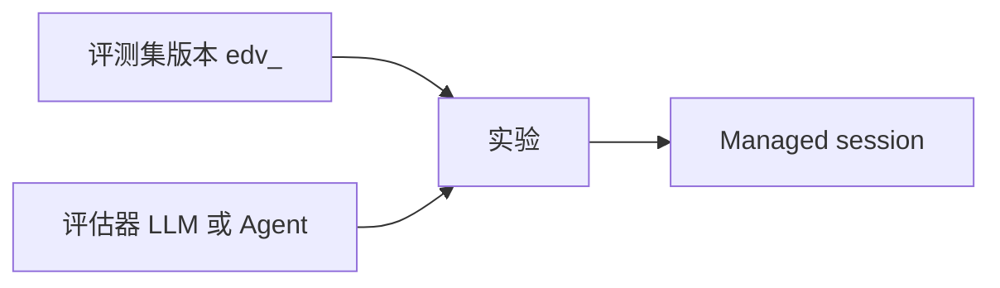

# QCA Evaluation 对齐计划

- 状态：M1 评测集、M2 自定义评估器、M3 实验与 Compare、Session 终态收口、LLM 打分、Agent 打分 Session、预置目录、timeout/env 注入、Compare 分数列，以及打分 Agent 版本冻结已实现。今日额度不在范围内。
- 剩余缺口：没有真实 E2B 端到端。契约路径对应 sandbox 的 `/mnt/session/uploads/data/session/result.json` 与 `/mnt/session/outputs/score.json`，容器里没有字面的 `/data` 与 `/output`。没有 OpenAPI。
- 日期：2026-10-22
- 来源：qoder.com.cn 企业控制台，分析 → 评测（Beta）。下文只采用这次实测看到的信息架构和字段，不补写未出现的产品文案。没有 QCA 目录导出，所以预置内容是标明 OMA demo 的示例，不是 QCA 原文。
- 非目标：不改 Workbench Evaluate 的请求、表格或测试预期。不实现今日额度、额度计数或额度 UI。不复制 QCA 预置 case 或评估器正文。

Workbench Evaluate 仍是 prompt revision 上的变量行 A/B。QCA 评测不是这个表格，也没有一等的 Runs、Outcome 或 Results 页面；那些路径在实测里是空壳。

## 当前实现（只依据仓库）

Workbench Evaluate 是 Console 路由，不在 `openapi/oma.en.json` / `openapi/oma.zh.json`。

| 层 | 位置 | 今天做什么 |
| --- | --- | --- |
| 路由 | `internal/workbench/workbench_handler.go`，挂在 `/api/organizations/{orgUuid}` | revision 下列表/创建 evaluation；按 evaluation 更新变量、golden answer、completion、rating；删除；流式生成 test case |
| 持久化 | `workbench_evaluations`，`internal/db/workbench_evaluation_mapper.go` | 一行 evaluation 属于一个 prompt revision。`00044` 之后查询用 `organization_uuid` + `revision_ref_uuid`。payload 是 JSON，不是独立 case/run 表 |
| 生成队列 | `workbench_generated_test_cases` | 组织级一次性队列。更新变量时 `TakeWorkbenchGeneratedTestCase` 取走匹配项，不是可复用数据集 |
| 前端 | `web/src/features/workbench/evaluate.tsx`、`model.ts`、`api.ts`、`WorkbenchPage.tsx` | 模式 `prompt \| evaluate`。表格列是变量、当前 revision 输出、可选对比 revision、可选 ideal output |
| 入口条件 | `canEvaluateRevision` | 至少一个 `{{var}}`，且 `tools.length === 0`。带工具的 prompt 不能进入 Evaluate |
| 导航 | `web/src/app/layout/navigation.ts` | `/workbench` 在 Build 组里，当前 `hidden: true` |

一条 evaluation 的 payload 字段是：`id`、`revision_id`、`test_case_id`、`variable_values`、`golden_answer`、`completion`、`completion_text`、`rating`、`created_at`。`test_case_id` 默认等于 evaluation id，没有跨 revision 的 case 身份。

运行行为：

- 「Run」对当前 prompt revision 做变量替换，再调用已有的 `POST .../workbench/completions`。主列输出会 `save_completion`。
- Add Comparison 只在浏览器状态里保存另一份 prompt revision 的输出，不写库，刷新即丢失。
- `rating` 路由和行模型存在，`EvaluateView` 没有评分控件，Console client 也没有 `update_rating` 调用。
- CSV 导入/导出在浏览器完成，列是 `{{variable}}` 和 `ideal_output`，然后逐行 `evaluations/create`。导入会替换当前表格，不保留数据集版本。
- 未保存的 prompt 修改会使表格只读，提示先存成新 revision。

OMA 里已经存在、但实测评测页没有当成一等对象的能力：

- Agent 版本：`agents.current_version` 与 `agent_versions`。Session 创建时钉住 `agent_version` 和 `agent_snapshot`。
- 任务状态与轨迹：`session_events` 已分类 `session.status_*`、`agent.tool_use` / `agent.tool_result`、`span.model_request_start` / `span.model_request_end`。
- Deployment outcome：`user.define_outcome` 与 `span.outcome_evaluation_*` 服务单次 session。实测评测的打分入口是评估器，不是这套 outcome 页。
- Trace 查询：`observability.enabled` 时才注册 observability traces。
- Memory：`memory_stores` 可挂到 session。实测评测信息架构没有 memory pin。

## 实测信息架构

评测在「分析 → 评测」下，三个页签加今日额度：

| 页签 | 控制台路径 | 实测内容 |
| --- | --- | --- |
| 评测集 | `/cloud/evaluation`、`/evaluation/datasets` | 自定义集可空。另有已发布预置集，带版本（`edv_`）、case 数、状态 可用 / 已归档 |
| 评估器 | `/evaluators` | 自定义可空。另有预置评估器，类型为 Agent。创建支持 LLM 与 Agent |
| 实验 | `/experiments`、`/experiments/new`、`/experiments/compare` | 绑定数据集版本、Agent 与多个评估器。Compare 固定数据集版本和评估器，更换 Agent 版本 |

没有一等的 Runs、Outcome 或 Results 页面。

评测集：

- 创建时填写 name、desc。上传 JSONL 或 ZIP（不超过 100MB、不超过 1000 条），或复用已发布版本里的 case。
- Case 字段：`name` 必填，`turns` 为必填的字符串数组，另有 `desc`、`checkpoints`、`input_files`、`reference_files`。`reference_files` 只给评估器使用。
- 预置集详情是版本列表、case 列表和 case JSON 快照，只读。

评估器：

- LLM：单个模型打分。
- Agent：在打分 Agent 的 sandbox session 里读 `/data/session/result.json` 和 artifacts，写出 `/output/score.json`，形状为 `{score, explanation, details}`。
- 变量：`input`、`output`、`checkpoints`、`agent_trajectory`、`invocation_result`。
- 今日额度：实测里预置 100，自定义 LLM 100，按 Asia/Shanghai 零点重置。Agent 评估器不在额度弹层里。OMA 不实现这项，也不做计数器或额度 UI。

实验：

- 绑定数据集版本、Agent（加 Environment、timeout、可选 env/resources）和多个评估器。评估器在实验上冻结。
- 每个 case 创建一个 Managed session。
- Compare 固定数据集版本和评估器，变化的是 Agent 及其版本。
- 名称在同一个 space 内还要按模式唯一：Managed Agents 与 Forward Mode 分开。

## 能力矩阵

| QCA feature | OMA today | gap | proposed approach | priority |
| --- | --- | --- | --- | --- |
| 评测集：创建、导入、列出，带版本和 case | M1 可创建、导入、列出 workspace 评测集。创建时可以复用已发布预置版本的 case | 预置正文不是 QCA 原文 | M1：`evaluation_datasets`、`evaluation_dataset_versions`、`evaluation_cases`。创建集时写入版本 1。JSONL/ZIP 导入。不迁移 `workbench_evaluations` | P0，本切片 |
| 评估器 | M2 可创建、列出、读取自定义评估器。LLM 保存单个 model 和 prompt。Agent 保存打分 Agent id。case `end_turn` 后 LLM 评估器会打分并落库。Agent 评估器会另开打分 Session，读 score 文件后落库。可以从已发布预置版本复制出自定义评估器 | 今日额度不实现。预置 Agent 的 `agent_id` 是占位符。OMA 没有 `/data` 和 `/output` 挂载，结果文件和分数文件落在 uploads/outputs。打分 Agent 的版本在实验创建时冻结，不跟随后续当前版本 | M2：`evaluation_evaluators` 与版本 1。变量只用 `input`、`output`、`checkpoints`、`agent_trajectory`、`invocation_result`。LLM 打分复用已有 provider。Agent 打分复用已有 Session 创建和 Filestore | P0，本切片 |
| 实验 | M3 可创建、列出、读取实验。创建时冻结数据集版本、被测 Agent 版本、环境和评估器版本，并为每个 case 调用已有 Session 创建。Session 终态事件把 item 收成 completed 或 failed。`end_turn` 后为每个冻结评估器写入 `evalscore_`。Agent 评估器的 score 在打分 Session 终态之后写入 | timeout 与 env 进入 case Session 和打分 Session，再由已有 sandbox 创建读取 | M3：`evaluation_experiments` 与 case item。Session id 记在 item 上。`publishSessionEvents` 上的观察者读取已持久化的 `session.status_idle` / `session.status_terminated`，再写 score | P0，本切片 |
| Compare | M3 按数据集版本和冻结评估器版本列出 status 为 completed 的实验，响应带 `scores`。对比页按评估器列出分数，失败显示错误，没有分数显示缺失 | 只有全部 item 都 completed 的实验会出现 | 固定数据集版本和评估器，变化的是 Agent 版本。名称在组织和工作区下唯一 | P0，本切片 |
| 预置评测集 / 预置评估器 | 只读目录：19 个 OMA demo 评测集、11 个 OMA demo 评估器。评测集页和评估器页用 Custom / Presets 分开。创建自定义资源时可以复用已发布版本 | 数量对齐实测目录规模，正文不是 QCA 原文。目录编译在服务里，不是按 workspace 存的行，也不能在 API 里改。已归档预置可以浏览，不能复用 | 不建新表。`evaluation-dataset-presets` 与 `evaluation-evaluator-presets` 返回目录。`source_version_id` 把已发布版本复制进 workspace 的自定义评测集或评估器 | P0，本切片 |
| 今日额度 | 无评测额度 | QCA 有预置 100、自定义 LLM 100、上海时区零点和 Agent 评估器不计入 | 不实现。不记账，不做额度 UI 或计数器，也不放进后续里程碑 | 不做 |
| Session trace | Session 事件和详情已覆盖模型、工具和任务状态 | 实验不另存 trace | M3 的 item 保存 session id，详情链到现有 Session 页。不新写 trace 存储 | P1 |
| Memory pin | Memory 版本存在 | 实测评测页没有这项 | 不纳入当前里程碑 | 不做 |

## 为什么不改现有 Evaluate 表格

Workbench Evaluate 继续做 prompt 变量实验。评测集的 case 是 `turns`，不是 `{{var}}` 行。入口还拒绝 tools。因此保留 `web/src/features/workbench/` 与 `internal/workbench/`。评测集、评估器和实验放在 Managed Agents，不放进隐藏的 `/workbench`。

## 数据模型

`00095_evaluation_datasets.sql` 在写入前已按实测字段校正，不另起已应用 migration。不改 `internal/db/schema.go`，不建外键。租户条件同时带 `organization_uuid` 和 `workspace_uuid`。

`evaluation_datasets`

- `external_id` 前缀 `evalds_`
- `name` 1–255 字符，`description` 最长 1024，API 字段名是 `desc`
- `archived_at` 为空时状态为 `available`，否则为 `archived`。M1 不提供归档接口，列先留着
- 列表不返回已归档行

`evaluation_dataset_versions`

- `external_id` 前缀 `edv_`
- `dataset_uuid` 加 `version` 唯一，`version` 从 1 开始
- M1 创建评测集时在同一事务写入版本 1。带 `source_version_id` 时，同一事务把已发布预置版本的 case 复制进来，并生成新的 `evalcase_` id

`evaluation_cases`

- `external_id` 前缀 `evalcase_`
- 属于 `dataset_uuid` 和 `version_uuid`。`(version_uuid, position)` 唯一
- `name` 必填。`description` 对应 API 的 `desc`
- `turns` jsonb，必须是数组，且至少一条非空字符串
- `checkpoints` 可空，只接受 JSON 数组或对象，不解释内部字段
- `input_files`、`reference_files` 可空，只接受 JSON 数组，不解释元素。`reference_files` 留到评估器使用

`00096_evaluation_evaluators.sql` 增加自定义评估器。不建实验表或 memory pin 表。预置评估器不写进这张表。

`evaluation_evaluators`

- `external_id` 前缀 `evalev_`
- `name` 1–255 字符，`description` 最长 1024，API 字段名是 `desc`
- `archived_at` 为空时状态为 `available`，否则为 `archived`。M2 不提供归档接口
- 列表不返回已归档行

`evaluation_evaluator_versions`

- `external_id` 前缀 `eev_`
- `evaluator_uuid` 加 `version` 唯一，`version` 从 1 开始
- M2 创建评估器时在同一事务写入版本 1。实验以后冻结的是这个版本，本切片不另存新版本
- `evaluator_type` 为 `llm` 或 `agent`
- LLM：`model` 必填，最长 255；`prompt_template` 必填，最长 16000。`agent_id` 必须为空
- Agent：`agent_id` 必填，最长 255。`model` 与 `prompt_template` 必须为空。M2 只保存 id，不检查 Agent 是否存在，也不创建 sandbox session
- `variables` 是 JSON 数组，元素只能是 `input`、`output`、`checkpoints`、`agent_trajectory`、`invocation_result`。LLM 至少选一个。prompt 里的 `{{name}}` 必须落在已选变量里
- Agent 响应带固定契约：读 `/data/session/result.json` 和 artifacts，写 `/output/score.json`，字段为 `score`、`explanation`、`details`。这些路径不入库

`00097_evaluation_experiments.sql` 增加实验。不建外键，不写入预置数据，不记账。

`evaluation_experiments`

- `external_id` 前缀 `evalexp_`
- `name` 在 `(organization_uuid, workspace_uuid)` 下唯一。QCA 还按 Managed Agents / Forward Mode 分开；OMA 没有这第二种模式，所以不另加 mode 列
- 绑定 `version_external_id`、`agent_external_id`、`agent_version`、`environment_external_id`
- `timeout_seconds` 为 1–86400。`env` 可空，必须是 JSON 对象。`resources` 可空，必须是 JSON 数组
- `evaluator_set_key` 是冻结评估器版本 id 排序后用 `|` 连接。Compare 用它和数据集版本定位同一组实验
- `status` 为 `pending`、`running`、`completed`、`failed`、`cancelled`。创建后是 pending；Session 创建成功变为 running，创建失败变为 failed。Session 终态事件再把仍为 running 的 item 收成 completed 或 failed。没有取消接口

`evaluation_experiment_evaluators`

- `external_id` 前缀 `evalbind_`
- 创建时复制评估器当前版本。一次实验最多 20 个，且不能重复
- `(experiment_uuid, position)` 与 `(experiment_uuid, evaluator_uuid)` 唯一

`evaluation_experiment_items`

- `external_id` 前缀 `evalitem_`
- 每个 case 一行，`session_external_id` 在 Session 创建成功后写入
- 状态与实验相同。`error_message` 最长 1024。case 的 `turns` 超过 Session `initial_events` 的 50 条上限时，这一行失败，不另写执行引擎

`00098_evaluation_experiment_item_session_idx.sql` 为 `(organization_uuid, workspace_uuid, session_external_id)` 加索引，供终态事件按 Session 找到仍在 running 的 item。

Session 完成：`sessions.Handler.publishSessionEvents` 在 SSE fanout 之后调用评估观察者。这条路径和 webhook 一样，只看已经写入的 Session 事件，不另起执行器。

- `session.status_idle` 且 `stop_reason.type` 为 `end_turn`：item 变为 completed
- `session.status_idle` 且 `stop_reason.type` 为 `retries_exhausted`：item 变为 failed，错误文案为 `Session retries exhausted`
- `session.status_terminated` 与 `session.deleted`：item 变为 failed，错误文案为 `Session terminated`
- `requires_action` 和其他非终态事件保持 running
- 同一批事件里，failed 不会被后面的 end_turn 盖掉。item 离开 running 之后不再改写

实验汇总：还有 running 则为 running；否则还有 pending 则为 pending；否则有 failed 则为 failed；全部 completed 才是 completed。Compare 因此要等每个 case session 都以 `end_turn` 结束。

创建 Session 时 item 还没写成 running，所以创建当下的初始事件不会把实验提前收口。

`00099_evaluation_experiment_scores.sql` 增加 `evaluation_experiment_scores`（`evalscore_`）。一行对应一个 item 和一个冻结评估器版本，`(item_uuid, version_uuid)` 唯一。`status` 为 `completed` 或 `failed`。`completed` 必须有 `score`。`explanation` 最长 4000，`error_message` 最长 1024，`details` 可空或为 JSON 对象。

打分发生在 item 因 `end_turn` 变成 completed 之后，并且只跑这一次。打分失败只把该 score 行标成 failed，不改 case item 的 completed，也不改实验的 completed。

- LLM：用冻结版本的 `model` 和 `prompt_template`。变量从 case 与已持久化的 Session 事件填充：`input` 用用户消息，没有则用 case turns；`output` 用 agent 消息；`checkpoints` 用 case JSON；`agent_trajectory` 拼用户、agent 和工具事件；`invocation_result` 用最后一条 `agent.tool_result` 文本，没有工具结果时用最后一次 idle 的 `stop_reason.type`。请求走现有 LLM provider 解析和 `/v1/messages` 或 `/v1/chat/completions`。模型需返回 `{score, explanation, details}`。
- Agent：case item 因 `end_turn` 变成 completed 之后，为这个冻结评估器版本启动一个打分 Session。打分 Agent 用评估器版本上的 `agent_id`。版本在实验创建时冻结：和被测 Agent 一样，当时解析该 Agent 的当前版本，写到 `evaluation_experiment_evaluators.agent_version`。之后打分 Session 用这个数字调用已有的 Agent 版本读取，不用后来的当前版本。Agent 在创建实验时不存在或已归档，实验创建失败，和被测 Agent 相同。LLM 绑定的这一列为空。`00100` 之前已创建、该列为空的实验，打分时仍读取当时的当前版本。Environment、timeout 和 env 复用实验上的值。resources 只交给 case Session，不交给打分 Session。打分 Session 的 metadata 带 `evaluation_role=agent_score`、`experiment_id`、`item_id`、`evaluator_version_id`，以及 `timeout_seconds` 和有值时的 `env`，所以它的终态不会被当成另一个 case item。
- 同一个 case `end_turn` 只启动一次。item 已经离开 running，或 `(item_uuid, version_uuid)` 已经有 score 行时，不再启动，也不再写第二行。
- case 结果写成 JSON：`session_id`、`input`、`output`、`checkpoints`、`agent_trajectory`、`invocation_result`，以及 `artifacts.input_files` 和 `artifacts.reference_files`。这份 JSON 放进打分 Session 的第一条用户消息。Filestore 再把它写到 `/uploads/data/session/result.json`。Sandbox 挂载点是 `/mnt/session/uploads/data/session/result.json`。评估器 API 契约里的 `/data/session/result.json` 仍是对外路径名；OMA 只挂载五个固定根，不能把文件放到容器里的 `/data/session/result.json`。写文件失败只记日志，打分 Session 仍然启动，用户消息里仍有这份 JSON。
- 打分 Session 以 `end_turn` 结束时，读取 `/outputs/score.json`。Sandbox 里对应 `/mnt/session/outputs/score.json`。契约路径 `/output/score.json` 对应该输出根。文件内容须是 `{score, explanation, details}`。解析成功则 score 行为 completed。文件缺失时错误文案是 `Evaluation score file is missing`。内容无法解析时错误文案是 `Could not parse evaluator score`。打分 Session 被终止或 `retries_exhausted` 时，score 行用和 case 相同的终态文案标为 failed。
- 打分 Session 还没结束时，实验可以已经是 completed，但这条 Agent score 还不存在。score 行只在打分 Session 进入终态后写入。没有配置 sandbox 时，score 行仍是 failed，文案是 `Agent evaluator scoring is not executed`。生产组装会接上 sandbox。
- Agent 不存在时 score 行失败，文案是 `Agent not found`。已归档 Agent 的文案是 `agent must not be archived`。启动 Session 失败的文案是 `Could not score evaluation`。这些都只写 score 行。

列表、读取和 Compare 都返回 `scores`。读取仍带 item。打分失败时 item 的 `status` 仍是 completed。

timeout 和 env 从实验写进 case Session 和打分 Session 的 metadata。Session 创建把它们复制到 Environment Work metadata。已有 sandbox 创建读取这份 metadata：`timeout_seconds` 覆盖 E2B sandbox 的创建超时和后续续期，`env` 并入 sandbox 环境变量，同时写入 Managed Agent session config 的 `environment_variables`，由已有的 environment-manager 启动载荷合并。平台已经放进 resolution 的环境变量名不会被实验 env 覆盖。省略 env 时不写这个字段，Session 仍能创建。resources 会交给 case Session，不交给打分 Session。没有在真实 E2B/FUSE sandbox 里跑通打分 Agent。这些都不属于今日额度。

## API

Console cookie + CSRF 组，与 MCP servers 相同。错误体是 `{error, message}`。成功响应状态码 200。

M1：

- `GET/POST /api/console/organizations/{orgUuid}/workspaces/{workspaceId}/evaluation-datasets`
- `GET .../evaluation-datasets/{datasetId}`
- `GET/POST .../evaluation-datasets/{datasetId}/cases`
- `POST .../evaluation-datasets/{datasetId}/cases:import`

路径里的 workspace 可以是 `default`、workspace UUID 或 external id。查询和写入使用 principal 的组织与 workspace UUID。另一 workspace 的 id 返回 404，且不读库。

创建评测集的 body 是 `{name, desc}`，也可以加 `source_version_id`。`source_version_id` 指向已发布预置版本时，复制该版本的 case。响应带 `status` 和 `version: {id, version, case_count}`。已归档预置返回 400，未知 id 返回 404，都不写库。

单条 case 与 JSONL 每行的字段是 `name`、`turns`、`desc`、`checkpoints`、`input_files`、`reference_files`。未知字段拒绝。导入是 JSONL（`application/x-ndjson` 或 `application/jsonl`），或只含一个 `.jsonl` 成员的 ZIP。超过 1000 条或 100MB 返回 400，校验通过前不写入。这与 Workbench 的 `{{var}},ideal_output` CSV 不是同一格式。

M2：

- `GET/POST /api/console/organizations/{orgUuid}/workspaces/{workspaceId}/evaluation-evaluators`
- `GET .../evaluation-evaluators/{evaluatorId}`

创建评估器的 body 是 `{name, desc, evaluator_type, model, agent_id, prompt_template, variables}`。`evaluator_type` 为 `llm` 或 `agent`。也可以只传 `{name, desc, source_version_id}`，从已发布预置版本复制类型、model、prompt、variables 或 agent id。`source_version_id` 不能和这些字段同时出现。响应带 `status` 和 `version`。Agent 版本额外带 `agent_contract`。

M2 不做 PATCH、DELETE、归档和 OpenAPI。自定义评估器的打分在 case `end_turn` 之后执行。不实现今日额度。

预置目录：

- `GET .../evaluation-dataset-presets`
- `GET .../evaluation-dataset-presets/{presetId}`
- `GET .../evaluation-dataset-presets/{presetId}/cases?version_id=`
- `GET .../evaluation-evaluator-presets`
- `GET .../evaluation-evaluator-presets/{presetId}`

目录不按 workspace 存行。请求仍要过 Console 的组织和 workspace 校验，另一 workspace 返回 404。列表一次返回全部，`next_page` 为 null。评测集预置响应类型是 `evaluation_dataset_preset`，带 `versions`。评估器预置响应类型是 `evaluation_evaluator_preset`。

种子是编译进 `internal/evaluations/presets.go` 的 OMA demo，不是 migration，也不是 QCA 导出。19 个评测集里 18 个可用、1 个已归档；`evalds_oma_demo_03` 有 v1 和 v2。11 个评估器里 4 个 LLM、6 个可用 Agent、1 个已归档 Agent。LLM 的 model 是 `oma-demo`。Agent 的 `agent_id` 是 `agent_oma_demo_XX` 占位符，不对应已创建的 Agent。case 文案都标明 OMA demo，并要求回复 ready。

M3：

- `GET/POST /api/console/organizations/{orgUuid}/workspaces/{workspaceId}/evaluation-experiments`
- `GET .../evaluation-experiments/{experimentId}`
- `POST .../evaluation-experiments/{experimentId}:start`
- `POST .../evaluation-experiments:compare`

创建 body 是 `{name, desc, dataset_version_id, agent_id, agent_version, environment_id, timeout_seconds, env, resources, evaluator_ids}`。`agent_version`、`env`、`resources` 可省略。省略 `agent_version` 时使用 Agent 当前版本，并把它写进实验。Agent 或 Environment 不存在返回 404，已归档返回 400。数据集版本没有 case 时不创建实验。

列表不返回 item，但返回已有的 `scores`。读取返回冻结的评估器、每个 case 的 session id，以及 `scores`。`:start` 只重试仍为 pending 的 item。Compare 的 body 是 `{dataset_version_id, evaluator_ids}`，只返回 `completed`，并带上 `scores`。没有完成实验时 `data` 为空数组，不是 404。Session 以 `end_turn` 结束后，对应实验可以变成 `completed` 并出现在 Compare 里。

M3 不做取消和 OpenAPI。不实现今日额度。LLM 或 Agent 打分失败都不把实验从 completed 改回 failed。

## UI

Managed Agents 导航在 Sessions 与 Observability 之间增加 Datasets。OMA 没有「分析」分组，所以不把评测放进用量分析。

- `/workspaces/$workspaceId/evaluations`：Custom 与 Presets 两个页签。Custom 仍是评测集列表和创建（name、desc）。Presets 列出已发布目录，Reuse 打开已发布版本的 case，并以 `source_version_id` 复制成自定义评测集
- `/workspaces/$workspaceId/evaluations/datasets/$datasetId`：当前版本、case 列表、单条 case、JSONL 导入
- `/workspaces/$workspaceId/evaluations/evaluators`：Custom 与 Presets 两个页签。Custom 仍在 LLM 与 Agent 之间切换。Presets 列出已发布评估器，Create from preset 复制已发布版本

Managed Agents 导航在 Evaluators 旁增加 Experiments。

- `/workspaces/$workspaceId/evaluations/experiments`：实验列表
- `/workspaces/$workspaceId/evaluations/experiments/new`：绑定数据集版本、Agent、Environment、timeout 和评估器
- `/workspaces/$workspaceId/evaluations/experiments/compare`：固定数据集版本和评估器。没有 completed 实验时显示 “No completed experiments.” / “还没有已完成的实验。”。有结果时，每个评估器一列：完成显示分数，失败显示错误，没有分数显示 “Missing” / “缺失”
- `/workspaces/$workspaceId/evaluations/experiments/$experimentId`：item、session id，以及重试 pending item

Workbench 的 prompt/evaluate 开关保持原样。

## 里程碑

1. **M0**：差距说明。
2. **M1**：评测集、版本 1 和 case 的 migration、Yourbatis、创建 / 导入 / 列出，以及 Datasets 页面。无 session，不改 Workbench Evaluate。
3. **M2**：自定义评估器。LLM 与 Agent 两种类型，创建时写入版本 1。变量只用 `input`、`output`、`checkpoints`、`agent_trajectory`、`invocation_result`。
4. **M3**：实验与 Compare。绑定数据集版本、Agent、Environment、timeout 和冻结的评估器版本；每个 case 复用已有 Session 创建并记下 session id。已有 Session 终态事件把 item 收成 completed 或 failed，并汇总实验状态。`end_turn` 后对冻结的 LLM 评估器打分并写入 `evalscore_`。Compare 固定数据集版本和评估器，只列出 completed，并按评估器展示分数。名称在组织和工作区下唯一。timeout/env 经已有 Session metadata 和 sandbox 创建注入。
5. **预置目录**：只读的已发布评测集和评估器，以及从已发布版本复制 case 或评估器定义。内容是 19 个评测集和 11 个评估器的 OMA demo，不是 QCA 原文。
6. **Agent 打分 sandbox（本变更）**：case `end_turn` 后为 Agent 评估器启动打分 Session，把 case 结果交给打分 Agent，并在打分 Session 终态读取 `/outputs/score.json`。

今日额度不在里程碑里。不实现每日 100 次、上海时区重置、Agent 评估器是否计入，也不做额度 UI 或计数器。

预置 Agent 的 id 和 LLM 的 `oma-demo` model 都没有对应的已配置资源。打分 Agent 的版本冻结在实验绑定上，不写进评估器版本。契约路径映射到 sandbox 的 `/mnt/session/uploads/data/session/result.json` 和 `/mnt/session/outputs/score.json`。这些都不属于额度。

## 未排期

不把今日额度排进后续切片。不改 Workbench。预置目录已做只读浏览和复用；还没有 QCA 原文、目录编辑、或把预置 id 直接绑到实验上。

## 验收与未覆盖

同一 workspace 可以创建评测集（同时得到 `edv_` 版本 1）、用 JSONL 或单成员 ZIP 导入 case，并列出 case。空 name、空 turns、超过 1000 条、错误 ZIP 和另一 workspace 的 id 在写库前失败。归档行不出现在列表里。

预置目录列出 19 个评测集和 11 个评估器。`evalds_oma_demo_03` 的 v2 有两条 case。复用 `edv_oma_demo_03_v2` 会在同一事务写入自定义评测集和两条新 case。已归档预置和未知 id 不写库。`eev_oma_demo_01_v1` 复制出 LLM 评估器，model 为 `oma-demo`。`source_version_id` 和 model 同时出现会失败。另一 workspace 读不到目录。

同一 workspace 可以创建 LLM 评估器（model、prompt、已选变量，版本 `eev_`）和 Agent 评估器（agent id，响应带 score.json 契约），并列出、读取。错误类型、未选变量、Agent 带 prompt，以及另一 workspace 的 id，在写库前失败。

同一 workspace 可以创建实验：冻结 `edv_` 与评估器版本，item 先为 pending；接上 Session starter 后每个 case 得到 `sesn_`，实验变为 running。创建 body 带 `timeout_seconds` 和 `env` 时，starter 收到这两个值；省略 `env` 时 Session 仍会创建。Agent 评估器在创建时把打分 Agent 的当前版本写进绑定。之后即使该 Agent 的当前版本变了，打分 Session 仍使用冻结版本。打分 Agent 不存在时实验创建失败，不写库。Starter 失败时 item 为 failed。`requires_action` 保持 running。`end_turn` 把 item 和实验收成 completed。LLM 评估器把模型返回的 `score`、`explanation`、`details` 记为 completed。Agent 评估器用冻结的 `agent_id` 启动打分 Session，并把 case 结果放进用户消息和 `/uploads/data/session/result.json`。打分 Session 的 `end_turn` 读取 `/outputs/score.json`，形状为 `{score, explanation, details}`，score 行为 completed。文件缺失时 score 为 failed，文案是 `Evaluation score file is missing`。无法解析时文案是 `Could not parse evaluator score`。没有配置 sandbox 时文案仍是 `Agent evaluator scoring is not executed`。这些失败都不改变 item 或实验的 completed。已经离开 running 的 item 不会被后到的终态改写，也不会再次打分；已有 score 行不会再写一行。`retries_exhausted` 或 `session.status_terminated` 把 case item 收成 failed，且不打分。打分 Session 自己的终止只让对应 score 行失败。列表不返回 item，但返回 scores。Compare 在没有 completed 实验时返回空列表。空 name、重复评估器、非法 timeout、没有 case、已归档 Environment、重名和另一 workspace 的 id 会失败。

Postgres 迁移测试在设置 `TEST_MIGRATION_DATABASE_URL` 时覆盖到 `00100`。默认 `just test` 不连接外部数据库；未设置该变量时，不能把 `00097`、`00098`、`00099` 或 `00100` 说成已经在真实 Postgres 上应用过。
